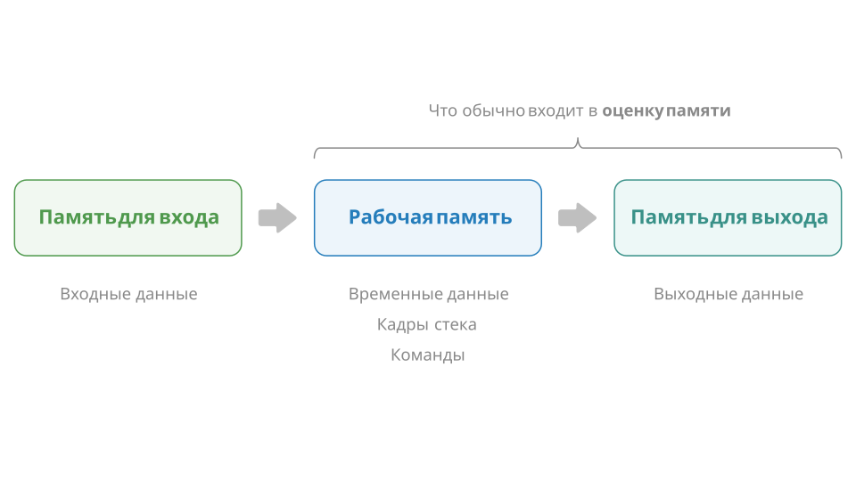
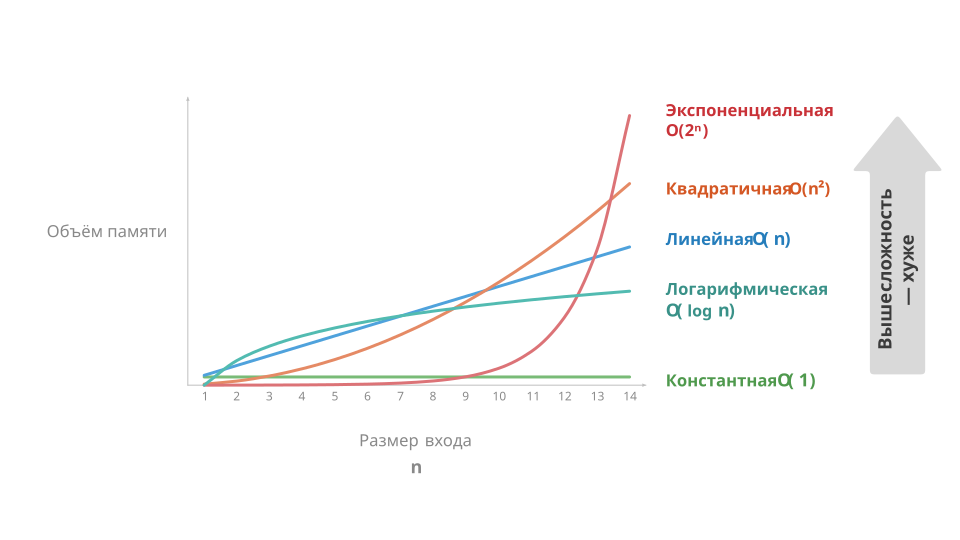
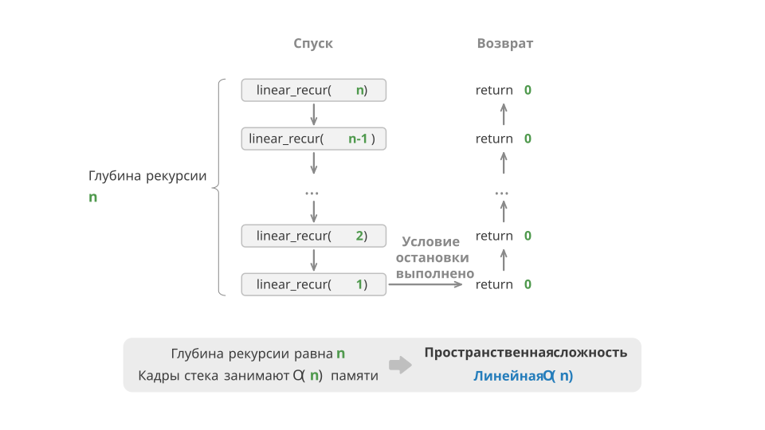
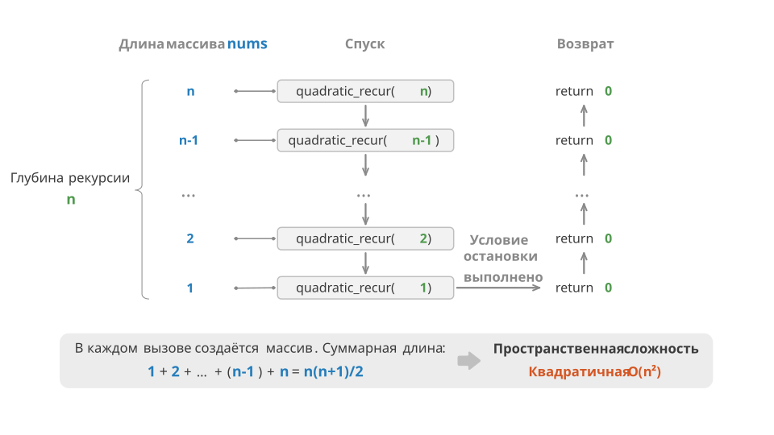

# Пространственная сложность

<u>Пространственная сложность (space complexity)</u> описывает, как растёт объём памяти, занимаемой алгоритмом, при увеличении объёма данных. Это понятие очень похоже на временную сложность: достаточно заменить «время работы» на «расход памяти».

## Какая память нужна алгоритму

При выполнении алгоритма память используется для нескольких целей.

- **Память для входа** хранит входные данные алгоритма.
- **Рабочая память** нужна для переменных, объектов, состояния вызванных функций и других данных, используемых при вычислениях.
- **Память для выхода** хранит выходные данные алгоритма.

Как правило, при оценке пространственной сложности учитывают рабочую память и память для выхода.

Рабочую память, в свою очередь, можно разделить на три части.

- **Временные данные** — это константы, переменные, объекты и другие данные, с которыми работает алгоритм.
- **Кадры стека** хранят состояние вызовов функций. При каждом вызове система создаёт кадр на вершине стека, а после возврата освобождает занимаемую им память.
- **Память для команд** хранит инструкции скомпилированной программы. На практике её обычно не учитывают.

Итак, при анализе пространственной сложности программы **мы обычно учитываем временные данные, кадры стека и выходные данные**, как показано на рисунке.



Рассмотрим соответствующий пример кода:

```snippet
space_categories
```

## Как оценить пространственную сложность

Оценка пространственной сложности во многом похожа на оценку временной. Только вместо числа операций мы подсчитываем объём занимаемой памяти.

В отличие от анализа времени, здесь **нас обычно интересует лишь пространственная сложность в худшем случае**. Память накладывает жёсткое ограничение: её должно хватить при любых допустимых входных данных.

В следующем примере у слова «худший» есть два смысла.

1. **Выбираем наихудший вход**. При $n < 10$ пространственная сложность равна $O(1)$. Однако при $n > 10$ создаётся массив `nums`, который занимает $O(n)$ памяти. Таким образом, сложность в худшем случае равна $O(n)$.
2. **Берём пиковый расход памяти за время работы**. Например, до выполнения последней строки программа занимает $O(1)$ памяти. При создании массива `nums` расход возрастает до $O(n)$, поэтому сложность в худшем случае равна $O(n)$.

```snippet
worst_case_space
```

**В рекурсивных функциях важно учитывать память для кадров стека**. Рассмотрим код:

```snippet
loop_vs_recursion_space
```

Временная сложность функций `loop()` и `recur()` одинакова и равна $O(n)$, но расход памяти различается.

- Функция `loop()` в цикле вызывает `function()` ровно $n$ раз. На каждой итерации `function()` успевает вернуть управление, а её кадр освобождается, поэтому пространственная сложность остаётся равной $O(1)$.
- При выполнении рекурсивной функции `recur()` одновременно активны $n$ вызовов `recur()`, поэтому кадры стека занимают $O(n)$ памяти.

## Основные классы сложности

Пусть размер входных данных равен $n$. На рисунке показаны распространённые классы пространственной сложности в порядке возрастания.

$$
\begin{aligned}
& O(1) < O(\log n) < O(n) < O(n^2) < O(2^n) \newline
& \text{константная} < \text{логарифмическая} < \text{линейная} < \text{квадратичная} < \text{экспоненциальная}
\end{aligned}
$$



### Константная сложность $O(1)$

Константная сложность характерна для набора констант, переменных и объектов, число которых не зависит от размера входа $n$.

Обратите внимание: в следующем примере память, выделенная под переменные или вызовы функций внутри цикла, к следующей итерации освобождается. Расход не накапливается, и пространственная сложность остаётся равной $O(1)$:

```src
[file]{space_complexity}-[class]{}-[func]{constant}
```

### Линейная сложность $O(n)$

Линейная сложность характерна для массивов, связных списков, стеков и очередей, если число их элементов пропорционально $n$:

```src
[file]{space_complexity}-[class]{}-[func]{linear}
```

На рисунке глубина рекурсии функции равна $n$. Это означает, что одновременно активны $n$ вызовов `linear_recur()`, а их кадры занимают $O(n)$ памяти:

```src
[file]{space_complexity}-[class]{}-[func]{linear_recur}
```



### Квадратичная сложность $O(n^2)$

Квадратичная сложность встречается у матриц и графов, в которых число хранимых элементов пропорционально квадрату $n$:

```src
[file]{space_complexity}-[class]{}-[func]{quadratic}
```

На рисунке показаны $n$ уровней рекурсии с выделением памяти. На каждом создаётся массив, причём длины массивов равны $n$, $n-1$, $\dots$, $2$ и $1$. Средняя длина составляет примерно $n / 2$, поэтому общие затраты памяти равны $O(n^2)$:

```src
[file]{space_complexity}-[class]{}-[func]{quadratic_recur}
```



### Экспоненциальная сложность $O(2^n)$

Экспоненциальная сложность встречается у двоичных деревьев. Например, в совершенном двоичном дереве из $n$ уровней на рисунке ровно $2^n - 1$ узлов. Они занимают $O(2^n)$ памяти:

```src
[file]{space_complexity}-[class]{}-[func]{build_tree}
```


### Логарифмическая сложность $O(\log n)$

Логарифмическая сложность встречается в алгоритмах «разделяй и властвуй». Например, при сортировке слиянием на вход подаётся массив длины $n$. На каждом шаге рекурсии массив делится посередине на две части. Получается дерево рекурсии высоты $\log n$, и для кадров стека нужно $O(\log n)$ памяти.

Другой пример — преобразование числа в строку. У положительного целого числа $n$ количество десятичных цифр равно $\lfloor \log_{10} n \rfloor + 1$. Длина соответствующей строки равна $\lfloor \log_{10} n \rfloor + 1$, поэтому пространственная сложность составляет $O(\log_{10} n + 1) = O(\log n)$.

## Компромисс между временем и памятью

В идеале хотелось бы добиться оптимальной сложности и по времени, и по памяти. Однако на практике одновременно оптимизировать оба показателя обычно очень трудно.

**Уменьшение временной сложности часто достигается ценой увеличения пространственной, и наоборот**. Когда мы расходуем больше памяти, чтобы ускорить алгоритм, мы обмениваем память на время. Если же мы готовы дольше ждать ради экономии памяти, то обмениваем время на память.

Выбор зависит от того, какой ресурс для нас важнее. Чаще время ценнее памяти, поэтому обычно предпочитают потратить больше памяти ради ускорения. Конечно, при очень больших объёмах данных важно также ограничивать расход памяти.
