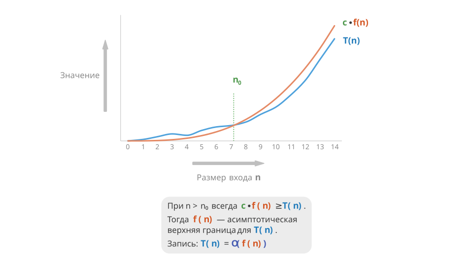
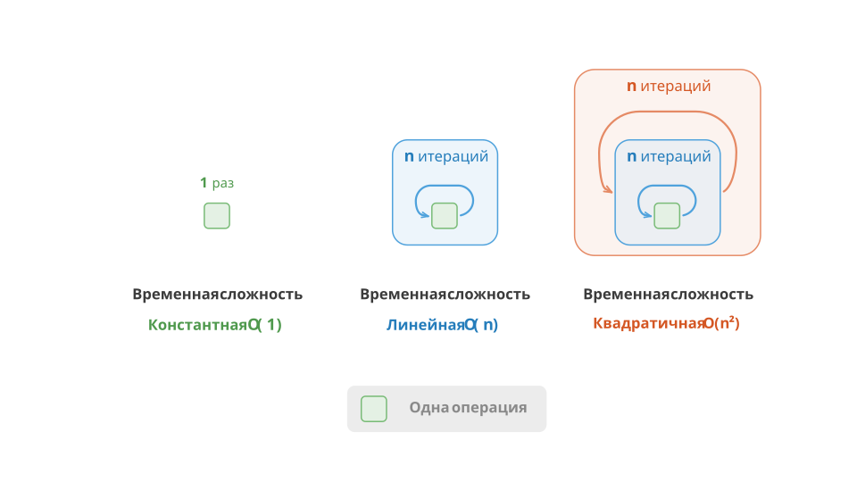
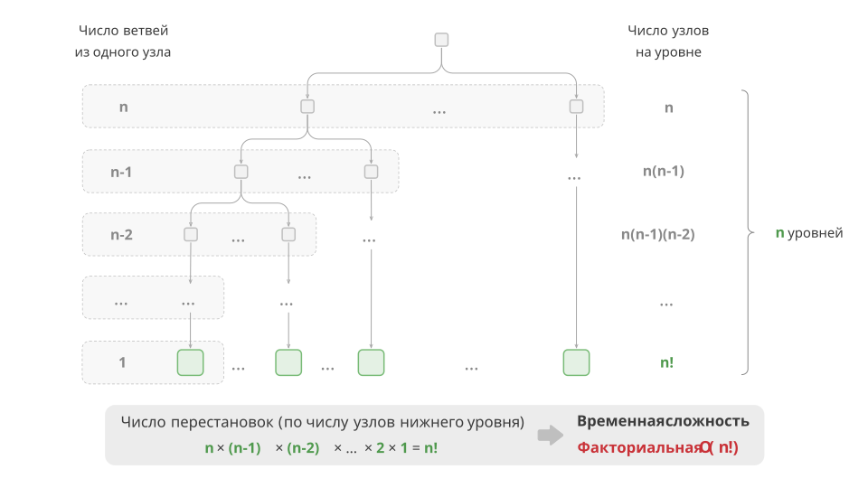

# Временная сложность

Время работы — наглядный и точный показатель эффективности. Как можно было бы заранее вычислить время выполнения фрагмента кода?

1. **Выбрать платформу**: определить конфигурацию оборудования, язык программирования, системное окружение и другие факторы, влияющие на скорость выполнения.
2. **Оценить длительность каждой операции**. Допустим, сложение `+` занимает 1 нс, умножение `*` — 10 нс, а вывод `print()` — 5 нс.
3. **Подсчитать все операции в коде** и сложить время их выполнения. Так мы получим общее время работы.

Например, в следующем коде размер входных данных равен $n$:

```snippet
run_time_estimate
```

Описанный расчёт даёт время работы $(6n + 12)$ нс:

$$
1 + 1 + 10 + (1 + 5) \times n = 6n + 12
$$

Однако на практике **такой расчёт времени и неудобен, и едва ли осуществим**. Во-первых, алгоритм может работать на разных платформах, а мы не хотим привязывать оценку к одной из них. Во-вторых, узнать длительность каждой отдельной операции трудно, что сильно усложняет расчёт.

## Как растёт время работы

При анализе временной сложности мы определяем не само время работы, а **характер его роста с увеличением объёма данных**.

Чтобы лучше понять, что такое характер роста, рассмотрим пример. Пусть размер входа равен $n$ и заданы три алгоритма `A`, `B` и `C`:

```snippet
growth_trend
```

На рисунке показано, как ведёт себя время работы этих трёх алгоритмов.

- Алгоритм `A` выполняет операцию печати всего $1$ раз. Его время работы не растёт с увеличением $n$. Такую временную сложность называют константной.
- В алгоритме `B` печать повторяется в цикле $n$ раз. Время работы растёт линейно с увеличением $n$. Такую временную сложность называют линейной.
- Алгоритм `C` повторяет печать $1000000$ раз. Он работает долго, но его время работы не зависит от размера входа $n$. Поэтому у `C` та же константная сложность, что и у `A`.


Что даёт анализ временной сложности по сравнению с прямым подсчётом времени?

- **Временная сложность помогает оценивать эффективность алгоритмов**. Например, время работы `B` растёт линейно. При $n > 1$ он медленнее алгоритма `A`, а при $n > 1000000$ — медленнее алгоритма `C`. При достаточно большом размере входа $n$ алгоритм с константным временем обязательно окажется быстрее алгоритма с линейным временем. В этом и состоит смысл сравнения по характеру роста.
- **Оценить временную сложность проще**. В рассматриваемой модели платформа и длительности отдельных операций не меняют характера роста. Поэтому можно считать, что каждая элементарная операция занимает одну и ту же условную единицу времени. Вместо сложения длительностей достаточно подсчитать операции, что значительно упрощает оценку.
- **У временной сложности есть и ограничения**. Например, у алгоритмов `A` и `C` одинаковая сложность, хотя время работы сильно различается. И наоборот, у алгоритма `B` сложность выше, чем у `C`, но при малом размере входа $n$ алгоритм `B` заметно быстрее `C`. В таких случаях одной лишь сложности недостаточно для точного сравнения. Тем не менее анализ сложности остаётся одним из наиболее эффективных и распространённых способов оценки алгоритмов.

## Асимптотическая верхняя граница функции

Рассмотрим функцию, у которой размер входных данных равен $n$:

```snippet
asymptotic_upper_bound
```

Обозначим число операций алгоритма в зависимости от размера входа $n$ через $T(n)$. Для приведённой функции получаем:

$$
T(n) = 3 + 2n
$$

Функция $T(n)$ — многочлен первой степени. Время работы растёт линейно, поэтому и временная сложность линейная.

Линейную временную сложность записывают как $O(n)$. Эта запись называется <u>«большое $O$» (big-$O$ notation)</u> и задаёт <u>асимптотическую верхнюю границу (asymptotic upper bound)</u> функции $T(n)$.

По существу, при анализе временной сложности мы определяем асимптотическую верхнюю границу числа операций $T(n)$. У этого понятия есть точное математическое определение.

!!! note "Асимптотическая верхняя граница функции"

    Если существуют положительное вещественное число $c$ и вещественное число $n_0$, такие что для всех $n > n_0$ выполняется $T(n) \leq c \cdot f(n)$, то $f(n)$ задаёт асимптотическую верхнюю границу функции $T(n)$. Это записывают так: $T(n) = O(f(n))$.

На рисунке показано, как подобрать верхнюю оценку. Мы ищем такую функцию $f(n)$, чтобы при стремлении $n$ к бесконечности рост $T(n)$ можно было описать ростом $f(n)$ с точностью до постоянного множителя $c$.



## Как оценить временную сложность

Определение асимптотической верхней границы может показаться непривычно строгим. Если оно пока не вполне понятно, начните с практического способа оценки: математический смысл постепенно прояснится на примерах.

По определению, найдя $f(n)$, получаем временную сложность $O(f(n))$. Как определить асимптотическую верхнюю границу $f(n)$? Сделаем это в два шага: подсчитаем операции и найдём верхнюю оценку.

### Шаг 1. Подсчитаем операции

Можно пройти код сверху вниз и учесть операции в каждой строке. Однако в выражении $c \cdot f(n)$ постоянный множитель $c$ может быть сколь угодно большим. **Поэтому при оценке порядка роста числа операций $T(n)$ можно опускать постоянные коэффициенты и слагаемые**. Отсюда следуют несколько простых приёмов подсчёта.

1. **Опускайте постоянные слагаемые в $T(n)$**. Они не зависят от $n$ и не влияют на порядок временной сложности.
2. **Опускайте постоянные коэффициенты**. Например, и $2n$, и $5n + 1$ итераций можно для такой оценки считать как $n$ итераций: коэффициент при $n$ не влияет на порядок сложности.
3. **При вложенных циклах используйте умножение**. Число операций внешнего цикла умножается на число операций внутреннего за один проход. Для каждого уровня отдельно можно применять приёмы `1.` и `2.`.

Подсчитаем этими приёмами операции в следующей функции:

```snippet
count_operations
```

Ниже показаны результаты до и после упрощения. В обоих случаях получаем временную сложность $O(n^2)$.

$$
\begin{aligned}
T(n) & = 2n(n + 1) + (5n + 1) + 2 & \text{Полный подсчёт (-.-|||)} \newline
& = 2n^2 + 7n + 3 \newline
T(n) & = n^2 + n & \text{Упрощённый подсчёт (o.O)}
\end{aligned}
$$

### Шаг 2. Определим асимптотическую верхнюю границу

**Временную сложность определяет член $T(n)$ с наибольшим порядком роста**. При стремлении $n$ к бесконечности этот член становится определяющим, и влиянием остальных можно пренебречь.

В таблице приведены примеры. Некоторые значения нарочно преувеличены, чтобы показать: коэффициент не меняет порядка роста. Когда $n$ стремится к бесконечности, эти константы теряют значение.

<p align="center">Таблица <id> &nbsp; Временная сложность при разном числе операций</p>

| Число операций $T(n)$        | Временная сложность $O(f(n))$ |
| ---------------------- | -------------------- |
| $100000$               | $O(1)$               |
| $3n + 2$               | $O(n)$               |
| $2n^2 + 3n + 2$        | $O(n^2)$             |
| $n^3 + 10000n^2$       | $O(n^3)$             |
| $2^n + 10000n^{10000}$ | $O(2^n)$             |

## Основные классы сложности

Пусть размер входных данных равен $n$. На рисунке показаны распространённые классы временной сложности в порядке возрастания.

$$
\begin{aligned}
& O(1) < O(\log n) < O(n) < O(n \log n) < O(n^2) < O(2^n) < O(n!) \newline
& \text{константная} < \text{логарифмическая} < \text{линейная} < \text{линейно-логарифмическая} < \text{квадратичная} < \text{экспоненциальная} < \text{факториальная}
\end{aligned}
$$


### Константная сложность $O(1)$

При константной сложности число операций не зависит от размера входа $n$ и не меняется с изменением $n$.

В следующей функции число операций `size` может быть велико, но от размера входа $n$ оно не зависит. Поэтому временная сложность равна $O(1)$:

```src
[file]{time_complexity}-[class]{}-[func]{constant}
```

### Линейная сложность $O(n)$

При линейной сложности число операций растёт линейно с размером входа $n$. Часто такой рост даёт простой цикл:

```src
[file]{time_complexity}-[class]{}-[func]{linear}
```

Обход массива или связного списка занимает $O(n)$ времени, где $n$ — длина массива или списка:

```src
[file]{time_complexity}-[class]{}-[func]{array_traversal}
```

Обратите внимание: **смысл размера входа $n$ зависит от типа входных данных**. В первом примере размер задаёт сама переменная $n$, а во втором — длина массива $n$.

### Квадратичная сложность $O(n^2)$

При квадратичной сложности число операций растёт как квадрат размера входа $n$. Это часто происходит при вложенных циклах: если и внешний цикл, и внутренний имеют линейную сложность $O(n)$, то общая временная сложность составляет $O(n^2)$:

```src
[file]{time_complexity}-[class]{}-[func]{quadratic}
```

На рисунке сопоставлены константная, линейная и квадратичная временная сложность.



Возьмём пузырьковую сортировку. Внешний цикл выполняется $n - 1$ раз. Внутренний последовательно выполняет $n-1$, $n-2$, $\dots$, $2$ и $1$ итераций, в среднем $n / 2$ за проход. Отсюда временная сложность $O((n - 1) n / 2) = O(n^2)$:

```src
[file]{time_complexity}-[class]{}-[func]{bubble_sort}
```

### Экспоненциальная сложность $O(2^n)$

Классический пример экспоненциального роста в природе — деление клеток. Вначале имеется $1$ клетка, после первого раунда их $2$, после второго — $4$ и так далее. Через $n$ раундов будет $2^n$ клеток.

На рисунке и в коде смоделировано деление клеток. Временная сложность равна $O(2^n)$. Обратите внимание: входной параметр $n$ задаёт число раундов, а возвращаемое значение `count` — суммарное число делений.

```src
[file]{time_complexity}-[class]{}-[func]{exponential}
```


В алгоритмах экспоненциальная сложность часто возникает при рекурсии. Например, в следующем коде задача на каждом шаге делится надвое, и ветвление прекращается после $n$ уровней:

```src
[file]{time_complexity}-[class]{}-[func]{exp_recur}
```

Экспоненциальный рост очень быстр и характерен для перебора, в том числе для полного поиска и поиска с возвратом. Для больших входов такая сложность неприемлема. Обычно приходится искать другое решение, например с помощью динамического программирования или жадного алгоритма.

### Логарифмическая сложность $O(\log n)$

Обратная сторона экспоненциального роста — логарифмическая зависимость при сокращении вдвое. Если исходный размер равен $n$ и на каждом шаге уменьшается вдвое, то число шагов задаёт $\log_2 n$ — функция, обратная к $2^n$.

На рисунке и в коде показано сокращение вдвое на каждом шаге. Временная сложность равна $O(\log_2 n)$, или, короче, $O(\log n)$:

```src
[file]{time_complexity}-[class]{}-[func]{logarithmic}
```


Как и экспоненциальная, логарифмическая сложность часто встречается при рекурсии. Следующий код порождает дерево рекурсии высоты $\log_2 n$:

```src
[file]{time_complexity}-[class]{}-[func]{log_recur}
```

Логарифмический рост характерен для алгоритмов «разделяй и властвуй», в которых одну задачу разбивают на несколько частей и сводят сложную задачу к более простой. Логарифм растёт медленно. Среди рассмотренных классов лишь константная сложность выгоднее.

!!! tip "Какое основание у логарифма в $O(\log n)$?"

    Точнее, при уменьшении размера задачи в $m$ раз за шаг получается сложность $O(\log_m n)$. Формула перехода к другому основанию показывает, что разные основания дают один класс сложности:

    $$
    O(\log_m n) = O(\log_k n / \log_k m) = O(\log_k n)
    $$

    Другими словами, основание $m$ можно изменить, не меняя порядка сложности. Поэтому основание $m$ обычно опускают и обозначают логарифмическую сложность как $O(\log n)$.

### Линейно-логарифмическая сложность $O(n \log n)$

Линейно-логарифмическая сложность часто встречается во вложенных циклах, один из которых имеет сложность $O(\log n)$, а другой — $O(n)$. Рассмотрим код:

```src
[file]{time_complexity}-[class]{}-[func]{linear_log_recur}
```

На рисунке видно ещё одно объяснение линейно-логарифмического роста. На каждом уровне двоичного дерева суммарно выполняется $n$ операций, а уровней всего $\log_2 n + 1$. Поэтому временная сложность равна $O(n \log n)$.


У многих распространённых алгоритмов сортировки время работы обычно составляет $O(n \log n)$. Примеры — быстрая сортировка, сортировка слиянием и пирамидальная сортировка.

### Факториальная сложность $O(n!)$

Факториальный рост возникает в задаче обо всех перестановках. Сколькими способами можно расположить $n$ различных элементов? Число вариантов равно:

$$
n! = n \times (n - 1) \times (n - 2) \times \dots \times 2 \times 1
$$

Варианты удобно перебирать рекурсивно. На рисунке и в коде на первом шаге есть $n$ вариантов, на втором — $n - 1$ и так далее. Ветвление заканчивается на уровне $n$:

```src
[file]{time_complexity}-[class]{}-[func]{factorial_recur}
```



Обратите внимание: при $n \geq 4$ всегда выполняется $n! > 2^n$. Факториал растёт быстрее экспоненты, и при большом $n$ факториальная сложность тоже неприемлема.

## Временная сложность в худшем, лучшем и среднем случаях

**Время работы алгоритма часто зависит от того, как распределены входные данные**. Пусть задан массив `nums` длины $n$. В `nums` записаны числа от $1$ до $n$, каждое ровно один раз, в случайном порядке. Требуется вернуть индекс элемента $1$. Рассмотрим возможные случаи.

- Если `nums = [?, ?, ..., 1]`, то элемент $1$ стоит последним и приходится пройти весь массив. **Временная сложность в худшем случае равна $O(n)$**.
- Если `nums = [1, ?, ?, ...]`, то $1$ стоит на первом месте. Какой бы ни была длина массива, продолжать обход не требуется. **Временная сложность в лучшем случае равна $\Omega(1)$**.

Для худшего случая здесь указываем асимптотическую верхнюю границу, обозначаемую большим $O$. Для лучшего случая — асимптотическую нижнюю границу, обозначаемую $\Omega$:

```src
[file]{worst_best_time_complexity}-[class]{}-[func]{find_one}
```

На практике оценку лучшего случая используют редко: обычно он маловероятен и может создать ложное представление о скорости алгоритма. **Оценка худшего случая полезнее, поскольку задаёт гарантированную границу затрат**, на которую можно положиться при использовании алгоритма.

Как показывает пример, лучший и худший случаи возникают при особом расположении входных данных. Оно может встречаться редко, поэтому крайние оценки не всегда отражают реальную эффективность. **Средняя временная сложность характеризует время работы на случайном входе**. Здесь для её оценки используем обозначение $\Theta$.

Для некоторых алгоритмов средний случай на случайных данных легко рассчитать. В нашем примере массив перемешан, поэтому число $1$ с равной вероятностью находится на любой позиции. В среднем цикл проходит примерно половину массива, то есть около $n / 2$ элементов. Средняя временная сложность равна $\Theta(n / 2) = \Theta(n)$.

Для более сложных алгоритмов оценить среднюю временную сложность бывает трудно: нужно найти математическое ожидание с учётом всего распределения входных данных. В таких случаях для оценки эффективности обычно используют сложность в худшем случае.

!!! question "Почему обозначение $\Theta$ встречается редко?"

    Возможно, обозначение $O$ просто привычнее, поэтому его часто используют и для средней временной сложности. Однако при строгом изложении такая запись не всегда передаёт нужный смысл. Если в этой книге или других материалах вам встретится выражение «средняя временная сложность $O(n)$», здесь под ним подразумевается $\Theta(n)$.
