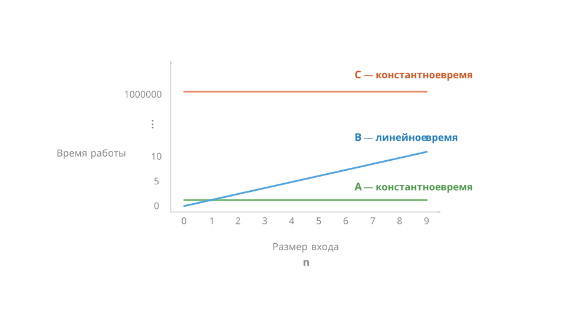
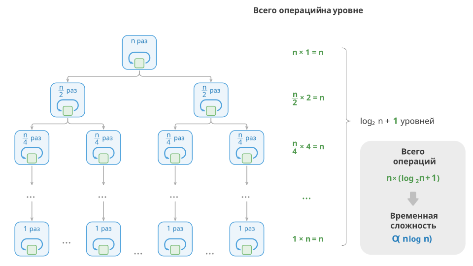

# 2.3 &nbsp; Временная сложность

Время работы — наглядный и точный показатель эффективности. Как можно было бы заранее вычислить время выполнения фрагмента кода?

1. **Выбрать платформу**: определить конфигурацию оборудования, язык программирования, системное окружение и другие факторы, влияющие на скорость выполнения.
2. **Оценить длительность каждой операции**. Допустим, сложение `+` занимает 1 нс, умножение `*` — 10 нс, а вывод `print()` — 5 нс.
3. **Подсчитать все операции в коде** и сложить время их выполнения. Так мы получим общее время работы.

Например, в следующем коде размер входных данных равен $n$:

=== "Python"

    ```python title=""
    # На некоторой платформе
    def algorithm(n: int):
        a = 2      # 1 ns
        a = a + 1  # 1 ns
        a = a * 2  # 10 ns
        # Повторить n раз
        for _ in range(n):  # 1 ns
            print(0)        # 5 ns
    ```

=== "C++"

    ```cpp title=""
    // На некоторой платформе
    void algorithm(int n) {
        int a = 2;  // 1 ns
        a = a + 1;  // 1 ns
        a = a * 2;  // 10 ns
        // Повторить n раз
        for (int i = 0; i < n; i++) {  // 1 ns
            cout << 0 << endl;         // 5 ns
        }
    }
    ```

=== "Java"

    ```java title=""
    // На некоторой платформе
    void algorithm(int n) {
        int a = 2;  // 1 ns
        a = a + 1;  // 1 ns
        a = a * 2;  // 10 ns
        // Повторить n раз
        for (int i = 0; i < n; i++) {  // 1 ns
            System.out.println(0);     // 5 ns
        }
    }
    ```

=== "C#"

    ```csharp title=""
    // На некоторой платформе
    void Algorithm(int n) {
        int a = 2;  // 1 ns
        a = a + 1;  // 1 ns
        a = a * 2;  // 10 ns
        // Повторить n раз
        for (int i = 0; i < n; i++) {  // 1 ns
            Console.WriteLine(0);      // 5 ns
        }
    }
    ```

=== "Go"

    ```go title=""
    // На некоторой платформе
    func algorithm(n int) {
        a := 2     // 1 ns
        a = a + 1  // 1 ns
        a = a * 2  // 10 ns
        // Повторить n раз
        for i := 0; i < n; i++ {  // 1 ns
            fmt.Println(a)        // 5 ns
        }
    }
    ```

=== "Swift"

    ```swift title=""
    // На некоторой платформе
    func algorithm(n: Int) {
        var a = 2 // 1 ns
        a = a + 1 // 1 ns
        a = a * 2 // 10 ns
        // Повторить n раз
        for _ in 0 ..< n { // 1 ns
            print(0) // 5 ns
        }
    }
    ```

=== "JS"

    ```javascript title=""
    // На некоторой платформе
    function algorithm(n) {
        var a = 2; // 1 ns
        a = a + 1; // 1 ns
        a = a * 2; // 10 ns
        // Повторить n раз
        for(let i = 0; i < n; i++) { // 1 ns
            console.log(0); // 5 ns
        }
    }
    ```

=== "TS"

    ```typescript title=""
    // На некоторой платформе
    function algorithm(n: number): void {
        var a: number = 2; // 1 ns
        a = a + 1; // 1 ns
        a = a * 2; // 10 ns
        // Повторить n раз
        for(let i = 0; i < n; i++) { // 1 ns
            console.log(0); // 5 ns
        }
    }
    ```

=== "Dart"

    ```dart title=""
    // На некоторой платформе
    void algorithm(int n) {
      int a = 2; // 1 ns
      a = a + 1; // 1 ns
      a = a * 2; // 10 ns
      // Повторить n раз
      for (int i = 0; i < n; i++) { // 1 ns
        print(0); // 5 ns
      }
    }
    ```

=== "Rust"

    ```rust title=""
    // На некоторой платформе
    fn algorithm(n: i32) {
        let mut a = 2;      // 1 ns
        a = a + 1;          // 1 ns
        a = a * 2;          // 10 ns
        // Повторить n раз
        for _ in 0..n {     // 1 ns
            println!("{}", 0);  // 5 ns
        }
    }
    ```

=== "C"

    ```c title=""
    // На некоторой платформе
    void algorithm(int n) {
        int a = 2;  // 1 ns
        a = a + 1;  // 1 ns
        a = a * 2;  // 10 ns
        // Повторить n раз
        for (int i = 0; i < n; i++) {   // 1 ns
            printf("%d", 0);            // 5 ns
        }
    }
    ```

=== "Kotlin"

    ```kotlin title=""
    // На некоторой платформе
    fun algorithm(n: Int) {
        var a = 2 // 1 ns
        a = a + 1 // 1 ns
        a = a * 2 // 10 ns
        // Повторить n раз
        for (i in 0..<n) {  // 1 ns
            println(0)      // 5 ns
        }
    }
    ```

=== "Ruby"

    ```ruby title=""
    # На некоторой платформе
    def algorithm(n)
        a = 2       # 1 ns
        a = a + 1   # 1 ns
        a = a * 2   # 10 ns
        # Повторить n раз
        (0...n).each do # 1 ns
            puts 0      # 5 ns
        end
    end
    ```

Описанный расчёт даёт время работы $(6n + 12)$ нс:

$$
1 + 1 + 10 + (1 + 5) \times n = 6n + 12
$$

Однако на практике **такой расчёт времени и неудобен, и едва ли осуществим**. Во-первых, алгоритм может работать на разных платформах, а мы не хотим привязывать оценку к одной из них. Во-вторых, узнать длительность каждой отдельной операции трудно, что сильно усложняет расчёт.

## 2.3.1 &nbsp; Как растёт время работы

При анализе временной сложности мы определяем не само время работы, а **характер его роста с увеличением объёма данных**.

Чтобы лучше понять, что такое характер роста, рассмотрим пример. Пусть размер входа равен $n$ и заданы три алгоритма `A`, `B` и `C`:

=== "Python"

    ```python title=""
    # Временная сложность алгоритма A: константная
    def algorithm_A(n: int):
        print(0)
    # Временная сложность алгоритма B: линейная
    def algorithm_B(n: int):
        for _ in range(n):
            print(0)
    # Временная сложность алгоритма C: константная
    def algorithm_C(n: int):
        for _ in range(1000000):
            print(0)
    ```

=== "C++"

    ```cpp title=""
    // Временная сложность алгоритма A: константная
    void algorithm_A(int n) {
        cout << 0 << endl;
    }
    // Временная сложность алгоритма B: линейная
    void algorithm_B(int n) {
        for (int i = 0; i < n; i++) {
            cout << 0 << endl;
        }
    }
    // Временная сложность алгоритма C: константная
    void algorithm_C(int n) {
        for (int i = 0; i < 1000000; i++) {
            cout << 0 << endl;
        }
    }
    ```

=== "Java"

    ```java title=""
    // Временная сложность алгоритма A: константная
    void algorithm_A(int n) {
        System.out.println(0);
    }
    // Временная сложность алгоритма B: линейная
    void algorithm_B(int n) {
        for (int i = 0; i < n; i++) {
            System.out.println(0);
        }
    }
    // Временная сложность алгоритма C: константная
    void algorithm_C(int n) {
        for (int i = 0; i < 1000000; i++) {
            System.out.println(0);
        }
    }
    ```

=== "C#"

    ```csharp title=""
    // Временная сложность алгоритма A: константная
    void AlgorithmA(int n) {
        Console.WriteLine(0);
    }
    // Временная сложность алгоритма B: линейная
    void AlgorithmB(int n) {
        for (int i = 0; i < n; i++) {
            Console.WriteLine(0);
        }
    }
    // Временная сложность алгоритма C: константная
    void AlgorithmC(int n) {
        for (int i = 0; i < 1000000; i++) {
            Console.WriteLine(0);
        }
    }
    ```

=== "Go"

    ```go title=""
    // Временная сложность алгоритма A: константная
    func algorithm_A(n int) {
        fmt.Println(0)
    }
    // Временная сложность алгоритма B: линейная
    func algorithm_B(n int) {
        for i := 0; i < n; i++ {
            fmt.Println(0)
        }
    }
    // Временная сложность алгоритма C: константная
    func algorithm_C(n int) {
        for i := 0; i < 1000000; i++ {
            fmt.Println(0)
        }
    }
    ```

=== "Swift"

    ```swift title=""
    // Временная сложность алгоритма A: константная
    func algorithmA(n: Int) {
        print(0)
    }

    // Временная сложность алгоритма B: линейная
    func algorithmB(n: Int) {
        for _ in 0 ..< n {
            print(0)
        }
    }

    // Временная сложность алгоритма C: константная
    func algorithmC(n: Int) {
        for _ in 0 ..< 1_000_000 {
            print(0)
        }
    }
    ```

=== "JS"

    ```javascript title=""
    // Временная сложность алгоритма A: константная
    function algorithm_A(n) {
        console.log(0);
    }
    // Временная сложность алгоритма B: линейная
    function algorithm_B(n) {
        for (let i = 0; i < n; i++) {
            console.log(0);
        }
    }
    // Временная сложность алгоритма C: константная
    function algorithm_C(n) {
        for (let i = 0; i < 1000000; i++) {
            console.log(0);
        }
    }

    ```

=== "TS"

    ```typescript title=""
    // Временная сложность алгоритма A: константная
    function algorithm_A(n: number): void {
        console.log(0);
    }
    // Временная сложность алгоритма B: линейная
    function algorithm_B(n: number): void {
        for (let i = 0; i < n; i++) {
            console.log(0);
        }
    }
    // Временная сложность алгоритма C: константная
    function algorithm_C(n: number): void {
        for (let i = 0; i < 1000000; i++) {
            console.log(0);
        }
    }
    ```

=== "Dart"

    ```dart title=""
    // Временная сложность алгоритма A: константная
    void algorithmA(int n) {
      print(0);
    }
    // Временная сложность алгоритма B: линейная
    void algorithmB(int n) {
      for (int i = 0; i < n; i++) {
        print(0);
      }
    }
    // Временная сложность алгоритма C: константная
    void algorithmC(int n) {
      for (int i = 0; i < 1000000; i++) {
        print(0);
      }
    }
    ```

=== "Rust"

    ```rust title=""
    // Временная сложность алгоритма A: константная
    fn algorithm_A(n: i32) {
        println!("{}", 0);
    }
    // Временная сложность алгоритма B: линейная
    fn algorithm_B(n: i32) {
        for _ in 0..n {
            println!("{}", 0);
        }
    }
    // Временная сложность алгоритма C: константная
    fn algorithm_C(n: i32) {
        for _ in 0..1000000 {
            println!("{}", 0);
        }
    }
    ```

=== "C"

    ```c title=""
    // Временная сложность алгоритма A: константная
    void algorithm_A(int n) {
        printf("%d", 0);
    }
    // Временная сложность алгоритма B: линейная
    void algorithm_B(int n) {
        for (int i = 0; i < n; i++) {
            printf("%d", 0);
        }
    }
    // Временная сложность алгоритма C: константная
    void algorithm_C(int n) {
        for (int i = 0; i < 1000000; i++) {
            printf("%d", 0);
        }
    }
    ```

=== "Kotlin"

    ```kotlin title=""
    // Временная сложность алгоритма A: константная
    fun algorithm_A(n: Int) {
        println(0)
    }
    // Временная сложность алгоритма B: линейная
    fun algorithm_B(n: Int) {
        for (i in 0..<n){
            println(0)
        }
    }
    // Временная сложность алгоритма C: константная
    fun algorithm_C(n: Int) {
        for (i in 0..<1000000) {
            println(0)
        }
    }
    ```

=== "Ruby"

    ```ruby title=""
    # Временная сложность алгоритма A: константная
    def algorithm_A(n)
        puts 0
    end

    # Временная сложность алгоритма B: линейная
    def algorithm_B(n)
        (0...n).each { puts 0 }
    end

    # Временная сложность алгоритма C: константная
    def algorithm_C(n)
        (0...1_000_000).each { puts 0 }
    end
    ```

На рисунке показано, как ведёт себя время работы этих трёх алгоритмов.

- Алгоритм `A` выполняет операцию печати всего $1$ раз. Его время работы не растёт с увеличением $n$. Такую временную сложность называют константной.
- В алгоритме `B` печать повторяется в цикле $n$ раз. Время работы растёт линейно с увеличением $n$. Такую временную сложность называют линейной.
- Алгоритм `C` повторяет печать $1000000$ раз. Он работает долго, но его время работы не зависит от размера входа $n$. Поэтому у `C` та же константная сложность, что и у `A`.

{ class="animation-figure" }

<p align="center"> Рисунок 2-7 &nbsp; Рост времени работы алгоритмов A, B и C </p>

Что даёт анализ временной сложности по сравнению с прямым подсчётом времени?

- **Временная сложность помогает оценивать эффективность алгоритмов**. Например, время работы `B` растёт линейно. При $n > 1$ он медленнее алгоритма `A`, а при $n > 1000000$ — медленнее алгоритма `C`. При достаточно большом размере входа $n$ алгоритм с константным временем обязательно окажется быстрее алгоритма с линейным временем. В этом и состоит смысл сравнения по характеру роста.
- **Оценить временную сложность проще**. В рассматриваемой модели платформа и длительности отдельных операций не меняют характера роста. Поэтому можно считать, что каждая элементарная операция занимает одну и ту же условную единицу времени. Вместо сложения длительностей достаточно подсчитать операции, что значительно упрощает оценку.
- **У временной сложности есть и ограничения**. Например, у алгоритмов `A` и `C` одинаковая сложность, хотя время работы сильно различается. И наоборот, у алгоритма `B` сложность выше, чем у `C`, но при малом размере входа $n$ алгоритм `B` заметно быстрее `C`. В таких случаях одной лишь сложности недостаточно для точного сравнения. Тем не менее анализ сложности остаётся одним из наиболее эффективных и распространённых способов оценки алгоритмов.

## 2.3.2 &nbsp; Асимптотическая верхняя граница функции

Рассмотрим функцию, у которой размер входных данных равен $n$:

=== "Python"

    ```python title=""
    def algorithm(n: int):
        a = 1      # +1
        a = a + 1  # +1
        a = a * 2  # +1
        # Повторить n раз
        for i in range(n):  # +1
            print(0)        # +1
    ```

=== "C++"

    ```cpp title=""
    void algorithm(int n) {
        int a = 1;  // +1
        a = a + 1;  // +1
        a = a * 2;  // +1
        // Повторить n раз
        for (int i = 0; i < n; i++) { // +1 (i ++ на каждой итерации)
            cout << 0 << endl;    // +1
        }
    }
    ```

=== "Java"

    ```java title=""
    void algorithm(int n) {
        int a = 1;  // +1
        a = a + 1;  // +1
        a = a * 2;  // +1
        // Повторить n раз
        for (int i = 0; i < n; i++) { // +1 (i ++ на каждой итерации)
            System.out.println(0);    // +1
        }
    }
    ```

=== "C#"

    ```csharp title=""
    void Algorithm(int n) {
        int a = 1;  // +1
        a = a + 1;  // +1
        a = a * 2;  // +1
        // Повторить n раз
        for (int i = 0; i < n; i++) {   // +1 (i ++ на каждой итерации)
            Console.WriteLine(0);   // +1
        }
    }
    ```

=== "Go"

    ```go title=""
    func algorithm(n int) {
        a := 1      // +1
        a = a + 1   // +1
        a = a * 2   // +1
        // Повторить n раз
        for i := 0; i < n; i++ {   // +1
            fmt.Println(a)         // +1
        }
    }
    ```

=== "Swift"

    ```swift title=""
    func algorithm(n: Int) {
        var a = 1 // +1
        a = a + 1 // +1
        a = a * 2 // +1
        // Повторить n раз
        for _ in 0 ..< n { // +1
            print(0) // +1
        }
    }
    ```

=== "JS"

    ```javascript title=""
    function algorithm(n) {
        var a = 1; // +1
        a += 1; // +1
        a *= 2; // +1
        // Повторить n раз
        for(let i = 0; i < n; i++){ // +1 (i ++ на каждой итерации)
            console.log(0); // +1
        }
    }
    ```

=== "TS"

    ```typescript title=""
    function algorithm(n: number): void{
        var a: number = 1; // +1
        a += 1; // +1
        a *= 2; // +1
        // Повторить n раз
        for(let i = 0; i < n; i++){ // +1 (i ++ на каждой итерации)
            console.log(0); // +1
        }
    }
    ```

=== "Dart"

    ```dart title=""
    void algorithm(int n) {
      int a = 1; // +1
      a = a + 1; // +1
      a = a * 2; // +1
      // Повторить n раз
      for (int i = 0; i < n; i++) { // +1 (i ++ на каждой итерации)
        print(0); // +1
      }
    }
    ```

=== "Rust"

    ```rust title=""
    fn algorithm(n: i32) {
        let mut a = 1;   // +1
        a = a + 1;      // +1
        a = a * 2;      // +1

        // Повторить n раз
        for _ in 0..n { // +1 (i ++ на каждой итерации)
            println!("{}", 0); // +1
        }
    }
    ```

=== "C"

    ```c title=""
    void algorithm(int n) {
        int a = 1;  // +1
        a = a + 1;  // +1
        a = a * 2;  // +1
        // Повторить n раз
        for (int i = 0; i < n; i++) {   // +1 (i ++ на каждой итерации)
            printf("%d", 0);            // +1
        }
    }
    ```

=== "Kotlin"

    ```kotlin title=""
    fun algorithm(n: Int) {
        var a = 1 // +1
        a = a + 1 // +1
        a = a * 2 // +1
        // Повторить n раз
        for (i in 0..<n) { // +1 (i ++ на каждой итерации)
            println(0) // +1
        }
    }
    ```

=== "Ruby"

    ```ruby title=""
    def algorithm(n)
        a = 1       # +1
        a = a + 1   # +1
        a = a * 2   # +1
        # Повторить n раз
        (0...n).each do # +1
            puts 0      # +1
        end
    end
    ```

Обозначим число операций алгоритма в зависимости от размера входа $n$ через $T(n)$. Для приведённой функции получаем:

$$
T(n) = 3 + 2n
$$

Функция $T(n)$ — многочлен первой степени. Время работы растёт линейно, поэтому и временная сложность линейная.

Линейную временную сложность записывают как $O(n)$. Эта запись называется <u>«большое $O$» (big-$O$ notation)</u> и задаёт <u>асимптотическую верхнюю границу (asymptotic upper bound)</u> функции $T(n)$.

По существу, при анализе временной сложности мы определяем асимптотическую верхнюю границу числа операций $T(n)$. У этого понятия есть точное математическое определение.

!!! note "Асимптотическая верхняя граница функции"

    Если существуют положительное вещественное число $c$ и вещественное число $n_0$, такие что для всех $n > n_0$ выполняется $T(n) \leq c \cdot f(n)$, то $f(n)$ задаёт асимптотическую верхнюю границу функции $T(n)$. Это записывают так: $T(n) = O(f(n))$.

На рисунке показано, как подобрать верхнюю оценку. Мы ищем такую функцию $f(n)$, чтобы при стремлении $n$ к бесконечности рост $T(n)$ можно было описать ростом $f(n)$ с точностью до постоянного множителя $c$.

{ class="animation-figure" }

<p align="center"> Рисунок 2-8 &nbsp; Асимптотическая верхняя граница функции </p>

## 2.3.3 &nbsp; Как оценить временную сложность

Определение асимптотической верхней границы может показаться непривычно строгим. Если оно пока не вполне понятно, начните с практического способа оценки: математический смысл постепенно прояснится на примерах.

По определению, найдя $f(n)$, получаем временную сложность $O(f(n))$. Как определить асимптотическую верхнюю границу $f(n)$? Сделаем это в два шага: подсчитаем операции и найдём верхнюю оценку.

### 1. &nbsp; Шаг 1. Подсчитаем операции

Можно пройти код сверху вниз и учесть операции в каждой строке. Однако в выражении $c \cdot f(n)$ постоянный множитель $c$ может быть сколь угодно большим. **Поэтому при оценке порядка роста числа операций $T(n)$ можно опускать постоянные коэффициенты и слагаемые**. Отсюда следуют несколько простых приёмов подсчёта.

1. **Опускайте постоянные слагаемые в $T(n)$**. Они не зависят от $n$ и не влияют на порядок временной сложности.
2. **Опускайте постоянные коэффициенты**. Например, и $2n$, и $5n + 1$ итераций можно для такой оценки считать как $n$ итераций: коэффициент при $n$ не влияет на порядок сложности.
3. **При вложенных циклах используйте умножение**. Число операций внешнего цикла умножается на число операций внутреннего за один проход. Для каждого уровня отдельно можно применять приёмы `1.` и `2.`.

Подсчитаем этими приёмами операции в следующей функции:

=== "Python"

    ```python title=""
    def algorithm(n: int):
        a = 1      # +0 (приём 1)
        a = a + n  # +0 (приём 1)
        # +n (приём 2)
        for i in range(5 * n + 1):
            print(0)
        # +n*n (приём 3)
        for i in range(2 * n):
            for j in range(n + 1):
                print(0)
    ```

=== "C++"

    ```cpp title=""
    void algorithm(int n) {
        int a = 1;  // +0 (приём 1)
        a = a + n;  // +0 (приём 1)
        // +n (приём 2)
        for (int i = 0; i < 5 * n + 1; i++) {
            cout << 0 << endl;
        }
        // +n*n (приём 3)
        for (int i = 0; i < 2 * n; i++) {
            for (int j = 0; j < n + 1; j++) {
                cout << 0 << endl;
            }
        }
    }
    ```

=== "Java"

    ```java title=""
    void algorithm(int n) {
        int a = 1;  // +0 (приём 1)
        a = a + n;  // +0 (приём 1)
        // +n (приём 2)
        for (int i = 0; i < 5 * n + 1; i++) {
            System.out.println(0);
        }
        // +n*n (приём 3)
        for (int i = 0; i < 2 * n; i++) {
            for (int j = 0; j < n + 1; j++) {
                System.out.println(0);
            }
        }
    }
    ```

=== "C#"

    ```csharp title=""
    void Algorithm(int n) {
        int a = 1;  // +0 (приём 1)
        a = a + n;  // +0 (приём 1)
        // +n (приём 2)
        for (int i = 0; i < 5 * n + 1; i++) {
            Console.WriteLine(0);
        }
        // +n*n (приём 3)
        for (int i = 0; i < 2 * n; i++) {
            for (int j = 0; j < n + 1; j++) {
                Console.WriteLine(0);
            }
        }
    }
    ```

=== "Go"

    ```go title=""
    func algorithm(n int) {
        a := 1     // +0 (приём 1)
        a = a + n  // +0 (приём 1)
        // +n (приём 2)
        for i := 0; i < 5 * n + 1; i++ {
            fmt.Println(0)
        }
        // +n*n (приём 3)
        for i := 0; i < 2 * n; i++ {
            for j := 0; j < n + 1; j++ {
                fmt.Println(0)
            }
        }
    }
    ```

=== "Swift"

    ```swift title=""
    func algorithm(n: Int) {
        var a = 1 // +0 (приём 1)
        a = a + n // +0 (приём 1)
        // +n (приём 2)
        for _ in 0 ..< (5 * n + 1) {
            print(0)
        }
        // +n*n (приём 3)
        for _ in 0 ..< (2 * n) {
            for _ in 0 ..< (n + 1) {
                print(0)
            }
        }
    }
    ```

=== "JS"

    ```javascript title=""
    function algorithm(n) {
        let a = 1;  // +0 (приём 1)
        a = a + n;  // +0 (приём 1)
        // +n (приём 2)
        for (let i = 0; i < 5 * n + 1; i++) {
            console.log(0);
        }
        // +n*n (приём 3)
        for (let i = 0; i < 2 * n; i++) {
            for (let j = 0; j < n + 1; j++) {
                console.log(0);
            }
        }
    }
    ```

=== "TS"

    ```typescript title=""
    function algorithm(n: number): void {
        let a = 1;  // +0 (приём 1)
        a = a + n;  // +0 (приём 1)
        // +n (приём 2)
        for (let i = 0; i < 5 * n + 1; i++) {
            console.log(0);
        }
        // +n*n (приём 3)
        for (let i = 0; i < 2 * n; i++) {
            for (let j = 0; j < n + 1; j++) {
                console.log(0);
            }
        }
    }
    ```

=== "Dart"

    ```dart title=""
    void algorithm(int n) {
      int a = 1; // +0 (приём 1)
      a = a + n; // +0 (приём 1)
      // +n (приём 2)
      for (int i = 0; i < 5 * n + 1; i++) {
        print(0);
      }
      // +n*n (приём 3)
      for (int i = 0; i < 2 * n; i++) {
        for (int j = 0; j < n + 1; j++) {
          print(0);
        }
      }
    }
    ```

=== "Rust"

    ```rust title=""
    fn algorithm(n: i32) {
        let mut a = 1;     // +0 (приём 1)
        a = a + n;        // +0 (приём 1)

        // +n (приём 2)
        for i in 0..(5 * n + 1) {
            println!("{}", 0);
        }

        // +n*n (приём 3)
        for i in 0..(2 * n) {
            for j in 0..(n + 1) {
                println!("{}", 0);
            }
        }
    }
    ```

=== "C"

    ```c title=""
    void algorithm(int n) {
        int a = 1;  // +0 (приём 1)
        a = a + n;  // +0 (приём 1)
        // +n (приём 2)
        for (int i = 0; i < 5 * n + 1; i++) {
            printf("%d", 0);
        }
        // +n*n (приём 3)
        for (int i = 0; i < 2 * n; i++) {
            for (int j = 0; j < n + 1; j++) {
                printf("%d", 0);
            }
        }
    }
    ```

=== "Kotlin"

    ```kotlin title=""
    fun algorithm(n: Int) {
        var a = 1   // +0 (приём 1)
        a = a + n   // +0 (приём 1)
        // +n (приём 2)
        for (i in 0..<5 * n + 1) {
            println(0)
        }
        // +n*n (приём 3)
        for (i in 0..<2 * n) {
            for (j in 0..<n + 1) {
                println(0)
            }
        }
    }
    ```

=== "Ruby"

    ```ruby title=""
    def algorithm(n)
        a = 1       # +0 (приём 1)
        a = a + n   # +0 (приём 1)
        # +n (приём 2)
        (0...(5 * n + 1)).each { puts 0 }
        # +n*n (приём 3)
        (0...(2 * n)).each do
            (0...(n + 1)).each { puts 0 }
        end
    end
    ```

Ниже показаны результаты до и после упрощения. В обоих случаях получаем временную сложность $O(n^2)$.

$$
\begin{aligned}
T(n) & = 2n(n + 1) + (5n + 1) + 2 & \text{Полный подсчёт (-.-|||)} \newline
& = 2n^2 + 7n + 3 \newline
T(n) & = n^2 + n & \text{Упрощённый подсчёт (o.O)}
\end{aligned}
$$

### 2. &nbsp; Шаг 2. Определим асимптотическую верхнюю границу

**Временную сложность определяет член $T(n)$ с наибольшим порядком роста**. При стремлении $n$ к бесконечности этот член становится определяющим, и влиянием остальных можно пренебречь.

В таблице приведены примеры. Некоторые значения нарочно преувеличены, чтобы показать: коэффициент не меняет порядка роста. Когда $n$ стремится к бесконечности, эти константы теряют значение.

<p align="center">Таблица <id> &nbsp; Временная сложность при разном числе операций</p>

<div class="center-table" markdown>

| Число операций $T(n)$        | Временная сложность $O(f(n))$ |
| ---------------------- | -------------------- |
| $100000$               | $O(1)$               |
| $3n + 2$               | $O(n)$               |
| $2n^2 + 3n + 2$        | $O(n^2)$             |
| $n^3 + 10000n^2$       | $O(n^3)$             |
| $2^n + 10000n^{10000}$ | $O(2^n)$             |

</div>

## 2.3.4 &nbsp; Основные классы сложности

Пусть размер входных данных равен $n$. На рисунке показаны распространённые классы временной сложности в порядке возрастания.

$$
\begin{aligned}
& O(1) < O(\log n) < O(n) < O(n \log n) < O(n^2) < O(2^n) < O(n!) \newline
& \text{константная} < \text{логарифмическая} < \text{линейная} < \text{линейно-логарифмическая} < \text{квадратичная} < \text{экспоненциальная} < \text{факториальная}
\end{aligned}
$$

{ class="animation-figure" }

<p align="center"> Рисунок 2-9 &nbsp; Основные классы временной сложности </p>

### 1. &nbsp; Константная сложность $O(1)$ {data-toc-label="1. &nbsp; Константная сложность"}

При константной сложности число операций не зависит от размера входа $n$ и не меняется с изменением $n$.

В следующей функции число операций `size` может быть велико, но от размера входа $n$ оно не зависит. Поэтому временная сложность равна $O(1)$:

=== "Python"

    ```python title="time_complexity.py"
    def constant(n: int) -> int:
        """Константная сложность"""
        count = 0
        size = 100000
        for _ in range(size):
            count += 1
        return count
    ```

=== "C++"

    ```cpp title="time_complexity.cpp"
    /* Константная сложность */
    int constant(int n) {
        int count = 0;
        int size = 100000;
        for (int i = 0; i < size; i++)
            count++;
        return count;
    }
    ```

=== "Java"

    ```java title="time_complexity.java"
    /* Константная сложность */
    int constant(int n) {
        int count = 0;
        int size = 100000;
        for (int i = 0; i < size; i++)
            count++;
        return count;
    }
    ```

=== "C#"

    ```csharp title="time_complexity.cs"
    /* Константная сложность */
    int Constant(int n) {
        int count = 0;
        int size = 100000;
        for (int i = 0; i < size; i++)
            count++;
        return count;
    }
    ```

=== "Go"

    ```go title="time_complexity.go"
    /* Константная сложность */
    func constant(n int) int {
        count := 0
        size := 100000
        for i := 0; i < size; i++ {
            count++
        }
        return count
    }
    ```

=== "Swift"

    ```swift title="time_complexity.swift"
    /* Константная сложность */
    func constant(n: Int) -> Int {
        var count = 0
        let size = 100_000
        for _ in 0 ..< size {
            count += 1
        }
        return count
    }
    ```

=== "JS"

    ```javascript title="time_complexity.js"
    /* Константная сложность */
    function constant(n) {
        let count = 0;
        const size = 100000;
        for (let i = 0; i < size; i++) count++;
        return count;
    }
    ```

=== "TS"

    ```typescript title="time_complexity.ts"
    /* Константная сложность */
    function constant(n: number): number {
        let count = 0;
        const size = 100000;
        for (let i = 0; i < size; i++) count++;
        return count;
    }
    ```

=== "Dart"

    ```dart title="time_complexity.dart"
    /* Константная сложность */
    int constant(int n) {
      int count = 0;
      int size = 100000;
      for (var i = 0; i < size; i++) {
        count++;
      }
      return count;
    }
    ```

=== "Rust"

    ```rust title="time_complexity.rs"
    /* Константная сложность */
    fn constant(n: i32) -> i32 {
        _ = n;
        let mut count = 0;
        let size = 100_000;
        for _ in 0..size {
            count += 1;
        }
        count
    }
    ```

=== "C"

    ```c title="time_complexity.c"
    /* Константная сложность */
    int constant(int n) {
        int count = 0;
        int size = 100000;
        for (int i = 0; i < size; i++) {
            count++;
        }
        return count;
    }
    ```

=== "Kotlin"

    ```kotlin title="time_complexity.kt"
    /* Константная сложность */
    fun constant(n: Int): Int {
        var count = 0
        val size = 100000
        for (i in 0..<size)
            count++
        return count
    }
    ```

=== "Ruby"

    ```ruby title="time_complexity.rb"
    ### Константная сложность ###
    def constant(n)
      count = 0
      size = 100000

      (0...size).each { count += 1 }

      count
    end
    ```

??? pythontutor "Визуализация выполнения"

    <div style="height: 459px; width: 100%;"><iframe class="pythontutor-iframe" title="Визуализация выполнения" src="https://pythontutor.com/iframe-embed.html#code=def%20constant%28n%3A%20int%29%20-%3E%20int%3A%0A%20%20%20%20%22%22%22%D0%9A%D0%BE%D0%BD%D1%81%D1%82%D0%B0%D0%BD%D1%82%D0%BD%D0%B0%D1%8F%20%D1%81%D0%BB%D0%BE%D0%B6%D0%BD%D0%BE%D1%81%D1%82%D1%8C%22%22%22%0A%20%20%20%20count%20%3D%200%0A%20%20%20%20size%20%3D%2010%0A%20%20%20%20for%20_%20in%20range%28size%29%3A%0A%20%20%20%20%20%20%20%20count%20%2B%3D%201%0A%20%20%20%20return%20count%0A%0A%22%22%22Driver%20Code%22%22%22%0Aif%20__name__%20%3D%3D%20%22__main__%22%3A%0A%20%20%20%20n%20%3D%208%0A%20%20%20%20print%28%22%D0%A0%D0%B0%D0%B7%D0%BC%D0%B5%D1%80%20%D0%B2%D1%85%D0%BE%D0%B4%D0%BD%D1%8B%D1%85%20%D0%B4%D0%B0%D0%BD%D0%BD%D1%8B%D1%85%20n%20%3D%22,%20n%29%0A%0A%20%20%20%20count%20%3D%20constant%28n%29%0A%20%20%20%20print%28%22%D0%A7%D0%B8%D1%81%D0%BB%D0%BE%20%D0%BE%D0%BF%D0%B5%D1%80%D0%B0%D1%86%D0%B8%D0%B9%20%D0%BF%D1%80%D0%B8%20%D0%BA%D0%BE%D0%BD%D1%81%D1%82%D0%B0%D0%BD%D1%82%D0%BD%D0%BE%D0%B9%20%D1%81%D0%BB%D0%BE%D0%B6%D0%BD%D0%BE%D1%81%D1%82%D0%B8%20%3D%22,%20count%29&codeDivHeight=472&codeDivWidth=350&cumulative=false&curInstr=3&heapPrimitives=nevernest&origin=opt-frontend.js&py=311&rawInputLstJSON=%5B%5D&textReferences=false"> </iframe></div>
    <div style="margin-top: 5px;"><a href="https://pythontutor.com/iframe-embed.html#code=def%20constant%28n%3A%20int%29%20-%3E%20int%3A%0A%20%20%20%20%22%22%22%D0%9A%D0%BE%D0%BD%D1%81%D1%82%D0%B0%D0%BD%D1%82%D0%BD%D0%B0%D1%8F%20%D1%81%D0%BB%D0%BE%D0%B6%D0%BD%D0%BE%D1%81%D1%82%D1%8C%22%22%22%0A%20%20%20%20count%20%3D%200%0A%20%20%20%20size%20%3D%2010%0A%20%20%20%20for%20_%20in%20range%28size%29%3A%0A%20%20%20%20%20%20%20%20count%20%2B%3D%201%0A%20%20%20%20return%20count%0A%0A%22%22%22Driver%20Code%22%22%22%0Aif%20__name__%20%3D%3D%20%22__main__%22%3A%0A%20%20%20%20n%20%3D%208%0A%20%20%20%20print%28%22%D0%A0%D0%B0%D0%B7%D0%BC%D0%B5%D1%80%20%D0%B2%D1%85%D0%BE%D0%B4%D0%BD%D1%8B%D1%85%20%D0%B4%D0%B0%D0%BD%D0%BD%D1%8B%D1%85%20n%20%3D%22,%20n%29%0A%0A%20%20%20%20count%20%3D%20constant%28n%29%0A%20%20%20%20print%28%22%D0%A7%D0%B8%D1%81%D0%BB%D0%BE%20%D0%BE%D0%BF%D0%B5%D1%80%D0%B0%D1%86%D0%B8%D0%B9%20%D0%BF%D1%80%D0%B8%20%D0%BA%D0%BE%D0%BD%D1%81%D1%82%D0%B0%D0%BD%D1%82%D0%BD%D0%BE%D0%B9%20%D1%81%D0%BB%D0%BE%D0%B6%D0%BD%D0%BE%D1%81%D1%82%D0%B8%20%3D%22,%20count%29&codeDivHeight=800&codeDivWidth=600&cumulative=false&curInstr=3&heapPrimitives=nevernest&origin=opt-frontend.js&py=311&rawInputLstJSON=%5B%5D&textReferences=false" target="_blank" rel="noopener noreferrer">Во весь экран ></a></div>

### 2. &nbsp; Линейная сложность $O(n)$ {data-toc-label="2. &nbsp; Линейная сложность"}

При линейной сложности число операций растёт линейно с размером входа $n$. Часто такой рост даёт простой цикл:

=== "Python"

    ```python title="time_complexity.py"
    def linear(n: int) -> int:
        """Линейная сложность"""
        count = 0
        for _ in range(n):
            count += 1
        return count
    ```

=== "C++"

    ```cpp title="time_complexity.cpp"
    /* Линейная сложность */
    int linear(int n) {
        int count = 0;
        for (int i = 0; i < n; i++)
            count++;
        return count;
    }
    ```

=== "Java"

    ```java title="time_complexity.java"
    /* Линейная сложность */
    int linear(int n) {
        int count = 0;
        for (int i = 0; i < n; i++)
            count++;
        return count;
    }
    ```

=== "C#"

    ```csharp title="time_complexity.cs"
    /* Линейная сложность */
    int Linear(int n) {
        int count = 0;
        for (int i = 0; i < n; i++)
            count++;
        return count;
    }
    ```

=== "Go"

    ```go title="time_complexity.go"
    /* Линейная сложность */
    func linear(n int) int {
        count := 0
        for i := 0; i < n; i++ {
            count++
        }
        return count
    }
    ```

=== "Swift"

    ```swift title="time_complexity.swift"
    /* Линейная сложность */
    func linear(n: Int) -> Int {
        var count = 0
        for _ in 0 ..< n {
            count += 1
        }
        return count
    }
    ```

=== "JS"

    ```javascript title="time_complexity.js"
    /* Линейная сложность */
    function linear(n) {
        let count = 0;
        for (let i = 0; i < n; i++) count++;
        return count;
    }
    ```

=== "TS"

    ```typescript title="time_complexity.ts"
    /* Линейная сложность */
    function linear(n: number): number {
        let count = 0;
        for (let i = 0; i < n; i++) count++;
        return count;
    }
    ```

=== "Dart"

    ```dart title="time_complexity.dart"
    /* Линейная сложность */
    int linear(int n) {
      int count = 0;
      for (var i = 0; i < n; i++) {
        count++;
      }
      return count;
    }
    ```

=== "Rust"

    ```rust title="time_complexity.rs"
    /* Линейная сложность */
    fn linear(n: i32) -> i32 {
        let mut count = 0;
        for _ in 0..n {
            count += 1;
        }
        count
    }
    ```

=== "C"

    ```c title="time_complexity.c"
    /* Линейная сложность */
    int linear(int n) {
        int count = 0;
        for (int i = 0; i < n; i++) {
            count++;
        }
        return count;
    }
    ```

=== "Kotlin"

    ```kotlin title="time_complexity.kt"
    /* Линейная сложность */
    fun linear(n: Int): Int {
        var count = 0
        for (i in 0..<n)
            count++
        return count
    }
    ```

=== "Ruby"

    ```ruby title="time_complexity.rb"
    ### Линейная сложность ###
    def linear(n)
      count = 0
      (0...n).each { count += 1 }
      count
    end
    ```

??? pythontutor "Визуализация выполнения"

    <div style="height: 441px; width: 100%;"><iframe class="pythontutor-iframe" title="Визуализация выполнения" src="https://pythontutor.com/iframe-embed.html#code=def%20linear%28n%29%20-%3E%20int%3A%0A%20%20%20%20%22%22%22%D0%9B%D0%B8%D0%BD%D0%B5%D0%B9%D0%BD%D0%B0%D1%8F%20%D1%81%D0%BB%D0%BE%D0%B6%D0%BD%D0%BE%D1%81%D1%82%D1%8C%22%22%22%0A%20%20%20%20count%20%3D%200%0A%20%20%20%20for%20_%20in%20range%28n%29%3A%0A%20%20%20%20%20%20%20%20count%20%2B%3D%201%0A%20%20%20%20return%20count%0A%0A%22%22%22Driver%20Code%22%22%22%0Aif%20__name__%20%3D%3D%20%22__main__%22%3A%0A%20%20%20%20n%20%3D%208%0A%20%20%20%20print%28%22%D0%A0%D0%B0%D0%B7%D0%BC%D0%B5%D1%80%20%D0%B2%D1%85%D0%BE%D0%B4%D0%BD%D1%8B%D1%85%20%D0%B4%D0%B0%D0%BD%D0%BD%D1%8B%D1%85%20n%20%3D%22,%20n%29%0A%0A%20%20%20%20count%20%3D%20linear%28n%29%0A%20%20%20%20print%28%22%D0%A7%D0%B8%D1%81%D0%BB%D0%BE%20%D0%BE%D0%BF%D0%B5%D1%80%D0%B0%D1%86%D0%B8%D0%B9%20%D0%BF%D1%80%D0%B8%20%D0%BB%D0%B8%D0%BD%D0%B5%D0%B9%D0%BD%D0%BE%D0%B9%20%D1%81%D0%BB%D0%BE%D0%B6%D0%BD%D0%BE%D1%81%D1%82%D0%B8%20%3D%22,%20count%29&codeDivHeight=472&codeDivWidth=350&cumulative=false&curInstr=3&heapPrimitives=nevernest&origin=opt-frontend.js&py=311&rawInputLstJSON=%5B%5D&textReferences=false"> </iframe></div>
    <div style="margin-top: 5px;"><a href="https://pythontutor.com/iframe-embed.html#code=def%20linear%28n%29%20-%3E%20int%3A%0A%20%20%20%20%22%22%22%D0%9B%D0%B8%D0%BD%D0%B5%D0%B9%D0%BD%D0%B0%D1%8F%20%D1%81%D0%BB%D0%BE%D0%B6%D0%BD%D0%BE%D1%81%D1%82%D1%8C%22%22%22%0A%20%20%20%20count%20%3D%200%0A%20%20%20%20for%20_%20in%20range%28n%29%3A%0A%20%20%20%20%20%20%20%20count%20%2B%3D%201%0A%20%20%20%20return%20count%0A%0A%22%22%22Driver%20Code%22%22%22%0Aif%20__name__%20%3D%3D%20%22__main__%22%3A%0A%20%20%20%20n%20%3D%208%0A%20%20%20%20print%28%22%D0%A0%D0%B0%D0%B7%D0%BC%D0%B5%D1%80%20%D0%B2%D1%85%D0%BE%D0%B4%D0%BD%D1%8B%D1%85%20%D0%B4%D0%B0%D0%BD%D0%BD%D1%8B%D1%85%20n%20%3D%22,%20n%29%0A%0A%20%20%20%20count%20%3D%20linear%28n%29%0A%20%20%20%20print%28%22%D0%A7%D0%B8%D1%81%D0%BB%D0%BE%20%D0%BE%D0%BF%D0%B5%D1%80%D0%B0%D1%86%D0%B8%D0%B9%20%D0%BF%D1%80%D0%B8%20%D0%BB%D0%B8%D0%BD%D0%B5%D0%B9%D0%BD%D0%BE%D0%B9%20%D1%81%D0%BB%D0%BE%D0%B6%D0%BD%D0%BE%D1%81%D1%82%D0%B8%20%3D%22,%20count%29&codeDivHeight=800&codeDivWidth=600&cumulative=false&curInstr=3&heapPrimitives=nevernest&origin=opt-frontend.js&py=311&rawInputLstJSON=%5B%5D&textReferences=false" target="_blank" rel="noopener noreferrer">Во весь экран ></a></div>

Обход массива или связного списка занимает $O(n)$ времени, где $n$ — длина массива или списка:

=== "Python"

    ```python title="time_complexity.py"
    def array_traversal(nums: list[int]) -> int:
        """Линейная сложность (обход массива)"""
        count = 0
        # Число итераций пропорционально длине массива
        for num in nums:
            count += 1
        return count
    ```

=== "C++"

    ```cpp title="time_complexity.cpp"
    /* Линейная сложность (обход массива) */
    int arrayTraversal(vector<int> &nums) {
        int count = 0;
        // Число итераций пропорционально длине массива
        for (int num : nums) {
            count++;
        }
        return count;
    }
    ```

=== "Java"

    ```java title="time_complexity.java"
    /* Линейная сложность (обход массива) */
    int arrayTraversal(int[] nums) {
        int count = 0;
        // Число итераций пропорционально длине массива
        for (int num : nums) {
            count++;
        }
        return count;
    }
    ```

=== "C#"

    ```csharp title="time_complexity.cs"
    /* Линейная сложность (обход массива) */
    int ArrayTraversal(int[] nums) {
        int count = 0;
        // Число итераций пропорционально длине массива
        foreach (int num in nums) {
            count++;
        }
        return count;
    }
    ```

=== "Go"

    ```go title="time_complexity.go"
    /* Линейная сложность (обход массива) */
    func arrayTraversal(nums []int) int {
        count := 0
        // Число итераций пропорционально длине массива
        for range nums {
            count++
        }
        return count
    }
    ```

=== "Swift"

    ```swift title="time_complexity.swift"
    /* Линейная сложность (обход массива) */
    func arrayTraversal(nums: [Int]) -> Int {
        var count = 0
        // Число итераций пропорционально длине массива
        for _ in nums {
            count += 1
        }
        return count
    }
    ```

=== "JS"

    ```javascript title="time_complexity.js"
    /* Линейная сложность (обход массива) */
    function arrayTraversal(nums) {
        let count = 0;
        // Число итераций пропорционально длине массива
        for (let i = 0; i < nums.length; i++) {
            count++;
        }
        return count;
    }
    ```

=== "TS"

    ```typescript title="time_complexity.ts"
    /* Линейная сложность (обход массива) */
    function arrayTraversal(nums: number[]): number {
        let count = 0;
        // Число итераций пропорционально длине массива
        for (let i = 0; i < nums.length; i++) {
            count++;
        }
        return count;
    }
    ```

=== "Dart"

    ```dart title="time_complexity.dart"
    /* Линейная сложность (обход массива) */
    int arrayTraversal(List<int> nums) {
      int count = 0;
      // Число итераций пропорционально длине массива
      for (var _num in nums) {
        count++;
      }
      return count;
    }
    ```

=== "Rust"

    ```rust title="time_complexity.rs"
    /* Линейная сложность (обход массива) */
    fn array_traversal(nums: &[i32]) -> i32 {
        let mut count = 0;
        // Число итераций пропорционально длине массива
        for _ in nums {
            count += 1;
        }
        count
    }
    ```

=== "C"

    ```c title="time_complexity.c"
    /* Линейная сложность (обход массива) */
    int arrayTraversal(int *nums, int n) {
        int count = 0;
        // Число итераций пропорционально длине массива
        for (int i = 0; i < n; i++) {
            count++;
        }
        return count;
    }
    ```

=== "Kotlin"

    ```kotlin title="time_complexity.kt"
    /* Линейная сложность (обход массива) */
    fun arrayTraversal(nums: IntArray): Int {
        var count = 0
        // Число итераций пропорционально длине массива
        for (num in nums) {
            count++
        }
        return count
    }
    ```

=== "Ruby"

    ```ruby title="time_complexity.rb"
    ### Линейная сложность (обход массива)###
    def array_traversal(nums)
      count = 0

      # Число итераций пропорционально длине массива
      for num in nums
        count += 1
      end

      count
    end
    ```

??? pythontutor "Визуализация выполнения"

    <div style="height: 459px; width: 100%;"><iframe class="pythontutor-iframe" title="Визуализация выполнения" src="https://pythontutor.com/iframe-embed.html#code=def%20array_traversal%28nums%3A%20list%5Bint%5D%29%20-%3E%20int%3A%0A%20%20%20%20%22%22%22%D0%9B%D0%B8%D0%BD%D0%B5%D0%B9%D0%BD%D0%B0%D1%8F%20%D1%81%D0%BB%D0%BE%D0%B6%D0%BD%D0%BE%D1%81%D1%82%D1%8C%20%28%D0%BE%D0%B1%D1%85%D0%BE%D0%B4%20%D0%BC%D0%B0%D1%81%D1%81%D0%B8%D0%B2%D0%B0%29%22%22%22%0A%20%20%20%20count%20%3D%200%0A%20%20%20%20%23%20%D0%A7%D0%B8%D1%81%D0%BB%D0%BE%20%D0%B8%D1%82%D0%B5%D1%80%D0%B0%D1%86%D0%B8%D0%B9%20%D0%BF%D1%80%D0%BE%D0%BF%D0%BE%D1%80%D1%86%D0%B8%D0%BE%D0%BD%D0%B0%D0%BB%D1%8C%D0%BD%D0%BE%20%D0%B4%D0%BB%D0%B8%D0%BD%D0%B5%20%D0%BC%D0%B0%D1%81%D1%81%D0%B8%D0%B2%D0%B0%0A%20%20%20%20for%20num%20in%20nums%3A%0A%20%20%20%20%20%20%20%20count%20%2B%3D%201%0A%20%20%20%20return%20count%0A%0A%22%22%22Driver%20Code%22%22%22%0Aif%20__name__%20%3D%3D%20%22__main__%22%3A%0A%20%20%20%20n%20%3D%208%0A%20%20%20%20print%28%22%D0%A0%D0%B0%D0%B7%D0%BC%D0%B5%D1%80%20%D0%B2%D1%85%D0%BE%D0%B4%D0%BD%D1%8B%D1%85%20%D0%B4%D0%B0%D0%BD%D0%BD%D1%8B%D1%85%20n%20%3D%22,%20n%29%0A%0A%20%20%20%20count%20%3D%20array_traversal%28%5B0%5D%20%2A%20n%29%0A%20%20%20%20print%28%22%D0%A7%D0%B8%D1%81%D0%BB%D0%BE%20%D0%BE%D0%BF%D0%B5%D1%80%D0%B0%D1%86%D0%B8%D0%B9%20%D0%BF%D1%80%D0%B8%20%D0%BB%D0%B8%D0%BD%D0%B5%D0%B9%D0%BD%D0%BE%D0%B9%20%D1%81%D0%BB%D0%BE%D0%B6%D0%BD%D0%BE%D1%81%D1%82%D0%B8%20%28%D0%BE%D0%B1%D1%85%D0%BE%D0%B4%20%D0%BC%D0%B0%D1%81%D1%81%D0%B8%D0%B2%D0%B0%29%20%3D%22,%20count%29&codeDivHeight=472&codeDivWidth=350&cumulative=false&curInstr=3&heapPrimitives=nevernest&origin=opt-frontend.js&py=311&rawInputLstJSON=%5B%5D&textReferences=false"> </iframe></div>
    <div style="margin-top: 5px;"><a href="https://pythontutor.com/iframe-embed.html#code=def%20array_traversal%28nums%3A%20list%5Bint%5D%29%20-%3E%20int%3A%0A%20%20%20%20%22%22%22%D0%9B%D0%B8%D0%BD%D0%B5%D0%B9%D0%BD%D0%B0%D1%8F%20%D1%81%D0%BB%D0%BE%D0%B6%D0%BD%D0%BE%D1%81%D1%82%D1%8C%20%28%D0%BE%D0%B1%D1%85%D0%BE%D0%B4%20%D0%BC%D0%B0%D1%81%D1%81%D0%B8%D0%B2%D0%B0%29%22%22%22%0A%20%20%20%20count%20%3D%200%0A%20%20%20%20%23%20%D0%A7%D0%B8%D1%81%D0%BB%D0%BE%20%D0%B8%D1%82%D0%B5%D1%80%D0%B0%D1%86%D0%B8%D0%B9%20%D0%BF%D1%80%D0%BE%D0%BF%D0%BE%D1%80%D1%86%D0%B8%D0%BE%D0%BD%D0%B0%D0%BB%D1%8C%D0%BD%D0%BE%20%D0%B4%D0%BB%D0%B8%D0%BD%D0%B5%20%D0%BC%D0%B0%D1%81%D1%81%D0%B8%D0%B2%D0%B0%0A%20%20%20%20for%20num%20in%20nums%3A%0A%20%20%20%20%20%20%20%20count%20%2B%3D%201%0A%20%20%20%20return%20count%0A%0A%22%22%22Driver%20Code%22%22%22%0Aif%20__name__%20%3D%3D%20%22__main__%22%3A%0A%20%20%20%20n%20%3D%208%0A%20%20%20%20print%28%22%D0%A0%D0%B0%D0%B7%D0%BC%D0%B5%D1%80%20%D0%B2%D1%85%D0%BE%D0%B4%D0%BD%D1%8B%D1%85%20%D0%B4%D0%B0%D0%BD%D0%BD%D1%8B%D1%85%20n%20%3D%22,%20n%29%0A%0A%20%20%20%20count%20%3D%20array_traversal%28%5B0%5D%20%2A%20n%29%0A%20%20%20%20print%28%22%D0%A7%D0%B8%D1%81%D0%BB%D0%BE%20%D0%BE%D0%BF%D0%B5%D1%80%D0%B0%D1%86%D0%B8%D0%B9%20%D0%BF%D1%80%D0%B8%20%D0%BB%D0%B8%D0%BD%D0%B5%D0%B9%D0%BD%D0%BE%D0%B9%20%D1%81%D0%BB%D0%BE%D0%B6%D0%BD%D0%BE%D1%81%D1%82%D0%B8%20%28%D0%BE%D0%B1%D1%85%D0%BE%D0%B4%20%D0%BC%D0%B0%D1%81%D1%81%D0%B8%D0%B2%D0%B0%29%20%3D%22,%20count%29&codeDivHeight=800&codeDivWidth=600&cumulative=false&curInstr=3&heapPrimitives=nevernest&origin=opt-frontend.js&py=311&rawInputLstJSON=%5B%5D&textReferences=false" target="_blank" rel="noopener noreferrer">Во весь экран ></a></div>

Обратите внимание: **смысл размера входа $n$ зависит от типа входных данных**. В первом примере размер задаёт сама переменная $n$, а во втором — длина массива $n$.

### 3. &nbsp; Квадратичная сложность $O(n^2)$ {data-toc-label="3. &nbsp; Квадратичная сложность"}

При квадратичной сложности число операций растёт как квадрат размера входа $n$. Это часто происходит при вложенных циклах: если и внешний цикл, и внутренний имеют линейную сложность $O(n)$, то общая временная сложность составляет $O(n^2)$:

=== "Python"

    ```python title="time_complexity.py"
    def quadratic(n: int) -> int:
        """Квадратичная сложность"""
        count = 0
        # Число итераций пропорционально квадрату размера данных n
        for i in range(n):
            for j in range(n):
                count += 1
        return count
    ```

=== "C++"

    ```cpp title="time_complexity.cpp"
    /* Квадратичная сложность */
    int quadratic(int n) {
        int count = 0;
        // Число итераций пропорционально квадрату размера данных n
        for (int i = 0; i < n; i++) {
            for (int j = 0; j < n; j++) {
                count++;
            }
        }
        return count;
    }
    ```

=== "Java"

    ```java title="time_complexity.java"
    /* Квадратичная сложность */
    int quadratic(int n) {
        int count = 0;
        // Число итераций пропорционально квадрату размера данных n
        for (int i = 0; i < n; i++) {
            for (int j = 0; j < n; j++) {
                count++;
            }
        }
        return count;
    }
    ```

=== "C#"

    ```csharp title="time_complexity.cs"
    /* Квадратичная сложность */
    int Quadratic(int n) {
        int count = 0;
        // Число итераций пропорционально квадрату размера данных n
        for (int i = 0; i < n; i++) {
            for (int j = 0; j < n; j++) {
                count++;
            }
        }
        return count;
    }
    ```

=== "Go"

    ```go title="time_complexity.go"
    /* Квадратичная сложность */
    func quadratic(n int) int {
        count := 0
        // Число итераций пропорционально квадрату размера данных n
        for i := 0; i < n; i++ {
            for j := 0; j < n; j++ {
                count++
            }
        }
        return count
    }
    ```

=== "Swift"

    ```swift title="time_complexity.swift"
    /* Квадратичная сложность */
    func quadratic(n: Int) -> Int {
        var count = 0
        // Число итераций пропорционально квадрату размера данных n
        for _ in 0 ..< n {
            for _ in 0 ..< n {
                count += 1
            }
        }
        return count
    }
    ```

=== "JS"

    ```javascript title="time_complexity.js"
    /* Квадратичная сложность */
    function quadratic(n) {
        let count = 0;
        // Число итераций пропорционально квадрату размера данных n
        for (let i = 0; i < n; i++) {
            for (let j = 0; j < n; j++) {
                count++;
            }
        }
        return count;
    }
    ```

=== "TS"

    ```typescript title="time_complexity.ts"
    /* Квадратичная сложность */
    function quadratic(n: number): number {
        let count = 0;
        // Число итераций пропорционально квадрату размера данных n
        for (let i = 0; i < n; i++) {
            for (let j = 0; j < n; j++) {
                count++;
            }
        }
        return count;
    }
    ```

=== "Dart"

    ```dart title="time_complexity.dart"
    /* Квадратичная сложность */
    int quadratic(int n) {
      int count = 0;
      // Число итераций пропорционально квадрату размера данных n
      for (int i = 0; i < n; i++) {
        for (int j = 0; j < n; j++) {
          count++;
        }
      }
      return count;
    }
    ```

=== "Rust"

    ```rust title="time_complexity.rs"
    /* Квадратичная сложность */
    fn quadratic(n: i32) -> i32 {
        let mut count = 0;
        // Число итераций пропорционально квадрату размера данных n
        for _ in 0..n {
            for _ in 0..n {
                count += 1;
            }
        }
        count
    }
    ```

=== "C"

    ```c title="time_complexity.c"
    /* Квадратичная сложность */
    int quadratic(int n) {
        int count = 0;
        // Число итераций пропорционально квадрату размера данных n
        for (int i = 0; i < n; i++) {
            for (int j = 0; j < n; j++) {
                count++;
            }
        }
        return count;
    }
    ```

=== "Kotlin"

    ```kotlin title="time_complexity.kt"
    /* Квадратичная сложность */
    fun quadratic(n: Int): Int {
        var count = 0
        // Число итераций пропорционально квадрату размера данных n
        for (i in 0..<n) {
            for (j in 0..<n) {
                count++
            }
        }
        return count
    }
    ```

=== "Ruby"

    ```ruby title="time_complexity.rb"
    ### Квадратичная сложность ###
    def quadratic(n)
      count = 0

      # Число итераций пропорционально квадрату размера данных n
      for i in 0...n
        for j in 0...n
          count += 1
        end
      end

      count
    end
    ```

??? pythontutor "Визуализация выполнения"

    <div style="height: 477px; width: 100%;"><iframe class="pythontutor-iframe" title="Визуализация выполнения" src="https://pythontutor.com/iframe-embed.html#code=def%20quadratic%28n%29%20-%3E%20int%3A%0A%20%20%20%20%22%22%22%D0%9A%D0%B2%D0%B0%D0%B4%D1%80%D0%B0%D1%82%D0%B8%D1%87%D0%BD%D0%B0%D1%8F%20%D1%81%D0%BB%D0%BE%D0%B6%D0%BD%D0%BE%D1%81%D1%82%D1%8C%22%22%22%0A%20%20%20%20count%20%3D%200%0A%20%20%20%20%23%20%D0%A7%D0%B8%D1%81%D0%BB%D0%BE%20%D0%B8%D1%82%D0%B5%D1%80%D0%B0%D1%86%D0%B8%D0%B9%20%D0%BF%D1%80%D0%BE%D0%BF%D0%BE%D1%80%D1%86%D0%B8%D0%BE%D0%BD%D0%B0%D0%BB%D1%8C%D0%BD%D0%BE%20%D0%BA%D0%B2%D0%B0%D0%B4%D1%80%D0%B0%D1%82%D1%83%20%D1%80%D0%B0%D0%B7%D0%BC%D0%B5%D1%80%D0%B0%20%D0%B4%D0%B0%D0%BD%D0%BD%D1%8B%D1%85%20n%0A%20%20%20%20for%20i%20in%20range%28n%29%3A%0A%20%20%20%20%20%20%20%20for%20j%20in%20range%28n%29%3A%0A%20%20%20%20%20%20%20%20%20%20%20%20count%20%2B%3D%201%0A%20%20%20%20return%20count%0A%0A%22%22%22Driver%20Code%22%22%22%0Aif%20__name__%20%3D%3D%20%22__main__%22%3A%0A%20%20%20%20n%20%3D%208%0A%20%20%20%20print%28%22%D0%A0%D0%B0%D0%B7%D0%BC%D0%B5%D1%80%20%D0%B2%D1%85%D0%BE%D0%B4%D0%BD%D1%8B%D1%85%20%D0%B4%D0%B0%D0%BD%D0%BD%D1%8B%D1%85%20n%20%3D%22,%20n%29%0A%0A%20%20%20%20count%20%3D%20quadratic%28n%29%0A%20%20%20%20print%28%22%D0%A7%D0%B8%D1%81%D0%BB%D0%BE%20%D0%BE%D0%BF%D0%B5%D1%80%D0%B0%D1%86%D0%B8%D0%B9%20%D0%BF%D1%80%D0%B8%20%D0%BA%D0%B2%D0%B0%D0%B4%D1%80%D0%B0%D1%82%D0%B8%D1%87%D0%BD%D0%BE%D0%B9%20%D1%81%D0%BB%D0%BE%D0%B6%D0%BD%D0%BE%D1%81%D1%82%D0%B8%20%3D%22,%20count%29&codeDivHeight=472&codeDivWidth=350&cumulative=false&curInstr=3&heapPrimitives=nevernest&origin=opt-frontend.js&py=311&rawInputLstJSON=%5B%5D&textReferences=false"> </iframe></div>
    <div style="margin-top: 5px;"><a href="https://pythontutor.com/iframe-embed.html#code=def%20quadratic%28n%29%20-%3E%20int%3A%0A%20%20%20%20%22%22%22%D0%9A%D0%B2%D0%B0%D0%B4%D1%80%D0%B0%D1%82%D0%B8%D1%87%D0%BD%D0%B0%D1%8F%20%D1%81%D0%BB%D0%BE%D0%B6%D0%BD%D0%BE%D1%81%D1%82%D1%8C%22%22%22%0A%20%20%20%20count%20%3D%200%0A%20%20%20%20%23%20%D0%A7%D0%B8%D1%81%D0%BB%D0%BE%20%D0%B8%D1%82%D0%B5%D1%80%D0%B0%D1%86%D0%B8%D0%B9%20%D0%BF%D1%80%D0%BE%D0%BF%D0%BE%D1%80%D1%86%D0%B8%D0%BE%D0%BD%D0%B0%D0%BB%D1%8C%D0%BD%D0%BE%20%D0%BA%D0%B2%D0%B0%D0%B4%D1%80%D0%B0%D1%82%D1%83%20%D1%80%D0%B0%D0%B7%D0%BC%D0%B5%D1%80%D0%B0%20%D0%B4%D0%B0%D0%BD%D0%BD%D1%8B%D1%85%20n%0A%20%20%20%20for%20i%20in%20range%28n%29%3A%0A%20%20%20%20%20%20%20%20for%20j%20in%20range%28n%29%3A%0A%20%20%20%20%20%20%20%20%20%20%20%20count%20%2B%3D%201%0A%20%20%20%20return%20count%0A%0A%22%22%22Driver%20Code%22%22%22%0Aif%20__name__%20%3D%3D%20%22__main__%22%3A%0A%20%20%20%20n%20%3D%208%0A%20%20%20%20print%28%22%D0%A0%D0%B0%D0%B7%D0%BC%D0%B5%D1%80%20%D0%B2%D1%85%D0%BE%D0%B4%D0%BD%D1%8B%D1%85%20%D0%B4%D0%B0%D0%BD%D0%BD%D1%8B%D1%85%20n%20%3D%22,%20n%29%0A%0A%20%20%20%20count%20%3D%20quadratic%28n%29%0A%20%20%20%20print%28%22%D0%A7%D0%B8%D1%81%D0%BB%D0%BE%20%D0%BE%D0%BF%D0%B5%D1%80%D0%B0%D1%86%D0%B8%D0%B9%20%D0%BF%D1%80%D0%B8%20%D0%BA%D0%B2%D0%B0%D0%B4%D1%80%D0%B0%D1%82%D0%B8%D1%87%D0%BD%D0%BE%D0%B9%20%D1%81%D0%BB%D0%BE%D0%B6%D0%BD%D0%BE%D1%81%D1%82%D0%B8%20%3D%22,%20count%29&codeDivHeight=800&codeDivWidth=600&cumulative=false&curInstr=3&heapPrimitives=nevernest&origin=opt-frontend.js&py=311&rawInputLstJSON=%5B%5D&textReferences=false" target="_blank" rel="noopener noreferrer">Во весь экран ></a></div>

На рисунке сопоставлены константная, линейная и квадратичная временная сложность.

{ class="animation-figure" }

<p align="center"> Рисунок 2-10 &nbsp; Константная, линейная и квадратичная временная сложность </p>

Возьмём пузырьковую сортировку. Внешний цикл выполняется $n - 1$ раз. Внутренний последовательно выполняет $n-1$, $n-2$, $\dots$, $2$ и $1$ итераций, в среднем $n / 2$ за проход. Отсюда временная сложность $O((n - 1) n / 2) = O(n^2)$:

=== "Python"

    ```python title="time_complexity.py"
    def bubble_sort(nums: list[int]) -> int:
        """Квадратичная сложность (пузырьковая сортировка)"""
        count = 0  # Счётчик
        # Внешний цикл: неотсортированный участок — [0, i]
        for i in range(len(nums) - 1, 0, -1):
            # Внутренний цикл обменами перемещает максимум участка [0, i] на его правый край
            for j in range(i):
                if nums[j] > nums[j + 1]:
                    # Поменять местами nums[j] и nums[j + 1]
                    tmp: int = nums[j]
                    nums[j] = nums[j + 1]
                    nums[j + 1] = tmp
                    count += 3  # Обмен элементов состоит из трёх элементарных операций
        return count
    ```

=== "C++"

    ```cpp title="time_complexity.cpp"
    /* Квадратичная сложность (пузырьковая сортировка) */
    int bubbleSort(vector<int> &nums) {
        int count = 0; // Счётчик
        // Внешний цикл: неотсортированный участок — [0, i]
        for (int i = nums.size() - 1; i > 0; i--) {
            // Внутренний цикл обменами перемещает максимум участка [0, i] на его правый край
            for (int j = 0; j < i; j++) {
                if (nums[j] > nums[j + 1]) {
                    // Поменять местами nums[j] и nums[j + 1]
                    int tmp = nums[j];
                    nums[j] = nums[j + 1];
                    nums[j + 1] = tmp;
                    count += 3; // Обмен элементов состоит из трёх элементарных операций
                }
            }
        }
        return count;
    }
    ```

=== "Java"

    ```java title="time_complexity.java"
    /* Квадратичная сложность (пузырьковая сортировка) */
    int bubbleSort(int[] nums) {
        int count = 0; // Счётчик
        // Внешний цикл: неотсортированный участок — [0, i]
        for (int i = nums.length - 1; i > 0; i--) {
            // Внутренний цикл обменами перемещает максимум участка [0, i] на его правый край
            for (int j = 0; j < i; j++) {
                if (nums[j] > nums[j + 1]) {
                    // Поменять местами nums[j] и nums[j + 1]
                    int tmp = nums[j];
                    nums[j] = nums[j + 1];
                    nums[j + 1] = tmp;
                    count += 3; // Обмен элементов состоит из трёх элементарных операций
                }
            }
        }
        return count;
    }
    ```

=== "C#"

    ```csharp title="time_complexity.cs"
    /* Квадратичная сложность (пузырьковая сортировка) */
    int BubbleSort(int[] nums) {
        int count = 0;  // Счётчик
        // Внешний цикл: неотсортированный участок — [0, i]
        for (int i = nums.Length - 1; i > 0; i--) {
            // Внутренний цикл обменами перемещает максимум участка [0, i] на его правый край
            for (int j = 0; j < i; j++) {
                if (nums[j] > nums[j + 1]) {
                    // Поменять местами nums[j] и nums[j + 1]
                    (nums[j + 1], nums[j]) = (nums[j], nums[j + 1]);
                    count += 3;  // Обмен элементов состоит из трёх элементарных операций
                }
            }
        }
        return count;
    }
    ```

=== "Go"

    ```go title="time_complexity.go"
    /* Квадратичная сложность (пузырьковая сортировка) */
    func bubbleSort(nums []int) int {
        count := 0 // Счётчик
        // Внешний цикл: неотсортированный участок — [0, i]
        for i := len(nums) - 1; i > 0; i-- {
            // Внутренний цикл обменами перемещает максимум участка [0, i] на его правый край
            for j := 0; j < i; j++ {
                if nums[j] > nums[j+1] {
                    // Поменять местами nums[j] и nums[j + 1]
                    tmp := nums[j]
                    nums[j] = nums[j+1]
                    nums[j+1] = tmp
                    count += 3 // Обмен элементов состоит из трёх элементарных операций
                }
            }
        }
        return count
    }
    ```

=== "Swift"

    ```swift title="time_complexity.swift"
    /* Квадратичная сложность (пузырьковая сортировка) */
    func bubbleSort(nums: inout [Int]) -> Int {
        var count = 0 // Счётчик
        // Внешний цикл: неотсортированный участок — [0, i]
        for i in nums.indices.dropFirst().reversed() {
            // Внутренний цикл обменами перемещает максимум участка [0, i] на его правый край
            for j in 0 ..< i {
                if nums[j] > nums[j + 1] {
                    // Поменять местами nums[j] и nums[j + 1]
                    let tmp = nums[j]
                    nums[j] = nums[j + 1]
                    nums[j + 1] = tmp
                    count += 3 // Обмен элементов состоит из трёх элементарных операций
                }
            }
        }
        return count
    }
    ```

=== "JS"

    ```javascript title="time_complexity.js"
    /* Квадратичная сложность (пузырьковая сортировка) */
    function bubbleSort(nums) {
        let count = 0; // Счётчик
        // Внешний цикл: неотсортированный участок — [0, i]
        for (let i = nums.length - 1; i > 0; i--) {
            // Внутренний цикл обменами перемещает максимум участка [0, i] на его правый край
            for (let j = 0; j < i; j++) {
                if (nums[j] > nums[j + 1]) {
                    // Поменять местами nums[j] и nums[j + 1]
                    let tmp = nums[j];
                    nums[j] = nums[j + 1];
                    nums[j + 1] = tmp;
                    count += 3; // Обмен элементов состоит из трёх элементарных операций
                }
            }
        }
        return count;
    }
    ```

=== "TS"

    ```typescript title="time_complexity.ts"
    /* Квадратичная сложность (пузырьковая сортировка) */
    function bubbleSort(nums: number[]): number {
        let count = 0; // Счётчик
        // Внешний цикл: неотсортированный участок — [0, i]
        for (let i = nums.length - 1; i > 0; i--) {
            // Внутренний цикл обменами перемещает максимум участка [0, i] на его правый край
            for (let j = 0; j < i; j++) {
                if (nums[j] > nums[j + 1]) {
                    // Поменять местами nums[j] и nums[j + 1]
                    let tmp = nums[j];
                    nums[j] = nums[j + 1];
                    nums[j + 1] = tmp;
                    count += 3; // Обмен элементов состоит из трёх элементарных операций
                }
            }
        }
        return count;
    }
    ```

=== "Dart"

    ```dart title="time_complexity.dart"
    /* Квадратичная сложность (пузырьковая сортировка) */
    int bubbleSort(List<int> nums) {
      int count = 0; // Счётчик
      // Внешний цикл: неотсортированный участок — [0, i]
      for (var i = nums.length - 1; i > 0; i--) {
        // Внутренний цикл обменами перемещает максимум участка [0, i] на его правый край
        for (var j = 0; j < i; j++) {
          if (nums[j] > nums[j + 1]) {
            // Поменять местами nums[j] и nums[j + 1]
            int tmp = nums[j];
            nums[j] = nums[j + 1];
            nums[j + 1] = tmp;
            count += 3; // Обмен элементов состоит из трёх элементарных операций
          }
        }
      }
      return count;
    }
    ```

=== "Rust"

    ```rust title="time_complexity.rs"
    /* Квадратичная сложность (пузырьковая сортировка) */
    fn bubble_sort(nums: &mut [i32]) -> i32 {
        let mut count = 0; // Счётчик

        // Внешний цикл: неотсортированный участок — [0, i]
        for i in (1..nums.len()).rev() {
            // Внутренний цикл обменами перемещает максимум участка [0, i] на его правый край
            for j in 0..i {
                if nums[j] > nums[j + 1] {
                    // Поменять местами nums[j] и nums[j + 1]
                    let tmp = nums[j];
                    nums[j] = nums[j + 1];
                    nums[j + 1] = tmp;
                    count += 3; // Обмен элементов состоит из трёх элементарных операций
                }
            }
        }
        count
    }
    ```

=== "C"

    ```c title="time_complexity.c"
    /* Квадратичная сложность (пузырьковая сортировка) */
    int bubbleSort(int *nums, int n) {
        int count = 0; // Счётчик
        // Внешний цикл: неотсортированный участок — [0, i]
        for (int i = n - 1; i > 0; i--) {
            // Внутренний цикл обменами перемещает максимум участка [0, i] на его правый край
            for (int j = 0; j < i; j++) {
                if (nums[j] > nums[j + 1]) {
                    // Поменять местами nums[j] и nums[j + 1]
                    int tmp = nums[j];
                    nums[j] = nums[j + 1];
                    nums[j + 1] = tmp;
                    count += 3; // Обмен элементов состоит из трёх элементарных операций
                }
            }
        }
        return count;
    }
    ```

=== "Kotlin"

    ```kotlin title="time_complexity.kt"
    /* Квадратичная сложность (пузырьковая сортировка) */
    fun bubbleSort(nums: IntArray): Int {
        var count = 0 // Счётчик
        // Внешний цикл: неотсортированный участок — [0, i]
        for (i in nums.size - 1 downTo 1) {
            // Внутренний цикл обменами перемещает максимум участка [0, i] на его правый край
            for (j in 0..<i) {
                if (nums[j] > nums[j + 1]) {
                    // Поменять местами nums[j] и nums[j + 1]
                    val temp = nums[j]
                    nums[j] = nums[j + 1]
                    nums[j + 1] = temp
                    count += 3 // Обмен элементов состоит из трёх элементарных операций
                }
            }
        }
        return count
    }
    ```

=== "Ruby"

    ```ruby title="time_complexity.rb"
    ### Квадратичная сложность (пузырьковая сортировка)###
    def bubble_sort(nums)
      count = 0  # Счётчик

      # Внешний цикл: неотсортированный участок — [0, i]
      for i in (nums.length - 1).downto(0)
        # Внутренний цикл обменами перемещает максимум участка [0, i] на его правый край
        for j in 0...i
          if nums[j] > nums[j + 1]
            # Поменять местами nums[j] и nums[j + 1]
            tmp = nums[j]
            nums[j] = nums[j + 1]
            nums[j + 1] = tmp
            count += 3 # Обмен элементов состоит из трёх элементарных операций
          end
        end
      end

      count
    end
    ```

??? pythontutor "Визуализация выполнения"

    <div style="height: 549px; width: 100%;"><iframe class="pythontutor-iframe" title="Визуализация выполнения" src="https://pythontutor.com/iframe-embed.html#code=def%20bubble_sort%28nums%3A%20list%5Bint%5D%29%20-%3E%20int%3A%0A%20%20%20%20%22%22%22%D0%9A%D0%B2%D0%B0%D0%B4%D1%80%D0%B0%D1%82%D0%B8%D1%87%D0%BD%D0%B0%D1%8F%20%D1%81%D0%BB%D0%BE%D0%B6%D0%BD%D0%BE%D1%81%D1%82%D1%8C%20%28%D0%BF%D1%83%D0%B7%D1%8B%D1%80%D1%8C%D0%BA%D0%BE%D0%B2%D0%B0%D1%8F%20%D1%81%D0%BE%D1%80%D1%82%D0%B8%D1%80%D0%BE%D0%B2%D0%BA%D0%B0%29%22%22%22%0A%20%20%20%20count%20%3D%200%20%20%23%20%D0%A1%D1%87%D1%91%D1%82%D1%87%D0%B8%D0%BA%0A%20%20%20%20%23%20%D0%92%D0%BD%D0%B5%D1%88%D0%BD%D0%B8%D0%B9%20%D1%86%D0%B8%D0%BA%D0%BB%3A%20%D0%BD%D0%B5%D0%BE%D1%82%D1%81%D0%BE%D1%80%D1%82%D0%B8%D1%80%D0%BE%D0%B2%D0%B0%D0%BD%D0%BD%D1%8B%D0%B9%20%D1%83%D1%87%D0%B0%D1%81%D1%82%D0%BE%D0%BA%20%E2%80%94%20%5B0,%20i%5D%0A%20%20%20%20for%20i%20in%20range%28len%28nums%29%20-%201,%200,%20-1%29%3A%0A%20%20%20%20%20%20%20%20%23%20%D0%92%D0%BD%D1%83%D1%82%D1%80%D0%B5%D0%BD%D0%BD%D0%B8%D0%B9%20%D1%86%D0%B8%D0%BA%D0%BB%20%D0%BE%D0%B1%D0%BC%D0%B5%D0%BD%D0%B0%D0%BC%D0%B8%20%D0%BF%D0%B5%D1%80%D0%B5%D0%BC%D0%B5%D1%89%D0%B0%D0%B5%D1%82%20%D0%BC%D0%B0%D0%BA%D1%81%D0%B8%D0%BC%D1%83%D0%BC%20%D1%83%D1%87%D0%B0%D1%81%D1%82%D0%BA%D0%B0%20%5B0,%20i%5D%20%D0%BD%D0%B0%20%D0%B5%D0%B3%D0%BE%20%D0%BF%D1%80%D0%B0%D0%B2%D1%8B%D0%B9%20%D0%BA%D1%80%D0%B0%D0%B9%0A%20%20%20%20%20%20%20%20for%20j%20in%20range%28i%29%3A%0A%20%20%20%20%20%20%20%20%20%20%20%20if%20nums%5Bj%5D%20%3E%20nums%5Bj%20%2B%201%5D%3A%0A%20%20%20%20%20%20%20%20%20%20%20%20%20%20%20%20%23%20%D0%9F%D0%BE%D0%BC%D0%B5%D0%BD%D1%8F%D1%82%D1%8C%20%D0%BC%D0%B5%D1%81%D1%82%D0%B0%D0%BC%D0%B8%20nums%5Bj%5D%20%D0%B8%20nums%5Bj%20%2B%201%5D%0A%20%20%20%20%20%20%20%20%20%20%20%20%20%20%20%20tmp%20%3D%20nums%5Bj%5D%0A%20%20%20%20%20%20%20%20%20%20%20%20%20%20%20%20nums%5Bj%5D%20%3D%20nums%5Bj%20%2B%201%5D%0A%20%20%20%20%20%20%20%20%20%20%20%20%20%20%20%20nums%5Bj%20%2B%201%5D%20%3D%20tmp%0A%20%20%20%20%20%20%20%20%20%20%20%20%20%20%20%20count%20%2B%3D%203%20%20%23%20%D0%9E%D0%B1%D0%BC%D0%B5%D0%BD%20%D1%8D%D0%BB%D0%B5%D0%BC%D0%B5%D0%BD%D1%82%D0%BE%D0%B2%20%D1%81%D0%BE%D1%81%D1%82%D0%BE%D0%B8%D1%82%20%D0%B8%D0%B7%20%D1%82%D1%80%D1%91%D1%85%20%D1%8D%D0%BB%D0%B5%D0%BC%D0%B5%D0%BD%D1%82%D0%B0%D1%80%D0%BD%D1%8B%D1%85%20%D0%BE%D0%BF%D0%B5%D1%80%D0%B0%D1%86%D0%B8%D0%B9%0A%20%20%20%20return%20count%0A%0A%22%22%22Driver%20Code%22%22%22%0Aif%20__name__%20%3D%3D%20%22__main__%22%3A%0A%20%20%20%20n%20%3D%208%0A%20%20%20%20print%28%22%D0%A0%D0%B0%D0%B7%D0%BC%D0%B5%D1%80%20%D0%B2%D1%85%D0%BE%D0%B4%D0%BD%D1%8B%D1%85%20%D0%B4%D0%B0%D0%BD%D0%BD%D1%8B%D1%85%20n%20%3D%22,%20n%29%0A%0A%20%20%20%20nums%20%3D%20%5Bi%20for%20i%20in%20range%28n,%200,%20-1%29%5D%20%20%23%20%5Bn,%20n-1,%20...,%202,%201%5D%0A%20%20%20%20count%20%3D%20bubble_sort%28nums%29%0A%20%20%20%20print%28%22%D0%A7%D0%B8%D1%81%D0%BB%D0%BE%20%D0%BE%D0%BF%D0%B5%D1%80%D0%B0%D1%86%D0%B8%D0%B9%20%D0%BF%D1%80%D0%B8%20%D0%BA%D0%B2%D0%B0%D0%B4%D1%80%D0%B0%D1%82%D0%B8%D1%87%D0%BD%D0%BE%D0%B9%20%D1%81%D0%BB%D0%BE%D0%B6%D0%BD%D0%BE%D1%81%D1%82%D0%B8%20%28%D0%BF%D1%83%D0%B7%D1%8B%D1%80%D1%8C%D0%BA%D0%BE%D0%B2%D0%B0%D1%8F%20%D1%81%D0%BE%D1%80%D1%82%D0%B8%D1%80%D0%BE%D0%B2%D0%BA%D0%B0%29%20%3D%22,%20count%29&codeDivHeight=472&codeDivWidth=350&cumulative=false&curInstr=3&heapPrimitives=nevernest&origin=opt-frontend.js&py=311&rawInputLstJSON=%5B%5D&textReferences=false"> </iframe></div>
    <div style="margin-top: 5px;"><a href="https://pythontutor.com/iframe-embed.html#code=def%20bubble_sort%28nums%3A%20list%5Bint%5D%29%20-%3E%20int%3A%0A%20%20%20%20%22%22%22%D0%9A%D0%B2%D0%B0%D0%B4%D1%80%D0%B0%D1%82%D0%B8%D1%87%D0%BD%D0%B0%D1%8F%20%D1%81%D0%BB%D0%BE%D0%B6%D0%BD%D0%BE%D1%81%D1%82%D1%8C%20%28%D0%BF%D1%83%D0%B7%D1%8B%D1%80%D1%8C%D0%BA%D0%BE%D0%B2%D0%B0%D1%8F%20%D1%81%D0%BE%D1%80%D1%82%D0%B8%D1%80%D0%BE%D0%B2%D0%BA%D0%B0%29%22%22%22%0A%20%20%20%20count%20%3D%200%20%20%23%20%D0%A1%D1%87%D1%91%D1%82%D1%87%D0%B8%D0%BA%0A%20%20%20%20%23%20%D0%92%D0%BD%D0%B5%D1%88%D0%BD%D0%B8%D0%B9%20%D1%86%D0%B8%D0%BA%D0%BB%3A%20%D0%BD%D0%B5%D0%BE%D1%82%D1%81%D0%BE%D1%80%D1%82%D0%B8%D1%80%D0%BE%D0%B2%D0%B0%D0%BD%D0%BD%D1%8B%D0%B9%20%D1%83%D1%87%D0%B0%D1%81%D1%82%D0%BE%D0%BA%20%E2%80%94%20%5B0,%20i%5D%0A%20%20%20%20for%20i%20in%20range%28len%28nums%29%20-%201,%200,%20-1%29%3A%0A%20%20%20%20%20%20%20%20%23%20%D0%92%D0%BD%D1%83%D1%82%D1%80%D0%B5%D0%BD%D0%BD%D0%B8%D0%B9%20%D1%86%D0%B8%D0%BA%D0%BB%20%D0%BE%D0%B1%D0%BC%D0%B5%D0%BD%D0%B0%D0%BC%D0%B8%20%D0%BF%D0%B5%D1%80%D0%B5%D0%BC%D0%B5%D1%89%D0%B0%D0%B5%D1%82%20%D0%BC%D0%B0%D0%BA%D1%81%D0%B8%D0%BC%D1%83%D0%BC%20%D1%83%D1%87%D0%B0%D1%81%D1%82%D0%BA%D0%B0%20%5B0,%20i%5D%20%D0%BD%D0%B0%20%D0%B5%D0%B3%D0%BE%20%D0%BF%D1%80%D0%B0%D0%B2%D1%8B%D0%B9%20%D0%BA%D1%80%D0%B0%D0%B9%0A%20%20%20%20%20%20%20%20for%20j%20in%20range%28i%29%3A%0A%20%20%20%20%20%20%20%20%20%20%20%20if%20nums%5Bj%5D%20%3E%20nums%5Bj%20%2B%201%5D%3A%0A%20%20%20%20%20%20%20%20%20%20%20%20%20%20%20%20%23%20%D0%9F%D0%BE%D0%BC%D0%B5%D0%BD%D1%8F%D1%82%D1%8C%20%D0%BC%D0%B5%D1%81%D1%82%D0%B0%D0%BC%D0%B8%20nums%5Bj%5D%20%D0%B8%20nums%5Bj%20%2B%201%5D%0A%20%20%20%20%20%20%20%20%20%20%20%20%20%20%20%20tmp%20%3D%20nums%5Bj%5D%0A%20%20%20%20%20%20%20%20%20%20%20%20%20%20%20%20nums%5Bj%5D%20%3D%20nums%5Bj%20%2B%201%5D%0A%20%20%20%20%20%20%20%20%20%20%20%20%20%20%20%20nums%5Bj%20%2B%201%5D%20%3D%20tmp%0A%20%20%20%20%20%20%20%20%20%20%20%20%20%20%20%20count%20%2B%3D%203%20%20%23%20%D0%9E%D0%B1%D0%BC%D0%B5%D0%BD%20%D1%8D%D0%BB%D0%B5%D0%BC%D0%B5%D0%BD%D1%82%D0%BE%D0%B2%20%D1%81%D0%BE%D1%81%D1%82%D0%BE%D0%B8%D1%82%20%D0%B8%D0%B7%20%D1%82%D1%80%D1%91%D1%85%20%D1%8D%D0%BB%D0%B5%D0%BC%D0%B5%D0%BD%D1%82%D0%B0%D1%80%D0%BD%D1%8B%D1%85%20%D0%BE%D0%BF%D0%B5%D1%80%D0%B0%D1%86%D0%B8%D0%B9%0A%20%20%20%20return%20count%0A%0A%22%22%22Driver%20Code%22%22%22%0Aif%20__name__%20%3D%3D%20%22__main__%22%3A%0A%20%20%20%20n%20%3D%208%0A%20%20%20%20print%28%22%D0%A0%D0%B0%D0%B7%D0%BC%D0%B5%D1%80%20%D0%B2%D1%85%D0%BE%D0%B4%D0%BD%D1%8B%D1%85%20%D0%B4%D0%B0%D0%BD%D0%BD%D1%8B%D1%85%20n%20%3D%22,%20n%29%0A%0A%20%20%20%20nums%20%3D%20%5Bi%20for%20i%20in%20range%28n,%200,%20-1%29%5D%20%20%23%20%5Bn,%20n-1,%20...,%202,%201%5D%0A%20%20%20%20count%20%3D%20bubble_sort%28nums%29%0A%20%20%20%20print%28%22%D0%A7%D0%B8%D1%81%D0%BB%D0%BE%20%D0%BE%D0%BF%D0%B5%D1%80%D0%B0%D1%86%D0%B8%D0%B9%20%D0%BF%D1%80%D0%B8%20%D0%BA%D0%B2%D0%B0%D0%B4%D1%80%D0%B0%D1%82%D0%B8%D1%87%D0%BD%D0%BE%D0%B9%20%D1%81%D0%BB%D0%BE%D0%B6%D0%BD%D0%BE%D1%81%D1%82%D0%B8%20%28%D0%BF%D1%83%D0%B7%D1%8B%D1%80%D1%8C%D0%BA%D0%BE%D0%B2%D0%B0%D1%8F%20%D1%81%D0%BE%D1%80%D1%82%D0%B8%D1%80%D0%BE%D0%B2%D0%BA%D0%B0%29%20%3D%22,%20count%29&codeDivHeight=800&codeDivWidth=600&cumulative=false&curInstr=3&heapPrimitives=nevernest&origin=opt-frontend.js&py=311&rawInputLstJSON=%5B%5D&textReferences=false" target="_blank" rel="noopener noreferrer">Во весь экран ></a></div>

### 4. &nbsp; Экспоненциальная сложность $O(2^n)$ {data-toc-label="4. &nbsp; Экспоненциальная сложность"}

Классический пример экспоненциального роста в природе — деление клеток. Вначале имеется $1$ клетка, после первого раунда их $2$, после второго — $4$ и так далее. Через $n$ раундов будет $2^n$ клеток.

На рисунке и в коде смоделировано деление клеток. Временная сложность равна $O(2^n)$. Обратите внимание: входной параметр $n$ задаёт число раундов, а возвращаемое значение `count` — суммарное число делений.

=== "Python"

    ```python title="time_complexity.py"
    def exponential(n: int) -> int:
        """Экспоненциальная сложность (цикл)"""
        count = 0
        base = 1
        # На каждом шаге клетка делится надвое. Получаем 1, 2, 4, 8, ..., 2^(n-1)
        for _ in range(n):
            for _ in range(base):
                count += 1
            base *= 2
        # count = 1 + 2 + 4 + 8 + .. + 2^(n-1) = 2^n - 1
        return count
    ```

=== "C++"

    ```cpp title="time_complexity.cpp"
    /* Экспоненциальная сложность (цикл) */
    int exponential(int n) {
        int count = 0, base = 1;
        // На каждом шаге клетка делится надвое. Получаем 1, 2, 4, 8, ..., 2^(n-1)
        for (int i = 0; i < n; i++) {
            for (int j = 0; j < base; j++) {
                count++;
            }
            base *= 2;
        }
        // count = 1 + 2 + 4 + 8 + .. + 2^(n-1) = 2^n - 1
        return count;
    }
    ```

=== "Java"

    ```java title="time_complexity.java"
    /* Экспоненциальная сложность (цикл) */
    int exponential(int n) {
        int count = 0, base = 1;
        // На каждом шаге клетка делится надвое. Получаем 1, 2, 4, 8, ..., 2^(n-1)
        for (int i = 0; i < n; i++) {
            for (int j = 0; j < base; j++) {
                count++;
            }
            base *= 2;
        }
        // count = 1 + 2 + 4 + 8 + .. + 2^(n-1) = 2^n - 1
        return count;
    }
    ```

=== "C#"

    ```csharp title="time_complexity.cs"
    /* Экспоненциальная сложность (цикл) */
    int Exponential(int n) {
        int count = 0, bas = 1;
        // На каждом шаге клетка делится надвое. Получаем 1, 2, 4, 8, ..., 2^(n-1)
        for (int i = 0; i < n; i++) {
            for (int j = 0; j < bas; j++) {
                count++;
            }
            bas *= 2;
        }
        // count = 1 + 2 + 4 + 8 + .. + 2^(n-1) = 2^n - 1
        return count;
    }
    ```

=== "Go"

    ```go title="time_complexity.go"
    /* Экспоненциальная сложность (цикл)*/
    func exponential(n int) int {
        count, base := 0, 1
        // На каждом шаге клетка делится надвое. Получаем 1, 2, 4, 8, ..., 2^(n-1)
        for i := 0; i < n; i++ {
            for j := 0; j < base; j++ {
                count++
            }
            base *= 2
        }
        // count = 1 + 2 + 4 + 8 + .. + 2^(n-1) = 2^n - 1
        return count
    }
    ```

=== "Swift"

    ```swift title="time_complexity.swift"
    /* Экспоненциальная сложность (цикл) */
    func exponential(n: Int) -> Int {
        var count = 0
        var base = 1
        // На каждом шаге клетка делится надвое. Получаем 1, 2, 4, 8, ..., 2^(n-1)
        for _ in 0 ..< n {
            for _ in 0 ..< base {
                count += 1
            }
            base *= 2
        }
        // count = 1 + 2 + 4 + 8 + .. + 2^(n-1) = 2^n - 1
        return count
    }
    ```

=== "JS"

    ```javascript title="time_complexity.js"
    /* Экспоненциальная сложность (цикл) */
    function exponential(n) {
        let count = 0,
            base = 1;
        // На каждом шаге клетка делится надвое. Получаем 1, 2, 4, 8, ..., 2^(n-1)
        for (let i = 0; i < n; i++) {
            for (let j = 0; j < base; j++) {
                count++;
            }
            base *= 2;
        }
        // count = 1 + 2 + 4 + 8 + .. + 2^(n-1) = 2^n - 1
        return count;
    }
    ```

=== "TS"

    ```typescript title="time_complexity.ts"
    /* Экспоненциальная сложность (цикл) */
    function exponential(n: number): number {
        let count = 0,
            base = 1;
        // На каждом шаге клетка делится надвое. Получаем 1, 2, 4, 8, ..., 2^(n-1)
        for (let i = 0; i < n; i++) {
            for (let j = 0; j < base; j++) {
                count++;
            }
            base *= 2;
        }
        // count = 1 + 2 + 4 + 8 + .. + 2^(n-1) = 2^n - 1
        return count;
    }
    ```

=== "Dart"

    ```dart title="time_complexity.dart"
    /* Экспоненциальная сложность (цикл) */
    int exponential(int n) {
      int count = 0, base = 1;
      // На каждом шаге клетка делится надвое. Получаем 1, 2, 4, 8, ..., 2^(n-1)
      for (var i = 0; i < n; i++) {
        for (var j = 0; j < base; j++) {
          count++;
        }
        base *= 2;
      }
      // count = 1 + 2 + 4 + 8 + .. + 2^(n-1) = 2^n - 1
      return count;
    }
    ```

=== "Rust"

    ```rust title="time_complexity.rs"
    /* Экспоненциальная сложность (цикл) */
    fn exponential(n: i32) -> i32 {
        let mut count = 0;
        let mut base = 1;
        // На каждом шаге клетка делится надвое. Получаем 1, 2, 4, 8, ..., 2^(n-1)
        for _ in 0..n {
            for _ in 0..base {
                count += 1
            }
            base *= 2;
        }
        // count = 1 + 2 + 4 + 8 + .. + 2^(n-1) = 2^n - 1
        count
    }
    ```

=== "C"

    ```c title="time_complexity.c"
    /* Экспоненциальная сложность (цикл) */
    int exponential(int n) {
        int count = 0;
        int bas = 1;
        // На каждом шаге клетка делится надвое. Получаем 1, 2, 4, 8, ..., 2^(n-1)
        for (int i = 0; i < n; i++) {
            for (int j = 0; j < bas; j++) {
                count++;
            }
            bas *= 2;
        }
        // count = 1 + 2 + 4 + 8 + .. + 2^(n-1) = 2^n - 1
        return count;
    }
    ```

=== "Kotlin"

    ```kotlin title="time_complexity.kt"
    /* Экспоненциальная сложность (цикл) */
    fun exponential(n: Int): Int {
        var count = 0
        var base = 1
        // На каждом шаге клетка делится надвое. Получаем 1, 2, 4, 8, ..., 2^(n-1)
        for (i in 0..<n) {
            for (j in 0..<base) {
                count++
            }
            base *= 2
        }
        // count = 1 + 2 + 4 + 8 + .. + 2^(n-1) = 2^n - 1
        return count
    }
    ```

=== "Ruby"

    ```ruby title="time_complexity.rb"
    ### Экспоненциальная сложность (цикл)###
    def exponential(n)
      count, base = 0, 1

      # На каждом шаге клетка делится надвое. Получаем 1, 2, 4, 8, ..., 2^(n-1)
      (0...n).each do
        (0...base).each { count += 1 }
        base *= 2
      end

      # count = 1 + 2 + 4 + 8 + .. + 2^(n-1) = 2^n - 1
      count
    end
    ```

??? pythontutor "Визуализация выполнения"

    <div style="height: 531px; width: 100%;"><iframe class="pythontutor-iframe" title="Визуализация выполнения" src="https://pythontutor.com/iframe-embed.html#code=def%20exponential%28n%29%20-%3E%20int%3A%0A%20%20%20%20%22%22%22%D0%AD%D0%BA%D1%81%D0%BF%D0%BE%D0%BD%D0%B5%D0%BD%D1%86%D0%B8%D0%B0%D0%BB%D1%8C%D0%BD%D0%B0%D1%8F%20%D1%81%D0%BB%D0%BE%D0%B6%D0%BD%D0%BE%D1%81%D1%82%D1%8C%20%28%D1%86%D0%B8%D0%BA%D0%BB%29%22%22%22%0A%20%20%20%20count%20%3D%200%0A%20%20%20%20base%20%3D%201%0A%20%20%20%20%23%20%D0%9D%D0%B0%20%D0%BA%D0%B0%D0%B6%D0%B4%D0%BE%D0%BC%20%D1%88%D0%B0%D0%B3%D0%B5%20%D0%BA%D0%BB%D0%B5%D1%82%D0%BA%D0%B0%20%D0%B4%D0%B5%D0%BB%D0%B8%D1%82%D1%81%D1%8F%20%D0%BD%D0%B0%D0%B4%D0%B2%D0%BE%D0%B5.%20%D0%9F%D0%BE%D0%BB%D1%83%D1%87%D0%B0%D0%B5%D0%BC%201,%202,%204,%208,%20...,%202%5E%28n-1%29%0A%20%20%20%20for%20_%20in%20range%28n%29%3A%0A%20%20%20%20%20%20%20%20for%20_%20in%20range%28base%29%3A%0A%20%20%20%20%20%20%20%20%20%20%20%20count%20%2B%3D%201%0A%20%20%20%20%20%20%20%20base%20%2A%3D%202%0A%20%20%20%20%23%20count%20%3D%201%20%2B%202%20%2B%204%20%2B%208%20%2B%20..%20%2B%202%5E%28n-1%29%20%3D%202%5En%20-%201%0A%20%20%20%20return%20count%0A%0A%22%22%22Driver%20Code%22%22%22%0Aif%20__name__%20%3D%3D%20%22__main__%22%3A%0A%20%20%20%20n%20%3D%208%0A%20%20%20%20print%28%22%D0%A0%D0%B0%D0%B7%D0%BC%D0%B5%D1%80%20%D0%B2%D1%85%D0%BE%D0%B4%D0%BD%D1%8B%D1%85%20%D0%B4%D0%B0%D0%BD%D0%BD%D1%8B%D1%85%20n%20%3D%22,%20n%29%0A%0A%20%20%20%20count%20%3D%20exponential%28n%29%0A%20%20%20%20print%28%22%D0%A7%D0%B8%D1%81%D0%BB%D0%BE%20%D0%BE%D0%BF%D0%B5%D1%80%D0%B0%D1%86%D0%B8%D0%B9%20%D0%BF%D1%80%D0%B8%20%D1%8D%D0%BA%D1%81%D0%BF%D0%BE%D0%BD%D0%B5%D0%BD%D1%86%D0%B8%D0%B0%D0%BB%D1%8C%D0%BD%D0%BE%D0%B9%20%D1%81%D0%BB%D0%BE%D0%B6%D0%BD%D0%BE%D1%81%D1%82%D0%B8%20%28%D1%86%D0%B8%D0%BA%D0%BB%29%20%3D%22,%20count%29&codeDivHeight=472&codeDivWidth=350&cumulative=false&curInstr=3&heapPrimitives=nevernest&origin=opt-frontend.js&py=311&rawInputLstJSON=%5B%5D&textReferences=false"> </iframe></div>
    <div style="margin-top: 5px;"><a href="https://pythontutor.com/iframe-embed.html#code=def%20exponential%28n%29%20-%3E%20int%3A%0A%20%20%20%20%22%22%22%D0%AD%D0%BA%D1%81%D0%BF%D0%BE%D0%BD%D0%B5%D0%BD%D1%86%D0%B8%D0%B0%D0%BB%D1%8C%D0%BD%D0%B0%D1%8F%20%D1%81%D0%BB%D0%BE%D0%B6%D0%BD%D0%BE%D1%81%D1%82%D1%8C%20%28%D1%86%D0%B8%D0%BA%D0%BB%29%22%22%22%0A%20%20%20%20count%20%3D%200%0A%20%20%20%20base%20%3D%201%0A%20%20%20%20%23%20%D0%9D%D0%B0%20%D0%BA%D0%B0%D0%B6%D0%B4%D0%BE%D0%BC%20%D1%88%D0%B0%D0%B3%D0%B5%20%D0%BA%D0%BB%D0%B5%D1%82%D0%BA%D0%B0%20%D0%B4%D0%B5%D0%BB%D0%B8%D1%82%D1%81%D1%8F%20%D0%BD%D0%B0%D0%B4%D0%B2%D0%BE%D0%B5.%20%D0%9F%D0%BE%D0%BB%D1%83%D1%87%D0%B0%D0%B5%D0%BC%201,%202,%204,%208,%20...,%202%5E%28n-1%29%0A%20%20%20%20for%20_%20in%20range%28n%29%3A%0A%20%20%20%20%20%20%20%20for%20_%20in%20range%28base%29%3A%0A%20%20%20%20%20%20%20%20%20%20%20%20count%20%2B%3D%201%0A%20%20%20%20%20%20%20%20base%20%2A%3D%202%0A%20%20%20%20%23%20count%20%3D%201%20%2B%202%20%2B%204%20%2B%208%20%2B%20..%20%2B%202%5E%28n-1%29%20%3D%202%5En%20-%201%0A%20%20%20%20return%20count%0A%0A%22%22%22Driver%20Code%22%22%22%0Aif%20__name__%20%3D%3D%20%22__main__%22%3A%0A%20%20%20%20n%20%3D%208%0A%20%20%20%20print%28%22%D0%A0%D0%B0%D0%B7%D0%BC%D0%B5%D1%80%20%D0%B2%D1%85%D0%BE%D0%B4%D0%BD%D1%8B%D1%85%20%D0%B4%D0%B0%D0%BD%D0%BD%D1%8B%D1%85%20n%20%3D%22,%20n%29%0A%0A%20%20%20%20count%20%3D%20exponential%28n%29%0A%20%20%20%20print%28%22%D0%A7%D0%B8%D1%81%D0%BB%D0%BE%20%D0%BE%D0%BF%D0%B5%D1%80%D0%B0%D1%86%D0%B8%D0%B9%20%D0%BF%D1%80%D0%B8%20%D1%8D%D0%BA%D1%81%D0%BF%D0%BE%D0%BD%D0%B5%D0%BD%D1%86%D0%B8%D0%B0%D0%BB%D1%8C%D0%BD%D0%BE%D0%B9%20%D1%81%D0%BB%D0%BE%D0%B6%D0%BD%D0%BE%D1%81%D1%82%D0%B8%20%28%D1%86%D0%B8%D0%BA%D0%BB%29%20%3D%22,%20count%29&codeDivHeight=800&codeDivWidth=600&cumulative=false&curInstr=3&heapPrimitives=nevernest&origin=opt-frontend.js&py=311&rawInputLstJSON=%5B%5D&textReferences=false" target="_blank" rel="noopener noreferrer">Во весь экран ></a></div>

{ class="animation-figure" }

<p align="center"> Рисунок 2-11 &nbsp; Экспоненциальная временная сложность </p>

В алгоритмах экспоненциальная сложность часто возникает при рекурсии. Например, в следующем коде задача на каждом шаге делится надвое, и ветвление прекращается после $n$ уровней:

=== "Python"

    ```python title="time_complexity.py"
    def exp_recur(n: int) -> int:
        """Экспоненциальная сложность (рекурсия)"""
        if n == 1:
            return 1
        return exp_recur(n - 1) + exp_recur(n - 1) + 1
    ```

=== "C++"

    ```cpp title="time_complexity.cpp"
    /* Экспоненциальная сложность (рекурсия) */
    int expRecur(int n) {
        if (n == 1)
            return 1;
        return expRecur(n - 1) + expRecur(n - 1) + 1;
    }
    ```

=== "Java"

    ```java title="time_complexity.java"
    /* Экспоненциальная сложность (рекурсия) */
    int expRecur(int n) {
        if (n == 1)
            return 1;
        return expRecur(n - 1) + expRecur(n - 1) + 1;
    }
    ```

=== "C#"

    ```csharp title="time_complexity.cs"
    /* Экспоненциальная сложность (рекурсия) */
    int ExpRecur(int n) {
        if (n == 1) return 1;
        return ExpRecur(n - 1) + ExpRecur(n - 1) + 1;
    }
    ```

=== "Go"

    ```go title="time_complexity.go"
    /* Экспоненциальная сложность (рекурсия)*/
    func expRecur(n int) int {
        if n == 1 {
            return 1
        }
        return expRecur(n-1) + expRecur(n-1) + 1
    }
    ```

=== "Swift"

    ```swift title="time_complexity.swift"
    /* Экспоненциальная сложность (рекурсия) */
    func expRecur(n: Int) -> Int {
        if n == 1 {
            return 1
        }
        return expRecur(n: n - 1) + expRecur(n: n - 1) + 1
    }
    ```

=== "JS"

    ```javascript title="time_complexity.js"
    /* Экспоненциальная сложность (рекурсия) */
    function expRecur(n) {
        if (n === 1) return 1;
        return expRecur(n - 1) + expRecur(n - 1) + 1;
    }
    ```

=== "TS"

    ```typescript title="time_complexity.ts"
    /* Экспоненциальная сложность (рекурсия) */
    function expRecur(n: number): number {
        if (n === 1) return 1;
        return expRecur(n - 1) + expRecur(n - 1) + 1;
    }
    ```

=== "Dart"

    ```dart title="time_complexity.dart"
    /* Экспоненциальная сложность (рекурсия) */
    int expRecur(int n) {
      if (n == 1) return 1;
      return expRecur(n - 1) + expRecur(n - 1) + 1;
    }
    ```

=== "Rust"

    ```rust title="time_complexity.rs"
    /* Экспоненциальная сложность (рекурсия) */
    fn exp_recur(n: i32) -> i32 {
        if n == 1 {
            return 1;
        }
        exp_recur(n - 1) + exp_recur(n - 1) + 1
    }
    ```

=== "C"

    ```c title="time_complexity.c"
    /* Экспоненциальная сложность (рекурсия) */
    int expRecur(int n) {
        if (n == 1)
            return 1;
        return expRecur(n - 1) + expRecur(n - 1) + 1;
    }
    ```

=== "Kotlin"

    ```kotlin title="time_complexity.kt"
    /* Экспоненциальная сложность (рекурсия) */
    fun expRecur(n: Int): Int {
        if (n == 1) {
            return 1
        }
        return expRecur(n - 1) + expRecur(n - 1) + 1
    }
    ```

=== "Ruby"

    ```ruby title="time_complexity.rb"
    ### Экспоненциальная сложность (рекурсия)###
    def exp_recur(n)
      return 1 if n == 1
      exp_recur(n - 1) + exp_recur(n - 1) + 1
    end
    ```

??? pythontutor "Визуализация выполнения"

    <div style="height: 423px; width: 100%;"><iframe class="pythontutor-iframe" title="Визуализация выполнения" src="https://pythontutor.com/iframe-embed.html#code=def%20exp_recur%28n%29%20-%3E%20int%3A%0A%20%20%20%20%22%22%22%D0%AD%D0%BA%D1%81%D0%BF%D0%BE%D0%BD%D0%B5%D0%BD%D1%86%D0%B8%D0%B0%D0%BB%D1%8C%D0%BD%D0%B0%D1%8F%20%D1%81%D0%BB%D0%BE%D0%B6%D0%BD%D0%BE%D1%81%D1%82%D1%8C%20%28%D1%80%D0%B5%D0%BA%D1%83%D1%80%D1%81%D0%B8%D1%8F%29%22%22%22%0A%20%20%20%20if%20n%20%3D%3D%201%3A%0A%20%20%20%20%20%20%20%20return%201%0A%20%20%20%20return%20exp_recur%28n%20-%201%29%20%2B%20exp_recur%28n%20-%201%29%20%2B%201%0A%0A%22%22%22Driver%20Code%22%22%22%0Aif%20__name__%20%3D%3D%20%22__main__%22%3A%0A%20%20%20%20n%20%3D%207%0A%20%20%20%20print%28%22%D0%A0%D0%B0%D0%B7%D0%BC%D0%B5%D1%80%20%D0%B2%D1%85%D0%BE%D0%B4%D0%BD%D1%8B%D1%85%20%D0%B4%D0%B0%D0%BD%D0%BD%D1%8B%D1%85%20n%20%3D%22,%20n%29%0A%0A%20%20%20%20count%20%3D%20exp_recur%28n%29%0A%20%20%20%20print%28%22%D0%A7%D0%B8%D1%81%D0%BB%D0%BE%20%D0%BE%D0%BF%D0%B5%D1%80%D0%B0%D1%86%D0%B8%D0%B9%20%D0%BF%D1%80%D0%B8%20%D1%8D%D0%BA%D1%81%D0%BF%D0%BE%D0%BD%D0%B5%D0%BD%D1%86%D0%B8%D0%B0%D0%BB%D1%8C%D0%BD%D0%BE%D0%B9%20%D1%81%D0%BB%D0%BE%D0%B6%D0%BD%D0%BE%D1%81%D1%82%D0%B8%20%28%D1%80%D0%B5%D0%BA%D1%83%D1%80%D1%81%D0%B8%D1%8F%29%20%3D%22,%20count%29&codeDivHeight=472&codeDivWidth=350&cumulative=false&curInstr=3&heapPrimitives=nevernest&origin=opt-frontend.js&py=311&rawInputLstJSON=%5B%5D&textReferences=false"> </iframe></div>
    <div style="margin-top: 5px;"><a href="https://pythontutor.com/iframe-embed.html#code=def%20exp_recur%28n%29%20-%3E%20int%3A%0A%20%20%20%20%22%22%22%D0%AD%D0%BA%D1%81%D0%BF%D0%BE%D0%BD%D0%B5%D0%BD%D1%86%D0%B8%D0%B0%D0%BB%D1%8C%D0%BD%D0%B0%D1%8F%20%D1%81%D0%BB%D0%BE%D0%B6%D0%BD%D0%BE%D1%81%D1%82%D1%8C%20%28%D1%80%D0%B5%D0%BA%D1%83%D1%80%D1%81%D0%B8%D1%8F%29%22%22%22%0A%20%20%20%20if%20n%20%3D%3D%201%3A%0A%20%20%20%20%20%20%20%20return%201%0A%20%20%20%20return%20exp_recur%28n%20-%201%29%20%2B%20exp_recur%28n%20-%201%29%20%2B%201%0A%0A%22%22%22Driver%20Code%22%22%22%0Aif%20__name__%20%3D%3D%20%22__main__%22%3A%0A%20%20%20%20n%20%3D%207%0A%20%20%20%20print%28%22%D0%A0%D0%B0%D0%B7%D0%BC%D0%B5%D1%80%20%D0%B2%D1%85%D0%BE%D0%B4%D0%BD%D1%8B%D1%85%20%D0%B4%D0%B0%D0%BD%D0%BD%D1%8B%D1%85%20n%20%3D%22,%20n%29%0A%0A%20%20%20%20count%20%3D%20exp_recur%28n%29%0A%20%20%20%20print%28%22%D0%A7%D0%B8%D1%81%D0%BB%D0%BE%20%D0%BE%D0%BF%D0%B5%D1%80%D0%B0%D1%86%D0%B8%D0%B9%20%D0%BF%D1%80%D0%B8%20%D1%8D%D0%BA%D1%81%D0%BF%D0%BE%D0%BD%D0%B5%D0%BD%D1%86%D0%B8%D0%B0%D0%BB%D1%8C%D0%BD%D0%BE%D0%B9%20%D1%81%D0%BB%D0%BE%D0%B6%D0%BD%D0%BE%D1%81%D1%82%D0%B8%20%28%D1%80%D0%B5%D0%BA%D1%83%D1%80%D1%81%D0%B8%D1%8F%29%20%3D%22,%20count%29&codeDivHeight=800&codeDivWidth=600&cumulative=false&curInstr=3&heapPrimitives=nevernest&origin=opt-frontend.js&py=311&rawInputLstJSON=%5B%5D&textReferences=false" target="_blank" rel="noopener noreferrer">Во весь экран ></a></div>

Экспоненциальный рост очень быстр и характерен для перебора, в том числе для полного поиска и поиска с возвратом. Для больших входов такая сложность неприемлема. Обычно приходится искать другое решение, например с помощью динамического программирования или жадного алгоритма.

### 5. &nbsp; Логарифмическая сложность $O(\log n)$ {data-toc-label="5. &nbsp; Логарифмическая сложность"}

Обратная сторона экспоненциального роста — логарифмическая зависимость при сокращении вдвое. Если исходный размер равен $n$ и на каждом шаге уменьшается вдвое, то число шагов задаёт $\log_2 n$ — функция, обратная к $2^n$.

На рисунке и в коде показано сокращение вдвое на каждом шаге. Временная сложность равна $O(\log_2 n)$, или, короче, $O(\log n)$:

=== "Python"

    ```python title="time_complexity.py"
    def logarithmic(n: int) -> int:
        """Логарифмическая сложность (цикл)"""
        count = 0
        while n > 1:
            n = n / 2
            count += 1
        return count
    ```

=== "C++"

    ```cpp title="time_complexity.cpp"
    /* Логарифмическая сложность (цикл) */
    int logarithmic(int n) {
        int count = 0;
        while (n > 1) {
            n = n / 2;
            count++;
        }
        return count;
    }
    ```

=== "Java"

    ```java title="time_complexity.java"
    /* Логарифмическая сложность (цикл) */
    int logarithmic(int n) {
        int count = 0;
        while (n > 1) {
            n = n / 2;
            count++;
        }
        return count;
    }
    ```

=== "C#"

    ```csharp title="time_complexity.cs"
    /* Логарифмическая сложность (цикл) */
    int Logarithmic(int n) {
        int count = 0;
        while (n > 1) {
            n /= 2;
            count++;
        }
        return count;
    }
    ```

=== "Go"

    ```go title="time_complexity.go"
    /* Логарифмическая сложность (цикл)*/
    func logarithmic(n int) int {
        count := 0
        for n > 1 {
            n = n / 2
            count++
        }
        return count
    }
    ```

=== "Swift"

    ```swift title="time_complexity.swift"
    /* Логарифмическая сложность (цикл) */
    func logarithmic(n: Int) -> Int {
        var count = 0
        var n = n
        while n > 1 {
            n = n / 2
            count += 1
        }
        return count
    }
    ```

=== "JS"

    ```javascript title="time_complexity.js"
    /* Логарифмическая сложность (цикл) */
    function logarithmic(n) {
        let count = 0;
        while (n > 1) {
            n = n / 2;
            count++;
        }
        return count;
    }
    ```

=== "TS"

    ```typescript title="time_complexity.ts"
    /* Логарифмическая сложность (цикл) */
    function logarithmic(n: number): number {
        let count = 0;
        while (n > 1) {
            n = n / 2;
            count++;
        }
        return count;
    }
    ```

=== "Dart"

    ```dart title="time_complexity.dart"
    /* Логарифмическая сложность (цикл) */
    int logarithmic(int n) {
      int count = 0;
      while (n > 1) {
        n = n ~/ 2;
        count++;
      }
      return count;
    }
    ```

=== "Rust"

    ```rust title="time_complexity.rs"
    /* Логарифмическая сложность (цикл) */
    fn logarithmic(mut n: i32) -> i32 {
        let mut count = 0;
        while n > 1 {
            n = n / 2;
            count += 1;
        }
        count
    }
    ```

=== "C"

    ```c title="time_complexity.c"
    /* Логарифмическая сложность (цикл) */
    int logarithmic(int n) {
        int count = 0;
        while (n > 1) {
            n = n / 2;
            count++;
        }
        return count;
    }
    ```

=== "Kotlin"

    ```kotlin title="time_complexity.kt"
    /* Логарифмическая сложность (цикл) */
    fun logarithmic(n: Int): Int {
        var n1 = n
        var count = 0
        while (n1 > 1) {
            n1 /= 2
            count++
        }
        return count
    }
    ```

=== "Ruby"

    ```ruby title="time_complexity.rb"
    ### Логарифмическая сложность (цикл)###
    def logarithmic(n)
      count = 0

      while n > 1
        n /= 2
        count += 1
      end

      count
    end
    ```

??? pythontutor "Визуализация выполнения"

    <div style="height: 459px; width: 100%;"><iframe class="pythontutor-iframe" title="Визуализация выполнения" src="https://pythontutor.com/iframe-embed.html#code=def%20logarithmic%28n%3A%20int%29%20-%3E%20int%3A%0A%20%20%20%20%22%22%22%D0%9B%D0%BE%D0%B3%D0%B0%D1%80%D0%B8%D1%84%D0%BC%D0%B8%D1%87%D0%B5%D1%81%D0%BA%D0%B0%D1%8F%20%D1%81%D0%BB%D0%BE%D0%B6%D0%BD%D0%BE%D1%81%D1%82%D1%8C%20%28%D1%86%D0%B8%D0%BA%D0%BB%29%22%22%22%0A%20%20%20%20count%20%3D%200%0A%20%20%20%20while%20n%20%3E%201%3A%0A%20%20%20%20%20%20%20%20n%20%3D%20n%20/%202%0A%20%20%20%20%20%20%20%20count%20%2B%3D%201%0A%20%20%20%20return%20count%0A%0A%22%22%22Driver%20Code%22%22%22%0Aif%20__name__%20%3D%3D%20%22__main__%22%3A%0A%20%20%20%20n%20%3D%208%0A%20%20%20%20print%28%22%D0%A0%D0%B0%D0%B7%D0%BC%D0%B5%D1%80%20%D0%B2%D1%85%D0%BE%D0%B4%D0%BD%D1%8B%D1%85%20%D0%B4%D0%B0%D0%BD%D0%BD%D1%8B%D1%85%20n%20%3D%22,%20n%29%0A%0A%20%20%20%20count%20%3D%20logarithmic%28n%29%0A%20%20%20%20print%28%22%D0%A7%D0%B8%D1%81%D0%BB%D0%BE%20%D0%BE%D0%BF%D0%B5%D1%80%D0%B0%D1%86%D0%B8%D0%B9%20%D0%BF%D1%80%D0%B8%20%D0%BB%D0%BE%D0%B3%D0%B0%D1%80%D0%B8%D1%84%D0%BC%D0%B8%D1%87%D0%B5%D1%81%D0%BA%D0%BE%D0%B9%20%D1%81%D0%BB%D0%BE%D0%B6%D0%BD%D0%BE%D1%81%D1%82%D0%B8%20%28%D1%86%D0%B8%D0%BA%D0%BB%29%20%3D%22,%20count%29&codeDivHeight=472&codeDivWidth=350&cumulative=false&curInstr=3&heapPrimitives=nevernest&origin=opt-frontend.js&py=311&rawInputLstJSON=%5B%5D&textReferences=false"> </iframe></div>
    <div style="margin-top: 5px;"><a href="https://pythontutor.com/iframe-embed.html#code=def%20logarithmic%28n%3A%20int%29%20-%3E%20int%3A%0A%20%20%20%20%22%22%22%D0%9B%D0%BE%D0%B3%D0%B0%D1%80%D0%B8%D1%84%D0%BC%D0%B8%D1%87%D0%B5%D1%81%D0%BA%D0%B0%D1%8F%20%D1%81%D0%BB%D0%BE%D0%B6%D0%BD%D0%BE%D1%81%D1%82%D1%8C%20%28%D1%86%D0%B8%D0%BA%D0%BB%29%22%22%22%0A%20%20%20%20count%20%3D%200%0A%20%20%20%20while%20n%20%3E%201%3A%0A%20%20%20%20%20%20%20%20n%20%3D%20n%20/%202%0A%20%20%20%20%20%20%20%20count%20%2B%3D%201%0A%20%20%20%20return%20count%0A%0A%22%22%22Driver%20Code%22%22%22%0Aif%20__name__%20%3D%3D%20%22__main__%22%3A%0A%20%20%20%20n%20%3D%208%0A%20%20%20%20print%28%22%D0%A0%D0%B0%D0%B7%D0%BC%D0%B5%D1%80%20%D0%B2%D1%85%D0%BE%D0%B4%D0%BD%D1%8B%D1%85%20%D0%B4%D0%B0%D0%BD%D0%BD%D1%8B%D1%85%20n%20%3D%22,%20n%29%0A%0A%20%20%20%20count%20%3D%20logarithmic%28n%29%0A%20%20%20%20print%28%22%D0%A7%D0%B8%D1%81%D0%BB%D0%BE%20%D0%BE%D0%BF%D0%B5%D1%80%D0%B0%D1%86%D0%B8%D0%B9%20%D0%BF%D1%80%D0%B8%20%D0%BB%D0%BE%D0%B3%D0%B0%D1%80%D0%B8%D1%84%D0%BC%D0%B8%D1%87%D0%B5%D1%81%D0%BA%D0%BE%D0%B9%20%D1%81%D0%BB%D0%BE%D0%B6%D0%BD%D0%BE%D1%81%D1%82%D0%B8%20%28%D1%86%D0%B8%D0%BA%D0%BB%29%20%3D%22,%20count%29&codeDivHeight=800&codeDivWidth=600&cumulative=false&curInstr=3&heapPrimitives=nevernest&origin=opt-frontend.js&py=311&rawInputLstJSON=%5B%5D&textReferences=false" target="_blank" rel="noopener noreferrer">Во весь экран ></a></div>

{ class="animation-figure" }

<p align="center"> Рисунок 2-12 &nbsp; Логарифмическая временная сложность </p>

Как и экспоненциальная, логарифмическая сложность часто встречается при рекурсии. Следующий код порождает дерево рекурсии высоты $\log_2 n$:

=== "Python"

    ```python title="time_complexity.py"
    def log_recur(n: int) -> int:
        """Логарифмическая сложность (рекурсия)"""
        if n <= 1:
            return 0
        return log_recur(n / 2) + 1
    ```

=== "C++"

    ```cpp title="time_complexity.cpp"
    /* Логарифмическая сложность (рекурсия) */
    int logRecur(int n) {
        if (n <= 1)
            return 0;
        return logRecur(n / 2) + 1;
    }
    ```

=== "Java"

    ```java title="time_complexity.java"
    /* Логарифмическая сложность (рекурсия) */
    int logRecur(int n) {
        if (n <= 1)
            return 0;
        return logRecur(n / 2) + 1;
    }
    ```

=== "C#"

    ```csharp title="time_complexity.cs"
    /* Логарифмическая сложность (рекурсия) */
    int LogRecur(int n) {
        if (n <= 1) return 0;
        return LogRecur(n / 2) + 1;
    }
    ```

=== "Go"

    ```go title="time_complexity.go"
    /* Логарифмическая сложность (рекурсия)*/
    func logRecur(n int) int {
        if n <= 1 {
            return 0
        }
        return logRecur(n/2) + 1
    }
    ```

=== "Swift"

    ```swift title="time_complexity.swift"
    /* Логарифмическая сложность (рекурсия) */
    func logRecur(n: Int) -> Int {
        if n <= 1 {
            return 0
        }
        return logRecur(n: n / 2) + 1
    }
    ```

=== "JS"

    ```javascript title="time_complexity.js"
    /* Логарифмическая сложность (рекурсия) */
    function logRecur(n) {
        if (n <= 1) return 0;
        return logRecur(n / 2) + 1;
    }
    ```

=== "TS"

    ```typescript title="time_complexity.ts"
    /* Логарифмическая сложность (рекурсия) */
    function logRecur(n: number): number {
        if (n <= 1) return 0;
        return logRecur(n / 2) + 1;
    }
    ```

=== "Dart"

    ```dart title="time_complexity.dart"
    /* Логарифмическая сложность (рекурсия) */
    int logRecur(int n) {
      if (n <= 1) return 0;
      return logRecur(n ~/ 2) + 1;
    }
    ```

=== "Rust"

    ```rust title="time_complexity.rs"
    /* Логарифмическая сложность (рекурсия) */
    fn log_recur(n: i32) -> i32 {
        if n <= 1 {
            return 0;
        }
        log_recur(n / 2) + 1
    }
    ```

=== "C"

    ```c title="time_complexity.c"
    /* Логарифмическая сложность (рекурсия) */
    int logRecur(int n) {
        if (n <= 1)
            return 0;
        return logRecur(n / 2) + 1;
    }
    ```

=== "Kotlin"

    ```kotlin title="time_complexity.kt"
    /* Логарифмическая сложность (рекурсия) */
    fun logRecur(n: Int): Int {
        if (n <= 1)
            return 0
        return logRecur(n / 2) + 1
    }
    ```

=== "Ruby"

    ```ruby title="time_complexity.rb"
    ### Логарифмическая сложность (рекурсия)###
    def log_recur(n)
      return 0 unless n > 1
      log_recur(n / 2) + 1
    end
    ```

??? pythontutor "Визуализация выполнения"

    <div style="height: 423px; width: 100%;"><iframe class="pythontutor-iframe" title="Визуализация выполнения" src="https://pythontutor.com/iframe-embed.html#code=def%20log_recur%28n%3A%20int%29%20-%3E%20int%3A%0A%20%20%20%20%22%22%22%D0%9B%D0%BE%D0%B3%D0%B0%D1%80%D0%B8%D1%84%D0%BC%D0%B8%D1%87%D0%B5%D1%81%D0%BA%D0%B0%D1%8F%20%D1%81%D0%BB%D0%BE%D0%B6%D0%BD%D0%BE%D1%81%D1%82%D1%8C%20%28%D1%80%D0%B5%D0%BA%D1%83%D1%80%D1%81%D0%B8%D1%8F%29%22%22%22%0A%20%20%20%20if%20n%20%3C%3D%201%3A%0A%20%20%20%20%20%20%20%20return%200%0A%20%20%20%20return%20log_recur%28n%20/%202%29%20%2B%201%0A%0A%22%22%22Driver%20Code%22%22%22%0Aif%20__name__%20%3D%3D%20%22__main__%22%3A%0A%20%20%20%20n%20%3D%208%0A%20%20%20%20print%28%22%D0%A0%D0%B0%D0%B7%D0%BC%D0%B5%D1%80%20%D0%B2%D1%85%D0%BE%D0%B4%D0%BD%D1%8B%D1%85%20%D0%B4%D0%B0%D0%BD%D0%BD%D1%8B%D1%85%20n%20%3D%22,%20n%29%0A%0A%20%20%20%20count%20%3D%20log_recur%28n%29%0A%20%20%20%20print%28%22%D0%A7%D0%B8%D1%81%D0%BB%D0%BE%20%D0%BE%D0%BF%D0%B5%D1%80%D0%B0%D1%86%D0%B8%D0%B9%20%D0%BF%D1%80%D0%B8%20%D0%BB%D0%BE%D0%B3%D0%B0%D1%80%D0%B8%D1%84%D0%BC%D0%B8%D1%87%D0%B5%D1%81%D0%BA%D0%BE%D0%B9%20%D1%81%D0%BB%D0%BE%D0%B6%D0%BD%D0%BE%D1%81%D1%82%D0%B8%20%28%D1%80%D0%B5%D0%BA%D1%83%D1%80%D1%81%D0%B8%D1%8F%29%20%3D%22,%20count%29&codeDivHeight=472&codeDivWidth=350&cumulative=false&curInstr=4&heapPrimitives=nevernest&origin=opt-frontend.js&py=311&rawInputLstJSON=%5B%5D&textReferences=false"> </iframe></div>
    <div style="margin-top: 5px;"><a href="https://pythontutor.com/iframe-embed.html#code=def%20log_recur%28n%3A%20int%29%20-%3E%20int%3A%0A%20%20%20%20%22%22%22%D0%9B%D0%BE%D0%B3%D0%B0%D1%80%D0%B8%D1%84%D0%BC%D0%B8%D1%87%D0%B5%D1%81%D0%BA%D0%B0%D1%8F%20%D1%81%D0%BB%D0%BE%D0%B6%D0%BD%D0%BE%D1%81%D1%82%D1%8C%20%28%D1%80%D0%B5%D0%BA%D1%83%D1%80%D1%81%D0%B8%D1%8F%29%22%22%22%0A%20%20%20%20if%20n%20%3C%3D%201%3A%0A%20%20%20%20%20%20%20%20return%200%0A%20%20%20%20return%20log_recur%28n%20/%202%29%20%2B%201%0A%0A%22%22%22Driver%20Code%22%22%22%0Aif%20__name__%20%3D%3D%20%22__main__%22%3A%0A%20%20%20%20n%20%3D%208%0A%20%20%20%20print%28%22%D0%A0%D0%B0%D0%B7%D0%BC%D0%B5%D1%80%20%D0%B2%D1%85%D0%BE%D0%B4%D0%BD%D1%8B%D1%85%20%D0%B4%D0%B0%D0%BD%D0%BD%D1%8B%D1%85%20n%20%3D%22,%20n%29%0A%0A%20%20%20%20count%20%3D%20log_recur%28n%29%0A%20%20%20%20print%28%22%D0%A7%D0%B8%D1%81%D0%BB%D0%BE%20%D0%BE%D0%BF%D0%B5%D1%80%D0%B0%D1%86%D0%B8%D0%B9%20%D0%BF%D1%80%D0%B8%20%D0%BB%D0%BE%D0%B3%D0%B0%D1%80%D0%B8%D1%84%D0%BC%D0%B8%D1%87%D0%B5%D1%81%D0%BA%D0%BE%D0%B9%20%D1%81%D0%BB%D0%BE%D0%B6%D0%BD%D0%BE%D1%81%D1%82%D0%B8%20%28%D1%80%D0%B5%D0%BA%D1%83%D1%80%D1%81%D0%B8%D1%8F%29%20%3D%22,%20count%29&codeDivHeight=800&codeDivWidth=600&cumulative=false&curInstr=4&heapPrimitives=nevernest&origin=opt-frontend.js&py=311&rawInputLstJSON=%5B%5D&textReferences=false" target="_blank" rel="noopener noreferrer">Во весь экран ></a></div>

Логарифмический рост характерен для алгоритмов «разделяй и властвуй», в которых одну задачу разбивают на несколько частей и сводят сложную задачу к более простой. Логарифм растёт медленно. Среди рассмотренных классов лишь константная сложность выгоднее.

!!! tip "Какое основание у логарифма в $O(\log n)$?"

    Точнее, при уменьшении размера задачи в $m$ раз за шаг получается сложность $O(\log_m n)$. Формула перехода к другому основанию показывает, что разные основания дают один класс сложности:

    $$
    O(\log_m n) = O(\log_k n / \log_k m) = O(\log_k n)
    $$

    Другими словами, основание $m$ можно изменить, не меняя порядка сложности. Поэтому основание $m$ обычно опускают и обозначают логарифмическую сложность как $O(\log n)$.

### 6. &nbsp; Линейно-логарифмическая сложность $O(n \log n)$ {data-toc-label="6. &nbsp; Линейно-логарифмическая сложность"}

Линейно-логарифмическая сложность часто встречается во вложенных циклах, один из которых имеет сложность $O(\log n)$, а другой — $O(n)$. Рассмотрим код:

=== "Python"

    ```python title="time_complexity.py"
    def linear_log_recur(n: int) -> int:
        """Линейно-логарифмическая сложность"""
        if n <= 1:
            return 1
        # Разделить задачу надвое: размер подзадачи уменьшится вдвое
        count = linear_log_recur(n // 2) + linear_log_recur(n // 2)
        # Текущая подзадача требует n операций
        for _ in range(n):
            count += 1
        return count
    ```

=== "C++"

    ```cpp title="time_complexity.cpp"
    /* Линейно-логарифмическая сложность */
    int linearLogRecur(int n) {
        if (n <= 1)
            return 1;
        int count = linearLogRecur(n / 2) + linearLogRecur(n / 2);
        for (int i = 0; i < n; i++) {
            count++;
        }
        return count;
    }
    ```

=== "Java"

    ```java title="time_complexity.java"
    /* Линейно-логарифмическая сложность */
    int linearLogRecur(int n) {
        if (n <= 1)
            return 1;
        int count = linearLogRecur(n / 2) + linearLogRecur(n / 2);
        for (int i = 0; i < n; i++) {
            count++;
        }
        return count;
    }
    ```

=== "C#"

    ```csharp title="time_complexity.cs"
    /* Линейно-логарифмическая сложность */
    int LinearLogRecur(int n) {
        if (n <= 1) return 1;
        int count = LinearLogRecur(n / 2) + LinearLogRecur(n / 2);
        for (int i = 0; i < n; i++) {
            count++;
        }
        return count;
    }
    ```

=== "Go"

    ```go title="time_complexity.go"
    /* Линейно-логарифмическая сложность */
    func linearLogRecur(n int) int {
        if n <= 1 {
            return 1
        }
        count := linearLogRecur(n/2) + linearLogRecur(n/2)
        for i := 0; i < n; i++ {
            count++
        }
        return count
    }
    ```

=== "Swift"

    ```swift title="time_complexity.swift"
    /* Линейно-логарифмическая сложность */
    func linearLogRecur(n: Int) -> Int {
        if n <= 1 {
            return 1
        }
        var count = linearLogRecur(n: n / 2) + linearLogRecur(n: n / 2)
        for _ in stride(from: 0, to: n, by: 1) {
            count += 1
        }
        return count
    }
    ```

=== "JS"

    ```javascript title="time_complexity.js"
    /* Линейно-логарифмическая сложность */
    function linearLogRecur(n) {
        if (n <= 1) return 1;
        const half = Math.floor(n / 2);
        let count = linearLogRecur(half) + linearLogRecur(half);
        for (let i = 0; i < n; i++) {
            count++;
        }
        return count;
    }
    ```

=== "TS"

    ```typescript title="time_complexity.ts"
    /* Линейно-логарифмическая сложность */
    function linearLogRecur(n: number): number {
        if (n <= 1) return 1;
        const half = Math.floor(n / 2);
        let count = linearLogRecur(half) + linearLogRecur(half);
        for (let i = 0; i < n; i++) {
            count++;
        }
        return count;
    }
    ```

=== "Dart"

    ```dart title="time_complexity.dart"
    /* Линейно-логарифмическая сложность */
    int linearLogRecur(int n) {
      if (n <= 1) return 1;
      int count = linearLogRecur(n ~/ 2) + linearLogRecur(n ~/ 2);
      for (var i = 0; i < n; i++) {
        count++;
      }
      return count;
    }
    ```

=== "Rust"

    ```rust title="time_complexity.rs"
    /* Линейно-логарифмическая сложность */
    fn linear_log_recur(n: i32) -> i32 {
        if n <= 1 {
            return 1;
        }
        let mut count = linear_log_recur(n / 2) + linear_log_recur(n / 2);
        for _ in 0..n {
            count += 1;
        }
        return count;
    }
    ```

=== "C"

    ```c title="time_complexity.c"
    /* Линейно-логарифмическая сложность */
    int linearLogRecur(int n) {
        if (n <= 1)
            return 1;
        int count = linearLogRecur(n / 2) + linearLogRecur(n / 2);
        for (int i = 0; i < n; i++) {
            count++;
        }
        return count;
    }
    ```

=== "Kotlin"

    ```kotlin title="time_complexity.kt"
    /* Линейно-логарифмическая сложность */
    fun linearLogRecur(n: Int): Int {
        if (n <= 1)
            return 1
        var count = linearLogRecur(n / 2) + linearLogRecur(n / 2)
        for (i in 0..<n) {
            count++
        }
        return count
    }
    ```

=== "Ruby"

    ```ruby title="time_complexity.rb"
    ### Линейно-логарифмическая сложность ###
    def linear_log_recur(n)
      return 1 unless n > 1

      count = linear_log_recur(n / 2) + linear_log_recur(n / 2)
      (0...n).each { count += 1 }

      count
    end
    ```

??? pythontutor "Визуализация выполнения"

    <div style="height: 477px; width: 100%;"><iframe class="pythontutor-iframe" title="Визуализация выполнения" src="https://pythontutor.com/iframe-embed.html#code=def%20linear_log_recur%28n%3A%20int%29%20-%3E%20int%3A%0A%20%20%20%20%22%22%22%D0%9B%D0%B8%D0%BD%D0%B5%D0%B9%D0%BD%D0%BE-%D0%BB%D0%BE%D0%B3%D0%B0%D1%80%D0%B8%D1%84%D0%BC%D0%B8%D1%87%D0%B5%D1%81%D0%BA%D0%B0%D1%8F%20%D1%81%D0%BB%D0%BE%D0%B6%D0%BD%D0%BE%D1%81%D1%82%D1%8C%22%22%22%0A%20%20%20%20if%20n%20%3C%3D%201%3A%0A%20%20%20%20%20%20%20%20return%201%0A%20%20%20%20count%20%3D%20linear_log_recur%28n%20//%202%29%20%2B%20linear_log_recur%28n%20//%202%29%0A%20%20%20%20for%20_%20in%20range%28n%29%3A%0A%20%20%20%20%20%20%20%20count%20%2B%3D%201%0A%20%20%20%20return%20count%0A%0A%22%22%22Driver%20Code%22%22%22%0Aif%20__name__%20%3D%3D%20%22__main__%22%3A%0A%20%20%20%20n%20%3D%208%0A%20%20%20%20print%28%22%D0%A0%D0%B0%D0%B7%D0%BC%D0%B5%D1%80%20%D0%B2%D1%85%D0%BE%D0%B4%D0%BD%D1%8B%D1%85%20%D0%B4%D0%B0%D0%BD%D0%BD%D1%8B%D1%85%20n%20%3D%22,%20n%29%0A%0A%20%20%20%20count%20%3D%20linear_log_recur%28n%29%0A%20%20%20%20print%28%22%D0%A7%D0%B8%D1%81%D0%BB%D0%BE%20%D0%BE%D0%BF%D0%B5%D1%80%D0%B0%D1%86%D0%B8%D0%B9%20%D0%BF%D1%80%D0%B8%20%D0%BB%D0%B8%D0%BD%D0%B5%D0%B9%D0%BD%D0%BE-%D0%BB%D0%BE%D0%B3%D0%B0%D1%80%D0%B8%D1%84%D0%BC%D0%B8%D1%87%D0%B5%D1%81%D0%BA%D0%BE%D0%B9%20%D1%81%D0%BB%D0%BE%D0%B6%D0%BD%D0%BE%D1%81%D1%82%D0%B8%20%28%D1%80%D0%B5%D0%BA%D1%83%D1%80%D1%81%D0%B8%D1%8F%29%20%3D%22,%20count%29&codeDivHeight=472&codeDivWidth=350&cumulative=false&curInstr=4&heapPrimitives=nevernest&origin=opt-frontend.js&py=311&rawInputLstJSON=%5B%5D&textReferences=false"> </iframe></div>
    <div style="margin-top: 5px;"><a href="https://pythontutor.com/iframe-embed.html#code=def%20linear_log_recur%28n%3A%20int%29%20-%3E%20int%3A%0A%20%20%20%20%22%22%22%D0%9B%D0%B8%D0%BD%D0%B5%D0%B9%D0%BD%D0%BE-%D0%BB%D0%BE%D0%B3%D0%B0%D1%80%D0%B8%D1%84%D0%BC%D0%B8%D1%87%D0%B5%D1%81%D0%BA%D0%B0%D1%8F%20%D1%81%D0%BB%D0%BE%D0%B6%D0%BD%D0%BE%D1%81%D1%82%D1%8C%22%22%22%0A%20%20%20%20if%20n%20%3C%3D%201%3A%0A%20%20%20%20%20%20%20%20return%201%0A%20%20%20%20count%20%3D%20linear_log_recur%28n%20//%202%29%20%2B%20linear_log_recur%28n%20//%202%29%0A%20%20%20%20for%20_%20in%20range%28n%29%3A%0A%20%20%20%20%20%20%20%20count%20%2B%3D%201%0A%20%20%20%20return%20count%0A%0A%22%22%22Driver%20Code%22%22%22%0Aif%20__name__%20%3D%3D%20%22__main__%22%3A%0A%20%20%20%20n%20%3D%208%0A%20%20%20%20print%28%22%D0%A0%D0%B0%D0%B7%D0%BC%D0%B5%D1%80%20%D0%B2%D1%85%D0%BE%D0%B4%D0%BD%D1%8B%D1%85%20%D0%B4%D0%B0%D0%BD%D0%BD%D1%8B%D1%85%20n%20%3D%22,%20n%29%0A%0A%20%20%20%20count%20%3D%20linear_log_recur%28n%29%0A%20%20%20%20print%28%22%D0%A7%D0%B8%D1%81%D0%BB%D0%BE%20%D0%BE%D0%BF%D0%B5%D1%80%D0%B0%D1%86%D0%B8%D0%B9%20%D0%BF%D1%80%D0%B8%20%D0%BB%D0%B8%D0%BD%D0%B5%D0%B9%D0%BD%D0%BE-%D0%BB%D0%BE%D0%B3%D0%B0%D1%80%D0%B8%D1%84%D0%BC%D0%B8%D1%87%D0%B5%D1%81%D0%BA%D0%BE%D0%B9%20%D1%81%D0%BB%D0%BE%D0%B6%D0%BD%D0%BE%D1%81%D1%82%D0%B8%20%28%D1%80%D0%B5%D0%BA%D1%83%D1%80%D1%81%D0%B8%D1%8F%29%20%3D%22,%20count%29&codeDivHeight=800&codeDivWidth=600&cumulative=false&curInstr=4&heapPrimitives=nevernest&origin=opt-frontend.js&py=311&rawInputLstJSON=%5B%5D&textReferences=false" target="_blank" rel="noopener noreferrer">Во весь экран ></a></div>

На рисунке видно ещё одно объяснение линейно-логарифмического роста. На каждом уровне двоичного дерева суммарно выполняется $n$ операций, а уровней всего $\log_2 n + 1$. Поэтому временная сложность равна $O(n \log n)$.

{ class="animation-figure" }

<p align="center"> Рисунок 2-13 &nbsp; Линейно-логарифмическая временная сложность </p>

У многих распространённых алгоритмов сортировки время работы обычно составляет $O(n \log n)$. Примеры — быстрая сортировка, сортировка слиянием и пирамидальная сортировка.

### 7. &nbsp; Факториальная сложность $O(n!)$ {data-toc-label="7. &nbsp; Факториальная сложность"}

Факториальный рост возникает в задаче обо всех перестановках. Сколькими способами можно расположить $n$ различных элементов? Число вариантов равно:

$$
n! = n \times (n - 1) \times (n - 2) \times \dots \times 2 \times 1
$$

Варианты удобно перебирать рекурсивно. На рисунке и в коде на первом шаге есть $n$ вариантов, на втором — $n - 1$ и так далее. Ветвление заканчивается на уровне $n$:

=== "Python"

    ```python title="time_complexity.py"
    def factorial_recur(n: int) -> int:
        """Факториальная сложность (рекурсия)"""
        if n == 0:
            return 1
        count = 0
        # Разветвить одну задачу на n подзадач
        for _ in range(n):
            count += factorial_recur(n - 1)
        return count
    ```

=== "C++"

    ```cpp title="time_complexity.cpp"
    /* Факториальная сложность (рекурсия) */
    int factorialRecur(int n) {
        if (n == 0)
            return 1;
        int count = 0;
        // Разветвить одну задачу на n подзадач
        for (int i = 0; i < n; i++) {
            count += factorialRecur(n - 1);
        }
        return count;
    }
    ```

=== "Java"

    ```java title="time_complexity.java"
    /* Факториальная сложность (рекурсия) */
    int factorialRecur(int n) {
        if (n == 0)
            return 1;
        int count = 0;
        // Разветвить одну задачу на n подзадач
        for (int i = 0; i < n; i++) {
            count += factorialRecur(n - 1);
        }
        return count;
    }
    ```

=== "C#"

    ```csharp title="time_complexity.cs"
    /* Факториальная сложность (рекурсия) */
    int FactorialRecur(int n) {
        if (n == 0) return 1;
        int count = 0;
        // Разветвить одну задачу на n подзадач
        for (int i = 0; i < n; i++) {
            count += FactorialRecur(n - 1);
        }
        return count;
    }
    ```

=== "Go"

    ```go title="time_complexity.go"
    /* Факториальная сложность (рекурсия) */
    func factorialRecur(n int) int {
        if n == 0 {
            return 1
        }
        count := 0
        // Разветвить одну задачу на n подзадач
        for i := 0; i < n; i++ {
            count += factorialRecur(n - 1)
        }
        return count
    }
    ```

=== "Swift"

    ```swift title="time_complexity.swift"
    /* Факториальная сложность (рекурсия) */
    func factorialRecur(n: Int) -> Int {
        if n == 0 {
            return 1
        }
        var count = 0
        // Разветвить одну задачу на n подзадач
        for _ in 0 ..< n {
            count += factorialRecur(n: n - 1)
        }
        return count
    }
    ```

=== "JS"

    ```javascript title="time_complexity.js"
    /* Факториальная сложность (рекурсия) */
    function factorialRecur(n) {
        if (n === 0) return 1;
        let count = 0;
        // Разветвить одну задачу на n подзадач
        for (let i = 0; i < n; i++) {
            count += factorialRecur(n - 1);
        }
        return count;
    }
    ```

=== "TS"

    ```typescript title="time_complexity.ts"
    /* Факториальная сложность (рекурсия) */
    function factorialRecur(n: number): number {
        if (n === 0) return 1;
        let count = 0;
        // Разветвить одну задачу на n подзадач
        for (let i = 0; i < n; i++) {
            count += factorialRecur(n - 1);
        }
        return count;
    }
    ```

=== "Dart"

    ```dart title="time_complexity.dart"
    /* Факториальная сложность (рекурсия) */
    int factorialRecur(int n) {
      if (n == 0) return 1;
      int count = 0;
      // Разветвить одну задачу на n подзадач
      for (var i = 0; i < n; i++) {
        count += factorialRecur(n - 1);
      }
      return count;
    }
    ```

=== "Rust"

    ```rust title="time_complexity.rs"
    /* Факториальная сложность (рекурсия) */
    fn factorial_recur(n: i32) -> i32 {
        if n == 0 {
            return 1;
        }
        let mut count = 0;
        // Разветвить одну задачу на n подзадач
        for _ in 0..n {
            count += factorial_recur(n - 1);
        }
        count
    }
    ```

=== "C"

    ```c title="time_complexity.c"
    /* Факториальная сложность (рекурсия) */
    int factorialRecur(int n) {
        if (n == 0)
            return 1;
        int count = 0;
        for (int i = 0; i < n; i++) {
            count += factorialRecur(n - 1);
        }
        return count;
    }
    ```

=== "Kotlin"

    ```kotlin title="time_complexity.kt"
    /* Факториальная сложность (рекурсия) */
    fun factorialRecur(n: Int): Int {
        if (n == 0)
            return 1
        var count = 0
        // Разветвить одну задачу на n подзадач
        for (i in 0..<n) {
            count += factorialRecur(n - 1)
        }
        return count
    }
    ```

=== "Ruby"

    ```ruby title="time_complexity.rb"
    ### Факториальная сложность (рекурсия)###
    def factorial_recur(n)
      return 1 if n == 0

      count = 0
      # Разветвить одну задачу на n подзадач
      (0...n).each { count += factorial_recur(n - 1) }

      count
    end
    ```

??? pythontutor "Визуализация выполнения"

    <div style="height: 495px; width: 100%;"><iframe class="pythontutor-iframe" title="Визуализация выполнения" src="https://pythontutor.com/iframe-embed.html#code=def%20factorial_recur%28n%29%20-%3E%20int%3A%0A%20%20%20%20%22%22%22%D0%A4%D0%B0%D0%BA%D1%82%D0%BE%D1%80%D0%B8%D0%B0%D0%BB%D1%8C%D0%BD%D0%B0%D1%8F%20%D1%81%D0%BB%D0%BE%D0%B6%D0%BD%D0%BE%D1%81%D1%82%D1%8C%20%28%D1%80%D0%B5%D0%BA%D1%83%D1%80%D1%81%D0%B8%D1%8F%29%22%22%22%0A%20%20%20%20if%20n%20%3D%3D%200%3A%0A%20%20%20%20%20%20%20%20return%201%0A%20%20%20%20count%20%3D%200%0A%20%20%20%20%23%20%D0%A0%D0%B0%D0%B7%D0%B2%D0%B5%D1%82%D0%B2%D0%B8%D1%82%D1%8C%20%D0%BE%D0%B4%D0%BD%D1%83%20%D0%B7%D0%B0%D0%B4%D0%B0%D1%87%D1%83%20%D0%BD%D0%B0%20n%20%D0%BF%D0%BE%D0%B4%D0%B7%D0%B0%D0%B4%D0%B0%D1%87%0A%20%20%20%20for%20_%20in%20range%28n%29%3A%0A%20%20%20%20%20%20%20%20count%20%2B%3D%20factorial_recur%28n%20-%201%29%0A%20%20%20%20return%20count%0A%0A%22%22%22Driver%20Code%22%22%22%0Aif%20__name__%20%3D%3D%20%22__main__%22%3A%0A%20%20%20%20n%20%3D%204%0A%20%20%20%20print%28%22%D0%A0%D0%B0%D0%B7%D0%BC%D0%B5%D1%80%20%D0%B2%D1%85%D0%BE%D0%B4%D0%BD%D1%8B%D1%85%20%D0%B4%D0%B0%D0%BD%D0%BD%D1%8B%D1%85%20n%20%3D%22,%20n%29%0A%0A%20%20%20%20count%20%3D%20factorial_recur%28n%29%0A%20%20%20%20print%28%22%D0%A7%D0%B8%D1%81%D0%BB%D0%BE%20%D0%BE%D0%BF%D0%B5%D1%80%D0%B0%D1%86%D0%B8%D0%B9%20%D0%BF%D1%80%D0%B8%20%D1%84%D0%B0%D0%BA%D1%82%D0%BE%D1%80%D0%B8%D0%B0%D0%BB%D1%8C%D0%BD%D0%BE%D0%B9%20%D1%81%D0%BB%D0%BE%D0%B6%D0%BD%D0%BE%D1%81%D1%82%D0%B8%20%28%D1%80%D0%B5%D0%BA%D1%83%D1%80%D1%81%D0%B8%D1%8F%29%20%3D%22,%20count%29&codeDivHeight=472&codeDivWidth=350&cumulative=false&curInstr=3&heapPrimitives=nevernest&origin=opt-frontend.js&py=311&rawInputLstJSON=%5B%5D&textReferences=false"> </iframe></div>
    <div style="margin-top: 5px;"><a href="https://pythontutor.com/iframe-embed.html#code=def%20factorial_recur%28n%29%20-%3E%20int%3A%0A%20%20%20%20%22%22%22%D0%A4%D0%B0%D0%BA%D1%82%D0%BE%D1%80%D0%B8%D0%B0%D0%BB%D1%8C%D0%BD%D0%B0%D1%8F%20%D1%81%D0%BB%D0%BE%D0%B6%D0%BD%D0%BE%D1%81%D1%82%D1%8C%20%28%D1%80%D0%B5%D0%BA%D1%83%D1%80%D1%81%D0%B8%D1%8F%29%22%22%22%0A%20%20%20%20if%20n%20%3D%3D%200%3A%0A%20%20%20%20%20%20%20%20return%201%0A%20%20%20%20count%20%3D%200%0A%20%20%20%20%23%20%D0%A0%D0%B0%D0%B7%D0%B2%D0%B5%D1%82%D0%B2%D0%B8%D1%82%D1%8C%20%D0%BE%D0%B4%D0%BD%D1%83%20%D0%B7%D0%B0%D0%B4%D0%B0%D1%87%D1%83%20%D0%BD%D0%B0%20n%20%D0%BF%D0%BE%D0%B4%D0%B7%D0%B0%D0%B4%D0%B0%D1%87%0A%20%20%20%20for%20_%20in%20range%28n%29%3A%0A%20%20%20%20%20%20%20%20count%20%2B%3D%20factorial_recur%28n%20-%201%29%0A%20%20%20%20return%20count%0A%0A%22%22%22Driver%20Code%22%22%22%0Aif%20__name__%20%3D%3D%20%22__main__%22%3A%0A%20%20%20%20n%20%3D%204%0A%20%20%20%20print%28%22%D0%A0%D0%B0%D0%B7%D0%BC%D0%B5%D1%80%20%D0%B2%D1%85%D0%BE%D0%B4%D0%BD%D1%8B%D1%85%20%D0%B4%D0%B0%D0%BD%D0%BD%D1%8B%D1%85%20n%20%3D%22,%20n%29%0A%0A%20%20%20%20count%20%3D%20factorial_recur%28n%29%0A%20%20%20%20print%28%22%D0%A7%D0%B8%D1%81%D0%BB%D0%BE%20%D0%BE%D0%BF%D0%B5%D1%80%D0%B0%D1%86%D0%B8%D0%B9%20%D0%BF%D1%80%D0%B8%20%D1%84%D0%B0%D0%BA%D1%82%D0%BE%D1%80%D0%B8%D0%B0%D0%BB%D1%8C%D0%BD%D0%BE%D0%B9%20%D1%81%D0%BB%D0%BE%D0%B6%D0%BD%D0%BE%D1%81%D1%82%D0%B8%20%28%D1%80%D0%B5%D0%BA%D1%83%D1%80%D1%81%D0%B8%D1%8F%29%20%3D%22,%20count%29&codeDivHeight=800&codeDivWidth=600&cumulative=false&curInstr=3&heapPrimitives=nevernest&origin=opt-frontend.js&py=311&rawInputLstJSON=%5B%5D&textReferences=false" target="_blank" rel="noopener noreferrer">Во весь экран ></a></div>

{ class="animation-figure" }

<p align="center"> Рисунок 2-14 &nbsp; Факториальная временная сложность </p>

Обратите внимание: при $n \geq 4$ всегда выполняется $n! > 2^n$. Факториал растёт быстрее экспоненты, и при большом $n$ факториальная сложность тоже неприемлема.

## 2.3.5 &nbsp; Временная сложность в худшем, лучшем и среднем случаях

**Время работы алгоритма часто зависит от того, как распределены входные данные**. Пусть задан массив `nums` длины $n$. В `nums` записаны числа от $1$ до $n$, каждое ровно один раз, в случайном порядке. Требуется вернуть индекс элемента $1$. Рассмотрим возможные случаи.

- Если `nums = [?, ?, ..., 1]`, то элемент $1$ стоит последним и приходится пройти весь массив. **Временная сложность в худшем случае равна $O(n)$**.
- Если `nums = [1, ?, ?, ...]`, то $1$ стоит на первом месте. Какой бы ни была длина массива, продолжать обход не требуется. **Временная сложность в лучшем случае равна $\Omega(1)$**.

Для худшего случая здесь указываем асимптотическую верхнюю границу, обозначаемую большим $O$. Для лучшего случая — асимптотическую нижнюю границу, обозначаемую $\Omega$:

=== "Python"

    ```python title="worst_best_time_complexity.py"
    def random_numbers(n: int) -> list[int]:
        """Создать массив из чисел { 1, 2, ..., n } в случайном порядке"""
        # Создать массив nums = { 1, 2, 3, ..., n }
        nums = [i for i in range(1, n + 1)]
        # Случайно перемешать элементы массива
        random.shuffle(nums)
        return nums

    def find_one(nums: list[int]) -> int:
        """Найти индекс числа 1 в массиве nums"""
        for i in range(len(nums)):
            # Если 1 стоит в начале массива, сложность минимальна: O(1)
            # Если 1 стоит в конце массива, сложность максимальна: O(n)
            if nums[i] == 1:
                return i
        return -1
    ```

=== "C++"

    ```cpp title="worst_best_time_complexity.cpp"
    /* Создать массив из чисел { 1, 2, ..., n } в случайном порядке */
    vector<int> randomNumbers(int n) {
        vector<int> nums(n);
        // Создать массив nums = { 1, 2, 3, ..., n }
        for (int i = 0; i < n; i++) {
            nums[i] = i + 1;
        }
        // Инициализировать генератор случайных чисел по системному времени
        unsigned seed = chrono::system_clock::now().time_since_epoch().count();
        // Случайно перемешать элементы массива
        shuffle(nums.begin(), nums.end(), default_random_engine(seed));
        return nums;
    }

    /* Найти индекс числа 1 в массиве nums */
    int findOne(vector<int> &nums) {
        for (int i = 0; i < nums.size(); i++) {
            // Если 1 стоит в начале массива, сложность минимальна: O(1)
            // Если 1 стоит в конце массива, сложность максимальна: O(n)
            if (nums[i] == 1)
                return i;
        }
        return -1;
    }
    ```

=== "Java"

    ```java title="worst_best_time_complexity.java"
    /* Создать массив из чисел { 1, 2, ..., n } в случайном порядке */
    int[] randomNumbers(int n) {
        Integer[] nums = new Integer[n];
        // Создать массив nums = { 1, 2, 3, ..., n }
        for (int i = 0; i < n; i++) {
            nums[i] = i + 1;
        }
        // Случайно перемешать элементы массива
        Collections.shuffle(Arrays.asList(nums));
        // Integer[] -> int[]
        int[] res = new int[n];
        for (int i = 0; i < n; i++) {
            res[i] = nums[i];
        }
        return res;
    }

    /* Найти индекс числа 1 в массиве nums */
    int findOne(int[] nums) {
        for (int i = 0; i < nums.length; i++) {
            // Если 1 стоит в начале массива, сложность минимальна: O(1)
            // Если 1 стоит в конце массива, сложность максимальна: O(n)
            if (nums[i] == 1)
                return i;
        }
        return -1;
    }
    ```

=== "C#"

    ```csharp title="worst_best_time_complexity.cs"
    /* Создать массив из чисел { 1, 2, ..., n } в случайном порядке */
    int[] RandomNumbers(int n) {
        int[] nums = new int[n];
        // Создать массив nums = { 1, 2, 3, ..., n }
        for (int i = 0; i < n; i++) {
            nums[i] = i + 1;
        }

        // Случайно перемешать элементы массива
        for (int i = 0; i < nums.Length; i++) {
            int index = new Random().Next(i, nums.Length);
            (nums[i], nums[index]) = (nums[index], nums[i]);
        }
        return nums;
    }

    /* Найти индекс числа 1 в массиве nums */
    int FindOne(int[] nums) {
        for (int i = 0; i < nums.Length; i++) {
            // Если 1 стоит в начале массива, сложность минимальна: O(1)
            // Если 1 стоит в конце массива, сложность максимальна: O(n)
            if (nums[i] == 1)
                return i;
        }
        return -1;
    }
    ```

=== "Go"

    ```go title="worst_best_time_complexity.go"
    /* Создать массив из чисел { 1, 2, ..., n } в случайном порядке */
    func randomNumbers(n int) []int {
        nums := make([]int, n)
        // Создать массив nums = { 1, 2, 3, ..., n }
        for i := 0; i < n; i++ {
            nums[i] = i + 1
        }
        // Случайно перемешать элементы массива
        rand.Shuffle(len(nums), func(i, j int) {
            nums[i], nums[j] = nums[j], nums[i]
        })
        return nums
    }

    /* Найти индекс числа 1 в массиве nums */
    func findOne(nums []int) int {
        for i := 0; i < len(nums); i++ {
            // Если 1 стоит в начале массива, сложность минимальна: O(1)
            // Если 1 стоит в конце массива, сложность максимальна: O(n)
            if nums[i] == 1 {
                return i
            }
        }
        return -1
    }
    ```

=== "Swift"

    ```swift title="worst_best_time_complexity.swift"
    /* Создать массив из чисел { 1, 2, ..., n } в случайном порядке */
    func randomNumbers(n: Int) -> [Int] {
        // Создать массив nums = { 1, 2, 3, ..., n }
        var nums = Array(1 ... n)
        // Случайно перемешать элементы массива
        nums.shuffle()
        return nums
    }

    /* Найти индекс числа 1 в массиве nums */
    func findOne(nums: [Int]) -> Int {
        for i in nums.indices {
            // Если 1 стоит в начале массива, сложность минимальна: O(1)
            // Если 1 стоит в конце массива, сложность максимальна: O(n)
            if nums[i] == 1 {
                return i
            }
        }
        return -1
    }
    ```

=== "JS"

    ```javascript title="worst_best_time_complexity.js"
    /* Создать массив из чисел { 1, 2, ..., n } в случайном порядке */
    function randomNumbers(n) {
        const nums = Array(n);
        // Создать массив nums = { 1, 2, 3, ..., n }
        for (let i = 0; i < n; i++) {
            nums[i] = i + 1;
        }
        // Случайно перемешать элементы массива
        for (let i = 0; i < n; i++) {
            const r = Math.floor(Math.random() * (i + 1));
            const temp = nums[i];
            nums[i] = nums[r];
            nums[r] = temp;
        }
        return nums;
    }

    /* Найти индекс числа 1 в массиве nums */
    function findOne(nums) {
        for (let i = 0; i < nums.length; i++) {
            // Если 1 стоит в начале массива, сложность минимальна: O(1)
            // Если 1 стоит в конце массива, сложность максимальна: O(n)
            if (nums[i] === 1) {
                return i;
            }
        }
        return -1;
    }
    ```

=== "TS"

    ```typescript title="worst_best_time_complexity.ts"
    /* Создать массив из чисел { 1, 2, ..., n } в случайном порядке */
    function randomNumbers(n: number): number[] {
        const nums = Array(n);
        // Создать массив nums = { 1, 2, 3, ..., n }
        for (let i = 0; i < n; i++) {
            nums[i] = i + 1;
        }
        // Случайно перемешать элементы массива
        for (let i = 0; i < n; i++) {
            const r = Math.floor(Math.random() * (i + 1));
            const temp = nums[i];
            nums[i] = nums[r];
            nums[r] = temp;
        }
        return nums;
    }

    /* Найти индекс числа 1 в массиве nums */
    function findOne(nums: number[]): number {
        for (let i = 0; i < nums.length; i++) {
            // Если 1 стоит в начале массива, сложность минимальна: O(1)
            // Если 1 стоит в конце массива, сложность максимальна: O(n)
            if (nums[i] === 1) {
                return i;
            }
        }
        return -1;
    }
    ```

=== "Dart"

    ```dart title="worst_best_time_complexity.dart"
    /* Создать массив из чисел { 1, 2, ..., n } в случайном порядке */
    List<int> randomNumbers(int n) {
      final nums = List.filled(n, 0);
      // Создать массив nums = { 1, 2, 3, ..., n }
      for (var i = 0; i < n; i++) {
        nums[i] = i + 1;
      }
      // Случайно перемешать элементы массива
      nums.shuffle();

      return nums;
    }

    /* Найти индекс числа 1 в массиве nums */
    int findOne(List<int> nums) {
      for (var i = 0; i < nums.length; i++) {
        // Если 1 стоит в начале массива, сложность минимальна: O(1)
        // Если 1 стоит в конце массива, сложность максимальна: O(n)
        if (nums[i] == 1) return i;
      }

      return -1;
    }
    ```

=== "Rust"

    ```rust title="worst_best_time_complexity.rs"
    /* Создать массив из чисел { 1, 2, ..., n } в случайном порядке */
    fn random_numbers(n: i32) -> Vec<i32> {
        // Создать массив nums = { 1, 2, 3, ..., n }
        let mut nums = (1..=n).collect::<Vec<i32>>();
        // Случайно перемешать элементы массива
        nums.shuffle(&mut thread_rng());
        nums
    }

    /* Найти индекс числа 1 в массиве nums */
    fn find_one(nums: &[i32]) -> Option<usize> {
        for i in 0..nums.len() {
            // Если 1 стоит в начале массива, сложность минимальна: O(1)
            // Если 1 стоит в конце массива, сложность максимальна: O(n)
            if nums[i] == 1 {
                return Some(i);
            }
        }
        None
    }
    ```

=== "C"

    ```c title="worst_best_time_complexity.c"
    /* Создать массив из чисел { 1, 2, ..., n } в случайном порядке */
    int *randomNumbers(int n) {
        // Выделить память в куче для одномерного массива переменной длины из n элементов типа int
        int *nums = (int *)malloc(n * sizeof(int));
        // Создать массив nums = { 1, 2, 3, ..., n }
        for (int i = 0; i < n; i++) {
            nums[i] = i + 1;
        }
        // Случайно перемешать элементы массива
        for (int i = n - 1; i > 0; i--) {
            int j = rand() % (i + 1);
            int temp = nums[i];
            nums[i] = nums[j];
            nums[j] = temp;
        }
        return nums;
    }

    /* Найти индекс числа 1 в массиве nums */
    int findOne(int *nums, int n) {
        for (int i = 0; i < n; i++) {
            // Если 1 стоит в начале массива, сложность минимальна: O(1)
            // Если 1 стоит в конце массива, сложность максимальна: O(n)
            if (nums[i] == 1)
                return i;
        }
        return -1;
    }
    ```

=== "Kotlin"

    ```kotlin title="worst_best_time_complexity.kt"
    /* Создать массив из чисел { 1, 2, ..., n } в случайном порядке */
    fun randomNumbers(n: Int): Array<Int?> {
        val nums = IntArray(n)
        // Создать массив nums = { 1, 2, 3, ..., n }
        for (i in 0..<n) {
            nums[i] = i + 1
        }
        // Случайно перемешать элементы массива
        nums.shuffle()
        val res = arrayOfNulls<Int>(n)
        for (i in 0..<n) {
            res[i] = nums[i]
        }
        return res
    }

    /* Найти индекс числа 1 в массиве nums */
    fun findOne(nums: Array<Int?>): Int {
        for (i in nums.indices) {
            // Если 1 стоит в начале массива, сложность минимальна: O(1)
            // Если 1 стоит в конце массива, сложность максимальна: O(n)
            if (nums[i] == 1)
                return i
        }
        return -1
    }
    ```

=== "Ruby"

    ```ruby title="worst_best_time_complexity.rb"
    ### Создать массив из чисел { 1, 2, ..., n } в случайном порядке ###
    def random_numbers(n)
      # Создать массив nums = { 1, 2, 3, ..., n }
      nums = Array.new(n) { |i| i + 1 }
      # Случайно перемешать элементы массива
      nums.shuffle!
    end

    ### Найти индекс числа 1 в массиве nums ###
    def find_one(nums)
      for i in 0...nums.length
        # Если 1 стоит в начале массива, сложность минимальна: O(1)
        # Если 1 стоит в конце массива, сложность максимальна: O(n)
        return i if nums[i] == 1
      end

      -1
    end
    ```

??? pythontutor "Визуализация выполнения"

    <div style="height: 549px; width: 100%;"><iframe class="pythontutor-iframe" title="Визуализация выполнения" src="https://pythontutor.com/iframe-embed.html#code=import%20random%0A%0Adef%20random_numbers%28n%3A%20int%29%20-%3E%20list%5Bint%5D%3A%0A%20%20%20%20%22%22%22%D0%A1%D0%BE%D0%B7%D0%B4%D0%B0%D1%82%D1%8C%20%D0%BC%D0%B0%D1%81%D1%81%D0%B8%D0%B2%20%D0%B8%D0%B7%20%D1%87%D0%B8%D1%81%D0%B5%D0%BB%20%7B%201,%202,%20...,%20n%20%7D%20%D0%B2%20%D1%81%D0%BB%D1%83%D1%87%D0%B0%D0%B9%D0%BD%D0%BE%D0%BC%20%D0%BF%D0%BE%D1%80%D1%8F%D0%B4%D0%BA%D0%B5%22%22%22%0A%20%20%20%20%23%20%D0%A1%D0%BE%D0%B7%D0%B4%D0%B0%D1%82%D1%8C%20%D0%BC%D0%B0%D1%81%D1%81%D0%B8%D0%B2%20nums%20%3D%20%7B%201,%202,%203,%20...,%20n%20%7D%0A%20%20%20%20nums%20%3D%20%5Bi%20for%20i%20in%20range%281,%20n%20%2B%201%29%5D%0A%20%20%20%20%23%20%D0%A1%D0%BB%D1%83%D1%87%D0%B0%D0%B9%D0%BD%D0%BE%20%D0%BF%D0%B5%D1%80%D0%B5%D0%BC%D0%B5%D1%88%D0%B0%D1%82%D1%8C%20%D1%8D%D0%BB%D0%B5%D0%BC%D0%B5%D0%BD%D1%82%D1%8B%20%D0%BC%D0%B0%D1%81%D1%81%D0%B8%D0%B2%D0%B0%0A%20%20%20%20random.shuffle%28nums%29%0A%20%20%20%20return%20nums%0A%0Adef%20find_one%28nums%3A%20list%5Bint%5D%29%20-%3E%20int%3A%0A%20%20%20%20%22%22%22%D0%9D%D0%B0%D0%B9%D1%82%D0%B8%20%D0%B8%D0%BD%D0%B4%D0%B5%D0%BA%D1%81%20%D1%87%D0%B8%D1%81%D0%BB%D0%B0%201%20%D0%B2%20%D0%BC%D0%B0%D1%81%D1%81%D0%B8%D0%B2%D0%B5%20nums%22%22%22%0A%20%20%20%20for%20i%20in%20range%28len%28nums%29%29%3A%0A%20%20%20%20%20%20%20%20%23%20%D0%95%D1%81%D0%BB%D0%B8%201%20%D1%81%D1%82%D0%BE%D0%B8%D1%82%20%D0%B2%20%D0%BD%D0%B0%D1%87%D0%B0%D0%BB%D0%B5%20%D0%BC%D0%B0%D1%81%D1%81%D0%B8%D0%B2%D0%B0,%20%D1%81%D0%BB%D0%BE%D0%B6%D0%BD%D0%BE%D1%81%D1%82%D1%8C%20%D0%BC%D0%B8%D0%BD%D0%B8%D0%BC%D0%B0%D0%BB%D1%8C%D0%BD%D0%B0%3A%20O%281%29%0A%20%20%20%20%20%20%20%20%23%20%D0%95%D1%81%D0%BB%D0%B8%201%20%D1%81%D1%82%D0%BE%D0%B8%D1%82%20%D0%B2%20%D0%BA%D0%BE%D0%BD%D1%86%D0%B5%20%D0%BC%D0%B0%D1%81%D1%81%D0%B8%D0%B2%D0%B0,%20%D1%81%D0%BB%D0%BE%D0%B6%D0%BD%D0%BE%D1%81%D1%82%D1%8C%20%D0%BC%D0%B0%D0%BA%D1%81%D0%B8%D0%BC%D0%B0%D0%BB%D1%8C%D0%BD%D0%B0%3A%20O%28n%29%0A%20%20%20%20%20%20%20%20if%20nums%5Bi%5D%20%3D%3D%201%3A%0A%20%20%20%20%20%20%20%20%20%20%20%20return%20i%0A%20%20%20%20return%20-1%0A%0A%22%22%22Driver%20Code%22%22%22%0Aif%20__name__%20%3D%3D%20%22__main__%22%3A%0A%20%20%20%20n%20%3D%2010%0A%20%20%20%20nums%20%3D%20random_numbers%28n%29%0A%20%20%20%20index%20%3D%20find_one%28nums%29%0A%20%20%20%20print%28%22%5Cn%D0%9C%D0%B0%D1%81%D1%81%D0%B8%D0%B2%20%5B%201,%202,%20...,%20n%20%5D%20%D0%BF%D0%BE%D1%81%D0%BB%D0%B5%20%D0%BF%D0%B5%D1%80%D0%B5%D0%BC%D0%B5%D1%88%D0%B8%D0%B2%D0%B0%D0%BD%D0%B8%D1%8F%20%3D%22,%20nums%29%0A%20%20%20%20print%28%22%D0%98%D0%BD%D0%B4%D0%B5%D0%BA%D1%81%20%D1%87%D0%B8%D1%81%D0%BB%D0%B0%201%3A%22,%20index%29&codeDivHeight=472&codeDivWidth=350&cumulative=false&curInstr=25&heapPrimitives=nevernest&origin=opt-frontend.js&py=311&rawInputLstJSON=%5B%5D&textReferences=false"> </iframe></div>
    <div style="margin-top: 5px;"><a href="https://pythontutor.com/iframe-embed.html#code=import%20random%0A%0Adef%20random_numbers%28n%3A%20int%29%20-%3E%20list%5Bint%5D%3A%0A%20%20%20%20%22%22%22%D0%A1%D0%BE%D0%B7%D0%B4%D0%B0%D1%82%D1%8C%20%D0%BC%D0%B0%D1%81%D1%81%D0%B8%D0%B2%20%D0%B8%D0%B7%20%D1%87%D0%B8%D1%81%D0%B5%D0%BB%20%7B%201,%202,%20...,%20n%20%7D%20%D0%B2%20%D1%81%D0%BB%D1%83%D1%87%D0%B0%D0%B9%D0%BD%D0%BE%D0%BC%20%D0%BF%D0%BE%D1%80%D1%8F%D0%B4%D0%BA%D0%B5%22%22%22%0A%20%20%20%20%23%20%D0%A1%D0%BE%D0%B7%D0%B4%D0%B0%D1%82%D1%8C%20%D0%BC%D0%B0%D1%81%D1%81%D0%B8%D0%B2%20nums%20%3D%20%7B%201,%202,%203,%20...,%20n%20%7D%0A%20%20%20%20nums%20%3D%20%5Bi%20for%20i%20in%20range%281,%20n%20%2B%201%29%5D%0A%20%20%20%20%23%20%D0%A1%D0%BB%D1%83%D1%87%D0%B0%D0%B9%D0%BD%D0%BE%20%D0%BF%D0%B5%D1%80%D0%B5%D0%BC%D0%B5%D1%88%D0%B0%D1%82%D1%8C%20%D1%8D%D0%BB%D0%B5%D0%BC%D0%B5%D0%BD%D1%82%D1%8B%20%D0%BC%D0%B0%D1%81%D1%81%D0%B8%D0%B2%D0%B0%0A%20%20%20%20random.shuffle%28nums%29%0A%20%20%20%20return%20nums%0A%0Adef%20find_one%28nums%3A%20list%5Bint%5D%29%20-%3E%20int%3A%0A%20%20%20%20%22%22%22%D0%9D%D0%B0%D0%B9%D1%82%D0%B8%20%D0%B8%D0%BD%D0%B4%D0%B5%D0%BA%D1%81%20%D1%87%D0%B8%D1%81%D0%BB%D0%B0%201%20%D0%B2%20%D0%BC%D0%B0%D1%81%D1%81%D0%B8%D0%B2%D0%B5%20nums%22%22%22%0A%20%20%20%20for%20i%20in%20range%28len%28nums%29%29%3A%0A%20%20%20%20%20%20%20%20%23%20%D0%95%D1%81%D0%BB%D0%B8%201%20%D1%81%D1%82%D0%BE%D0%B8%D1%82%20%D0%B2%20%D0%BD%D0%B0%D1%87%D0%B0%D0%BB%D0%B5%20%D0%BC%D0%B0%D1%81%D1%81%D0%B8%D0%B2%D0%B0,%20%D1%81%D0%BB%D0%BE%D0%B6%D0%BD%D0%BE%D1%81%D1%82%D1%8C%20%D0%BC%D0%B8%D0%BD%D0%B8%D0%BC%D0%B0%D0%BB%D1%8C%D0%BD%D0%B0%3A%20O%281%29%0A%20%20%20%20%20%20%20%20%23%20%D0%95%D1%81%D0%BB%D0%B8%201%20%D1%81%D1%82%D0%BE%D0%B8%D1%82%20%D0%B2%20%D0%BA%D0%BE%D0%BD%D1%86%D0%B5%20%D0%BC%D0%B0%D1%81%D1%81%D0%B8%D0%B2%D0%B0,%20%D1%81%D0%BB%D0%BE%D0%B6%D0%BD%D0%BE%D1%81%D1%82%D1%8C%20%D0%BC%D0%B0%D0%BA%D1%81%D0%B8%D0%BC%D0%B0%D0%BB%D1%8C%D0%BD%D0%B0%3A%20O%28n%29%0A%20%20%20%20%20%20%20%20if%20nums%5Bi%5D%20%3D%3D%201%3A%0A%20%20%20%20%20%20%20%20%20%20%20%20return%20i%0A%20%20%20%20return%20-1%0A%0A%22%22%22Driver%20Code%22%22%22%0Aif%20__name__%20%3D%3D%20%22__main__%22%3A%0A%20%20%20%20n%20%3D%2010%0A%20%20%20%20nums%20%3D%20random_numbers%28n%29%0A%20%20%20%20index%20%3D%20find_one%28nums%29%0A%20%20%20%20print%28%22%5Cn%D0%9C%D0%B0%D1%81%D1%81%D0%B8%D0%B2%20%5B%201,%202,%20...,%20n%20%5D%20%D0%BF%D0%BE%D1%81%D0%BB%D0%B5%20%D0%BF%D0%B5%D1%80%D0%B5%D0%BC%D0%B5%D1%88%D0%B8%D0%B2%D0%B0%D0%BD%D0%B8%D1%8F%20%3D%22,%20nums%29%0A%20%20%20%20print%28%22%D0%98%D0%BD%D0%B4%D0%B5%D0%BA%D1%81%20%D1%87%D0%B8%D1%81%D0%BB%D0%B0%201%3A%22,%20index%29&codeDivHeight=800&codeDivWidth=600&cumulative=false&curInstr=25&heapPrimitives=nevernest&origin=opt-frontend.js&py=311&rawInputLstJSON=%5B%5D&textReferences=false" target="_blank" rel="noopener noreferrer">Во весь экран ></a></div>

На практике оценку лучшего случая используют редко: обычно он маловероятен и может создать ложное представление о скорости алгоритма. **Оценка худшего случая полезнее, поскольку задаёт гарантированную границу затрат**, на которую можно положиться при использовании алгоритма.

Как показывает пример, лучший и худший случаи возникают при особом расположении входных данных. Оно может встречаться редко, поэтому крайние оценки не всегда отражают реальную эффективность. **Средняя временная сложность характеризует время работы на случайном входе**. Здесь для её оценки используем обозначение $\Theta$.

Для некоторых алгоритмов средний случай на случайных данных легко рассчитать. В нашем примере массив перемешан, поэтому число $1$ с равной вероятностью находится на любой позиции. В среднем цикл проходит примерно половину массива, то есть около $n / 2$ элементов. Средняя временная сложность равна $\Theta(n / 2) = \Theta(n)$.

Для более сложных алгоритмов оценить среднюю временную сложность бывает трудно: нужно найти математическое ожидание с учётом всего распределения входных данных. В таких случаях для оценки эффективности обычно используют сложность в худшем случае.

!!! question "Почему обозначение $\Theta$ встречается редко?"

    Возможно, обозначение $O$ просто привычнее, поэтому его часто используют и для средней временной сложности. Однако при строгом изложении такая запись не всегда передаёт нужный смысл. Если в этой книге или других материалах вам встретится выражение «средняя временная сложность $O(n)$», здесь под ним подразумевается $\Theta(n)$.
