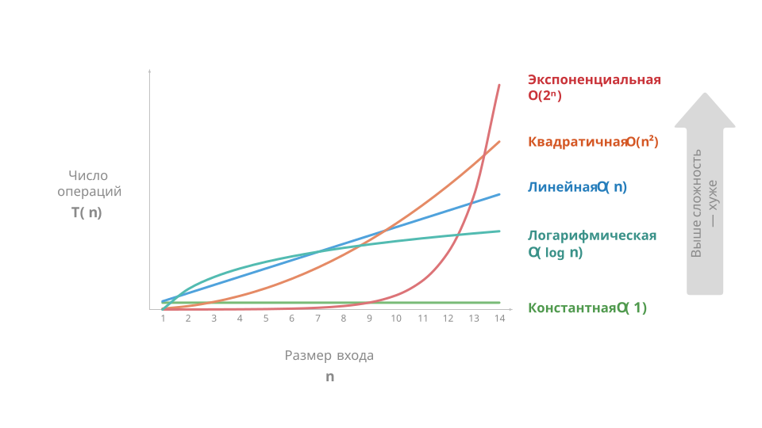
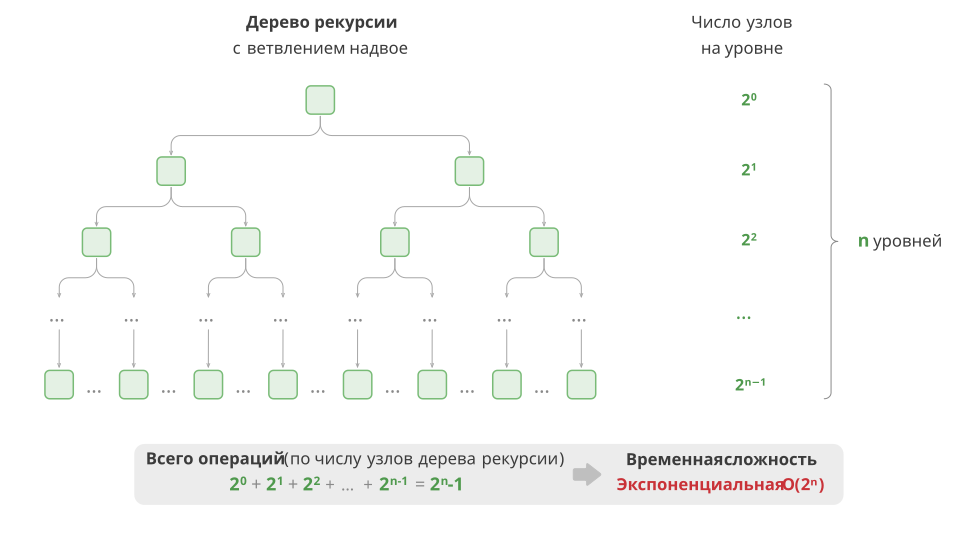
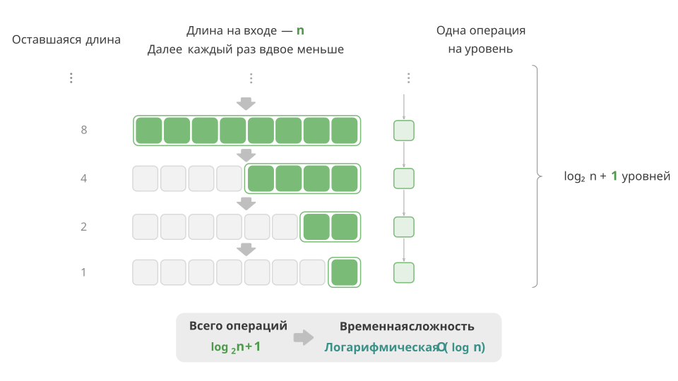

# Временная сложность

Время выполнения действительно может наглядно и точно отражать эффективность алгоритма. Но если мы захотим точно оценить время работы некоторого фрагмента кода, то столкнемся со следующими шагами.

1. **Определить платформу выполнения**, включая конфигурацию оборудования, язык программирования, системную среду и т.д., поскольку все эти факторы влияют на эффективность выполнения кода.
2. **Оценить время выполнения различных вычислительных операций**, например операция сложения `+` требует 1 нс , операция умножения `*` требует 10 нс , операция вывода `print()` требует 5 нс и т.д.
3. **Подсчитать все вычислительные операции в коде** и суммировать время выполнения всех операций, чтобы получить общее время работы.

Например, в следующем коде размер входных данных равен $n$ :

```snippet
run_time_estimate
```

Согласно приведенному выше методу, время работы алгоритма равно $(6n + 12)$ нс :

$$
1 + 1 + 10 + (1 + 5) \times n = 6n + 12
$$

Но на практике **подсчитывать реальное время выполнения алгоритма и неразумно, и нереалистично**. Во-первых, мы не хотим привязывать оценку времени к конкретной платформе, потому что алгоритм должен запускаться на самых разных платформах. Во-вторых, нам трудно определить время выполнения каждого типа операций, а это делает точную оценку крайне затруднительной.

## Подсчет тенденции роста времени

Анализ временной сложности оценивает не само время выполнения алгоритма, **а тенденцию роста этого времени по мере увеличения объема данных**.

Понятие «тенденции роста времени» выглядит довольно абстрактным, поэтому разберем его на примере. Предположим, размер входных данных равен $n$ , и даны три алгоритма `A` , `B` и `C` :

```snippet
growth_trend
```

На рисунке ниже показаны временные сложности трех приведенных выше функций.

- У алгоритма `A` есть только одна операция вывода, и время его работы не растет с увеличением $n$ . Такую временную сложность называют постоянной.
- В алгоритме `B` операция вывода выполняется в цикле $n$ раз, поэтому время работы растет линейно по мере увеличения $n$ . Такая временная сложность называется линейной.
- В алгоритме `C` операция вывода выполняется $1000000$ раз. Хотя время работы велико, оно не зависит от размера входных данных $n$ . Поэтому временная сложность `C` такая же, как у `A` , и тоже является постоянной.


Какие особенности имеет анализ временной сложности по сравнению с непосредственным измерением времени работы алгоритма?

- **Временная сложность позволяет эффективно оценивать эффективность алгоритма**. Например, время работы алгоритма `B` растет линейно: при $n > 1$ он медленнее алгоритма `A` , а при $n > 1000000$ медленнее алгоритма `C` . Если размер входных данных достаточно велик, алгоритм с постоянной сложностью обязательно лучше алгоритма с линейной сложностью. В этом и состоит смысл тенденции роста времени.
- **Метод вывода временной сложности проще**. Платформа выполнения и тип вычислительных операций не влияют на тенденцию роста времени работы алгоритма. Поэтому в анализе временной сложности можно считать время выполнения всех вычислительных операций одинаковым единичным временем и тем самым упростить подсчет времени выполнения до подсчета количества операций.
- **У временной сложности есть и определенные ограничения**. Например, хотя временная сложность алгоритмов `A` и `C` одинакова, их реальное время выполнения сильно различается. Точно так же, хотя временная сложность `B` выше, чем у `C` , при малых $n$ алгоритм `B` очевидно лучше `C` . Несмотря на эти ограничения, анализ сложности все равно остается самым эффективным и самым распространенным способом оценки алгоритмов.

## Асимптотическая верхняя граница функции

Для функции с входным размером $n$ :

```snippet
asymptotic_upper_bound
```

Пусть количество операций алгоритма является функцией от размера входных данных $n$ и обозначается как $T(n)$. Тогда для приведенной выше функции число операций равно:

$$
T(n) = 3 + 2n
$$

$T(n)$ - линейная функция, а это означает, что тенденция роста времени работы линейна, следовательно, временная сложность здесь тоже линейна.

Линейную временную сложность записывают как $O(n)$. Этот математический символ называется <u>нотацией Big $O$ (big-$O$ notation)</u> и обозначает <u>асимптотическую верхнюю границу (asymptotic upper bound)</u> функции $T(n)$ .

Иными словами, анализ временной сложности сводится к определению асимптотической верхней границы числа операций $T(n)$, и у этого понятия есть строгое математическое определение.

!!! note "Асимптотическая верхняя граница функции"

    Если существуют положительное действительное число $c$ и действительное число $n_0$ , такие что для всех $n > n_0$ выполняется $T(n) \leq c \cdot f(n)$ , то можно считать, что $f(n)$ задает асимптотическую верхнюю границу для $T(n)$. Это записывается как $T(n) = O(f(n))$ .

Как показано на рисунке ниже, вычислить асимптотическую верхнюю границу - значит найти такую функцию $f(n)$ , что при стремлении $n$ к бесконечности функции $T(n)$ и $f(n)$ имеют один и тот же порядок роста и отличаются только постоянным коэффициентом $c$.


## Метод вывода

Математическое определение асимптотической верхней границы выглядит довольно формально, и если оно пока не до конца понятно, переживать не стоит. Сначала можно освоить сам метод вывода, а в процессе дальнейшей практики постепенно почувствовать его математический смысл.

Согласно определению, после того как мы определили $f(n)$ , можно получить временную сложность $O(f(n))$ . Но как определить саму асимптотическую верхнюю границу $f(n)$ ? В целом процесс состоит из двух шагов: сначала подсчитать количество операций, затем определить асимптотическую верхнюю границу.

### Шаг 1: подсчет количества операций

Для кода это можно делать построчно сверху вниз. Однако, поскольку в выражении $c \cdot f(n)$ постоянный коэффициент $c$ может быть сколь угодно большим, **различные коэффициенты и постоянные члены в числе операций $T(n)$ можно игнорировать**. Исходя из этого принципа, можно сформулировать следующие упрощающие приемы подсчета.

1. **Игнорировать константы в $T(n)$**. Они не зависят от $n$ , а значит не влияют на временную сложность.
2. **Опускать все коэффициенты**. Например, циклы на $2n$ раз или $5n + 1$ раз можно упростить до $n$ раз, потому что коэффициент перед $n$ не влияет на временную сложность.
3. **При вложенных циклах использовать умножение**. Общее число операций равно произведению числа операций внешнего и внутреннего циклов. При этом для каждого уровня цикла по-прежнему можно применять приемы из пунктов `1.` и `2.` .

Для заданной функции мы можем использовать перечисленные выше приемы и подсчитать число операций:

```snippet
count_operations
```

Следующая формула показывает результаты подсчета до и после использования перечисленных выше приемов. В обоих случаях выводимая временная сложность равна $O(n^2)$ .

$$
\begin{aligned}
T(n) & = 2n(n + 1) + (5n + 1) + 2 & \text{полный подсчет (-.-|||)} \newline
& = 2n^2 + 7n + 3 \newline
T(n) & = n^2 + n & \text{ленивый подсчет (o.O)}
\end{aligned}
$$

### Шаг 2: определение асимптотической верхней границы

**Временная сложность определяется старшим по степени членом в $T(n)$**. Это связано с тем, что при стремлении $n$ к бесконечности именно старший член начинает доминировать, а влиянием остальных членов можно пренебречь.

В таблице ниже приведены несколько примеров. Некоторые значения специально сделаны преувеличенными, чтобы подчеркнуть вывод: коэффициент не способен изменить порядок. Когда $n$ стремится к бесконечности, эти константы становятся несущественными.

<p align="center"> Таблица <id> &nbsp; Временная сложность, соответствующая разному количеству операций </p>

| Число операций $T(n)$ | Временная сложность $O(f(n))$ |
| ---------------------- | -------------------- |
| $100000$               | $O(1)$               |
| $3n + 2$               | $O(n)$               |
| $2n^2 + 3n + 2$        | $O(n^2)$             |
| $n^3 + 10000n^2$       | $O(n^3)$             |
| $2^n + 10000n^{10000}$ | $O(2^n)$             |

## Распространенные типы

Пусть размер входных данных равен $n$. Распространенные типы временной сложности показаны на рисунке ниже в порядке от меньшей к большей.

$$
\begin{aligned}
& O(1) < O(\log n) < O(n) < O(n \log n) < O(n^2) < O(2^n) < O(n!) \newline
& \text{Постоянная} < \text{Логарифмическая} < \text{Линейная} < \text{Линейно-логарифмическая} < \text{Квадратичная} < \text{Экспоненциальная} < \text{Факториальная}
\end{aligned}
$$



### Постоянная сложность $O(1)$

Число операций при постоянной сложности не зависит от размера входных данных $n$ , то есть не изменяется вместе с изменением $n$ .

В следующей функции, хотя число операций `size` может быть большим, оно не зависит от размера входных данных $n$ , поэтому временная сложность по-прежнему равна $O(1)$ :

```src
[file]{time_complexity}-[class]{}-[func]{constant}
```

### Линейная сложность $O(n)$

Линейная сложность характеризуется тем, что число операций растет линейно относительно размера входных данных $n$ . Линейная сложность обычно встречается в одноуровневых циклах:

```src
[file]{time_complexity}-[class]{}-[func]{linear}
```

Операции обхода массива и обхода связного списка имеют временную сложность $O(n)$ , где $n$ - длина массива или списка:

```src
[file]{time_complexity}-[class]{}-[func]{array_traversal}
```

Стоит отметить, что **размер входных данных $n$ нужно определять конкретно в зависимости от типа входа**. Например, в первом примере переменная $n$ сама является размером входных данных. Во втором примере размером данных служит длина массива.

### Квадратичная сложность $O(n^2)$

Квадратичная сложность характеризуется тем, что число операций растет квадратично относительно размера входных данных $n$ . Квадратичная сложность обычно встречается во вложенных циклах: временная сложность внешнего и внутреннего циклов равна $O(n)$ , поэтому общая временная сложность составляет $O(n^2)$ :

```src
[file]{time_complexity}-[class]{}-[func]{quadratic}
```

На рисунке ниже сравниваются три временные сложности: постоянная, линейная и квадратичная.


Возьмем в качестве примера пузырьковую сортировку: внешний цикл выполняется $n - 1$ раз, внутренний цикл выполняется $n-1$ , $n-2$ , $\dots$ , $2$ , $1$ раз, в среднем это $n / 2$ раз, поэтому временная сложность равна $O((n - 1)n / 2) = O(n^2)$ :

```src
[file]{time_complexity}-[class]{}-[func]{bubble_sort}
```

### Экспоненциальная сложность $O(2^n)$

Типичный пример экспоненциального роста в биологии - деление клеток: в начальном состоянии есть одна клетка, после одного деления их становится 2, после двух делений - 4 и так далее. После $n$ раундов деления клеток становится $2^n$ .

На рисунке ниже и в следующем коде моделируется процесс деления клеток. Временная сложность равна $O(2^n)$ . Здесь входное значение $n$ обозначает число раундов деления, а возвращаемое значение `count` обозначает общее число делений.

```src
[file]{time_complexity}-[class]{}-[func]{exponential}
```



В реальных алгоритмах экспоненциальная сложность также часто встречается в рекурсивных функциях. Например, в следующем коде процесс рекурсивно делится надвое и останавливается после $n$ разбиений:

```src
[file]{time_complexity}-[class]{}-[func]{exp_recur}
```

Экспоненциальный рост происходит очень быстро и часто встречается в переборных методах, грубой силе, поиске с возвратом и тому подобных подходах. Для задач большого масштаба экспоненциальная сложность неприемлема, и обычно приходится применять динамическое программирование, жадные алгоритмы и другие стратегии.

### Логарифмическая сложность $O(\log n)$

В противоположность экспоненциальной, логарифмическая сложность описывает ситуацию, когда **в каждом раунде размер задачи уменьшается вдвое**. Пусть размер входных данных равен $n$. Так как на каждом шаге размер уменьшается вдвое, число итераций равно $\log_2 n$ , то есть является обратной функцией к $2^n$ .

На рисунке ниже и в следующем коде моделируется процесс, в котором **в каждом раунде размер задачи уменьшается вдвое**. Временная сложность равна $O(\log_2 n)$ и кратко записывается как $O(\log n)$ :

```src
[file]{time_complexity}-[class]{}-[func]{logarithmic}
```



Подобно экспоненциальной сложности, логарифмическая также часто встречается в рекурсивных функциях. Следующий код формирует рекурсивное дерево высотой $\log_2 n$ :

```src
[file]{time_complexity}-[class]{}-[func]{log_recur}
```

Логарифмическая сложность часто встречается в алгоритмах, основанных на стратегии «разделяй и властвуй», и отражает идеи разбиения на части и упрощения сложной задачи. Она растет медленно и считается одной из самых желательных временных сложностей после константной.

!!! tip "Каково основание у $O(\log n)$ ?"

    Точнее говоря, «разделение на $m$ частей» соответствует временной сложности $O(\log_m n)$ . А по формуле перехода к другому основанию логарифма мы получаем равные по сложности выражения с разными основаниями:

    $$
    O(\log_m n) = O(\log_k n / \log_k m) = O(\log_k n)
    $$

    Иными словами, основание $m$ можно менять без влияния на сложность. Поэтому мы обычно опускаем основание $m$ и напрямую записываем логарифмическую сложность как $O(\log n)$ .

### Линейно-логарифмическая сложность $O(n \log n)$

Линейно-логарифмическая сложность часто встречается в рекурсивных разбиениях, где временная сложность одного измерения равна $O(\log n)$ , а другого - $O(n)$ . Соответствующий код выглядит следующим образом:

```src
[file]{time_complexity}-[class]{}-[func]{linear_log_recur}
```

На рисунке ниже показано, как возникает линейно-логарифмическая сложность. Общее число операций на каждом уровне бинарного дерева равно $n$ , а дерево имеет $\log_2 n + 1$ уровней, поэтому временная сложность равна $O(n \log n)$ .


Временная сложность основных алгоритмов сортировки обычно равна $O(n \log n)$ , например у быстрой сортировки, сортировки слиянием, пирамидальной сортировки и т.д.

### Факториальная сложность $O(n!)$

Факториальная сложность соответствует математической задаче полной перестановки. Если даны $n$ попарно различных элементов, то число всех возможных перестановок равно:

$$
n! = n \times (n - 1) \times (n - 2) \times \dots \times 2 \times 1
$$

Факториал обычно реализуют через рекурсию. Как показано на рисунке ниже и в следующем коде, на первом уровне происходит ветвление на $n$ подзадач, на втором - на $n - 1$ и так далее, пока на $n$-м уровне ветвление не прекращается:

```src
[file]{time_complexity}-[class]{}-[func]{factorial_recur}
```


Следует отметить, что поскольку при $n \geq 4$ всегда выполняется $n! > 2^n$ , факториальная сложность растет еще быстрее, чем экспоненциальная, и при больших $n$ становится неприемлемой.

## Худшая, лучшая и средняя временная сложность

**Временная эффективность алгоритма часто не фиксирована, а зависит от распределения входных данных**. Предположим, на вход подается массив `nums` длины $n$ , состоящий из чисел от $1$ до $n$ , каждое из которых встречается ровно один раз. При этом порядок элементов случайно перемешан. Задача состоит в том, чтобы вернуть индекс элемента $1$ . Тогда можно сделать следующие выводы.

- Когда `nums = [?, ?, ..., 1]` , то есть когда последний элемент равен $1$ , нужно полностью пройти по массиву, **что дает худшую временную сложность $O(n)$** .
- Когда `nums = [1, ?, ?, ...]` , то есть когда первый элемент равен $1$ , независимо от длины массива продолжать обход не нужно, **что дает лучшую временную сложность $\Omega(1)$** .

Худшая временная сложность соответствует асимптотической верхней границе функции и обозначается нотацией Big $O$ . Соответственно, лучшая временная сложность соответствует асимптотической нижней границе функции и обозначается символом $\Omega$ :

```src
[file]{worst_best_time_complexity}-[class]{}-[func]{find_one}
```

Стоит отметить, что на практике лучшая временная сложность используется редко, поскольку обычно она достигается лишь с очень малой вероятностью и может вводить в заблуждение. **Худшая временная сложность гораздо практичнее, потому что задает безопасную оценку эффективности** и позволяет уверенно использовать алгоритм.

Из приведенного выше примера видно, что худшая и лучшая временные сложности возникают только при особых распределениях данных. Вероятность таких случаев может быть низкой, и они не всегда реально отражают эффективность алгоритма. Напротив, **средняя временная сложность способна показать эффективность алгоритма на случайных входных данных** и обозначается символом $\Theta$ .

Для некоторых алгоритмов можно относительно просто вывести средний случай при случайном распределении данных. Например, в приведенном выше примере входной массив перемешан, а вероятность появления элемента $1$ на любом индексе одинакова. Следовательно, среднее число итераций алгоритма равно половине длины массива, то есть $n / 2$ , а средняя временная сложность равна $\Theta(n / 2) = \Theta(n)$ .

Однако для более сложных алгоритмов вычислить среднюю временную сложность часто непросто, потому что трудно проанализировать полное математическое ожидание на заданном распределении данных. В таких случаях обычно используют худшую временную сложность как критерий оценки эффективности алгоритма.

!!! question "Почему символ $\Theta$ встречается так редко?"

    Возможно, потому что символ $O$ звучит слишком привычно, и мы часто используем его для обозначения средней временной сложности. Но строго говоря, это некорректно. В этой книге и в других материалах, если встретится выражение вроде «средняя временная сложность $O(n)$», просто понимай его как $\Theta(n)$ .
