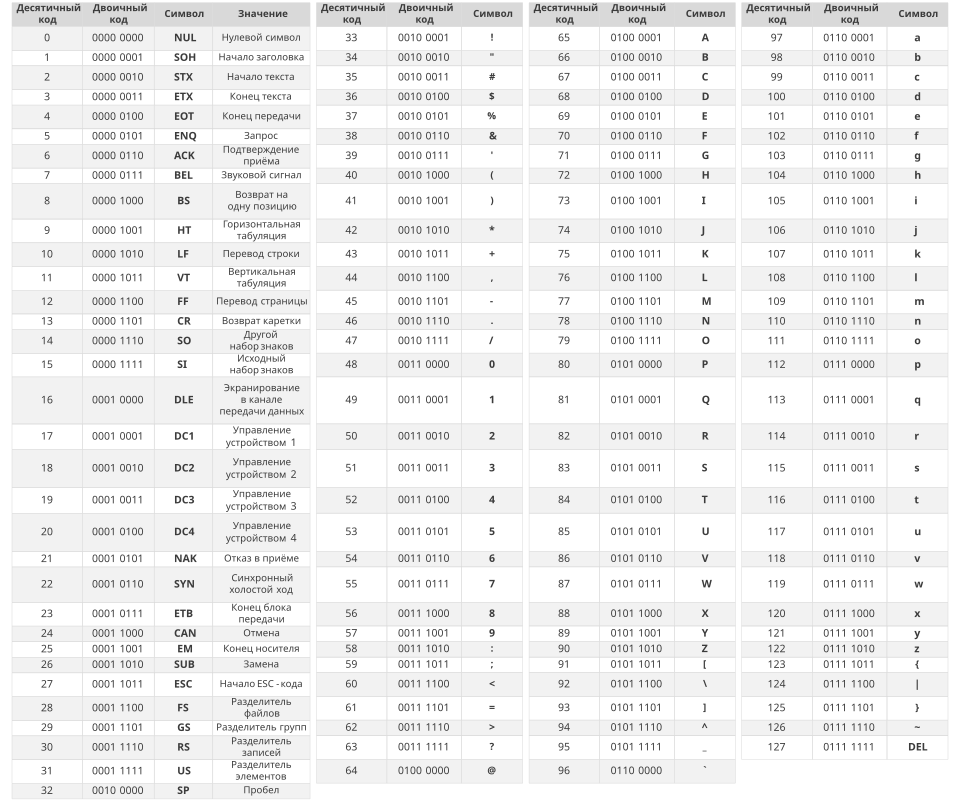
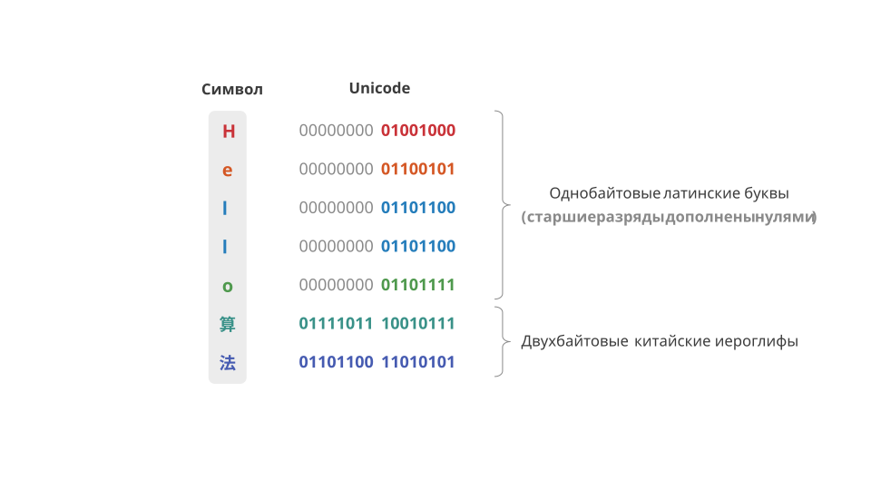
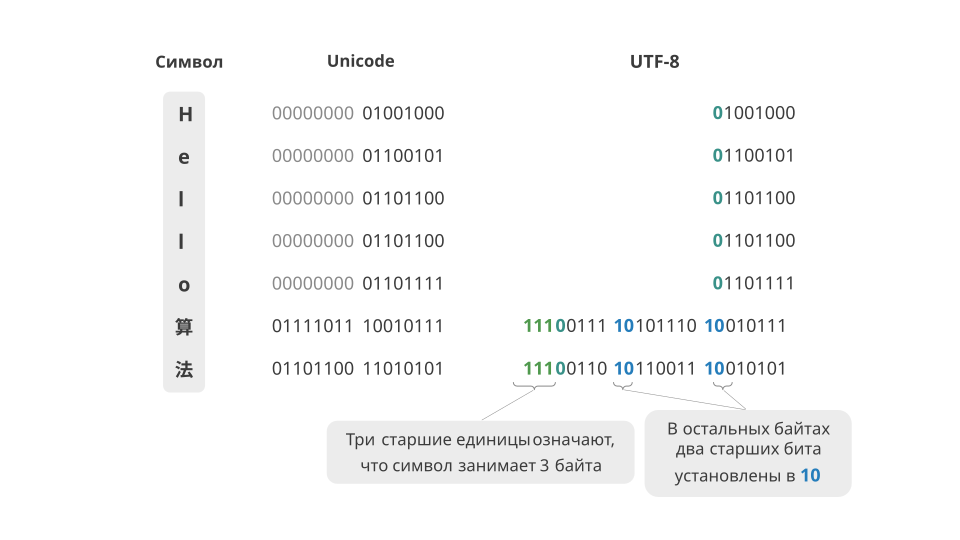

# Кодирование символов *

Все данные в компьютере хранятся в двоичном виде, и символы `char` тоже. Для их представления нужен набор символов, который устанавливает взаимно однозначное соответствие между символами и двоичными числами. С помощью такой таблицы компьютер может преобразовать число в соответствующий символ.

## Набор символов ASCII

<u>ASCII</u> — один из самых ранних наборов символов. Его полное название — American Standard Code for Information Interchange (американский стандартный код для обмена информацией). На символ отводится 7 бит (младшие семь бит байта), что позволяет представить до 128 разных символов. Как видно на рисунке, в ASCII входят прописные и строчные английские буквы, цифры от 0 до 9, знаки препинания и управляющие символы, например перевода строки и табуляции.

Однако **для записи текста средствами ASCII доступен лишь английский алфавит**. По мере распространения компьютеров по миру появился расширенный набор символов <u>EASCII</u> для записи и других языков. Семибитный код ASCII расширили до восьми бит, что позволило представить 256 разных символов.

В разных регионах со временем появились свои варианты EASCII. Первые 128 символов в них совпадали с ASCII, а остальные 128 выбирали в зависимости от потребностей языка.

## Набор символов GBK

Со временем стало ясно, что **даже EASCII вмещает недостаточно символов для многих языков**. Например, китайских иероглифов насчитывается около ста тысяч, и только в повседневной жизни используются несколько тысяч. В 1980 году Государственное управление стандартов Китая выпустило набор <u>GB2312</u>. В него вошли 6763 иероглифа, что в основном удовлетворяло тогдашним потребностям компьютерной обработки китайского текста.

Тем не менее в GB2312 отсутствовали некоторые редкие и традиционные иероглифы. Расширив GB2312, получили набор <u>GBK</u>, включающий 21 886 китайских иероглифов. В GBK символы ASCII кодируются одним байтом, а иероглифы — двумя.

## Набор символов Unicode

С развитием вычислительной техники появилось множество наборов символов и стандартов кодирования. Это создало проблемы. Во-первых, наборы обычно охватывали лишь определённые языки и плохо подходили для многоязычного текста. Во-вторых, даже для одного языка существовали разные стандарты. Если два компьютера использовали разные кодировки, переданный текст мог превратиться в нечитаемый набор знаков.

Исследователи того времени задались вопросом: **если создать достаточно полный набор, включающий письменности всех языков мира и всевозможные знаки, нельзя ли тем самым решить проблемы многоязычных текстов и искажений при обмене**? Из этой идеи и вырос всеобъемлющий набор символов Unicode.

<u>Unicode</u> (по-китайски его название означает «единый код») теоретически вмещает более миллиона символов. Его цель — объединить символы со всего мира в одном наборе для обработки и отображения разных письменностей и сократить число искажений из-за несовпадающих стандартов кодирования. Со времени первой публикации в 1991 году Unicode постоянно пополняется новыми письменностями и знаками. К сентябрю 2022 года в него входило 149 186 символов, включая знаки разных языков, специальные символы и эмодзи.

Как универсальный набор символов Unicode присваивает каждому символу уникальный номер — кодовую точку. Диапазон от U+0000 до U+10FFFF образует единое пространство номеров. Однако **само присвоение кодовых точек в Unicode ещё не определяет, как хранить их в компьютере**. Как системе разбирать текст, если в нём встречаются кодовые точки разной длины? Например, как определить, обозначают два байта один двухбайтовый символ или два однобайтовых?

**Прямое решение — хранить все символы в кодах одинаковой длины**. Как показано на рисунке, каждому символу «Hello» достаточно одного байта, а каждому иероглифу в «算法» нужны два байта. Дополнив старшие разряды нулями, можно записать каждый символ фразы «Hello 算法» в двух байтах. Тогда система сможет восстановить текст, читая по два байта на символ.

Но, как видно из ASCII, для английской буквы достаточно одного байта. При предложенном подходе английский текст займёт вдвое больше места, чем в ASCII. Чтобы расходовать память экономнее, нужна более эффективная кодировка Unicode.

## Кодировка UTF-8

UTF-8 — самая распространённая в мире кодировка Unicode. **Это кодировка переменной длины**: в зависимости от символа требуется от 1 до 4 байтов. Символы ASCII занимают один байт, расширенные латинские и греческие буквы обычно два, распространённые китайские иероглифы — три, а некоторые более редкие символы — четыре.

В UTF-8 действуют два несложных правила.

- У однобайтового символа старший бит равен $0$, а остальные семь бит содержат значение кодовой точки Unicode. Первые 128 кодовых точек Unicode отведены символам ASCII. Поэтому **UTF-8 обратно совместима с ASCII** и позволяет читать даже старые тексты в ASCII.
- Если символ занимает $n$ байтов, где $n > 1$, то в первом байте старшие $n$ бит устанавливаются в $1$, а следующий бит, номер $n + 1$ при счёте слева, — в $0$. Начиная со второго байта старшие два бита каждого байта равны $10$. Во все оставшиеся позиции записываются биты кодовой точки Unicode.

На рисунке показана строка «Hello算法» в UTF-8. У многобайтового символа старшие $n$ бит первого байта равны $1$. Поэтому по числу последовательных $1$ в начале байта система определяет длину символа: $n$ байтов.

Почему старшие два бита каждого из остальных байтов равны $10$? Префикс $10$ служит проверочным признаком: если система начнёт разбирать текст с неверной позиции, начальные биты $10$ помогут сразу обнаружить ошибку.

Префикс $10$ подходит для проверки, поскольку по правилам UTF-8 ни один символ не может начинаться с битов $10$. Докажем от противного. Пусть символ начинается с $10$. По числу начальных единиц его длина должна равняться $1$ байту, то есть это символ ASCII. Но старший бит символа ASCII равен $0$. Получаем противоречие.

Помимо UTF-8 распространены ещё две кодировки.

- **UTF-16**. Один символ занимает 2 или 4 байта. Все символы ASCII и часто встречающиеся символы других письменностей представляются двумя байтами, некоторым символам нужны четыре. Для двухбайтового символа значение кода UTF-16 совпадает с его кодовой точкой Unicode.
- **UTF-32**. Каждый символ занимает 4 байта. Поэтому UTF-32 требует больше места, чем UTF-8 и UTF-16, особенно если в тексте много символов ASCII.

По расходу памяти UTF-8 очень выгодна для английских букв: на каждую нужен лишь 1 байт. Для некоторых других письменностей, например распространённых китайских иероглифов, экономнее UTF-16: ей достаточно 2 байтов там, где UTF-8 может потребоваться 3.

По совместимости наиболее универсальна UTF-8: многие инструменты и библиотеки поддерживают её в первую очередь.

## Кодирование символов в языках программирования

Исторически во многих языках строки во время выполнения представлялись последовательностями единиц фиксированной ширины, как в UTF-16 или UTF-32. При фиксированной ширине строку можно обрабатывать как массив, что даёт следующие преимущества.

- **Произвольный доступ**. В строке UTF-16 легко обратиться по индексу к кодовой единице. UTF-8 имеет переменную длину: чтобы найти символ с порядковым номером $i$, приходится идти от начала строки до символа номер $i$. Это занимает время $O(n)$.
- **Подсчёт символов**. Как и произвольный доступ, определение длины строки UTF-16 в кодовых единицах — операция $O(1)$. Чтобы сосчитать символы в строке UTF-8, требуется пройти всю строку.
- **Операции со строками**. Многие операции со строками UTF-16, в том числе разбиение, конкатенацию, вставку и удаление, проще реализовать. Для строк UTF-8 обычно нужны дополнительные вычисления, чтобы результат оставался корректной последовательностью UTF-8.

При выборе внутреннего представления строк разработчики языка учитывают множество факторов. Рассмотрим несколько интересных примеров.

- Тип `String` в Java использует UTF-16 с двухбайтовыми кодовыми единицами. На раннем этапе разработки Java предполагалось, что 16 бит хватит для всех возможных символов. Впоследствии выяснилось, что это не так. Unicode вышел за пределы 16 бит, и теперь один символ в Java может представляться двумя 16-битными значениями — суррогатной парой.
- В JavaScript и TypeScript строки представлены в UTF-16 по причинам, сходным с историей Java. Когда компания Netscape впервые выпустила JavaScript в 1995 году, Unicode ещё только развивался и для всех его тогдашних символов хватало 16 бит.
- В C# используется UTF-16 главным образом потому, что платформу .NET разработала компания Microsoft, а эта кодировка широко применяется в её технологиях, в том числе в Windows.

Создатели этих языков недооценили количество символов, и для символов Unicode за пределами 16 бит пришлось использовать суррогатные пары. Это был вынужденный компромисс. С одной стороны, в строках с суррогатными парами символ занимает 2 или 4 байта, так что преимущество фиксированной длины теряется. С другой стороны, обработка пар требует дополнительного кода, усложняя программирование и отладку.

По этим причинам в некоторых языках выбрали другие способы представления строк.

- В Python тип `str` хранит текст Unicode в гибком представлении: ширина символа зависит от наибольшей кодовой точки в строке. Если все символы входят в ASCII, каждому отводится 1 байт. Если встречаются символы за пределами ASCII, но все они входят в основную многоязычную плоскость (BMP), каждому отводится 2 байта. Если есть символы за пределами BMP, каждому отводится 4 байта.
- Тип `string` в Go использует для текста кодировку UTF-8. Для отдельной кодовой точки Unicode предусмотрен тип `rune`.
- В Rust типы `str` и `String` используют UTF-8. Тип `char` предназначен для одной кодовой точки Unicode.

Мы рассматривали внутреннее представление строк в языках программирования. **Хранение строки в файле и её передача по сети — отдельные вопросы**. Для файлов и передачи по сети обычно используют UTF-8, сочетая совместимость с экономным расходом места.
