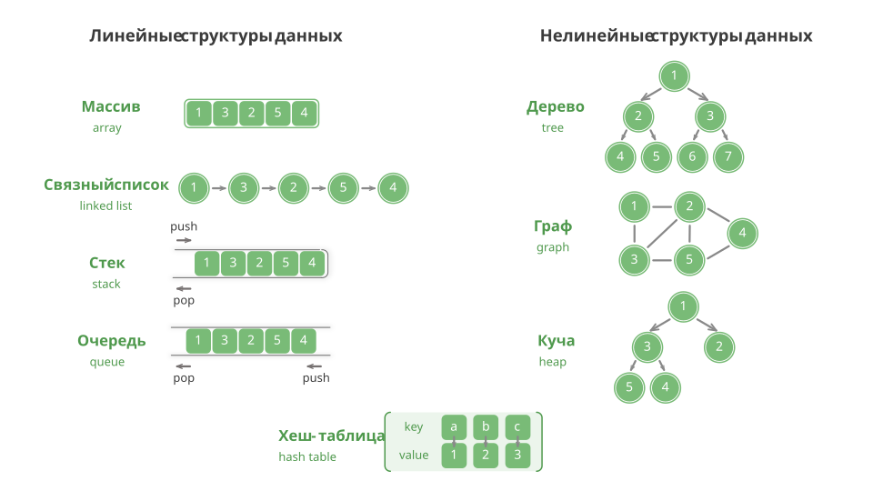
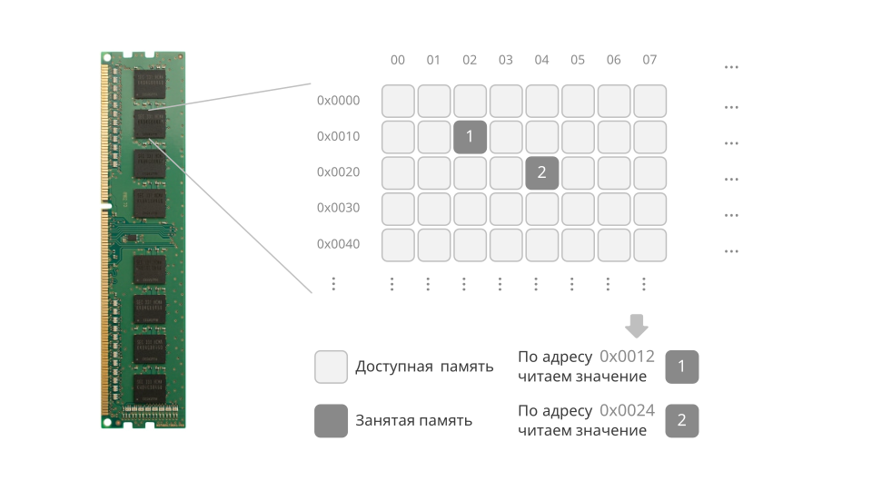
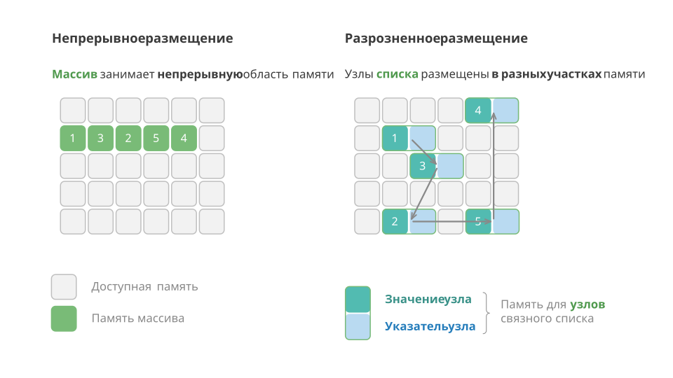

# Классификация структур данных

К распространённым структурам данных относятся массивы, связные списки, стеки, очереди, хеш-таблицы, деревья, кучи и графы. Их можно классифицировать по двум признакам: логической и физической организации.

## Логическая структура: линейная и нелинейная

**Логическая структура описывает отношения между элементами данных**. В массиве и связном списке элементы выстроены в определённом порядке, что выражает линейную связь. В дереве данные образуют иерархию сверху вниз, связывающую предков и потомков. Граф состоит из вершин и рёбер и отражает более сложные сетевые связи.

Как показано на рисунке, логические структуры делятся на линейные и нелинейные. Линейную структуру легко представить: элементы логически выстраиваются в один ряд. Нелинейные структуры имеют иную организацию.

- **Линейные структуры данных**: массив, связный список, стек и очередь. Порядок элементов задан последовательными связями «один к одному».
- **Нелинейные структуры данных**: дерево, куча и граф.

Два распространённых вида нелинейных структур — древовидные и сетевые.

- **Древовидные структуры**: дерево и куча. Элементы связаны отношением «один ко многим».
- **Сетевые структуры**: граф. Элементы связаны отношением «многие ко многим».

В хеш-таблице значение находят по ключу. Это соответствие показано на рисунке отдельно.

## Физическая структура: непрерывное и разрозненное размещение

**При выполнении алгоритма обрабатываемые данные хранятся главным образом в оперативной памяти**. Ниже показан модуль памяти. В каждом чёрном корпусе находится микросхема, предоставляющая часть памяти. Представим память в виде огромной таблицы Excel, в каждой ячейке которой помещается определённое количество данных.

**Система обращается к данным в нужном месте по адресу памяти**. Как показано на рисунке, компьютер по определённым правилам присваивает каждой ячейке таблицы номер, так что у каждой позиции есть уникальный адрес. По этим адресам программа получает доступ к данным.

!!! tip

    Сравнение памяти с таблицей Excel — упрощённая аналогия. Реальная память устроена сложнее: здесь важны адресное пространство, управление памятью, кеширование, виртуальная и физическая память.

Память служит общим ресурсом для всех программ. Когда участок занят одной программой, другие, как правило, не могут одновременно использовать его для своих данных. **Поэтому при проектировании структур данных и алгоритмов важно учитывать доступную память**. Например, пиковая потребность алгоритма в памяти не должна превышать свободный объём. Если нет большого непрерывного участка, выбранная структура должна допускать размещение по частям.

Как показано на рисунке, **физическая структура описывает способ хранения данных в памяти компьютера**. Различают непрерывное размещение (массив) и разрозненное размещение (связный список). От физической организации зависит, как выполняются доступ, изменение, вставка и удаление. По затратам времени и памяти эти два способа дополняют друг друга.

Важно понимать, что **все структуры данных реализуются на основе массивов, связных списков или их сочетания**. Например, и стек, и очередь можно реализовать как массивом, так и связным списком, а хеш-таблица может включать и массив, и связные списки.

- **На основе массива реализуют** стеки, очереди, хеш-таблицы, деревья, кучи, графы, матрицы, тензоры (массивы размерности $\geq 3$) и другие структуры.
- **На основе связных списков реализуют** стеки, очереди, хеш-таблицы, деревья, кучи, графы и другие структуры.

После создания связного списка его длину по-прежнему можно менять во время выполнения программы, поэтому его называют динамической структурой данных. Длина массива после создания фиксирована, и его называют статической структурой. Впрочем, можно выделить память заново и получить массив другой длины, что придаёт массивам некоторую «динамичность».

!!! tip

    Если физическую организацию пока трудно представить, сначала прочитайте следующую главу, а затем вернитесь к этому разделу.
