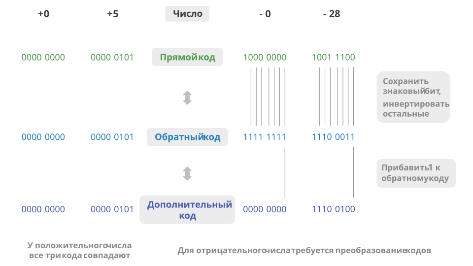
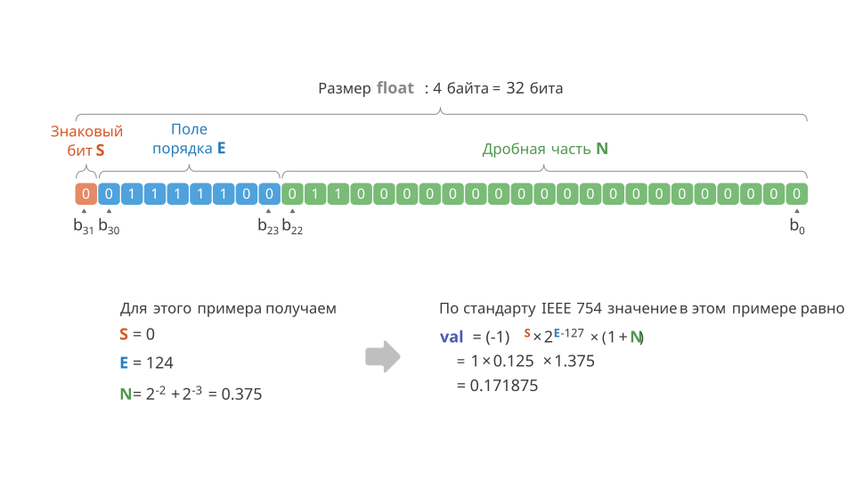

# 3.3 &nbsp; Кодирование чисел *

!!! tip

    Звёздочкой * в заголовке отмечены необязательные разделы книги. Если у вас мало времени или материал пока кажется трудным, можно его пропустить и вернуться к нему после изучения обязательных разделов.

## 3.3.1 &nbsp; Прямой, обратный и дополнительный коды

В таблице из предыдущего раздела видно, что у всех приведённых целочисленных типов отрицательных значений на одно больше, чем положительных. Например, диапазон типа `byte` равен $[-128, 127]$. Чтобы понять этот неожиданный результат, разберём прямой, обратный и дополнительный коды.

Для начала отметим, что **целые числа со знаком в компьютере хранятся в дополнительном коде**. Прежде чем выяснить почему, определим все три представления.

- **Прямой код**. Старший бит двоичного представления отводится под знак: $0$ означает плюс, $1$ — минус. Остальные биты задают модуль числа.
- **Обратный код**. У положительного числа он совпадает с прямым. У отрицательного числа инвертируют все биты прямого кода, кроме знакового.
- **Дополнительный код**. У положительного числа он совпадает с прямым. Для отрицательного числа к обратному коду прибавляют $1$.

На рисунке показаны переходы между прямым, обратным и дополнительным кодами.

{ class="animation-figure" }

 Рисунок 3-4 &nbsp; Преобразования между прямым, обратным и дополнительным кодами 

<u>Прямой код (sign-magnitude)</u> наиболее нагляден, но у него есть ограничения. Во-первых, **с прямым кодом отрицательного числа нельзя выполнять обычное двоичное сложение без учёта знака**. Например, если так вычислить $1 + (-2)$ в прямом коде, получится $-3$, что явно неверно.

$$
\begin{aligned}
& 1 + (-2) \newline
& \rightarrow 0000 \; 0001 + 1000 \; 0010 \newline
& = 1000 \; 0011 \newline
& \rightarrow -3
\end{aligned}
$$

Для решения этой проблемы стали использовать <u>обратный код (1's complement)</u>. Если перевести числа из прямого кода в обратный, вычислить $1 + (-2)$ и вернуть результат в прямой код, получится верный ответ $-1$.

$$
\begin{aligned}
& 1 + (-2) \newline
& \rightarrow 0000 \; 0001 \; \text{(прямой код)} + 1000 \; 0010 \; \text{(прямой код)} \newline
& = 0000 \; 0001 \; \text{(обратный код)} + 1111  \; 1101 \; \text{(обратный код)} \newline
& = 1111 \; 1110 \; \text{(обратный код)} \newline
& = 1000 \; 0001 \; \text{(прямой код)} \newline
& \rightarrow -1
\end{aligned}
$$

Во-вторых, **у нуля в прямом коде два представления: $+0$ и $-0$**. Две разные двоичные записи одного числа создают неоднозначность. Например, при проверке условия разница между кодами положительного и отрицательного нуля может привести к неверному результату. Для учёта обоих представлений понадобятся дополнительные проверки, что может замедлить вычисления.

$$
\begin{aligned}
+0 & \rightarrow 0000 \; 0000 \newline
-0 & \rightarrow 1000 \; 0000
\end{aligned}
$$

В обратном коде также есть положительный и отрицательный нули, поэтому следующим шагом стал <u>дополнительный код (2's complement)</u>. Проследим, как отрицательный нуль переходит из прямого кода в обратный и дополнительный:

$$
\begin{aligned}
-0 \rightarrow \; & 1000 \; 0000 \; \text{(прямой код)} \newline
= \; & 1111 \; 1111 \; \text{(обратный код)} \newline
= 1 \; & 0000 \; 0000 \; \text{(дополнительный код)} \newline
\end{aligned}
$$

При добавлении $1$ к обратному коду отрицательного нуля возникает перенос. Тип `byte` содержит только 8 бит, поэтому значение $1$ в девятом разряде отбрасывается. Таким образом, **дополнительный код отрицательного нуля равен $0000 \; 0000$ и совпадает с дополнительным кодом положительного нуля**. У нуля остаётся только одно представление, и неоднозначность исчезает.

Остаётся последний вопрос. Диапазон типа `byte` равен $[-128, 127]$. Откуда берётся дополнительное отрицательное значение $-128$? У каждого целого числа в диапазоне $[-127, +127]$ есть прямой, обратный и дополнительный коды, причём прямой и дополнительный коды можно преобразовать друг в друга.

Однако **у дополнительного кода $1000 \; 0000$ нет соответствующего прямого кода**. Если применить правило преобразования, получится прямой код $0000 \; 0000$. Возникает противоречие: этот прямой код обозначает $0$, а дополнительный код нуля должен совпадать с ним самим. Поэтому особый дополнительный код $1000 \; 0000$ обозначает $-128$. Действительно, вычисление $(-1) + (-127)$ в дополнительном коде даёт $-128$.

$$
\begin{aligned}
& (-127) + (-1) \newline
& \rightarrow 1111 \; 1111 \; \text{(прямой код)} + 1000 \; 0001 \; \text{(прямой код)} \newline
& = 1000 \; 0000 \; \text{(обратный код)} + 1111  \; 1110 \; \text{(обратный код)} \newline
& = 1000 \; 0001 \; \text{(дополнительный код)} + 1111  \; 1111 \; \text{(дополнительный код)} \newline
& = 1000 \; 0000 \; \text{(дополнительный код)} \newline
& \rightarrow -128
\end{aligned}
$$

Вы, вероятно, заметили, что во всех примерах выполнялось сложение. За этим стоит важное обстоятельство: **в основе арифметических схем компьютера лежит операция сложения**. По сравнению с умножением, делением и вычитанием сложение проще реализовать аппаратно и легче распараллелить, поэтому оно выполняется быстрее.

Это, конечно, не ограничивает компьютер одним сложением. **Сочетая сложение с базовыми логическими операциями, можно реализовать другие математические действия**. Например, вместо вычитания $a - b$ можно выполнить сложение $a + (-b)$. Умножение и деление можно свести к повторным сложениям или вычитаниям.

Теперь понятно, почему используется дополнительный код. Для сложения положительных и отрицательных чисел подходят одни и те же схемы и операции. Не нужны ни особая схема вычитания, ни специальные проверки для положительного и отрицательного нулей. Это существенно упрощает устройство аппаратуры и повышает эффективность вычислений.

У дополнительного кода есть и другие интересные свойства. Здесь мы ограничимся этим знакомством, а заинтересованный читатель может изучить их подробнее.

## 3.3.2 &nbsp; Кодирование чисел с плавающей точкой

Вы могли заметить: `int` и `float` занимают по 4 байта, но диапазон `float` гораздо шире, чем у `int`. На первый взгляд это неожиданно: ведь `float` нужно представлять ещё и дробную часть, так что диапазон, казалось бы, должен сократиться.

Дело в том, что **для чисел с плавающей точкой типа `float` используется другое представление**. Запишем 32-битное двоичное число в виде:

$$
b_{31} b_{30} b_{29} \ldots b_2 b_1 b_0
$$

Согласно стандарту IEEE 754, 32-битное значение `float` состоит из трёх полей.

- Знак $\mathrm{S}$: один бит, $b_{31}$.
- Порядок $\mathrm{E}$: восемь бит, $b_{30} b_{29} \ldots b_{23}$.
- Дробная часть $\mathrm{N}$: 23 бита, $b_{22} b_{21} \ldots b_0$.

Значение, соответствующее двоичной записи `float`, вычисляется так:

$$
\text {val} = (-1)^{b_{31}} \times 2^{\left(b_{30} b_{29} \ldots b_{23}\right)_2-127} \times\left(1 . b_{22} b_{21} \ldots b_0\right)_2
$$

В десятичной записи формула принимает вид:

$$
\text {val}=(-1)^{\mathrm{S}} \times 2^{\mathrm{E} -127} \times (1 + \mathrm{N})
$$

Входящие в неё величины принимают следующие значения:

$$
\begin{aligned}
\mathrm{S} \in & \{ 0, 1\}, \quad \mathrm{E} \in \{ 1, 2, \dots, 254 \} \newline
(1 + \mathrm{N}) = & (1 + \sum_{i=1}^{23} b_{23-i} 2^{-i}) \subset [1, 2 - 2^{-23}]
\end{aligned}
$$

{ class="animation-figure" }

 Рисунок 3-5 &nbsp; Пример вычисления значения float по стандарту IEEE 754 

На рисунке показан пример с $\mathrm{S} = 0$, $\mathrm{E} = 124$ и $\mathrm{N} = 2^{-2} + 2^{-3} = 0.375$. Подставим значения:

$$
\text { val } = (-1)^0 \times 2^{124 - 127} \times (1 + 0.375) = 0.171875
$$

Теперь ответим на исходный вопрос: **представление `float` содержит поле порядка, поэтому его диапазон намного шире диапазона `int`**. Из приведённых вычислений следует, что наибольшее положительное значение `float` равно $2^{254 - 127} \times (2 - 2^{-23}) \approx 3.4 \times 10^{38}$. Изменив знаковый бит, получим наименьшее отрицательное значение.

**Более широкий диапазон `float` достигается за счёт точности**. Тип `int` использует все 32 бита для представления целых чисел, и значения расположены равномерно. У типа `float` часть битов отведена под порядок, поэтому при увеличении модуля числа расстояние между соседними представимыми значениями в целом растёт.

Как показано в таблице, значения поля порядка $\mathrm{E} = 0$ и $\mathrm{E} = 255$ имеют особый смысл: **они используются, в частности, для представления нуля, бесконечности и $\mathrm{NaN}$**.

 Таблица 3-2 &nbsp; Значения поля порядка 

| Поле порядка E           | Дробная часть $\mathrm{N} = 0$ | Дробная часть $\mathrm{N} \ne 0$ | Формула                                                               |
| ------------------ | ----------------------- | ------------------------- | ---------------------------------------------------------------------- |
| $0$                | $\pm 0$                 | Субнормальное число                  | $(-1)^{\mathrm{S}} \times 2^{-126} \times (0.\mathrm{N})$              |
| $1, 2, \dots, 254$ | Нормальное число                  | Нормальное число                    | $(-1)^{\mathrm{S}} \times 2^{(\mathrm{E} -127)} \times (1.\mathrm{N})$ |
| $255$              | $\pm \infty$            | $\mathrm{NaN}$            |                                                                        |

Субнормальные числа позволяют представлять гораздо меньшие по модулю значения вблизи нуля. Наименьшее положительное нормальное число — $2^{-126}$, а наименьшее положительное субнормальное — $2^{-126} \times 2^{-23}$.

Тип двойной точности `double` использует представление, сходное с `float`. Не будем разбирать его отдельно.
