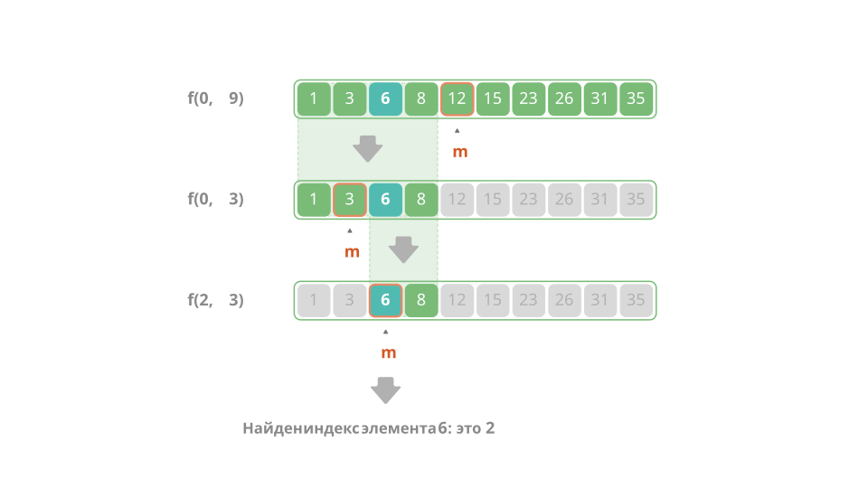

# 12.2 &nbsp; Поиск методом «разделяй и властвуй»

Как мы уже видели, алгоритмы поиска можно разделить на две большие группы.

- **Поиск перебором** обходит структуру данных и занимает $O(n)$ времени.
- **Адаптивный поиск** использует особенности организации данных или заранее известные сведения о них. Время поиска может составлять $O(\log n)$ или даже $O(1)$.

На практике **алгоритмы поиска со временем $O(\log n)$ часто опираются на метод «разделяй и властвуй»**. Примеры — двоичный поиск и поиск в деревьях.

- На каждом шаге двоичного поиска исходная задача (найти элемент в массиве) сводится к меньшей (найти его в одной половине массива). Так продолжается, пока массив не опустеет или элемент не будет найден.
- Деревья наглядно воплощают идею «разделяй и властвуй». В двоичном дереве поиска, АВЛ-дереве и куче различные операции имеют временную сложность $O(\log n)$.

Рассмотрим, как двоичный поиск использует эту стратегию.

- **Задача допускает разбиение**. Сравнивая средний элемент с искомым, мы рекурсивно сводим исходную задачу поиска в массиве к подзадаче поиска в одной его половине.
- **Подзадачи независимы**. На каждом шаге двоичного поиска обрабатывается лишь одна подзадача. Остальные не влияют на её решение.
- **Объединять решения подзадач не требуется**. Мы ищем конкретный элемент, поэтому, как только решена подзадача, решена и исходная задача.

Преимущество в скорости объясняется тем, что поиск перебором за один шаг исключает лишь один вариант, **а метод «разделяй и властвуй» позволяет исключить сразу половину**.

### 1. &nbsp; Двоичный поиск методом «разделяй и властвуй»

В предыдущих главах мы реализовали двоичный поиск итеративно. Теперь воспользуемся рекурсией и методом «разделяй и властвуй».

!!! question

    Дан отсортированный массив `nums` длины $n$, все элементы которого различны. Найдите элемент `target`.

Обозначим подзадачу поиска в интервале $[i, j]$ через $f(i, j)$.

Начнём с исходной задачи $f(0, n-1)$ и выполним следующие шаги двоичного поиска.

1. Найдём середину $m$ интервала $[i, j]$ и по значению в этой позиции исключим половину интервала.
2. Рекурсивно решим подзадачу вдвое меньшего размера: $f(i, m-1)$ или $f(m+1, j)$.
3. Повторяем шаги `1.` и `2.`, пока не найдём `target` или интервал не опустеет. Тогда возвращаем результат.

На рисунке показано, как двоичный поиск находит элемент $6$ в массиве методом «разделяй и властвуй».

{ class="animation-figure" }

<p align="center"> Рисунок 12-4 &nbsp; Двоичный поиск методом «разделяй и властвуй» </p>

Для решения задачи $f(i, j)$ объявим рекурсивную функцию `dfs()`:

=== "Python"

    ```python title="binary_search_recur.py"
    def dfs(nums: list[int], target: int, i: int, j: int) -> int:
        """Двоичный поиск: задача f(i, j)"""
        # Если интервал пуст, искомого элемента нет. Возвращаем -1
        if i > j:
            return -1
        # Вычисляем индекс середины m
        m = (i + j) // 2
        if nums[m] < target:
            # Рекурсивно решаем подзадачу f(m+1, j)
            return dfs(nums, target, m + 1, j)
        elif nums[m] > target:
            # Рекурсивно решаем подзадачу f(i, m-1)
            return dfs(nums, target, i, m - 1)
        else:
            # Искомый элемент найден. Возвращаем его индекс
            return m

    def binary_search(nums: list[int], target: int) -> int:
        """Двоичный поиск"""
        n = len(nums)
        # Решаем задачу f(0, n-1)
        return dfs(nums, target, 0, n - 1)
    ```

=== "C++"

    ```cpp title="binary_search_recur.cpp"
    /* Двоичный поиск: задача f(i, j) */
    int dfs(vector<int> &nums, int target, int i, int j) {
        // Если интервал пуст, искомого элемента нет. Возвращаем -1
        if (i > j) {
            return -1;
        }
        // Вычисляем индекс середины m
        int m = (i + j) / 2;
        if (nums[m] < target) {
            // Рекурсивно решаем подзадачу f(m+1, j)
            return dfs(nums, target, m + 1, j);
        } else if (nums[m] > target) {
            // Рекурсивно решаем подзадачу f(i, m-1)
            return dfs(nums, target, i, m - 1);
        } else {
            // Искомый элемент найден. Возвращаем его индекс
            return m;
        }
    }

    /* Двоичный поиск */
    int binarySearch(vector<int> &nums, int target) {
        int n = nums.size();
        // Решаем задачу f(0, n-1)
        return dfs(nums, target, 0, n - 1);
    }
    ```

=== "Java"

    ```java title="binary_search_recur.java"
    /* Двоичный поиск: задача f(i, j) */
    int dfs(int[] nums, int target, int i, int j) {
        // Если интервал пуст, искомого элемента нет. Возвращаем -1
        if (i > j) {
            return -1;
        }
        // Вычисляем индекс середины m
        int m = (i + j) / 2;
        if (nums[m] < target) {
            // Рекурсивно решаем подзадачу f(m+1, j)
            return dfs(nums, target, m + 1, j);
        } else if (nums[m] > target) {
            // Рекурсивно решаем подзадачу f(i, m-1)
            return dfs(nums, target, i, m - 1);
        } else {
            // Искомый элемент найден. Возвращаем его индекс
            return m;
        }
    }

    /* Двоичный поиск */
    int binarySearch(int[] nums, int target) {
        int n = nums.length;
        // Решаем задачу f(0, n-1)
        return dfs(nums, target, 0, n - 1);
    }
    ```

=== "C#"

    ```csharp title="binary_search_recur.cs"
    /* Двоичный поиск: задача f(i, j) */
    int DFS(int[] nums, int target, int i, int j) {
        // Если интервал пуст, искомого элемента нет. Возвращаем -1
        if (i > j) {
            return -1;
        }
        // Вычисляем индекс середины m
        int m = (i + j) / 2;
        if (nums[m] < target) {
            // Рекурсивно решаем подзадачу f(m+1, j)
            return DFS(nums, target, m + 1, j);
        } else if (nums[m] > target) {
            // Рекурсивно решаем подзадачу f(i, m-1)
            return DFS(nums, target, i, m - 1);
        } else {
            // Искомый элемент найден. Возвращаем его индекс
            return m;
        }
    }

    /* Двоичный поиск */
    int BinarySearch(int[] nums, int target) {
        int n = nums.Length;
        // Решаем задачу f(0, n-1)
        return DFS(nums, target, 0, n - 1);
    }
    ```

=== "Go"

    ```go title="binary_search_recur.go"
    /* Двоичный поиск: задача f(i, j) */
    func dfs(nums []int, target, i, j int) int {
        // Если интервал пуст, искомого элемента нет. Возвращаем -1
        if i > j {
            return -1
        }
        //    Вычисляем индекс середины
        m := i + ((j - i) >> 1)
        //Сравниваем средний элемент с искомым
        if nums[m] < target {
            // Если он меньше, продолжаем поиск в правой половине
            // Рекурсивно решаем подзадачу f(m+1, j)
            return dfs(nums, target, m+1, j)
        } else if nums[m] > target {
            // Если он больше, продолжаем поиск в левой половине
            // Рекурсивно решаем подзадачу f(i, m-1)
            return dfs(nums, target, i, m-1)
        } else {
            // Искомый элемент найден. Возвращаем его индекс
            return m
        }
    }

    /* Двоичный поиск */
    func binarySearch(nums []int, target int) int {
        n := len(nums)
        return dfs(nums, target, 0, n-1)
    }
    ```

=== "Swift"

    ```swift title="binary_search_recur.swift"
    /* Двоичный поиск: задача f(i, j) */
    func dfs(nums: [Int], target: Int, i: Int, j: Int) -> Int {
        // Если интервал пуст, искомого элемента нет. Возвращаем -1
        if i > j {
            return -1
        }
        // Вычисляем индекс середины m
        let m = (i + j) / 2
        if nums[m] < target {
            // Рекурсивно решаем подзадачу f(m+1, j)
            return dfs(nums: nums, target: target, i: m + 1, j: j)
        } else if nums[m] > target {
            // Рекурсивно решаем подзадачу f(i, m-1)
            return dfs(nums: nums, target: target, i: i, j: m - 1)
        } else {
            // Искомый элемент найден. Возвращаем его индекс
            return m
        }
    }

    /* Двоичный поиск */
    func binarySearch(nums: [Int], target: Int) -> Int {
        // Решаем задачу f(0, n-1)
        dfs(nums: nums, target: target, i: nums.startIndex, j: nums.endIndex - 1)
    }
    ```

=== "JS"

    ```javascript title="binary_search_recur.js"
    /* Двоичный поиск: задача f(i, j) */
    function dfs(nums, target, i, j) {
        // Если интервал пуст, искомого элемента нет. Возвращаем -1
        if (i > j) {
            return -1;
        }
        // Вычисляем индекс середины m
        const m = i + ((j - i) >> 1);
        if (nums[m] < target) {
            // Рекурсивно решаем подзадачу f(m+1, j)
            return dfs(nums, target, m + 1, j);
        } else if (nums[m] > target) {
            // Рекурсивно решаем подзадачу f(i, m-1)
            return dfs(nums, target, i, m - 1);
        } else {
            // Искомый элемент найден. Возвращаем его индекс
            return m;
        }
    }

    /* Двоичный поиск */
    function binarySearch(nums, target) {
        const n = nums.length;
        // Решаем задачу f(0, n-1)
        return dfs(nums, target, 0, n - 1);
    }
    ```

=== "TS"

    ```typescript title="binary_search_recur.ts"
    /* Двоичный поиск: задача f(i, j) */
    function dfs(nums: number[], target: number, i: number, j: number): number {
        // Если интервал пуст, искомого элемента нет. Возвращаем -1
        if (i > j) {
            return -1;
        }
        // Вычисляем индекс середины m
        const m = i + ((j - i) >> 1);
        if (nums[m] < target) {
            // Рекурсивно решаем подзадачу f(m+1, j)
            return dfs(nums, target, m + 1, j);
        } else if (nums[m] > target) {
            // Рекурсивно решаем подзадачу f(i, m-1)
            return dfs(nums, target, i, m - 1);
        } else {
            // Искомый элемент найден. Возвращаем его индекс
            return m;
        }
    }

    /* Двоичный поиск */
    function binarySearch(nums: number[], target: number): number {
        const n = nums.length;
        // Решаем задачу f(0, n-1)
        return dfs(nums, target, 0, n - 1);
    }
    ```

=== "Dart"

    ```dart title="binary_search_recur.dart"
    /* Двоичный поиск: задача f(i, j) */
    int dfs(List<int> nums, int target, int i, int j) {
      // Если интервал пуст, искомого элемента нет. Возвращаем -1
      if (i > j) {
        return -1;
      }
      // Вычисляем индекс середины m
      int m = (i + j) ~/ 2;
      if (nums[m] < target) {
        // Рекурсивно решаем подзадачу f(m+1, j)
        return dfs(nums, target, m + 1, j);
      } else if (nums[m] > target) {
        // Рекурсивно решаем подзадачу f(i, m-1)
        return dfs(nums, target, i, m - 1);
      } else {
        // Искомый элемент найден. Возвращаем его индекс
        return m;
      }
    }

    /* Двоичный поиск */
    int binarySearch(List<int> nums, int target) {
      int n = nums.length;
      // Решаем задачу f(0, n-1)
      return dfs(nums, target, 0, n - 1);
    }
    ```

=== "Rust"

    ```rust title="binary_search_recur.rs"
    /* Двоичный поиск: задача f(i, j) */
    fn dfs(nums: &[i32], target: i32, i: i32, j: i32) -> i32 {
        // Если интервал пуст, искомого элемента нет. Возвращаем -1
        if i > j {
            return -1;
        }
        let m: i32 = i + (j - i) / 2;
        if nums[m as usize] < target {
            // Рекурсивно решаем подзадачу f(m+1, j)
            return dfs(nums, target, m + 1, j);
        } else if nums[m as usize] > target {
            // Рекурсивно решаем подзадачу f(i, m-1)
            return dfs(nums, target, i, m - 1);
        } else {
            // Искомый элемент найден. Возвращаем его индекс
            return m;
        }
    }

    /* Двоичный поиск */
    fn binary_search(nums: &[i32], target: i32) -> i32 {
        let n = nums.len() as i32;
        // Решаем задачу f(0, n-1)
        dfs(nums, target, 0, n - 1)
    }
    ```

=== "C"

    ```c title="binary_search_recur.c"
    /* Двоичный поиск: задача f(i, j) */
    int dfs(int nums[], int target, int i, int j) {
        // Если интервал пуст, искомого элемента нет. Возвращаем -1
        if (i > j) {
            return -1;
        }
        // Вычисляем индекс середины m
        int m = (i + j) / 2;
        if (nums[m] < target) {
            // Рекурсивно решаем подзадачу f(m+1, j)
            return dfs(nums, target, m + 1, j);
        } else if (nums[m] > target) {
            // Рекурсивно решаем подзадачу f(i, m-1)
            return dfs(nums, target, i, m - 1);
        } else {
            // Искомый элемент найден. Возвращаем его индекс
            return m;
        }
    }

    /* Двоичный поиск */
    int binarySearch(int nums[], int target, int numsSize) {
        int n = numsSize;
        // Решаем задачу f(0, n-1)
        return dfs(nums, target, 0, n - 1);
    }
    ```

=== "Kotlin"

    ```kotlin title="binary_search_recur.kt"
    /* Двоичный поиск: задача f(i, j) */
    fun dfs(
        nums: IntArray,
        target: Int,
        i: Int,
        j: Int
    ): Int {
        // Если интервал пуст, искомого элемента нет. Возвращаем -1
        if (i > j) {
            return -1
        }
        // Вычисляем индекс середины m
        val m = (i + j) / 2
        return if (nums[m] < target) {
            // Рекурсивно решаем подзадачу f(m+1, j)
            dfs(nums, target, m + 1, j)
        } else if (nums[m] > target) {
            // Рекурсивно решаем подзадачу f(i, m-1)
            dfs(nums, target, i, m - 1)
        } else {
            // Искомый элемент найден. Возвращаем его индекс
            m
        }
    }

    /* Двоичный поиск */
    fun binarySearch(nums: IntArray, target: Int): Int {
        val n = nums.size
        // Решаем задачу f(0, n-1)
        return dfs(nums, target, 0, n - 1)
    }
    ```

=== "Ruby"

    ```ruby title="binary_search_recur.rb"
    ### Двоичный поиск: задача f(i, j) ###
    def dfs(nums, target, i, j)
      # Если интервал пуст, искомого элемента нет. Возвращаем -1
      return -1 if i > j
      
      # Вычисляем индекс середины m
      m = (i + j) / 2

      if nums[m] < target
        # Рекурсивно решаем подзадачу f(m+1, j)
        return dfs(nums, target, m + 1, j)
      elsif nums[m] > target
        # Рекурсивно решаем подзадачу f(i, m-1)
        return dfs(nums, target, i, m - 1)
      else
        # Искомый элемент найден. Возвращаем его индекс
        return m
      end
    end

    ### Двоичный поиск ###
    def binary_search(nums, target)
      n = nums.length
      # Решаем задачу f(0, n-1)
      dfs(nums, target, 0, n - 1)
    end
    ```

??? pythontutor "Визуализация выполнения"

    <div style="height: 549px; width: 100%;"><iframe class="pythontutor-iframe" title="Визуализация выполнения" src="https://pythontutor.com/iframe-embed.html#code=def%20dfs%28nums%3A%20list%5Bint%5D,%20target%3A%20int,%20i%3A%20int,%20j%3A%20int%29%20-%3E%20int%3A%0A%20%20%20%20%22%22%22%D0%94%D0%B2%D0%BE%D0%B8%D1%87%D0%BD%D1%8B%D0%B9%20%D0%BF%D0%BE%D0%B8%D1%81%D0%BA%3A%20%D0%B7%D0%B0%D0%B4%D0%B0%D1%87%D0%B0%20f%28i,%20j%29%22%22%22%0A%20%20%20%20%23%20%D0%95%D1%81%D0%BB%D0%B8%20%D0%B8%D0%BD%D1%82%D0%B5%D1%80%D0%B2%D0%B0%D0%BB%20%D0%BF%D1%83%D1%81%D1%82,%20%D0%B8%D1%81%D0%BA%D0%BE%D0%BC%D0%BE%D0%B3%D0%BE%20%D1%8D%D0%BB%D0%B5%D0%BC%D0%B5%D0%BD%D1%82%D0%B0%20%D0%BD%D0%B5%D1%82.%20%D0%92%D0%BE%D0%B7%D0%B2%D1%80%D0%B0%D1%89%D0%B0%D0%B5%D0%BC%20-1%0A%20%20%20%20if%20i%20%3E%20j%3A%0A%20%20%20%20%20%20%20%20return%20-1%0A%20%20%20%20%23%20%D0%92%D1%8B%D1%87%D0%B8%D1%81%D0%BB%D1%8F%D0%B5%D0%BC%20%D0%B8%D0%BD%D0%B4%D0%B5%D0%BA%D1%81%20%D1%81%D0%B5%D1%80%D0%B5%D0%B4%D0%B8%D0%BD%D1%8B%20m%0A%20%20%20%20m%20%3D%20%28i%20%2B%20j%29%20//%202%0A%20%20%20%20if%20nums%5Bm%5D%20%3C%20target%3A%0A%20%20%20%20%20%20%20%20%23%20%D0%A0%D0%B5%D0%BA%D1%83%D1%80%D1%81%D0%B8%D0%B2%D0%BD%D0%BE%20%D1%80%D0%B5%D1%88%D0%B0%D0%B5%D0%BC%20%D0%BF%D0%BE%D0%B4%D0%B7%D0%B0%D0%B4%D0%B0%D1%87%D1%83%20f%28m%2B1,%20j%29%0A%20%20%20%20%20%20%20%20return%20dfs%28nums,%20target,%20m%20%2B%201,%20j%29%0A%20%20%20%20elif%20nums%5Bm%5D%20%3E%20target%3A%0A%20%20%20%20%20%20%20%20%23%20%D0%A0%D0%B5%D0%BA%D1%83%D1%80%D1%81%D0%B8%D0%B2%D0%BD%D0%BE%20%D1%80%D0%B5%D1%88%D0%B0%D0%B5%D0%BC%20%D0%BF%D0%BE%D0%B4%D0%B7%D0%B0%D0%B4%D0%B0%D1%87%D1%83%20f%28i,%20m-1%29%0A%20%20%20%20%20%20%20%20return%20dfs%28nums,%20target,%20i,%20m%20-%201%29%0A%20%20%20%20else%3A%0A%20%20%20%20%20%20%20%20%23%20%D0%98%D1%81%D0%BA%D0%BE%D0%BC%D1%8B%D0%B9%20%D1%8D%D0%BB%D0%B5%D0%BC%D0%B5%D0%BD%D1%82%20%D0%BD%D0%B0%D0%B9%D0%B4%D0%B5%D0%BD.%20%D0%92%D0%BE%D0%B7%D0%B2%D1%80%D0%B0%D1%89%D0%B0%D0%B5%D0%BC%20%D0%B5%D0%B3%D0%BE%20%D0%B8%D0%BD%D0%B4%D0%B5%D0%BA%D1%81%0A%20%20%20%20%20%20%20%20return%20m%0A%0Adef%20binary_search%28nums%3A%20list%5Bint%5D,%20target%3A%20int%29%20-%3E%20int%3A%0A%20%20%20%20%22%22%22%D0%94%D0%B2%D0%BE%D0%B8%D1%87%D0%BD%D1%8B%D0%B9%20%D0%BF%D0%BE%D0%B8%D1%81%D0%BA%22%22%22%0A%20%20%20%20n%20%3D%20len%28nums%29%0A%20%20%20%20%23%20%D0%A0%D0%B5%D1%88%D0%B0%D0%B5%D0%BC%20%D0%B7%D0%B0%D0%B4%D0%B0%D1%87%D1%83%20f%280,%20n-1%29%0A%20%20%20%20return%20dfs%28nums,%20target,%200,%20n%20-%201%29%0A%0A%22%22%22Driver%20Code%22%22%22%0Aif%20__name__%20%3D%3D%20%22__main__%22%3A%0A%20%20%20%20target%20%3D%206%0A%20%20%20%20nums%20%3D%20%5B1,%203,%206,%208,%2012,%2015,%2023,%2026,%2031,%2035%5D%0A%0A%20%20%20%20%23%20%D0%94%D0%B2%D0%BE%D0%B8%D1%87%D0%BD%D1%8B%D0%B9%20%D0%BF%D0%BE%D0%B8%D1%81%D0%BA%20%28%D0%B7%D0%B0%D0%BC%D0%BA%D0%BD%D1%83%D1%82%D1%8B%D0%B9%20%D0%B8%D0%BD%D1%82%D0%B5%D1%80%D0%B2%D0%B0%D0%BB%29%0A%20%20%20%20index%20%3D%20binary_search%28nums,%20target%29%0A%20%20%20%20print%28%22%D0%98%D0%BD%D0%B4%D0%B5%D0%BA%D1%81%20%D1%8D%D0%BB%D0%B5%D0%BC%D0%B5%D0%BD%D1%82%D0%B0%206%20%3D%20%22,%20index%29&codeDivHeight=472&codeDivWidth=350&cumulative=false&curInstr=6&heapPrimitives=nevernest&origin=opt-frontend.js&py=311&rawInputLstJSON=%5B%5D&textReferences=false"> </iframe></div>
    <div style="margin-top: 5px;"><a href="https://pythontutor.com/iframe-embed.html#code=def%20dfs%28nums%3A%20list%5Bint%5D,%20target%3A%20int,%20i%3A%20int,%20j%3A%20int%29%20-%3E%20int%3A%0A%20%20%20%20%22%22%22%D0%94%D0%B2%D0%BE%D0%B8%D1%87%D0%BD%D1%8B%D0%B9%20%D0%BF%D0%BE%D0%B8%D1%81%D0%BA%3A%20%D0%B7%D0%B0%D0%B4%D0%B0%D1%87%D0%B0%20f%28i,%20j%29%22%22%22%0A%20%20%20%20%23%20%D0%95%D1%81%D0%BB%D0%B8%20%D0%B8%D0%BD%D1%82%D0%B5%D1%80%D0%B2%D0%B0%D0%BB%20%D0%BF%D1%83%D1%81%D1%82,%20%D0%B8%D1%81%D0%BA%D0%BE%D0%BC%D0%BE%D0%B3%D0%BE%20%D1%8D%D0%BB%D0%B5%D0%BC%D0%B5%D0%BD%D1%82%D0%B0%20%D0%BD%D0%B5%D1%82.%20%D0%92%D0%BE%D0%B7%D0%B2%D1%80%D0%B0%D1%89%D0%B0%D0%B5%D0%BC%20-1%0A%20%20%20%20if%20i%20%3E%20j%3A%0A%20%20%20%20%20%20%20%20return%20-1%0A%20%20%20%20%23%20%D0%92%D1%8B%D1%87%D0%B8%D1%81%D0%BB%D1%8F%D0%B5%D0%BC%20%D0%B8%D0%BD%D0%B4%D0%B5%D0%BA%D1%81%20%D1%81%D0%B5%D1%80%D0%B5%D0%B4%D0%B8%D0%BD%D1%8B%20m%0A%20%20%20%20m%20%3D%20%28i%20%2B%20j%29%20//%202%0A%20%20%20%20if%20nums%5Bm%5D%20%3C%20target%3A%0A%20%20%20%20%20%20%20%20%23%20%D0%A0%D0%B5%D0%BA%D1%83%D1%80%D1%81%D0%B8%D0%B2%D0%BD%D0%BE%20%D1%80%D0%B5%D1%88%D0%B0%D0%B5%D0%BC%20%D0%BF%D0%BE%D0%B4%D0%B7%D0%B0%D0%B4%D0%B0%D1%87%D1%83%20f%28m%2B1,%20j%29%0A%20%20%20%20%20%20%20%20return%20dfs%28nums,%20target,%20m%20%2B%201,%20j%29%0A%20%20%20%20elif%20nums%5Bm%5D%20%3E%20target%3A%0A%20%20%20%20%20%20%20%20%23%20%D0%A0%D0%B5%D0%BA%D1%83%D1%80%D1%81%D0%B8%D0%B2%D0%BD%D0%BE%20%D1%80%D0%B5%D1%88%D0%B0%D0%B5%D0%BC%20%D0%BF%D0%BE%D0%B4%D0%B7%D0%B0%D0%B4%D0%B0%D1%87%D1%83%20f%28i,%20m-1%29%0A%20%20%20%20%20%20%20%20return%20dfs%28nums,%20target,%20i,%20m%20-%201%29%0A%20%20%20%20else%3A%0A%20%20%20%20%20%20%20%20%23%20%D0%98%D1%81%D0%BA%D0%BE%D0%BC%D1%8B%D0%B9%20%D1%8D%D0%BB%D0%B5%D0%BC%D0%B5%D0%BD%D1%82%20%D0%BD%D0%B0%D0%B9%D0%B4%D0%B5%D0%BD.%20%D0%92%D0%BE%D0%B7%D0%B2%D1%80%D0%B0%D1%89%D0%B0%D0%B5%D0%BC%20%D0%B5%D0%B3%D0%BE%20%D0%B8%D0%BD%D0%B4%D0%B5%D0%BA%D1%81%0A%20%20%20%20%20%20%20%20return%20m%0A%0Adef%20binary_search%28nums%3A%20list%5Bint%5D,%20target%3A%20int%29%20-%3E%20int%3A%0A%20%20%20%20%22%22%22%D0%94%D0%B2%D0%BE%D0%B8%D1%87%D0%BD%D1%8B%D0%B9%20%D0%BF%D0%BE%D0%B8%D1%81%D0%BA%22%22%22%0A%20%20%20%20n%20%3D%20len%28nums%29%0A%20%20%20%20%23%20%D0%A0%D0%B5%D1%88%D0%B0%D0%B5%D0%BC%20%D0%B7%D0%B0%D0%B4%D0%B0%D1%87%D1%83%20f%280,%20n-1%29%0A%20%20%20%20return%20dfs%28nums,%20target,%200,%20n%20-%201%29%0A%0A%22%22%22Driver%20Code%22%22%22%0Aif%20__name__%20%3D%3D%20%22__main__%22%3A%0A%20%20%20%20target%20%3D%206%0A%20%20%20%20nums%20%3D%20%5B1,%203,%206,%208,%2012,%2015,%2023,%2026,%2031,%2035%5D%0A%0A%20%20%20%20%23%20%D0%94%D0%B2%D0%BE%D0%B8%D1%87%D0%BD%D1%8B%D0%B9%20%D0%BF%D0%BE%D0%B8%D1%81%D0%BA%20%28%D0%B7%D0%B0%D0%BC%D0%BA%D0%BD%D1%83%D1%82%D1%8B%D0%B9%20%D0%B8%D0%BD%D1%82%D0%B5%D1%80%D0%B2%D0%B0%D0%BB%29%0A%20%20%20%20index%20%3D%20binary_search%28nums,%20target%29%0A%20%20%20%20print%28%22%D0%98%D0%BD%D0%B4%D0%B5%D0%BA%D1%81%20%D1%8D%D0%BB%D0%B5%D0%BC%D0%B5%D0%BD%D1%82%D0%B0%206%20%3D%20%22,%20index%29&codeDivHeight=800&codeDivWidth=600&cumulative=false&curInstr=6&heapPrimitives=nevernest&origin=opt-frontend.js&py=311&rawInputLstJSON=%5B%5D&textReferences=false" target="_blank" rel="noopener noreferrer">Во весь экран ></a></div>
