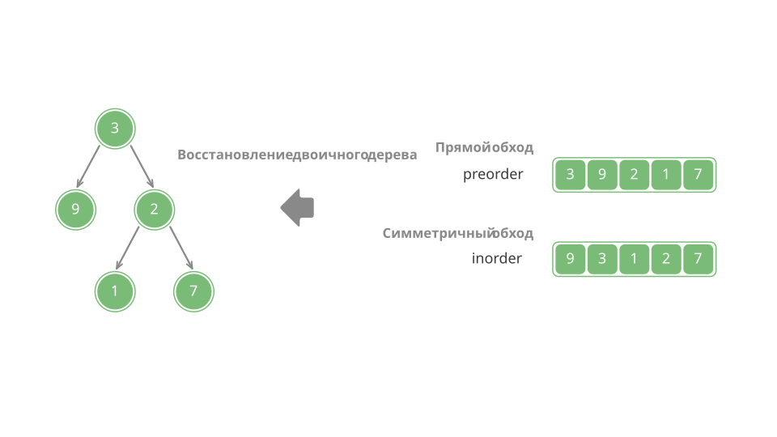
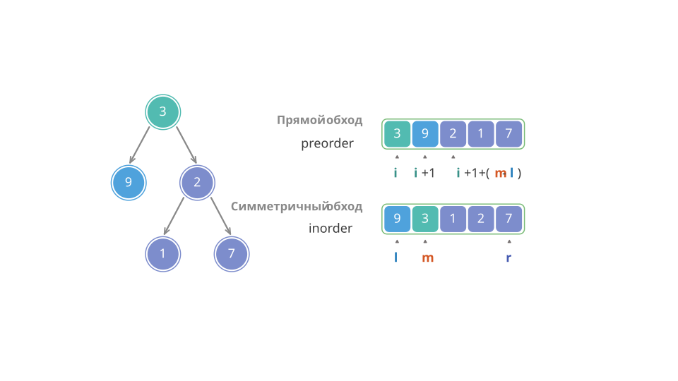
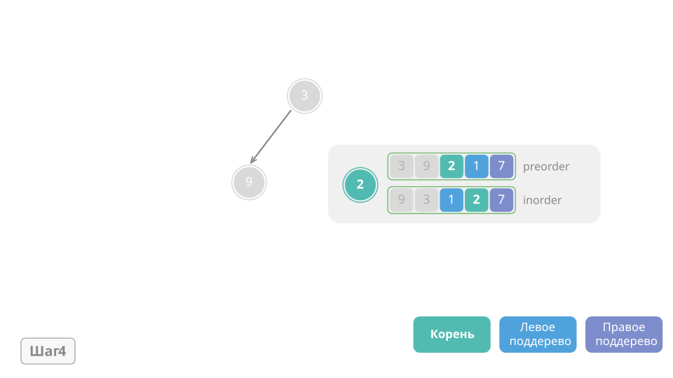
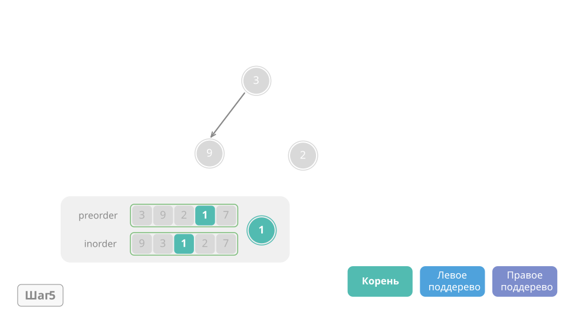
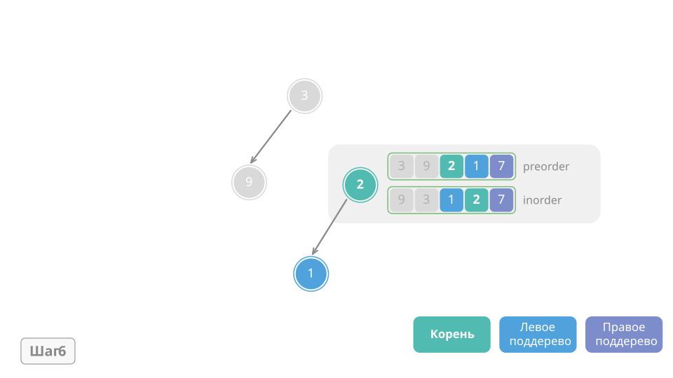
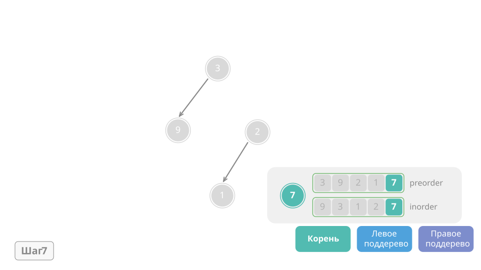
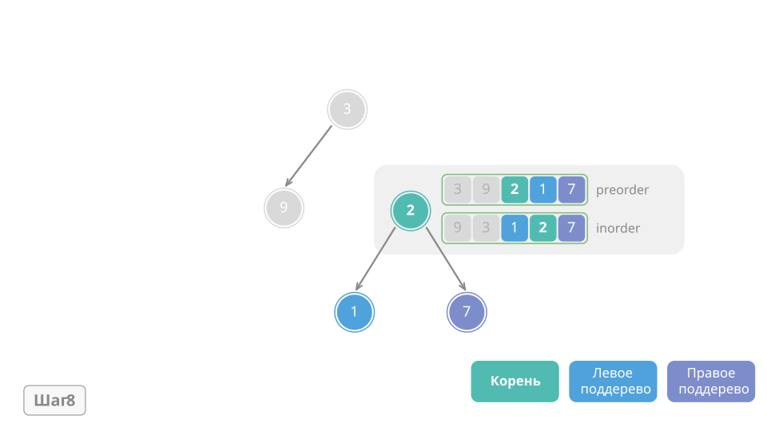
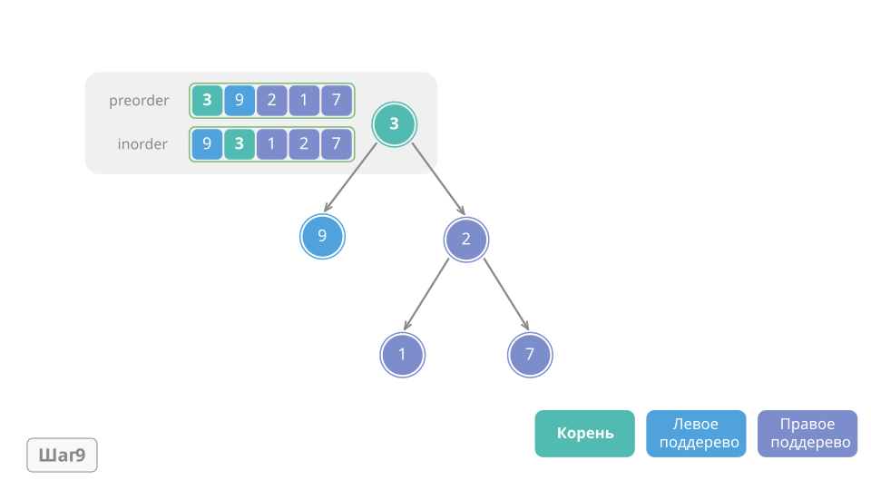
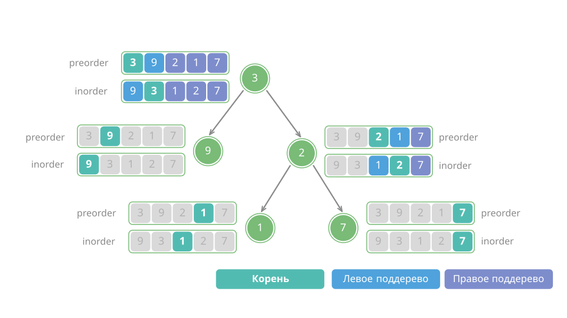

# Задача о построении двоичного дерева

!!! question

    Даны последовательности прямого обхода `preorder` и симметричного обхода `inorder` двоичного дерева. Постройте дерево и верните его корень. Предполагается, что значения всех узлов различны (см. рисунок).



### Подходит ли метод «разделяй и властвуй»?

Исходная задача — построить двоичное дерево по `preorder` и `inorder`. Это типичная задача для метода «разделяй и властвуй».

- **Задача допускает разбиение**. Достаточно создать корень и решить две подзадачи: построить левое и правое поддеревья. Каждое поддерево можно таким же образом разбить на меньшие. Разбиение закончится на минимальной подзадаче — пустом поддереве.
- **Подзадачи независимы**. Левое и правое поддеревья не пересекаются. При построении левого достаточно рассматривать соответствующие ему части симметричного и прямого обходов. То же верно для правого.
- **Решения подзадач можно объединить**. Построив левое и правое поддеревья, присоединим их к корню и получим решение исходной задачи.

### Как выделить поддеревья

Итак, метод «разделяй и властвуй» применим. **Но как по прямому обходу `preorder` и симметричному обходу `inorder` выделить левое и правое поддеревья**?

По определению как `preorder`, так и `inorder` состоят из трёх частей.

- Прямой обход: `[ корень | левое поддерево | правое поддерево ]`. Для дерева на рисунке это `[ 3 | 9 | 2 1 7 ]`.
- Симметричный обход: `[ левое поддерево | корень | правое поддерево ]`. Для дерева на рисунке это `[ 9 | 3 | 1 2 7 ]`.

Разберём по шагам, как разделить последовательности из нашего примера. Шаги показаны на следующем рисунке.

1. Первый элемент прямого обхода, 3, — значение корня.
2. Найдём индекс корня 3 в `inorder`. По этому индексу разделим `inorder` на части: `[ 9 | 3 | 1 2 7 ]`.
3. Из разбиения `inorder` видно, что в левом поддереве один узел, а в правом — три. Значит, `preorder` можно разделить так: `[ 3 | 9 | 2 1 7 ]`.


### Переменные для интервалов поддеревьев

После разбиения **мы знаем интервалы индексов корня, левого и правого поддеревьев в `preorder` и `inorder`**. Опишем эти интервалы несколькими переменными-указателями.

- Обозначим через $i$ индекс корня текущего дерева в `preorder`.
- Обозначим через $m$ индекс корня текущего дерева в `inorder`.
- Обозначим через $[l, r]$ интервал индексов текущего дерева в `inorder`.

Как показано в таблице, через эти переменные можно выразить индекс корня в `preorder` и интервал индексов поддерева в `inorder`.

<p align="center"> Таблица <id> &nbsp; Индексы корня и поддеревьев в прямом и симметричном обходах </p>

|        | Индекс корня в `preorder` | Интервал индексов поддерева в `inorder` |
| ------ | ---------------------------- | ----------------------------- |
| Текущее дерево | $i$                          | $[l, r]$                      |
| Левое поддерево | $i + 1$                      | $[l, m-1]$                    |
| Правое поддерево | $i + 1 + (m - l)$            | $[m+1, r]$                    |

В формуле индекса корня правого поддерева величина $(m-l)$ — число узлов левого поддерева. Это удобно проследить на рисунке.



### Реализация

Чтобы быстро находить $m$, сохраним в хеш-таблице `hmap` индексы элементов массива `inorder` по их значениям:

```src
[file]{build_tree}-[class]{}-[func]{build_tree}
```

На рисунке показано рекурсивное построение дерева. Узлы создаются при спуске по рекурсии, а рёбра (ссылки) — при возврате из вызовов.

=== "<1>"
    

=== "<2>"
    

=== "<3>"
    

=== "<4>"
    

=== "<5>"
    

=== "<6>"
    

=== "<7>"
    

=== "<8>"
    

=== "<9>"
    

На рисунке показано, как в каждом рекурсивном вызове делятся на части последовательности прямого обхода `preorder` и симметричного обхода `inorder`.



Пусть дерево содержит $n$ узлов. Создание каждого узла (работа одного вызова `dfs()` без учёта вложенных вызовов) занимает $O(1)$ времени. **Следовательно, общая временная сложность равна $O(n)$**.

Хеш-таблица индексов элементов `inorder` занимает $O(n)$ памяти. В худшем случае дерево вырождается в связный список, глубина рекурсии достигает $n$ и для стека требуется $O(n)$ памяти. **Итак, общая пространственная сложность равна $O(n)$**.
