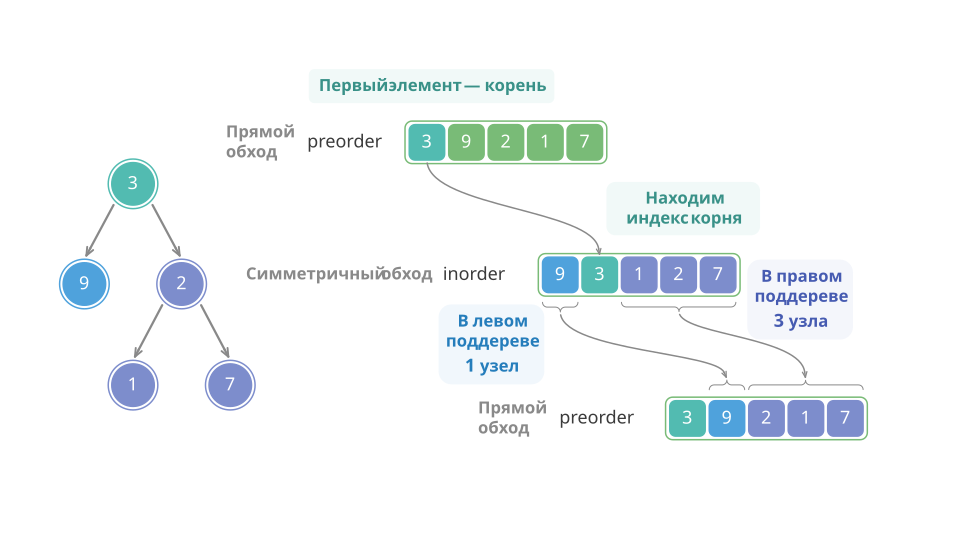
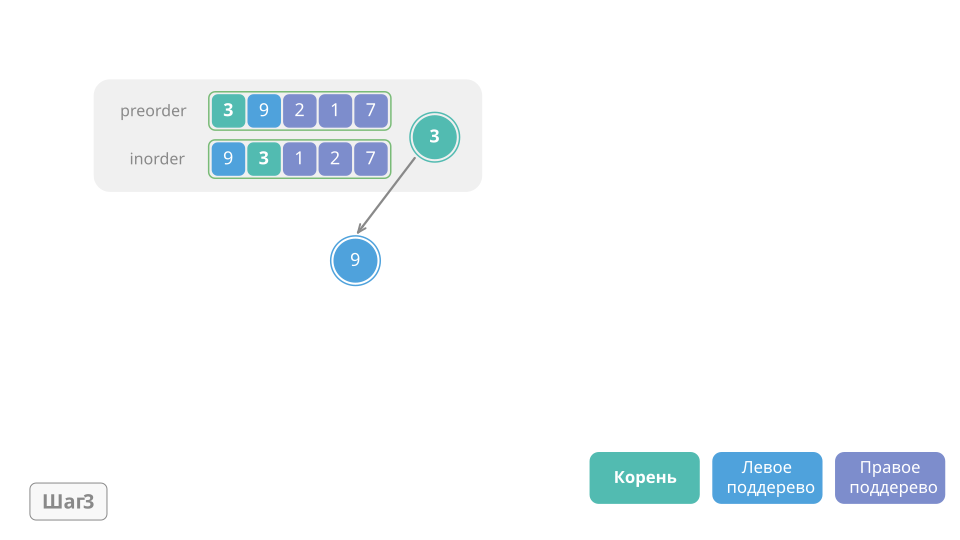

# 12.3 &nbsp; Задача о построении двоичного дерева

!!! question

    Даны последовательности прямого обхода `preorder` и симметричного обхода `inorder` двоичного дерева. Постройте дерево и верните его корень. Предполагается, что значения всех узлов различны (см. рисунок).

{ class="animation-figure" }

<p align="center"> Рисунок 12-5 &nbsp; Исходные данные для построения двоичного дерева </p>

### 1. &nbsp; Подходит ли метод «разделяй и властвуй»?

Исходная задача — построить двоичное дерево по `preorder` и `inorder`. Это типичная задача для метода «разделяй и властвуй».

- **Задача допускает разбиение**. Достаточно создать корень и решить две подзадачи: построить левое и правое поддеревья. Каждое поддерево можно таким же образом разбить на меньшие. Разбиение закончится на минимальной подзадаче — пустом поддереве.
- **Подзадачи независимы**. Левое и правое поддеревья не пересекаются. При построении левого достаточно рассматривать соответствующие ему части симметричного и прямого обходов. То же верно для правого.
- **Решения подзадач можно объединить**. Построив левое и правое поддеревья, присоединим их к корню и получим решение исходной задачи.

### 2. &nbsp; Как выделить поддеревья

Итак, метод «разделяй и властвуй» применим. **Но как по прямому обходу `preorder` и симметричному обходу `inorder` выделить левое и правое поддеревья**?

По определению как `preorder`, так и `inorder` состоят из трёх частей.

- Прямой обход: `[ корень | левое поддерево | правое поддерево ]`. Для дерева на рисунке это `[ 3 | 9 | 2 1 7 ]`.
- Симметричный обход: `[ левое поддерево | корень | правое поддерево ]`. Для дерева на рисунке это `[ 9 | 3 | 1 2 7 ]`.

Разберём по шагам, как разделить последовательности из нашего примера. Шаги показаны на следующем рисунке.

1. Первый элемент прямого обхода, 3, — значение корня.
2. Найдём индекс корня 3 в `inorder`. По этому индексу разделим `inorder` на части: `[ 9 | 3 | 1 2 7 ]`.
3. Из разбиения `inorder` видно, что в левом поддереве один узел, а в правом — три. Значит, `preorder` можно разделить так: `[ 3 | 9 | 2 1 7 ]`.

{ class="animation-figure" }

<p align="center"> Рисунок 12-6 &nbsp; Выделение поддеревьев в последовательностях прямого и симметричного обходов </p>

### 3. &nbsp; Переменные для интервалов поддеревьев

После разбиения **мы знаем интервалы индексов корня, левого и правого поддеревьев в `preorder` и `inorder`**. Опишем эти интервалы несколькими переменными-указателями.

- Обозначим через $i$ индекс корня текущего дерева в `preorder`.
- Обозначим через $m$ индекс корня текущего дерева в `inorder`.
- Обозначим через $[l, r]$ интервал индексов текущего дерева в `inorder`.

Как показано в таблице, через эти переменные можно выразить индекс корня в `preorder` и интервал индексов поддерева в `inorder`.

<p align="center"> Таблица 12-1 &nbsp; Индексы корня и поддеревьев в прямом и симметричном обходах </p>

<div class="center-table" markdown>

|        | Индекс корня в `preorder` | Интервал индексов поддерева в `inorder` |
| ------ | ---------------------------- | ----------------------------- |
| Текущее дерево | $i$                          | $[l, r]$                      |
| Левое поддерево | $i + 1$                      | $[l, m-1]$                    |
| Правое поддерево | $i + 1 + (m - l)$            | $[m+1, r]$                    |

</div>

В формуле индекса корня правого поддерева величина $(m-l)$ — число узлов левого поддерева. Это удобно проследить на рисунке.

{ class="animation-figure" }

<p align="center"> Рисунок 12-7 &nbsp; Интервалы индексов для корня и двух поддеревьев </p>

### 4. &nbsp; Реализация

Чтобы быстро находить $m$, сохраним в хеш-таблице `hmap` индексы элементов массива `inorder` по их значениям:

=== "Python"

    ```python title="build_tree.py"
    def dfs(
        preorder: list[int],
        inorder_map: dict[int, int],
        i: int,
        l: int,
        r: int,
    ) -> TreeNode | None:
        """Построение двоичного дерева методом «разделяй и властвуй»"""
        # Если интервал поддерева пуст, завершаем рекурсию
        if r - l < 0:
            return None
        # Создаём корень
        root = TreeNode(preorder[i])
        # Находим m и разделяем левое и правое поддеревья
        m = inorder_map[preorder[i]]
        # Подзадача: строим левое поддерево
        root.left = dfs(preorder, inorder_map, i + 1, l, m - 1)
        # Подзадача: строим правое поддерево
        root.right = dfs(preorder, inorder_map, i + 1 + m - l, m + 1, r)
        # Возвращаем корень
        return root

    def build_tree(preorder: list[int], inorder: list[int]) -> TreeNode | None:
        """Построение двоичного дерева"""
        # Создаём хеш-таблицу индексов элементов inorder
        inorder_map = {val: i for i, val in enumerate(inorder)}
        root = dfs(preorder, inorder_map, 0, 0, len(inorder) - 1)
        return root
    ```

=== "C++"

    ```cpp title="build_tree.cpp"
    /* Построение двоичного дерева методом «разделяй и властвуй» */
    TreeNode *dfs(vector<int> &preorder, unordered_map<int, int> &inorderMap, int i, int l, int r) {
        // Если интервал поддерева пуст, завершаем рекурсию
        if (r - l < 0)
            return NULL;
        // Создаём корень
        TreeNode *root = new TreeNode(preorder[i]);
        // Находим m и разделяем левое и правое поддеревья
        int m = inorderMap[preorder[i]];
        // Подзадача: строим левое поддерево
        root->left = dfs(preorder, inorderMap, i + 1, l, m - 1);
        // Подзадача: строим правое поддерево
        root->right = dfs(preorder, inorderMap, i + 1 + m - l, m + 1, r);
        // Возвращаем корень
        return root;
    }

    /* Построение двоичного дерева */
    TreeNode *buildTree(vector<int> &preorder, vector<int> &inorder) {
        // Создаём хеш-таблицу индексов элементов inorder
        unordered_map<int, int> inorderMap;
        for (int i = 0; i < inorder.size(); i++) {
            inorderMap[inorder[i]] = i;
        }
        TreeNode *root = dfs(preorder, inorderMap, 0, 0, inorder.size() - 1);
        return root;
    }
    ```

=== "Java"

    ```java title="build_tree.java"
    /* Построение двоичного дерева методом «разделяй и властвуй» */
    TreeNode dfs(int[] preorder, Map<Integer, Integer> inorderMap, int i, int l, int r) {
        // Если интервал поддерева пуст, завершаем рекурсию
        if (r - l < 0)
            return null;
        // Создаём корень
        TreeNode root = new TreeNode(preorder[i]);
        // Находим m и разделяем левое и правое поддеревья
        int m = inorderMap.get(preorder[i]);
        // Подзадача: строим левое поддерево
        root.left = dfs(preorder, inorderMap, i + 1, l, m - 1);
        // Подзадача: строим правое поддерево
        root.right = dfs(preorder, inorderMap, i + 1 + m - l, m + 1, r);
        // Возвращаем корень
        return root;
    }

    /* Построение двоичного дерева */
    TreeNode buildTree(int[] preorder, int[] inorder) {
        // Создаём хеш-таблицу индексов элементов inorder
        Map<Integer, Integer> inorderMap = new HashMap<>();
        for (int i = 0; i < inorder.length; i++) {
            inorderMap.put(inorder[i], i);
        }
        TreeNode root = dfs(preorder, inorderMap, 0, 0, inorder.length - 1);
        return root;
    }
    ```

=== "C#"

    ```csharp title="build_tree.cs"
    /* Построение двоичного дерева методом «разделяй и властвуй» */
    TreeNode? DFS(int[] preorder, Dictionary<int, int> inorderMap, int i, int l, int r) {
        // Если интервал поддерева пуст, завершаем рекурсию
        if (r - l < 0)
            return null;
        // Создаём корень
        TreeNode root = new(preorder[i]);
        // Находим m и разделяем левое и правое поддеревья
        int m = inorderMap[preorder[i]];
        // Подзадача: строим левое поддерево
        root.left = DFS(preorder, inorderMap, i + 1, l, m - 1);
        // Подзадача: строим правое поддерево
        root.right = DFS(preorder, inorderMap, i + 1 + m - l, m + 1, r);
        // Возвращаем корень
        return root;
    }

    /* Построение двоичного дерева */
    TreeNode? BuildTree(int[] preorder, int[] inorder) {
        // Создаём хеш-таблицу индексов элементов inorder
        Dictionary<int, int> inorderMap = [];
        for (int i = 0; i < inorder.Length; i++) {
            inorderMap.TryAdd(inorder[i], i);
        }
        TreeNode? root = DFS(preorder, inorderMap, 0, 0, inorder.Length - 1);
        return root;
    }
    ```

=== "Go"

    ```go title="build_tree.go"
    /* Построение двоичного дерева методом «разделяй и властвуй» */
    func dfsBuildTree(preorder []int, inorderMap map[int]int, i, l, r int) *TreeNode {
        // Если интервал поддерева пуст, завершаем рекурсию
        if r-l < 0 {
            return nil
        }
        // Создаём корень
        root := NewTreeNode(preorder[i])
        // Находим m и разделяем левое и правое поддеревья
        m := inorderMap[preorder[i]]
        // Подзадача: строим левое поддерево
        root.Left = dfsBuildTree(preorder, inorderMap, i+1, l, m-1)
        // Подзадача: строим правое поддерево
        root.Right = dfsBuildTree(preorder, inorderMap, i+1+m-l, m+1, r)
        // Возвращаем корень
        return root
    }

    /* Построение двоичного дерева */
    func buildTree(preorder, inorder []int) *TreeNode {
        // Создаём хеш-таблицу индексов элементов inorder
        inorderMap := make(map[int]int, len(inorder))
        for i := 0; i < len(inorder); i++ {
            inorderMap[inorder[i]] = i
        }

        root := dfsBuildTree(preorder, inorderMap, 0, 0, len(inorder)-1)
        return root
    }
    ```

=== "Swift"

    ```swift title="build_tree.swift"
    /* Построение двоичного дерева методом «разделяй и властвуй» */
    func dfs(preorder: [Int], inorderMap: [Int: Int], i: Int, l: Int, r: Int) -> TreeNode? {
        // Если интервал поддерева пуст, завершаем рекурсию
        if r - l < 0 {
            return nil
        }
        // Создаём корень
        let root = TreeNode(x: preorder[i])
        // Находим m и разделяем левое и правое поддеревья
        let m = inorderMap[preorder[i]]!
        // Подзадача: строим левое поддерево
        root.left = dfs(preorder: preorder, inorderMap: inorderMap, i: i + 1, l: l, r: m - 1)
        // Подзадача: строим правое поддерево
        root.right = dfs(preorder: preorder, inorderMap: inorderMap, i: i + 1 + m - l, l: m + 1, r: r)
        // Возвращаем корень
        return root
    }

    /* Построение двоичного дерева */
    func buildTree(preorder: [Int], inorder: [Int]) -> TreeNode? {
        // Создаём хеш-таблицу индексов элементов inorder
        let inorderMap = inorder.enumerated().reduce(into: [:]) { $0[$1.element] = $1.offset }
        return dfs(preorder: preorder, inorderMap: inorderMap, i: inorder.startIndex, l: inorder.startIndex, r: inorder.endIndex - 1)
    }
    ```

=== "JS"

    ```javascript title="build_tree.js"
    /* Построение двоичного дерева методом «разделяй и властвуй» */
    function dfs(preorder, inorderMap, i, l, r) {
        // Если интервал поддерева пуст, завершаем рекурсию
        if (r - l < 0) return null;
        // Создаём корень
        const root = new TreeNode(preorder[i]);
        // Находим m и разделяем левое и правое поддеревья
        const m = inorderMap.get(preorder[i]);
        // Подзадача: строим левое поддерево
        root.left = dfs(preorder, inorderMap, i + 1, l, m - 1);
        // Подзадача: строим правое поддерево
        root.right = dfs(preorder, inorderMap, i + 1 + m - l, m + 1, r);
        // Возвращаем корень
        return root;
    }

    /* Построение двоичного дерева */
    function buildTree(preorder, inorder) {
        // Создаём хеш-таблицу индексов элементов inorder
        let inorderMap = new Map();
        for (let i = 0; i < inorder.length; i++) {
            inorderMap.set(inorder[i], i);
        }
        const root = dfs(preorder, inorderMap, 0, 0, inorder.length - 1);
        return root;
    }
    ```

=== "TS"

    ```typescript title="build_tree.ts"
    /* Построение двоичного дерева методом «разделяй и властвуй» */
    function dfs(
        preorder: number[],
        inorderMap: Map<number, number>,
        i: number,
        l: number,
        r: number
    ): TreeNode | null {
        // Если интервал поддерева пуст, завершаем рекурсию
        if (r - l < 0) return null;
        // Создаём корень
        const root: TreeNode = new TreeNode(preorder[i]);
        // Находим m и разделяем левое и правое поддеревья
        const m = inorderMap.get(preorder[i]);
        // Подзадача: строим левое поддерево
        root.left = dfs(preorder, inorderMap, i + 1, l, m - 1);
        // Подзадача: строим правое поддерево
        root.right = dfs(preorder, inorderMap, i + 1 + m - l, m + 1, r);
        // Возвращаем корень
        return root;
    }

    /* Построение двоичного дерева */
    function buildTree(preorder: number[], inorder: number[]): TreeNode | null {
        // Создаём хеш-таблицу индексов элементов inorder
        let inorderMap = new Map<number, number>();
        for (let i = 0; i < inorder.length; i++) {
            inorderMap.set(inorder[i], i);
        }
        const root = dfs(preorder, inorderMap, 0, 0, inorder.length - 1);
        return root;
    }
    ```

=== "Dart"

    ```dart title="build_tree.dart"
    /* Построение двоичного дерева методом «разделяй и властвуй» */
    TreeNode? dfs(
      List<int> preorder,
      Map<int, int> inorderMap,
      int i,
      int l,
      int r,
    ) {
      // Если интервал поддерева пуст, завершаем рекурсию
      if (r - l < 0) {
        return null;
      }
      // Создаём корень
      TreeNode? root = TreeNode(preorder[i]);
      // Находим m и разделяем левое и правое поддеревья
      int m = inorderMap[preorder[i]]!;
      // Подзадача: строим левое поддерево
      root.left = dfs(preorder, inorderMap, i + 1, l, m - 1);
      // Подзадача: строим правое поддерево
      root.right = dfs(preorder, inorderMap, i + 1 + m - l, m + 1, r);
      // Возвращаем корень
      return root;
    }

    /* Построение двоичного дерева */
    TreeNode? buildTree(List<int> preorder, List<int> inorder) {
      // Создаём хеш-таблицу индексов элементов inorder
      Map<int, int> inorderMap = {};
      for (int i = 0; i < inorder.length; i++) {
        inorderMap[inorder[i]] = i;
      }
      TreeNode? root = dfs(preorder, inorderMap, 0, 0, inorder.length - 1);
      return root;
    }
    ```

=== "Rust"

    ```rust title="build_tree.rs"
    /* Построение двоичного дерева методом «разделяй и властвуй» */
    fn dfs(
        preorder: &[i32],
        inorder_map: &HashMap<i32, i32>,
        i: i32,
        l: i32,
        r: i32,
    ) -> Option<Rc<RefCell<TreeNode>>> {
        // Если интервал поддерева пуст, завершаем рекурсию
        if r - l < 0 {
            return None;
        }
        // Создаём корень
        let root = TreeNode::new(preorder[i as usize]);
        // Находим m и разделяем левое и правое поддеревья
        let m = inorder_map.get(&preorder[i as usize]).unwrap();
        // Подзадача: строим левое поддерево
        root.borrow_mut().left = dfs(preorder, inorder_map, i + 1, l, m - 1);
        // Подзадача: строим правое поддерево
        root.borrow_mut().right = dfs(preorder, inorder_map, i + 1 + m - l, m + 1, r);
        // Возвращаем корень
        Some(root)
    }

    /* Построение двоичного дерева */
    fn build_tree(preorder: &[i32], inorder: &[i32]) -> Option<Rc<RefCell<TreeNode>>> {
        // Создаём хеш-таблицу индексов элементов inorder
        let mut inorder_map: HashMap<i32, i32> = HashMap::new();
        for i in 0..inorder.len() {
            inorder_map.insert(inorder[i], i as i32);
        }
        let root = dfs(preorder, &inorder_map, 0, 0, inorder.len() as i32 - 1);
        root
    }
    ```

=== "C"

    ```c title="build_tree.c"
    /* Построение двоичного дерева методом «разделяй и властвуй» */
    TreeNode *dfs(int *preorder, int *inorderMap, int i, int l, int r, int size) {
        // Если интервал поддерева пуст, завершаем рекурсию
        if (r - l < 0)
            return NULL;
        // Создаём корень
        TreeNode *root = (TreeNode *)malloc(sizeof(TreeNode));
        root->val = preorder[i];
        root->left = NULL;
        root->right = NULL;
        // Находим m и разделяем левое и правое поддеревья
        int m = inorderMap[preorder[i]];
        // Подзадача: строим левое поддерево
        root->left = dfs(preorder, inorderMap, i + 1, l, m - 1, size);
        // Подзадача: строим правое поддерево
        root->right = dfs(preorder, inorderMap, i + 1 + m - l, m + 1, r, size);
        // Возвращаем корень
        return root;
    }

    /* Построение двоичного дерева */
    TreeNode *buildTree(int *preorder, int preorderSize, int *inorder, int inorderSize) {
        // Создаём хеш-таблицу индексов элементов inorder
        int *inorderMap = (int *)malloc(sizeof(int) * MAX_SIZE);
        for (int i = 0; i < inorderSize; i++) {
            inorderMap[inorder[i]] = i;
        }
        TreeNode *root = dfs(preorder, inorderMap, 0, 0, inorderSize - 1, inorderSize);
        free(inorderMap);
        return root;
    }
    ```

=== "Kotlin"

    ```kotlin title="build_tree.kt"
    /* Построение двоичного дерева методом «разделяй и властвуй» */
    fun dfs(
        preorder: IntArray,
        inorderMap: Map<Int?, Int?>,
        i: Int,
        l: Int,
        r: Int
    ): TreeNode? {
        // Если интервал поддерева пуст, завершаем рекурсию
        if (r - l < 0) return null
        // Создаём корень
        val root = TreeNode(preorder[i])
        // Находим m и разделяем левое и правое поддеревья
        val m = inorderMap[preorder[i]]!!
        // Подзадача: строим левое поддерево
        root.left = dfs(preorder, inorderMap, i + 1, l, m - 1)
        // Подзадача: строим правое поддерево
        root.right = dfs(preorder, inorderMap, i + 1 + m - l, m + 1, r)
        // Возвращаем корень
        return root
    }

    /* Построение двоичного дерева */
    fun buildTree(preorder: IntArray, inorder: IntArray): TreeNode? {
        // Создаём хеш-таблицу индексов элементов inorder
        val inorderMap = HashMap<Int?, Int?>()
        for (i in inorder.indices) {
            inorderMap[inorder[i]] = i
        }
        val root = dfs(preorder, inorderMap, 0, 0, inorder.size - 1)
        return root
    }
    ```

=== "Ruby"

    ```ruby title="build_tree.rb"
    ### Построение двоичного дерева методом «разделяй и властвуй» ###
    def dfs(preorder, inorder_map, i, l, r)
      # Если интервал поддерева пуст, завершаем рекурсию
      return if r - l < 0

      # Создаём корень
      root = TreeNode.new(preorder[i])
      # Находим m и разделяем левое и правое поддеревья
      m = inorder_map[preorder[i]]
      # Подзадача: строим левое поддерево
      root.left = dfs(preorder, inorder_map, i + 1, l, m - 1)
      # Подзадача: строим правое поддерево
      root.right = dfs(preorder, inorder_map, i + 1 + m - l, m + 1, r)

      # Возвращаем корень
      root
    end

    ### Построение двоичного дерева ###
    def build_tree(preorder, inorder)
      # Создаём хеш-таблицу индексов элементов inorder
      inorder_map = {}
      inorder.each_with_index { |val, i| inorder_map[val] = i }
      dfs(preorder, inorder_map, 0, 0, inorder.length - 1)
    end
    ```

??? pythontutor "Визуализация выполнения"

    <div style="height: 549px; width: 100%;"><iframe class="pythontutor-iframe" title="Визуализация выполнения" src="https://pythontutor.com/iframe-embed.html#code=class%20TreeNode%3A%0A%20%20%20%20%22%22%22%D0%9A%D0%BB%D0%B0%D1%81%D1%81%20%D1%83%D0%B7%D0%BB%D0%B0%20%D0%B4%D0%B5%D1%80%D0%B5%D0%B2%D0%B0%22%22%22%0A%20%20%20%20def%20__init__%28self,%20val%3A%20int%20%3D%200%29%3A%0A%20%20%20%20%20%20%20%20self.val%3A%20int%20%3D%20val%20%20%23%20%D0%97%D0%BD%D0%B0%D1%87%D0%B5%D0%BD%D0%B8%D0%B5%20%D1%83%D0%B7%D0%BB%D0%B0%0A%20%20%20%20%20%20%20%20self.left%3A%20TreeNode%20%7C%20None%20%3D%20None%20%20%23%20%D0%A1%D1%81%D1%8B%D0%BB%D0%BA%D0%B0%20%D0%BD%D0%B0%20%D0%BB%D0%B5%D0%B2%D0%BE%D0%B3%D0%BE%20%D0%BF%D0%BE%D1%82%D0%BE%D0%BC%D0%BA%D0%B0%0A%20%20%20%20%20%20%20%20self.right%3A%20TreeNode%20%7C%20None%20%3D%20None%20%20%23%20%D0%A1%D1%81%D1%8B%D0%BB%D0%BA%D0%B0%20%D0%BD%D0%B0%20%D0%BF%D1%80%D0%B0%D0%B2%D0%BE%D0%B3%D0%BE%20%D0%BF%D0%BE%D1%82%D0%BE%D0%BC%D0%BA%D0%B0%0A%0Adef%20dfs%28%0A%20%20%20%20preorder%3A%20list%5Bint%5D,%0A%20%20%20%20inorder_map%3A%20dict%5Bint,%20int%5D,%0A%20%20%20%20i%3A%20int,%0A%20%20%20%20l%3A%20int,%0A%20%20%20%20r%3A%20int,%0A%29%20-%3E%20TreeNode%20%7C%20None%3A%0A%20%20%20%20%22%22%22%D0%9F%D0%BE%D1%81%D1%82%D1%80%D0%BE%D0%B5%D0%BD%D0%B8%D0%B5%20%D0%B4%D0%B2%D0%BE%D0%B8%D1%87%D0%BD%D0%BE%D0%B3%D0%BE%20%D0%B4%D0%B5%D1%80%D0%B5%D0%B2%D0%B0%20%D0%BC%D0%B5%D1%82%D0%BE%D0%B4%D0%BE%D0%BC%20%C2%AB%D1%80%D0%B0%D0%B7%D0%B4%D0%B5%D0%BB%D1%8F%D0%B9%20%D0%B8%20%D0%B2%D0%BB%D0%B0%D1%81%D1%82%D0%B2%D1%83%D0%B9%C2%BB%22%22%22%0A%20%20%20%20%23%20%D0%95%D1%81%D0%BB%D0%B8%20%D0%B8%D0%BD%D1%82%D0%B5%D1%80%D0%B2%D0%B0%D0%BB%20%D0%BF%D0%BE%D0%B4%D0%B4%D0%B5%D1%80%D0%B5%D0%B2%D0%B0%20%D0%BF%D1%83%D1%81%D1%82,%20%D0%B7%D0%B0%D0%B2%D0%B5%D1%80%D1%88%D0%B0%D0%B5%D0%BC%20%D1%80%D0%B5%D0%BA%D1%83%D1%80%D1%81%D0%B8%D1%8E%0A%20%20%20%20if%20r%20-%20l%20%3C%200%3A%0A%20%20%20%20%20%20%20%20return%20None%0A%20%20%20%20%23%20%D0%A1%D0%BE%D0%B7%D0%B4%D0%B0%D1%91%D0%BC%20%D0%BA%D0%BE%D1%80%D0%B5%D0%BD%D1%8C%0A%20%20%20%20root%20%3D%20TreeNode%28preorder%5Bi%5D%29%0A%20%20%20%20%23%20%D0%9D%D0%B0%D1%85%D0%BE%D0%B4%D0%B8%D0%BC%20m%20%D0%B8%20%D1%80%D0%B0%D0%B7%D0%B4%D0%B5%D0%BB%D1%8F%D0%B5%D0%BC%20%D0%BB%D0%B5%D0%B2%D0%BE%D0%B5%20%D0%B8%20%D0%BF%D1%80%D0%B0%D0%B2%D0%BE%D0%B5%20%D0%BF%D0%BE%D0%B4%D0%B4%D0%B5%D1%80%D0%B5%D0%B2%D1%8C%D1%8F%0A%20%20%20%20m%20%3D%20inorder_map%5Bpreorder%5Bi%5D%5D%0A%20%20%20%20%23%20%D0%9F%D0%BE%D0%B4%D0%B7%D0%B0%D0%B4%D0%B0%D1%87%D0%B0%3A%20%D1%81%D1%82%D1%80%D0%BE%D0%B8%D0%BC%20%D0%BB%D0%B5%D0%B2%D0%BE%D0%B5%20%D0%BF%D0%BE%D0%B4%D0%B4%D0%B5%D1%80%D0%B5%D0%B2%D0%BE%0A%20%20%20%20root.left%20%3D%20dfs%28preorder,%20inorder_map,%20i%20%2B%201,%20l,%20m%20-%201%29%0A%20%20%20%20%23%20%D0%9F%D0%BE%D0%B4%D0%B7%D0%B0%D0%B4%D0%B0%D1%87%D0%B0%3A%20%D1%81%D1%82%D1%80%D0%BE%D0%B8%D0%BC%20%D0%BF%D1%80%D0%B0%D0%B2%D0%BE%D0%B5%20%D0%BF%D0%BE%D0%B4%D0%B4%D0%B5%D1%80%D0%B5%D0%B2%D0%BE%0A%20%20%20%20root.right%20%3D%20dfs%28preorder,%20inorder_map,%20i%20%2B%201%20%2B%20m%20-%20l,%20m%20%2B%201,%20r%29%0A%20%20%20%20%23%20%D0%92%D0%BE%D0%B7%D0%B2%D1%80%D0%B0%D1%89%D0%B0%D0%B5%D0%BC%20%D0%BA%D0%BE%D1%80%D0%B5%D0%BD%D1%8C%0A%20%20%20%20return%20root%0A%0A%0Adef%20build_tree%28preorder%3A%20list%5Bint%5D,%20inorder%3A%20list%5Bint%5D%29%20-%3E%20TreeNode%20%7C%20None%3A%0A%20%20%20%20%22%22%22%D0%9F%D0%BE%D1%81%D1%82%D1%80%D0%BE%D0%B5%D0%BD%D0%B8%D0%B5%20%D0%B4%D0%B2%D0%BE%D0%B8%D1%87%D0%BD%D0%BE%D0%B3%D0%BE%20%D0%B4%D0%B5%D1%80%D0%B5%D0%B2%D0%B0%22%22%22%0A%20%20%20%20%23%20%D0%A1%D0%BE%D0%B7%D0%B4%D0%B0%D1%91%D0%BC%20%D1%85%D0%B5%D1%88-%D1%82%D0%B0%D0%B1%D0%BB%D0%B8%D1%86%D1%83%20%D0%B8%D0%BD%D0%B4%D0%B5%D0%BA%D1%81%D0%BE%D0%B2%20%D1%8D%D0%BB%D0%B5%D0%BC%D0%B5%D0%BD%D1%82%D0%BE%D0%B2%20inorder%0A%20%20%20%20inorder_map%20%3D%20%7Bval%3A%20i%20for%20i,%20val%20in%20enumerate%28inorder%29%7D%0A%20%20%20%20root%20%3D%20dfs%28preorder,%20inorder_map,%200,%200,%20len%28inorder%29%20-%201%29%0A%20%20%20%20return%20root%0A%0A%0A%22%22%22Driver%20Code%22%22%22%0Aif%20__name__%20%3D%3D%20%22__main__%22%3A%0A%20%20%20%20preorder%20%3D%20%5B3,%209,%202,%201,%207%5D%0A%20%20%20%20inorder%20%3D%20%5B9,%203,%201,%202,%207%5D%0A%20%20%20%20print%28f%22%D0%9F%D1%80%D1%8F%D0%BC%D0%BE%D0%B9%20%D0%BE%D0%B1%D1%85%D0%BE%D0%B4%20%3D%20%7Bpreorder%7D%22%29%0A%20%20%20%20print%28f%22%D0%A1%D0%B8%D0%BC%D0%BC%D0%B5%D1%82%D1%80%D0%B8%D1%87%D0%BD%D1%8B%D0%B9%20%D0%BE%D0%B1%D1%85%D0%BE%D0%B4%20%3D%20%7Binorder%7D%22%29%0A%20%20%20%20root%20%3D%20build_tree%28preorder,%20inorder%29&codeDivHeight=472&codeDivWidth=350&cumulative=false&curInstr=21&heapPrimitives=nevernest&origin=opt-frontend.js&py=311&rawInputLstJSON=%5B%5D&textReferences=false"> </iframe></div>
    <div style="margin-top: 5px;"><a href="https://pythontutor.com/iframe-embed.html#code=class%20TreeNode%3A%0A%20%20%20%20%22%22%22%D0%9A%D0%BB%D0%B0%D1%81%D1%81%20%D1%83%D0%B7%D0%BB%D0%B0%20%D0%B4%D0%B5%D1%80%D0%B5%D0%B2%D0%B0%22%22%22%0A%20%20%20%20def%20__init__%28self,%20val%3A%20int%20%3D%200%29%3A%0A%20%20%20%20%20%20%20%20self.val%3A%20int%20%3D%20val%20%20%23%20%D0%97%D0%BD%D0%B0%D1%87%D0%B5%D0%BD%D0%B8%D0%B5%20%D1%83%D0%B7%D0%BB%D0%B0%0A%20%20%20%20%20%20%20%20self.left%3A%20TreeNode%20%7C%20None%20%3D%20None%20%20%23%20%D0%A1%D1%81%D1%8B%D0%BB%D0%BA%D0%B0%20%D0%BD%D0%B0%20%D0%BB%D0%B5%D0%B2%D0%BE%D0%B3%D0%BE%20%D0%BF%D0%BE%D1%82%D0%BE%D0%BC%D0%BA%D0%B0%0A%20%20%20%20%20%20%20%20self.right%3A%20TreeNode%20%7C%20None%20%3D%20None%20%20%23%20%D0%A1%D1%81%D1%8B%D0%BB%D0%BA%D0%B0%20%D0%BD%D0%B0%20%D0%BF%D1%80%D0%B0%D0%B2%D0%BE%D0%B3%D0%BE%20%D0%BF%D0%BE%D1%82%D0%BE%D0%BC%D0%BA%D0%B0%0A%0Adef%20dfs%28%0A%20%20%20%20preorder%3A%20list%5Bint%5D,%0A%20%20%20%20inorder_map%3A%20dict%5Bint,%20int%5D,%0A%20%20%20%20i%3A%20int,%0A%20%20%20%20l%3A%20int,%0A%20%20%20%20r%3A%20int,%0A%29%20-%3E%20TreeNode%20%7C%20None%3A%0A%20%20%20%20%22%22%22%D0%9F%D0%BE%D1%81%D1%82%D1%80%D0%BE%D0%B5%D0%BD%D0%B8%D0%B5%20%D0%B4%D0%B2%D0%BE%D0%B8%D1%87%D0%BD%D0%BE%D0%B3%D0%BE%20%D0%B4%D0%B5%D1%80%D0%B5%D0%B2%D0%B0%20%D0%BC%D0%B5%D1%82%D0%BE%D0%B4%D0%BE%D0%BC%20%C2%AB%D1%80%D0%B0%D0%B7%D0%B4%D0%B5%D0%BB%D1%8F%D0%B9%20%D0%B8%20%D0%B2%D0%BB%D0%B0%D1%81%D1%82%D0%B2%D1%83%D0%B9%C2%BB%22%22%22%0A%20%20%20%20%23%20%D0%95%D1%81%D0%BB%D0%B8%20%D0%B8%D0%BD%D1%82%D0%B5%D1%80%D0%B2%D0%B0%D0%BB%20%D0%BF%D0%BE%D0%B4%D0%B4%D0%B5%D1%80%D0%B5%D0%B2%D0%B0%20%D0%BF%D1%83%D1%81%D1%82,%20%D0%B7%D0%B0%D0%B2%D0%B5%D1%80%D1%88%D0%B0%D0%B5%D0%BC%20%D1%80%D0%B5%D0%BA%D1%83%D1%80%D1%81%D0%B8%D1%8E%0A%20%20%20%20if%20r%20-%20l%20%3C%200%3A%0A%20%20%20%20%20%20%20%20return%20None%0A%20%20%20%20%23%20%D0%A1%D0%BE%D0%B7%D0%B4%D0%B0%D1%91%D0%BC%20%D0%BA%D0%BE%D1%80%D0%B5%D0%BD%D1%8C%0A%20%20%20%20root%20%3D%20TreeNode%28preorder%5Bi%5D%29%0A%20%20%20%20%23%20%D0%9D%D0%B0%D1%85%D0%BE%D0%B4%D0%B8%D0%BC%20m%20%D0%B8%20%D1%80%D0%B0%D0%B7%D0%B4%D0%B5%D0%BB%D1%8F%D0%B5%D0%BC%20%D0%BB%D0%B5%D0%B2%D0%BE%D0%B5%20%D0%B8%20%D0%BF%D1%80%D0%B0%D0%B2%D0%BE%D0%B5%20%D0%BF%D0%BE%D0%B4%D0%B4%D0%B5%D1%80%D0%B5%D0%B2%D1%8C%D1%8F%0A%20%20%20%20m%20%3D%20inorder_map%5Bpreorder%5Bi%5D%5D%0A%20%20%20%20%23%20%D0%9F%D0%BE%D0%B4%D0%B7%D0%B0%D0%B4%D0%B0%D1%87%D0%B0%3A%20%D1%81%D1%82%D1%80%D0%BE%D0%B8%D0%BC%20%D0%BB%D0%B5%D0%B2%D0%BE%D0%B5%20%D0%BF%D0%BE%D0%B4%D0%B4%D0%B5%D1%80%D0%B5%D0%B2%D0%BE%0A%20%20%20%20root.left%20%3D%20dfs%28preorder,%20inorder_map,%20i%20%2B%201,%20l,%20m%20-%201%29%0A%20%20%20%20%23%20%D0%9F%D0%BE%D0%B4%D0%B7%D0%B0%D0%B4%D0%B0%D1%87%D0%B0%3A%20%D1%81%D1%82%D1%80%D0%BE%D0%B8%D0%BC%20%D0%BF%D1%80%D0%B0%D0%B2%D0%BE%D0%B5%20%D0%BF%D0%BE%D0%B4%D0%B4%D0%B5%D1%80%D0%B5%D0%B2%D0%BE%0A%20%20%20%20root.right%20%3D%20dfs%28preorder,%20inorder_map,%20i%20%2B%201%20%2B%20m%20-%20l,%20m%20%2B%201,%20r%29%0A%20%20%20%20%23%20%D0%92%D0%BE%D0%B7%D0%B2%D1%80%D0%B0%D1%89%D0%B0%D0%B5%D0%BC%20%D0%BA%D0%BE%D1%80%D0%B5%D0%BD%D1%8C%0A%20%20%20%20return%20root%0A%0A%0Adef%20build_tree%28preorder%3A%20list%5Bint%5D,%20inorder%3A%20list%5Bint%5D%29%20-%3E%20TreeNode%20%7C%20None%3A%0A%20%20%20%20%22%22%22%D0%9F%D0%BE%D1%81%D1%82%D1%80%D0%BE%D0%B5%D0%BD%D0%B8%D0%B5%20%D0%B4%D0%B2%D0%BE%D0%B8%D1%87%D0%BD%D0%BE%D0%B3%D0%BE%20%D0%B4%D0%B5%D1%80%D0%B5%D0%B2%D0%B0%22%22%22%0A%20%20%20%20%23%20%D0%A1%D0%BE%D0%B7%D0%B4%D0%B0%D1%91%D0%BC%20%D1%85%D0%B5%D1%88-%D1%82%D0%B0%D0%B1%D0%BB%D0%B8%D1%86%D1%83%20%D0%B8%D0%BD%D0%B4%D0%B5%D0%BA%D1%81%D0%BE%D0%B2%20%D1%8D%D0%BB%D0%B5%D0%BC%D0%B5%D0%BD%D1%82%D0%BE%D0%B2%20inorder%0A%20%20%20%20inorder_map%20%3D%20%7Bval%3A%20i%20for%20i,%20val%20in%20enumerate%28inorder%29%7D%0A%20%20%20%20root%20%3D%20dfs%28preorder,%20inorder_map,%200,%200,%20len%28inorder%29%20-%201%29%0A%20%20%20%20return%20root%0A%0A%0A%22%22%22Driver%20Code%22%22%22%0Aif%20__name__%20%3D%3D%20%22__main__%22%3A%0A%20%20%20%20preorder%20%3D%20%5B3,%209,%202,%201,%207%5D%0A%20%20%20%20inorder%20%3D%20%5B9,%203,%201,%202,%207%5D%0A%20%20%20%20print%28f%22%D0%9F%D1%80%D1%8F%D0%BC%D0%BE%D0%B9%20%D0%BE%D0%B1%D1%85%D0%BE%D0%B4%20%3D%20%7Bpreorder%7D%22%29%0A%20%20%20%20print%28f%22%D0%A1%D0%B8%D0%BC%D0%BC%D0%B5%D1%82%D1%80%D0%B8%D1%87%D0%BD%D1%8B%D0%B9%20%D0%BE%D0%B1%D1%85%D0%BE%D0%B4%20%3D%20%7Binorder%7D%22%29%0A%20%20%20%20root%20%3D%20build_tree%28preorder,%20inorder%29&codeDivHeight=800&codeDivWidth=600&cumulative=false&curInstr=21&heapPrimitives=nevernest&origin=opt-frontend.js&py=311&rawInputLstJSON=%5B%5D&textReferences=false" target="_blank" rel="noopener noreferrer">Во весь экран ></a></div>

На рисунке показано рекурсивное построение дерева. Узлы создаются при спуске по рекурсии, а рёбра (ссылки) — при возврате из вызовов.

=== "<1>"
    { class="animation-figure" }

=== "<2>"
    { class="animation-figure" }

=== "<3>"
    { class="animation-figure" }

=== "<4>"
    { class="animation-figure" }

=== "<5>"
    { class="animation-figure" }

=== "<6>"
    { class="animation-figure" }

=== "<7>"
    { class="animation-figure" }

=== "<8>"
    { class="animation-figure" }

=== "<9>"
    { class="animation-figure" }

<p align="center"> Рисунок 12-8 &nbsp; Рекурсивное построение двоичного дерева </p>

На рисунке показано, как в каждом рекурсивном вызове делятся на части последовательности прямого обхода `preorder` и симметричного обхода `inorder`.

{ class="animation-figure" }

<p align="center"> Рисунок 12-9 &nbsp; Результат разбиения в каждом рекурсивном вызове </p>

Пусть дерево содержит $n$ узлов. Создание каждого узла (работа одного вызова `dfs()` без учёта вложенных вызовов) занимает $O(1)$ времени. **Следовательно, общая временная сложность равна $O(n)$**.

Хеш-таблица индексов элементов `inorder` занимает $O(n)$ памяти. В худшем случае дерево вырождается в связный список, глубина рекурсии достигает $n$ и для стека требуется $O(n)$ памяти. **Итак, общая пространственная сложность равна $O(n)$**.
