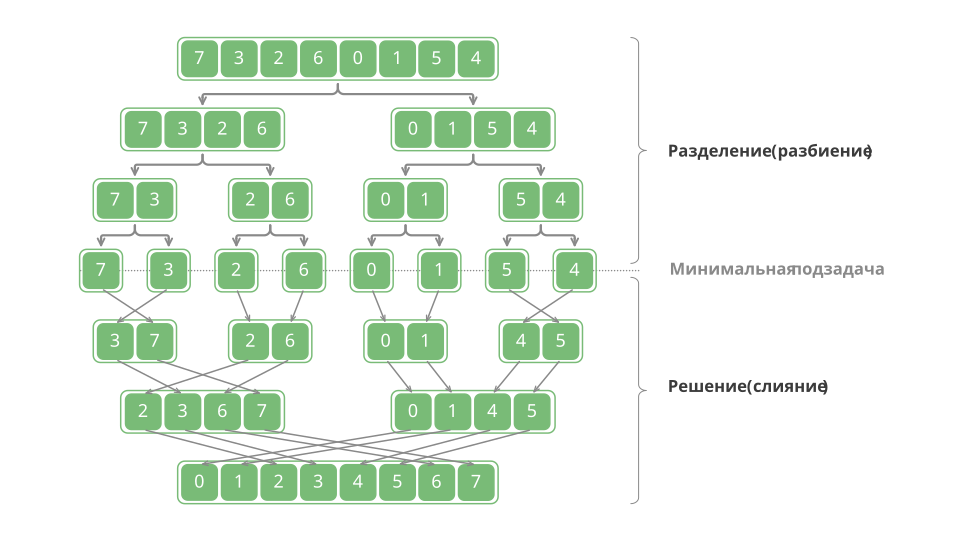
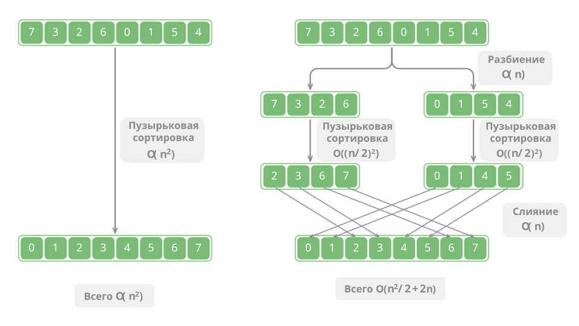
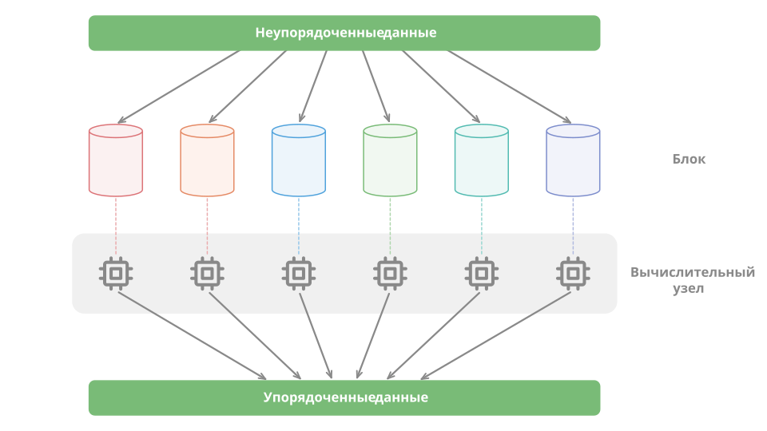

# 12.1 &nbsp; Метод «разделяй и властвуй»

<u>Метод «разделяй и властвуй» (divide and conquer)</u> — одна из основных и широко применяемых алгоритмических стратегий. Обычно её реализуют рекурсивно в два этапа.

1. **Разделение (этап разбиения)**. Рекурсивно делим исходную задачу на две или несколько подзадач, пока не дойдём до минимальных подзадач.
2. **Решение (этап объединения)**. Начав с известных решений минимальных подзадач, объединяем решения снизу вверх и получаем решение исходной задачи.

Сортировка слиянием, показанная на рисунке, — один из типичных примеров этой стратегии.

1. **Разделение**. Рекурсивно делим исходный массив (задачу) на два подмассива (подзадачи), пока в каждом не останется по одному элементу (минимальная подзадача).
2. **Решение**. Снизу вверх сливаем отсортированные подмассивы (решения подзадач) и получаем отсортированный исходный массив (решение исходной задачи).

{ class="animation-figure" }

 Рисунок 12-1 &nbsp; Метод «разделяй и властвуй» в сортировке слиянием 

## 12.1.1 &nbsp; Как распознать задачу для метода «разделяй и властвуй»

Определить, подходит ли этот метод для решения задачи, обычно помогают следующие признаки.

1. **Задача допускает разбиение**. Исходную задачу можно разделить на похожие задачи меньшего размера, а затем рекурсивно делить их тем же способом.
2. **Подзадачи независимы**. Они не перекрываются и не зависят друг от друга, поэтому их можно решать по отдельности.
3. **Решения подзадач можно объединить**. Объединяя их, получаем решение исходной задачи.

Сортировка слиянием удовлетворяет всем трём признакам.

1. **Задача допускает разбиение**. Массив (исходную задачу) рекурсивно делят на два подмассива (подзадачи).
2. **Подзадачи независимы**. Каждый подмассив можно отсортировать отдельно, то есть решить соответствующую подзадачу независимо.
3. **Решения подзадач можно объединить**. Два отсортированных подмассива (решения подзадач) можно слить в один отсортированный массив (решение исходной задачи).

## 12.1.2 &nbsp; Как разбиение повышает эффективность

**Метод «разделяй и властвуй» позволяет решать алгоритмические задачи и часто повышает эффективность алгоритмов**. Именно применение этой стратегии даёт быстрой сортировке, сортировке слиянием и пирамидальной сортировке преимущество в скорости перед сортировками выбором, пузырьком и вставками.

**Почему метод «разделяй и властвуй» повышает эффективность и чем это объясняется**? Иными словами, почему разбить большую задачу на подзадачи, решить их и объединить результаты может оказаться быстрее, чем решить исходную задачу напрямую? Рассмотрим число операций и возможность параллельных вычислений.

### 1. &nbsp; Сокращение числа операций

Пузырьковая сортировка массива длины $n$ занимает $O(n^2)$ времени. Разделим массив посередине на два подмассива, как на рисунке. Разбиение занимает $O(n)$ времени, сортировка каждого подмассива — $O((n / 2)^2)$, а слияние двух подмассивов — $O(n)$. Общая временная сложность составит:

$$
O(n + (\frac{n}{2})^2 \times 2 + n) = O(\frac{n^2}{2} + 2n)
$$

{ class="animation-figure" }

 Рисунок 12-2 &nbsp; Пузырьковая сортировка до и после разбиения массива 

Решим следующее неравенство. Слева в нём записано общее число операций без разбиения, справа — с разбиением:

$$
\begin{aligned}
n^2 & > \frac{n^2}{2} + 2n \newline
n^2 - \frac{n^2}{2} - 2n & > 0 \newline
n(n - 4) & > 0
\end{aligned}
$$

**При $n > 4$ после разбиения требуется меньше операций, поэтому сортировка должна работать быстрее**. Временная сложность остаётся квадратичной, $O(n^2)$. Уменьшается лишь постоянный множитель.

А что, если **продолжать делить каждый подмассив посередине на два**, пока в нём не останется один элемент? Это и есть идея сортировки слиянием, временная сложность которой составляет $O(n \log n)$.

Что, если **выбрать несколько точек разбиения** и разделить исходный массив на $k$ равных частей? Этот подход близок к блочной сортировке. Она хорошо подходит для больших объёмов данных и теоретически может работать за $O(n + k)$.

### 2. &nbsp; Ускорение за счёт параллельных вычислений

Подзадачи, полученные разбиением, независимы, **поэтому обычно их можно решать параллельно**. Таким образом, метод «разделяй и властвуй» не только снижает временную сложность алгоритма, **но и помогает операционной системе распараллелить вычисления**.

Такое ускорение особенно заметно в многоядерных или многопроцессорных системах. Одновременная обработка нескольких подзадач позволяет полнее использовать вычислительные ресурсы и значительно сократить общее время работы.

Например, при блочной сортировке на рисунке большой объём данных равномерно распределён по блокам. Сортировку блоков можно поручить разным вычислительным узлам, а затем объединить результаты.

{ class="animation-figure" }

 Рисунок 12-3 &nbsp; Параллельные вычисления в блочной сортировке 

## 12.1.3 &nbsp; Применение метода «разделяй и властвуй»

С помощью этого метода можно решить многие классические алгоритмические задачи.

- **Поиск ближайшей пары точек**. Алгоритм делит множество точек на две части, находит ближайшую пару внутри каждой части, а затем ищет ближайшую пару из точек, принадлежащих разным частям.
- **Умножение больших целых чисел**. Например, алгоритм Карацубы сводит умножение больших чисел к нескольким умножениям и сложениям меньших чисел.
- **Умножение матриц**. Например, алгоритм Штрассена сводит умножение больших матриц к нескольким умножениям и сложениям матриц меньшего размера.
- **Ханойские башни**. Их рекурсивное решение — характерный пример метода «разделяй и властвуй».
- **Поиск инверсий**. Если в последовательности одно число стоит раньше другого, но больше него, эти числа образуют инверсию. Задачу об инверсиях можно решить методом «разделяй и властвуй» с помощью сортировки слиянием.

Эта стратегия также широко используется при проектировании алгоритмов и структур данных.

- **Двоичный поиск**. Средний индекс делит отсортированный массив на две части. Сравнив искомое значение со средним элементом, определяем, какую половину исключить. В оставшемся интервале повторяем то же разбиение.
- **Сортировка слиянием**. Мы разобрали её в начале раздела.
- **Быстрая сортировка**. Выбирают опорное значение и делят массив на два подмассива: в одном элементы меньше опорного, в другом — больше. Такое разбиение повторяют для обеих частей, пока не останутся подмассивы из одного элемента.
- **Блочная сортировка**. Данные распределяют по нескольким блокам, сортируют элементы внутри каждого блока и последовательно извлекают их из блоков. Получается отсортированный массив.
- **Деревья**. Поиск, вставку и удаление в двоичных деревьях поиска, АВЛ-деревьях, красно-чёрных деревьях, B-деревьях и B+-деревьях можно рассматривать как применение стратегии «разделяй и властвуй».
- **Кучи**. Куча — особое полное двоичное дерево. В таких операциях, как вставка, удаление и восстановление свойства кучи, также прослеживается идея «разделяй и властвуй».
- **Хеш-таблицы**. Сами хеш-таблицы не применяют этот метод напрямую, но он встречается в способах разрешения коллизий. Например, при использовании цепочек длинный связный список преобразуют в красно-чёрное дерево, чтобы ускорить поиск.

Как видно, **идея «разделяй и властвуй» часто действует незаметно**: она лежит в основе самых разных алгоритмов и структур данных.
