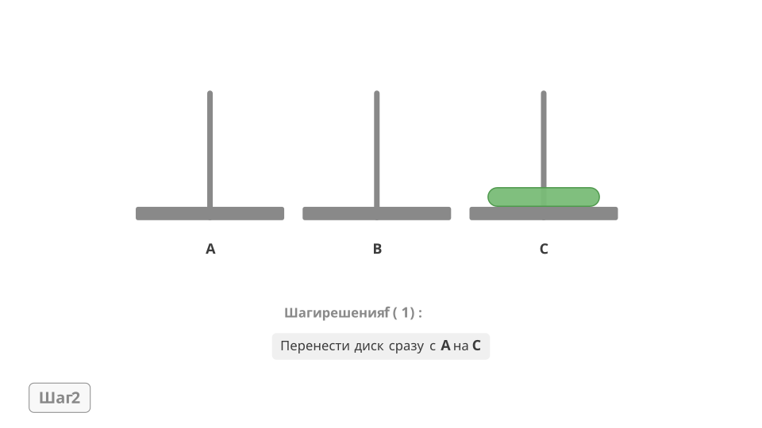
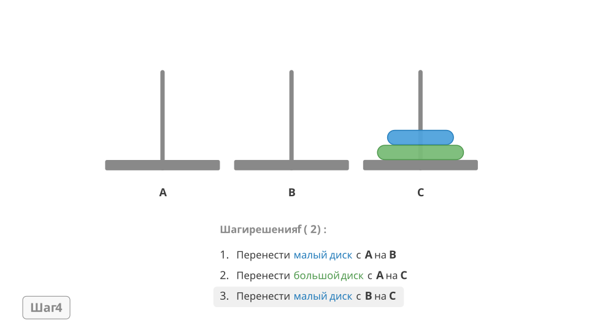
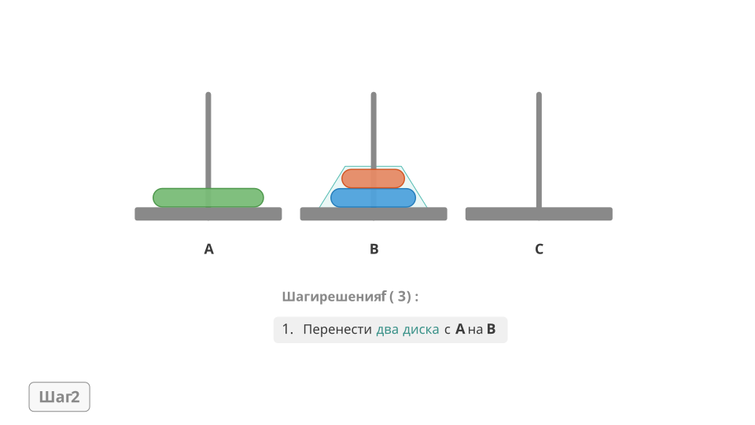

# Задача о ханойских башнях

При сортировке слиянием и построении двоичного дерева мы делили исходную задачу на две подзадачи вдвое меньшего размера. Для ханойских башен выберем другой способ разбиения.

!!! question

    Даны три стержня `A`, `B` и `C`. Вначале на стержне `A` находятся $n$ дисков, расположенных сверху вниз от меньшего к большему. Нужно перенести все $n$ дисков на стержень `C`, сохранив их порядок (см. рисунок). При переносе действуют следующие правила.
    
    1. Диск можно снять только с вершины одного стержня и положить только на вершину другого.
    2. За один ход можно перенести только один диск.
    3. Меньший диск всегда должен находиться выше большего, если они на одном стержне.


**Обозначим задачу о ханойских башнях размера $i$ через $f(i)$**. Например, $f(3)$ означает задачу переноса $3$ дисков с `A` на `C`.

### Базовые случаи

Для задачи $f(1)$, когда диск всего один, достаточно перенести его сразу с `A` на `C`, как показано на рисунке.

=== "<1>"
    

=== "<2>"
    

В задаче $f(2)$ дисков два. Как видно на рисунке, **меньший диск всегда должен оставаться поверх большего, поэтому для переноса понадобится стержень `B`**.

1. Сначала переносим верхний, меньший диск с `A` на `B`.
2. Затем переносим большой диск с `A` на `C`.
3. Наконец переносим малый диск с `B` на `C`.

=== "<1>"
    

=== "<2>"
    

=== "<3>"
    

=== "<4>"
    

Итак, чтобы решить $f(2)$, нужно **с помощью `B` перенести два диска с `A` на `C`**. Стержень `C` называется целевым, а `B` — вспомогательным.

### Разбиение на подзадачи

В задаче $f(3)$ дисков три, поэтому решение немного сложнее.

Решения $f(1)$ и $f(2)$ уже известны. Применим метод «разделяй и властвуй»: **будем рассматривать два верхних диска на `A` как единое целое** и выполним шаги, показанные на рисунке. Так мы перенесём все три диска с `A` на `C`.

1. Возьмём `B` как целевой стержень, а `C` — как вспомогательный и перенесём два диска с `A` на `B`.
2. Оставшийся на `A` диск перенесём прямо с `A` на `C`.
3. Возьмём `C` как целевой стержень, а `A` — как вспомогательный и перенесём два диска с `B` на `C`.

=== "<1>"
    

=== "<2>"
    

=== "<3>"
    

=== "<4>"
    

По сути, **мы разбили задачу $f(3)$ на две подзадачи $f(2)$ и одну подзадачу $f(1)$**. Последовательно решив их, получим решение исходной задачи. Подзадачи независимы, а их решения можно объединить.

Теперь можно сформулировать стратегию для ханойских башен, показанную на рисунке. Исходную задачу $f(n)$ разделим на две подзадачи $f(n-1)$ и одну подзадачу $f(1)$ и решим их в следующем порядке.

1. С помощью `C` переносим $n-1$ дисков с `A` на `B`.
2. Оставшийся $1$ диск переносим прямо с `A` на `C`.
3. С помощью `A` переносим $n-1$ дисков с `B` на `C`.

Обе подзадачи $f(n-1)$ **можно рекурсивно разбивать таким же образом**, пока не будет достигнута минимальная подзадача $f(1)$. Решение $f(1)$ известно: достаточно одного хода.


### Реализация

Объявим рекурсивную функцию `dfs(i, src, buf, tar)`. Она переносит со стержня `src` верхние $i$ дисков с помощью вспомогательного стержня `buf` на целевой стержень `tar`:

```src
[file]{hanota}-[class]{}-[func]{solve_hanota}
```

Задача о ханойских башнях порождает дерево рекурсии высоты $n$, показанное на рисунке. Каждый узел представляет подзадачу и соответствует вызову `dfs()`. **Временная сложность составляет $O(2^n)$, а пространственная — $O(n)$**.


!!! quote

    Задача о ханойских башнях восходит к старинной легенде. В одном храме Древней Индии у монахов были три высоких алмазных стержня и $64$ золотых дисков разного размера. Монахи непрестанно перекладывали диски и верили, что, когда последний диск займёт своё место, наступит конец света.

    Даже если монахи будут делать по одному ходу в секунду, на перенос всех дисков уйдёт примерно $2^{64} \approx 1.84×10^{19}$ секунд. Это около 585 миллиардов лет ($5850$ × 100 млн лет) — гораздо больше, чем возраст Вселенной по современным оценкам. Так что, если верить легенде, нам едва ли стоит опасаться скорого конца света.
