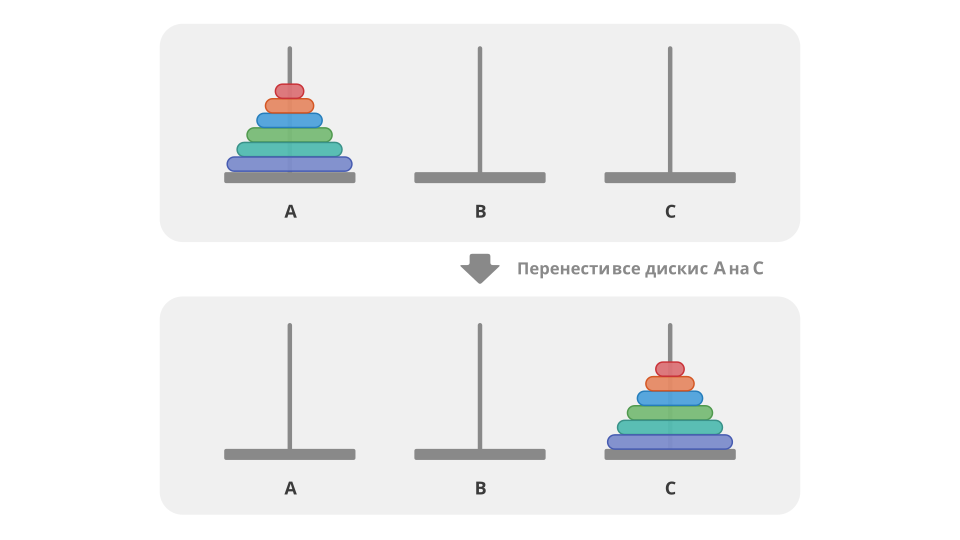
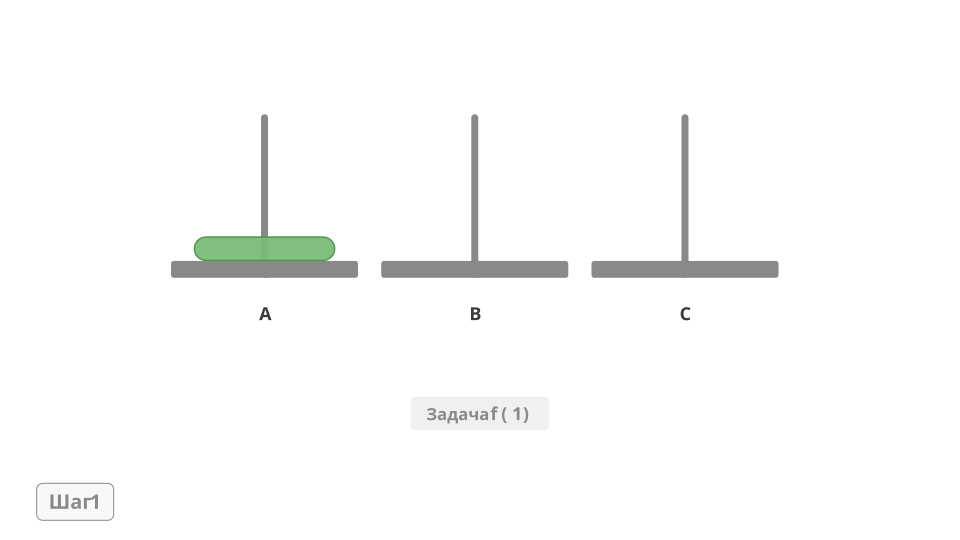
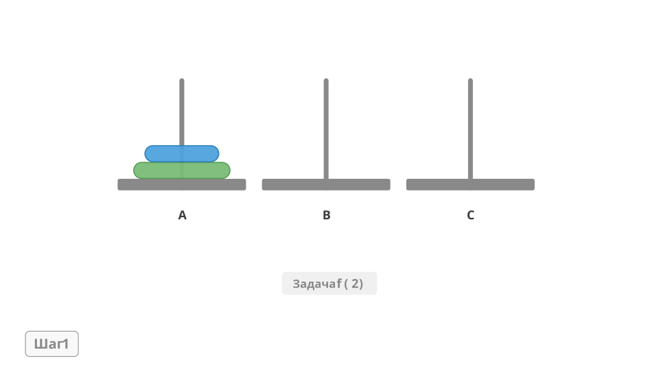
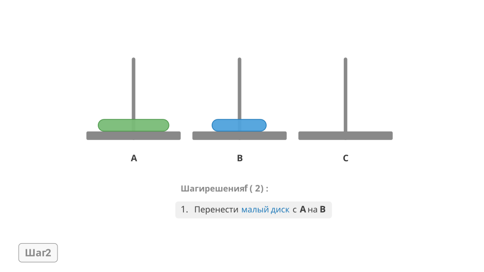
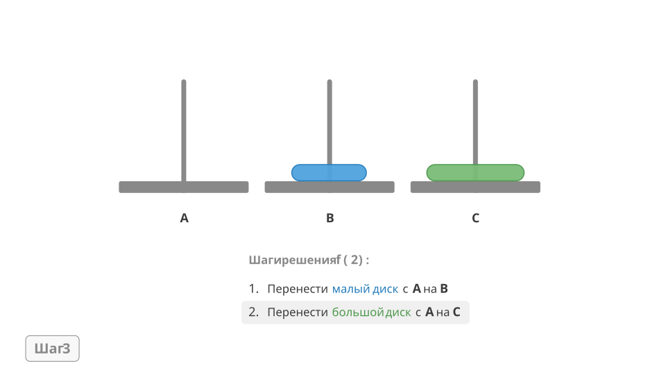
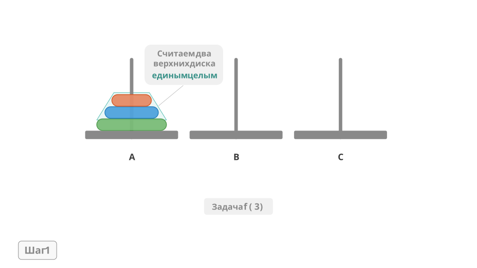
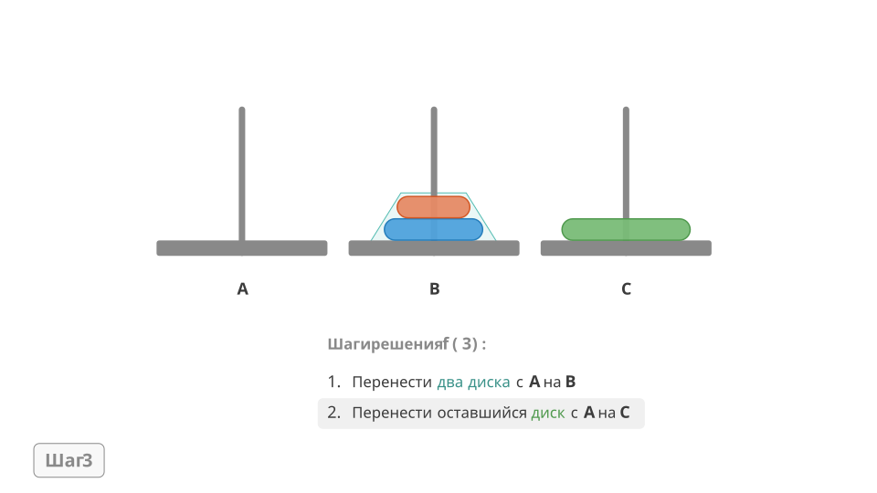
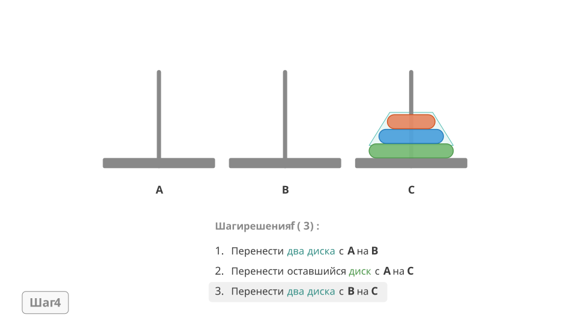
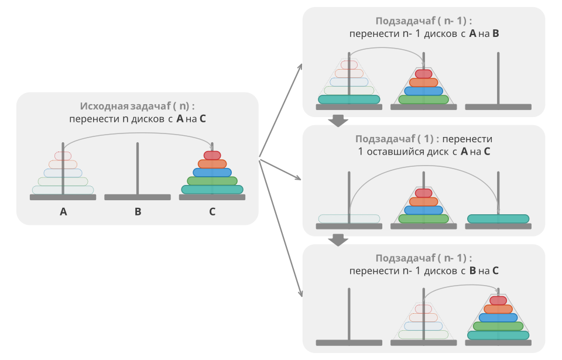
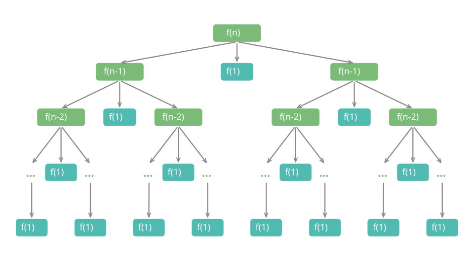

# 12.4 &nbsp; Задача о ханойских башнях

При сортировке слиянием и построении двоичного дерева мы делили исходную задачу на две подзадачи вдвое меньшего размера. Для ханойских башен выберем другой способ разбиения.

!!! question

    Даны три стержня `A`, `B` и `C`. Вначале на стержне `A` находятся $n$ дисков, расположенных сверху вниз от меньшего к большему. Нужно перенести все $n$ дисков на стержень `C`, сохранив их порядок (см. рисунок). При переносе действуют следующие правила.
    
    1. Диск можно снять только с вершины одного стержня и положить только на вершину другого.
    2. За один ход можно перенести только один диск.
    3. Меньший диск всегда должен находиться выше большего, если они на одном стержне.

{ class="animation-figure" }

<p align="center"> Рисунок 12-10 &nbsp; Пример задачи о ханойских башнях </p>

**Обозначим задачу о ханойских башнях размера $i$ через $f(i)$**. Например, $f(3)$ означает задачу переноса $3$ дисков с `A` на `C`.

### 1. &nbsp; Базовые случаи

Для задачи $f(1)$, когда диск всего один, достаточно перенести его сразу с `A` на `C`, как показано на рисунке.

=== "<1>"
    { class="animation-figure" }

=== "<2>"
    { class="animation-figure" }

<p align="center"> Рисунок 12-11 &nbsp; Решение для одного диска </p>

В задаче $f(2)$ дисков два. Как видно на рисунке, **меньший диск всегда должен оставаться поверх большего, поэтому для переноса понадобится стержень `B`**.

1. Сначала переносим верхний, меньший диск с `A` на `B`.
2. Затем переносим большой диск с `A` на `C`.
3. Наконец переносим малый диск с `B` на `C`.

=== "<1>"
    { class="animation-figure" }

=== "<2>"
    { class="animation-figure" }

=== "<3>"
    { class="animation-figure" }

=== "<4>"
    { class="animation-figure" }

<p align="center"> Рисунок 12-12 &nbsp; Решение для двух дисков </p>

Итак, чтобы решить $f(2)$, нужно **с помощью `B` перенести два диска с `A` на `C`**. Стержень `C` называется целевым, а `B` — вспомогательным.

### 2. &nbsp; Разбиение на подзадачи

В задаче $f(3)$ дисков три, поэтому решение немного сложнее.

Решения $f(1)$ и $f(2)$ уже известны. Применим метод «разделяй и властвуй»: **будем рассматривать два верхних диска на `A` как единое целое** и выполним шаги, показанные на рисунке. Так мы перенесём все три диска с `A` на `C`.

1. Возьмём `B` как целевой стержень, а `C` — как вспомогательный и перенесём два диска с `A` на `B`.
2. Оставшийся на `A` диск перенесём прямо с `A` на `C`.
3. Возьмём `C` как целевой стержень, а `A` — как вспомогательный и перенесём два диска с `B` на `C`.

=== "<1>"
    { class="animation-figure" }

=== "<2>"
    { class="animation-figure" }

=== "<3>"
    { class="animation-figure" }

=== "<4>"
    { class="animation-figure" }

<p align="center"> Рисунок 12-13 &nbsp; Решение для трёх дисков </p>

По сути, **мы разбили задачу $f(3)$ на две подзадачи $f(2)$ и одну подзадачу $f(1)$**. Последовательно решив их, получим решение исходной задачи. Подзадачи независимы, а их решения можно объединить.

Теперь можно сформулировать стратегию для ханойских башен, показанную на рисунке. Исходную задачу $f(n)$ разделим на две подзадачи $f(n-1)$ и одну подзадачу $f(1)$ и решим их в следующем порядке.

1. С помощью `C` переносим $n-1$ дисков с `A` на `B`.
2. Оставшийся $1$ диск переносим прямо с `A` на `C`.
3. С помощью `A` переносим $n-1$ дисков с `B` на `C`.

Обе подзадачи $f(n-1)$ **можно рекурсивно разбивать таким же образом**, пока не будет достигнута минимальная подзадача $f(1)$. Решение $f(1)$ известно: достаточно одного хода.

{ class="animation-figure" }

<p align="center"> Рисунок 12-14 &nbsp; Метод «разделяй и властвуй» в задаче о ханойских башнях </p>

### 3. &nbsp; Реализация

Объявим рекурсивную функцию `dfs(i, src, buf, tar)`. Она переносит со стержня `src` верхние $i$ дисков с помощью вспомогательного стержня `buf` на целевой стержень `tar`:

=== "Python"

    ```python title="hanota.py"
    def move(src: list[int], tar: list[int]):
        """Перенос одного диска"""
        # Снимаем верхний диск с src
        pan = src.pop()
        # Кладём диск на вершину tar
        tar.append(pan)

    def dfs(i: int, src: list[int], buf: list[int], tar: list[int]):
        """Решение задачи о ханойских башнях f(i)"""
        # Если с src осталось перенести один диск, кладём его сразу на tar
        if i == 1:
            move(src, tar)
            return
        # Подзадача f(i-1): переносим i-1 верхних дисков с src на buf с помощью tar
        dfs(i - 1, src, tar, buf)
        # Подзадача f(1): переносим оставшийся диск с src на tar
        move(src, tar)
        # Подзадача f(i-1): переносим i-1 верхних дисков с buf на tar с помощью src
        dfs(i - 1, buf, src, tar)

    def solve_hanota(A: list[int], B: list[int], C: list[int]):
        """Решение задачи о ханойских башнях"""
        n = len(A)
        # Переносим n верхних дисков с A на C с помощью B
        dfs(n, A, B, C)
    ```

=== "C++"

    ```cpp title="hanota.cpp"
    /* Перенос одного диска */
    void move(vector<int> &src, vector<int> &tar) {
        // Снимаем верхний диск с src
        int pan = src.back();
        src.pop_back();
        // Кладём диск на вершину tar
        tar.push_back(pan);
    }

    /* Решение задачи о ханойских башнях f(i) */
    void dfs(int i, vector<int> &src, vector<int> &buf, vector<int> &tar) {
        // Если с src осталось перенести один диск, кладём его сразу на tar
        if (i == 1) {
            move(src, tar);
            return;
        }
        // Подзадача f(i-1): переносим i-1 верхних дисков с src на buf с помощью tar
        dfs(i - 1, src, tar, buf);
        // Подзадача f(1): переносим оставшийся диск с src на tar
        move(src, tar);
        // Подзадача f(i-1): переносим i-1 верхних дисков с buf на tar с помощью src
        dfs(i - 1, buf, src, tar);
    }

    /* Решение задачи о ханойских башнях */
    void solveHanota(vector<int> &A, vector<int> &B, vector<int> &C) {
        int n = A.size();
        // Переносим n верхних дисков с A на C с помощью B
        dfs(n, A, B, C);
    }
    ```

=== "Java"

    ```java title="hanota.java"
    /* Перенос одного диска */
    void move(List<Integer> src, List<Integer> tar) {
        // Снимаем верхний диск с src
        Integer pan = src.remove(src.size() - 1);
        // Кладём диск на вершину tar
        tar.add(pan);
    }

    /* Решение задачи о ханойских башнях f(i) */
    void dfs(int i, List<Integer> src, List<Integer> buf, List<Integer> tar) {
        // Если с src осталось перенести один диск, кладём его сразу на tar
        if (i == 1) {
            move(src, tar);
            return;
        }
        // Подзадача f(i-1): переносим i-1 верхних дисков с src на buf с помощью tar
        dfs(i - 1, src, tar, buf);
        // Подзадача f(1): переносим оставшийся диск с src на tar
        move(src, tar);
        // Подзадача f(i-1): переносим i-1 верхних дисков с buf на tar с помощью src
        dfs(i - 1, buf, src, tar);
    }

    /* Решение задачи о ханойских башнях */
    void solveHanota(List<Integer> A, List<Integer> B, List<Integer> C) {
        int n = A.size();
        // Переносим n верхних дисков с A на C с помощью B
        dfs(n, A, B, C);
    }
    ```

=== "C#"

    ```csharp title="hanota.cs"
    /* Перенос одного диска */
    void Move(List<int> src, List<int> tar) {
        // Снимаем верхний диск с src
        int pan = src[^1];
        src.RemoveAt(src.Count - 1);
        // Кладём диск на вершину tar
        tar.Add(pan);
    }

    /* Решение задачи о ханойских башнях f(i) */
    void DFS(int i, List<int> src, List<int> buf, List<int> tar) {
        // Если с src осталось перенести один диск, кладём его сразу на tar
        if (i == 1) {
            Move(src, tar);
            return;
        }
        // Подзадача f(i-1): переносим i-1 верхних дисков с src на buf с помощью tar
        DFS(i - 1, src, tar, buf);
        // Подзадача f(1): переносим оставшийся диск с src на tar
        Move(src, tar);
        // Подзадача f(i-1): переносим i-1 верхних дисков с buf на tar с помощью src
        DFS(i - 1, buf, src, tar);
    }

    /* Решение задачи о ханойских башнях */
    void SolveHanota(List<int> A, List<int> B, List<int> C) {
        int n = A.Count;
        // Переносим n верхних дисков с A на C с помощью B
        DFS(n, A, B, C);
    }
    ```

=== "Go"

    ```go title="hanota.go"
    /* Перенос одного диска */
    func move(src, tar *list.List) {
        // Снимаем верхний диск с src
        pan := src.Back()
        // Кладём диск на вершину tar
        tar.PushBack(pan.Value)
        // Снимаем верхний диск с src
        src.Remove(pan)
    }

    /* Решение задачи о ханойских башнях f(i) */
    func dfsHanota(i int, src, buf, tar *list.List) {
        // Если с src осталось перенести один диск, кладём его сразу на tar
        if i == 1 {
            move(src, tar)
            return
        }
        // Подзадача f(i-1): переносим i-1 верхних дисков с src на buf с помощью tar
        dfsHanota(i-1, src, tar, buf)
        // Подзадача f(1): переносим оставшийся диск с src на tar
        move(src, tar)
        // Подзадача f(i-1): переносим i-1 верхних дисков с buf на tar с помощью src
        dfsHanota(i-1, buf, src, tar)
    }

    /* Решение задачи о ханойских башнях */
    func solveHanota(A, B, C *list.List) {
        n := A.Len()
        // Переносим n верхних дисков с A на C с помощью B
        dfsHanota(n, A, B, C)
    }
    ```

=== "Swift"

    ```swift title="hanota.swift"
    /* Перенос одного диска */
    func move(src: inout [Int], tar: inout [Int]) {
        // Снимаем верхний диск с src
        let pan = src.popLast()!
        // Кладём диск на вершину tar
        tar.append(pan)
    }

    /* Решение задачи о ханойских башнях f(i) */
    func dfs(i: Int, src: inout [Int], buf: inout [Int], tar: inout [Int]) {
        // Если с src осталось перенести один диск, кладём его сразу на tar
        if i == 1 {
            move(src: &src, tar: &tar)
            return
        }
        // Подзадача f(i-1): переносим i-1 верхних дисков с src на buf с помощью tar
        dfs(i: i - 1, src: &src, buf: &tar, tar: &buf)
        // Подзадача f(1): переносим оставшийся диск с src на tar
        move(src: &src, tar: &tar)
        // Подзадача f(i-1): переносим i-1 верхних дисков с buf на tar с помощью src
        dfs(i: i - 1, src: &buf, buf: &src, tar: &tar)
    }

    /* Решение задачи о ханойских башнях */
    func solveHanota(A: inout [Int], B: inout [Int], C: inout [Int]) {
        let n = A.count
        // Последний элемент списка соответствует вершине стержня
        // Переносим n верхних дисков с src на C с помощью B
        dfs(i: n, src: &A, buf: &B, tar: &C)
    }
    ```

=== "JS"

    ```javascript title="hanota.js"
    /* Перенос одного диска */
    function move(src, tar) {
        // Снимаем верхний диск с src
        const pan = src.pop();
        // Кладём диск на вершину tar
        tar.push(pan);
    }

    /* Решение задачи о ханойских башнях f(i) */
    function dfs(i, src, buf, tar) {
        // Если с src осталось перенести один диск, кладём его сразу на tar
        if (i === 1) {
            move(src, tar);
            return;
        }
        // Подзадача f(i-1): переносим i-1 верхних дисков с src на buf с помощью tar
        dfs(i - 1, src, tar, buf);
        // Подзадача f(1): переносим оставшийся диск с src на tar
        move(src, tar);
        // Подзадача f(i-1): переносим i-1 верхних дисков с buf на tar с помощью src
        dfs(i - 1, buf, src, tar);
    }

    /* Решение задачи о ханойских башнях */
    function solveHanota(A, B, C) {
        const n = A.length;
        // Переносим n верхних дисков с A на C с помощью B
        dfs(n, A, B, C);
    }
    ```

=== "TS"

    ```typescript title="hanota.ts"
    /* Перенос одного диска */
    function move(src: number[], tar: number[]): void {
        // Снимаем верхний диск с src
        const pan = src.pop();
        // Кладём диск на вершину tar
        tar.push(pan);
    }

    /* Решение задачи о ханойских башнях f(i) */
    function dfs(i: number, src: number[], buf: number[], tar: number[]): void {
        // Если с src осталось перенести один диск, кладём его сразу на tar
        if (i === 1) {
            move(src, tar);
            return;
        }
        // Подзадача f(i-1): переносим i-1 верхних дисков с src на buf с помощью tar
        dfs(i - 1, src, tar, buf);
        // Подзадача f(1): переносим оставшийся диск с src на tar
        move(src, tar);
        // Подзадача f(i-1): переносим i-1 верхних дисков с buf на tar с помощью src
        dfs(i - 1, buf, src, tar);
    }

    /* Решение задачи о ханойских башнях */
    function solveHanota(A: number[], B: number[], C: number[]): void {
        const n = A.length;
        // Переносим n верхних дисков с A на C с помощью B
        dfs(n, A, B, C);
    }
    ```

=== "Dart"

    ```dart title="hanota.dart"
    /* Перенос одного диска */
    void move(List<int> src, List<int> tar) {
      // Снимаем верхний диск с src
      int pan = src.removeLast();
      // Кладём диск на вершину tar
      tar.add(pan);
    }

    /* Решение задачи о ханойских башнях f(i) */
    void dfs(int i, List<int> src, List<int> buf, List<int> tar) {
      // Если с src осталось перенести один диск, кладём его сразу на tar
      if (i == 1) {
        move(src, tar);
        return;
      }
      // Подзадача f(i-1): переносим i-1 верхних дисков с src на buf с помощью tar
      dfs(i - 1, src, tar, buf);
      // Подзадача f(1): переносим оставшийся диск с src на tar
      move(src, tar);
      // Подзадача f(i-1): переносим i-1 верхних дисков с buf на tar с помощью src
      dfs(i - 1, buf, src, tar);
    }

    /* Решение задачи о ханойских башнях */
    void solveHanota(List<int> A, List<int> B, List<int> C) {
      int n = A.length;
      // Переносим n верхних дисков с A на C с помощью B
      dfs(n, A, B, C);
    }
    ```

=== "Rust"

    ```rust title="hanota.rs"
    /* Перенос одного диска */
    fn move_pan(src: &mut Vec<i32>, tar: &mut Vec<i32>) {
        // Снимаем верхний диск с src
        let pan = src.pop().unwrap();
        // Кладём диск на вершину tar
        tar.push(pan);
    }

    /* Решение задачи о ханойских башнях f(i) */
    fn dfs(i: i32, src: &mut Vec<i32>, buf: &mut Vec<i32>, tar: &mut Vec<i32>) {
        // Если с src осталось перенести один диск, кладём его сразу на tar
        if i == 1 {
            move_pan(src, tar);
            return;
        }
        // Подзадача f(i-1): переносим i-1 верхних дисков с src на buf с помощью tar
        dfs(i - 1, src, tar, buf);
        // Подзадача f(1): переносим оставшийся диск с src на tar
        move_pan(src, tar);
        // Подзадача f(i-1): переносим i-1 верхних дисков с buf на tar с помощью src
        dfs(i - 1, buf, src, tar);
    }

    /* Решение задачи о ханойских башнях */
    fn solve_hanota(A: &mut Vec<i32>, B: &mut Vec<i32>, C: &mut Vec<i32>) {
        let n = A.len() as i32;
        // Переносим n верхних дисков с A на C с помощью B
        dfs(n, A, B, C);
    }
    ```

=== "C"

    ```c title="hanota.c"
    /* Перенос одного диска */
    void move(int *src, int *srcSize, int *tar, int *tarSize) {
        // Снимаем верхний диск с src
        int pan = src[*srcSize - 1];
        src[*srcSize - 1] = 0;
        (*srcSize)--;
        // Кладём диск на вершину tar
        tar[*tarSize] = pan;
        (*tarSize)++;
    }

    /* Решение задачи о ханойских башнях f(i) */
    void dfs(int i, int *src, int *srcSize, int *buf, int *bufSize, int *tar, int *tarSize) {
        // Если с src осталось перенести один диск, кладём его сразу на tar
        if (i == 1) {
            move(src, srcSize, tar, tarSize);
            return;
        }
        // Подзадача f(i-1): переносим i-1 верхних дисков с src на buf с помощью tar
        dfs(i - 1, src, srcSize, tar, tarSize, buf, bufSize);
        // Подзадача f(1): переносим оставшийся диск с src на tar
        move(src, srcSize, tar, tarSize);
        // Подзадача f(i-1): переносим i-1 верхних дисков с buf на tar с помощью src
        dfs(i - 1, buf, bufSize, src, srcSize, tar, tarSize);
    }

    /* Решение задачи о ханойских башнях */
    void solveHanota(int *A, int *ASize, int *B, int *BSize, int *C, int *CSize) {
        // Переносим n верхних дисков с A на C с помощью B
        dfs(*ASize, A, ASize, B, BSize, C, CSize);
    }
    ```

=== "Kotlin"

    ```kotlin title="hanota.kt"
    /* Перенос одного диска */
    fun move(src: MutableList<Int>, tar: MutableList<Int>) {
        // Снимаем верхний диск с src
        val pan = src.removeAt(src.size - 1)
        // Кладём диск на вершину tar
        tar.add(pan)
    }

    /* Решение задачи о ханойских башнях f(i) */
    fun dfs(i: Int, src: MutableList<Int>, buf: MutableList<Int>, tar: MutableList<Int>) {
        // Если с src осталось перенести один диск, кладём его сразу на tar
        if (i == 1) {
            move(src, tar)
            return
        }
        // Подзадача f(i-1): переносим i-1 верхних дисков с src на buf с помощью tar
        dfs(i - 1, src, tar, buf)
        // Подзадача f(1): переносим оставшийся диск с src на tar
        move(src, tar)
        // Подзадача f(i-1): переносим i-1 верхних дисков с buf на tar с помощью src
        dfs(i - 1, buf, src, tar)
    }

    /* Решение задачи о ханойских башнях */
    fun solveHanota(A: MutableList<Int>, B: MutableList<Int>, C: MutableList<Int>) {
        val n = A.size
        // Переносим n верхних дисков с A на C с помощью B
        dfs(n, A, B, C)
    }
    ```

=== "Ruby"

    ```ruby title="hanota.rb"
    ### Перенос одного диска ###
    def move(src, tar)
      # Снимаем верхний диск с src
      pan = src.pop
      # Кладём диск на вершину tar
      tar << pan
    end

    ### Решение задачи о ханойских башнях f(i) ###
    def dfs(i, src, buf, tar)
      # Если с src осталось перенести один диск, кладём его сразу на tar
      if i == 1
        move(src, tar)
        return
      end

      # Подзадача f(i-1): переносим i-1 верхних дисков с src на buf с помощью tar
      dfs(i - 1, src, tar, buf)
      # Подзадача f(1): переносим оставшийся диск с src на tar
      move(src, tar)
      # Подзадача f(i-1): переносим i-1 верхних дисков с buf на tar с помощью src
      dfs(i - 1, buf, src, tar)
    end

    ### Решение задачи о ханойских башнях ###
    def solve_hanota(_A, _B, _C)
      n = _A.length
      # Переносим n верхних дисков с A на C с помощью B
      dfs(n, _A, _B, _C)
    end
    ```

??? pythontutor "Визуализация выполнения"

    <div style="height: 549px; width: 100%;"><iframe class="pythontutor-iframe" title="Визуализация выполнения" src="https://pythontutor.com/iframe-embed.html#code=def%20move%28src%3A%20list%5Bint%5D,%20tar%3A%20list%5Bint%5D%29%3A%0A%20%20%20%20%22%22%22%D0%9F%D0%B5%D1%80%D0%B5%D0%BD%D0%BE%D1%81%20%D0%BE%D0%B4%D0%BD%D0%BE%D0%B3%D0%BE%20%D0%B4%D0%B8%D1%81%D0%BA%D0%B0%22%22%22%0A%20%20%20%20%23%20%D0%A1%D0%BD%D0%B8%D0%BC%D0%B0%D0%B5%D0%BC%20%D0%B2%D0%B5%D1%80%D1%85%D0%BD%D0%B8%D0%B9%20%D0%B4%D0%B8%D1%81%D0%BA%20%D1%81%20src%0A%20%20%20%20pan%20%3D%20src.pop%28%29%0A%20%20%20%20%23%20%D0%9A%D0%BB%D0%B0%D0%B4%D1%91%D0%BC%20%D0%B4%D0%B8%D1%81%D0%BA%20%D0%BD%D0%B0%20%D0%B2%D0%B5%D1%80%D1%88%D0%B8%D0%BD%D1%83%20tar%0A%20%20%20%20tar.append%28pan%29%0A%0A%0Adef%20dfs%28i%3A%20int,%20src%3A%20list%5Bint%5D,%20buf%3A%20list%5Bint%5D,%20tar%3A%20list%5Bint%5D%29%3A%0A%20%20%20%20%22%22%22%D0%A0%D0%B5%D1%88%D0%B5%D0%BD%D0%B8%D0%B5%20%D0%B7%D0%B0%D0%B4%D0%B0%D1%87%D0%B8%20%D0%BE%20%D1%85%D0%B0%D0%BD%D0%BE%D0%B9%D1%81%D0%BA%D0%B8%D1%85%20%D0%B1%D0%B0%D1%88%D0%BD%D1%8F%D1%85%20f%28i%29%22%22%22%0A%20%20%20%20%23%20%D0%95%D1%81%D0%BB%D0%B8%20%D1%81%20src%20%D0%BE%D1%81%D1%82%D0%B0%D0%BB%D0%BE%D1%81%D1%8C%20%D0%BF%D0%B5%D1%80%D0%B5%D0%BD%D0%B5%D1%81%D1%82%D0%B8%20%D0%BE%D0%B4%D0%B8%D0%BD%20%D0%B4%D0%B8%D1%81%D0%BA,%20%D0%BA%D0%BB%D0%B0%D0%B4%D1%91%D0%BC%20%D0%B5%D0%B3%D0%BE%20%D1%81%D1%80%D0%B0%D0%B7%D1%83%20%D0%BD%D0%B0%20tar%0A%20%20%20%20if%20i%20%3D%3D%201%3A%0A%20%20%20%20%20%20%20%20move%28src,%20tar%29%0A%20%20%20%20%20%20%20%20return%0A%20%20%20%20%23%20%D0%9F%D0%BE%D0%B4%D0%B7%D0%B0%D0%B4%D0%B0%D1%87%D0%B0%20f%28i-1%29%3A%20%D0%BF%D0%B5%D1%80%D0%B5%D0%BD%D0%BE%D1%81%D0%B8%D0%BC%20i-1%20%D0%B2%D0%B5%D1%80%D1%85%D0%BD%D0%B8%D1%85%20%D0%B4%D0%B8%D1%81%D0%BA%D0%BE%D0%B2%20%D1%81%20src%20%D0%BD%D0%B0%20buf%20%D1%81%20%D0%BF%D0%BE%D0%BC%D0%BE%D1%89%D1%8C%D1%8E%20tar%0A%20%20%20%20dfs%28i%20-%201,%20src,%20tar,%20buf%29%0A%20%20%20%20%23%20%D0%9F%D0%BE%D0%B4%D0%B7%D0%B0%D0%B4%D0%B0%D1%87%D0%B0%20f%281%29%3A%20%D0%BF%D0%B5%D1%80%D0%B5%D0%BD%D0%BE%D1%81%D0%B8%D0%BC%20%D0%BE%D1%81%D1%82%D0%B0%D0%B2%D1%88%D0%B8%D0%B9%D1%81%D1%8F%20%D0%B4%D0%B8%D1%81%D0%BA%20%D1%81%20src%20%D0%BD%D0%B0%20tar%0A%20%20%20%20move%28src,%20tar%29%0A%20%20%20%20%23%20%D0%9F%D0%BE%D0%B4%D0%B7%D0%B0%D0%B4%D0%B0%D1%87%D0%B0%20f%28i-1%29%3A%20%D0%BF%D0%B5%D1%80%D0%B5%D0%BD%D0%BE%D1%81%D0%B8%D0%BC%20i-1%20%D0%B2%D0%B5%D1%80%D1%85%D0%BD%D0%B8%D1%85%20%D0%B4%D0%B8%D1%81%D0%BA%D0%BE%D0%B2%20%D1%81%20buf%20%D0%BD%D0%B0%20tar%20%D1%81%20%D0%BF%D0%BE%D0%BC%D0%BE%D1%89%D1%8C%D1%8E%20src%0A%20%20%20%20dfs%28i%20-%201,%20buf,%20src,%20tar%29%0A%0A%0Adef%20solve_hanota%28A%3A%20list%5Bint%5D,%20B%3A%20list%5Bint%5D,%20C%3A%20list%5Bint%5D%29%3A%0A%20%20%20%20%22%22%22%D0%A0%D0%B5%D1%88%D0%B5%D0%BD%D0%B8%D0%B5%20%D0%B7%D0%B0%D0%B4%D0%B0%D1%87%D0%B8%20%D0%BE%20%D1%85%D0%B0%D0%BD%D0%BE%D0%B9%D1%81%D0%BA%D0%B8%D1%85%20%D0%B1%D0%B0%D1%88%D0%BD%D1%8F%D1%85%22%22%22%0A%20%20%20%20n%20%3D%20len%28A%29%0A%20%20%20%20%23%20%D0%9F%D0%B5%D1%80%D0%B5%D0%BD%D0%BE%D1%81%D0%B8%D0%BC%20n%20%D0%B2%D0%B5%D1%80%D1%85%D0%BD%D0%B8%D1%85%20%D0%B4%D0%B8%D1%81%D0%BA%D0%BE%D0%B2%20%D1%81%20A%20%D0%BD%D0%B0%20C%20%D1%81%20%D0%BF%D0%BE%D0%BC%D0%BE%D1%89%D1%8C%D1%8E%20B%0A%20%20%20%20dfs%28n,%20A,%20B,%20C%29%0A%0A%0A%22%22%22Driver%20Code%22%22%22%0Aif%20__name__%20%3D%3D%20%22__main__%22%3A%0A%20%20%20%20%23%20%D0%9F%D0%BE%D1%81%D0%BB%D0%B5%D0%B4%D0%BD%D0%B8%D0%B9%20%D1%8D%D0%BB%D0%B5%D0%BC%D0%B5%D0%BD%D1%82%20%D1%81%D0%BF%D0%B8%D1%81%D0%BA%D0%B0%20%D1%81%D0%BE%D0%BE%D1%82%D0%B2%D0%B5%D1%82%D1%81%D1%82%D0%B2%D1%83%D0%B5%D1%82%20%D0%B2%D0%B5%D1%80%D1%88%D0%B8%D0%BD%D0%B5%20%D1%81%D1%82%D0%B5%D1%80%D0%B6%D0%BD%D1%8F%0A%20%20%20%20A%20%3D%20%5B5,%204,%203,%202,%201%5D%0A%20%20%20%20B%20%3D%20%5B%5D%0A%20%20%20%20C%20%3D%20%5B%5D%0A%20%20%20%20print%28%22%D0%98%D1%81%D1%85%D0%BE%D0%B4%D0%BD%D0%BE%D0%B5%20%D1%81%D0%BE%D1%81%D1%82%D0%BE%D1%8F%D0%BD%D0%B8%D0%B5%3A%22%29%0A%20%20%20%20print%28f%22A%20%3D%20%7BA%7D%22%29%0A%20%20%20%20print%28f%22B%20%3D%20%7BB%7D%22%29%0A%20%20%20%20print%28f%22C%20%3D%20%7BC%7D%22%29%0A%0A%20%20%20%20solve_hanota%28A,%20B,%20C%29%0A%0A%20%20%20%20print%28%22%D0%9F%D0%BE%D1%81%D0%BB%D0%B5%20%D0%BF%D0%B5%D1%80%D0%B5%D0%BD%D0%BE%D1%81%D0%B0%20%D0%B4%D0%B8%D1%81%D0%BA%D0%BE%D0%B2%3A%22%29%0A%20%20%20%20print%28f%22A%20%3D%20%7BA%7D%22%29%0A%20%20%20%20print%28f%22B%20%3D%20%7BB%7D%22%29%0A%20%20%20%20print%28f%22C%20%3D%20%7BC%7D%22%29&codeDivHeight=472&codeDivWidth=350&cumulative=false&curInstr=12&heapPrimitives=nevernest&origin=opt-frontend.js&py=311&rawInputLstJSON=%5B%5D&textReferences=false"> </iframe></div>
    <div style="margin-top: 5px;"><a href="https://pythontutor.com/iframe-embed.html#code=def%20move%28src%3A%20list%5Bint%5D,%20tar%3A%20list%5Bint%5D%29%3A%0A%20%20%20%20%22%22%22%D0%9F%D0%B5%D1%80%D0%B5%D0%BD%D0%BE%D1%81%20%D0%BE%D0%B4%D0%BD%D0%BE%D0%B3%D0%BE%20%D0%B4%D0%B8%D1%81%D0%BA%D0%B0%22%22%22%0A%20%20%20%20%23%20%D0%A1%D0%BD%D0%B8%D0%BC%D0%B0%D0%B5%D0%BC%20%D0%B2%D0%B5%D1%80%D1%85%D0%BD%D0%B8%D0%B9%20%D0%B4%D0%B8%D1%81%D0%BA%20%D1%81%20src%0A%20%20%20%20pan%20%3D%20src.pop%28%29%0A%20%20%20%20%23%20%D0%9A%D0%BB%D0%B0%D0%B4%D1%91%D0%BC%20%D0%B4%D0%B8%D1%81%D0%BA%20%D0%BD%D0%B0%20%D0%B2%D0%B5%D1%80%D1%88%D0%B8%D0%BD%D1%83%20tar%0A%20%20%20%20tar.append%28pan%29%0A%0A%0Adef%20dfs%28i%3A%20int,%20src%3A%20list%5Bint%5D,%20buf%3A%20list%5Bint%5D,%20tar%3A%20list%5Bint%5D%29%3A%0A%20%20%20%20%22%22%22%D0%A0%D0%B5%D1%88%D0%B5%D0%BD%D0%B8%D0%B5%20%D0%B7%D0%B0%D0%B4%D0%B0%D1%87%D0%B8%20%D0%BE%20%D1%85%D0%B0%D0%BD%D0%BE%D0%B9%D1%81%D0%BA%D0%B8%D1%85%20%D0%B1%D0%B0%D1%88%D0%BD%D1%8F%D1%85%20f%28i%29%22%22%22%0A%20%20%20%20%23%20%D0%95%D1%81%D0%BB%D0%B8%20%D1%81%20src%20%D0%BE%D1%81%D1%82%D0%B0%D0%BB%D0%BE%D1%81%D1%8C%20%D0%BF%D0%B5%D1%80%D0%B5%D0%BD%D0%B5%D1%81%D1%82%D0%B8%20%D0%BE%D0%B4%D0%B8%D0%BD%20%D0%B4%D0%B8%D1%81%D0%BA,%20%D0%BA%D0%BB%D0%B0%D0%B4%D1%91%D0%BC%20%D0%B5%D0%B3%D0%BE%20%D1%81%D1%80%D0%B0%D0%B7%D1%83%20%D0%BD%D0%B0%20tar%0A%20%20%20%20if%20i%20%3D%3D%201%3A%0A%20%20%20%20%20%20%20%20move%28src,%20tar%29%0A%20%20%20%20%20%20%20%20return%0A%20%20%20%20%23%20%D0%9F%D0%BE%D0%B4%D0%B7%D0%B0%D0%B4%D0%B0%D1%87%D0%B0%20f%28i-1%29%3A%20%D0%BF%D0%B5%D1%80%D0%B5%D0%BD%D0%BE%D1%81%D0%B8%D0%BC%20i-1%20%D0%B2%D0%B5%D1%80%D1%85%D0%BD%D0%B8%D1%85%20%D0%B4%D0%B8%D1%81%D0%BA%D0%BE%D0%B2%20%D1%81%20src%20%D0%BD%D0%B0%20buf%20%D1%81%20%D0%BF%D0%BE%D0%BC%D0%BE%D1%89%D1%8C%D1%8E%20tar%0A%20%20%20%20dfs%28i%20-%201,%20src,%20tar,%20buf%29%0A%20%20%20%20%23%20%D0%9F%D0%BE%D0%B4%D0%B7%D0%B0%D0%B4%D0%B0%D1%87%D0%B0%20f%281%29%3A%20%D0%BF%D0%B5%D1%80%D0%B5%D0%BD%D0%BE%D1%81%D0%B8%D0%BC%20%D0%BE%D1%81%D1%82%D0%B0%D0%B2%D1%88%D0%B8%D0%B9%D1%81%D1%8F%20%D0%B4%D0%B8%D1%81%D0%BA%20%D1%81%20src%20%D0%BD%D0%B0%20tar%0A%20%20%20%20move%28src,%20tar%29%0A%20%20%20%20%23%20%D0%9F%D0%BE%D0%B4%D0%B7%D0%B0%D0%B4%D0%B0%D1%87%D0%B0%20f%28i-1%29%3A%20%D0%BF%D0%B5%D1%80%D0%B5%D0%BD%D0%BE%D1%81%D0%B8%D0%BC%20i-1%20%D0%B2%D0%B5%D1%80%D1%85%D0%BD%D0%B8%D1%85%20%D0%B4%D0%B8%D1%81%D0%BA%D0%BE%D0%B2%20%D1%81%20buf%20%D0%BD%D0%B0%20tar%20%D1%81%20%D0%BF%D0%BE%D0%BC%D0%BE%D1%89%D1%8C%D1%8E%20src%0A%20%20%20%20dfs%28i%20-%201,%20buf,%20src,%20tar%29%0A%0A%0Adef%20solve_hanota%28A%3A%20list%5Bint%5D,%20B%3A%20list%5Bint%5D,%20C%3A%20list%5Bint%5D%29%3A%0A%20%20%20%20%22%22%22%D0%A0%D0%B5%D1%88%D0%B5%D0%BD%D0%B8%D0%B5%20%D0%B7%D0%B0%D0%B4%D0%B0%D1%87%D0%B8%20%D0%BE%20%D1%85%D0%B0%D0%BD%D0%BE%D0%B9%D1%81%D0%BA%D0%B8%D1%85%20%D0%B1%D0%B0%D1%88%D0%BD%D1%8F%D1%85%22%22%22%0A%20%20%20%20n%20%3D%20len%28A%29%0A%20%20%20%20%23%20%D0%9F%D0%B5%D1%80%D0%B5%D0%BD%D0%BE%D1%81%D0%B8%D0%BC%20n%20%D0%B2%D0%B5%D1%80%D1%85%D0%BD%D0%B8%D1%85%20%D0%B4%D0%B8%D1%81%D0%BA%D0%BE%D0%B2%20%D1%81%20A%20%D0%BD%D0%B0%20C%20%D1%81%20%D0%BF%D0%BE%D0%BC%D0%BE%D1%89%D1%8C%D1%8E%20B%0A%20%20%20%20dfs%28n,%20A,%20B,%20C%29%0A%0A%0A%22%22%22Driver%20Code%22%22%22%0Aif%20__name__%20%3D%3D%20%22__main__%22%3A%0A%20%20%20%20%23%20%D0%9F%D0%BE%D1%81%D0%BB%D0%B5%D0%B4%D0%BD%D0%B8%D0%B9%20%D1%8D%D0%BB%D0%B5%D0%BC%D0%B5%D0%BD%D1%82%20%D1%81%D0%BF%D0%B8%D1%81%D0%BA%D0%B0%20%D1%81%D0%BE%D0%BE%D1%82%D0%B2%D0%B5%D1%82%D1%81%D1%82%D0%B2%D1%83%D0%B5%D1%82%20%D0%B2%D0%B5%D1%80%D1%88%D0%B8%D0%BD%D0%B5%20%D1%81%D1%82%D0%B5%D1%80%D0%B6%D0%BD%D1%8F%0A%20%20%20%20A%20%3D%20%5B5,%204,%203,%202,%201%5D%0A%20%20%20%20B%20%3D%20%5B%5D%0A%20%20%20%20C%20%3D%20%5B%5D%0A%20%20%20%20print%28%22%D0%98%D1%81%D1%85%D0%BE%D0%B4%D0%BD%D0%BE%D0%B5%20%D1%81%D0%BE%D1%81%D1%82%D0%BE%D1%8F%D0%BD%D0%B8%D0%B5%3A%22%29%0A%20%20%20%20print%28f%22A%20%3D%20%7BA%7D%22%29%0A%20%20%20%20print%28f%22B%20%3D%20%7BB%7D%22%29%0A%20%20%20%20print%28f%22C%20%3D%20%7BC%7D%22%29%0A%0A%20%20%20%20solve_hanota%28A,%20B,%20C%29%0A%0A%20%20%20%20print%28%22%D0%9F%D0%BE%D1%81%D0%BB%D0%B5%20%D0%BF%D0%B5%D1%80%D0%B5%D0%BD%D0%BE%D1%81%D0%B0%20%D0%B4%D0%B8%D1%81%D0%BA%D0%BE%D0%B2%3A%22%29%0A%20%20%20%20print%28f%22A%20%3D%20%7BA%7D%22%29%0A%20%20%20%20print%28f%22B%20%3D%20%7BB%7D%22%29%0A%20%20%20%20print%28f%22C%20%3D%20%7BC%7D%22%29&codeDivHeight=800&codeDivWidth=600&cumulative=false&curInstr=12&heapPrimitives=nevernest&origin=opt-frontend.js&py=311&rawInputLstJSON=%5B%5D&textReferences=false" target="_blank" rel="noopener noreferrer">Во весь экран ></a></div>

Задача о ханойских башнях порождает дерево рекурсии высоты $n$, показанное на рисунке. Каждый узел представляет подзадачу и соответствует вызову `dfs()`. **Временная сложность составляет $O(2^n)$, а пространственная — $O(n)$**.

{ class="animation-figure" }

<p align="center"> Рисунок 12-15 &nbsp; Дерево рекурсии для ханойских башен </p>

!!! quote

    Задача о ханойских башнях восходит к старинной легенде. В одном храме Древней Индии у монахов были три высоких алмазных стержня и $64$ золотых дисков разного размера. Монахи непрестанно перекладывали диски и верили, что, когда последний диск займёт своё место, наступит конец света.

    Даже если монахи будут делать по одному ходу в секунду, на перенос всех дисков уйдёт примерно $2^{64} \approx 1.84×10^{19}$ секунд. Это около 585 миллиардов лет ($5850$ × 100 млн лет) — гораздо больше, чем возраст Вселенной по современным оценкам. Так что, если верить легенде, нам едва ли стоит опасаться скорого конца света.
