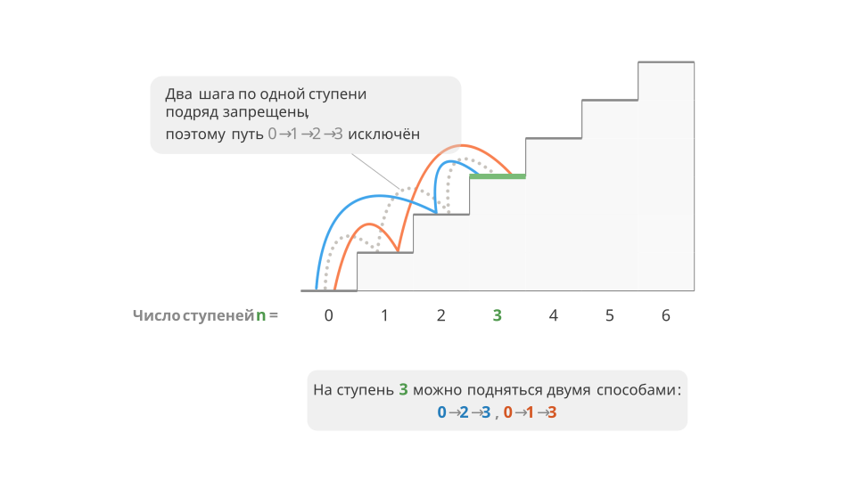
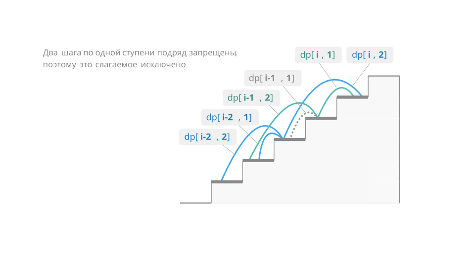

# Свойства задач динамического программирования

В предыдущем разделе мы решали задачу методом динамического программирования, разбивая её на подзадачи. Такое разбиение используют и в других подходах. Рассмотрим, какую роль оно играет в методе «разделяй и властвуй», динамическом программировании и поиске с возвратом.

- Метод «разделяй и властвуй» рекурсивно разбивает задачу на независимые подзадачи, пока не дойдёт до простейших. На обратном пути он объединяет их решения и в итоге получает решение исходной задачи.
- Динамическое программирование тоже опирается на рекурсивное разбиение. Главное отличие от метода «разделяй и властвуй» состоит в том, что подзадачи связаны между собой: при разбиении одни и те же подзадачи возникают многократно.
- Поиск с возвратом перебирает все возможные решения, делая и отменяя выбор. Отсечение позволяет пропускать ненужные ветви поиска. Решение исходной задачи складывается из последовательности решений на отдельных шагах. Часть последовательности до очередного шага можно рассматривать как подзадачу.

Динамическое программирование часто применяют в задачах оптимизации. Помимо повторяющихся подзадач, для них характерны ещё два свойства: оптимальная подструктура и отсутствие последействия.

## Оптимальная подструктура

Немного изменим задачу о подъёме по лестнице, чтобы на её примере показать, что такое оптимальная подструктура.

!!! question "Минимальная стоимость подъёма по лестнице"

    За один шаг можно подняться на $1$ или $2$ ступени. На каждой ступени записано неотрицательное целое число — стоимость посещения этой ступени. Стоимости заданы массивом неотрицательных целых чисел $cost$, где $cost[i]$ — стоимость ступени с номером $i$, а $cost[0]$ соответствует земле, откуда начинается подъём. Какова минимальная стоимость подъёма до вершины?

На рисунке ступени $1$, $2$ и $3$ стоят соответственно $1$, $10$ и $1$. Тогда минимальная стоимость подъёма с земли до ступени $3$ равна $2$.


Пусть $dp[i]$ — накопленная стоимость подъёма до ступени $i$. На ступень $i$ можно попасть только со ступени $i - 1$ или $i - 2$, поэтому возможны два значения $dp[i]$: $dp[i - 1] + cost[i]$ и $dp[i - 2] + cost[i]$. Чтобы свести затраты к минимуму, выберем меньшее:

$$
dp[i] = \min(dp[i-1], dp[i-2]) + cost[i]
$$

В этом и состоит оптимальная подструктура: **оптимальное решение исходной задачи строится из оптимальных решений подзадач**.

В нашем примере оптимальная подструктура хорошо видна: из оптимальных решений двух подзадач, $dp[i-1]$ и $dp[i-2]$, мы выбираем более выгодное и строим из него оптимальное решение исходной задачи $dp[i]$.

А есть ли оптимальная подструктура у задачи о лестнице из предыдущего раздела? На первый взгляд это задача на подсчёт числа способов. Но попробуем спросить: «Каково максимальное число способов?» Оказывается, **задача осталась прежней, а оптимальная подструктура стала заметной**: максимальное число способов достичь ступени $n$ равно сумме максимальных чисел способов достичь ступеней $n-1$ и $n-2$. Таким образом, интерпретация оптимальной подструктуры достаточно гибка и зависит от задачи.

По формуле перехода и начальным состояниям $dp[1] = cost[1]$ и $dp[2] = cost[2]$ можно написать решение методом динамического программирования:

```src
[file]{min_cost_climbing_stairs_dp}-[class]{}-[func]{min_cost_climbing_stairs_dp}
```

На рисунке показано, как работает этот код.


Здесь тоже можно сэкономить память: заменить одномерный массив отдельными переменными. Пространственная сложность снизится с $O(n)$ до $O(1)$:

```src
[file]{min_cost_climbing_stairs_dp}-[class]{}-[func]{min_cost_climbing_stairs_dp_comp}
```

## Отсутствие последействия

Отсутствие последействия — одно из свойств, благодаря которым динамическое программирование эффективно. Определение таково: **если текущее состояние задано, дальнейшие возможности зависят только от него и не зависят от пройденных состояний**.

В задаче о лестнице из состояния $i$ можно перейти в состояние $i+1$ или $i+2$, поднявшись соответственно на $1$ или $2$ ступени. Выбирая шаг, не нужно учитывать состояния, пройденные до $i$: они не влияют на дальнейшие переходы из $i$.

Однако стоит добавить одно ограничение, и ситуация изменится.

!!! question "Подъём по лестнице с ограничением"

    В лестнице $n$ ступеней. За шаг можно подняться на $1$ или $2$ ступени, **но нельзя дважды подряд подниматься на $1$ ступень**. Сколькими способами можно добраться до вершины?

На рисунке видно, что для ступени $3$ осталось всего $2$ допустимых способа. Вариант с тремя шагами по $1$ ступени подряд нарушает ограничение, поэтому его исключаем.



Если предыдущий шаг был длиной $1$, следующий обязательно должен иметь длину $2$. Значит, **выбор следующего шага зависит и от текущего состояния (где мы стоим), и от предыдущего (на какой ступени мы стояли до этого)**.

Теперь у задачи есть последействие, и формула $dp[i] = dp[i-1] + dp[i-2]$ больше не работает. Слагаемое $dp[i-1]$ соответствует подъёму ещё на $1$ ступень, но включает и такие пути, у которых предыдущий шаг тоже имел длину $1$. По условию мы не можем включить всё значение $dp[i-1]$ в $dp[i]$.

Расширим определение состояния: **состояние $[i, j]$ означает, что мы находимся на ступени $i$, а длина последнего шага равна $j$**, где $j \in \{1, 2\}$. Теперь шаги длиной $1$ и $2$ различимы, и мы можем определить, из каких состояний достижимо текущее.

- Если последний шаг имел длину $1$, то предпоследний мог иметь только длину $2$. Поэтому единственный источник для $dp[i, 1]$ — состояние $dp[i-1, 2]$.
- Если последний шаг имел длину $2$, длина предпоследнего могла быть как $1$, так и $2$. Следовательно, в $dp[i, 2]$ можно перейти из $dp[i-2, 1]$ или $dp[i-2, 2]$.

При таком определении $dp[i, j]$ хранит число способов попасть в состояние $[i, j]$. Формулы перехода показаны на рисунке:

$$
\begin{cases}
dp[i, 1] = dp[i-1, 2] \\
dp[i, 2] = dp[i-2, 1] + dp[i-2, 2]
\end{cases}
$$



В конце возвращаем $dp[n, 1] + dp[n, 2]$: эта сумма даёт общее число способов подняться на ступень $n$.

```src
[file]{climbing_stairs_constraint_dp}-[class]{}-[func]{climbing_stairs_constraint_dp}
```

В этом примере достаточно было учесть один предыдущий шаг. Расширив состояние, мы вернули задаче свойство отсутствия последействия. Однако в некоторых задачах влияние предыстории гораздо сильнее.

!!! question "Подъём по лестнице с появляющимися препятствиями"

    В лестнице $n$ ступеней. За шаг можно подняться на $1$ или $2$ ступени. **Когда вы попадаете на ступень $i$, на ступени $2i$ автоматически появляется препятствие. В дальнейшем наступать на ступень $2i$ запрещено**. Например, если первые два шага привели вас на ступени $2$ и $3$, то впоследствии нельзя наступать на ступени $4$ и $6$. Сколькими способами можно добраться до вершины?

Теперь следующий шаг зависит от всех пройденных состояний: каждый шаг создаёт препятствие выше по лестнице и влияет на будущие шаги. Такие задачи часто трудно решать динамическим программированием.

Во многих сложных задачах комбинаторной оптимизации, например в задаче коммивояжёра, дальнейший выбор зависит от предыстории. Для таких задач обычно выбирают другие методы, например эвристический поиск, генетические алгоритмы или обучение с подкреплением, чтобы за ограниченное время получить пригодное локально оптимальное решение.
