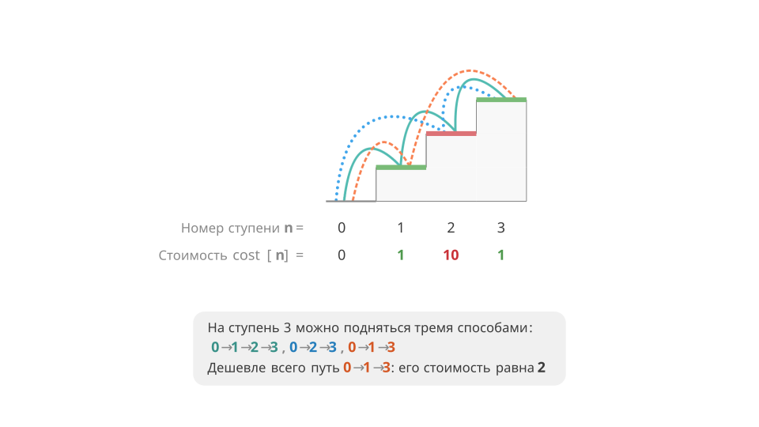
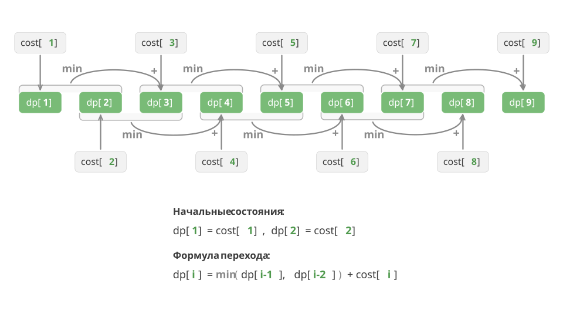

# 14.2 &nbsp; Свойства задач динамического программирования

В предыдущем разделе мы решали задачу методом динамического программирования, разбивая её на подзадачи. Такое разбиение используют и в других подходах. Рассмотрим, какую роль оно играет в методе «разделяй и властвуй», динамическом программировании и поиске с возвратом.

- Метод «разделяй и властвуй» рекурсивно разбивает задачу на независимые подзадачи, пока не дойдёт до простейших. На обратном пути он объединяет их решения и в итоге получает решение исходной задачи.
- Динамическое программирование тоже опирается на рекурсивное разбиение. Главное отличие от метода «разделяй и властвуй» состоит в том, что подзадачи связаны между собой: при разбиении одни и те же подзадачи возникают многократно.
- Поиск с возвратом перебирает все возможные решения, делая и отменяя выбор. Отсечение позволяет пропускать ненужные ветви поиска. Решение исходной задачи складывается из последовательности решений на отдельных шагах. Часть последовательности до очередного шага можно рассматривать как подзадачу.

Динамическое программирование часто применяют в задачах оптимизации. Помимо повторяющихся подзадач, для них характерны ещё два свойства: оптимальная подструктура и отсутствие последействия.

## 14.2.1 &nbsp; Оптимальная подструктура

Немного изменим задачу о подъёме по лестнице, чтобы на её примере показать, что такое оптимальная подструктура.

!!! question "Минимальная стоимость подъёма по лестнице"

    За один шаг можно подняться на $1$ или $2$ ступени. На каждой ступени записано неотрицательное целое число — стоимость посещения этой ступени. Стоимости заданы массивом неотрицательных целых чисел $cost$, где $cost[i]$ — стоимость ступени с номером $i$, а $cost[0]$ соответствует земле, откуда начинается подъём. Какова минимальная стоимость подъёма до вершины?

На рисунке ступени $1$, $2$ и $3$ стоят соответственно $1$, $10$ и $1$. Тогда минимальная стоимость подъёма с земли до ступени $3$ равна $2$.

{ class="animation-figure" }

<p align="center"> Рисунок 14-6 &nbsp; Минимальная стоимость подъёма на ступень 3 </p>

Пусть $dp[i]$ — накопленная стоимость подъёма до ступени $i$. На ступень $i$ можно попасть только со ступени $i - 1$ или $i - 2$, поэтому возможны два значения $dp[i]$: $dp[i - 1] + cost[i]$ и $dp[i - 2] + cost[i]$. Чтобы свести затраты к минимуму, выберем меньшее:

$$
dp[i] = \min(dp[i-1], dp[i-2]) + cost[i]
$$

В этом и состоит оптимальная подструктура: **оптимальное решение исходной задачи строится из оптимальных решений подзадач**.

В нашем примере оптимальная подструктура хорошо видна: из оптимальных решений двух подзадач, $dp[i-1]$ и $dp[i-2]$, мы выбираем более выгодное и строим из него оптимальное решение исходной задачи $dp[i]$.

А есть ли оптимальная подструктура у задачи о лестнице из предыдущего раздела? На первый взгляд это задача на подсчёт числа способов. Но попробуем спросить: «Каково максимальное число способов?» Оказывается, **задача осталась прежней, а оптимальная подструктура стала заметной**: максимальное число способов достичь ступени $n$ равно сумме максимальных чисел способов достичь ступеней $n-1$ и $n-2$. Таким образом, интерпретация оптимальной подструктуры достаточно гибка и зависит от задачи.

По формуле перехода и начальным состояниям $dp[1] = cost[1]$ и $dp[2] = cost[2]$ можно написать решение методом динамического программирования:

=== "Python"

    ```python title="min_cost_climbing_stairs_dp.py"
    def min_cost_climbing_stairs_dp(cost: list[int]) -> int:
        """Минимальная стоимость подъёма: динамическое программирование"""
        n = len(cost) - 1
        if n == 1 or n == 2:
            return cost[n]
        # Создать таблицу dp для решений подзадач
        dp = [0] * (n + 1)
        # Начальные состояния: задать решения простейших подзадач
        dp[1], dp[2] = cost[1], cost[2]
        # Переход: решать подзадачи от меньших к большим
        for i in range(3, n + 1):
            dp[i] = min(dp[i - 1], dp[i - 2]) + cost[i]
        return dp[n]
    ```

=== "C++"

    ```cpp title="min_cost_climbing_stairs_dp.cpp"
    /* Минимальная стоимость подъёма: динамическое программирование */
    int minCostClimbingStairsDP(vector<int> &cost) {
        int n = cost.size() - 1;
        if (n == 1 || n == 2)
            return cost[n];
        // Создать таблицу dp для решений подзадач
        vector<int> dp(n + 1);
        // Начальные состояния: задать решения простейших подзадач
        dp[1] = cost[1];
        dp[2] = cost[2];
        // Переход: решать подзадачи от меньших к большим
        for (int i = 3; i <= n; i++) {
            dp[i] = min(dp[i - 1], dp[i - 2]) + cost[i];
        }
        return dp[n];
    }
    ```

=== "Java"

    ```java title="min_cost_climbing_stairs_dp.java"
    /* Минимальная стоимость подъёма: динамическое программирование */
    int minCostClimbingStairsDP(int[] cost) {
        int n = cost.length - 1;
        if (n == 1 || n == 2)
            return cost[n];
        // Создать таблицу dp для решений подзадач
        int[] dp = new int[n + 1];
        // Начальные состояния: задать решения простейших подзадач
        dp[1] = cost[1];
        dp[2] = cost[2];
        // Переход: решать подзадачи от меньших к большим
        for (int i = 3; i <= n; i++) {
            dp[i] = Math.min(dp[i - 1], dp[i - 2]) + cost[i];
        }
        return dp[n];
    }
    ```

=== "C#"

    ```csharp title="min_cost_climbing_stairs_dp.cs"
    /* Минимальная стоимость подъёма: динамическое программирование */
    int MinCostClimbingStairsDP(int[] cost) {
        int n = cost.Length - 1;
        if (n == 1 || n == 2)
            return cost[n];
        // Создать таблицу dp для решений подзадач
        int[] dp = new int[n + 1];
        // Начальные состояния: задать решения простейших подзадач
        dp[1] = cost[1];
        dp[2] = cost[2];
        // Переход: решать подзадачи от меньших к большим
        for (int i = 3; i <= n; i++) {
            dp[i] = Math.Min(dp[i - 1], dp[i - 2]) + cost[i];
        }
        return dp[n];
    }
    ```

=== "Go"

    ```go title="min_cost_climbing_stairs_dp.go"
    /* Минимальная стоимость подъёма: динамическое программирование */
    func minCostClimbingStairsDP(cost []int) int {
        n := len(cost) - 1
        if n == 1 || n == 2 {
            return cost[n]
        }
        min := func(a, b int) int {
            if a < b {
                return a
            }
            return b
        }
        // Создать таблицу dp для решений подзадач
        dp := make([]int, n+1)
        // Начальные состояния: задать решения простейших подзадач
        dp[1] = cost[1]
        dp[2] = cost[2]
        // Переход: решать подзадачи от меньших к большим
        for i := 3; i <= n; i++ {
            dp[i] = min(dp[i-1], dp[i-2]) + cost[i]
        }
        return dp[n]
    }
    ```

=== "Swift"

    ```swift title="min_cost_climbing_stairs_dp.swift"
    /* Минимальная стоимость подъёма: динамическое программирование */
    func minCostClimbingStairsDP(cost: [Int]) -> Int {
        let n = cost.count - 1
        if n == 1 || n == 2 {
            return cost[n]
        }
        // Создать таблицу dp для решений подзадач
        var dp = Array(repeating: 0, count: n + 1)
        // Начальные состояния: задать решения простейших подзадач
        dp[1] = cost[1]
        dp[2] = cost[2]
        // Переход: решать подзадачи от меньших к большим
        for i in 3 ... n {
            dp[i] = min(dp[i - 1], dp[i - 2]) + cost[i]
        }
        return dp[n]
    }
    ```

=== "JS"

    ```javascript title="min_cost_climbing_stairs_dp.js"
    /* Минимальная стоимость подъёма: динамическое программирование */
    function minCostClimbingStairsDP(cost) {
        const n = cost.length - 1;
        if (n === 1 || n === 2) {
            return cost[n];
        }
        // Создать таблицу dp для решений подзадач
        const dp = new Array(n + 1);
        // Начальные состояния: задать решения простейших подзадач
        dp[1] = cost[1];
        dp[2] = cost[2];
        // Переход: решать подзадачи от меньших к большим
        for (let i = 3; i <= n; i++) {
            dp[i] = Math.min(dp[i - 1], dp[i - 2]) + cost[i];
        }
        return dp[n];
    }
    ```

=== "TS"

    ```typescript title="min_cost_climbing_stairs_dp.ts"
    /* Минимальная стоимость подъёма: динамическое программирование */
    function minCostClimbingStairsDP(cost: Array<number>): number {
        const n = cost.length - 1;
        if (n === 1 || n === 2) {
            return cost[n];
        }
        // Создать таблицу dp для решений подзадач
        const dp = new Array(n + 1);
        // Начальные состояния: задать решения простейших подзадач
        dp[1] = cost[1];
        dp[2] = cost[2];
        // Переход: решать подзадачи от меньших к большим
        for (let i = 3; i <= n; i++) {
            dp[i] = Math.min(dp[i - 1], dp[i - 2]) + cost[i];
        }
        return dp[n];
    }
    ```

=== "Dart"

    ```dart title="min_cost_climbing_stairs_dp.dart"
    /* Минимальная стоимость подъёма: динамическое программирование */
    int minCostClimbingStairsDP(List<int> cost) {
      int n = cost.length - 1;
      if (n == 1 || n == 2) return cost[n];
      // Создать таблицу dp для решений подзадач
      List<int> dp = List.filled(n + 1, 0);
      // Начальные состояния: задать решения простейших подзадач
      dp[1] = cost[1];
      dp[2] = cost[2];
      // Переход: решать подзадачи от меньших к большим
      for (int i = 3; i <= n; i++) {
        dp[i] = min(dp[i - 1], dp[i - 2]) + cost[i];
      }
      return dp[n];
    }
    ```

=== "Rust"

    ```rust title="min_cost_climbing_stairs_dp.rs"
    /* Минимальная стоимость подъёма: динамическое программирование */
    fn min_cost_climbing_stairs_dp(cost: &[i32]) -> i32 {
        let n = cost.len() - 1;
        if n == 1 || n == 2 {
            return cost[n];
        }
        // Создать таблицу dp для решений подзадач
        let mut dp = vec![-1; n + 1];
        // Начальные состояния: задать решения простейших подзадач
        dp[1] = cost[1];
        dp[2] = cost[2];
        // Переход: решать подзадачи от меньших к большим
        for i in 3..=n {
            dp[i] = cmp::min(dp[i - 1], dp[i - 2]) + cost[i];
        }
        dp[n]
    }
    ```

=== "C"

    ```c title="min_cost_climbing_stairs_dp.c"
    /* Минимальная стоимость подъёма: динамическое программирование */
    int minCostClimbingStairsDP(int cost[], int costSize) {
        int n = costSize - 1;
        if (n == 1 || n == 2)
            return cost[n];
        // Создать таблицу dp для решений подзадач
        int *dp = calloc(n + 1, sizeof(int));
        // Начальные состояния: задать решения простейших подзадач
        dp[1] = cost[1];
        dp[2] = cost[2];
        // Переход: решать подзадачи от меньших к большим
        for (int i = 3; i <= n; i++) {
            dp[i] = myMin(dp[i - 1], dp[i - 2]) + cost[i];
        }
        int res = dp[n];
        // Освободить память
        free(dp);
        return res;
    }
    ```

=== "Kotlin"

    ```kotlin title="min_cost_climbing_stairs_dp.kt"
    /* Минимальная стоимость подъёма: динамическое программирование */
    fun minCostClimbingStairsDP(cost: IntArray): Int {
        val n = cost.size - 1
        if (n == 1 || n == 2) return cost[n]
        // Создать таблицу dp для решений подзадач
        val dp = IntArray(n + 1)
        // Начальные состояния: задать решения простейших подзадач
        dp[1] = cost[1]
        dp[2] = cost[2]
        // Переход: решать подзадачи от меньших к большим
        for (i in 3..n) {
            dp[i] = min(dp[i - 1], dp[i - 2]) + cost[i]
        }
        return dp[n]
    }
    ```

=== "Ruby"

    ```ruby title="min_cost_climbing_stairs_dp.rb"
    ### Минимальная стоимость подъёма: динамическое программирование ###
    def min_cost_climbing_stairs_dp(cost)
      n = cost.length - 1
      return cost[n] if n == 1 || n == 2
      # Создать таблицу dp для решений подзадач
      dp = Array.new(n + 1, 0)
      # Начальные состояния: задать решения простейших подзадач
      dp[1], dp[2] = cost[1], cost[2]
      # Переход: решать подзадачи от меньших к большим
      (3...(n + 1)).each { |i| dp[i] = [dp[i - 1], dp[i - 2]].min + cost[i] }
      dp[n]
    end
    ```

??? pythontutor "Визуализация выполнения"

    <div style="height: 549px; width: 100%;"><iframe class="pythontutor-iframe" title="Визуализация выполнения" src="https://pythontutor.com/iframe-embed.html#code=def%20min_cost_climbing_stairs_dp%28cost%3A%20list%5Bint%5D%29%20-%3E%20int%3A%0A%20%20%20%20%22%22%22%D0%9C%D0%B8%D0%BD%D0%B8%D0%BC%D0%B0%D0%BB%D1%8C%D0%BD%D0%B0%D1%8F%20%D1%81%D1%82%D0%BE%D0%B8%D0%BC%D0%BE%D1%81%D1%82%D1%8C%20%D0%BF%D0%BE%D0%B4%D1%8A%D1%91%D0%BC%D0%B0%3A%20%D0%B4%D0%B8%D0%BD%D0%B0%D0%BC%D0%B8%D1%87%D0%B5%D1%81%D0%BA%D0%BE%D0%B5%20%D0%BF%D1%80%D0%BE%D0%B3%D1%80%D0%B0%D0%BC%D0%BC%D0%B8%D1%80%D0%BE%D0%B2%D0%B0%D0%BD%D0%B8%D0%B5%22%22%22%0A%20%20%20%20n%20%3D%20len%28cost%29%20-%201%0A%20%20%20%20if%20n%20%3D%3D%201%20or%20n%20%3D%3D%202%3A%0A%20%20%20%20%20%20%20%20return%20cost%5Bn%5D%0A%20%20%20%20%23%20%D0%A1%D0%BE%D0%B7%D0%B4%D0%B0%D1%82%D1%8C%20%D1%82%D0%B0%D0%B1%D0%BB%D0%B8%D1%86%D1%83%20dp%20%D0%B4%D0%BB%D1%8F%20%D1%80%D0%B5%D1%88%D0%B5%D0%BD%D0%B8%D0%B9%20%D0%BF%D0%BE%D0%B4%D0%B7%D0%B0%D0%B4%D0%B0%D1%87%0A%20%20%20%20dp%20%3D%20%5B0%5D%20%2A%20%28n%20%2B%201%29%0A%20%20%20%20%23%20%D0%9D%D0%B0%D1%87%D0%B0%D0%BB%D1%8C%D0%BD%D1%8B%D0%B5%20%D1%81%D0%BE%D1%81%D1%82%D0%BE%D1%8F%D0%BD%D0%B8%D1%8F%3A%20%D0%B7%D0%B0%D0%B4%D0%B0%D1%82%D1%8C%20%D1%80%D0%B5%D1%88%D0%B5%D0%BD%D0%B8%D1%8F%20%D0%BF%D1%80%D0%BE%D1%81%D1%82%D0%B5%D0%B9%D1%88%D0%B8%D1%85%20%D0%BF%D0%BE%D0%B4%D0%B7%D0%B0%D0%B4%D0%B0%D1%87%0A%20%20%20%20dp%5B1%5D,%20dp%5B2%5D%20%3D%20cost%5B1%5D,%20cost%5B2%5D%0A%20%20%20%20%23%20%D0%9F%D0%B5%D1%80%D0%B5%D1%85%D0%BE%D0%B4%3A%20%D1%80%D0%B5%D1%88%D0%B0%D1%82%D1%8C%20%D0%BF%D0%BE%D0%B4%D0%B7%D0%B0%D0%B4%D0%B0%D1%87%D0%B8%20%D0%BE%D1%82%20%D0%BC%D0%B5%D0%BD%D1%8C%D1%88%D0%B8%D1%85%20%D0%BA%20%D0%B1%D0%BE%D0%BB%D1%8C%D1%88%D0%B8%D0%BC%0A%20%20%20%20for%20i%20in%20range%283,%20n%20%2B%201%29%3A%0A%20%20%20%20%20%20%20%20dp%5Bi%5D%20%3D%20min%28dp%5Bi%20-%201%5D,%20dp%5Bi%20-%202%5D%29%20%2B%20cost%5Bi%5D%0A%20%20%20%20return%20dp%5Bn%5D%0A%0A%0A%22%22%22Driver%20Code%22%22%22%0Aif%20__name__%20%3D%3D%20%22__main__%22%3A%0A%20%20%20%20cost%20%3D%20%5B0,%201,%2010,%201,%201,%201,%2010,%201,%201,%2010,%201%5D%0A%20%20%20%20print%28f%22%D0%A1%D1%82%D0%BE%D0%B8%D0%BC%D0%BE%D1%81%D1%82%D1%8C%20%D1%81%D1%82%D1%83%D0%BF%D0%B5%D0%BD%D0%B5%D0%B9%3A%20%7Bcost%7D%22%29%0A%0A%20%20%20%20res%20%3D%20min_cost_climbing_stairs_dp%28cost%29%0A%20%20%20%20print%28f%22%D0%9C%D0%B8%D0%BD%D0%B8%D0%BC%D0%B0%D0%BB%D1%8C%D0%BD%D0%B0%D1%8F%20%D1%81%D1%82%D0%BE%D0%B8%D0%BC%D0%BE%D1%81%D1%82%D1%8C%20%D0%BF%D0%BE%D0%B4%D1%8A%D1%91%D0%BC%D0%B0%3A%20%7Bres%7D%22%29&codeDivHeight=472&codeDivWidth=350&cumulative=false&curInstr=4&heapPrimitives=nevernest&origin=opt-frontend.js&py=311&rawInputLstJSON=%5B%5D&textReferences=false"> </iframe></div>
    <div style="margin-top: 5px;"><a href="https://pythontutor.com/iframe-embed.html#code=def%20min_cost_climbing_stairs_dp%28cost%3A%20list%5Bint%5D%29%20-%3E%20int%3A%0A%20%20%20%20%22%22%22%D0%9C%D0%B8%D0%BD%D0%B8%D0%BC%D0%B0%D0%BB%D1%8C%D0%BD%D0%B0%D1%8F%20%D1%81%D1%82%D0%BE%D0%B8%D0%BC%D0%BE%D1%81%D1%82%D1%8C%20%D0%BF%D0%BE%D0%B4%D1%8A%D1%91%D0%BC%D0%B0%3A%20%D0%B4%D0%B8%D0%BD%D0%B0%D0%BC%D0%B8%D1%87%D0%B5%D1%81%D0%BA%D0%BE%D0%B5%20%D0%BF%D1%80%D0%BE%D0%B3%D1%80%D0%B0%D0%BC%D0%BC%D0%B8%D1%80%D0%BE%D0%B2%D0%B0%D0%BD%D0%B8%D0%B5%22%22%22%0A%20%20%20%20n%20%3D%20len%28cost%29%20-%201%0A%20%20%20%20if%20n%20%3D%3D%201%20or%20n%20%3D%3D%202%3A%0A%20%20%20%20%20%20%20%20return%20cost%5Bn%5D%0A%20%20%20%20%23%20%D0%A1%D0%BE%D0%B7%D0%B4%D0%B0%D1%82%D1%8C%20%D1%82%D0%B0%D0%B1%D0%BB%D0%B8%D1%86%D1%83%20dp%20%D0%B4%D0%BB%D1%8F%20%D1%80%D0%B5%D1%88%D0%B5%D0%BD%D0%B8%D0%B9%20%D0%BF%D0%BE%D0%B4%D0%B7%D0%B0%D0%B4%D0%B0%D1%87%0A%20%20%20%20dp%20%3D%20%5B0%5D%20%2A%20%28n%20%2B%201%29%0A%20%20%20%20%23%20%D0%9D%D0%B0%D1%87%D0%B0%D0%BB%D1%8C%D0%BD%D1%8B%D0%B5%20%D1%81%D0%BE%D1%81%D1%82%D0%BE%D1%8F%D0%BD%D0%B8%D1%8F%3A%20%D0%B7%D0%B0%D0%B4%D0%B0%D1%82%D1%8C%20%D1%80%D0%B5%D1%88%D0%B5%D0%BD%D0%B8%D1%8F%20%D0%BF%D1%80%D0%BE%D1%81%D1%82%D0%B5%D0%B9%D1%88%D0%B8%D1%85%20%D0%BF%D0%BE%D0%B4%D0%B7%D0%B0%D0%B4%D0%B0%D1%87%0A%20%20%20%20dp%5B1%5D,%20dp%5B2%5D%20%3D%20cost%5B1%5D,%20cost%5B2%5D%0A%20%20%20%20%23%20%D0%9F%D0%B5%D1%80%D0%B5%D1%85%D0%BE%D0%B4%3A%20%D1%80%D0%B5%D1%88%D0%B0%D1%82%D1%8C%20%D0%BF%D0%BE%D0%B4%D0%B7%D0%B0%D0%B4%D0%B0%D1%87%D0%B8%20%D0%BE%D1%82%20%D0%BC%D0%B5%D0%BD%D1%8C%D1%88%D0%B8%D1%85%20%D0%BA%20%D0%B1%D0%BE%D0%BB%D1%8C%D1%88%D0%B8%D0%BC%0A%20%20%20%20for%20i%20in%20range%283,%20n%20%2B%201%29%3A%0A%20%20%20%20%20%20%20%20dp%5Bi%5D%20%3D%20min%28dp%5Bi%20-%201%5D,%20dp%5Bi%20-%202%5D%29%20%2B%20cost%5Bi%5D%0A%20%20%20%20return%20dp%5Bn%5D%0A%0A%0A%22%22%22Driver%20Code%22%22%22%0Aif%20__name__%20%3D%3D%20%22__main__%22%3A%0A%20%20%20%20cost%20%3D%20%5B0,%201,%2010,%201,%201,%201,%2010,%201,%201,%2010,%201%5D%0A%20%20%20%20print%28f%22%D0%A1%D1%82%D0%BE%D0%B8%D0%BC%D0%BE%D1%81%D1%82%D1%8C%20%D1%81%D1%82%D1%83%D0%BF%D0%B5%D0%BD%D0%B5%D0%B9%3A%20%7Bcost%7D%22%29%0A%0A%20%20%20%20res%20%3D%20min_cost_climbing_stairs_dp%28cost%29%0A%20%20%20%20print%28f%22%D0%9C%D0%B8%D0%BD%D0%B8%D0%BC%D0%B0%D0%BB%D1%8C%D0%BD%D0%B0%D1%8F%20%D1%81%D1%82%D0%BE%D0%B8%D0%BC%D0%BE%D1%81%D1%82%D1%8C%20%D0%BF%D0%BE%D0%B4%D1%8A%D1%91%D0%BC%D0%B0%3A%20%7Bres%7D%22%29&codeDivHeight=800&codeDivWidth=600&cumulative=false&curInstr=4&heapPrimitives=nevernest&origin=opt-frontend.js&py=311&rawInputLstJSON=%5B%5D&textReferences=false" target="_blank" rel="noopener noreferrer">Во весь экран ></a></div>

На рисунке показано, как работает этот код.

{ class="animation-figure" }

<p align="center"> Рисунок 14-7 &nbsp; Вычисление минимальной стоимости подъёма методом динамического программирования </p>

Здесь тоже можно сэкономить память: заменить одномерный массив отдельными переменными. Пространственная сложность снизится с $O(n)$ до $O(1)$:

=== "Python"

    ```python title="min_cost_climbing_stairs_dp.py"
    def min_cost_climbing_stairs_dp_comp(cost: list[int]) -> int:
        """Минимальная стоимость подъёма: динамическое программирование с экономией памяти"""
        n = len(cost) - 1
        if n == 1 or n == 2:
            return cost[n]
        a, b = cost[1], cost[2]
        for i in range(3, n + 1):
            a, b = b, min(a, b) + cost[i]
        return b
    ```

=== "C++"

    ```cpp title="min_cost_climbing_stairs_dp.cpp"
    /* Минимальная стоимость подъёма: динамическое программирование с экономией памяти */
    int minCostClimbingStairsDPComp(vector<int> &cost) {
        int n = cost.size() - 1;
        if (n == 1 || n == 2)
            return cost[n];
        int a = cost[1], b = cost[2];
        for (int i = 3; i <= n; i++) {
            int tmp = b;
            b = min(a, tmp) + cost[i];
            a = tmp;
        }
        return b;
    }
    ```

=== "Java"

    ```java title="min_cost_climbing_stairs_dp.java"
    /* Минимальная стоимость подъёма: динамическое программирование с экономией памяти */
    int minCostClimbingStairsDPComp(int[] cost) {
        int n = cost.length - 1;
        if (n == 1 || n == 2)
            return cost[n];
        int a = cost[1], b = cost[2];
        for (int i = 3; i <= n; i++) {
            int tmp = b;
            b = Math.min(a, tmp) + cost[i];
            a = tmp;
        }
        return b;
    }
    ```

=== "C#"

    ```csharp title="min_cost_climbing_stairs_dp.cs"
    /* Минимальная стоимость подъёма: динамическое программирование с экономией памяти */
    int MinCostClimbingStairsDPComp(int[] cost) {
        int n = cost.Length - 1;
        if (n == 1 || n == 2)
            return cost[n];
        int a = cost[1], b = cost[2];
        for (int i = 3; i <= n; i++) {
            int tmp = b;
            b = Math.Min(a, tmp) + cost[i];
            a = tmp;
        }
        return b;
    }
    ```

=== "Go"

    ```go title="min_cost_climbing_stairs_dp.go"
    /* Минимальная стоимость подъёма: динамическое программирование с экономией памяти */
    func minCostClimbingStairsDPComp(cost []int) int {
        n := len(cost) - 1
        if n == 1 || n == 2 {
            return cost[n]
        }
        min := func(a, b int) int {
            if a < b {
                return a
            }
            return b
        }
        // Начальные состояния: задать решения простейших подзадач
        a, b := cost[1], cost[2]
        // Переход: решать подзадачи от меньших к большим
        for i := 3; i <= n; i++ {
            tmp := b
            b = min(a, tmp) + cost[i]
            a = tmp
        }
        return b
    }
    ```

=== "Swift"

    ```swift title="min_cost_climbing_stairs_dp.swift"
    /* Минимальная стоимость подъёма: динамическое программирование с экономией памяти */
    func minCostClimbingStairsDPComp(cost: [Int]) -> Int {
        let n = cost.count - 1
        if n == 1 || n == 2 {
            return cost[n]
        }
        var (a, b) = (cost[1], cost[2])
        for i in 3 ... n {
            (a, b) = (b, min(a, b) + cost[i])
        }
        return b
    }
    ```

=== "JS"

    ```javascript title="min_cost_climbing_stairs_dp.js"
    /* Минимальная стоимость подъёма: динамическое программирование с экономией памяти */
    function minCostClimbingStairsDPComp(cost) {
        const n = cost.length - 1;
        if (n === 1 || n === 2) {
            return cost[n];
        }
        let a = cost[1],
            b = cost[2];
        for (let i = 3; i <= n; i++) {
            const tmp = b;
            b = Math.min(a, tmp) + cost[i];
            a = tmp;
        }
        return b;
    }
    ```

=== "TS"

    ```typescript title="min_cost_climbing_stairs_dp.ts"
    /* Минимальная стоимость подъёма: динамическое программирование с экономией памяти */
    function minCostClimbingStairsDPComp(cost: Array<number>): number {
        const n = cost.length - 1;
        if (n === 1 || n === 2) {
            return cost[n];
        }
        let a = cost[1],
            b = cost[2];
        for (let i = 3; i <= n; i++) {
            const tmp = b;
            b = Math.min(a, tmp) + cost[i];
            a = tmp;
        }
        return b;
    }
    ```

=== "Dart"

    ```dart title="min_cost_climbing_stairs_dp.dart"
    /* Минимальная стоимость подъёма: динамическое программирование с экономией памяти */
    int minCostClimbingStairsDPComp(List<int> cost) {
      int n = cost.length - 1;
      if (n == 1 || n == 2) return cost[n];
      int a = cost[1], b = cost[2];
      for (int i = 3; i <= n; i++) {
        int tmp = b;
        b = min(a, tmp) + cost[i];
        a = tmp;
      }
      return b;
    }
    ```

=== "Rust"

    ```rust title="min_cost_climbing_stairs_dp.rs"
    /* Минимальная стоимость подъёма: динамическое программирование с экономией памяти */
    fn min_cost_climbing_stairs_dp_comp(cost: &[i32]) -> i32 {
        let n = cost.len() - 1;
        if n == 1 || n == 2 {
            return cost[n];
        };
        let (mut a, mut b) = (cost[1], cost[2]);
        for i in 3..=n {
            let tmp = b;
            b = cmp::min(a, tmp) + cost[i];
            a = tmp;
        }
        b
    }
    ```

=== "C"

    ```c title="min_cost_climbing_stairs_dp.c"
    /* Минимальная стоимость подъёма: динамическое программирование с экономией памяти */
    int minCostClimbingStairsDPComp(int cost[], int costSize) {
        int n = costSize - 1;
        if (n == 1 || n == 2)
            return cost[n];
        int a = cost[1], b = cost[2];
        for (int i = 3; i <= n; i++) {
            int tmp = b;
            b = myMin(a, tmp) + cost[i];
            a = tmp;
        }
        return b;
    }
    ```

=== "Kotlin"

    ```kotlin title="min_cost_climbing_stairs_dp.kt"
    /* Минимальная стоимость подъёма: динамическое программирование с экономией памяти */
    fun minCostClimbingStairsDPComp(cost: IntArray): Int {
        val n = cost.size - 1
        if (n == 1 || n == 2) return cost[n]
        var a = cost[1]
        var b = cost[2]
        for (i in 3..n) {
            val tmp = b
            b = min(a, tmp) + cost[i]
            a = tmp
        }
        return b
    }
    ```

=== "Ruby"

    ```ruby title="min_cost_climbing_stairs_dp.rb"
    ### Минимальная стоимость подъёма: динамическое программирование с экономией памяти ###
    def min_cost_climbing_stairs_dp_comp(cost)
      n = cost.length - 1
      return cost[n] if n == 1 || n == 2
      a, b = cost[1], cost[2]
      (3...(n + 1)).each { |i| a, b = b, [a, b].min + cost[i] }
      b
    end
    ```

??? pythontutor "Визуализация выполнения"

    <div style="height: 513px; width: 100%;"><iframe class="pythontutor-iframe" title="Визуализация выполнения" src="https://pythontutor.com/iframe-embed.html#code=def%20min_cost_climbing_stairs_dp_comp%28cost%3A%20list%5Bint%5D%29%20-%3E%20int%3A%0A%20%20%20%20%22%22%22%D0%9C%D0%B8%D0%BD%D0%B8%D0%BC%D0%B0%D0%BB%D1%8C%D0%BD%D0%B0%D1%8F%20%D1%81%D1%82%D0%BE%D0%B8%D0%BC%D0%BE%D1%81%D1%82%D1%8C%20%D0%BF%D0%BE%D0%B4%D1%8A%D1%91%D0%BC%D0%B0%3A%20%D0%B4%D0%B8%D0%BD%D0%B0%D0%BC%D0%B8%D1%87%D0%B5%D1%81%D0%BA%D0%BE%D0%B5%20%D0%BF%D1%80%D0%BE%D0%B3%D1%80%D0%B0%D0%BC%D0%BC%D0%B8%D1%80%D0%BE%D0%B2%D0%B0%D0%BD%D0%B8%D0%B5%20%D1%81%20%D1%8D%D0%BA%D0%BE%D0%BD%D0%BE%D0%BC%D0%B8%D0%B5%D0%B9%20%D0%BF%D0%B0%D0%BC%D1%8F%D1%82%D0%B8%22%22%22%0A%20%20%20%20n%20%3D%20len%28cost%29%20-%201%0A%20%20%20%20if%20n%20%3D%3D%201%20or%20n%20%3D%3D%202%3A%0A%20%20%20%20%20%20%20%20return%20cost%5Bn%5D%0A%20%20%20%20a,%20b%20%3D%20cost%5B1%5D,%20cost%5B2%5D%0A%20%20%20%20for%20i%20in%20range%283,%20n%20%2B%201%29%3A%0A%20%20%20%20%20%20%20%20a,%20b%20%3D%20b,%20min%28a,%20b%29%20%2B%20cost%5Bi%5D%0A%20%20%20%20return%20b%0A%0A%0A%22%22%22Driver%20Code%22%22%22%0Aif%20__name__%20%3D%3D%20%22__main__%22%3A%0A%20%20%20%20cost%20%3D%20%5B0,%201,%2010,%201,%201,%201,%2010,%201,%201,%2010,%201%5D%0A%20%20%20%20print%28f%22%D0%A1%D1%82%D0%BE%D0%B8%D0%BC%D0%BE%D1%81%D1%82%D1%8C%20%D1%81%D1%82%D1%83%D0%BF%D0%B5%D0%BD%D0%B5%D0%B9%3A%20%7Bcost%7D%22%29%0A%0A%20%20%20%20res%20%3D%20min_cost_climbing_stairs_dp_comp%28cost%29%0A%20%20%20%20print%28f%22%D0%9C%D0%B8%D0%BD%D0%B8%D0%BC%D0%B0%D0%BB%D1%8C%D0%BD%D0%B0%D1%8F%20%D1%81%D1%82%D0%BE%D0%B8%D0%BC%D0%BE%D1%81%D1%82%D1%8C%20%D0%BF%D0%BE%D0%B4%D1%8A%D1%91%D0%BC%D0%B0%3A%20%7Bres%7D%22%29&codeDivHeight=472&codeDivWidth=350&cumulative=false&curInstr=5&heapPrimitives=nevernest&origin=opt-frontend.js&py=311&rawInputLstJSON=%5B%5D&textReferences=false"> </iframe></div>
    <div style="margin-top: 5px;"><a href="https://pythontutor.com/iframe-embed.html#code=def%20min_cost_climbing_stairs_dp_comp%28cost%3A%20list%5Bint%5D%29%20-%3E%20int%3A%0A%20%20%20%20%22%22%22%D0%9C%D0%B8%D0%BD%D0%B8%D0%BC%D0%B0%D0%BB%D1%8C%D0%BD%D0%B0%D1%8F%20%D1%81%D1%82%D0%BE%D0%B8%D0%BC%D0%BE%D1%81%D1%82%D1%8C%20%D0%BF%D0%BE%D0%B4%D1%8A%D1%91%D0%BC%D0%B0%3A%20%D0%B4%D0%B8%D0%BD%D0%B0%D0%BC%D0%B8%D1%87%D0%B5%D1%81%D0%BA%D0%BE%D0%B5%20%D0%BF%D1%80%D0%BE%D0%B3%D1%80%D0%B0%D0%BC%D0%BC%D0%B8%D1%80%D0%BE%D0%B2%D0%B0%D0%BD%D0%B8%D0%B5%20%D1%81%20%D1%8D%D0%BA%D0%BE%D0%BD%D0%BE%D0%BC%D0%B8%D0%B5%D0%B9%20%D0%BF%D0%B0%D0%BC%D1%8F%D1%82%D0%B8%22%22%22%0A%20%20%20%20n%20%3D%20len%28cost%29%20-%201%0A%20%20%20%20if%20n%20%3D%3D%201%20or%20n%20%3D%3D%202%3A%0A%20%20%20%20%20%20%20%20return%20cost%5Bn%5D%0A%20%20%20%20a,%20b%20%3D%20cost%5B1%5D,%20cost%5B2%5D%0A%20%20%20%20for%20i%20in%20range%283,%20n%20%2B%201%29%3A%0A%20%20%20%20%20%20%20%20a,%20b%20%3D%20b,%20min%28a,%20b%29%20%2B%20cost%5Bi%5D%0A%20%20%20%20return%20b%0A%0A%0A%22%22%22Driver%20Code%22%22%22%0Aif%20__name__%20%3D%3D%20%22__main__%22%3A%0A%20%20%20%20cost%20%3D%20%5B0,%201,%2010,%201,%201,%201,%2010,%201,%201,%2010,%201%5D%0A%20%20%20%20print%28f%22%D0%A1%D1%82%D0%BE%D0%B8%D0%BC%D0%BE%D1%81%D1%82%D1%8C%20%D1%81%D1%82%D1%83%D0%BF%D0%B5%D0%BD%D0%B5%D0%B9%3A%20%7Bcost%7D%22%29%0A%0A%20%20%20%20res%20%3D%20min_cost_climbing_stairs_dp_comp%28cost%29%0A%20%20%20%20print%28f%22%D0%9C%D0%B8%D0%BD%D0%B8%D0%BC%D0%B0%D0%BB%D1%8C%D0%BD%D0%B0%D1%8F%20%D1%81%D1%82%D0%BE%D0%B8%D0%BC%D0%BE%D1%81%D1%82%D1%8C%20%D0%BF%D0%BE%D0%B4%D1%8A%D1%91%D0%BC%D0%B0%3A%20%7Bres%7D%22%29&codeDivHeight=800&codeDivWidth=600&cumulative=false&curInstr=5&heapPrimitives=nevernest&origin=opt-frontend.js&py=311&rawInputLstJSON=%5B%5D&textReferences=false" target="_blank" rel="noopener noreferrer">Во весь экран ></a></div>

## 14.2.2 &nbsp; Отсутствие последействия

Отсутствие последействия — одно из свойств, благодаря которым динамическое программирование эффективно. Определение таково: **если текущее состояние задано, дальнейшие возможности зависят только от него и не зависят от пройденных состояний**.

В задаче о лестнице из состояния $i$ можно перейти в состояние $i+1$ или $i+2$, поднявшись соответственно на $1$ или $2$ ступени. Выбирая шаг, не нужно учитывать состояния, пройденные до $i$: они не влияют на дальнейшие переходы из $i$.

Однако стоит добавить одно ограничение, и ситуация изменится.

!!! question "Подъём по лестнице с ограничением"

    В лестнице $n$ ступеней. За шаг можно подняться на $1$ или $2$ ступени, **но нельзя дважды подряд подниматься на $1$ ступень**. Сколькими способами можно добраться до вершины?

На рисунке видно, что для ступени $3$ осталось всего $2$ допустимых способа. Вариант с тремя шагами по $1$ ступени подряд нарушает ограничение, поэтому его исключаем.

{ class="animation-figure" }

<p align="center"> Рисунок 14-8 &nbsp; Число способов подняться на ступень 3 с ограничением </p>

Если предыдущий шаг был длиной $1$, следующий обязательно должен иметь длину $2$. Значит, **выбор следующего шага зависит и от текущего состояния (где мы стоим), и от предыдущего (на какой ступени мы стояли до этого)**.

Теперь у задачи есть последействие, и формула $dp[i] = dp[i-1] + dp[i-2]$ больше не работает. Слагаемое $dp[i-1]$ соответствует подъёму ещё на $1$ ступень, но включает и такие пути, у которых предыдущий шаг тоже имел длину $1$. По условию мы не можем включить всё значение $dp[i-1]$ в $dp[i]$.

Расширим определение состояния: **состояние $[i, j]$ означает, что мы находимся на ступени $i$, а длина последнего шага равна $j$**, где $j \in \{1, 2\}$. Теперь шаги длиной $1$ и $2$ различимы, и мы можем определить, из каких состояний достижимо текущее.

- Если последний шаг имел длину $1$, то предпоследний мог иметь только длину $2$. Поэтому единственный источник для $dp[i, 1]$ — состояние $dp[i-1, 2]$.
- Если последний шаг имел длину $2$, длина предпоследнего могла быть как $1$, так и $2$. Следовательно, в $dp[i, 2]$ можно перейти из $dp[i-2, 1]$ или $dp[i-2, 2]$.

При таком определении $dp[i, j]$ хранит число способов попасть в состояние $[i, j]$. Формулы перехода показаны на рисунке:

$$
\begin{cases}
dp[i, 1] = dp[i-1, 2] \\
dp[i, 2] = dp[i-2, 1] + dp[i-2, 2]
\end{cases}
$$

{ class="animation-figure" }

<p align="center"> Рисунок 14-9 &nbsp; Рекуррентное соотношение с учётом ограничения </p>

В конце возвращаем $dp[n, 1] + dp[n, 2]$: эта сумма даёт общее число способов подняться на ступень $n$.

=== "Python"

    ```python title="climbing_stairs_constraint_dp.py"
    def climbing_stairs_constraint_dp(n: int) -> int:
        """Подъём по лестнице с ограничением: динамическое программирование"""
        if n == 1 or n == 2:
            return 1
        # Создать таблицу dp для решений подзадач
        dp = [[0] * 3 for _ in range(n + 1)]
        # Начальные состояния: задать решения простейших подзадач
        dp[1][1], dp[1][2] = 1, 0
        dp[2][1], dp[2][2] = 0, 1
        # Переход: решать подзадачи от меньших к большим
        for i in range(3, n + 1):
            dp[i][1] = dp[i - 1][2]
            dp[i][2] = dp[i - 2][1] + dp[i - 2][2]
        return dp[n][1] + dp[n][2]
    ```

=== "C++"

    ```cpp title="climbing_stairs_constraint_dp.cpp"
    /* Подъём по лестнице с ограничением: динамическое программирование */
    int climbingStairsConstraintDP(int n) {
        if (n == 1 || n == 2) {
            return 1;
        }
        // Создать таблицу dp для решений подзадач
        vector<vector<int>> dp(n + 1, vector<int>(3, 0));
        // Начальные состояния: задать решения простейших подзадач
        dp[1][1] = 1;
        dp[1][2] = 0;
        dp[2][1] = 0;
        dp[2][2] = 1;
        // Переход: решать подзадачи от меньших к большим
        for (int i = 3; i <= n; i++) {
            dp[i][1] = dp[i - 1][2];
            dp[i][2] = dp[i - 2][1] + dp[i - 2][2];
        }
        return dp[n][1] + dp[n][2];
    }
    ```

=== "Java"

    ```java title="climbing_stairs_constraint_dp.java"
    /* Подъём по лестнице с ограничением: динамическое программирование */
    int climbingStairsConstraintDP(int n) {
        if (n == 1 || n == 2) {
            return 1;
        }
        // Создать таблицу dp для решений подзадач
        int[][] dp = new int[n + 1][3];
        // Начальные состояния: задать решения простейших подзадач
        dp[1][1] = 1;
        dp[1][2] = 0;
        dp[2][1] = 0;
        dp[2][2] = 1;
        // Переход: решать подзадачи от меньших к большим
        for (int i = 3; i <= n; i++) {
            dp[i][1] = dp[i - 1][2];
            dp[i][2] = dp[i - 2][1] + dp[i - 2][2];
        }
        return dp[n][1] + dp[n][2];
    }
    ```

=== "C#"

    ```csharp title="climbing_stairs_constraint_dp.cs"
    /* Подъём по лестнице с ограничением: динамическое программирование */
    int ClimbingStairsConstraintDP(int n) {
        if (n == 1 || n == 2) {
            return 1;
        }
        // Создать таблицу dp для решений подзадач
        int[,] dp = new int[n + 1, 3];
        // Начальные состояния: задать решения простейших подзадач
        dp[1, 1] = 1;
        dp[1, 2] = 0;
        dp[2, 1] = 0;
        dp[2, 2] = 1;
        // Переход: решать подзадачи от меньших к большим
        for (int i = 3; i <= n; i++) {
            dp[i, 1] = dp[i - 1, 2];
            dp[i, 2] = dp[i - 2, 1] + dp[i - 2, 2];
        }
        return dp[n, 1] + dp[n, 2];
    }
    ```

=== "Go"

    ```go title="climbing_stairs_constraint_dp.go"
    /* Подъём по лестнице с ограничением: динамическое программирование */
    func climbingStairsConstraintDP(n int) int {
        if n == 1 || n == 2 {
            return 1
        }
        // Создать таблицу dp для решений подзадач
        dp := make([][3]int, n+1)
        // Начальные состояния: задать решения простейших подзадач
        dp[1][1] = 1
        dp[1][2] = 0
        dp[2][1] = 0
        dp[2][2] = 1
        // Переход: решать подзадачи от меньших к большим
        for i := 3; i <= n; i++ {
            dp[i][1] = dp[i-1][2]
            dp[i][2] = dp[i-2][1] + dp[i-2][2]
        }
        return dp[n][1] + dp[n][2]
    }
    ```

=== "Swift"

    ```swift title="climbing_stairs_constraint_dp.swift"
    /* Подъём по лестнице с ограничением: динамическое программирование */
    func climbingStairsConstraintDP(n: Int) -> Int {
        if n == 1 || n == 2 {
            return 1
        }
        // Создать таблицу dp для решений подзадач
        var dp = Array(repeating: Array(repeating: 0, count: 3), count: n + 1)
        // Начальные состояния: задать решения простейших подзадач
        dp[1][1] = 1
        dp[1][2] = 0
        dp[2][1] = 0
        dp[2][2] = 1
        // Переход: решать подзадачи от меньших к большим
        for i in 3 ... n {
            dp[i][1] = dp[i - 1][2]
            dp[i][2] = dp[i - 2][1] + dp[i - 2][2]
        }
        return dp[n][1] + dp[n][2]
    }
    ```

=== "JS"

    ```javascript title="climbing_stairs_constraint_dp.js"
    /* Подъём по лестнице с ограничением: динамическое программирование */
    function climbingStairsConstraintDP(n) {
        if (n === 1 || n === 2) {
            return 1;
        }
        // Создать таблицу dp для решений подзадач
        const dp = Array.from(new Array(n + 1), () => new Array(3));
        // Начальные состояния: задать решения простейших подзадач
        dp[1][1] = 1;
        dp[1][2] = 0;
        dp[2][1] = 0;
        dp[2][2] = 1;
        // Переход: решать подзадачи от меньших к большим
        for (let i = 3; i <= n; i++) {
            dp[i][1] = dp[i - 1][2];
            dp[i][2] = dp[i - 2][1] + dp[i - 2][2];
        }
        return dp[n][1] + dp[n][2];
    }
    ```

=== "TS"

    ```typescript title="climbing_stairs_constraint_dp.ts"
    /* Подъём по лестнице с ограничением: динамическое программирование */
    function climbingStairsConstraintDP(n: number): number {
        if (n === 1 || n === 2) {
            return 1;
        }
        // Создать таблицу dp для решений подзадач
        const dp = Array.from({ length: n + 1 }, () => new Array(3));
        // Начальные состояния: задать решения простейших подзадач
        dp[1][1] = 1;
        dp[1][2] = 0;
        dp[2][1] = 0;
        dp[2][2] = 1;
        // Переход: решать подзадачи от меньших к большим
        for (let i = 3; i <= n; i++) {
            dp[i][1] = dp[i - 1][2];
            dp[i][2] = dp[i - 2][1] + dp[i - 2][2];
        }
        return dp[n][1] + dp[n][2];
    }
    ```

=== "Dart"

    ```dart title="climbing_stairs_constraint_dp.dart"
    /* Подъём по лестнице с ограничением: динамическое программирование */
    int climbingStairsConstraintDP(int n) {
      if (n == 1 || n == 2) {
        return 1;
      }
      // Создать таблицу dp для решений подзадач
      List<List<int>> dp = List.generate(n + 1, (index) => List.filled(3, 0));
      // Начальные состояния: задать решения простейших подзадач
      dp[1][1] = 1;
      dp[1][2] = 0;
      dp[2][1] = 0;
      dp[2][2] = 1;
      // Переход: решать подзадачи от меньших к большим
      for (int i = 3; i <= n; i++) {
        dp[i][1] = dp[i - 1][2];
        dp[i][2] = dp[i - 2][1] + dp[i - 2][2];
      }
      return dp[n][1] + dp[n][2];
    }
    ```

=== "Rust"

    ```rust title="climbing_stairs_constraint_dp.rs"
    /* Подъём по лестнице с ограничением: динамическое программирование */
    fn climbing_stairs_constraint_dp(n: usize) -> i32 {
        if n == 1 || n == 2 {
            return 1;
        };
        // Создать таблицу dp для решений подзадач
        let mut dp = vec![vec![-1; 3]; n + 1];
        // Начальные состояния: задать решения простейших подзадач
        dp[1][1] = 1;
        dp[1][2] = 0;
        dp[2][1] = 0;
        dp[2][2] = 1;
        // Переход: решать подзадачи от меньших к большим
        for i in 3..=n {
            dp[i][1] = dp[i - 1][2];
            dp[i][2] = dp[i - 2][1] + dp[i - 2][2];
        }
        dp[n][1] + dp[n][2]
    }
    ```

=== "C"

    ```c title="climbing_stairs_constraint_dp.c"
    /* Подъём по лестнице с ограничением: динамическое программирование */
    int climbingStairsConstraintDP(int n) {
        if (n == 1 || n == 2) {
            return 1;
        }
        // Создать таблицу dp для решений подзадач
        int **dp = malloc((n + 1) * sizeof(int *));
        for (int i = 0; i <= n; i++) {
            dp[i] = calloc(3, sizeof(int));
        }
        // Начальные состояния: задать решения простейших подзадач
        dp[1][1] = 1;
        dp[1][2] = 0;
        dp[2][1] = 0;
        dp[2][2] = 1;
        // Переход: решать подзадачи от меньших к большим
        for (int i = 3; i <= n; i++) {
            dp[i][1] = dp[i - 1][2];
            dp[i][2] = dp[i - 2][1] + dp[i - 2][2];
        }
        int res = dp[n][1] + dp[n][2];
        // Освободить память
        for (int i = 0; i <= n; i++) {
            free(dp[i]);
        }
        free(dp);
        return res;
    }
    ```

=== "Kotlin"

    ```kotlin title="climbing_stairs_constraint_dp.kt"
    /* Подъём по лестнице с ограничением: динамическое программирование */
    fun climbingStairsConstraintDP(n: Int): Int {
        if (n == 1 || n == 2) {
            return 1
        }
        // Создать таблицу dp для решений подзадач
        val dp = Array(n + 1) { IntArray(3) }
        // Начальные состояния: задать решения простейших подзадач
        dp[1][1] = 1
        dp[1][2] = 0
        dp[2][1] = 0
        dp[2][2] = 1
        // Переход: решать подзадачи от меньших к большим
        for (i in 3..n) {
            dp[i][1] = dp[i - 1][2]
            dp[i][2] = dp[i - 2][1] + dp[i - 2][2]
        }
        return dp[n][1] + dp[n][2]
    }
    ```

=== "Ruby"

    ```ruby title="climbing_stairs_constraint_dp.rb"
    ### Подъём по лестнице с ограничением: динамическое программирование ###
    def climbing_stairs_constraint_dp(n)
      return 1 if n == 1 || n == 2

      # Создать таблицу dp для решений подзадач
      dp = Array.new(n + 1) { Array.new(3, 0) }
      # Начальные состояния: задать решения простейших подзадач
      dp[1][1], dp[1][2] = 1, 0
      dp[2][1], dp[2][2] = 0, 1
      # Переход: решать подзадачи от меньших к большим
      for i in 3...(n + 1)
        dp[i][1] = dp[i - 1][2]
        dp[i][2] = dp[i - 2][1] + dp[i - 2][2]
      end

      dp[n][1] + dp[n][2]
    end
    ```

??? pythontutor "Визуализация выполнения"

    <div style="height: 549px; width: 100%;"><iframe class="pythontutor-iframe" title="Визуализация выполнения" src="https://pythontutor.com/iframe-embed.html#code=def%20climbing_stairs_constraint_dp%28n%3A%20int%29%20-%3E%20int%3A%0A%20%20%20%20%22%22%22%D0%9F%D0%BE%D0%B4%D1%8A%D1%91%D0%BC%20%D0%BF%D0%BE%20%D0%BB%D0%B5%D1%81%D1%82%D0%BD%D0%B8%D1%86%D0%B5%20%D1%81%20%D0%BE%D0%B3%D1%80%D0%B0%D0%BD%D0%B8%D1%87%D0%B5%D0%BD%D0%B8%D0%B5%D0%BC%3A%20%D0%B4%D0%B8%D0%BD%D0%B0%D0%BC%D0%B8%D1%87%D0%B5%D1%81%D0%BA%D0%BE%D0%B5%20%D0%BF%D1%80%D0%BE%D0%B3%D1%80%D0%B0%D0%BC%D0%BC%D0%B8%D1%80%D0%BE%D0%B2%D0%B0%D0%BD%D0%B8%D0%B5%22%22%22%0A%20%20%20%20if%20n%20%3D%3D%201%20or%20n%20%3D%3D%202%3A%0A%20%20%20%20%20%20%20%20return%201%0A%20%20%20%20%23%20%D0%A1%D0%BE%D0%B7%D0%B4%D0%B0%D1%82%D1%8C%20%D1%82%D0%B0%D0%B1%D0%BB%D0%B8%D1%86%D1%83%20dp%20%D0%B4%D0%BB%D1%8F%20%D1%80%D0%B5%D1%88%D0%B5%D0%BD%D0%B8%D0%B9%20%D0%BF%D0%BE%D0%B4%D0%B7%D0%B0%D0%B4%D0%B0%D1%87%0A%20%20%20%20dp%20%3D%20%5B%5B0%5D%20%2A%203%20for%20_%20in%20range%28n%20%2B%201%29%5D%0A%20%20%20%20%23%20%D0%9D%D0%B0%D1%87%D0%B0%D0%BB%D1%8C%D0%BD%D1%8B%D0%B5%20%D1%81%D0%BE%D1%81%D1%82%D0%BE%D1%8F%D0%BD%D0%B8%D1%8F%3A%20%D0%B7%D0%B0%D0%B4%D0%B0%D1%82%D1%8C%20%D1%80%D0%B5%D1%88%D0%B5%D0%BD%D0%B8%D1%8F%20%D0%BF%D1%80%D0%BE%D1%81%D1%82%D0%B5%D0%B9%D1%88%D0%B8%D1%85%20%D0%BF%D0%BE%D0%B4%D0%B7%D0%B0%D0%B4%D0%B0%D1%87%0A%20%20%20%20dp%5B1%5D%5B1%5D,%20dp%5B1%5D%5B2%5D%20%3D%201,%200%0A%20%20%20%20dp%5B2%5D%5B1%5D,%20dp%5B2%5D%5B2%5D%20%3D%200,%201%0A%20%20%20%20%23%20%D0%9F%D0%B5%D1%80%D0%B5%D1%85%D0%BE%D0%B4%3A%20%D1%80%D0%B5%D1%88%D0%B0%D1%82%D1%8C%20%D0%BF%D0%BE%D0%B4%D0%B7%D0%B0%D0%B4%D0%B0%D1%87%D0%B8%20%D0%BE%D1%82%20%D0%BC%D0%B5%D0%BD%D1%8C%D1%88%D0%B8%D1%85%20%D0%BA%20%D0%B1%D0%BE%D0%BB%D1%8C%D1%88%D0%B8%D0%BC%0A%20%20%20%20for%20i%20in%20range%283,%20n%20%2B%201%29%3A%0A%20%20%20%20%20%20%20%20dp%5Bi%5D%5B1%5D%20%3D%20dp%5Bi%20-%201%5D%5B2%5D%0A%20%20%20%20%20%20%20%20dp%5Bi%5D%5B2%5D%20%3D%20dp%5Bi%20-%202%5D%5B1%5D%20%2B%20dp%5Bi%20-%202%5D%5B2%5D%0A%20%20%20%20return%20dp%5Bn%5D%5B1%5D%20%2B%20dp%5Bn%5D%5B2%5D%0A%0A%0A%22%22%22Driver%20Code%22%22%22%0Aif%20__name__%20%3D%3D%20%22__main__%22%3A%0A%20%20%20%20n%20%3D%209%0A%0A%20%20%20%20res%20%3D%20climbing_stairs_constraint_dp%28n%29%0A%20%20%20%20print%28f%22%D0%A7%D0%B8%D1%81%D0%BB%D0%BE%20%D1%81%D0%BF%D0%BE%D1%81%D0%BE%D0%B1%D0%BE%D0%B2%20%D0%BF%D0%BE%D0%B4%D0%BD%D1%8F%D1%82%D1%8C%D1%81%D1%8F%20%D0%BD%D0%B0%20%D0%BB%D0%B5%D1%81%D1%82%D0%BD%D0%B8%D1%86%D1%83%20%D0%B8%D0%B7%20%7Bn%7D%20%D1%81%D1%82%D1%83%D0%BF%D0%B5%D0%BD%D0%B5%D0%B9%3A%20%7Bres%7D.%22%29&codeDivHeight=472&codeDivWidth=350&cumulative=false&curInstr=4&heapPrimitives=nevernest&origin=opt-frontend.js&py=311&rawInputLstJSON=%5B%5D&textReferences=false"> </iframe></div>
    <div style="margin-top: 5px;"><a href="https://pythontutor.com/iframe-embed.html#code=def%20climbing_stairs_constraint_dp%28n%3A%20int%29%20-%3E%20int%3A%0A%20%20%20%20%22%22%22%D0%9F%D0%BE%D0%B4%D1%8A%D1%91%D0%BC%20%D0%BF%D0%BE%20%D0%BB%D0%B5%D1%81%D1%82%D0%BD%D0%B8%D1%86%D0%B5%20%D1%81%20%D0%BE%D0%B3%D1%80%D0%B0%D0%BD%D0%B8%D1%87%D0%B5%D0%BD%D0%B8%D0%B5%D0%BC%3A%20%D0%B4%D0%B8%D0%BD%D0%B0%D0%BC%D0%B8%D1%87%D0%B5%D1%81%D0%BA%D0%BE%D0%B5%20%D0%BF%D1%80%D0%BE%D0%B3%D1%80%D0%B0%D0%BC%D0%BC%D0%B8%D1%80%D0%BE%D0%B2%D0%B0%D0%BD%D0%B8%D0%B5%22%22%22%0A%20%20%20%20if%20n%20%3D%3D%201%20or%20n%20%3D%3D%202%3A%0A%20%20%20%20%20%20%20%20return%201%0A%20%20%20%20%23%20%D0%A1%D0%BE%D0%B7%D0%B4%D0%B0%D1%82%D1%8C%20%D1%82%D0%B0%D0%B1%D0%BB%D0%B8%D1%86%D1%83%20dp%20%D0%B4%D0%BB%D1%8F%20%D1%80%D0%B5%D1%88%D0%B5%D0%BD%D0%B8%D0%B9%20%D0%BF%D0%BE%D0%B4%D0%B7%D0%B0%D0%B4%D0%B0%D1%87%0A%20%20%20%20dp%20%3D%20%5B%5B0%5D%20%2A%203%20for%20_%20in%20range%28n%20%2B%201%29%5D%0A%20%20%20%20%23%20%D0%9D%D0%B0%D1%87%D0%B0%D0%BB%D1%8C%D0%BD%D1%8B%D0%B5%20%D1%81%D0%BE%D1%81%D1%82%D0%BE%D1%8F%D0%BD%D0%B8%D1%8F%3A%20%D0%B7%D0%B0%D0%B4%D0%B0%D1%82%D1%8C%20%D1%80%D0%B5%D1%88%D0%B5%D0%BD%D0%B8%D1%8F%20%D0%BF%D1%80%D0%BE%D1%81%D1%82%D0%B5%D0%B9%D1%88%D0%B8%D1%85%20%D0%BF%D0%BE%D0%B4%D0%B7%D0%B0%D0%B4%D0%B0%D1%87%0A%20%20%20%20dp%5B1%5D%5B1%5D,%20dp%5B1%5D%5B2%5D%20%3D%201,%200%0A%20%20%20%20dp%5B2%5D%5B1%5D,%20dp%5B2%5D%5B2%5D%20%3D%200,%201%0A%20%20%20%20%23%20%D0%9F%D0%B5%D1%80%D0%B5%D1%85%D0%BE%D0%B4%3A%20%D1%80%D0%B5%D1%88%D0%B0%D1%82%D1%8C%20%D0%BF%D0%BE%D0%B4%D0%B7%D0%B0%D0%B4%D0%B0%D1%87%D0%B8%20%D0%BE%D1%82%20%D0%BC%D0%B5%D0%BD%D1%8C%D1%88%D0%B8%D1%85%20%D0%BA%20%D0%B1%D0%BE%D0%BB%D1%8C%D1%88%D0%B8%D0%BC%0A%20%20%20%20for%20i%20in%20range%283,%20n%20%2B%201%29%3A%0A%20%20%20%20%20%20%20%20dp%5Bi%5D%5B1%5D%20%3D%20dp%5Bi%20-%201%5D%5B2%5D%0A%20%20%20%20%20%20%20%20dp%5Bi%5D%5B2%5D%20%3D%20dp%5Bi%20-%202%5D%5B1%5D%20%2B%20dp%5Bi%20-%202%5D%5B2%5D%0A%20%20%20%20return%20dp%5Bn%5D%5B1%5D%20%2B%20dp%5Bn%5D%5B2%5D%0A%0A%0A%22%22%22Driver%20Code%22%22%22%0Aif%20__name__%20%3D%3D%20%22__main__%22%3A%0A%20%20%20%20n%20%3D%209%0A%0A%20%20%20%20res%20%3D%20climbing_stairs_constraint_dp%28n%29%0A%20%20%20%20print%28f%22%D0%A7%D0%B8%D1%81%D0%BB%D0%BE%20%D1%81%D0%BF%D0%BE%D1%81%D0%BE%D0%B1%D0%BE%D0%B2%20%D0%BF%D0%BE%D0%B4%D0%BD%D1%8F%D1%82%D1%8C%D1%81%D1%8F%20%D0%BD%D0%B0%20%D0%BB%D0%B5%D1%81%D1%82%D0%BD%D0%B8%D1%86%D1%83%20%D0%B8%D0%B7%20%7Bn%7D%20%D1%81%D1%82%D1%83%D0%BF%D0%B5%D0%BD%D0%B5%D0%B9%3A%20%7Bres%7D.%22%29&codeDivHeight=800&codeDivWidth=600&cumulative=false&curInstr=4&heapPrimitives=nevernest&origin=opt-frontend.js&py=311&rawInputLstJSON=%5B%5D&textReferences=false" target="_blank" rel="noopener noreferrer">Во весь экран ></a></div>

В этом примере достаточно было учесть один предыдущий шаг. Расширив состояние, мы вернули задаче свойство отсутствия последействия. Однако в некоторых задачах влияние предыстории гораздо сильнее.

!!! question "Подъём по лестнице с появляющимися препятствиями"

    В лестнице $n$ ступеней. За шаг можно подняться на $1$ или $2$ ступени. **Когда вы попадаете на ступень $i$, на ступени $2i$ автоматически появляется препятствие. В дальнейшем наступать на ступень $2i$ запрещено**. Например, если первые два шага привели вас на ступени $2$ и $3$, то впоследствии нельзя наступать на ступени $4$ и $6$. Сколькими способами можно добраться до вершины?

Теперь следующий шаг зависит от всех пройденных состояний: каждый шаг создаёт препятствие выше по лестнице и влияет на будущие шаги. Такие задачи часто трудно решать динамическим программированием.

Во многих сложных задачах комбинаторной оптимизации, например в задаче коммивояжёра, дальнейший выбор зависит от предыстории. Для таких задач обычно выбирают другие методы, например эвристический поиск, генетические алгоритмы или обучение с подкреплением, чтобы за ограниченное время получить пригодное локально оптимальное решение.
