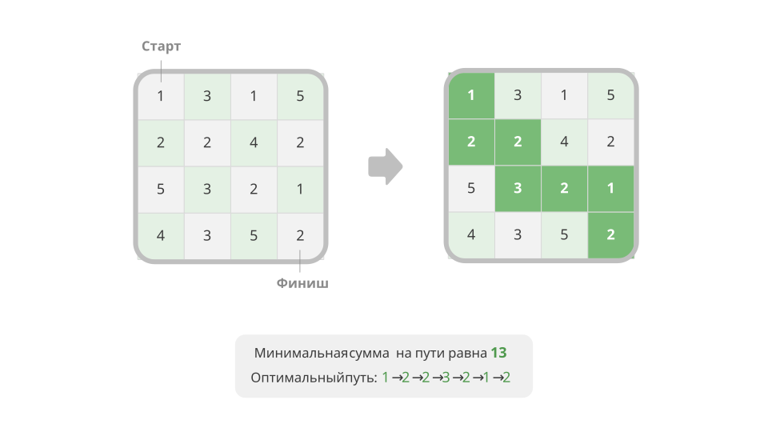
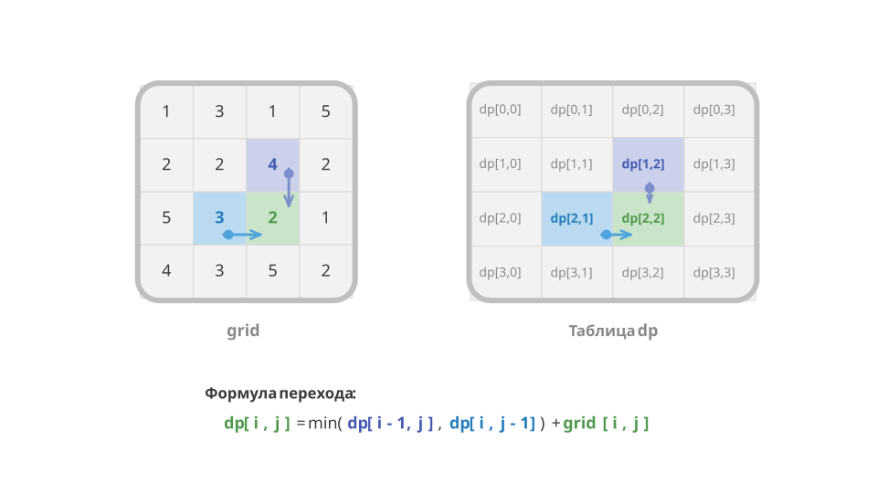
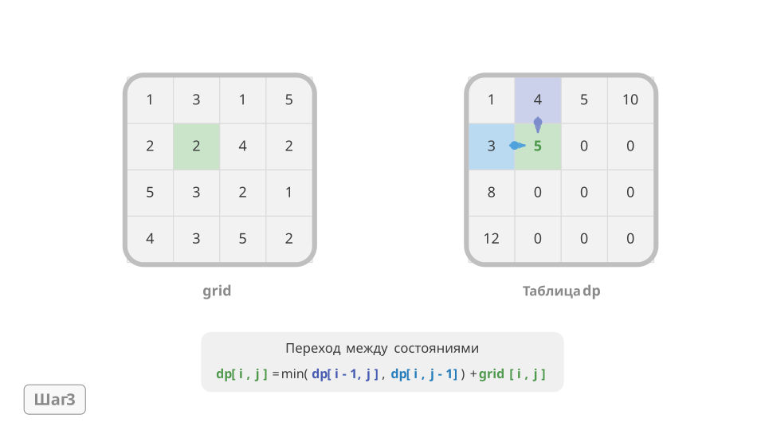
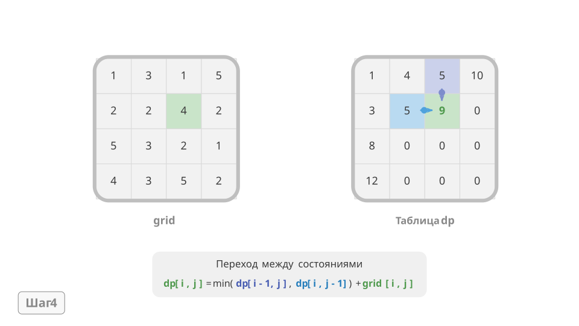
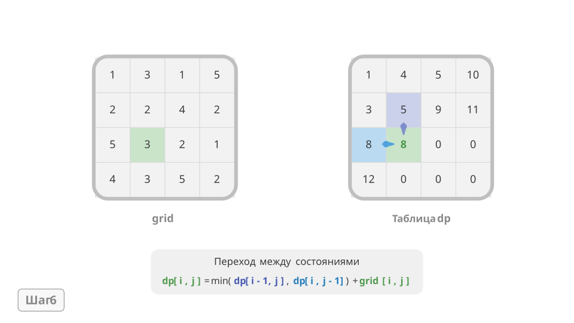
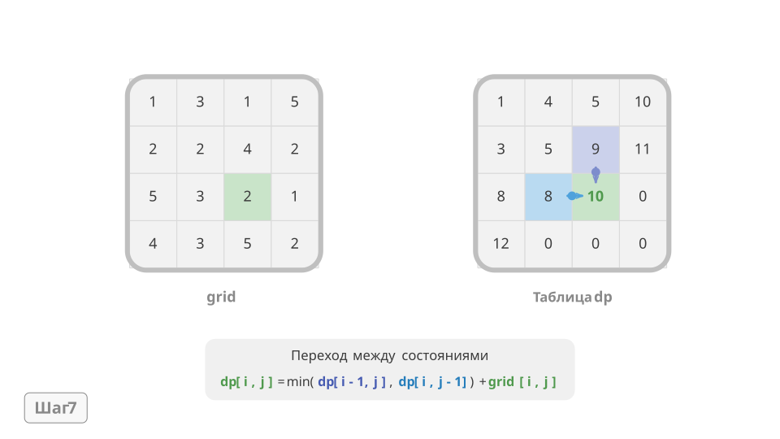
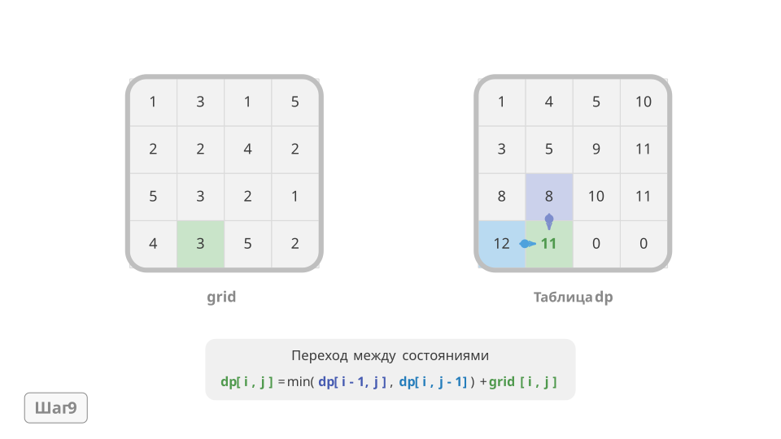
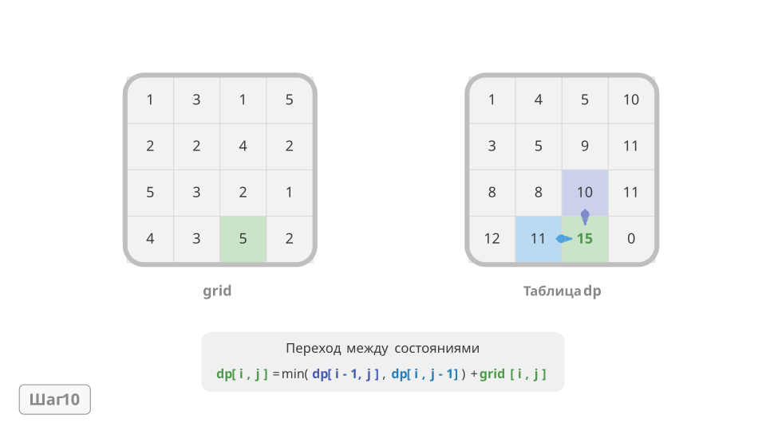
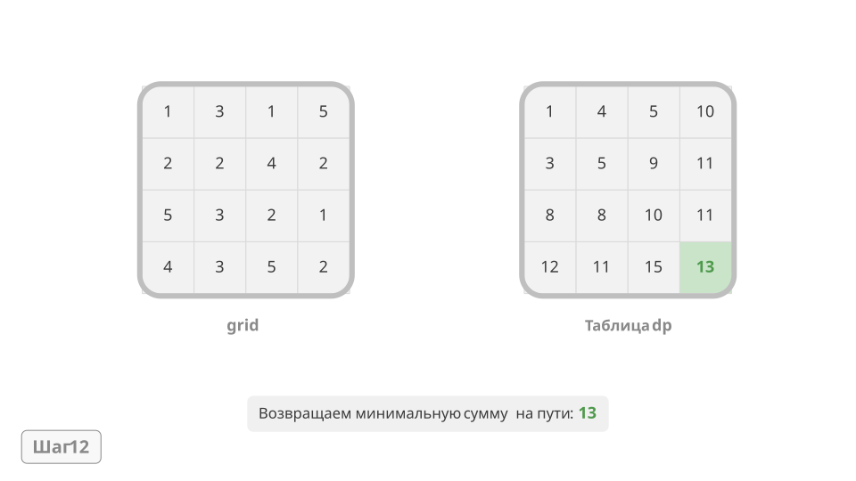

# Как решать задачи динамического программирования

В двух предыдущих разделах мы познакомились с основными признаками задач динамического программирования. Теперь рассмотрим два практических вопроса.

1. Как определить, подходит ли для задачи динамическое программирование?
2. С чего начать решение и из каких шагов оно состоит?

## Как распознать задачу

Динамическое программирование обычно подходит для задач с повторяющимися подзадачами, оптимальной подструктурой и отсутствием последействия. В формулировке задачи эти свойства редко видны сразу. Поэтому начнём с более простого вопроса: **можно ли решить задачу поиском с возвратом, перебирая варианты?**

**Задачи, подходящие для поиска с возвратом, обычно представимы в виде дерева решений**. Каждый узел такого дерева соответствует выбору, а путь — последовательности выборов.

Иными словами, если в задаче ясно, какой выбор мы делаем на каждом шаге, и из этих выборов складывается решение, то задачу можно описать деревом решений и обычно решить поиском с возвратом.

Есть несколько дополнительных признаков в пользу динамического программирования.

- В условии требуется найти максимум или минимум, например наибольшее или наименьшее количество.
- Состояния задачи можно представить списком, многомерным массивом или деревом. Значение состояния связано рекуррентным соотношением со значениями соседних состояний.

Есть и признаки, которые говорят против такого выбора.

- Требуется найти все возможные решения, а не оптимальное.
- В условии явно фигурируют перестановки или сочетания и требуется вернуть несколько конкретных вариантов.

Если задачу можно представить деревом решений и признаки в пользу динамического программирования выражены достаточно ясно, предположим, что метод подходит, и проверим это в ходе решения.

## Этапы решения

Ход решения зависит от особенностей и сложности задачи, но обычно включает несколько шагов: описать выбор, определить состояние, построить таблицу $dp$, вывести формулу перехода и задать граничные условия.

Разберём эти шаги на примере классической задачи о минимальной сумме на пути.

!!! question

    Дана прямоугольная сетка размером $n \times m$, заданная матрицей `grid`. В каждой ячейке записано неотрицательное целое число — стоимость её посещения. Робот начинает в верхней левой ячейке и за шаг может передвинуться только на одну ячейку вниз или вправо. Цель — нижняя правая ячейка. Верните минимальную сумму значений на пути из верхнего левого угла в нижний правый.

В примере на рисунке минимальная сумма на пути равна $13$.



**Шаг 1. Описать выбор на каждом шаге и определить состояния для таблицы $dp$**

На каждом шаге из текущей ячейки можно перейти на одну ячейку вниз или вправо. Если индексы текущей строки и столбца равны $[i, j]$, то после шага получаем $[i+1, j]$ или $[i, j+1]$. Следовательно, состояние задаётся двумя переменными, индексами строки и столбца. Обозначим его $[i, j]$.

Состоянию $[i, j]$ соответствует подзадача: найти минимальную сумму на пути из начальной точки $[0, 0]$ в $[i, j]$. Обозначим решение $dp[i, j]$.

Так получается двумерная таблица $dp$, показанная на рисунке. Её размеры совпадают с размерами исходной сетки $grid$.


!!! note

    И динамическое программирование, и поиск с возвратом можно описать последовательностью выборов. Состояние объединяет все переменные, от которых зависит выбор. Они должны полностью описывать достигнутый этап решения, чтобы по ним можно было вывести следующее состояние.
    
    Каждому состоянию соответствует подзадача. Решения всех подзадач мы храним в таблице $dp$. Каждая независимая переменная состояния задаёт одно измерение таблицы $dp$. По сути, таблица $dp$ сопоставляет каждому состоянию решение его подзадачи.

**Шаг 2. Найти оптимальную подструктуру и вывести формулу перехода**

В состояние $[i, j]$ можно прийти только из ячейки сверху $[i-1, j]$ или слева $[i, j-1]$. Отсюда оптимальная подструктура: минимальную сумму на пути до $[i, j]$ определяет меньшее из двух значений — минимальных сумм на путях до $[i, j-1]$ и до $[i-1, j]$.

Теперь можно записать формулу перехода, показанную на рисунке:

$$
dp[i, j] = \min(dp[i-1, j], dp[i, j-1]) + grid[i, j]
$$



!!! note

    По определению таблицы $dp$ установите связь между исходной задачей и подзадачами. Определите, как из оптимальных решений подзадач построить оптимальное решение исходной задачи. Это и есть её оптимальная подструктура.

    Найденная оптимальная подструктура позволяет записать формулу перехода.

**Шаг 3. Определить граничные условия и порядок переходов**

В ячейку первой строки можно прийти только слева, а в ячейку первого столбца — только сверху. Поэтому граничные условия зададим для первой строки $i = 0$ и первого столбца $j = 0$.

Как показано на рисунке, каждая ячейка зависит от соседей слева и сверху. Поэтому обойдём матрицу вложенными циклами: внешний перебирает строки, а внутренний — столбцы.


!!! note

    В динамическом программировании граничные условия служат для инициализации таблицы $dp$, а при поиске — для отсечения ветвей.
    
    Выбирая порядок переходов, важно обеспечить одно: к моменту вычисления текущего решения все меньшие подзадачи, от которых оно зависит, уже должны быть правильно решены.

Теперь можно сразу написать решение методом динамического программирования. Но само разбиение на подзадачи идёт сверху вниз, поэтому естественно строить реализации в таком порядке: полный перебор $\rightarrow$ поиск с мемоизацией $\rightarrow$ динамическое программирование.

### Способ 1. Полный перебор

Начнём поиск из состояния $[i, j]$, рекурсивно сводя задачу к меньшим состояниям $[i-1, j]$ и $[i, j-1]$. Опишем рекурсивную функцию.

- **Параметры рекурсии**: состояние $[i, j]$.
- **Возвращаемое значение**: минимальная сумма на пути из $[0, 0]$ в $[i, j]$, равная $dp[i, j]$.
- **Условие остановки**: если $i = 0$ и $j = 0$, вернуть стоимость $grid[0, 0]$.
- **Отсечение**: если $i < 0$ или $j < 0$, индекс выходит за границы. Возвращаем стоимость $+\infty$, обозначающую недопустимый путь.

Реализация:

```src
[file]{min_path_sum}-[class]{}-[func]{min_path_sum_dfs}
```

На рисунке показано дерево рекурсии с корнем $dp[2, 1]$. Некоторые подзадачи повторяются, и число повторов стремительно растёт с увеличением размеров сетки `grid`.

Причина повторов в том, что **в одну и ту же ячейку можно попасть из верхнего левого угла несколькими путями**.


Из каждого состояния есть два направления: вниз и вправо. От верхнего левого угла до нижнего правого требуется $m + n - 2$ шагов, поэтому временная сложность в худшем случае составляет $O(2^{m + n})$, где $n$ — число строк, а $m$ — число столбцов. Эта оценка не учитывает границы сетки: на границе остаётся только одно направление, поэтому на самом деле путей несколько меньше.

### Способ 2. Поиск с мемоизацией

Заведём для сетки `grid` массив `mem` того же размера. Будем сохранять в нём решения подзадач и отсекать ветви при повторном обращении:

```src
[file]{min_path_sum}-[class]{}-[func]{min_path_sum_dfs_mem}
```

Как видно на рисунке, благодаря мемоизации каждую подзадачу достаточно решить один раз. Поэтому время определяется числом состояний, то есть размером сетки, и составляет $O(nm)$.


### Способ 3. Динамическое программирование

Запишем итеративное решение методом динамического программирования:

```src
[file]{min_path_sum}-[class]{}-[func]{min_path_sum_dp}
```

На рисунке показаны переходы при вычислении минимальной суммы на пути. Алгоритм обходит всю сетку, **поэтому его временная сложность составляет $O(nm)$**.

Массив `dp` имеет размер $n \times m$, **поэтому пространственная сложность составляет $O(nm)$**.

=== "<1>"
    

=== "<2>"
    

=== "<3>"
    

=== "<4>"
    

=== "<5>"
    

=== "<6>"
    

=== "<7>"
    

=== "<8>"
    

=== "<9>"
    

=== "<10>"
    

=== "<11>"
    

=== "<12>"
    

### Экономия памяти

Каждая ячейка зависит только от соседей слева и сверху. Поэтому для таблицы $dp$ достаточно одномерного массива длиной в одну строку.

Массив `dp` хранит лишь одну строку состояний, так что инициализировать весь первый столбец заранее не получится. Будем обновлять его при обработке каждой строки:

```src
[file]{min_path_sum}-[class]{}-[func]{min_path_sum_dp_comp}
```
