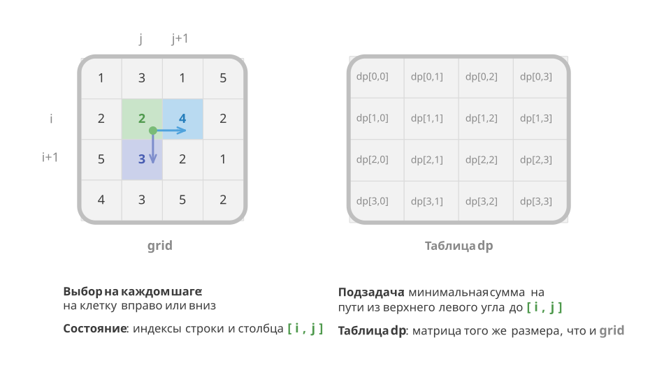
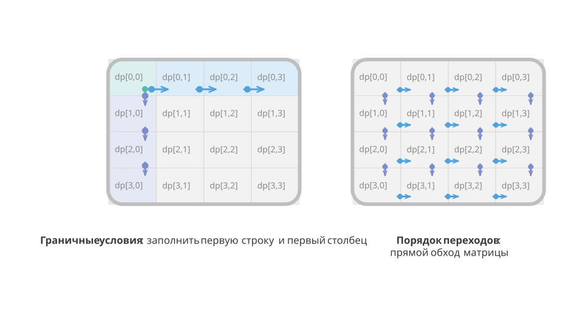
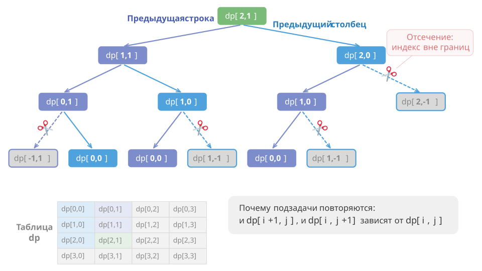
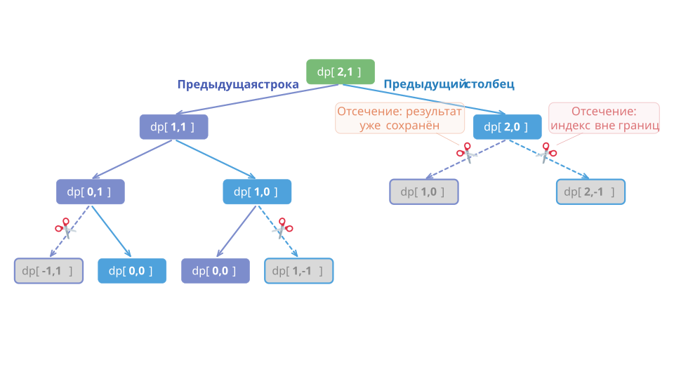
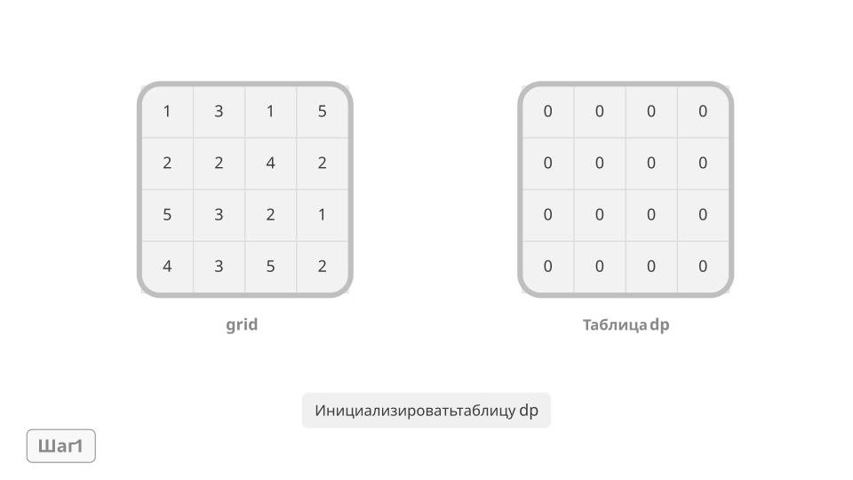
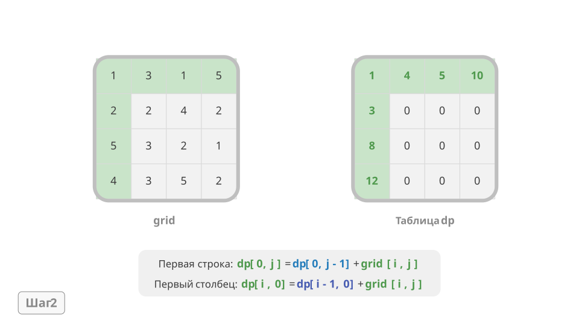
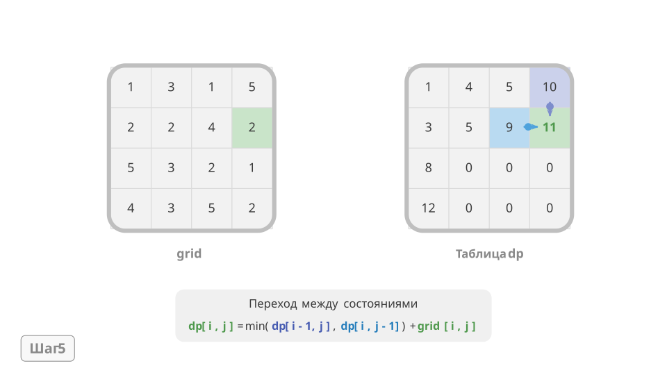
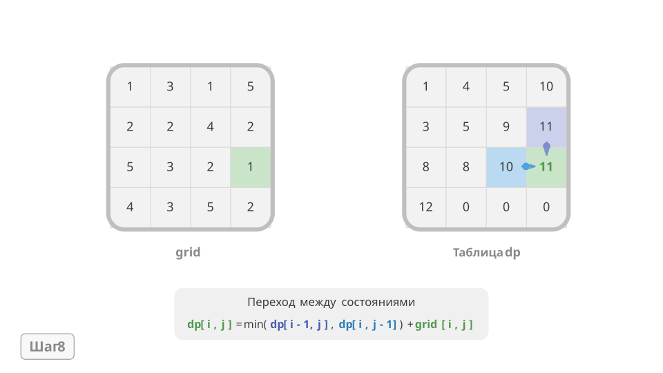
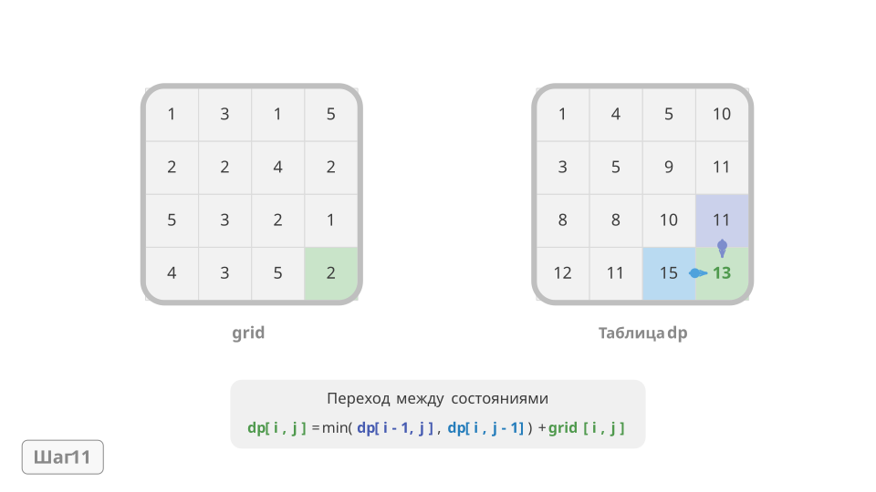

# 14.3 &nbsp; Как решать задачи динамического программирования

В двух предыдущих разделах мы познакомились с основными признаками задач динамического программирования. Теперь рассмотрим два практических вопроса.

1. Как определить, подходит ли для задачи динамическое программирование?
2. С чего начать решение и из каких шагов оно состоит?

## 14.3.1 &nbsp; Как распознать задачу

Динамическое программирование обычно подходит для задач с повторяющимися подзадачами, оптимальной подструктурой и отсутствием последействия. В формулировке задачи эти свойства редко видны сразу. Поэтому начнём с более простого вопроса: **можно ли решить задачу поиском с возвратом, перебирая варианты?**

**Задачи, подходящие для поиска с возвратом, обычно представимы в виде дерева решений**. Каждый узел такого дерева соответствует выбору, а путь — последовательности выборов.

Иными словами, если в задаче ясно, какой выбор мы делаем на каждом шаге, и из этих выборов складывается решение, то задачу можно описать деревом решений и обычно решить поиском с возвратом.

Есть несколько дополнительных признаков в пользу динамического программирования.

- В условии требуется найти максимум или минимум, например наибольшее или наименьшее количество.
- Состояния задачи можно представить списком, многомерным массивом или деревом. Значение состояния связано рекуррентным соотношением со значениями соседних состояний.

Есть и признаки, которые говорят против такого выбора.

- Требуется найти все возможные решения, а не оптимальное.
- В условии явно фигурируют перестановки или сочетания и требуется вернуть несколько конкретных вариантов.

Если задачу можно представить деревом решений и признаки в пользу динамического программирования выражены достаточно ясно, предположим, что метод подходит, и проверим это в ходе решения.

## 14.3.2 &nbsp; Этапы решения

Ход решения зависит от особенностей и сложности задачи, но обычно включает несколько шагов: описать выбор, определить состояние, построить таблицу $dp$, вывести формулу перехода и задать граничные условия.

Разберём эти шаги на примере классической задачи о минимальной сумме на пути.

!!! question

    Дана прямоугольная сетка размером $n \times m$, заданная матрицей `grid`. В каждой ячейке записано неотрицательное целое число — стоимость её посещения. Робот начинает в верхней левой ячейке и за шаг может передвинуться только на одну ячейку вниз или вправо. Цель — нижняя правая ячейка. Верните минимальную сумму значений на пути из верхнего левого угла в нижний правый.

В примере на рисунке минимальная сумма на пути равна $13$.

{ class="animation-figure" }

<p align="center"> Рисунок 14-10 &nbsp; Пример данных для задачи о минимальной сумме на пути </p>

**Шаг 1. Описать выбор на каждом шаге и определить состояния для таблицы $dp$**

На каждом шаге из текущей ячейки можно перейти на одну ячейку вниз или вправо. Если индексы текущей строки и столбца равны $[i, j]$, то после шага получаем $[i+1, j]$ или $[i, j+1]$. Следовательно, состояние задаётся двумя переменными, индексами строки и столбца. Обозначим его $[i, j]$.

Состоянию $[i, j]$ соответствует подзадача: найти минимальную сумму на пути из начальной точки $[0, 0]$ в $[i, j]$. Обозначим решение $dp[i, j]$.

Так получается двумерная таблица $dp$, показанная на рисунке. Её размеры совпадают с размерами исходной сетки $grid$.

{ class="animation-figure" }

<p align="center"> Рисунок 14-11 &nbsp; Определение состояния и таблица dp </p>

!!! note

    И динамическое программирование, и поиск с возвратом можно описать последовательностью выборов. Состояние объединяет все переменные, от которых зависит выбор. Они должны полностью описывать достигнутый этап решения, чтобы по ним можно было вывести следующее состояние.
    
    Каждому состоянию соответствует подзадача. Решения всех подзадач мы храним в таблице $dp$. Каждая независимая переменная состояния задаёт одно измерение таблицы $dp$. По сути, таблица $dp$ сопоставляет каждому состоянию решение его подзадачи.

**Шаг 2. Найти оптимальную подструктуру и вывести формулу перехода**

В состояние $[i, j]$ можно прийти только из ячейки сверху $[i-1, j]$ или слева $[i, j-1]$. Отсюда оптимальная подструктура: минимальную сумму на пути до $[i, j]$ определяет меньшее из двух значений — минимальных сумм на путях до $[i, j-1]$ и до $[i-1, j]$.

Теперь можно записать формулу перехода, показанную на рисунке:

$$
dp[i, j] = \min(dp[i-1, j], dp[i, j-1]) + grid[i, j]
$$

{ class="animation-figure" }

<p align="center"> Рисунок 14-12 &nbsp; Оптимальная подструктура и формула перехода </p>

!!! note

    По определению таблицы $dp$ установите связь между исходной задачей и подзадачами. Определите, как из оптимальных решений подзадач построить оптимальное решение исходной задачи. Это и есть её оптимальная подструктура.

    Найденная оптимальная подструктура позволяет записать формулу перехода.

**Шаг 3. Определить граничные условия и порядок переходов**

В ячейку первой строки можно прийти только слева, а в ячейку первого столбца — только сверху. Поэтому граничные условия зададим для первой строки $i = 0$ и первого столбца $j = 0$.

Как показано на рисунке, каждая ячейка зависит от соседей слева и сверху. Поэтому обойдём матрицу вложенными циклами: внешний перебирает строки, а внутренний — столбцы.

{ class="animation-figure" }

<p align="center"> Рисунок 14-13 &nbsp; Граничные условия и порядок переходов </p>

!!! note

    В динамическом программировании граничные условия служат для инициализации таблицы $dp$, а при поиске — для отсечения ветвей.
    
    Выбирая порядок переходов, важно обеспечить одно: к моменту вычисления текущего решения все меньшие подзадачи, от которых оно зависит, уже должны быть правильно решены.

Теперь можно сразу написать решение методом динамического программирования. Но само разбиение на подзадачи идёт сверху вниз, поэтому естественно строить реализации в таком порядке: полный перебор $\rightarrow$ поиск с мемоизацией $\rightarrow$ динамическое программирование.

### 1. &nbsp; Способ 1. Полный перебор

Начнём поиск из состояния $[i, j]$, рекурсивно сводя задачу к меньшим состояниям $[i-1, j]$ и $[i, j-1]$. Опишем рекурсивную функцию.

- **Параметры рекурсии**: состояние $[i, j]$.
- **Возвращаемое значение**: минимальная сумма на пути из $[0, 0]$ в $[i, j]$, равная $dp[i, j]$.
- **Условие остановки**: если $i = 0$ и $j = 0$, вернуть стоимость $grid[0, 0]$.
- **Отсечение**: если $i < 0$ или $j < 0$, индекс выходит за границы. Возвращаем стоимость $+\infty$, обозначающую недопустимый путь.

Реализация:

=== "Python"

    ```python title="min_path_sum.py"
    def min_path_sum_dfs(grid: list[list[int]], i: int, j: int) -> int:
        """Минимальная сумма на пути: полный перебор"""
        # При достижении верхней левой ячейки завершить поиск
        if i == 0 and j == 0:
            return grid[0][0]
        # Если индекс строки или столбца вне матрицы, вернуть стоимость +∞
        if i < 0 or j < 0:
            return inf
        # Найти минимальные стоимости путей из верхнего левого угла до (i-1, j) и (i, j-1)
        up = min_path_sum_dfs(grid, i - 1, j)
        left = min_path_sum_dfs(grid, i, j - 1)
        # Вернуть минимальную стоимость пути из верхнего левого угла до (i, j)
        return min(left, up) + grid[i][j]
    ```

=== "C++"

    ```cpp title="min_path_sum.cpp"
    /* Минимальная сумма на пути: полный перебор */
    int minPathSumDFS(vector<vector<int>> &grid, int i, int j) {
        // При достижении верхней левой ячейки завершить поиск
        if (i == 0 && j == 0) {
            return grid[0][0];
        }
        // Если индекс строки или столбца вне матрицы, вернуть стоимость +∞
        if (i < 0 || j < 0) {
            return INT_MAX;
        }
        // Найти минимальные стоимости путей из верхнего левого угла до (i-1, j) и (i, j-1)
        int up = minPathSumDFS(grid, i - 1, j);
        int left = minPathSumDFS(grid, i, j - 1);
        // Вернуть минимальную стоимость пути из верхнего левого угла до (i, j)
        return min(left, up) != INT_MAX ? min(left, up) + grid[i][j] : INT_MAX;
    }
    ```

=== "Java"

    ```java title="min_path_sum.java"
    /* Минимальная сумма на пути: полный перебор */
    int minPathSumDFS(int[][] grid, int i, int j) {
        // При достижении верхней левой ячейки завершить поиск
        if (i == 0 && j == 0) {
            return grid[0][0];
        }
        // Если индекс строки или столбца вне матрицы, вернуть стоимость +∞
        if (i < 0 || j < 0) {
            return Integer.MAX_VALUE;
        }
        // Найти минимальные стоимости путей из верхнего левого угла до (i-1, j) и (i, j-1)
        int up = minPathSumDFS(grid, i - 1, j);
        int left = minPathSumDFS(grid, i, j - 1);
        // Вернуть минимальную стоимость пути из верхнего левого угла до (i, j)
        return Math.min(left, up) + grid[i][j];
    }
    ```

=== "C#"

    ```csharp title="min_path_sum.cs"
    /* Минимальная сумма на пути: полный перебор */
    int MinPathSumDFS(int[][] grid, int i, int j) {
        // При достижении верхней левой ячейки завершить поиск
        if (i == 0 && j == 0) {
            return grid[0][0];
        }
        // Если индекс строки или столбца вне матрицы, вернуть стоимость +∞
        if (i < 0 || j < 0) {
            return int.MaxValue;
        }
        // Найти минимальные стоимости путей из верхнего левого угла до (i-1, j) и (i, j-1)
        int up = MinPathSumDFS(grid, i - 1, j);
        int left = MinPathSumDFS(grid, i, j - 1);
        // Вернуть минимальную стоимость пути из верхнего левого угла до (i, j)
        return Math.Min(left, up) + grid[i][j];
    }
    ```

=== "Go"

    ```go title="min_path_sum.go"
    /* Минимальная сумма на пути: полный перебор */
    func minPathSumDFS(grid [][]int, i, j int) int {
        // При достижении верхней левой ячейки завершить поиск
        if i == 0 && j == 0 {
            return grid[0][0]
        }
        // Если индекс строки или столбца вне матрицы, вернуть стоимость +∞
        if i < 0 || j < 0 {
            return math.MaxInt
        }
        // Найти минимальные стоимости путей из верхнего левого угла до (i-1, j) и (i, j-1)
        up := minPathSumDFS(grid, i-1, j)
        left := minPathSumDFS(grid, i, j-1)
        // Вернуть минимальную стоимость пути из верхнего левого угла до (i, j)
        return int(math.Min(float64(left), float64(up))) + grid[i][j]
    }
    ```

=== "Swift"

    ```swift title="min_path_sum.swift"
    /* Минимальная сумма на пути: полный перебор */
    func minPathSumDFS(grid: [[Int]], i: Int, j: Int) -> Int {
        // При достижении верхней левой ячейки завершить поиск
        if i == 0, j == 0 {
            return grid[0][0]
        }
        // Если индекс строки или столбца вне матрицы, вернуть стоимость +∞
        if i < 0 || j < 0 {
            return .max
        }
        // Найти минимальные стоимости путей из верхнего левого угла до (i-1, j) и (i, j-1)
        let up = minPathSumDFS(grid: grid, i: i - 1, j: j)
        let left = minPathSumDFS(grid: grid, i: i, j: j - 1)
        // Вернуть минимальную стоимость пути из верхнего левого угла до (i, j)
        return min(left, up) + grid[i][j]
    }
    ```

=== "JS"

    ```javascript title="min_path_sum.js"
    /* Минимальная сумма на пути: полный перебор */
    function minPathSumDFS(grid, i, j) {
        // При достижении верхней левой ячейки завершить поиск
        if (i === 0 && j === 0) {
            return grid[0][0];
        }
        // Если индекс строки или столбца вне матрицы, вернуть стоимость +∞
        if (i < 0 || j < 0) {
            return Infinity;
        }
        // Найти минимальные стоимости путей из верхнего левого угла до (i-1, j) и (i, j-1)
        const up = minPathSumDFS(grid, i - 1, j);
        const left = minPathSumDFS(grid, i, j - 1);
        // Вернуть минимальную стоимость пути из верхнего левого угла до (i, j)
        return Math.min(left, up) + grid[i][j];
    }
    ```

=== "TS"

    ```typescript title="min_path_sum.ts"
    /* Минимальная сумма на пути: полный перебор */
    function minPathSumDFS(
        grid: Array<Array<number>>,
        i: number,
        j: number
    ): number {
        // При достижении верхней левой ячейки завершить поиск
        if (i === 0 && j == 0) {
            return grid[0][0];
        }
        // Если индекс строки или столбца вне матрицы, вернуть стоимость +∞
        if (i < 0 || j < 0) {
            return Infinity;
        }
        // Найти минимальные стоимости путей из верхнего левого угла до (i-1, j) и (i, j-1)
        const up = minPathSumDFS(grid, i - 1, j);
        const left = minPathSumDFS(grid, i, j - 1);
        // Вернуть минимальную стоимость пути из верхнего левого угла до (i, j)
        return Math.min(left, up) + grid[i][j];
    }
    ```

=== "Dart"

    ```dart title="min_path_sum.dart"
    /* Минимальная сумма на пути: полный перебор */
    int minPathSumDFS(List<List<int>> grid, int i, int j) {
      // При достижении верхней левой ячейки завершить поиск
      if (i == 0 && j == 0) {
        return grid[0][0];
      }
      // Если индекс строки или столбца вне матрицы, вернуть стоимость +∞
      if (i < 0 || j < 0) {
        // В Dart тип int имеет ограниченный диапазон и не содержит значения для бесконечности
        return BigInt.from(2).pow(31).toInt();
      }
      // Найти минимальные стоимости путей из верхнего левого угла до (i-1, j) и (i, j-1)
      int up = minPathSumDFS(grid, i - 1, j);
      int left = minPathSumDFS(grid, i, j - 1);
      // Вернуть минимальную стоимость пути из верхнего левого угла до (i, j)
      return min(left, up) + grid[i][j];
    }
    ```

=== "Rust"

    ```rust title="min_path_sum.rs"
    /* Минимальная сумма на пути: полный перебор */
    fn min_path_sum_dfs(grid: &Vec<Vec<i32>>, i: i32, j: i32) -> i32 {
        // При достижении верхней левой ячейки завершить поиск
        if i == 0 && j == 0 {
            return grid[0][0];
        }
        // Если индекс строки или столбца вне матрицы, вернуть стоимость +∞
        if i < 0 || j < 0 {
            return i32::MAX;
        }
        // Найти минимальные стоимости путей из верхнего левого угла до (i-1, j) и (i, j-1)
        let up = min_path_sum_dfs(grid, i - 1, j);
        let left = min_path_sum_dfs(grid, i, j - 1);
        // Вернуть минимальную стоимость пути из верхнего левого угла до (i, j)
        std::cmp::min(left, up) + grid[i as usize][j as usize]
    }
    ```

=== "C"

    ```c title="min_path_sum.c"
    /* Минимальная сумма на пути: полный перебор */
    int minPathSumDFS(int grid[MAX_SIZE][MAX_SIZE], int i, int j) {
        // При достижении верхней левой ячейки завершить поиск
        if (i == 0 && j == 0) {
            return grid[0][0];
        }
        // Если индекс строки или столбца вне матрицы, вернуть стоимость +∞
        if (i < 0 || j < 0) {
            return INT_MAX;
        }
        // Найти минимальные стоимости путей из верхнего левого угла до (i-1, j) и (i, j-1)
        int up = minPathSumDFS(grid, i - 1, j);
        int left = minPathSumDFS(grid, i, j - 1);
        // Вернуть минимальную стоимость пути из верхнего левого угла до (i, j)
        return myMin(left, up) != INT_MAX ? myMin(left, up) + grid[i][j] : INT_MAX;
    }
    ```

=== "Kotlin"

    ```kotlin title="min_path_sum.kt"
    /* Минимальная сумма на пути: полный перебор */
    fun minPathSumDFS(grid: Array<IntArray>, i: Int, j: Int): Int {
        // При достижении верхней левой ячейки завершить поиск
        if (i == 0 && j == 0) {
            return grid[0][0]
        }
        // Если индекс строки или столбца вне матрицы, вернуть стоимость +∞
        if (i < 0 || j < 0) {
            return Int.MAX_VALUE
        }
        // Найти минимальные стоимости путей из верхнего левого угла до (i-1, j) и (i, j-1)
        val up = minPathSumDFS(grid, i - 1, j)
        val left = minPathSumDFS(grid, i, j - 1)
        // Вернуть минимальную стоимость пути из верхнего левого угла до (i, j)
        return min(left, up) + grid[i][j]
    }
    ```

=== "Ruby"

    ```ruby title="min_path_sum.rb"
    ### Минимальная сумма на пути: полный перебор ###
    def min_path_sum_dfs(grid, i, j)
      # При достижении верхней левой ячейки завершить поиск
      return grid[i][j] if i == 0 && j == 0
      # Если индекс строки или столбца вне матрицы, вернуть стоимость +∞
      return Float::INFINITY if i < 0 || j < 0
      # Найти минимальные стоимости путей из верхнего левого угла до (i-1, j) и (i, j-1)
      up = min_path_sum_dfs(grid, i - 1, j)
      left = min_path_sum_dfs(grid, i, j - 1)
      # Вернуть минимальную стоимость пути из верхнего левого угла до (i, j)
      [left, up].min + grid[i][j]
    end
    ```

??? pythontutor "Визуализация выполнения"

    <div style="height: 549px; width: 100%;"><iframe class="pythontutor-iframe" title="Визуализация выполнения" src="https://pythontutor.com/iframe-embed.html#code=from%20math%20import%20inf%0A%0Adef%20min_path_sum_dfs%28grid%3A%20list%5Blist%5Bint%5D%5D,%20i%3A%20int,%20j%3A%20int%29%20-%3E%20int%3A%0A%20%20%20%20%22%22%22%D0%9C%D0%B8%D0%BD%D0%B8%D0%BC%D0%B0%D0%BB%D1%8C%D0%BD%D0%B0%D1%8F%20%D1%81%D1%83%D0%BC%D0%BC%D0%B0%20%D0%BD%D0%B0%20%D0%BF%D1%83%D1%82%D0%B8%3A%20%D0%BF%D0%BE%D0%BB%D0%BD%D1%8B%D0%B9%20%D0%BF%D0%B5%D1%80%D0%B5%D0%B1%D0%BE%D1%80%22%22%22%0A%20%20%20%20%23%20%D0%9F%D1%80%D0%B8%20%D0%B4%D0%BE%D1%81%D1%82%D0%B8%D0%B6%D0%B5%D0%BD%D0%B8%D0%B8%20%D0%B2%D0%B5%D1%80%D1%85%D0%BD%D0%B5%D0%B9%20%D0%BB%D0%B5%D0%B2%D0%BE%D0%B9%20%D1%8F%D1%87%D0%B5%D0%B9%D0%BA%D0%B8%20%D0%B7%D0%B0%D0%B2%D0%B5%D1%80%D1%88%D0%B8%D1%82%D1%8C%20%D0%BF%D0%BE%D0%B8%D1%81%D0%BA%0A%20%20%20%20if%20i%20%3D%3D%200%20and%20j%20%3D%3D%200%3A%0A%20%20%20%20%20%20%20%20return%20grid%5B0%5D%5B0%5D%0A%20%20%20%20%23%20%D0%95%D1%81%D0%BB%D0%B8%20%D0%B8%D0%BD%D0%B4%D0%B5%D0%BA%D1%81%20%D1%81%D1%82%D1%80%D0%BE%D0%BA%D0%B8%20%D0%B8%D0%BB%D0%B8%20%D1%81%D1%82%D0%BE%D0%BB%D0%B1%D1%86%D0%B0%20%D0%B2%D0%BD%D0%B5%20%D0%BC%D0%B0%D1%82%D1%80%D0%B8%D1%86%D1%8B,%20%D0%B2%D0%B5%D1%80%D0%BD%D1%83%D1%82%D1%8C%20%D1%81%D1%82%D0%BE%D0%B8%D0%BC%D0%BE%D1%81%D1%82%D1%8C%20%2B%E2%88%9E%0A%20%20%20%20if%20i%20%3C%200%20or%20j%20%3C%200%3A%0A%20%20%20%20%20%20%20%20return%20inf%0A%20%20%20%20%23%20%D0%9D%D0%B0%D0%B9%D1%82%D0%B8%20%D0%BC%D0%B8%D0%BD%D0%B8%D0%BC%D0%B0%D0%BB%D1%8C%D0%BD%D1%8B%D0%B5%20%D1%81%D1%82%D0%BE%D0%B8%D0%BC%D0%BE%D1%81%D1%82%D0%B8%20%D0%BF%D1%83%D1%82%D0%B5%D0%B9%20%D0%B8%D0%B7%20%D0%B2%D0%B5%D1%80%D1%85%D0%BD%D0%B5%D0%B3%D0%BE%20%D0%BB%D0%B5%D0%B2%D0%BE%D0%B3%D0%BE%20%D1%83%D0%B3%D0%BB%D0%B0%20%D0%B4%D0%BE%20%28i-1,%20j%29%20%D0%B8%20%28i,%20j-1%29%0A%20%20%20%20up%20%3D%20min_path_sum_dfs%28grid,%20i%20-%201,%20j%29%0A%20%20%20%20left%20%3D%20min_path_sum_dfs%28grid,%20i,%20j%20-%201%29%0A%20%20%20%20%23%20%D0%92%D0%B5%D1%80%D0%BD%D1%83%D1%82%D1%8C%20%D0%BC%D0%B8%D0%BD%D0%B8%D0%BC%D0%B0%D0%BB%D1%8C%D0%BD%D1%83%D1%8E%20%D1%81%D1%82%D0%BE%D0%B8%D0%BC%D0%BE%D1%81%D1%82%D1%8C%20%D0%BF%D1%83%D1%82%D0%B8%20%D0%B8%D0%B7%20%D0%B2%D0%B5%D1%80%D1%85%D0%BD%D0%B5%D0%B3%D0%BE%20%D0%BB%D0%B5%D0%B2%D0%BE%D0%B3%D0%BE%20%D1%83%D0%B3%D0%BB%D0%B0%20%D0%B4%D0%BE%20%28i,%20j%29%0A%20%20%20%20return%20min%28left,%20up%29%20%2B%20grid%5Bi%5D%5Bj%5D%0A%0A%0A%22%22%22Driver%20Code%22%22%22%0Aif%20__name__%20%3D%3D%20%22__main__%22%3A%0A%20%20%20%20grid%20%3D%20%5B%5B1,%203,%201,%205%5D,%20%5B2,%202,%204,%202%5D,%20%5B5,%203,%202,%201%5D,%20%5B4,%203,%205,%202%5D%5D%0A%20%20%20%20n,%20m%20%3D%20len%28grid%29,%20len%28grid%5B0%5D%29%0A%0A%20%20%20%20%23%20%D0%9F%D0%BE%D0%BB%D0%BD%D1%8B%D0%B9%20%D0%BF%D0%B5%D1%80%D0%B5%D0%B1%D0%BE%D1%80%0A%20%20%20%20res%20%3D%20min_path_sum_dfs%28grid,%20n%20-%201,%20m%20-%201%29%0A%20%20%20%20print%28f%22%D0%9C%D0%B8%D0%BD%D0%B8%D0%BC%D0%B0%D0%BB%D1%8C%D0%BD%D0%B0%D1%8F%20%D1%81%D1%83%D0%BC%D0%BC%D0%B0%20%D0%BD%D0%B0%20%D0%BF%D1%83%D1%82%D0%B8%20%D0%B8%D0%B7%20%D0%B2%D0%B5%D1%80%D1%85%D0%BD%D0%B5%D0%B3%D0%BE%20%D0%BB%D0%B5%D0%B2%D0%BE%D0%B3%D0%BE%20%D0%B2%20%D0%BD%D0%B8%D0%B6%D0%BD%D0%B8%D0%B9%20%D0%BF%D1%80%D0%B0%D0%B2%D1%8B%D0%B9%20%D1%83%D0%B3%D0%BE%D0%BB%3A%20%7Bres%7D%22%29&codeDivHeight=472&codeDivWidth=350&cumulative=false&curInstr=6&heapPrimitives=nevernest&origin=opt-frontend.js&py=311&rawInputLstJSON=%5B%5D&textReferences=false"> </iframe></div>
    <div style="margin-top: 5px;"><a href="https://pythontutor.com/iframe-embed.html#code=from%20math%20import%20inf%0A%0Adef%20min_path_sum_dfs%28grid%3A%20list%5Blist%5Bint%5D%5D,%20i%3A%20int,%20j%3A%20int%29%20-%3E%20int%3A%0A%20%20%20%20%22%22%22%D0%9C%D0%B8%D0%BD%D0%B8%D0%BC%D0%B0%D0%BB%D1%8C%D0%BD%D0%B0%D1%8F%20%D1%81%D1%83%D0%BC%D0%BC%D0%B0%20%D0%BD%D0%B0%20%D0%BF%D1%83%D1%82%D0%B8%3A%20%D0%BF%D0%BE%D0%BB%D0%BD%D1%8B%D0%B9%20%D0%BF%D0%B5%D1%80%D0%B5%D0%B1%D0%BE%D1%80%22%22%22%0A%20%20%20%20%23%20%D0%9F%D1%80%D0%B8%20%D0%B4%D0%BE%D1%81%D1%82%D0%B8%D0%B6%D0%B5%D0%BD%D0%B8%D0%B8%20%D0%B2%D0%B5%D1%80%D1%85%D0%BD%D0%B5%D0%B9%20%D0%BB%D0%B5%D0%B2%D0%BE%D0%B9%20%D1%8F%D1%87%D0%B5%D0%B9%D0%BA%D0%B8%20%D0%B7%D0%B0%D0%B2%D0%B5%D1%80%D1%88%D0%B8%D1%82%D1%8C%20%D0%BF%D0%BE%D0%B8%D1%81%D0%BA%0A%20%20%20%20if%20i%20%3D%3D%200%20and%20j%20%3D%3D%200%3A%0A%20%20%20%20%20%20%20%20return%20grid%5B0%5D%5B0%5D%0A%20%20%20%20%23%20%D0%95%D1%81%D0%BB%D0%B8%20%D0%B8%D0%BD%D0%B4%D0%B5%D0%BA%D1%81%20%D1%81%D1%82%D1%80%D0%BE%D0%BA%D0%B8%20%D0%B8%D0%BB%D0%B8%20%D1%81%D1%82%D0%BE%D0%BB%D0%B1%D1%86%D0%B0%20%D0%B2%D0%BD%D0%B5%20%D0%BC%D0%B0%D1%82%D1%80%D0%B8%D1%86%D1%8B,%20%D0%B2%D0%B5%D1%80%D0%BD%D1%83%D1%82%D1%8C%20%D1%81%D1%82%D0%BE%D0%B8%D0%BC%D0%BE%D1%81%D1%82%D1%8C%20%2B%E2%88%9E%0A%20%20%20%20if%20i%20%3C%200%20or%20j%20%3C%200%3A%0A%20%20%20%20%20%20%20%20return%20inf%0A%20%20%20%20%23%20%D0%9D%D0%B0%D0%B9%D1%82%D0%B8%20%D0%BC%D0%B8%D0%BD%D0%B8%D0%BC%D0%B0%D0%BB%D1%8C%D0%BD%D1%8B%D0%B5%20%D1%81%D1%82%D0%BE%D0%B8%D0%BC%D0%BE%D1%81%D1%82%D0%B8%20%D0%BF%D1%83%D1%82%D0%B5%D0%B9%20%D0%B8%D0%B7%20%D0%B2%D0%B5%D1%80%D1%85%D0%BD%D0%B5%D0%B3%D0%BE%20%D0%BB%D0%B5%D0%B2%D0%BE%D0%B3%D0%BE%20%D1%83%D0%B3%D0%BB%D0%B0%20%D0%B4%D0%BE%20%28i-1,%20j%29%20%D0%B8%20%28i,%20j-1%29%0A%20%20%20%20up%20%3D%20min_path_sum_dfs%28grid,%20i%20-%201,%20j%29%0A%20%20%20%20left%20%3D%20min_path_sum_dfs%28grid,%20i,%20j%20-%201%29%0A%20%20%20%20%23%20%D0%92%D0%B5%D1%80%D0%BD%D1%83%D1%82%D1%8C%20%D0%BC%D0%B8%D0%BD%D0%B8%D0%BC%D0%B0%D0%BB%D1%8C%D0%BD%D1%83%D1%8E%20%D1%81%D1%82%D0%BE%D0%B8%D0%BC%D0%BE%D1%81%D1%82%D1%8C%20%D0%BF%D1%83%D1%82%D0%B8%20%D0%B8%D0%B7%20%D0%B2%D0%B5%D1%80%D1%85%D0%BD%D0%B5%D0%B3%D0%BE%20%D0%BB%D0%B5%D0%B2%D0%BE%D0%B3%D0%BE%20%D1%83%D0%B3%D0%BB%D0%B0%20%D0%B4%D0%BE%20%28i,%20j%29%0A%20%20%20%20return%20min%28left,%20up%29%20%2B%20grid%5Bi%5D%5Bj%5D%0A%0A%0A%22%22%22Driver%20Code%22%22%22%0Aif%20__name__%20%3D%3D%20%22__main__%22%3A%0A%20%20%20%20grid%20%3D%20%5B%5B1,%203,%201,%205%5D,%20%5B2,%202,%204,%202%5D,%20%5B5,%203,%202,%201%5D,%20%5B4,%203,%205,%202%5D%5D%0A%20%20%20%20n,%20m%20%3D%20len%28grid%29,%20len%28grid%5B0%5D%29%0A%0A%20%20%20%20%23%20%D0%9F%D0%BE%D0%BB%D0%BD%D1%8B%D0%B9%20%D0%BF%D0%B5%D1%80%D0%B5%D0%B1%D0%BE%D1%80%0A%20%20%20%20res%20%3D%20min_path_sum_dfs%28grid,%20n%20-%201,%20m%20-%201%29%0A%20%20%20%20print%28f%22%D0%9C%D0%B8%D0%BD%D0%B8%D0%BC%D0%B0%D0%BB%D1%8C%D0%BD%D0%B0%D1%8F%20%D1%81%D1%83%D0%BC%D0%BC%D0%B0%20%D0%BD%D0%B0%20%D0%BF%D1%83%D1%82%D0%B8%20%D0%B8%D0%B7%20%D0%B2%D0%B5%D1%80%D1%85%D0%BD%D0%B5%D0%B3%D0%BE%20%D0%BB%D0%B5%D0%B2%D0%BE%D0%B3%D0%BE%20%D0%B2%20%D0%BD%D0%B8%D0%B6%D0%BD%D0%B8%D0%B9%20%D0%BF%D1%80%D0%B0%D0%B2%D1%8B%D0%B9%20%D1%83%D0%B3%D0%BE%D0%BB%3A%20%7Bres%7D%22%29&codeDivHeight=800&codeDivWidth=600&cumulative=false&curInstr=6&heapPrimitives=nevernest&origin=opt-frontend.js&py=311&rawInputLstJSON=%5B%5D&textReferences=false" target="_blank" rel="noopener noreferrer">Во весь экран ></a></div>

На рисунке показано дерево рекурсии с корнем $dp[2, 1]$. Некоторые подзадачи повторяются, и число повторов стремительно растёт с увеличением размеров сетки `grid`.

Причина повторов в том, что **в одну и ту же ячейку можно попасть из верхнего левого угла несколькими путями**.

{ class="animation-figure" }

<p align="center"> Рисунок 14-14 &nbsp; Дерево рекурсии полного перебора </p>

Из каждого состояния есть два направления: вниз и вправо. От верхнего левого угла до нижнего правого требуется $m + n - 2$ шагов, поэтому временная сложность в худшем случае составляет $O(2^{m + n})$, где $n$ — число строк, а $m$ — число столбцов. Эта оценка не учитывает границы сетки: на границе остаётся только одно направление, поэтому на самом деле путей несколько меньше.

### 2. &nbsp; Способ 2. Поиск с мемоизацией

Заведём для сетки `grid` массив `mem` того же размера. Будем сохранять в нём решения подзадач и отсекать ветви при повторном обращении:

=== "Python"

    ```python title="min_path_sum.py"
    def min_path_sum_dfs_mem(
        grid: list[list[int]], mem: list[list[int]], i: int, j: int
    ) -> int:
        """Минимальная сумма на пути: поиск с мемоизацией"""
        # При достижении верхней левой ячейки завершить поиск
        if i == 0 and j == 0:
            return grid[0][0]
        # Если индекс строки или столбца вне матрицы, вернуть стоимость +∞
        if i < 0 or j < 0:
            return inf
        # Если результат сохранён, сразу вернуть его
        if mem[i][j] != -1:
            return mem[i][j]
        # Минимальные стоимости путей до ячеек слева и сверху
        up = min_path_sum_dfs_mem(grid, mem, i - 1, j)
        left = min_path_sum_dfs_mem(grid, mem, i, j - 1)
        # Сохранить и вернуть минимальную стоимость пути из верхнего левого угла до (i, j)
        mem[i][j] = min(left, up) + grid[i][j]
        return mem[i][j]
    ```

=== "C++"

    ```cpp title="min_path_sum.cpp"
    /* Минимальная сумма на пути: поиск с мемоизацией */
    int minPathSumDFSMem(vector<vector<int>> &grid, vector<vector<int>> &mem, int i, int j) {
        // При достижении верхней левой ячейки завершить поиск
        if (i == 0 && j == 0) {
            return grid[0][0];
        }
        // Если индекс строки или столбца вне матрицы, вернуть стоимость +∞
        if (i < 0 || j < 0) {
            return INT_MAX;
        }
        // Если результат сохранён, сразу вернуть его
        if (mem[i][j] != -1) {
            return mem[i][j];
        }
        // Минимальные стоимости путей до ячеек слева и сверху
        int up = minPathSumDFSMem(grid, mem, i - 1, j);
        int left = minPathSumDFSMem(grid, mem, i, j - 1);
        // Сохранить и вернуть минимальную стоимость пути из верхнего левого угла до (i, j)
        mem[i][j] = min(left, up) != INT_MAX ? min(left, up) + grid[i][j] : INT_MAX;
        return mem[i][j];
    }
    ```

=== "Java"

    ```java title="min_path_sum.java"
    /* Минимальная сумма на пути: поиск с мемоизацией */
    int minPathSumDFSMem(int[][] grid, int[][] mem, int i, int j) {
        // При достижении верхней левой ячейки завершить поиск
        if (i == 0 && j == 0) {
            return grid[0][0];
        }
        // Если индекс строки или столбца вне матрицы, вернуть стоимость +∞
        if (i < 0 || j < 0) {
            return Integer.MAX_VALUE;
        }
        // Если результат сохранён, сразу вернуть его
        if (mem[i][j] != -1) {
            return mem[i][j];
        }
        // Минимальные стоимости путей до ячеек слева и сверху
        int up = minPathSumDFSMem(grid, mem, i - 1, j);
        int left = minPathSumDFSMem(grid, mem, i, j - 1);
        // Сохранить и вернуть минимальную стоимость пути из верхнего левого угла до (i, j)
        mem[i][j] = Math.min(left, up) + grid[i][j];
        return mem[i][j];
    }
    ```

=== "C#"

    ```csharp title="min_path_sum.cs"
    /* Минимальная сумма на пути: поиск с мемоизацией */
    int MinPathSumDFSMem(int[][] grid, int[][] mem, int i, int j) {
        // При достижении верхней левой ячейки завершить поиск
        if (i == 0 && j == 0) {
            return grid[0][0];
        }
        // Если индекс строки или столбца вне матрицы, вернуть стоимость +∞
        if (i < 0 || j < 0) {
            return int.MaxValue;
        }
        // Если результат сохранён, сразу вернуть его
        if (mem[i][j] != -1) {
            return mem[i][j];
        }
        // Минимальные стоимости путей до ячеек слева и сверху
        int up = MinPathSumDFSMem(grid, mem, i - 1, j);
        int left = MinPathSumDFSMem(grid, mem, i, j - 1);
        // Сохранить и вернуть минимальную стоимость пути из верхнего левого угла до (i, j)
        mem[i][j] = Math.Min(left, up) + grid[i][j];
        return mem[i][j];
    }
    ```

=== "Go"

    ```go title="min_path_sum.go"
    /* Минимальная сумма на пути: поиск с мемоизацией */
    func minPathSumDFSMem(grid, mem [][]int, i, j int) int {
        // При достижении верхней левой ячейки завершить поиск
        if i == 0 && j == 0 {
            return grid[0][0]
        }
        // Если индекс строки или столбца вне матрицы, вернуть стоимость +∞
        if i < 0 || j < 0 {
            return math.MaxInt
        }
        // Если результат сохранён, сразу вернуть его
        if mem[i][j] != -1 {
            return mem[i][j]
        }
        // Минимальные стоимости путей до ячеек слева и сверху
        up := minPathSumDFSMem(grid, mem, i-1, j)
        left := minPathSumDFSMem(grid, mem, i, j-1)
        // Сохранить и вернуть минимальную стоимость пути из верхнего левого угла до (i, j)
        mem[i][j] = int(math.Min(float64(left), float64(up))) + grid[i][j]
        return mem[i][j]
    }
    ```

=== "Swift"

    ```swift title="min_path_sum.swift"
    /* Минимальная сумма на пути: поиск с мемоизацией */
    func minPathSumDFSMem(grid: [[Int]], mem: inout [[Int]], i: Int, j: Int) -> Int {
        // При достижении верхней левой ячейки завершить поиск
        if i == 0, j == 0 {
            return grid[0][0]
        }
        // Если индекс строки или столбца вне матрицы, вернуть стоимость +∞
        if i < 0 || j < 0 {
            return .max
        }
        // Если результат сохранён, сразу вернуть его
        if mem[i][j] != -1 {
            return mem[i][j]
        }
        // Минимальные стоимости путей до ячеек слева и сверху
        let up = minPathSumDFSMem(grid: grid, mem: &mem, i: i - 1, j: j)
        let left = minPathSumDFSMem(grid: grid, mem: &mem, i: i, j: j - 1)
        // Сохранить и вернуть минимальную стоимость пути из верхнего левого угла до (i, j)
        mem[i][j] = min(left, up) + grid[i][j]
        return mem[i][j]
    }
    ```

=== "JS"

    ```javascript title="min_path_sum.js"
    /* Минимальная сумма на пути: поиск с мемоизацией */
    function minPathSumDFSMem(grid, mem, i, j) {
        // При достижении верхней левой ячейки завершить поиск
        if (i === 0 && j === 0) {
            return grid[0][0];
        }
        // Если индекс строки или столбца вне матрицы, вернуть стоимость +∞
        if (i < 0 || j < 0) {
            return Infinity;
        }
        // Если результат сохранён, сразу вернуть его
        if (mem[i][j] !== -1) {
            return mem[i][j];
        }
        // Минимальные стоимости путей до ячеек слева и сверху
        const up = minPathSumDFSMem(grid, mem, i - 1, j);
        const left = minPathSumDFSMem(grid, mem, i, j - 1);
        // Сохранить и вернуть минимальную стоимость пути из верхнего левого угла до (i, j)
        mem[i][j] = Math.min(left, up) + grid[i][j];
        return mem[i][j];
    }
    ```

=== "TS"

    ```typescript title="min_path_sum.ts"
    /* Минимальная сумма на пути: поиск с мемоизацией */
    function minPathSumDFSMem(
        grid: Array<Array<number>>,
        mem: Array<Array<number>>,
        i: number,
        j: number
    ): number {
        // При достижении верхней левой ячейки завершить поиск
        if (i === 0 && j === 0) {
            return grid[0][0];
        }
        // Если индекс строки или столбца вне матрицы, вернуть стоимость +∞
        if (i < 0 || j < 0) {
            return Infinity;
        }
        // Если результат сохранён, сразу вернуть его
        if (mem[i][j] != -1) {
            return mem[i][j];
        }
        // Минимальные стоимости путей до ячеек слева и сверху
        const up = minPathSumDFSMem(grid, mem, i - 1, j);
        const left = minPathSumDFSMem(grid, mem, i, j - 1);
        // Сохранить и вернуть минимальную стоимость пути из верхнего левого угла до (i, j)
        mem[i][j] = Math.min(left, up) + grid[i][j];
        return mem[i][j];
    }
    ```

=== "Dart"

    ```dart title="min_path_sum.dart"
    /* Минимальная сумма на пути: поиск с мемоизацией */
    int minPathSumDFSMem(List<List<int>> grid, List<List<int>> mem, int i, int j) {
      // При достижении верхней левой ячейки завершить поиск
      if (i == 0 && j == 0) {
        return grid[0][0];
      }
      // Если индекс строки или столбца вне матрицы, вернуть стоимость +∞
      if (i < 0 || j < 0) {
        // В Dart тип int имеет ограниченный диапазон и не содержит значения для бесконечности
        return BigInt.from(2).pow(31).toInt();
      }
      // Если результат сохранён, сразу вернуть его
      if (mem[i][j] != -1) {
        return mem[i][j];
      }
      // Минимальные стоимости путей до ячеек слева и сверху
      int up = minPathSumDFSMem(grid, mem, i - 1, j);
      int left = minPathSumDFSMem(grid, mem, i, j - 1);
      // Сохранить и вернуть минимальную стоимость пути из верхнего левого угла до (i, j)
      mem[i][j] = min(left, up) + grid[i][j];
      return mem[i][j];
    }
    ```

=== "Rust"

    ```rust title="min_path_sum.rs"
    /* Минимальная сумма на пути: поиск с мемоизацией */
    fn min_path_sum_dfs_mem(grid: &Vec<Vec<i32>>, mem: &mut Vec<Vec<i32>>, i: i32, j: i32) -> i32 {
        // При достижении верхней левой ячейки завершить поиск
        if i == 0 && j == 0 {
            return grid[0][0];
        }
        // Если индекс строки или столбца вне матрицы, вернуть стоимость +∞
        if i < 0 || j < 0 {
            return i32::MAX;
        }
        // Если результат сохранён, сразу вернуть его
        if mem[i as usize][j as usize] != -1 {
            return mem[i as usize][j as usize];
        }
        // Минимальные стоимости путей до ячеек слева и сверху
        let up = min_path_sum_dfs_mem(grid, mem, i - 1, j);
        let left = min_path_sum_dfs_mem(grid, mem, i, j - 1);
        // Сохранить и вернуть минимальную стоимость пути из верхнего левого угла до (i, j)
        mem[i as usize][j as usize] = std::cmp::min(left, up) + grid[i as usize][j as usize];
        mem[i as usize][j as usize]
    }
    ```

=== "C"

    ```c title="min_path_sum.c"
    /* Минимальная сумма на пути: поиск с мемоизацией */
    int minPathSumDFSMem(int grid[MAX_SIZE][MAX_SIZE], int mem[MAX_SIZE][MAX_SIZE], int i, int j) {
        // При достижении верхней левой ячейки завершить поиск
        if (i == 0 && j == 0) {
            return grid[0][0];
        }
        // Если индекс строки или столбца вне матрицы, вернуть стоимость +∞
        if (i < 0 || j < 0) {
            return INT_MAX;
        }
        // Если результат сохранён, сразу вернуть его
        if (mem[i][j] != -1) {
            return mem[i][j];
        }
        // Минимальные стоимости путей до ячеек слева и сверху
        int up = minPathSumDFSMem(grid, mem, i - 1, j);
        int left = minPathSumDFSMem(grid, mem, i, j - 1);
        // Сохранить и вернуть минимальную стоимость пути из верхнего левого угла до (i, j)
        mem[i][j] = myMin(left, up) != INT_MAX ? myMin(left, up) + grid[i][j] : INT_MAX;
        return mem[i][j];
    }
    ```

=== "Kotlin"

    ```kotlin title="min_path_sum.kt"
    /* Минимальная сумма на пути: поиск с мемоизацией */
    fun minPathSumDFSMem(
        grid: Array<IntArray>,
        mem: Array<IntArray>,
        i: Int,
        j: Int
    ): Int {
        // При достижении верхней левой ячейки завершить поиск
        if (i == 0 && j == 0) {
            return grid[0][0]
        }
        // Если индекс строки или столбца вне матрицы, вернуть стоимость +∞
        if (i < 0 || j < 0) {
            return Int.MAX_VALUE
        }
        // Если результат сохранён, сразу вернуть его
        if (mem[i][j] != -1) {
            return mem[i][j]
        }
        // Минимальные стоимости путей до ячеек слева и сверху
        val up = minPathSumDFSMem(grid, mem, i - 1, j)
        val left = minPathSumDFSMem(grid, mem, i, j - 1)
        // Сохранить и вернуть минимальную стоимость пути из верхнего левого угла до (i, j)
        mem[i][j] = min(left, up) + grid[i][j]
        return mem[i][j]
    }
    ```

=== "Ruby"

    ```ruby title="min_path_sum.rb"
    ### Минимальная сумма на пути: поиск с мемоизацией ###
    def min_path_sum_dfs_mem(grid, mem, i, j)
      # При достижении верхней левой ячейки завершить поиск
      return grid[0][0] if i == 0 && j == 0
      # Если индекс строки или столбца вне матрицы, вернуть стоимость +∞
      return Float::INFINITY if i < 0 || j < 0
      # Если результат сохранён, сразу вернуть его
      return mem[i][j] if mem[i][j] != -1
      # Минимальные стоимости путей до ячеек слева и сверху
      up = min_path_sum_dfs_mem(grid, mem, i - 1, j)
      left = min_path_sum_dfs_mem(grid, mem, i, j - 1)
      # Сохранить и вернуть минимальную стоимость пути из верхнего левого угла до (i, j)
      mem[i][j] = [left, up].min + grid[i][j]
    end
    ```

??? pythontutor "Визуализация выполнения"

    <div style="height: 549px; width: 100%;"><iframe class="pythontutor-iframe" title="Визуализация выполнения" src="https://pythontutor.com/iframe-embed.html#code=from%20math%20import%20inf%0A%0Adef%20min_path_sum_dfs_mem%28%0A%20%20%20%20grid%3A%20list%5Blist%5Bint%5D%5D,%20mem%3A%20list%5Blist%5Bint%5D%5D,%20i%3A%20int,%20j%3A%20int%0A%29%20-%3E%20int%3A%0A%20%20%20%20%22%22%22%D0%9C%D0%B8%D0%BD%D0%B8%D0%BC%D0%B0%D0%BB%D1%8C%D0%BD%D0%B0%D1%8F%20%D1%81%D1%83%D0%BC%D0%BC%D0%B0%20%D0%BD%D0%B0%20%D0%BF%D1%83%D1%82%D0%B8%3A%20%D0%BF%D0%BE%D0%B8%D1%81%D0%BA%20%D1%81%20%D0%BC%D0%B5%D0%BC%D0%BE%D0%B8%D0%B7%D0%B0%D1%86%D0%B8%D0%B5%D0%B9%22%22%22%0A%20%20%20%20%23%20%D0%9F%D1%80%D0%B8%20%D0%B4%D0%BE%D1%81%D1%82%D0%B8%D0%B6%D0%B5%D0%BD%D0%B8%D0%B8%20%D0%B2%D0%B5%D1%80%D1%85%D0%BD%D0%B5%D0%B9%20%D0%BB%D0%B5%D0%B2%D0%BE%D0%B9%20%D1%8F%D1%87%D0%B5%D0%B9%D0%BA%D0%B8%20%D0%B7%D0%B0%D0%B2%D0%B5%D1%80%D1%88%D0%B8%D1%82%D1%8C%20%D0%BF%D0%BE%D0%B8%D1%81%D0%BA%0A%20%20%20%20if%20i%20%3D%3D%200%20and%20j%20%3D%3D%200%3A%0A%20%20%20%20%20%20%20%20return%20grid%5B0%5D%5B0%5D%0A%20%20%20%20%23%20%D0%95%D1%81%D0%BB%D0%B8%20%D0%B8%D0%BD%D0%B4%D0%B5%D0%BA%D1%81%20%D1%81%D1%82%D1%80%D0%BE%D0%BA%D0%B8%20%D0%B8%D0%BB%D0%B8%20%D1%81%D1%82%D0%BE%D0%BB%D0%B1%D1%86%D0%B0%20%D0%B2%D0%BD%D0%B5%20%D0%BC%D0%B0%D1%82%D1%80%D0%B8%D1%86%D1%8B,%20%D0%B2%D0%B5%D1%80%D0%BD%D1%83%D1%82%D1%8C%20%D1%81%D1%82%D0%BE%D0%B8%D0%BC%D0%BE%D1%81%D1%82%D1%8C%20%2B%E2%88%9E%0A%20%20%20%20if%20i%20%3C%200%20or%20j%20%3C%200%3A%0A%20%20%20%20%20%20%20%20return%20inf%0A%20%20%20%20%23%20%D0%95%D1%81%D0%BB%D0%B8%20%D1%80%D0%B5%D0%B7%D1%83%D0%BB%D1%8C%D1%82%D0%B0%D1%82%20%D1%81%D0%BE%D1%85%D1%80%D0%B0%D0%BD%D1%91%D0%BD,%20%D1%81%D1%80%D0%B0%D0%B7%D1%83%20%D0%B2%D0%B5%D1%80%D0%BD%D1%83%D1%82%D1%8C%20%D0%B5%D0%B3%D0%BE%0A%20%20%20%20if%20mem%5Bi%5D%5Bj%5D%20%21%3D%20-1%3A%0A%20%20%20%20%20%20%20%20return%20mem%5Bi%5D%5Bj%5D%0A%20%20%20%20%23%20%D0%9C%D0%B8%D0%BD%D0%B8%D0%BC%D0%B0%D0%BB%D1%8C%D0%BD%D1%8B%D0%B5%20%D1%81%D1%82%D0%BE%D0%B8%D0%BC%D0%BE%D1%81%D1%82%D0%B8%20%D0%BF%D1%83%D1%82%D0%B5%D0%B9%20%D0%B4%D0%BE%20%D1%8F%D1%87%D0%B5%D0%B5%D0%BA%20%D1%81%D0%BB%D0%B5%D0%B2%D0%B0%20%D0%B8%20%D1%81%D0%B2%D0%B5%D1%80%D1%85%D1%83%0A%20%20%20%20up%20%3D%20min_path_sum_dfs_mem%28grid,%20mem,%20i%20-%201,%20j%29%0A%20%20%20%20left%20%3D%20min_path_sum_dfs_mem%28grid,%20mem,%20i,%20j%20-%201%29%0A%20%20%20%20%23%20%D0%A1%D0%BE%D1%85%D1%80%D0%B0%D0%BD%D0%B8%D1%82%D1%8C%20%D0%B8%20%D0%B2%D0%B5%D1%80%D0%BD%D1%83%D1%82%D1%8C%20%D0%BC%D0%B8%D0%BD%D0%B8%D0%BC%D0%B0%D0%BB%D1%8C%D0%BD%D1%83%D1%8E%20%D1%81%D1%82%D0%BE%D0%B8%D0%BC%D0%BE%D1%81%D1%82%D1%8C%20%D0%BF%D1%83%D1%82%D0%B8%20%D0%B8%D0%B7%20%D0%B2%D0%B5%D1%80%D1%85%D0%BD%D0%B5%D0%B3%D0%BE%20%D0%BB%D0%B5%D0%B2%D0%BE%D0%B3%D0%BE%20%D1%83%D0%B3%D0%BB%D0%B0%20%D0%B4%D0%BE%20%28i,%20j%29%0A%20%20%20%20mem%5Bi%5D%5Bj%5D%20%3D%20min%28left,%20up%29%20%2B%20grid%5Bi%5D%5Bj%5D%0A%20%20%20%20return%20mem%5Bi%5D%5Bj%5D%0A%0A%0A%22%22%22Driver%20Code%22%22%22%0Aif%20__name__%20%3D%3D%20%22__main__%22%3A%0A%20%20%20%20grid%20%3D%20%5B%5B1,%203,%201,%205%5D,%20%5B2,%202,%204,%202%5D,%20%5B5,%203,%202,%201%5D,%20%5B4,%203,%205,%202%5D%5D%0A%20%20%20%20n,%20m%20%3D%20len%28grid%29,%20len%28grid%5B0%5D%29%0A%0A%20%20%20%23%20%D0%9F%D0%BE%D0%B8%D1%81%D0%BA%20%D1%81%20%D0%BC%D0%B5%D0%BC%D0%BE%D0%B8%D0%B7%D0%B0%D1%86%D0%B8%D0%B5%D0%B9%0A%20%20%20%20mem%20%3D%20%5B%5B-1%5D%20%2A%20m%20for%20_%20in%20range%28n%29%5D%0A%20%20%20%20res%20%3D%20min_path_sum_dfs_mem%28grid,%20mem,%20n%20-%201,%20m%20-%201%29%0A%20%20%20%20print%28f%22%D0%9C%D0%B8%D0%BD%D0%B8%D0%BC%D0%B0%D0%BB%D1%8C%D0%BD%D0%B0%D1%8F%20%D1%81%D1%83%D0%BC%D0%BC%D0%B0%20%D0%BD%D0%B0%20%D0%BF%D1%83%D1%82%D0%B8%20%D0%B8%D0%B7%20%D0%B2%D0%B5%D1%80%D1%85%D0%BD%D0%B5%D0%B3%D0%BE%20%D0%BB%D0%B5%D0%B2%D0%BE%D0%B3%D0%BE%20%D0%B2%20%D0%BD%D0%B8%D0%B6%D0%BD%D0%B8%D0%B9%20%D0%BF%D1%80%D0%B0%D0%B2%D1%8B%D0%B9%20%D1%83%D0%B3%D0%BE%D0%BB%3A%20%7Bres%7D%22%29&codeDivHeight=472&codeDivWidth=350&cumulative=false&curInstr=16&heapPrimitives=nevernest&origin=opt-frontend.js&py=311&rawInputLstJSON=%5B%5D&textReferences=false"> </iframe></div>
    <div style="margin-top: 5px;"><a href="https://pythontutor.com/iframe-embed.html#code=from%20math%20import%20inf%0A%0Adef%20min_path_sum_dfs_mem%28%0A%20%20%20%20grid%3A%20list%5Blist%5Bint%5D%5D,%20mem%3A%20list%5Blist%5Bint%5D%5D,%20i%3A%20int,%20j%3A%20int%0A%29%20-%3E%20int%3A%0A%20%20%20%20%22%22%22%D0%9C%D0%B8%D0%BD%D0%B8%D0%BC%D0%B0%D0%BB%D1%8C%D0%BD%D0%B0%D1%8F%20%D1%81%D1%83%D0%BC%D0%BC%D0%B0%20%D0%BD%D0%B0%20%D0%BF%D1%83%D1%82%D0%B8%3A%20%D0%BF%D0%BE%D0%B8%D1%81%D0%BA%20%D1%81%20%D0%BC%D0%B5%D0%BC%D0%BE%D0%B8%D0%B7%D0%B0%D1%86%D0%B8%D0%B5%D0%B9%22%22%22%0A%20%20%20%20%23%20%D0%9F%D1%80%D0%B8%20%D0%B4%D0%BE%D1%81%D1%82%D0%B8%D0%B6%D0%B5%D0%BD%D0%B8%D0%B8%20%D0%B2%D0%B5%D1%80%D1%85%D0%BD%D0%B5%D0%B9%20%D0%BB%D0%B5%D0%B2%D0%BE%D0%B9%20%D1%8F%D1%87%D0%B5%D0%B9%D0%BA%D0%B8%20%D0%B7%D0%B0%D0%B2%D0%B5%D1%80%D1%88%D0%B8%D1%82%D1%8C%20%D0%BF%D0%BE%D0%B8%D1%81%D0%BA%0A%20%20%20%20if%20i%20%3D%3D%200%20and%20j%20%3D%3D%200%3A%0A%20%20%20%20%20%20%20%20return%20grid%5B0%5D%5B0%5D%0A%20%20%20%20%23%20%D0%95%D1%81%D0%BB%D0%B8%20%D0%B8%D0%BD%D0%B4%D0%B5%D0%BA%D1%81%20%D1%81%D1%82%D1%80%D0%BE%D0%BA%D0%B8%20%D0%B8%D0%BB%D0%B8%20%D1%81%D1%82%D0%BE%D0%BB%D0%B1%D1%86%D0%B0%20%D0%B2%D0%BD%D0%B5%20%D0%BC%D0%B0%D1%82%D1%80%D0%B8%D1%86%D1%8B,%20%D0%B2%D0%B5%D1%80%D0%BD%D1%83%D1%82%D1%8C%20%D1%81%D1%82%D0%BE%D0%B8%D0%BC%D0%BE%D1%81%D1%82%D1%8C%20%2B%E2%88%9E%0A%20%20%20%20if%20i%20%3C%200%20or%20j%20%3C%200%3A%0A%20%20%20%20%20%20%20%20return%20inf%0A%20%20%20%20%23%20%D0%95%D1%81%D0%BB%D0%B8%20%D1%80%D0%B5%D0%B7%D1%83%D0%BB%D1%8C%D1%82%D0%B0%D1%82%20%D1%81%D0%BE%D1%85%D1%80%D0%B0%D0%BD%D1%91%D0%BD,%20%D1%81%D1%80%D0%B0%D0%B7%D1%83%20%D0%B2%D0%B5%D1%80%D0%BD%D1%83%D1%82%D1%8C%20%D0%B5%D0%B3%D0%BE%0A%20%20%20%20if%20mem%5Bi%5D%5Bj%5D%20%21%3D%20-1%3A%0A%20%20%20%20%20%20%20%20return%20mem%5Bi%5D%5Bj%5D%0A%20%20%20%20%23%20%D0%9C%D0%B8%D0%BD%D0%B8%D0%BC%D0%B0%D0%BB%D1%8C%D0%BD%D1%8B%D0%B5%20%D1%81%D1%82%D0%BE%D0%B8%D0%BC%D0%BE%D1%81%D1%82%D0%B8%20%D0%BF%D1%83%D1%82%D0%B5%D0%B9%20%D0%B4%D0%BE%20%D1%8F%D1%87%D0%B5%D0%B5%D0%BA%20%D1%81%D0%BB%D0%B5%D0%B2%D0%B0%20%D0%B8%20%D1%81%D0%B2%D0%B5%D1%80%D1%85%D1%83%0A%20%20%20%20up%20%3D%20min_path_sum_dfs_mem%28grid,%20mem,%20i%20-%201,%20j%29%0A%20%20%20%20left%20%3D%20min_path_sum_dfs_mem%28grid,%20mem,%20i,%20j%20-%201%29%0A%20%20%20%20%23%20%D0%A1%D0%BE%D1%85%D1%80%D0%B0%D0%BD%D0%B8%D1%82%D1%8C%20%D0%B8%20%D0%B2%D0%B5%D1%80%D0%BD%D1%83%D1%82%D1%8C%20%D0%BC%D0%B8%D0%BD%D0%B8%D0%BC%D0%B0%D0%BB%D1%8C%D0%BD%D1%83%D1%8E%20%D1%81%D1%82%D0%BE%D0%B8%D0%BC%D0%BE%D1%81%D1%82%D1%8C%20%D0%BF%D1%83%D1%82%D0%B8%20%D0%B8%D0%B7%20%D0%B2%D0%B5%D1%80%D1%85%D0%BD%D0%B5%D0%B3%D0%BE%20%D0%BB%D0%B5%D0%B2%D0%BE%D0%B3%D0%BE%20%D1%83%D0%B3%D0%BB%D0%B0%20%D0%B4%D0%BE%20%28i,%20j%29%0A%20%20%20%20mem%5Bi%5D%5Bj%5D%20%3D%20min%28left,%20up%29%20%2B%20grid%5Bi%5D%5Bj%5D%0A%20%20%20%20return%20mem%5Bi%5D%5Bj%5D%0A%0A%0A%22%22%22Driver%20Code%22%22%22%0Aif%20__name__%20%3D%3D%20%22__main__%22%3A%0A%20%20%20%20grid%20%3D%20%5B%5B1,%203,%201,%205%5D,%20%5B2,%202,%204,%202%5D,%20%5B5,%203,%202,%201%5D,%20%5B4,%203,%205,%202%5D%5D%0A%20%20%20%20n,%20m%20%3D%20len%28grid%29,%20len%28grid%5B0%5D%29%0A%0A%20%20%20%23%20%D0%9F%D0%BE%D0%B8%D1%81%D0%BA%20%D1%81%20%D0%BC%D0%B5%D0%BC%D0%BE%D0%B8%D0%B7%D0%B0%D1%86%D0%B8%D0%B5%D0%B9%0A%20%20%20%20mem%20%3D%20%5B%5B-1%5D%20%2A%20m%20for%20_%20in%20range%28n%29%5D%0A%20%20%20%20res%20%3D%20min_path_sum_dfs_mem%28grid,%20mem,%20n%20-%201,%20m%20-%201%29%0A%20%20%20%20print%28f%22%D0%9C%D0%B8%D0%BD%D0%B8%D0%BC%D0%B0%D0%BB%D1%8C%D0%BD%D0%B0%D1%8F%20%D1%81%D1%83%D0%BC%D0%BC%D0%B0%20%D0%BD%D0%B0%20%D0%BF%D1%83%D1%82%D0%B8%20%D0%B8%D0%B7%20%D0%B2%D0%B5%D1%80%D1%85%D0%BD%D0%B5%D0%B3%D0%BE%20%D0%BB%D0%B5%D0%B2%D0%BE%D0%B3%D0%BE%20%D0%B2%20%D0%BD%D0%B8%D0%B6%D0%BD%D0%B8%D0%B9%20%D0%BF%D1%80%D0%B0%D0%B2%D1%8B%D0%B9%20%D1%83%D0%B3%D0%BE%D0%BB%3A%20%7Bres%7D%22%29&codeDivHeight=800&codeDivWidth=600&cumulative=false&curInstr=16&heapPrimitives=nevernest&origin=opt-frontend.js&py=311&rawInputLstJSON=%5B%5D&textReferences=false" target="_blank" rel="noopener noreferrer">Во весь экран ></a></div>

Как видно на рисунке, благодаря мемоизации каждую подзадачу достаточно решить один раз. Поэтому время определяется числом состояний, то есть размером сетки, и составляет $O(nm)$.

{ class="animation-figure" }

<p align="center"> Рисунок 14-15 &nbsp; Дерево рекурсии поиска с мемоизацией </p>

### 3. &nbsp; Способ 3. Динамическое программирование

Запишем итеративное решение методом динамического программирования:

=== "Python"

    ```python title="min_path_sum.py"
    def min_path_sum_dp(grid: list[list[int]]) -> int:
        """Минимальная сумма на пути: динамическое программирование"""
        n, m = len(grid), len(grid[0])
        # Инициализировать таблицу dp
        dp = [[0] * m for _ in range(n)]
        dp[0][0] = grid[0][0]
        # Переход: первая строка
        for j in range(1, m):
            dp[0][j] = dp[0][j - 1] + grid[0][j]
        # Переход: первый столбец
        for i in range(1, n):
            dp[i][0] = dp[i - 1][0] + grid[i][0]
        # Переход: остальные строки и столбцы
        for i in range(1, n):
            for j in range(1, m):
                dp[i][j] = min(dp[i][j - 1], dp[i - 1][j]) + grid[i][j]
        return dp[n - 1][m - 1]
    ```

=== "C++"

    ```cpp title="min_path_sum.cpp"
    /* Минимальная сумма на пути: динамическое программирование */
    int minPathSumDP(vector<vector<int>> &grid) {
        int n = grid.size(), m = grid[0].size();
        // Инициализировать таблицу dp
        vector<vector<int>> dp(n, vector<int>(m));
        dp[0][0] = grid[0][0];
        // Переход: первая строка
        for (int j = 1; j < m; j++) {
            dp[0][j] = dp[0][j - 1] + grid[0][j];
        }
        // Переход: первый столбец
        for (int i = 1; i < n; i++) {
            dp[i][0] = dp[i - 1][0] + grid[i][0];
        }
        // Переход: остальные строки и столбцы
        for (int i = 1; i < n; i++) {
            for (int j = 1; j < m; j++) {
                dp[i][j] = min(dp[i][j - 1], dp[i - 1][j]) + grid[i][j];
            }
        }
        return dp[n - 1][m - 1];
    }
    ```

=== "Java"

    ```java title="min_path_sum.java"
    /* Минимальная сумма на пути: динамическое программирование */
    int minPathSumDP(int[][] grid) {
        int n = grid.length, m = grid[0].length;
        // Инициализировать таблицу dp
        int[][] dp = new int[n][m];
        dp[0][0] = grid[0][0];
        // Переход: первая строка
        for (int j = 1; j < m; j++) {
            dp[0][j] = dp[0][j - 1] + grid[0][j];
        }
        // Переход: первый столбец
        for (int i = 1; i < n; i++) {
            dp[i][0] = dp[i - 1][0] + grid[i][0];
        }
        // Переход: остальные строки и столбцы
        for (int i = 1; i < n; i++) {
            for (int j = 1; j < m; j++) {
                dp[i][j] = Math.min(dp[i][j - 1], dp[i - 1][j]) + grid[i][j];
            }
        }
        return dp[n - 1][m - 1];
    }
    ```

=== "C#"

    ```csharp title="min_path_sum.cs"
    /* Минимальная сумма на пути: динамическое программирование */
    int MinPathSumDP(int[][] grid) {
        int n = grid.Length, m = grid[0].Length;
        // Инициализировать таблицу dp
        int[,] dp = new int[n, m];
        dp[0, 0] = grid[0][0];
        // Переход: первая строка
        for (int j = 1; j < m; j++) {
            dp[0, j] = dp[0, j - 1] + grid[0][j];
        }
        // Переход: первый столбец
        for (int i = 1; i < n; i++) {
            dp[i, 0] = dp[i - 1, 0] + grid[i][0];
        }
        // Переход: остальные строки и столбцы
        for (int i = 1; i < n; i++) {
            for (int j = 1; j < m; j++) {
                dp[i, j] = Math.Min(dp[i, j - 1], dp[i - 1, j]) + grid[i][j];
            }
        }
        return dp[n - 1, m - 1];
    }
    ```

=== "Go"

    ```go title="min_path_sum.go"
    /* Минимальная сумма на пути: динамическое программирование */
    func minPathSumDP(grid [][]int) int {
        n, m := len(grid), len(grid[0])
        // Инициализировать таблицу dp
        dp := make([][]int, n)
        for i := 0; i < n; i++ {
            dp[i] = make([]int, m)
        }
        dp[0][0] = grid[0][0]
        // Переход: первая строка
        for j := 1; j < m; j++ {
            dp[0][j] = dp[0][j-1] + grid[0][j]
        }
        // Переход: первый столбец
        for i := 1; i < n; i++ {
            dp[i][0] = dp[i-1][0] + grid[i][0]
        }
        // Переход: остальные строки и столбцы
        for i := 1; i < n; i++ {
            for j := 1; j < m; j++ {
                dp[i][j] = int(math.Min(float64(dp[i][j-1]), float64(dp[i-1][j]))) + grid[i][j]
            }
        }
        return dp[n-1][m-1]
    }
    ```

=== "Swift"

    ```swift title="min_path_sum.swift"
    /* Минимальная сумма на пути: динамическое программирование */
    func minPathSumDP(grid: [[Int]]) -> Int {
        let n = grid.count
        let m = grid[0].count
        // Инициализировать таблицу dp
        var dp = Array(repeating: Array(repeating: 0, count: m), count: n)
        dp[0][0] = grid[0][0]
        // Переход: первая строка
        for j in 1 ..< m {
            dp[0][j] = dp[0][j - 1] + grid[0][j]
        }
        // Переход: первый столбец
        for i in 1 ..< n {
            dp[i][0] = dp[i - 1][0] + grid[i][0]
        }
        // Переход: остальные строки и столбцы
        for i in 1 ..< n {
            for j in 1 ..< m {
                dp[i][j] = min(dp[i][j - 1], dp[i - 1][j]) + grid[i][j]
            }
        }
        return dp[n - 1][m - 1]
    }
    ```

=== "JS"

    ```javascript title="min_path_sum.js"
    /* Минимальная сумма на пути: динамическое программирование */
    function minPathSumDP(grid) {
        const n = grid.length,
            m = grid[0].length;
        // Инициализировать таблицу dp
        const dp = Array.from({ length: n }, () =>
            Array.from({ length: m }, () => 0)
        );
        dp[0][0] = grid[0][0];
        // Переход: первая строка
        for (let j = 1; j < m; j++) {
            dp[0][j] = dp[0][j - 1] + grid[0][j];
        }
        // Переход: первый столбец
        for (let i = 1; i < n; i++) {
            dp[i][0] = dp[i - 1][0] + grid[i][0];
        }
        // Переход: остальные строки и столбцы
        for (let i = 1; i < n; i++) {
            for (let j = 1; j < m; j++) {
                dp[i][j] = Math.min(dp[i][j - 1], dp[i - 1][j]) + grid[i][j];
            }
        }
        return dp[n - 1][m - 1];
    }
    ```

=== "TS"

    ```typescript title="min_path_sum.ts"
    /* Минимальная сумма на пути: динамическое программирование */
    function minPathSumDP(grid: Array<Array<number>>): number {
        const n = grid.length,
            m = grid[0].length;
        // Инициализировать таблицу dp
        const dp = Array.from({ length: n }, () =>
            Array.from({ length: m }, () => 0)
        );
        dp[0][0] = grid[0][0];
        // Переход: первая строка
        for (let j = 1; j < m; j++) {
            dp[0][j] = dp[0][j - 1] + grid[0][j];
        }
        // Переход: первый столбец
        for (let i = 1; i < n; i++) {
            dp[i][0] = dp[i - 1][0] + grid[i][0];
        }
        // Переход: остальные строки и столбцы
        for (let i = 1; i < n; i++) {
            for (let j: number = 1; j < m; j++) {
                dp[i][j] = Math.min(dp[i][j - 1], dp[i - 1][j]) + grid[i][j];
            }
        }
        return dp[n - 1][m - 1];
    }
    ```

=== "Dart"

    ```dart title="min_path_sum.dart"
    /* Минимальная сумма на пути: динамическое программирование */
    int minPathSumDP(List<List<int>> grid) {
      int n = grid.length, m = grid[0].length;
      // Инициализировать таблицу dp
      List<List<int>> dp = List.generate(n, (i) => List.filled(m, 0));
      dp[0][0] = grid[0][0];
      // Переход: первая строка
      for (int j = 1; j < m; j++) {
        dp[0][j] = dp[0][j - 1] + grid[0][j];
      }
      // Переход: первый столбец
      for (int i = 1; i < n; i++) {
        dp[i][0] = dp[i - 1][0] + grid[i][0];
      }
      // Переход: остальные строки и столбцы
      for (int i = 1; i < n; i++) {
        for (int j = 1; j < m; j++) {
          dp[i][j] = min(dp[i][j - 1], dp[i - 1][j]) + grid[i][j];
        }
      }
      return dp[n - 1][m - 1];
    }
    ```

=== "Rust"

    ```rust title="min_path_sum.rs"
    /* Минимальная сумма на пути: динамическое программирование */
    fn min_path_sum_dp(grid: &Vec<Vec<i32>>) -> i32 {
        let (n, m) = (grid.len(), grid[0].len());
        // Инициализировать таблицу dp
        let mut dp = vec![vec![0; m]; n];
        dp[0][0] = grid[0][0];
        // Переход: первая строка
        for j in 1..m {
            dp[0][j] = dp[0][j - 1] + grid[0][j];
        }
        // Переход: первый столбец
        for i in 1..n {
            dp[i][0] = dp[i - 1][0] + grid[i][0];
        }
        // Переход: остальные строки и столбцы
        for i in 1..n {
            for j in 1..m {
                dp[i][j] = std::cmp::min(dp[i][j - 1], dp[i - 1][j]) + grid[i][j];
            }
        }
        dp[n - 1][m - 1]
    }
    ```

=== "C"

    ```c title="min_path_sum.c"
    /* Минимальная сумма на пути: динамическое программирование */
    int minPathSumDP(int grid[MAX_SIZE][MAX_SIZE], int n, int m) {
        // Инициализировать таблицу dp
        int **dp = malloc(n * sizeof(int *));
        for (int i = 0; i < n; i++) {
            dp[i] = calloc(m, sizeof(int));
        }
        dp[0][0] = grid[0][0];
        // Переход: первая строка
        for (int j = 1; j < m; j++) {
            dp[0][j] = dp[0][j - 1] + grid[0][j];
        }
        // Переход: первый столбец
        for (int i = 1; i < n; i++) {
            dp[i][0] = dp[i - 1][0] + grid[i][0];
        }
        // Переход: остальные строки и столбцы
        for (int i = 1; i < n; i++) {
            for (int j = 1; j < m; j++) {
                dp[i][j] = myMin(dp[i][j - 1], dp[i - 1][j]) + grid[i][j];
            }
        }
        int res = dp[n - 1][m - 1];
        // Освободить память
        for (int i = 0; i < n; i++) {
            free(dp[i]);
        }
        return res;
    }
    ```

=== "Kotlin"

    ```kotlin title="min_path_sum.kt"
    /* Минимальная сумма на пути: динамическое программирование */
    fun minPathSumDP(grid: Array<IntArray>): Int {
        val n = grid.size
        val m = grid[0].size
        // Инициализировать таблицу dp
        val dp = Array(n) { IntArray(m) }
        dp[0][0] = grid[0][0]
        // Переход: первая строка
        for (j in 1..<m) {
            dp[0][j] = dp[0][j - 1] + grid[0][j]
        }
        // Переход: первый столбец
        for (i in 1..<n) {
            dp[i][0] = dp[i - 1][0] + grid[i][0]
        }
        // Переход: остальные строки и столбцы
        for (i in 1..<n) {
            for (j in 1..<m) {
                dp[i][j] = min(dp[i][j - 1], dp[i - 1][j]) + grid[i][j]
            }
        }
        return dp[n - 1][m - 1]
    }
    ```

=== "Ruby"

    ```ruby title="min_path_sum.rb"
    ### Минимальная сумма на пути: динамическое программирование ###
    def min_path_sum_dp(grid)
      n, m = grid.length, grid.first.length
      # Инициализировать таблицу dp
      dp = Array.new(n) { Array.new(m, 0) }
      dp[0][0] = grid[0][0]
      # Переход: первая строка
      (1...m).each { |j| dp[0][j] = dp[0][j - 1] + grid[0][j] }
      # Переход: первый столбец
      (1...n).each { |i| dp[i][0] = dp[i - 1][0] + grid[i][0] }
      # Переход: остальные строки и столбцы
      for i in 1...n
        for j in 1...m
          dp[i][j] = [dp[i][j - 1], dp[i - 1][j]].min + grid[i][j]
        end
      end
      dp[n -1][m -1]
    end
    ```

??? pythontutor "Визуализация выполнения"

    <div style="height: 549px; width: 100%;"><iframe class="pythontutor-iframe" title="Визуализация выполнения" src="https://pythontutor.com/iframe-embed.html#code=from%20math%20import%20inf%0A%0Adef%20min_path_sum_dp%28grid%3A%20list%5Blist%5Bint%5D%5D%29%20-%3E%20int%3A%0A%20%20%20%20%22%22%22%D0%9C%D0%B8%D0%BD%D0%B8%D0%BC%D0%B0%D0%BB%D1%8C%D0%BD%D0%B0%D1%8F%20%D1%81%D1%83%D0%BC%D0%BC%D0%B0%20%D0%BD%D0%B0%20%D0%BF%D1%83%D1%82%D0%B8%3A%20%D0%B4%D0%B8%D0%BD%D0%B0%D0%BC%D0%B8%D1%87%D0%B5%D1%81%D0%BA%D0%BE%D0%B5%20%D0%BF%D1%80%D0%BE%D0%B3%D1%80%D0%B0%D0%BC%D0%BC%D0%B8%D1%80%D0%BE%D0%B2%D0%B0%D0%BD%D0%B8%D0%B5%22%22%22%0A%20%20%20%20n,%20m%20%3D%20len%28grid%29,%20len%28grid%5B0%5D%29%0A%20%20%20%20%23%20%D0%98%D0%BD%D0%B8%D1%86%D0%B8%D0%B0%D0%BB%D0%B8%D0%B7%D0%B8%D1%80%D0%BE%D0%B2%D0%B0%D1%82%D1%8C%20%D1%82%D0%B0%D0%B1%D0%BB%D0%B8%D1%86%D1%83%20dp%0A%20%20%20%20dp%20%3D%20%5B%5B0%5D%20%2A%20m%20for%20_%20in%20range%28n%29%5D%0A%20%20%20%20dp%5B0%5D%5B0%5D%20%3D%20grid%5B0%5D%5B0%5D%0A%20%20%20%20%23%20%D0%9F%D0%B5%D1%80%D0%B5%D1%85%D0%BE%D0%B4%3A%20%D0%BF%D0%B5%D1%80%D0%B2%D0%B0%D1%8F%20%D1%81%D1%82%D1%80%D0%BE%D0%BA%D0%B0%0A%20%20%20%20for%20j%20in%20range%281,%20m%29%3A%0A%20%20%20%20%20%20%20%20dp%5B0%5D%5Bj%5D%20%3D%20dp%5B0%5D%5Bj%20-%201%5D%20%2B%20grid%5B0%5D%5Bj%5D%0A%20%20%20%20%23%20%D0%9F%D0%B5%D1%80%D0%B5%D1%85%D0%BE%D0%B4%3A%20%D0%BF%D0%B5%D1%80%D0%B2%D1%8B%D0%B9%20%D1%81%D1%82%D0%BE%D0%BB%D0%B1%D0%B5%D1%86%0A%20%20%20%20for%20i%20in%20range%281,%20n%29%3A%0A%20%20%20%20%20%20%20%20dp%5Bi%5D%5B0%5D%20%3D%20dp%5Bi%20-%201%5D%5B0%5D%20%2B%20grid%5Bi%5D%5B0%5D%0A%20%20%20%20%23%20%D0%9F%D0%B5%D1%80%D0%B5%D1%85%D0%BE%D0%B4%3A%20%D0%BE%D1%81%D1%82%D0%B0%D0%BB%D1%8C%D0%BD%D1%8B%D0%B5%20%D1%81%D1%82%D1%80%D0%BE%D0%BA%D0%B8%20%D0%B8%20%D1%81%D1%82%D0%BE%D0%BB%D0%B1%D1%86%D1%8B%0A%20%20%20%20for%20i%20in%20range%281,%20n%29%3A%0A%20%20%20%20%20%20%20%20for%20j%20in%20range%281,%20m%29%3A%0A%20%20%20%20%20%20%20%20%20%20%20%20dp%5Bi%5D%5Bj%5D%20%3D%20min%28dp%5Bi%5D%5Bj%20-%201%5D,%20dp%5Bi%20-%201%5D%5Bj%5D%29%20%2B%20grid%5Bi%5D%5Bj%5D%0A%20%20%20%20return%20dp%5Bn%20-%201%5D%5Bm%20-%201%5D%0A%0A%0A%22%22%22Driver%20Code%22%22%22%0Aif%20__name__%20%3D%3D%20%22__main__%22%3A%0A%20%20%20%20grid%20%3D%20%5B%5B1,%203,%201,%205%5D,%20%5B2,%202,%204,%202%5D,%20%5B5,%203,%202,%201%5D,%20%5B4,%203,%205,%202%5D%5D%0A%20%20%20%20n,%20m%20%3D%20len%28grid%29,%20len%28grid%5B0%5D%29%0A%0A%20%20%20%20%23%20%D0%94%D0%B8%D0%BD%D0%B0%D0%BC%D0%B8%D1%87%D0%B5%D1%81%D0%BA%D0%BE%D0%B5%20%D0%BF%D1%80%D0%BE%D0%B3%D1%80%D0%B0%D0%BC%D0%BC%D0%B8%D1%80%D0%BE%D0%B2%D0%B0%D0%BD%D0%B8%D0%B5%0A%20%20%20%20res%20%3D%20min_path_sum_dp%28grid%29%0A%20%20%20%20print%28f%22%D0%9C%D0%B8%D0%BD%D0%B8%D0%BC%D0%B0%D0%BB%D1%8C%D0%BD%D0%B0%D1%8F%20%D1%81%D1%83%D0%BC%D0%BC%D0%B0%20%D0%BD%D0%B0%20%D0%BF%D1%83%D1%82%D0%B8%20%D0%B8%D0%B7%20%D0%B2%D0%B5%D1%80%D1%85%D0%BD%D0%B5%D0%B3%D0%BE%20%D0%BB%D0%B5%D0%B2%D0%BE%D0%B3%D0%BE%20%D0%B2%20%D0%BD%D0%B8%D0%B6%D0%BD%D0%B8%D0%B9%20%D0%BF%D1%80%D0%B0%D0%B2%D1%8B%D0%B9%20%D1%83%D0%B3%D0%BE%D0%BB%3A%20%7Bres%7D%22%29&codeDivHeight=472&codeDivWidth=350&cumulative=false&curInstr=6&heapPrimitives=nevernest&origin=opt-frontend.js&py=311&rawInputLstJSON=%5B%5D&textReferences=false"> </iframe></div>
    <div style="margin-top: 5px;"><a href="https://pythontutor.com/iframe-embed.html#code=from%20math%20import%20inf%0A%0Adef%20min_path_sum_dp%28grid%3A%20list%5Blist%5Bint%5D%5D%29%20-%3E%20int%3A%0A%20%20%20%20%22%22%22%D0%9C%D0%B8%D0%BD%D0%B8%D0%BC%D0%B0%D0%BB%D1%8C%D0%BD%D0%B0%D1%8F%20%D1%81%D1%83%D0%BC%D0%BC%D0%B0%20%D0%BD%D0%B0%20%D0%BF%D1%83%D1%82%D0%B8%3A%20%D0%B4%D0%B8%D0%BD%D0%B0%D0%BC%D0%B8%D1%87%D0%B5%D1%81%D0%BA%D0%BE%D0%B5%20%D0%BF%D1%80%D0%BE%D0%B3%D1%80%D0%B0%D0%BC%D0%BC%D0%B8%D1%80%D0%BE%D0%B2%D0%B0%D0%BD%D0%B8%D0%B5%22%22%22%0A%20%20%20%20n,%20m%20%3D%20len%28grid%29,%20len%28grid%5B0%5D%29%0A%20%20%20%20%23%20%D0%98%D0%BD%D0%B8%D1%86%D0%B8%D0%B0%D0%BB%D0%B8%D0%B7%D0%B8%D1%80%D0%BE%D0%B2%D0%B0%D1%82%D1%8C%20%D1%82%D0%B0%D0%B1%D0%BB%D0%B8%D1%86%D1%83%20dp%0A%20%20%20%20dp%20%3D%20%5B%5B0%5D%20%2A%20m%20for%20_%20in%20range%28n%29%5D%0A%20%20%20%20dp%5B0%5D%5B0%5D%20%3D%20grid%5B0%5D%5B0%5D%0A%20%20%20%20%23%20%D0%9F%D0%B5%D1%80%D0%B5%D1%85%D0%BE%D0%B4%3A%20%D0%BF%D0%B5%D1%80%D0%B2%D0%B0%D1%8F%20%D1%81%D1%82%D1%80%D0%BE%D0%BA%D0%B0%0A%20%20%20%20for%20j%20in%20range%281,%20m%29%3A%0A%20%20%20%20%20%20%20%20dp%5B0%5D%5Bj%5D%20%3D%20dp%5B0%5D%5Bj%20-%201%5D%20%2B%20grid%5B0%5D%5Bj%5D%0A%20%20%20%20%23%20%D0%9F%D0%B5%D1%80%D0%B5%D1%85%D0%BE%D0%B4%3A%20%D0%BF%D0%B5%D1%80%D0%B2%D1%8B%D0%B9%20%D1%81%D1%82%D0%BE%D0%BB%D0%B1%D0%B5%D1%86%0A%20%20%20%20for%20i%20in%20range%281,%20n%29%3A%0A%20%20%20%20%20%20%20%20dp%5Bi%5D%5B0%5D%20%3D%20dp%5Bi%20-%201%5D%5B0%5D%20%2B%20grid%5Bi%5D%5B0%5D%0A%20%20%20%20%23%20%D0%9F%D0%B5%D1%80%D0%B5%D1%85%D0%BE%D0%B4%3A%20%D0%BE%D1%81%D1%82%D0%B0%D0%BB%D1%8C%D0%BD%D1%8B%D0%B5%20%D1%81%D1%82%D1%80%D0%BE%D0%BA%D0%B8%20%D0%B8%20%D1%81%D1%82%D0%BE%D0%BB%D0%B1%D1%86%D1%8B%0A%20%20%20%20for%20i%20in%20range%281,%20n%29%3A%0A%20%20%20%20%20%20%20%20for%20j%20in%20range%281,%20m%29%3A%0A%20%20%20%20%20%20%20%20%20%20%20%20dp%5Bi%5D%5Bj%5D%20%3D%20min%28dp%5Bi%5D%5Bj%20-%201%5D,%20dp%5Bi%20-%201%5D%5Bj%5D%29%20%2B%20grid%5Bi%5D%5Bj%5D%0A%20%20%20%20return%20dp%5Bn%20-%201%5D%5Bm%20-%201%5D%0A%0A%0A%22%22%22Driver%20Code%22%22%22%0Aif%20__name__%20%3D%3D%20%22__main__%22%3A%0A%20%20%20%20grid%20%3D%20%5B%5B1,%203,%201,%205%5D,%20%5B2,%202,%204,%202%5D,%20%5B5,%203,%202,%201%5D,%20%5B4,%203,%205,%202%5D%5D%0A%20%20%20%20n,%20m%20%3D%20len%28grid%29,%20len%28grid%5B0%5D%29%0A%0A%20%20%20%20%23%20%D0%94%D0%B8%D0%BD%D0%B0%D0%BC%D0%B8%D1%87%D0%B5%D1%81%D0%BA%D0%BE%D0%B5%20%D0%BF%D1%80%D0%BE%D0%B3%D1%80%D0%B0%D0%BC%D0%BC%D0%B8%D1%80%D0%BE%D0%B2%D0%B0%D0%BD%D0%B8%D0%B5%0A%20%20%20%20res%20%3D%20min_path_sum_dp%28grid%29%0A%20%20%20%20print%28f%22%D0%9C%D0%B8%D0%BD%D0%B8%D0%BC%D0%B0%D0%BB%D1%8C%D0%BD%D0%B0%D1%8F%20%D1%81%D1%83%D0%BC%D0%BC%D0%B0%20%D0%BD%D0%B0%20%D0%BF%D1%83%D1%82%D0%B8%20%D0%B8%D0%B7%20%D0%B2%D0%B5%D1%80%D1%85%D0%BD%D0%B5%D0%B3%D0%BE%20%D0%BB%D0%B5%D0%B2%D0%BE%D0%B3%D0%BE%20%D0%B2%20%D0%BD%D0%B8%D0%B6%D0%BD%D0%B8%D0%B9%20%D0%BF%D1%80%D0%B0%D0%B2%D1%8B%D0%B9%20%D1%83%D0%B3%D0%BE%D0%BB%3A%20%7Bres%7D%22%29&codeDivHeight=800&codeDivWidth=600&cumulative=false&curInstr=6&heapPrimitives=nevernest&origin=opt-frontend.js&py=311&rawInputLstJSON=%5B%5D&textReferences=false" target="_blank" rel="noopener noreferrer">Во весь экран ></a></div>

На рисунке показаны переходы при вычислении минимальной суммы на пути. Алгоритм обходит всю сетку, **поэтому его временная сложность составляет $O(nm)$**.

Массив `dp` имеет размер $n \times m$, **поэтому пространственная сложность составляет $O(nm)$**.

=== "<1>"
    { class="animation-figure" }

=== "<2>"
    { class="animation-figure" }

=== "<3>"
    { class="animation-figure" }

=== "<4>"
    { class="animation-figure" }

=== "<5>"
    { class="animation-figure" }

=== "<6>"
    { class="animation-figure" }

=== "<7>"
    { class="animation-figure" }

=== "<8>"
    { class="animation-figure" }

=== "<9>"
    { class="animation-figure" }

=== "<10>"
    { class="animation-figure" }

=== "<11>"
    { class="animation-figure" }

=== "<12>"
    { class="animation-figure" }

<p align="center"> Рисунок 14-16 &nbsp; Вычисление минимальной суммы на пути методом динамического программирования </p>

### 4. &nbsp; Экономия памяти

Каждая ячейка зависит только от соседей слева и сверху. Поэтому для таблицы $dp$ достаточно одномерного массива длиной в одну строку.

Массив `dp` хранит лишь одну строку состояний, так что инициализировать весь первый столбец заранее не получится. Будем обновлять его при обработке каждой строки:

=== "Python"

    ```python title="min_path_sum.py"
    def min_path_sum_dp_comp(grid: list[list[int]]) -> int:
        """Минимальная сумма на пути: динамическое программирование с экономией памяти"""
        n, m = len(grid), len(grid[0])
        # Инициализировать таблицу dp
        dp = [0] * m
        # Переход: первая строка
        dp[0] = grid[0][0]
        for j in range(1, m):
            dp[j] = dp[j - 1] + grid[0][j]
        # Переход: остальные строки
        for i in range(1, n):
            # Переход: первый столбец
            dp[0] = dp[0] + grid[i][0]
            # Переход: остальные столбцы
            for j in range(1, m):
                dp[j] = min(dp[j - 1], dp[j]) + grid[i][j]
        return dp[m - 1]
    ```

=== "C++"

    ```cpp title="min_path_sum.cpp"
    /* Минимальная сумма на пути: динамическое программирование с экономией памяти */
    int minPathSumDPComp(vector<vector<int>> &grid) {
        int n = grid.size(), m = grid[0].size();
        // Инициализировать таблицу dp
        vector<int> dp(m);
        // Переход: первая строка
        dp[0] = grid[0][0];
        for (int j = 1; j < m; j++) {
            dp[j] = dp[j - 1] + grid[0][j];
        }
        // Переход: остальные строки
        for (int i = 1; i < n; i++) {
            // Переход: первый столбец
            dp[0] = dp[0] + grid[i][0];
            // Переход: остальные столбцы
            for (int j = 1; j < m; j++) {
                dp[j] = min(dp[j - 1], dp[j]) + grid[i][j];
            }
        }
        return dp[m - 1];
    }
    ```

=== "Java"

    ```java title="min_path_sum.java"
    /* Минимальная сумма на пути: динамическое программирование с экономией памяти */
    int minPathSumDPComp(int[][] grid) {
        int n = grid.length, m = grid[0].length;
        // Инициализировать таблицу dp
        int[] dp = new int[m];
        // Переход: первая строка
        dp[0] = grid[0][0];
        for (int j = 1; j < m; j++) {
            dp[j] = dp[j - 1] + grid[0][j];
        }
        // Переход: остальные строки
        for (int i = 1; i < n; i++) {
            // Переход: первый столбец
            dp[0] = dp[0] + grid[i][0];
            // Переход: остальные столбцы
            for (int j = 1; j < m; j++) {
                dp[j] = Math.min(dp[j - 1], dp[j]) + grid[i][j];
            }
        }
        return dp[m - 1];
    }
    ```

=== "C#"

    ```csharp title="min_path_sum.cs"
    /* Минимальная сумма на пути: динамическое программирование с экономией памяти */
    int MinPathSumDPComp(int[][] grid) {
        int n = grid.Length, m = grid[0].Length;
        // Инициализировать таблицу dp
        int[] dp = new int[m];
        dp[0] = grid[0][0];
        // Переход: первая строка
        for (int j = 1; j < m; j++) {
            dp[j] = dp[j - 1] + grid[0][j];
        }
        // Переход: остальные строки
        for (int i = 1; i < n; i++) {
            // Переход: первый столбец
            dp[0] = dp[0] + grid[i][0];
            // Переход: остальные столбцы
            for (int j = 1; j < m; j++) {
                dp[j] = Math.Min(dp[j - 1], dp[j]) + grid[i][j];
            }
        }
        return dp[m - 1];
    }
    ```

=== "Go"

    ```go title="min_path_sum.go"
    /* Минимальная сумма на пути: динамическое программирование с экономией памяти */
    func minPathSumDPComp(grid [][]int) int {
        n, m := len(grid), len(grid[0])
        // Инициализировать таблицу dp
        dp := make([]int, m)
        // Переход: первая строка
        dp[0] = grid[0][0]
        for j := 1; j < m; j++ {
            dp[j] = dp[j-1] + grid[0][j]
        }
        // Переход: остальные строки и столбцы
        for i := 1; i < n; i++ {
            // Переход: первый столбец
            dp[0] = dp[0] + grid[i][0]
            // Переход: остальные столбцы
            for j := 1; j < m; j++ {
                dp[j] = int(math.Min(float64(dp[j-1]), float64(dp[j]))) + grid[i][j]
            }
        }
        return dp[m-1]
    }
    ```

=== "Swift"

    ```swift title="min_path_sum.swift"
    /* Минимальная сумма на пути: динамическое программирование с экономией памяти */
    func minPathSumDPComp(grid: [[Int]]) -> Int {
        let n = grid.count
        let m = grid[0].count
        // Инициализировать таблицу dp
        var dp = Array(repeating: 0, count: m)
        // Переход: первая строка
        dp[0] = grid[0][0]
        for j in 1 ..< m {
            dp[j] = dp[j - 1] + grid[0][j]
        }
        // Переход: остальные строки
        for i in 1 ..< n {
            // Переход: первый столбец
            dp[0] = dp[0] + grid[i][0]
            // Переход: остальные столбцы
            for j in 1 ..< m {
                dp[j] = min(dp[j - 1], dp[j]) + grid[i][j]
            }
        }
        return dp[m - 1]
    }
    ```

=== "JS"

    ```javascript title="min_path_sum.js"
    /* Минимальная сумма на пути: динамическое программирование с экономией памяти */
    function minPathSumDPComp(grid) {
        const n = grid.length,
            m = grid[0].length;
        // Инициализировать таблицу dp
        const dp = new Array(m);
        // Переход: первая строка
        dp[0] = grid[0][0];
        for (let j = 1; j < m; j++) {
            dp[j] = dp[j - 1] + grid[0][j];
        }
        // Переход: остальные строки
        for (let i = 1; i < n; i++) {
            // Переход: первый столбец
            dp[0] = dp[0] + grid[i][0];
            // Переход: остальные столбцы
            for (let j = 1; j < m; j++) {
                dp[j] = Math.min(dp[j - 1], dp[j]) + grid[i][j];
            }
        }
        return dp[m - 1];
    }
    ```

=== "TS"

    ```typescript title="min_path_sum.ts"
    /* Минимальная сумма на пути: динамическое программирование с экономией памяти */
    function minPathSumDPComp(grid: Array<Array<number>>): number {
        const n = grid.length,
            m = grid[0].length;
        // Инициализировать таблицу dp
        const dp = new Array(m);
        // Переход: первая строка
        dp[0] = grid[0][0];
        for (let j = 1; j < m; j++) {
            dp[j] = dp[j - 1] + grid[0][j];
        }
        // Переход: остальные строки
        for (let i = 1; i < n; i++) {
            // Переход: первый столбец
            dp[0] = dp[0] + grid[i][0];
            // Переход: остальные столбцы
            for (let j = 1; j < m; j++) {
                dp[j] = Math.min(dp[j - 1], dp[j]) + grid[i][j];
            }
        }
        return dp[m - 1];
    }
    ```

=== "Dart"

    ```dart title="min_path_sum.dart"
    /* Минимальная сумма на пути: динамическое программирование с экономией памяти */
    int minPathSumDPComp(List<List<int>> grid) {
      int n = grid.length, m = grid[0].length;
      // Инициализировать таблицу dp
      List<int> dp = List.filled(m, 0);
      dp[0] = grid[0][0];
      for (int j = 1; j < m; j++) {
        dp[j] = dp[j - 1] + grid[0][j];
      }
      // Переход: остальные строки
      for (int i = 1; i < n; i++) {
        // Переход: первый столбец
        dp[0] = dp[0] + grid[i][0];
        // Переход: остальные столбцы
        for (int j = 1; j < m; j++) {
          dp[j] = min(dp[j - 1], dp[j]) + grid[i][j];
        }
      }
      return dp[m - 1];
    }
    ```

=== "Rust"

    ```rust title="min_path_sum.rs"
    /* Минимальная сумма на пути: динамическое программирование с экономией памяти */
    fn min_path_sum_dp_comp(grid: &Vec<Vec<i32>>) -> i32 {
        let (n, m) = (grid.len(), grid[0].len());
        // Инициализировать таблицу dp
        let mut dp = vec![0; m];
        // Переход: первая строка
        dp[0] = grid[0][0];
        for j in 1..m {
            dp[j] = dp[j - 1] + grid[0][j];
        }
        // Переход: остальные строки
        for i in 1..n {
            // Переход: первый столбец
            dp[0] = dp[0] + grid[i][0];
            // Переход: остальные столбцы
            for j in 1..m {
                dp[j] = std::cmp::min(dp[j - 1], dp[j]) + grid[i][j];
            }
        }
        dp[m - 1]
    }
    ```

=== "C"

    ```c title="min_path_sum.c"
    /* Минимальная сумма на пути: динамическое программирование с экономией памяти */
    int minPathSumDPComp(int grid[MAX_SIZE][MAX_SIZE], int n, int m) {
        // Инициализировать таблицу dp
        int *dp = calloc(m, sizeof(int));
        // Переход: первая строка
        dp[0] = grid[0][0];
        for (int j = 1; j < m; j++) {
            dp[j] = dp[j - 1] + grid[0][j];
        }
        // Переход: остальные строки
        for (int i = 1; i < n; i++) {
            // Переход: первый столбец
            dp[0] = dp[0] + grid[i][0];
            // Переход: остальные столбцы
            for (int j = 1; j < m; j++) {
                dp[j] = myMin(dp[j - 1], dp[j]) + grid[i][j];
            }
        }
        int res = dp[m - 1];
        // Освободить память
        free(dp);
        return res;
    }
    ```

=== "Kotlin"

    ```kotlin title="min_path_sum.kt"
    /* Минимальная сумма на пути: динамическое программирование с экономией памяти */
    fun minPathSumDPComp(grid: Array<IntArray>): Int {
        val n = grid.size
        val m = grid[0].size
        // Инициализировать таблицу dp
        val dp = IntArray(m)
        // Переход: первая строка
        dp[0] = grid[0][0]
        for (j in 1..<m) {
            dp[j] = dp[j - 1] + grid[0][j]
        }
        // Переход: остальные строки
        for (i in 1..<n) {
            // Переход: первый столбец
            dp[0] = dp[0] + grid[i][0]
            // Переход: остальные столбцы
            for (j in 1..<m) {
                dp[j] = min(dp[j - 1], dp[j]) + grid[i][j]
            }
        }
        return dp[m - 1]
    }
    ```

=== "Ruby"

    ```ruby title="min_path_sum.rb"
    ### Минимальная сумма на пути: динамическое программирование с экономией памяти ###
    def min_path_sum_dp_comp(grid)
      n, m = grid.length, grid.first.length
      # Инициализировать таблицу dp
      dp = Array.new(m, 0)
      # Переход: первая строка
      dp[0] = grid[0][0]
      (1...m).each { |j| dp[j] = dp[j - 1] + grid[0][j] }
      # Переход: остальные строки
      for i in 1...n
        # Переход: первый столбец
        dp[0] = dp[0] + grid[i][0]
        # Переход: остальные столбцы
        (1...m).each { |j| dp[j] = [dp[j - 1], dp[j]].min + grid[i][j] }
      end
      dp[m - 1]
    end
    ```

??? pythontutor "Визуализация выполнения"

    <div style="height: 549px; width: 100%;"><iframe class="pythontutor-iframe" title="Визуализация выполнения" src="https://pythontutor.com/iframe-embed.html#code=from%20math%20import%20inf%0A%0Adef%20min_path_sum_dp_comp%28grid%3A%20list%5Blist%5Bint%5D%5D%29%20-%3E%20int%3A%0A%20%20%20%20%22%22%22%D0%9C%D0%B8%D0%BD%D0%B8%D0%BC%D0%B0%D0%BB%D1%8C%D0%BD%D0%B0%D1%8F%20%D1%81%D1%83%D0%BC%D0%BC%D0%B0%20%D0%BD%D0%B0%20%D0%BF%D1%83%D1%82%D0%B8%3A%20%D0%B4%D0%B8%D0%BD%D0%B0%D0%BC%D0%B8%D1%87%D0%B5%D1%81%D0%BA%D0%BE%D0%B5%20%D0%BF%D1%80%D0%BE%D0%B3%D1%80%D0%B0%D0%BC%D0%BC%D0%B8%D1%80%D0%BE%D0%B2%D0%B0%D0%BD%D0%B8%D0%B5%20%D1%81%20%D1%8D%D0%BA%D0%BE%D0%BD%D0%BE%D0%BC%D0%B8%D0%B5%D0%B9%20%D0%BF%D0%B0%D0%BC%D1%8F%D1%82%D0%B8%22%22%22%0A%20%20%20%20n,%20m%20%3D%20len%28grid%29,%20len%28grid%5B0%5D%29%0A%20%20%20%20%23%20%D0%98%D0%BD%D0%B8%D1%86%D0%B8%D0%B0%D0%BB%D0%B8%D0%B7%D0%B8%D1%80%D0%BE%D0%B2%D0%B0%D1%82%D1%8C%20%D1%82%D0%B0%D0%B1%D0%BB%D0%B8%D1%86%D1%83%20dp%0A%20%20%20%20dp%20%3D%20%5B0%5D%20%2A%20m%0A%20%20%20%20%23%20%D0%9F%D0%B5%D1%80%D0%B5%D1%85%D0%BE%D0%B4%3A%20%D0%BF%D0%B5%D1%80%D0%B2%D0%B0%D1%8F%20%D1%81%D1%82%D1%80%D0%BE%D0%BA%D0%B0%0A%20%20%20%20dp%5B0%5D%20%3D%20grid%5B0%5D%5B0%5D%0A%20%20%20%20for%20j%20in%20range%281,%20m%29%3A%0A%20%20%20%20%20%20%20%20dp%5Bj%5D%20%3D%20dp%5Bj%20-%201%5D%20%2B%20grid%5B0%5D%5Bj%5D%0A%20%20%20%20%23%20%D0%9F%D0%B5%D1%80%D0%B5%D1%85%D0%BE%D0%B4%3A%20%D0%BE%D1%81%D1%82%D0%B0%D0%BB%D1%8C%D0%BD%D1%8B%D0%B5%20%D1%81%D1%82%D1%80%D0%BE%D0%BA%D0%B8%0A%20%20%20%20for%20i%20in%20range%281,%20n%29%3A%0A%20%20%20%20%20%20%20%20%23%20%D0%9F%D0%B5%D1%80%D0%B5%D1%85%D0%BE%D0%B4%3A%20%D0%BF%D0%B5%D1%80%D0%B2%D1%8B%D0%B9%20%D1%81%D1%82%D0%BE%D0%BB%D0%B1%D0%B5%D1%86%0A%20%20%20%20%20%20%20%20dp%5B0%5D%20%3D%20dp%5B0%5D%20%2B%20grid%5Bi%5D%5B0%5D%0A%20%20%20%20%20%20%20%20%23%20%D0%9F%D0%B5%D1%80%D0%B5%D1%85%D0%BE%D0%B4%3A%20%D0%BE%D1%81%D1%82%D0%B0%D0%BB%D1%8C%D0%BD%D1%8B%D0%B5%20%D1%81%D1%82%D0%BE%D0%BB%D0%B1%D1%86%D1%8B%0A%20%20%20%20%20%20%20%20for%20j%20in%20range%281,%20m%29%3A%0A%20%20%20%20%20%20%20%20%20%20%20%20dp%5Bj%5D%20%3D%20min%28dp%5Bj%20-%201%5D,%20dp%5Bj%5D%29%20%2B%20grid%5Bi%5D%5Bj%5D%0A%20%20%20%20return%20dp%5Bm%20-%201%5D%0A%0A%0A%22%22%22Driver%20Code%22%22%22%0Aif%20__name__%20%3D%3D%20%22__main__%22%3A%0A%20%20%20%20grid%20%3D%20%5B%5B1,%203,%201,%205%5D,%20%5B2,%202,%204,%202%5D,%20%5B5,%203,%202,%201%5D,%20%5B4,%203,%205,%202%5D%5D%0A%20%20%20%20n,%20m%20%3D%20len%28grid%29,%20len%28grid%5B0%5D%29%0A%0A%20%20%20%20%23%20%D0%94%D0%B8%D0%BD%D0%B0%D0%BC%D0%B8%D1%87%D0%B5%D1%81%D0%BA%D0%BE%D0%B5%20%D0%BF%D1%80%D0%BE%D0%B3%D1%80%D0%B0%D0%BC%D0%BC%D0%B8%D1%80%D0%BE%D0%B2%D0%B0%D0%BD%D0%B8%D0%B5%20%D1%81%20%D1%8D%D0%BA%D0%BE%D0%BD%D0%BE%D0%BC%D0%B8%D0%B5%D0%B9%20%D0%BF%D0%B0%D0%BC%D1%8F%D1%82%D0%B8%0A%20%20%20%20res%20%3D%20min_path_sum_dp_comp%28grid%29%0A%20%20%20%20print%28f%22%D0%9C%D0%B8%D0%BD%D0%B8%D0%BC%D0%B0%D0%BB%D1%8C%D0%BD%D0%B0%D1%8F%20%D1%81%D1%83%D0%BC%D0%BC%D0%B0%20%D0%BD%D0%B0%20%D0%BF%D1%83%D1%82%D0%B8%20%D0%B8%D0%B7%20%D0%B2%D0%B5%D1%80%D1%85%D0%BD%D0%B5%D0%B3%D0%BE%20%D0%BB%D0%B5%D0%B2%D0%BE%D0%B3%D0%BE%20%D0%B2%20%D0%BD%D0%B8%D0%B6%D0%BD%D0%B8%D0%B9%20%D0%BF%D1%80%D0%B0%D0%B2%D1%8B%D0%B9%20%D1%83%D0%B3%D0%BE%D0%BB%3A%20%7Bres%7D%22%29&codeDivHeight=472&codeDivWidth=350&cumulative=false&curInstr=6&heapPrimitives=nevernest&origin=opt-frontend.js&py=311&rawInputLstJSON=%5B%5D&textReferences=false"> </iframe></div>
    <div style="margin-top: 5px;"><a href="https://pythontutor.com/iframe-embed.html#code=from%20math%20import%20inf%0A%0Adef%20min_path_sum_dp_comp%28grid%3A%20list%5Blist%5Bint%5D%5D%29%20-%3E%20int%3A%0A%20%20%20%20%22%22%22%D0%9C%D0%B8%D0%BD%D0%B8%D0%BC%D0%B0%D0%BB%D1%8C%D0%BD%D0%B0%D1%8F%20%D1%81%D1%83%D0%BC%D0%BC%D0%B0%20%D0%BD%D0%B0%20%D0%BF%D1%83%D1%82%D0%B8%3A%20%D0%B4%D0%B8%D0%BD%D0%B0%D0%BC%D0%B8%D1%87%D0%B5%D1%81%D0%BA%D0%BE%D0%B5%20%D0%BF%D1%80%D0%BE%D0%B3%D1%80%D0%B0%D0%BC%D0%BC%D0%B8%D1%80%D0%BE%D0%B2%D0%B0%D0%BD%D0%B8%D0%B5%20%D1%81%20%D1%8D%D0%BA%D0%BE%D0%BD%D0%BE%D0%BC%D0%B8%D0%B5%D0%B9%20%D0%BF%D0%B0%D0%BC%D1%8F%D1%82%D0%B8%22%22%22%0A%20%20%20%20n,%20m%20%3D%20len%28grid%29,%20len%28grid%5B0%5D%29%0A%20%20%20%20%23%20%D0%98%D0%BD%D0%B8%D1%86%D0%B8%D0%B0%D0%BB%D0%B8%D0%B7%D0%B8%D1%80%D0%BE%D0%B2%D0%B0%D1%82%D1%8C%20%D1%82%D0%B0%D0%B1%D0%BB%D0%B8%D1%86%D1%83%20dp%0A%20%20%20%20dp%20%3D%20%5B0%5D%20%2A%20m%0A%20%20%20%20%23%20%D0%9F%D0%B5%D1%80%D0%B5%D1%85%D0%BE%D0%B4%3A%20%D0%BF%D0%B5%D1%80%D0%B2%D0%B0%D1%8F%20%D1%81%D1%82%D1%80%D0%BE%D0%BA%D0%B0%0A%20%20%20%20dp%5B0%5D%20%3D%20grid%5B0%5D%5B0%5D%0A%20%20%20%20for%20j%20in%20range%281,%20m%29%3A%0A%20%20%20%20%20%20%20%20dp%5Bj%5D%20%3D%20dp%5Bj%20-%201%5D%20%2B%20grid%5B0%5D%5Bj%5D%0A%20%20%20%20%23%20%D0%9F%D0%B5%D1%80%D0%B5%D1%85%D0%BE%D0%B4%3A%20%D0%BE%D1%81%D1%82%D0%B0%D0%BB%D1%8C%D0%BD%D1%8B%D0%B5%20%D1%81%D1%82%D1%80%D0%BE%D0%BA%D0%B8%0A%20%20%20%20for%20i%20in%20range%281,%20n%29%3A%0A%20%20%20%20%20%20%20%20%23%20%D0%9F%D0%B5%D1%80%D0%B5%D1%85%D0%BE%D0%B4%3A%20%D0%BF%D0%B5%D1%80%D0%B2%D1%8B%D0%B9%20%D1%81%D1%82%D0%BE%D0%BB%D0%B1%D0%B5%D1%86%0A%20%20%20%20%20%20%20%20dp%5B0%5D%20%3D%20dp%5B0%5D%20%2B%20grid%5Bi%5D%5B0%5D%0A%20%20%20%20%20%20%20%20%23%20%D0%9F%D0%B5%D1%80%D0%B5%D1%85%D0%BE%D0%B4%3A%20%D0%BE%D1%81%D1%82%D0%B0%D0%BB%D1%8C%D0%BD%D1%8B%D0%B5%20%D1%81%D1%82%D0%BE%D0%BB%D0%B1%D1%86%D1%8B%0A%20%20%20%20%20%20%20%20for%20j%20in%20range%281,%20m%29%3A%0A%20%20%20%20%20%20%20%20%20%20%20%20dp%5Bj%5D%20%3D%20min%28dp%5Bj%20-%201%5D,%20dp%5Bj%5D%29%20%2B%20grid%5Bi%5D%5Bj%5D%0A%20%20%20%20return%20dp%5Bm%20-%201%5D%0A%0A%0A%22%22%22Driver%20Code%22%22%22%0Aif%20__name__%20%3D%3D%20%22__main__%22%3A%0A%20%20%20%20grid%20%3D%20%5B%5B1,%203,%201,%205%5D,%20%5B2,%202,%204,%202%5D,%20%5B5,%203,%202,%201%5D,%20%5B4,%203,%205,%202%5D%5D%0A%20%20%20%20n,%20m%20%3D%20len%28grid%29,%20len%28grid%5B0%5D%29%0A%0A%20%20%20%20%23%20%D0%94%D0%B8%D0%BD%D0%B0%D0%BC%D0%B8%D1%87%D0%B5%D1%81%D0%BA%D0%BE%D0%B5%20%D0%BF%D1%80%D0%BE%D0%B3%D1%80%D0%B0%D0%BC%D0%BC%D0%B8%D1%80%D0%BE%D0%B2%D0%B0%D0%BD%D0%B8%D0%B5%20%D1%81%20%D1%8D%D0%BA%D0%BE%D0%BD%D0%BE%D0%BC%D0%B8%D0%B5%D0%B9%20%D0%BF%D0%B0%D0%BC%D1%8F%D1%82%D0%B8%0A%20%20%20%20res%20%3D%20min_path_sum_dp_comp%28grid%29%0A%20%20%20%20print%28f%22%D0%9C%D0%B8%D0%BD%D0%B8%D0%BC%D0%B0%D0%BB%D1%8C%D0%BD%D0%B0%D1%8F%20%D1%81%D1%83%D0%BC%D0%BC%D0%B0%20%D0%BD%D0%B0%20%D0%BF%D1%83%D1%82%D0%B8%20%D0%B8%D0%B7%20%D0%B2%D0%B5%D1%80%D1%85%D0%BD%D0%B5%D0%B3%D0%BE%20%D0%BB%D0%B5%D0%B2%D0%BE%D0%B3%D0%BE%20%D0%B2%20%D0%BD%D0%B8%D0%B6%D0%BD%D0%B8%D0%B9%20%D0%BF%D1%80%D0%B0%D0%B2%D1%8B%D0%B9%20%D1%83%D0%B3%D0%BE%D0%BB%3A%20%7Bres%7D%22%29&codeDivHeight=800&codeDivWidth=600&cumulative=false&curInstr=6&heapPrimitives=nevernest&origin=opt-frontend.js&py=311&rawInputLstJSON=%5B%5D&textReferences=false" target="_blank" rel="noopener noreferrer">Во весь экран ></a></div>
