# 14.6 &nbsp; Задача о редакционном расстоянии

Редакционное расстояние, или расстояние Левенштейна, — наименьшее число правок, необходимых для преобразования одной строки в другую. В информационном поиске и обработке естественного языка его часто используют как меру сходства двух последовательностей.

!!! question

    Даны две строки $s$ и $t$. Верните наименьшее число правок, необходимых для преобразования $s$ в $t$.
    
    Со строкой можно выполнить три операции: вставить один символ, удалить один символ или заменить один символ любым другим.

Как видно на рисунке, преобразование `kitten` в `sitting` требует 3 правок: двух замен и одной вставки. Для преобразования `hello` в `algo` тоже нужны 3 правки: две замены и одно удаление.

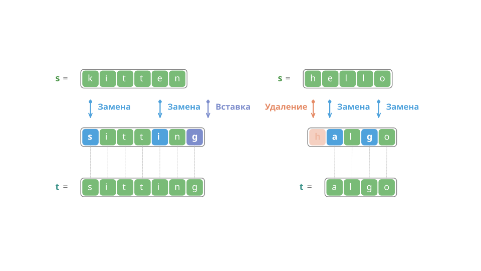{ class="animation-figure" }

<p align="center"> Рисунок 14-27 &nbsp; Пример данных для задачи о редакционном расстоянии </p>

**Задачу о редакционном расстоянии удобно представить деревом решений**. Узел дерева — это строка, а ребро — один выбор, то есть одна правка.

Как показано на рисунке, без ограничений на операции из каждого узла выходит множество рёбер, по одному на каждую возможную правку. Поэтому из `hello` в `algo` ведёт много разных путей.

На языке дерева решений задача состоит в поиске кратчайшего пути между узлами `hello` и `algo`.

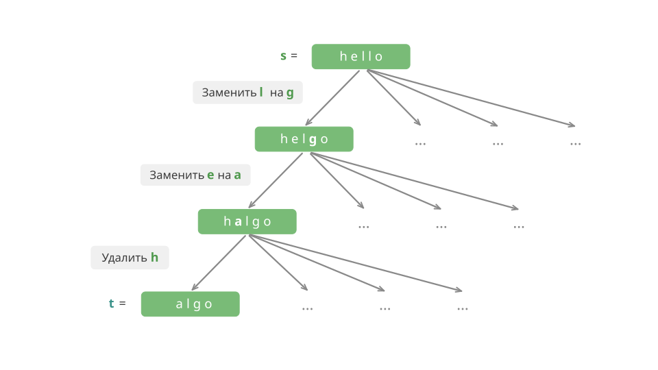{ class="animation-figure" }

<p align="center"> Рисунок 14-28 &nbsp; Задача о редакционном расстоянии в виде дерева решений </p>

### 1. &nbsp; Решение методом динамического программирования

**Шаг 1. Описать выбор на каждом шаге и определить состояния для таблицы $dp$**

На каждом шаге выбираем одну правку для строки $s$.

Чтобы выделить подзадачи, будем с каждой правкой уменьшать размер оставшейся задачи. Пусть строки $s$ и $t$ имеют длину $n$ и $m$ соответственно. Начнём с их последних символов $s[n-1]$ и $t[m-1]$.

- Если $s[n-1]$ и $t[m-1]$ совпадают, пропустим их и сразу перейдём к $s[n-2]$ и $t[m-2]$.
- Если $s[n-1]$ и $t[m-1]$ различаются, выполним над $s$ одну правку: вставку, удаление или замену. Так мы согласуем окончания строк и сможем перейти к меньшей задаче, отложив уже обработанные символы.

Каждая правка строки $s$ меняет то, какие символы в $s$ и $t$ остаётся сопоставить. Поэтому состояние зададим позициями рассматриваемых символов в строках $s$ и $t$ — соответственно $i$ и $j$. Обозначим его $[i, j]$.

Подзадача для состояния $[i, j]$: **найти минимальное число правок, превращающих префикс строки $s$ длины $i$ в префикс строки $t$ длины $j$**.

Получаем двумерную таблицу размера $(n+1) \times (m+1)$. Обозначим её $dp$.

**Шаг 2. Найти оптимальную подструктуру и вывести формулу перехода**

Рассмотрим подзадачу $dp[i, j]$. Последние символы её префиксов — $s[i-1]$ и $t[j-1]$. На рисунке показаны три случая, по одному для каждого вида правки.

1. Если после $s[i-1]$ вставить $t[j-1]$, останется подзадача $dp[i, j-1]$.
2. Если удалить $s[i-1]$, останется подзадача $dp[i-1, j]$.
3. Если заменить $s[i-1]$ на $t[j-1]$, останется подзадача $dp[i-1, j-1]$.

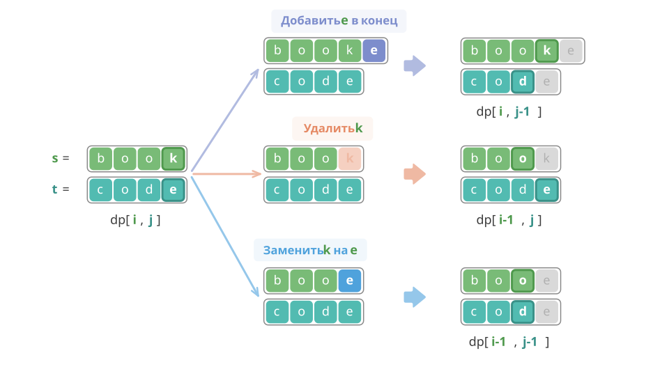{ class="animation-figure" }

<p align="center"> Рисунок 14-29 &nbsp; Переходы между состояниями для редакционного расстояния </p>

Получаем оптимальную подструктуру: для $dp[i, j]$ берём наименьшее из трёх чисел правок $dp[i, j-1]$, $dp[i-1, j]$, $dp[i-1, j-1]$ и прибавляем $1$ за текущую операцию. Соответствующая формула перехода:

$$
dp[i, j] = \min(dp[i, j-1], dp[i-1, j], dp[i-1, j-1]) + 1
$$

При этом **если $s[i-1]$ и $t[j-1]$ совпадают, текущий символ не требует правки**. В этом случае формула перехода имеет вид:

$$
dp[i, j] = dp[i-1, j-1]
$$

**Шаг 3. Определить граничные условия и порядок переходов**

Для двух пустых строк число правок равно $0$, то есть $dp[0, 0] = 0$. Если $s$ пуста, а $t$ нет, минимальное число правок равно длине $t$. Это задаёт первую строку: $dp[0, j] = j$. Если $s$ непуста, а $t$ пуста, требуется столько правок, какова длина $s$. Это задаёт первый столбец: $dp[i, 0] = i$.

По формуле перехода $dp[i, j]$ зависит от значений слева, сверху и по диагонали сверху слева. Поэтому достаточно обойти всю таблицу $dp$ в прямом порядке двумя вложенными циклами.

### 2. &nbsp; Реализация

=== "Python"

    ```python title="edit_distance.py"
    def edit_distance_dp(s: str, t: str) -> int:
        """Редакционное расстояние: динамическое программирование"""
        n, m = len(s), len(t)
        dp = [[0] * (m + 1) for _ in range(n + 1)]
        # Переход: первая строка и первый столбец
        for i in range(1, n + 1):
            dp[i][0] = i
        for j in range(1, m + 1):
            dp[0][j] = j
        # Переход: остальные строки и столбцы
        for i in range(1, n + 1):
            for j in range(1, m + 1):
                if s[i - 1] == t[j - 1]:
                    # Если символы совпадают, пропустить оба
                    dp[i][j] = dp[i - 1][j - 1]
                else:
                    # Минимум правок равен 1 плюс минимум по трём вариантам: вставка, удаление и замена
                    dp[i][j] = min(dp[i][j - 1], dp[i - 1][j], dp[i - 1][j - 1]) + 1
        return dp[n][m]
    ```

=== "C++"

    ```cpp title="edit_distance.cpp"
    /* Редакционное расстояние: динамическое программирование */
    int editDistanceDP(string s, string t) {
        int n = s.length(), m = t.length();
        vector<vector<int>> dp(n + 1, vector<int>(m + 1, 0));
        // Переход: первая строка и первый столбец
        for (int i = 1; i <= n; i++) {
            dp[i][0] = i;
        }
        for (int j = 1; j <= m; j++) {
            dp[0][j] = j;
        }
        // Переход: остальные строки и столбцы
        for (int i = 1; i <= n; i++) {
            for (int j = 1; j <= m; j++) {
                if (s[i - 1] == t[j - 1]) {
                    // Если символы совпадают, пропустить оба
                    dp[i][j] = dp[i - 1][j - 1];
                } else {
                    // Минимум правок равен 1 плюс минимум по трём вариантам: вставка, удаление и замена
                    dp[i][j] = min(min(dp[i][j - 1], dp[i - 1][j]), dp[i - 1][j - 1]) + 1;
                }
            }
        }
        return dp[n][m];
    }
    ```

=== "Java"

    ```java title="edit_distance.java"
    /* Редакционное расстояние: динамическое программирование */
    int editDistanceDP(String s, String t) {
        int n = s.length(), m = t.length();
        int[][] dp = new int[n + 1][m + 1];
        // Переход: первая строка и первый столбец
        for (int i = 1; i <= n; i++) {
            dp[i][0] = i;
        }
        for (int j = 1; j <= m; j++) {
            dp[0][j] = j;
        }
        // Переход: остальные строки и столбцы
        for (int i = 1; i <= n; i++) {
            for (int j = 1; j <= m; j++) {
                if (s.charAt(i - 1) == t.charAt(j - 1)) {
                    // Если символы совпадают, пропустить оба
                    dp[i][j] = dp[i - 1][j - 1];
                } else {
                    // Минимум правок равен 1 плюс минимум по трём вариантам: вставка, удаление и замена
                    dp[i][j] = Math.min(Math.min(dp[i][j - 1], dp[i - 1][j]), dp[i - 1][j - 1]) + 1;
                }
            }
        }
        return dp[n][m];
    }
    ```

=== "C#"

    ```csharp title="edit_distance.cs"
    /* Редакционное расстояние: динамическое программирование */
    int EditDistanceDP(string s, string t) {
        int n = s.Length, m = t.Length;
        int[,] dp = new int[n + 1, m + 1];
        // Переход: первая строка и первый столбец
        for (int i = 1; i <= n; i++) {
            dp[i, 0] = i;
        }
        for (int j = 1; j <= m; j++) {
            dp[0, j] = j;
        }
        // Переход: остальные строки и столбцы
        for (int i = 1; i <= n; i++) {
            for (int j = 1; j <= m; j++) {
                if (s[i - 1] == t[j - 1]) {
                    // Если символы совпадают, пропустить оба
                    dp[i, j] = dp[i - 1, j - 1];
                } else {
                    // Минимум правок равен 1 плюс минимум по трём вариантам: вставка, удаление и замена
                    dp[i, j] = Math.Min(Math.Min(dp[i, j - 1], dp[i - 1, j]), dp[i - 1, j - 1]) + 1;
                }
            }
        }
        return dp[n, m];
    }
    ```

=== "Go"

    ```go title="edit_distance.go"
    /* Редакционное расстояние: динамическое программирование */
    func editDistanceDP(s string, t string) int {
        n := len(s)
        m := len(t)
        dp := make([][]int, n+1)
        for i := 0; i <= n; i++ {
            dp[i] = make([]int, m+1)
        }
        // Переход: первая строка и первый столбец
        for i := 1; i <= n; i++ {
            dp[i][0] = i
        }
        for j := 1; j <= m; j++ {
            dp[0][j] = j
        }
        // Переход: остальные строки и столбцы
        for i := 1; i <= n; i++ {
            for j := 1; j <= m; j++ {
                if s[i-1] == t[j-1] {
                    // Если символы совпадают, пропустить оба
                    dp[i][j] = dp[i-1][j-1]
                } else {
                    // Минимум правок равен 1 плюс минимум по трём вариантам: вставка, удаление и замена
                    dp[i][j] = MinInt(MinInt(dp[i][j-1], dp[i-1][j]), dp[i-1][j-1]) + 1
                }
            }
        }
        return dp[n][m]
    }
    ```

=== "Swift"

    ```swift title="edit_distance.swift"
    /* Редакционное расстояние: динамическое программирование */
    func editDistanceDP(s: String, t: String) -> Int {
        let n = s.utf8CString.count
        let m = t.utf8CString.count
        var dp = Array(repeating: Array(repeating: 0, count: m + 1), count: n + 1)
        // Переход: первая строка и первый столбец
        for i in 1 ... n {
            dp[i][0] = i
        }
        for j in 1 ... m {
            dp[0][j] = j
        }
        // Переход: остальные строки и столбцы
        for i in 1 ... n {
            for j in 1 ... m {
                if s.utf8CString[i - 1] == t.utf8CString[j - 1] {
                    // Если символы совпадают, пропустить оба
                    dp[i][j] = dp[i - 1][j - 1]
                } else {
                    // Минимум правок равен 1 плюс минимум по трём вариантам: вставка, удаление и замена
                    dp[i][j] = min(min(dp[i][j - 1], dp[i - 1][j]), dp[i - 1][j - 1]) + 1
                }
            }
        }
        return dp[n][m]
    }
    ```

=== "JS"

    ```javascript title="edit_distance.js"
    /* Редакционное расстояние: динамическое программирование */
    function editDistanceDP(s, t) {
        const n = s.length,
            m = t.length;
        const dp = Array.from({ length: n + 1 }, () => new Array(m + 1).fill(0));
        // Переход: первая строка и первый столбец
        for (let i = 1; i <= n; i++) {
            dp[i][0] = i;
        }
        for (let j = 1; j <= m; j++) {
            dp[0][j] = j;
        }
        // Переход: остальные строки и столбцы
        for (let i = 1; i <= n; i++) {
            for (let j = 1; j <= m; j++) {
                if (s.charAt(i - 1) === t.charAt(j - 1)) {
                    // Если символы совпадают, пропустить оба
                    dp[i][j] = dp[i - 1][j - 1];
                } else {
                    // Минимум правок равен 1 плюс минимум по трём вариантам: вставка, удаление и замена
                    dp[i][j] =
                        Math.min(dp[i][j - 1], dp[i - 1][j], dp[i - 1][j - 1]) + 1;
                }
            }
        }
        return dp[n][m];
    }
    ```

=== "TS"

    ```typescript title="edit_distance.ts"
    /* Редакционное расстояние: динамическое программирование */
    function editDistanceDP(s: string, t: string): number {
        const n = s.length,
            m = t.length;
        const dp = Array.from({ length: n + 1 }, () =>
            Array.from({ length: m + 1 }, () => 0)
        );
        // Переход: первая строка и первый столбец
        for (let i = 1; i <= n; i++) {
            dp[i][0] = i;
        }
        for (let j = 1; j <= m; j++) {
            dp[0][j] = j;
        }
        // Переход: остальные строки и столбцы
        for (let i = 1; i <= n; i++) {
            for (let j = 1; j <= m; j++) {
                if (s.charAt(i - 1) === t.charAt(j - 1)) {
                    // Если символы совпадают, пропустить оба
                    dp[i][j] = dp[i - 1][j - 1];
                } else {
                    // Минимум правок равен 1 плюс минимум по трём вариантам: вставка, удаление и замена
                    dp[i][j] =
                        Math.min(dp[i][j - 1], dp[i - 1][j], dp[i - 1][j - 1]) + 1;
                }
            }
        }
        return dp[n][m];
    }
    ```

=== "Dart"

    ```dart title="edit_distance.dart"
    /* Редакционное расстояние: динамическое программирование */
    int editDistanceDP(String s, String t) {
      int n = s.length, m = t.length;
      List<List<int>> dp = List.generate(n + 1, (_) => List.filled(m + 1, 0));
      // Переход: первая строка и первый столбец
      for (int i = 1; i <= n; i++) {
        dp[i][0] = i;
      }
      for (int j = 1; j <= m; j++) {
        dp[0][j] = j;
      }
      // Переход: остальные строки и столбцы
      for (int i = 1; i <= n; i++) {
        for (int j = 1; j <= m; j++) {
          if (s[i - 1] == t[j - 1]) {
            // Если символы совпадают, пропустить оба
            dp[i][j] = dp[i - 1][j - 1];
          } else {
            // Минимум правок равен 1 плюс минимум по трём вариантам: вставка, удаление и замена
            dp[i][j] = min(min(dp[i][j - 1], dp[i - 1][j]), dp[i - 1][j - 1]) + 1;
          }
        }
      }
      return dp[n][m];
    }
    ```

=== "Rust"

    ```rust title="edit_distance.rs"
    /* Редакционное расстояние: динамическое программирование */
    fn edit_distance_dp(s: &str, t: &str) -> i32 {
        let (n, m) = (s.len(), t.len());
        let mut dp = vec![vec![0; m + 1]; n + 1];
        // Переход: первая строка и первый столбец
        for i in 1..=n {
            dp[i][0] = i as i32;
        }
        for j in 1..m {
            dp[0][j] = j as i32;
        }
        // Переход: остальные строки и столбцы
        for i in 1..=n {
            for j in 1..=m {
                if s.chars().nth(i - 1) == t.chars().nth(j - 1) {
                    // Если символы совпадают, пропустить оба
                    dp[i][j] = dp[i - 1][j - 1];
                } else {
                    // Минимум правок равен 1 плюс минимум по трём вариантам: вставка, удаление и замена
                    dp[i][j] =
                        std::cmp::min(std::cmp::min(dp[i][j - 1], dp[i - 1][j]), dp[i - 1][j - 1]) + 1;
                }
            }
        }
        dp[n][m]
    }
    ```

=== "C"

    ```c title="edit_distance.c"
    /* Редакционное расстояние: динамическое программирование */
    int editDistanceDP(char *s, char *t, int n, int m) {
        int **dp = malloc((n + 1) * sizeof(int *));
        for (int i = 0; i <= n; i++) {
            dp[i] = calloc(m + 1, sizeof(int));
        }
        // Переход: первая строка и первый столбец
        for (int i = 1; i <= n; i++) {
            dp[i][0] = i;
        }
        for (int j = 1; j <= m; j++) {
            dp[0][j] = j;
        }
        // Переход: остальные строки и столбцы
        for (int i = 1; i <= n; i++) {
            for (int j = 1; j <= m; j++) {
                if (s[i - 1] == t[j - 1]) {
                    // Если символы совпадают, пропустить оба
                    dp[i][j] = dp[i - 1][j - 1];
                } else {
                    // Минимум правок равен 1 плюс минимум по трём вариантам: вставка, удаление и замена
                    dp[i][j] = myMin(myMin(dp[i][j - 1], dp[i - 1][j]), dp[i - 1][j - 1]) + 1;
                }
            }
        }
        int res = dp[n][m];
        // Освободить память
        for (int i = 0; i <= n; i++) {
            free(dp[i]);
        }
        return res;
    }
    ```

=== "Kotlin"

    ```kotlin title="edit_distance.kt"
    /* Редакционное расстояние: динамическое программирование */
    fun editDistanceDP(s: String, t: String): Int {
        val n = s.length
        val m = t.length
        val dp = Array(n + 1) { IntArray(m + 1) }
        // Переход: первая строка и первый столбец
        for (i in 1..n) {
            dp[i][0] = i
        }
        for (j in 1..m) {
            dp[0][j] = j
        }
        // Переход: остальные строки и столбцы
        for (i in 1..n) {
            for (j in 1..m) {
                if (s[i - 1] == t[j - 1]) {
                    // Если символы совпадают, пропустить оба
                    dp[i][j] = dp[i - 1][j - 1]
                } else {
                    // Минимум правок равен 1 плюс минимум по трём вариантам: вставка, удаление и замена
                    dp[i][j] = min(min(dp[i][j - 1], dp[i - 1][j]), dp[i - 1][j - 1]) + 1
                }
            }
        }
        return dp[n][m]
    }
    ```

=== "Ruby"

    ```ruby title="edit_distance.rb"
    ### Редакционное расстояние: динамическое программирование ###
    def edit_distance_dp(s, t)
      n, m = s.length, t.length
      dp = Array.new(n + 1) { Array.new(m + 1, 0) }
      # Переход: первая строка и первый столбец
      (1...(n + 1)).each { |i| dp[i][0] = i }
      (1...(m + 1)).each { |j| dp[0][j] = j }
      # Переход: остальные строки и столбцы
      for i in 1...(n + 1)
        for j in 1...(m +1)
          if s[i - 1] == t[j - 1]
            # Если символы совпадают, пропустить оба
            dp[i][j] = dp[i - 1][j - 1]
          else
            # Минимум правок равен 1 плюс минимум по трём вариантам: вставка, удаление и замена
            dp[i][j] = [dp[i][j - 1], dp[i - 1][j], dp[i - 1][j - 1]].min + 1
          end
        end
      end
      dp[n][m]
    end
    ```

??? pythontutor "Визуализация выполнения"

    <div style="height: 549px; width: 100%;"><iframe class="pythontutor-iframe" title="Визуализация выполнения" src="https://pythontutor.com/iframe-embed.html#code=def%20edit_distance_dp%28s%3A%20str,%20t%3A%20str%29%20-%3E%20int%3A%0A%20%20%20%20%22%22%22%D0%A0%D0%B5%D0%B4%D0%B0%D0%BA%D1%86%D0%B8%D0%BE%D0%BD%D0%BD%D0%BE%D0%B5%20%D1%80%D0%B0%D1%81%D1%81%D1%82%D0%BE%D1%8F%D0%BD%D0%B8%D0%B5%3A%20%D0%B4%D0%B8%D0%BD%D0%B0%D0%BC%D0%B8%D1%87%D0%B5%D1%81%D0%BA%D0%BE%D0%B5%20%D0%BF%D1%80%D0%BE%D0%B3%D1%80%D0%B0%D0%BC%D0%BC%D0%B8%D1%80%D0%BE%D0%B2%D0%B0%D0%BD%D0%B8%D0%B5%22%22%22%0A%20%20%20%20n,%20m%20%3D%20len%28s%29,%20len%28t%29%0A%20%20%20%20dp%20%3D%20%5B%5B0%5D%20%2A%20%28m%20%2B%201%29%20for%20_%20in%20range%28n%20%2B%201%29%5D%0A%20%20%20%20%23%20%D0%9F%D0%B5%D1%80%D0%B5%D1%85%D0%BE%D0%B4%3A%20%D0%BF%D0%B5%D1%80%D0%B2%D0%B0%D1%8F%20%D1%81%D1%82%D1%80%D0%BE%D0%BA%D0%B0%20%D0%B8%20%D0%BF%D0%B5%D1%80%D0%B2%D1%8B%D0%B9%20%D1%81%D1%82%D0%BE%D0%BB%D0%B1%D0%B5%D1%86%0A%20%20%20%20for%20i%20in%20range%281,%20n%20%2B%201%29%3A%0A%20%20%20%20%20%20%20%20dp%5Bi%5D%5B0%5D%20%3D%20i%0A%20%20%20%20for%20j%20in%20range%281,%20m%20%2B%201%29%3A%0A%20%20%20%20%20%20%20%20dp%5B0%5D%5Bj%5D%20%3D%20j%0A%20%20%20%20%23%20%D0%9F%D0%B5%D1%80%D0%B5%D1%85%D0%BE%D0%B4%3A%20%D0%BE%D1%81%D1%82%D0%B0%D0%BB%D1%8C%D0%BD%D1%8B%D0%B5%20%D1%81%D1%82%D1%80%D0%BE%D0%BA%D0%B8%20%D0%B8%20%D1%81%D1%82%D0%BE%D0%BB%D0%B1%D1%86%D1%8B%0A%20%20%20%20for%20i%20in%20range%281,%20n%20%2B%201%29%3A%0A%20%20%20%20%20%20%20%20for%20j%20in%20range%281,%20m%20%2B%201%29%3A%0A%20%20%20%20%20%20%20%20%20%20%20%20if%20s%5Bi%20-%201%5D%20%3D%3D%20t%5Bj%20-%201%5D%3A%0A%20%20%20%20%20%20%20%20%20%20%20%20%20%20%20%20%23%20%D0%95%D1%81%D0%BB%D0%B8%20%D1%81%D0%B8%D0%BC%D0%B2%D0%BE%D0%BB%D1%8B%20%D1%81%D0%BE%D0%B2%D0%BF%D0%B0%D0%B4%D0%B0%D1%8E%D1%82,%20%D0%BF%D1%80%D0%BE%D0%BF%D1%83%D1%81%D1%82%D0%B8%D1%82%D1%8C%20%D0%BE%D0%B1%D0%B0%0A%20%20%20%20%20%20%20%20%20%20%20%20%20%20%20%20dp%5Bi%5D%5Bj%5D%20%3D%20dp%5Bi%20-%201%5D%5Bj%20-%201%5D%0A%20%20%20%20%20%20%20%20%20%20%20%20else%3A%0A%20%20%20%20%20%20%20%20%20%20%20%20%20%20%20%20%23%20%D0%9C%D0%B8%D0%BD%D0%B8%D0%BC%D1%83%D0%BC%20%D0%BF%D1%80%D0%B0%D0%B2%D0%BE%D0%BA%20%D1%80%D0%B0%D0%B2%D0%B5%D0%BD%201%20%D0%BF%D0%BB%D1%8E%D1%81%20%D0%BC%D0%B8%D0%BD%D0%B8%D0%BC%D1%83%D0%BC%20%D0%BF%D0%BE%20%D1%82%D1%80%D1%91%D0%BC%20%D0%B2%D0%B0%D1%80%D0%B8%D0%B0%D0%BD%D1%82%D0%B0%D0%BC%3A%20%D0%B2%D1%81%D1%82%D0%B0%D0%B2%D0%BA%D0%B0,%20%D1%83%D0%B4%D0%B0%D0%BB%D0%B5%D0%BD%D0%B8%D0%B5%20%D0%B8%20%D0%B7%D0%B0%D0%BC%D0%B5%D0%BD%D0%B0%0A%20%20%20%20%20%20%20%20%20%20%20%20%20%20%20%20dp%5Bi%5D%5Bj%5D%20%3D%20min%28dp%5Bi%5D%5Bj%20-%201%5D,%20dp%5Bi%20-%201%5D%5Bj%5D,%20dp%5Bi%20-%201%5D%5Bj%20-%201%5D%29%20%2B%201%0A%20%20%20%20return%20dp%5Bn%5D%5Bm%5D%0A%0A%0A%22%22%22Driver%20Code%22%22%22%0Aif%20__name__%20%3D%3D%20%22__main__%22%3A%0A%20%20%20%20s%20%3D%20%22bag%22%0A%20%20%20%20t%20%3D%20%22pack%22%0A%20%20%20%20n,%20m%20%3D%20len%28s%29,%20len%28t%29%0A%0A%20%20%20%20%23%20%D0%94%D0%B8%D0%BD%D0%B0%D0%BC%D0%B8%D1%87%D0%B5%D1%81%D0%BA%D0%BE%D0%B5%20%D0%BF%D1%80%D0%BE%D0%B3%D1%80%D0%B0%D0%BC%D0%BC%D0%B8%D1%80%D0%BE%D0%B2%D0%B0%D0%BD%D0%B8%D0%B5%0A%20%20%20%20res%20%3D%20edit_distance_dp%28s,%20t%29%0A%20%20%20%20print%28f%22%D0%94%D0%BB%D1%8F%20%D0%BF%D1%80%D0%B5%D0%BE%D0%B1%D1%80%D0%B0%D0%B7%D0%BE%D0%B2%D0%B0%D0%BD%D0%B8%D1%8F%20%7Bs%7D%20%D0%B2%20%7Bt%7D%20%D1%82%D1%80%D0%B5%D0%B1%D1%83%D0%B5%D1%82%D1%81%D1%8F%20%D0%BC%D0%B8%D0%BD%D0%B8%D0%BC%D1%83%D0%BC%20%D0%BF%D1%80%D0%B0%D0%B2%D0%BE%D0%BA%3A%20%7Bres%7D.%22%29&codeDivHeight=472&codeDivWidth=350&cumulative=false&curInstr=6&heapPrimitives=nevernest&origin=opt-frontend.js&py=311&rawInputLstJSON=%5B%5D&textReferences=false"> </iframe></div>
    <div style="margin-top: 5px;"><a href="https://pythontutor.com/iframe-embed.html#code=def%20edit_distance_dp%28s%3A%20str,%20t%3A%20str%29%20-%3E%20int%3A%0A%20%20%20%20%22%22%22%D0%A0%D0%B5%D0%B4%D0%B0%D0%BA%D1%86%D0%B8%D0%BE%D0%BD%D0%BD%D0%BE%D0%B5%20%D1%80%D0%B0%D1%81%D1%81%D1%82%D0%BE%D1%8F%D0%BD%D0%B8%D0%B5%3A%20%D0%B4%D0%B8%D0%BD%D0%B0%D0%BC%D0%B8%D1%87%D0%B5%D1%81%D0%BA%D0%BE%D0%B5%20%D0%BF%D1%80%D0%BE%D0%B3%D1%80%D0%B0%D0%BC%D0%BC%D0%B8%D1%80%D0%BE%D0%B2%D0%B0%D0%BD%D0%B8%D0%B5%22%22%22%0A%20%20%20%20n,%20m%20%3D%20len%28s%29,%20len%28t%29%0A%20%20%20%20dp%20%3D%20%5B%5B0%5D%20%2A%20%28m%20%2B%201%29%20for%20_%20in%20range%28n%20%2B%201%29%5D%0A%20%20%20%20%23%20%D0%9F%D0%B5%D1%80%D0%B5%D1%85%D0%BE%D0%B4%3A%20%D0%BF%D0%B5%D1%80%D0%B2%D0%B0%D1%8F%20%D1%81%D1%82%D1%80%D0%BE%D0%BA%D0%B0%20%D0%B8%20%D0%BF%D0%B5%D1%80%D0%B2%D1%8B%D0%B9%20%D1%81%D1%82%D0%BE%D0%BB%D0%B1%D0%B5%D1%86%0A%20%20%20%20for%20i%20in%20range%281,%20n%20%2B%201%29%3A%0A%20%20%20%20%20%20%20%20dp%5Bi%5D%5B0%5D%20%3D%20i%0A%20%20%20%20for%20j%20in%20range%281,%20m%20%2B%201%29%3A%0A%20%20%20%20%20%20%20%20dp%5B0%5D%5Bj%5D%20%3D%20j%0A%20%20%20%20%23%20%D0%9F%D0%B5%D1%80%D0%B5%D1%85%D0%BE%D0%B4%3A%20%D0%BE%D1%81%D1%82%D0%B0%D0%BB%D1%8C%D0%BD%D1%8B%D0%B5%20%D1%81%D1%82%D1%80%D0%BE%D0%BA%D0%B8%20%D0%B8%20%D1%81%D1%82%D0%BE%D0%BB%D0%B1%D1%86%D1%8B%0A%20%20%20%20for%20i%20in%20range%281,%20n%20%2B%201%29%3A%0A%20%20%20%20%20%20%20%20for%20j%20in%20range%281,%20m%20%2B%201%29%3A%0A%20%20%20%20%20%20%20%20%20%20%20%20if%20s%5Bi%20-%201%5D%20%3D%3D%20t%5Bj%20-%201%5D%3A%0A%20%20%20%20%20%20%20%20%20%20%20%20%20%20%20%20%23%20%D0%95%D1%81%D0%BB%D0%B8%20%D1%81%D0%B8%D0%BC%D0%B2%D0%BE%D0%BB%D1%8B%20%D1%81%D0%BE%D0%B2%D0%BF%D0%B0%D0%B4%D0%B0%D1%8E%D1%82,%20%D0%BF%D1%80%D0%BE%D0%BF%D1%83%D1%81%D1%82%D0%B8%D1%82%D1%8C%20%D0%BE%D0%B1%D0%B0%0A%20%20%20%20%20%20%20%20%20%20%20%20%20%20%20%20dp%5Bi%5D%5Bj%5D%20%3D%20dp%5Bi%20-%201%5D%5Bj%20-%201%5D%0A%20%20%20%20%20%20%20%20%20%20%20%20else%3A%0A%20%20%20%20%20%20%20%20%20%20%20%20%20%20%20%20%23%20%D0%9C%D0%B8%D0%BD%D0%B8%D0%BC%D1%83%D0%BC%20%D0%BF%D1%80%D0%B0%D0%B2%D0%BE%D0%BA%20%D1%80%D0%B0%D0%B2%D0%B5%D0%BD%201%20%D0%BF%D0%BB%D1%8E%D1%81%20%D0%BC%D0%B8%D0%BD%D0%B8%D0%BC%D1%83%D0%BC%20%D0%BF%D0%BE%20%D1%82%D1%80%D1%91%D0%BC%20%D0%B2%D0%B0%D1%80%D0%B8%D0%B0%D0%BD%D1%82%D0%B0%D0%BC%3A%20%D0%B2%D1%81%D1%82%D0%B0%D0%B2%D0%BA%D0%B0,%20%D1%83%D0%B4%D0%B0%D0%BB%D0%B5%D0%BD%D0%B8%D0%B5%20%D0%B8%20%D0%B7%D0%B0%D0%BC%D0%B5%D0%BD%D0%B0%0A%20%20%20%20%20%20%20%20%20%20%20%20%20%20%20%20dp%5Bi%5D%5Bj%5D%20%3D%20min%28dp%5Bi%5D%5Bj%20-%201%5D,%20dp%5Bi%20-%201%5D%5Bj%5D,%20dp%5Bi%20-%201%5D%5Bj%20-%201%5D%29%20%2B%201%0A%20%20%20%20return%20dp%5Bn%5D%5Bm%5D%0A%0A%0A%22%22%22Driver%20Code%22%22%22%0Aif%20__name__%20%3D%3D%20%22__main__%22%3A%0A%20%20%20%20s%20%3D%20%22bag%22%0A%20%20%20%20t%20%3D%20%22pack%22%0A%20%20%20%20n,%20m%20%3D%20len%28s%29,%20len%28t%29%0A%0A%20%20%20%20%23%20%D0%94%D0%B8%D0%BD%D0%B0%D0%BC%D0%B8%D1%87%D0%B5%D1%81%D0%BA%D0%BE%D0%B5%20%D0%BF%D1%80%D0%BE%D0%B3%D1%80%D0%B0%D0%BC%D0%BC%D0%B8%D1%80%D0%BE%D0%B2%D0%B0%D0%BD%D0%B8%D0%B5%0A%20%20%20%20res%20%3D%20edit_distance_dp%28s,%20t%29%0A%20%20%20%20print%28f%22%D0%94%D0%BB%D1%8F%20%D0%BF%D1%80%D0%B5%D0%BE%D0%B1%D1%80%D0%B0%D0%B7%D0%BE%D0%B2%D0%B0%D0%BD%D0%B8%D1%8F%20%7Bs%7D%20%D0%B2%20%7Bt%7D%20%D1%82%D1%80%D0%B5%D0%B1%D1%83%D0%B5%D1%82%D1%81%D1%8F%20%D0%BC%D0%B8%D0%BD%D0%B8%D0%BC%D1%83%D0%BC%20%D0%BF%D1%80%D0%B0%D0%B2%D0%BE%D0%BA%3A%20%7Bres%7D.%22%29&codeDivHeight=800&codeDivWidth=600&cumulative=false&curInstr=6&heapPrimitives=nevernest&origin=opt-frontend.js&py=311&rawInputLstJSON=%5B%5D&textReferences=false" target="_blank" rel="noopener noreferrer">Во весь экран ></a></div>

Как видно на рисунке, переходы в задаче о редакционном расстоянии очень похожи на переходы в задаче о рюкзаке: в обоих случаях мы заполняем двумерную таблицу.

=== "<1>"
    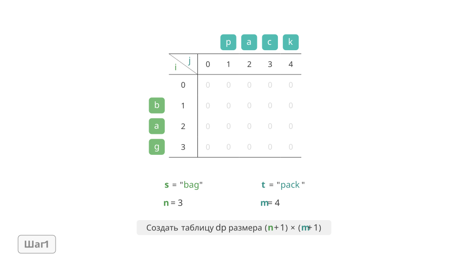{ class="animation-figure" }

=== "<2>"
    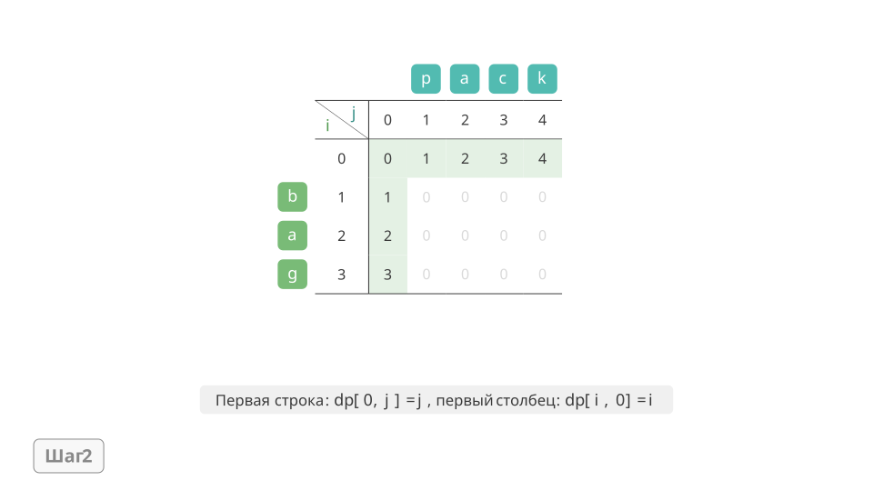{ class="animation-figure" }

=== "<3>"
    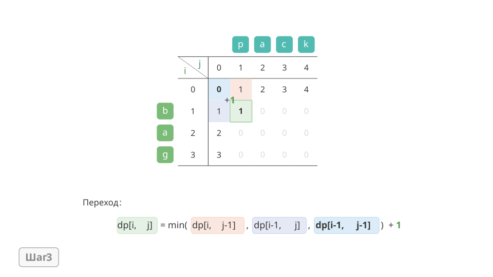{ class="animation-figure" }

=== "<4>"
    { class="animation-figure" }

=== "<5>"
    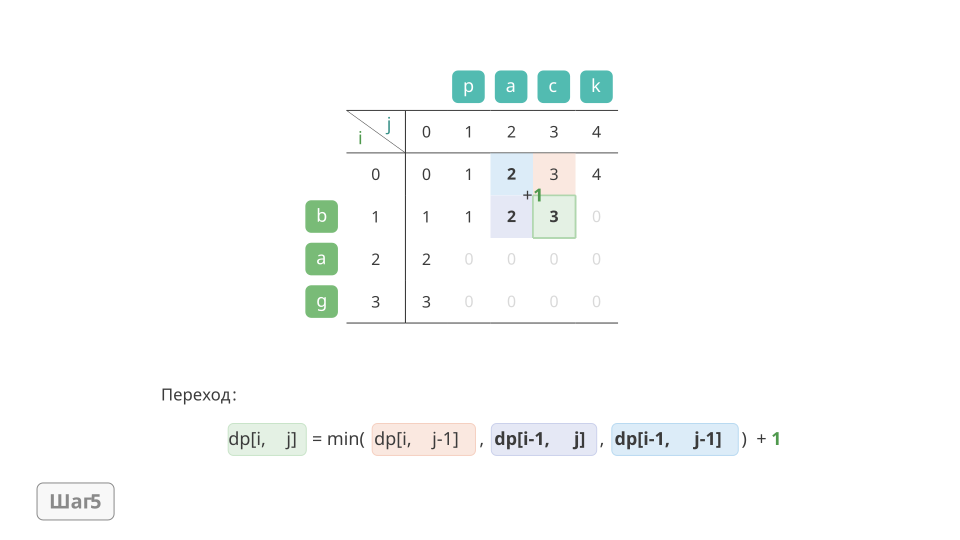{ class="animation-figure" }

=== "<6>"
    { class="animation-figure" }

=== "<7>"
    { class="animation-figure" }

=== "<8>"
    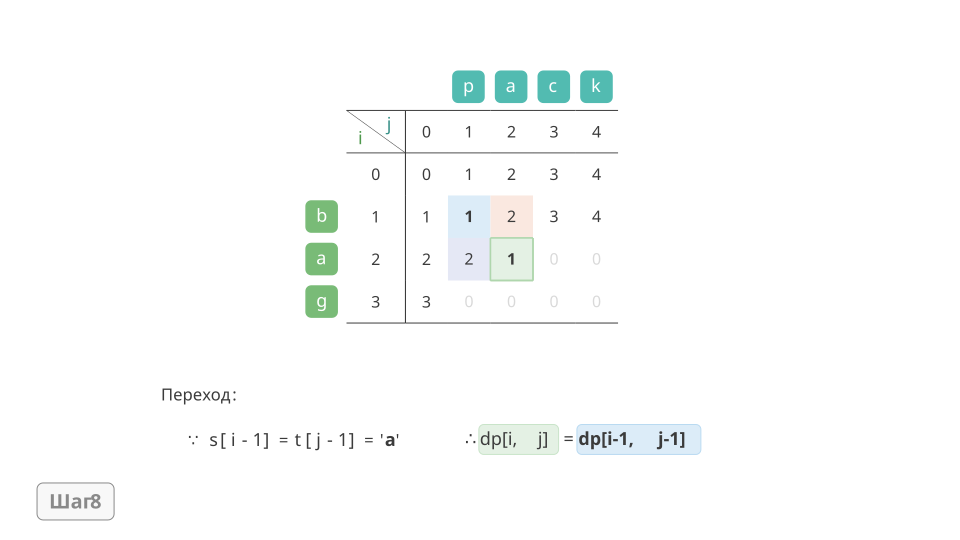{ class="animation-figure" }

=== "<9>"
    { class="animation-figure" }

=== "<10>"
    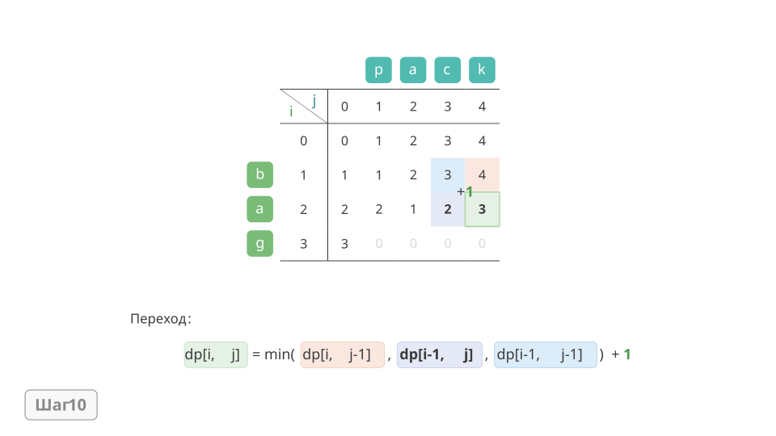{ class="animation-figure" }

=== "<11>"
    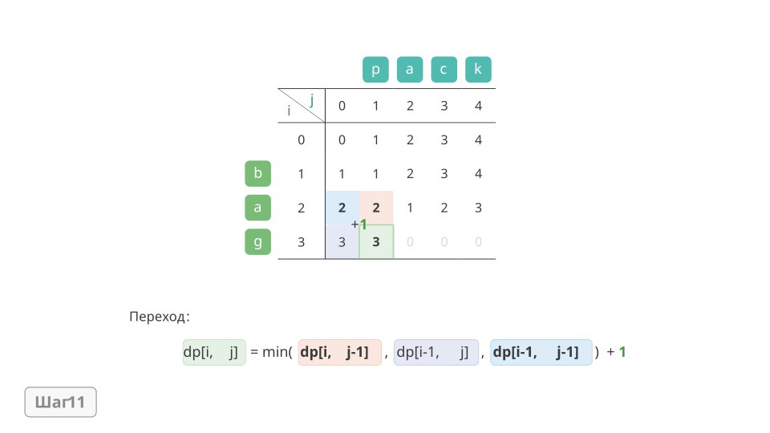{ class="animation-figure" }

=== "<12>"
    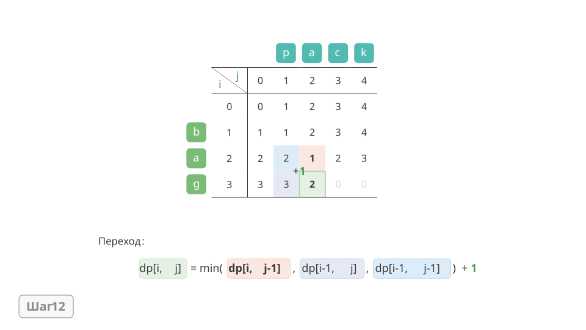{ class="animation-figure" }

=== "<13>"
    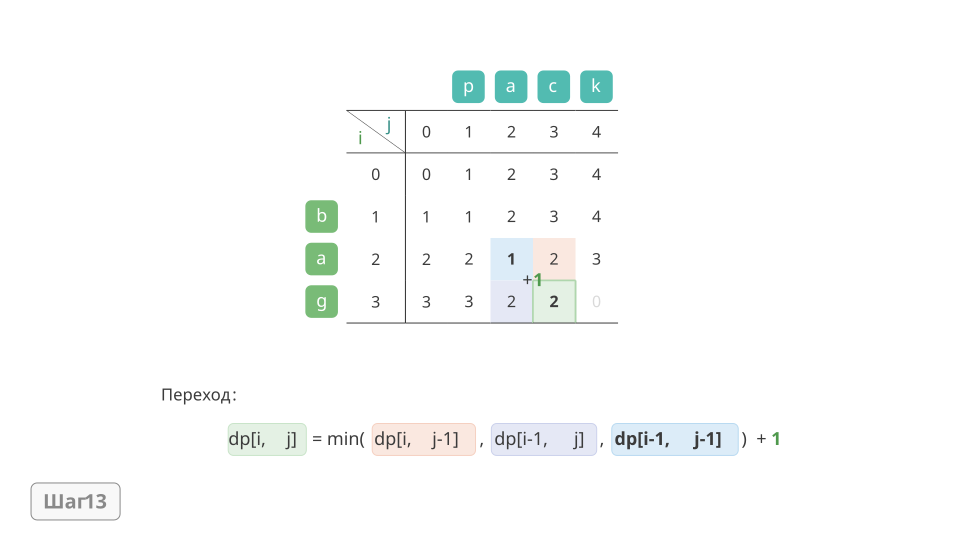{ class="animation-figure" }

=== "<14>"
    { class="animation-figure" }

=== "<15>"
    { class="animation-figure" }

<p align="center"> Рисунок 14-30 &nbsp; Вычисление редакционного расстояния методом динамического программирования </p>

### 3. &nbsp; Экономия памяти

Значение $dp[i,j]$ зависит от ячеек сверху $dp[i-1, j]$, слева $dp[i, j-1]$ и сверху слева $dp[i-1, j-1]$. При прямом обходе мы потеряем значение по диагонали $dp[i-1, j-1]$, а при обратном не успеем вычислить $dp[i, j-1]$. Поэтому ни один из этих порядков сам по себе не подходит.

Сохраним в переменной `leftup` значение по диагонали $dp[i-1, j-1]$. Тогда в массиве достаточно следить за значениями слева и сверху. Как и в задаче о неограниченном рюкзаке, теперь подходит прямой обход:

=== "Python"

    ```python title="edit_distance.py"
    def edit_distance_dp_comp(s: str, t: str) -> int:
        """Редакционное расстояние: динамическое программирование с экономией памяти"""
        n, m = len(s), len(t)
        dp = [0] * (m + 1)
        # Переход: первая строка
        for j in range(1, m + 1):
            dp[j] = j
        # Переход: остальные строки
        for i in range(1, n + 1):
            # Переход: первый столбец
            leftup = dp[0]  # Временно сохранить dp[i-1, j-1]
            dp[0] += 1
            # Переход: остальные столбцы
            for j in range(1, m + 1):
                temp = dp[j]
                if s[i - 1] == t[j - 1]:
                    # Если символы совпадают, пропустить оба
                    dp[j] = leftup
                else:
                    # Минимум правок равен 1 плюс минимум по трём вариантам: вставка, удаление и замена
                    dp[j] = min(dp[j - 1], dp[j], leftup) + 1
                leftup = temp  # Обновить значение dp[i-1, j-1] для следующей итерации
        return dp[m]
    ```

=== "C++"

    ```cpp title="edit_distance.cpp"
    /* Редакционное расстояние: динамическое программирование с экономией памяти */
    int editDistanceDPComp(string s, string t) {
        int n = s.length(), m = t.length();
        vector<int> dp(m + 1, 0);
        // Переход: первая строка
        for (int j = 1; j <= m; j++) {
            dp[j] = j;
        }
        // Переход: остальные строки
        for (int i = 1; i <= n; i++) {
            // Переход: первый столбец
            int leftup = dp[0]; // Временно сохранить dp[i-1, j-1]
            dp[0] = i;
            // Переход: остальные столбцы
            for (int j = 1; j <= m; j++) {
                int temp = dp[j];
                if (s[i - 1] == t[j - 1]) {
                    // Если символы совпадают, пропустить оба
                    dp[j] = leftup;
                } else {
                    // Минимум правок равен 1 плюс минимум по трём вариантам: вставка, удаление и замена
                    dp[j] = min(min(dp[j - 1], dp[j]), leftup) + 1;
                }
                leftup = temp; // Обновить значение dp[i-1, j-1] для следующей итерации
            }
        }
        return dp[m];
    }
    ```

=== "Java"

    ```java title="edit_distance.java"
    /* Редакционное расстояние: динамическое программирование с экономией памяти */
    int editDistanceDPComp(String s, String t) {
        int n = s.length(), m = t.length();
        int[] dp = new int[m + 1];
        // Переход: первая строка
        for (int j = 1; j <= m; j++) {
            dp[j] = j;
        }
        // Переход: остальные строки
        for (int i = 1; i <= n; i++) {
            // Переход: первый столбец
            int leftup = dp[0]; // Временно сохранить dp[i-1, j-1]
            dp[0] = i;
            // Переход: остальные столбцы
            for (int j = 1; j <= m; j++) {
                int temp = dp[j];
                if (s.charAt(i - 1) == t.charAt(j - 1)) {
                    // Если символы совпадают, пропустить оба
                    dp[j] = leftup;
                } else {
                    // Минимум правок равен 1 плюс минимум по трём вариантам: вставка, удаление и замена
                    dp[j] = Math.min(Math.min(dp[j - 1], dp[j]), leftup) + 1;
                }
                leftup = temp; // Обновить значение dp[i-1, j-1] для следующей итерации
            }
        }
        return dp[m];
    }
    ```

=== "C#"

    ```csharp title="edit_distance.cs"
    /* Редакционное расстояние: динамическое программирование с экономией памяти */
    int EditDistanceDPComp(string s, string t) {
        int n = s.Length, m = t.Length;
        int[] dp = new int[m + 1];
        // Переход: первая строка
        for (int j = 1; j <= m; j++) {
            dp[j] = j;
        }
        // Переход: остальные строки
        for (int i = 1; i <= n; i++) {
            // Переход: первый столбец
            int leftup = dp[0]; // Временно сохранить dp[i-1, j-1]
            dp[0] = i;
            // Переход: остальные столбцы
            for (int j = 1; j <= m; j++) {
                int temp = dp[j];
                if (s[i - 1] == t[j - 1]) {
                    // Если символы совпадают, пропустить оба
                    dp[j] = leftup;
                } else {
                    // Минимум правок равен 1 плюс минимум по трём вариантам: вставка, удаление и замена
                    dp[j] = Math.Min(Math.Min(dp[j - 1], dp[j]), leftup) + 1;
                }
                leftup = temp; // Обновить значение dp[i-1, j-1] для следующей итерации
            }
        }
        return dp[m];
    }
    ```

=== "Go"

    ```go title="edit_distance.go"
    /* Редакционное расстояние: динамическое программирование с экономией памяти */
    func editDistanceDPComp(s string, t string) int {
        n := len(s)
        m := len(t)
        dp := make([]int, m+1)
        // Переход: первая строка
        for j := 1; j <= m; j++ {
            dp[j] = j
        }
        // Переход: остальные строки
        for i := 1; i <= n; i++ {
            // Переход: первый столбец
            leftUp := dp[0] // Временно сохранить dp[i-1, j-1]
            dp[0] = i
            // Переход: остальные столбцы
            for j := 1; j <= m; j++ {
                temp := dp[j]
                if s[i-1] == t[j-1] {
                    // Если символы совпадают, пропустить оба
                    dp[j] = leftUp
                } else {
                    // Минимум правок равен 1 плюс минимум по трём вариантам: вставка, удаление и замена
                    dp[j] = MinInt(MinInt(dp[j-1], dp[j]), leftUp) + 1
                }
                leftUp = temp // Обновить значение dp[i-1, j-1] для следующей итерации
            }
        }
        return dp[m]
    }
    ```

=== "Swift"

    ```swift title="edit_distance.swift"
    /* Редакционное расстояние: динамическое программирование с экономией памяти */
    func editDistanceDPComp(s: String, t: String) -> Int {
        let n = s.utf8CString.count
        let m = t.utf8CString.count
        var dp = Array(repeating: 0, count: m + 1)
        // Переход: первая строка
        for j in 1 ... m {
            dp[j] = j
        }
        // Переход: остальные строки
        for i in 1 ... n {
            // Переход: первый столбец
            var leftup = dp[0] // Временно сохранить dp[i-1, j-1]
            dp[0] = i
            // Переход: остальные столбцы
            for j in 1 ... m {
                let temp = dp[j]
                if s.utf8CString[i - 1] == t.utf8CString[j - 1] {
                    // Если символы совпадают, пропустить оба
                    dp[j] = leftup
                } else {
                    // Минимум правок равен 1 плюс минимум по трём вариантам: вставка, удаление и замена
                    dp[j] = min(min(dp[j - 1], dp[j]), leftup) + 1
                }
                leftup = temp // Обновить значение dp[i-1, j-1] для следующей итерации
            }
        }
        return dp[m]
    }
    ```

=== "JS"

    ```javascript title="edit_distance.js"
    /* Редакционное расстояние: динамическое программирование с экономией памяти */
    function editDistanceDPComp(s, t) {
        const n = s.length,
            m = t.length;
        const dp = new Array(m + 1).fill(0);
        // Переход: первая строка
        for (let j = 1; j <= m; j++) {
            dp[j] = j;
        }
        // Переход: остальные строки
        for (let i = 1; i <= n; i++) {
            // Переход: первый столбец
            let leftup = dp[0]; // Временно сохранить dp[i-1, j-1]
            dp[0] = i;
            // Переход: остальные столбцы
            for (let j = 1; j <= m; j++) {
                const temp = dp[j];
                if (s.charAt(i - 1) === t.charAt(j - 1)) {
                    // Если символы совпадают, пропустить оба
                    dp[j] = leftup;
                } else {
                    // Минимум правок равен 1 плюс минимум по трём вариантам: вставка, удаление и замена
                    dp[j] = Math.min(dp[j - 1], dp[j], leftup) + 1;
                }
                leftup = temp; // Обновить значение dp[i-1, j-1] для следующей итерации
            }
        }
        return dp[m];
    }
    ```

=== "TS"

    ```typescript title="edit_distance.ts"
    /* Редакционное расстояние: динамическое программирование с экономией памяти */
    function editDistanceDPComp(s: string, t: string): number {
        const n = s.length,
            m = t.length;
        const dp = new Array(m + 1).fill(0);
        // Переход: первая строка
        for (let j = 1; j <= m; j++) {
            dp[j] = j;
        }
        // Переход: остальные строки
        for (let i = 1; i <= n; i++) {
            // Переход: первый столбец
            let leftup = dp[0]; // Временно сохранить dp[i-1, j-1]
            dp[0] = i;
            // Переход: остальные столбцы
            for (let j = 1; j <= m; j++) {
                const temp = dp[j];
                if (s.charAt(i - 1) === t.charAt(j - 1)) {
                    // Если символы совпадают, пропустить оба
                    dp[j] = leftup;
                } else {
                    // Минимум правок равен 1 плюс минимум по трём вариантам: вставка, удаление и замена
                    dp[j] = Math.min(dp[j - 1], dp[j], leftup) + 1;
                }
                leftup = temp; // Обновить значение dp[i-1, j-1] для следующей итерации
            }
        }
        return dp[m];
    }
    ```

=== "Dart"

    ```dart title="edit_distance.dart"
    /* Редакционное расстояние: динамическое программирование с экономией памяти */
    int editDistanceDPComp(String s, String t) {
      int n = s.length, m = t.length;
      List<int> dp = List.filled(m + 1, 0);
      // Переход: первая строка
      for (int j = 1; j <= m; j++) {
        dp[j] = j;
      }
      // Переход: остальные строки
      for (int i = 1; i <= n; i++) {
        // Переход: первый столбец
        int leftup = dp[0]; // Временно сохранить dp[i-1, j-1]
        dp[0] = i;
        // Переход: остальные столбцы
        for (int j = 1; j <= m; j++) {
          int temp = dp[j];
          if (s[i - 1] == t[j - 1]) {
            // Если символы совпадают, пропустить оба
            dp[j] = leftup;
          } else {
            // Минимум правок равен 1 плюс минимум по трём вариантам: вставка, удаление и замена
            dp[j] = min(min(dp[j - 1], dp[j]), leftup) + 1;
          }
          leftup = temp; // Обновить значение dp[i-1, j-1] для следующей итерации
        }
      }
      return dp[m];
    }
    ```

=== "Rust"

    ```rust title="edit_distance.rs"
    /* Редакционное расстояние: динамическое программирование с экономией памяти */
    fn edit_distance_dp_comp(s: &str, t: &str) -> i32 {
        let (n, m) = (s.len(), t.len());
        let mut dp = vec![0; m + 1];
        // Переход: первая строка
        for j in 1..m {
            dp[j] = j as i32;
        }
        // Переход: остальные строки
        for i in 1..=n {
            // Переход: первый столбец
            let mut leftup = dp[0]; // Временно сохранить dp[i-1, j-1]
            dp[0] = i as i32;
            // Переход: остальные столбцы
            for j in 1..=m {
                let temp = dp[j];
                if s.chars().nth(i - 1) == t.chars().nth(j - 1) {
                    // Если символы совпадают, пропустить оба
                    dp[j] = leftup;
                } else {
                    // Минимум правок равен 1 плюс минимум по трём вариантам: вставка, удаление и замена
                    dp[j] = std::cmp::min(std::cmp::min(dp[j - 1], dp[j]), leftup) + 1;
                }
                leftup = temp; // Обновить значение dp[i-1, j-1] для следующей итерации
            }
        }
        dp[m]
    }
    ```

=== "C"

    ```c title="edit_distance.c"
    /* Редакционное расстояние: динамическое программирование с экономией памяти */
    int editDistanceDPComp(char *s, char *t, int n, int m) {
        int *dp = calloc(m + 1, sizeof(int));
        // Переход: первая строка
        for (int j = 1; j <= m; j++) {
            dp[j] = j;
        }
        // Переход: остальные строки
        for (int i = 1; i <= n; i++) {
            // Переход: первый столбец
            int leftup = dp[0]; // Временно сохранить dp[i-1, j-1]
            dp[0] = i;
            // Переход: остальные столбцы
            for (int j = 1; j <= m; j++) {
                int temp = dp[j];
                if (s[i - 1] == t[j - 1]) {
                    // Если символы совпадают, пропустить оба
                    dp[j] = leftup;
                } else {
                    // Минимум правок равен 1 плюс минимум по трём вариантам: вставка, удаление и замена
                    dp[j] = myMin(myMin(dp[j - 1], dp[j]), leftup) + 1;
                }
                leftup = temp; // Обновить значение dp[i-1, j-1] для следующей итерации
            }
        }
        int res = dp[m];
        // Освободить память
        free(dp);
        return res;
    }
    ```

=== "Kotlin"

    ```kotlin title="edit_distance.kt"
    /* Редакционное расстояние: динамическое программирование с экономией памяти */
    fun editDistanceDPComp(s: String, t: String): Int {
        val n = s.length
        val m = t.length
        val dp = IntArray(m + 1)
        // Переход: первая строка
        for (j in 1..m) {
            dp[j] = j
        }
        // Переход: остальные строки
        for (i in 1..n) {
            // Переход: первый столбец
            var leftup = dp[0] // Временно сохранить dp[i-1, j-1]
            dp[0] = i
            // Переход: остальные столбцы
            for (j in 1..m) {
                val temp = dp[j]
                if (s[i - 1] == t[j - 1]) {
                    // Если символы совпадают, пропустить оба
                    dp[j] = leftup
                } else {
                    // Минимум правок равен 1 плюс минимум по трём вариантам: вставка, удаление и замена
                    dp[j] = min(min(dp[j - 1], dp[j]), leftup) + 1
                }
                leftup = temp // Обновить значение dp[i-1, j-1] для следующей итерации
            }
        }
        return dp[m]
    }
    ```

=== "Ruby"

    ```ruby title="edit_distance.rb"
    ### Редакционное расстояние: динамическое программирование с экономией памяти ###
    def edit_distance_dp_comp(s, t)
      n, m = s.length, t.length
      dp = Array.new(m + 1, 0)
      # Переход: первая строка
      (1...(m + 1)).each { |j| dp[j] = j }
      # Переход: остальные строки
      for i in 1...(n + 1)
        # Переход: первый столбец
        leftup = dp.first # Временно сохранить dp[i-1, j-1]
        dp[0] += 1
        # Переход: остальные столбцы
        for j in 1...(m + 1)
          temp = dp[j]
          if s[i - 1] == t[j - 1]
            # Если символы совпадают, пропустить оба
            dp[j] = leftup
          else
            # Минимум правок равен 1 плюс минимум по трём вариантам: вставка, удаление и замена
            dp[j] = [dp[j - 1], dp[j], leftup].min + 1
          end
          leftup = temp # Обновить значение dp[i-1, j-1] для следующей итерации
        end
      end
      dp[m]
    end
    ```

??? pythontutor "Визуализация выполнения"

    <div style="height: 549px; width: 100%;"><iframe class="pythontutor-iframe" title="Визуализация выполнения" src="https://pythontutor.com/iframe-embed.html#code=def%20edit_distance_dp_comp%28s%3A%20str,%20t%3A%20str%29%20-%3E%20int%3A%0A%20%20%20%20%22%22%22%D0%A0%D0%B5%D0%B4%D0%B0%D0%BA%D1%86%D0%B8%D0%BE%D0%BD%D0%BD%D0%BE%D0%B5%20%D1%80%D0%B0%D1%81%D1%81%D1%82%D0%BE%D1%8F%D0%BD%D0%B8%D0%B5%3A%20%D0%B4%D0%B8%D0%BD%D0%B0%D0%BC%D0%B8%D1%87%D0%B5%D1%81%D0%BA%D0%BE%D0%B5%20%D0%BF%D1%80%D0%BE%D0%B3%D1%80%D0%B0%D0%BC%D0%BC%D0%B8%D1%80%D0%BE%D0%B2%D0%B0%D0%BD%D0%B8%D0%B5%20%D1%81%20%D1%8D%D0%BA%D0%BE%D0%BD%D0%BE%D0%BC%D0%B8%D0%B5%D0%B9%20%D0%BF%D0%B0%D0%BC%D1%8F%D1%82%D0%B8%22%22%22%0A%20%20%20%20n,%20m%20%3D%20len%28s%29,%20len%28t%29%0A%20%20%20%20dp%20%3D%20%5B0%5D%20%2A%20%28m%20%2B%201%29%0A%20%20%20%20%23%20%D0%9F%D0%B5%D1%80%D0%B5%D1%85%D0%BE%D0%B4%3A%20%D0%BF%D0%B5%D1%80%D0%B2%D0%B0%D1%8F%20%D1%81%D1%82%D1%80%D0%BE%D0%BA%D0%B0%0A%20%20%20%20for%20j%20in%20range%281,%20m%20%2B%201%29%3A%0A%20%20%20%20%20%20%20%20dp%5Bj%5D%20%3D%20j%0A%20%20%20%20%23%20%D0%9F%D0%B5%D1%80%D0%B5%D1%85%D0%BE%D0%B4%3A%20%D0%BE%D1%81%D1%82%D0%B0%D0%BB%D1%8C%D0%BD%D1%8B%D0%B5%20%D1%81%D1%82%D1%80%D0%BE%D0%BA%D0%B8%0A%20%20%20%20for%20i%20in%20range%281,%20n%20%2B%201%29%3A%0A%20%20%20%20%20%20%20%20%23%20%D0%9F%D0%B5%D1%80%D0%B5%D1%85%D0%BE%D0%B4%3A%20%D0%BF%D0%B5%D1%80%D0%B2%D1%8B%D0%B9%20%D1%81%D1%82%D0%BE%D0%BB%D0%B1%D0%B5%D1%86%0A%20%20%20%20%20%20%20%20leftup%20%3D%20dp%5B0%5D%20%20%23%20%D0%92%D1%80%D0%B5%D0%BC%D0%B5%D0%BD%D0%BD%D0%BE%20%D1%81%D0%BE%D1%85%D1%80%D0%B0%D0%BD%D0%B8%D1%82%D1%8C%20dp%5Bi-1,%20j-1%5D%0A%20%20%20%20%20%20%20%20dp%5B0%5D%20%2B%3D%201%0A%20%20%20%20%20%20%20%20%23%20%D0%9F%D0%B5%D1%80%D0%B5%D1%85%D0%BE%D0%B4%3A%20%D0%BE%D1%81%D1%82%D0%B0%D0%BB%D1%8C%D0%BD%D1%8B%D0%B5%20%D1%81%D1%82%D0%BE%D0%BB%D0%B1%D1%86%D1%8B%0A%20%20%20%20%20%20%20%20for%20j%20in%20range%281,%20m%20%2B%201%29%3A%0A%20%20%20%20%20%20%20%20%20%20%20%20temp%20%3D%20dp%5Bj%5D%0A%20%20%20%20%20%20%20%20%20%20%20%20if%20s%5Bi%20-%201%5D%20%3D%3D%20t%5Bj%20-%201%5D%3A%0A%20%20%20%20%20%20%20%20%20%20%20%20%20%20%20%20%23%20%D0%95%D1%81%D0%BB%D0%B8%20%D1%81%D0%B8%D0%BC%D0%B2%D0%BE%D0%BB%D1%8B%20%D1%81%D0%BE%D0%B2%D0%BF%D0%B0%D0%B4%D0%B0%D1%8E%D1%82,%20%D0%BF%D1%80%D0%BE%D0%BF%D1%83%D1%81%D1%82%D0%B8%D1%82%D1%8C%20%D0%BE%D0%B1%D0%B0%0A%20%20%20%20%20%20%20%20%20%20%20%20%20%20%20%20dp%5Bj%5D%20%3D%20leftup%0A%20%20%20%20%20%20%20%20%20%20%20%20else%3A%0A%20%20%20%20%20%20%20%20%20%20%20%20%20%20%20%20%23%20%D0%9C%D0%B8%D0%BD%D0%B8%D0%BC%D1%83%D0%BC%20%D0%BF%D1%80%D0%B0%D0%B2%D0%BE%D0%BA%20%D1%80%D0%B0%D0%B2%D0%B5%D0%BD%201%20%D0%BF%D0%BB%D1%8E%D1%81%20%D0%BC%D0%B8%D0%BD%D0%B8%D0%BC%D1%83%D0%BC%20%D0%BF%D0%BE%20%D1%82%D1%80%D1%91%D0%BC%20%D0%B2%D0%B0%D1%80%D0%B8%D0%B0%D0%BD%D1%82%D0%B0%D0%BC%3A%20%D0%B2%D1%81%D1%82%D0%B0%D0%B2%D0%BA%D0%B0,%20%D1%83%D0%B4%D0%B0%D0%BB%D0%B5%D0%BD%D0%B8%D0%B5%20%D0%B8%20%D0%B7%D0%B0%D0%BC%D0%B5%D0%BD%D0%B0%0A%20%20%20%20%20%20%20%20%20%20%20%20%20%20%20%20dp%5Bj%5D%20%3D%20min%28dp%5Bj%20-%201%5D,%20dp%5Bj%5D,%20leftup%29%20%2B%201%0A%20%20%20%20%20%20%20%20%20%20%20%20leftup%20%3D%20temp%20%20%23%20%D0%9E%D0%B1%D0%BD%D0%BE%D0%B2%D0%B8%D1%82%D1%8C%20%D0%B7%D0%BD%D0%B0%D1%87%D0%B5%D0%BD%D0%B8%D0%B5%20dp%5Bi-1,%20j-1%5D%20%D0%B4%D0%BB%D1%8F%20%D1%81%D0%BB%D0%B5%D0%B4%D1%83%D1%8E%D1%89%D0%B5%D0%B9%20%D0%B8%D1%82%D0%B5%D1%80%D0%B0%D1%86%D0%B8%D0%B8%0A%20%20%20%20return%20dp%5Bm%5D%0A%0A%0A%22%22%22Driver%20Code%22%22%22%0Aif%20__name__%20%3D%3D%20%22__main__%22%3A%0A%20%20%20%20s%20%3D%20%22bag%22%0A%20%20%20%20t%20%3D%20%22pack%22%0A%20%20%20%20n,%20m%20%3D%20len%28s%29,%20len%28t%29%0A%0A%20%20%20%20%23%20%D0%94%D0%B8%D0%BD%D0%B0%D0%BC%D0%B8%D1%87%D0%B5%D1%81%D0%BA%D0%BE%D0%B5%20%D0%BF%D1%80%D0%BE%D0%B3%D1%80%D0%B0%D0%BC%D0%BC%D0%B8%D1%80%D0%BE%D0%B2%D0%B0%D0%BD%D0%B8%D0%B5%20%D1%81%20%D1%8D%D0%BA%D0%BE%D0%BD%D0%BE%D0%BC%D0%B8%D0%B5%D0%B9%20%D0%BF%D0%B0%D0%BC%D1%8F%D1%82%D0%B8%0A%20%20%20%20res%20%3D%20edit_distance_dp_comp%28s,%20t%29%0A%20%20%20%20print%28f%22%D0%94%D0%BB%D1%8F%20%D0%BF%D1%80%D0%B5%D0%BE%D0%B1%D1%80%D0%B0%D0%B7%D0%BE%D0%B2%D0%B0%D0%BD%D0%B8%D1%8F%20%7Bs%7D%20%D0%B2%20%7Bt%7D%20%D1%82%D1%80%D0%B5%D0%B1%D1%83%D0%B5%D1%82%D1%81%D1%8F%20%D0%BC%D0%B8%D0%BD%D0%B8%D0%BC%D1%83%D0%BC%20%D0%BF%D1%80%D0%B0%D0%B2%D0%BE%D0%BA%3A%20%7Bres%7D.%22%29&codeDivHeight=472&codeDivWidth=350&cumulative=false&curInstr=6&heapPrimitives=nevernest&origin=opt-frontend.js&py=311&rawInputLstJSON=%5B%5D&textReferences=false"> </iframe></div>
    <div style="margin-top: 5px;"><a href="https://pythontutor.com/iframe-embed.html#code=def%20edit_distance_dp_comp%28s%3A%20str,%20t%3A%20str%29%20-%3E%20int%3A%0A%20%20%20%20%22%22%22%D0%A0%D0%B5%D0%B4%D0%B0%D0%BA%D1%86%D0%B8%D0%BE%D0%BD%D0%BD%D0%BE%D0%B5%20%D1%80%D0%B0%D1%81%D1%81%D1%82%D0%BE%D1%8F%D0%BD%D0%B8%D0%B5%3A%20%D0%B4%D0%B8%D0%BD%D0%B0%D0%BC%D0%B8%D1%87%D0%B5%D1%81%D0%BA%D0%BE%D0%B5%20%D0%BF%D1%80%D0%BE%D0%B3%D1%80%D0%B0%D0%BC%D0%BC%D0%B8%D1%80%D0%BE%D0%B2%D0%B0%D0%BD%D0%B8%D0%B5%20%D1%81%20%D1%8D%D0%BA%D0%BE%D0%BD%D0%BE%D0%BC%D0%B8%D0%B5%D0%B9%20%D0%BF%D0%B0%D0%BC%D1%8F%D1%82%D0%B8%22%22%22%0A%20%20%20%20n,%20m%20%3D%20len%28s%29,%20len%28t%29%0A%20%20%20%20dp%20%3D%20%5B0%5D%20%2A%20%28m%20%2B%201%29%0A%20%20%20%20%23%20%D0%9F%D0%B5%D1%80%D0%B5%D1%85%D0%BE%D0%B4%3A%20%D0%BF%D0%B5%D1%80%D0%B2%D0%B0%D1%8F%20%D1%81%D1%82%D1%80%D0%BE%D0%BA%D0%B0%0A%20%20%20%20for%20j%20in%20range%281,%20m%20%2B%201%29%3A%0A%20%20%20%20%20%20%20%20dp%5Bj%5D%20%3D%20j%0A%20%20%20%20%23%20%D0%9F%D0%B5%D1%80%D0%B5%D1%85%D0%BE%D0%B4%3A%20%D0%BE%D1%81%D1%82%D0%B0%D0%BB%D1%8C%D0%BD%D1%8B%D0%B5%20%D1%81%D1%82%D1%80%D0%BE%D0%BA%D0%B8%0A%20%20%20%20for%20i%20in%20range%281,%20n%20%2B%201%29%3A%0A%20%20%20%20%20%20%20%20%23%20%D0%9F%D0%B5%D1%80%D0%B5%D1%85%D0%BE%D0%B4%3A%20%D0%BF%D0%B5%D1%80%D0%B2%D1%8B%D0%B9%20%D1%81%D1%82%D0%BE%D0%BB%D0%B1%D0%B5%D1%86%0A%20%20%20%20%20%20%20%20leftup%20%3D%20dp%5B0%5D%20%20%23%20%D0%92%D1%80%D0%B5%D0%BC%D0%B5%D0%BD%D0%BD%D0%BE%20%D1%81%D0%BE%D1%85%D1%80%D0%B0%D0%BD%D0%B8%D1%82%D1%8C%20dp%5Bi-1,%20j-1%5D%0A%20%20%20%20%20%20%20%20dp%5B0%5D%20%2B%3D%201%0A%20%20%20%20%20%20%20%20%23%20%D0%9F%D0%B5%D1%80%D0%B5%D1%85%D0%BE%D0%B4%3A%20%D0%BE%D1%81%D1%82%D0%B0%D0%BB%D1%8C%D0%BD%D1%8B%D0%B5%20%D1%81%D1%82%D0%BE%D0%BB%D0%B1%D1%86%D1%8B%0A%20%20%20%20%20%20%20%20for%20j%20in%20range%281,%20m%20%2B%201%29%3A%0A%20%20%20%20%20%20%20%20%20%20%20%20temp%20%3D%20dp%5Bj%5D%0A%20%20%20%20%20%20%20%20%20%20%20%20if%20s%5Bi%20-%201%5D%20%3D%3D%20t%5Bj%20-%201%5D%3A%0A%20%20%20%20%20%20%20%20%20%20%20%20%20%20%20%20%23%20%D0%95%D1%81%D0%BB%D0%B8%20%D1%81%D0%B8%D0%BC%D0%B2%D0%BE%D0%BB%D1%8B%20%D1%81%D0%BE%D0%B2%D0%BF%D0%B0%D0%B4%D0%B0%D1%8E%D1%82,%20%D0%BF%D1%80%D0%BE%D0%BF%D1%83%D1%81%D1%82%D0%B8%D1%82%D1%8C%20%D0%BE%D0%B1%D0%B0%0A%20%20%20%20%20%20%20%20%20%20%20%20%20%20%20%20dp%5Bj%5D%20%3D%20leftup%0A%20%20%20%20%20%20%20%20%20%20%20%20else%3A%0A%20%20%20%20%20%20%20%20%20%20%20%20%20%20%20%20%23%20%D0%9C%D0%B8%D0%BD%D0%B8%D0%BC%D1%83%D0%BC%20%D0%BF%D1%80%D0%B0%D0%B2%D0%BE%D0%BA%20%D1%80%D0%B0%D0%B2%D0%B5%D0%BD%201%20%D0%BF%D0%BB%D1%8E%D1%81%20%D0%BC%D0%B8%D0%BD%D0%B8%D0%BC%D1%83%D0%BC%20%D0%BF%D0%BE%20%D1%82%D1%80%D1%91%D0%BC%20%D0%B2%D0%B0%D1%80%D0%B8%D0%B0%D0%BD%D1%82%D0%B0%D0%BC%3A%20%D0%B2%D1%81%D1%82%D0%B0%D0%B2%D0%BA%D0%B0,%20%D1%83%D0%B4%D0%B0%D0%BB%D0%B5%D0%BD%D0%B8%D0%B5%20%D0%B8%20%D0%B7%D0%B0%D0%BC%D0%B5%D0%BD%D0%B0%0A%20%20%20%20%20%20%20%20%20%20%20%20%20%20%20%20dp%5Bj%5D%20%3D%20min%28dp%5Bj%20-%201%5D,%20dp%5Bj%5D,%20leftup%29%20%2B%201%0A%20%20%20%20%20%20%20%20%20%20%20%20leftup%20%3D%20temp%20%20%23%20%D0%9E%D0%B1%D0%BD%D0%BE%D0%B2%D0%B8%D1%82%D1%8C%20%D0%B7%D0%BD%D0%B0%D1%87%D0%B5%D0%BD%D0%B8%D0%B5%20dp%5Bi-1,%20j-1%5D%20%D0%B4%D0%BB%D1%8F%20%D1%81%D0%BB%D0%B5%D0%B4%D1%83%D1%8E%D1%89%D0%B5%D0%B9%20%D0%B8%D1%82%D0%B5%D1%80%D0%B0%D1%86%D0%B8%D0%B8%0A%20%20%20%20return%20dp%5Bm%5D%0A%0A%0A%22%22%22Driver%20Code%22%22%22%0Aif%20__name__%20%3D%3D%20%22__main__%22%3A%0A%20%20%20%20s%20%3D%20%22bag%22%0A%20%20%20%20t%20%3D%20%22pack%22%0A%20%20%20%20n,%20m%20%3D%20len%28s%29,%20len%28t%29%0A%0A%20%20%20%20%23%20%D0%94%D0%B8%D0%BD%D0%B0%D0%BC%D0%B8%D1%87%D0%B5%D1%81%D0%BA%D0%BE%D0%B5%20%D0%BF%D1%80%D0%BE%D0%B3%D1%80%D0%B0%D0%BC%D0%BC%D0%B8%D1%80%D0%BE%D0%B2%D0%B0%D0%BD%D0%B8%D0%B5%20%D1%81%20%D1%8D%D0%BA%D0%BE%D0%BD%D0%BE%D0%BC%D0%B8%D0%B5%D0%B9%20%D0%BF%D0%B0%D0%BC%D1%8F%D1%82%D0%B8%0A%20%20%20%20res%20%3D%20edit_distance_dp_comp%28s,%20t%29%0A%20%20%20%20print%28f%22%D0%94%D0%BB%D1%8F%20%D0%BF%D1%80%D0%B5%D0%BE%D0%B1%D1%80%D0%B0%D0%B7%D0%BE%D0%B2%D0%B0%D0%BD%D0%B8%D1%8F%20%7Bs%7D%20%D0%B2%20%7Bt%7D%20%D1%82%D1%80%D0%B5%D0%B1%D1%83%D0%B5%D1%82%D1%81%D1%8F%20%D0%BC%D0%B8%D0%BD%D0%B8%D0%BC%D1%83%D0%BC%20%D0%BF%D1%80%D0%B0%D0%B2%D0%BE%D0%BA%3A%20%7Bres%7D.%22%29&codeDivHeight=800&codeDivWidth=600&cumulative=false&curInstr=6&heapPrimitives=nevernest&origin=opt-frontend.js&py=311&rawInputLstJSON=%5B%5D&textReferences=false" target="_blank" rel="noopener noreferrer">Во весь экран ></a></div>
