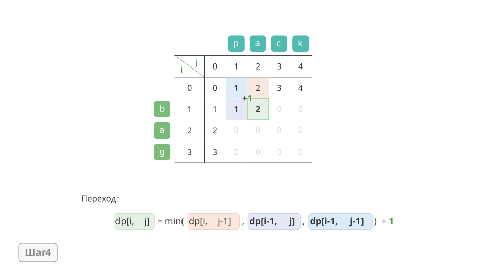
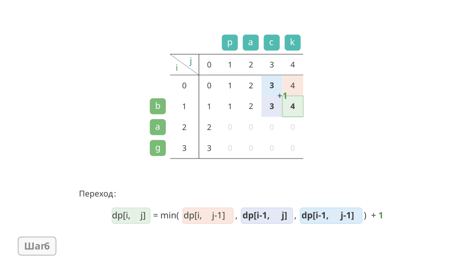
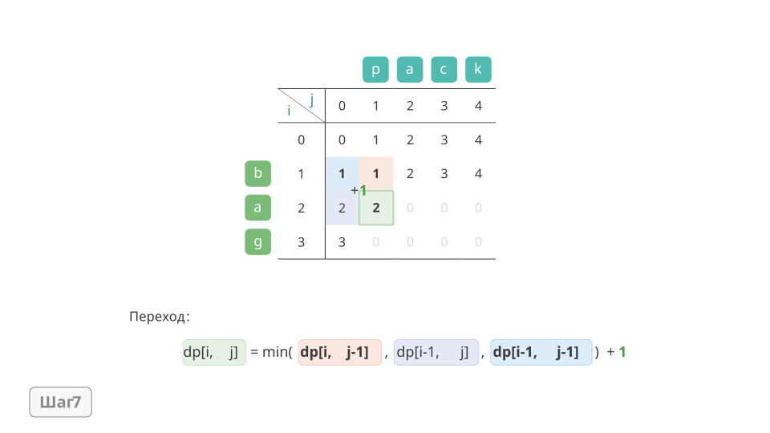
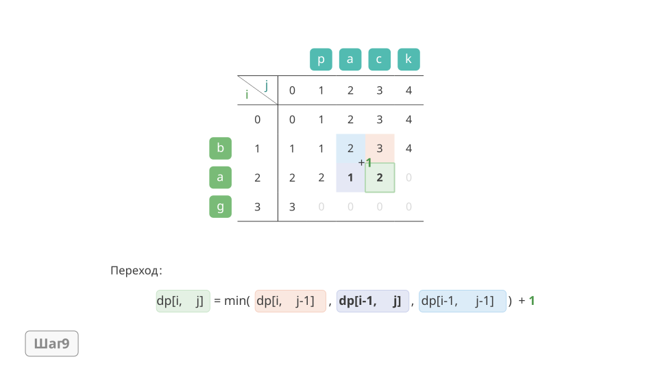
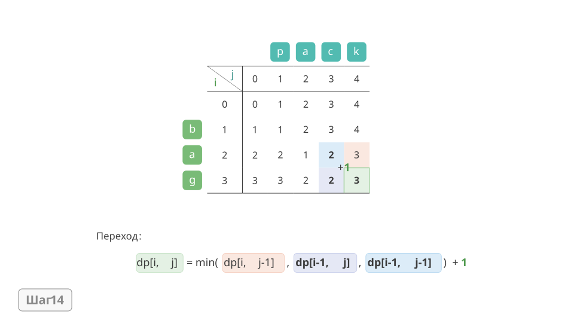
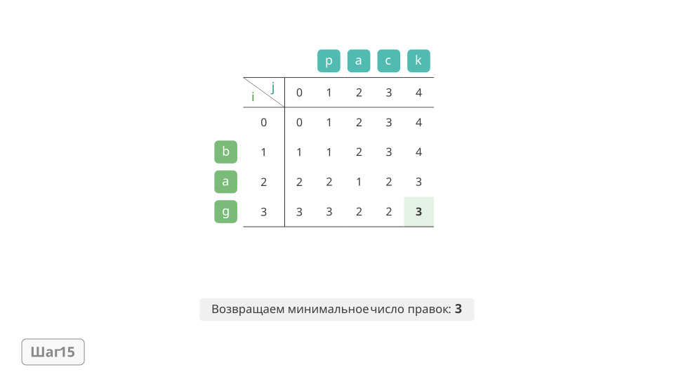

# Задача о редакционном расстоянии

Редакционное расстояние, или расстояние Левенштейна, — наименьшее число правок, необходимых для преобразования одной строки в другую. В информационном поиске и обработке естественного языка его часто используют как меру сходства двух последовательностей.

!!! question

    Даны две строки $s$ и $t$. Верните наименьшее число правок, необходимых для преобразования $s$ в $t$.
    
    Со строкой можно выполнить три операции: вставить один символ, удалить один символ или заменить один символ любым другим.

Как видно на рисунке, преобразование `kitten` в `sitting` требует 3 правок: двух замен и одной вставки. Для преобразования `hello` в `algo` тоже нужны 3 правки: две замены и одно удаление.


**Задачу о редакционном расстоянии удобно представить деревом решений**. Узел дерева — это строка, а ребро — один выбор, то есть одна правка.

Как показано на рисунке, без ограничений на операции из каждого узла выходит множество рёбер, по одному на каждую возможную правку. Поэтому из `hello` в `algo` ведёт много разных путей.

На языке дерева решений задача состоит в поиске кратчайшего пути между узлами `hello` и `algo`.


### Решение методом динамического программирования

**Шаг 1. Описать выбор на каждом шаге и определить состояния для таблицы $dp$**

На каждом шаге выбираем одну правку для строки $s$.

Чтобы выделить подзадачи, будем с каждой правкой уменьшать размер оставшейся задачи. Пусть строки $s$ и $t$ имеют длину $n$ и $m$ соответственно. Начнём с их последних символов $s[n-1]$ и $t[m-1]$.

- Если $s[n-1]$ и $t[m-1]$ совпадают, пропустим их и сразу перейдём к $s[n-2]$ и $t[m-2]$.
- Если $s[n-1]$ и $t[m-1]$ различаются, выполним над $s$ одну правку: вставку, удаление или замену. Так мы согласуем окончания строк и сможем перейти к меньшей задаче, отложив уже обработанные символы.

Каждая правка строки $s$ меняет то, какие символы в $s$ и $t$ остаётся сопоставить. Поэтому состояние зададим позициями рассматриваемых символов в строках $s$ и $t$ — соответственно $i$ и $j$. Обозначим его $[i, j]$.

Подзадача для состояния $[i, j]$: **найти минимальное число правок, превращающих префикс строки $s$ длины $i$ в префикс строки $t$ длины $j$**.

Получаем двумерную таблицу размера $(n+1) \times (m+1)$. Обозначим её $dp$.

**Шаг 2. Найти оптимальную подструктуру и вывести формулу перехода**

Рассмотрим подзадачу $dp[i, j]$. Последние символы её префиксов — $s[i-1]$ и $t[j-1]$. На рисунке показаны три случая, по одному для каждого вида правки.

1. Если после $s[i-1]$ вставить $t[j-1]$, останется подзадача $dp[i, j-1]$.
2. Если удалить $s[i-1]$, останется подзадача $dp[i-1, j]$.
3. Если заменить $s[i-1]$ на $t[j-1]$, останется подзадача $dp[i-1, j-1]$.


Получаем оптимальную подструктуру: для $dp[i, j]$ берём наименьшее из трёх чисел правок $dp[i, j-1]$, $dp[i-1, j]$, $dp[i-1, j-1]$ и прибавляем $1$ за текущую операцию. Соответствующая формула перехода:

$$
dp[i, j] = \min(dp[i, j-1], dp[i-1, j], dp[i-1, j-1]) + 1
$$

При этом **если $s[i-1]$ и $t[j-1]$ совпадают, текущий символ не требует правки**. В этом случае формула перехода имеет вид:

$$
dp[i, j] = dp[i-1, j-1]
$$

**Шаг 3. Определить граничные условия и порядок переходов**

Для двух пустых строк число правок равно $0$, то есть $dp[0, 0] = 0$. Если $s$ пуста, а $t$ нет, минимальное число правок равно длине $t$. Это задаёт первую строку: $dp[0, j] = j$. Если $s$ непуста, а $t$ пуста, требуется столько правок, какова длина $s$. Это задаёт первый столбец: $dp[i, 0] = i$.

По формуле перехода $dp[i, j]$ зависит от значений слева, сверху и по диагонали сверху слева. Поэтому достаточно обойти всю таблицу $dp$ в прямом порядке двумя вложенными циклами.

### Реализация

```src
[file]{edit_distance}-[class]{}-[func]{edit_distance_dp}
```

Как видно на рисунке, переходы в задаче о редакционном расстоянии очень похожи на переходы в задаче о рюкзаке: в обоих случаях мы заполняем двумерную таблицу.

=== "<1>"
    

=== "<2>"
    

=== "<3>"
    

=== "<4>"
    

=== "<5>"
    

=== "<6>"
    

=== "<7>"
    

=== "<8>"
    

=== "<9>"
    

=== "<10>"
    

=== "<11>"
    

=== "<12>"
    

=== "<13>"
    

=== "<14>"
    

=== "<15>"
    

### Экономия памяти

Значение $dp[i,j]$ зависит от ячеек сверху $dp[i-1, j]$, слева $dp[i, j-1]$ и сверху слева $dp[i-1, j-1]$. При прямом обходе мы потеряем значение по диагонали $dp[i-1, j-1]$, а при обратном не успеем вычислить $dp[i, j-1]$. Поэтому ни один из этих порядков сам по себе не подходит.

Сохраним в переменной `leftup` значение по диагонали $dp[i-1, j-1]$. Тогда в массиве достаточно следить за значениями слева и сверху. Как и в задаче о неограниченном рюкзаке, теперь подходит прямой обход:

```src
[file]{edit_distance}-[class]{}-[func]{edit_distance_dp_comp}
```
