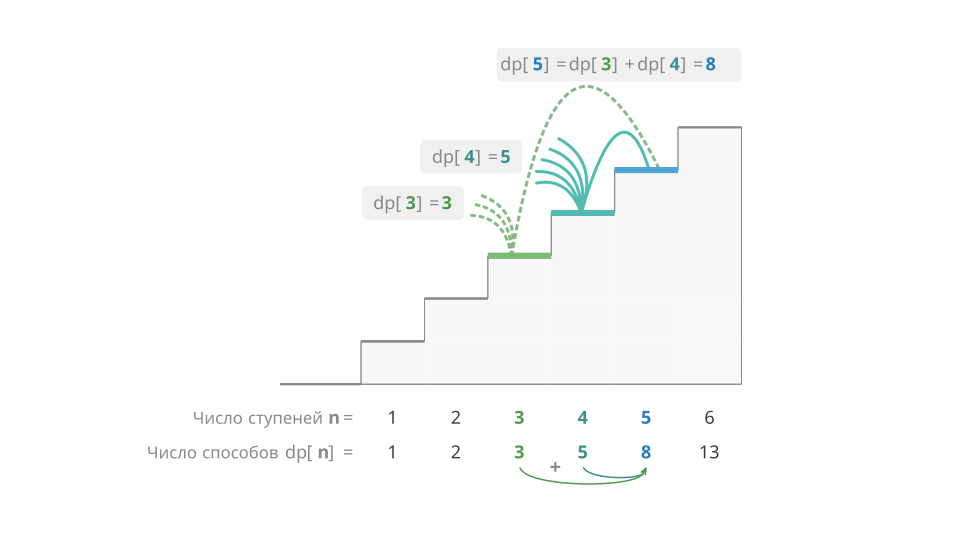
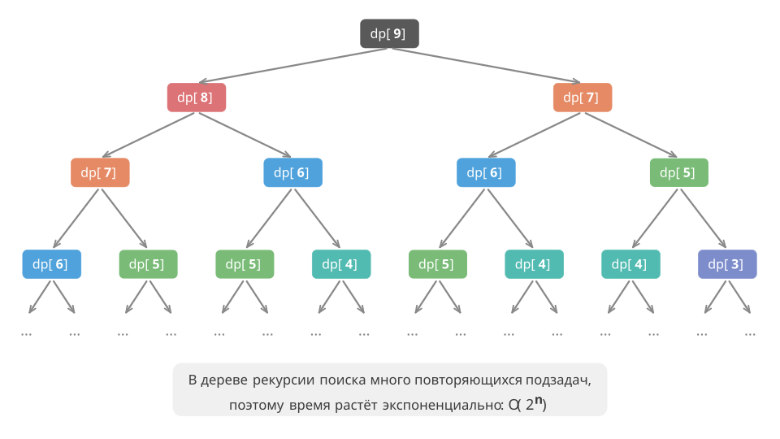
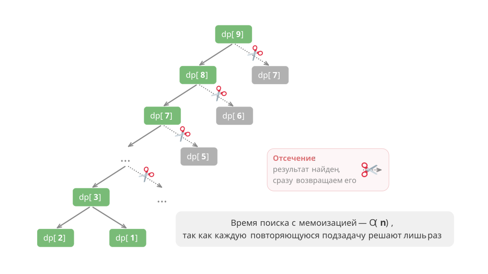
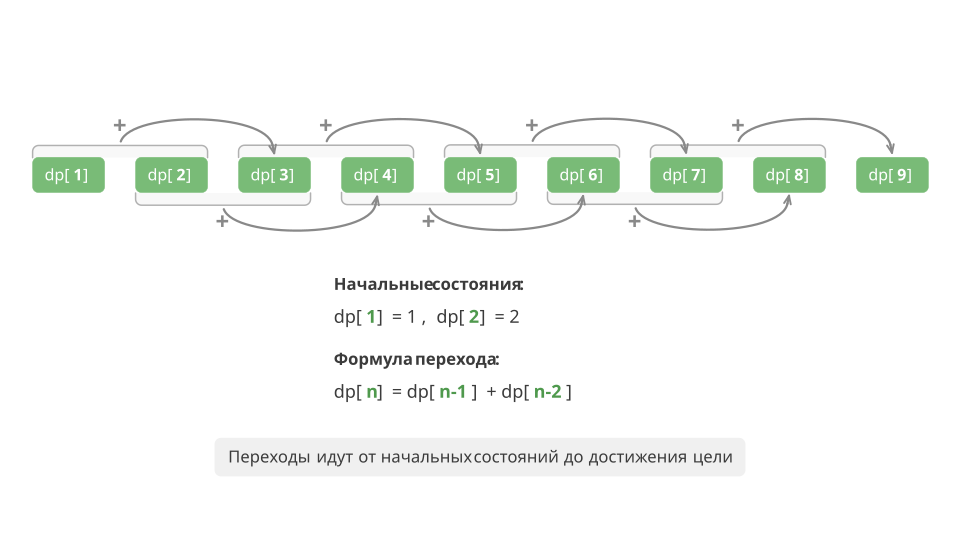

# 14.1 &nbsp; Знакомство с динамическим программированием

<u>Динамическое программирование (dynamic programming)</u> — важный подход к построению алгоритмов. Задачу разбивают на меньшие подзадачи и сохраняют их решения. Это позволяет избежать повторных вычислений и существенно сократить время работы.

Начнём с классического примера. Сначала решим задачу полным перебором с возвратом, найдём повторяющиеся подзадачи, а затем постепенно перейдём к более эффективному решению методом динамического программирования.

!!! question "Подъём по лестнице"

    В лестнице $n$ ступеней. За шаг можно подняться на $1$ или $2$ ступени. Сколькими способами можно добраться до вершины?

Как показано на рисунке, для лестницы из $3$ ступеней есть $3$ способа подняться до вершины.

{ class="animation-figure" }

<p align="center"> Рисунок 14-1 &nbsp; Число способов подняться на ступень 3 </p>

Нам нужно подсчитать способы подъёма. **Можно перебрать их все поиском с возвратом**. Представим подъём как последовательность выборов. Начнём с земли и на каждом шаге будем выбирать подъём на $1$ или $2$ ступени. Достигнув вершины, увеличим счётчик на $1$. Если шаг ведёт выше вершины, отсечём эту ветвь. Вот реализация:

=== "Python"

    ```python title="climbing_stairs_backtrack.py"
    def backtrack(choices: list[int], state: int, n: int, res: list[int]) -> int:
        """Поиск с возвратом"""
        # На ступени n увеличить число способов на 1
        if state == n:
            res[0] += 1
        # Перебрать все варианты
        for choice in choices:
            # Отсечь шаги за ступень n
            if state + choice > n:
                continue
            # Сделать выбор и обновить состояние
            backtrack(choices, state + choice, n, res)
            # Отменить выбор

    def climbing_stairs_backtrack(n: int) -> int:
        """Подъём по лестнице: поиск с возвратом"""
        choices = [1, 2]  # Можно подняться на 1 или 2 ступени
        state = 0  # Начать со ступени 0
        res = [0]  # Хранить число способов в res[0]
        backtrack(choices, state, n, res)
        return res[0]
    ```

=== "C++"

    ```cpp title="climbing_stairs_backtrack.cpp"
    /* Поиск с возвратом */
    void backtrack(vector<int> &choices, int state, int n, vector<int> &res) {
        // На ступени n увеличить число способов на 1
        if (state == n)
            res[0]++;
        // Перебрать все варианты
        for (auto &choice : choices) {
            // Отсечь шаги за ступень n
            if (state + choice > n)
                continue;
            // Сделать выбор и обновить состояние
            backtrack(choices, state + choice, n, res);
            // Отменить выбор
        }
    }

    /* Подъём по лестнице: поиск с возвратом */
    int climbingStairsBacktrack(int n) {
        vector<int> choices = {1, 2}; // Можно подняться на 1 или 2 ступени
        int state = 0;                // Начать со ступени 0
        vector<int> res = {0};        // Хранить число способов в res[0]
        backtrack(choices, state, n, res);
        return res[0];
    }
    ```

=== "Java"

    ```java title="climbing_stairs_backtrack.java"
    /* Поиск с возвратом */
    void backtrack(List<Integer> choices, int state, int n, List<Integer> res) {
        // На ступени n увеличить число способов на 1
        if (state == n)
            res.set(0, res.get(0) + 1);
        // Перебрать все варианты
        for (Integer choice : choices) {
            // Отсечь шаги за ступень n
            if (state + choice > n)
                continue;
            // Сделать выбор и обновить состояние
            backtrack(choices, state + choice, n, res);
            // Отменить выбор
        }
    }

    /* Подъём по лестнице: поиск с возвратом */
    int climbingStairsBacktrack(int n) {
        List<Integer> choices = Arrays.asList(1, 2); // Можно подняться на 1 или 2 ступени
        int state = 0; // Начать со ступени 0
        List<Integer> res = new ArrayList<>();
        res.add(0); // Хранить число способов в res[0]
        backtrack(choices, state, n, res);
        return res.get(0);
    }
    ```

=== "C#"

    ```csharp title="climbing_stairs_backtrack.cs"
    /* Поиск с возвратом */
    void Backtrack(List<int> choices, int state, int n, List<int> res) {
        // На ступени n увеличить число способов на 1
        if (state == n)
            res[0]++;
        // Перебрать все варианты
        foreach (int choice in choices) {
            // Отсечь шаги за ступень n
            if (state + choice > n)
                continue;
            // Сделать выбор и обновить состояние
            Backtrack(choices, state + choice, n, res);
            // Отменить выбор
        }
    }

    /* Подъём по лестнице: поиск с возвратом */
    int ClimbingStairsBacktrack(int n) {
        List<int> choices = [1, 2]; // Можно подняться на 1 или 2 ступени
        int state = 0; // Начать со ступени 0
        List<int> res = [0]; // Хранить число способов в res[0]
        Backtrack(choices, state, n, res);
        return res[0];
    }
    ```

=== "Go"

    ```go title="climbing_stairs_backtrack.go"
    /* Поиск с возвратом */
    func backtrack(choices []int, state, n int, res []int) {
        // На ступени n увеличить число способов на 1
        if state == n {
            res[0] = res[0] + 1
        }
        // Перебрать все варианты
        for _, choice := range choices {
            // Отсечь шаги за ступень n
            if state+choice > n {
                continue
            }
            // Сделать выбор и обновить состояние
            backtrack(choices, state+choice, n, res)
            // Отменить выбор
        }
    }

    /* Подъём по лестнице: поиск с возвратом */
    func climbingStairsBacktrack(n int) int {
        // Можно подняться на 1 или 2 ступени
        choices := []int{1, 2}
        // Начать со ступени 0
        state := 0
        res := make([]int, 1)
        // Хранить число способов в res[0]
        res[0] = 0
        backtrack(choices, state, n, res)
        return res[0]
    }
    ```

=== "Swift"

    ```swift title="climbing_stairs_backtrack.swift"
    /* Поиск с возвратом */
    func backtrack(choices: [Int], state: Int, n: Int, res: inout [Int]) {
        // На ступени n увеличить число способов на 1
        if state == n {
            res[0] += 1
        }
        // Перебрать все варианты
        for choice in choices {
            // Отсечь шаги за ступень n
            if state + choice > n {
                continue
            }
            // Сделать выбор и обновить состояние
            backtrack(choices: choices, state: state + choice, n: n, res: &res)
            // Отменить выбор
        }
    }

    /* Подъём по лестнице: поиск с возвратом */
    func climbingStairsBacktrack(n: Int) -> Int {
        let choices = [1, 2] // Можно подняться на 1 или 2 ступени
        let state = 0 // Начать со ступени 0
        var res: [Int] = []
        res.append(0) // Хранить число способов в res[0]
        backtrack(choices: choices, state: state, n: n, res: &res)
        return res[0]
    }
    ```

=== "JS"

    ```javascript title="climbing_stairs_backtrack.js"
    /* Поиск с возвратом */
    function backtrack(choices, state, n, res) {
        // На ступени n увеличить число способов на 1
        if (state === n) res.set(0, res.get(0) + 1);
        // Перебрать все варианты
        for (const choice of choices) {
            // Отсечь шаги за ступень n
            if (state + choice > n) continue;
            // Сделать выбор и обновить состояние
            backtrack(choices, state + choice, n, res);
            // Отменить выбор
        }
    }

    /* Подъём по лестнице: поиск с возвратом */
    function climbingStairsBacktrack(n) {
        const choices = [1, 2]; // Можно подняться на 1 или 2 ступени
        const state = 0; // Начать со ступени 0
        const res = new Map();
        res.set(0, 0); // Хранить число способов в res[0]
        backtrack(choices, state, n, res);
        return res.get(0);
    }
    ```

=== "TS"

    ```typescript title="climbing_stairs_backtrack.ts"
    /* Поиск с возвратом */
    function backtrack(
        choices: number[],
        state: number,
        n: number,
        res: Map<0, any>
    ): void {
        // На ступени n увеличить число способов на 1
        if (state === n) res.set(0, res.get(0) + 1);
        // Перебрать все варианты
        for (const choice of choices) {
            // Отсечь шаги за ступень n
            if (state + choice > n) continue;
            // Сделать выбор и обновить состояние
            backtrack(choices, state + choice, n, res);
            // Отменить выбор
        }
    }

    /* Подъём по лестнице: поиск с возвратом */
    function climbingStairsBacktrack(n: number): number {
        const choices = [1, 2]; // Можно подняться на 1 или 2 ступени
        const state = 0; // Начать со ступени 0
        const res = new Map();
        res.set(0, 0); // Хранить число способов в res[0]
        backtrack(choices, state, n, res);
        return res.get(0);
    }
    ```

=== "Dart"

    ```dart title="climbing_stairs_backtrack.dart"
    /* Поиск с возвратом */
    void backtrack(List<int> choices, int state, int n, List<int> res) {
      // На ступени n увеличить число способов на 1
      if (state == n) {
        res[0]++;
      }
      // Перебрать все варианты
      for (int choice in choices) {
        // Отсечь шаги за ступень n
        if (state + choice > n) continue;
        // Сделать выбор и обновить состояние
        backtrack(choices, state + choice, n, res);
        // Отменить выбор
      }
    }

    /* Подъём по лестнице: поиск с возвратом */
    int climbingStairsBacktrack(int n) {
      List<int> choices = [1, 2]; // Можно подняться на 1 или 2 ступени
      int state = 0; // Начать со ступени 0
      List<int> res = [];
      res.add(0); // Хранить число способов в res[0]
      backtrack(choices, state, n, res);
      return res[0];
    }
    ```

=== "Rust"

    ```rust title="climbing_stairs_backtrack.rs"
    /* Поиск с возвратом */
    fn backtrack(choices: &[i32], state: i32, n: i32, res: &mut [i32]) {
        // На ступени n увеличить число способов на 1
        if state == n {
            res[0] = res[0] + 1;
        }
        // Перебрать все варианты
        for &choice in choices {
            // Отсечь шаги за ступень n
            if state + choice > n {
                continue;
            }
            // Сделать выбор и обновить состояние
            backtrack(choices, state + choice, n, res);
            // Отменить выбор
        }
    }

    /* Подъём по лестнице: поиск с возвратом */
    fn climbing_stairs_backtrack(n: usize) -> i32 {
        let choices = vec![1, 2]; // Можно подняться на 1 или 2 ступени
        let state = 0; // Начать со ступени 0
        let mut res = Vec::new();
        res.push(0); // Хранить число способов в res[0]
        backtrack(&choices, state, n as i32, &mut res);
        res[0]
    }
    ```

=== "C"

    ```c title="climbing_stairs_backtrack.c"
    /* Поиск с возвратом */
    void backtrack(int *choices, int state, int n, int *res, int len) {
        // На ступени n увеличить число способов на 1
        if (state == n)
            res[0]++;
        // Перебрать все варианты
        for (int i = 0; i < len; i++) {
            int choice = choices[i];
            // Отсечь шаги за ступень n
            if (state + choice > n)
                continue;
            // Сделать выбор и обновить состояние
            backtrack(choices, state + choice, n, res, len);
            // Отменить выбор
        }
    }

    /* Подъём по лестнице: поиск с возвратом */
    int climbingStairsBacktrack(int n) {
        int choices[2] = {1, 2}; // Можно подняться на 1 или 2 ступени
        int state = 0;           // Начать со ступени 0
        int *res = (int *)malloc(sizeof(int));
        *res = 0; // Хранить число способов в res[0]
        int len = sizeof(choices) / sizeof(int);
        backtrack(choices, state, n, res, len);
        int result = *res;
        free(res);
        return result;
    }
    ```

=== "Kotlin"

    ```kotlin title="climbing_stairs_backtrack.kt"
    /* Поиск с возвратом */
    fun backtrack(
        choices: MutableList<Int>,
        state: Int,
        n: Int,
        res: MutableList<Int>
    ) {
        // На ступени n увеличить число способов на 1
        if (state == n)
            res[0] = res[0] + 1
        // Перебрать все варианты
        for (choice in choices) {
            // Отсечь шаги за ступень n
            if (state + choice > n) continue
            // Сделать выбор и обновить состояние
            backtrack(choices, state + choice, n, res)
            // Отменить выбор
        }
    }

    /* Подъём по лестнице: поиск с возвратом */
    fun climbingStairsBacktrack(n: Int): Int {
        val choices = mutableListOf(1, 2) // Можно подняться на 1 или 2 ступени
        val state = 0 // Начать со ступени 0
        val res = mutableListOf<Int>()
        res.add(0) // Хранить число способов в res[0]
        backtrack(choices, state, n, res)
        return res[0]
    }
    ```

=== "Ruby"

    ```ruby title="climbing_stairs_backtrack.rb"
    ### Поиск с возвратом ###
    def backtrack(choices, state, n, res)
      # На ступени n увеличить число способов на 1
      res[0] += 1 if state == n
      # Перебрать все варианты
      for choice in choices
        # Отсечь шаги за ступень n
        next if state + choice > n

        # Сделать выбор и обновить состояние
        backtrack(choices, state + choice, n, res)
      end
      # Отменить выбор
    end

    ### Подъём по лестнице: поиск с возвратом ###
    def climbing_stairs_backtrack(n)
      choices = [1, 2] # Можно подняться на 1 или 2 ступени
      state = 0 # Начать со ступени 0
      res = [0] # Хранить число способов в res[0]
      backtrack(choices, state, n, res)
      res.first
    end
    ```

??? pythontutor "Визуализация выполнения"

    <div style="height: 549px; width: 100%;"><iframe class="pythontutor-iframe" title="Визуализация выполнения" src="https://pythontutor.com/iframe-embed.html#code=def%20backtrack%28choices%3A%20list%5Bint%5D,%20state%3A%20int,%20n%3A%20int,%20res%3A%20list%5Bint%5D%29%20-%3E%20int%3A%0A%20%20%20%20%22%22%22%D0%9F%D0%BE%D0%B8%D1%81%D0%BA%20%D1%81%20%D0%B2%D0%BE%D0%B7%D0%B2%D1%80%D0%B0%D1%82%D0%BE%D0%BC%22%22%22%0A%20%20%20%20%23%20%D0%9D%D0%B0%20%D1%81%D1%82%D1%83%D0%BF%D0%B5%D0%BD%D0%B8%20n%20%D1%83%D0%B2%D0%B5%D0%BB%D0%B8%D1%87%D0%B8%D1%82%D1%8C%20%D1%87%D0%B8%D1%81%D0%BB%D0%BE%20%D1%81%D0%BF%D0%BE%D1%81%D0%BE%D0%B1%D0%BE%D0%B2%20%D0%BD%D0%B0%201%0A%20%20%20%20if%20state%20%3D%3D%20n%3A%0A%20%20%20%20%20%20%20%20res%5B0%5D%20%2B%3D%201%0A%20%20%20%20%23%20%D0%9F%D0%B5%D1%80%D0%B5%D0%B1%D1%80%D0%B0%D1%82%D1%8C%20%D0%B2%D1%81%D0%B5%20%D0%B2%D0%B0%D1%80%D0%B8%D0%B0%D0%BD%D1%82%D1%8B%0A%20%20%20%20for%20choice%20in%20choices%3A%0A%20%20%20%20%20%20%20%20%23%20%D0%9E%D1%82%D1%81%D0%B5%D1%87%D1%8C%20%D1%88%D0%B0%D0%B3%D0%B8%20%D0%B7%D0%B0%20%D1%81%D1%82%D1%83%D0%BF%D0%B5%D0%BD%D1%8C%20n%0A%20%20%20%20%20%20%20%20if%20state%20%2B%20choice%20%3E%20n%3A%0A%20%20%20%20%20%20%20%20%20%20%20%20continue%0A%20%20%20%20%20%20%20%20%23%20%D0%A1%D0%B4%D0%B5%D0%BB%D0%B0%D1%82%D1%8C%20%D0%B2%D1%8B%D0%B1%D0%BE%D1%80%20%D0%B8%20%D0%BE%D0%B1%D0%BD%D0%BE%D0%B2%D0%B8%D1%82%D1%8C%20%D1%81%D0%BE%D1%81%D1%82%D0%BE%D1%8F%D0%BD%D0%B8%D0%B5%0A%20%20%20%20%20%20%20%20backtrack%28choices,%20state%20%2B%20choice,%20n,%20res%29%0A%20%20%20%20%20%20%20%20%23%20%D0%9E%D1%82%D0%BC%D0%B5%D0%BD%D0%B8%D1%82%D1%8C%20%D0%B2%D1%8B%D0%B1%D0%BE%D1%80%0A%0A%0Adef%20climbing_stairs_backtrack%28n%3A%20int%29%20-%3E%20int%3A%0A%20%20%20%20%22%22%22%D0%9F%D0%BE%D0%B4%D1%8A%D1%91%D0%BC%20%D0%BF%D0%BE%20%D0%BB%D0%B5%D1%81%D1%82%D0%BD%D0%B8%D1%86%D0%B5%3A%20%D0%BF%D0%BE%D0%B8%D1%81%D0%BA%20%D1%81%20%D0%B2%D0%BE%D0%B7%D0%B2%D1%80%D0%B0%D1%82%D0%BE%D0%BC%22%22%22%0A%20%20%20%20choices%20%3D%20%5B1,%202%5D%20%20%23%20%D0%9C%D0%BE%D0%B6%D0%BD%D0%BE%20%D0%BF%D0%BE%D0%B4%D0%BD%D1%8F%D1%82%D1%8C%D1%81%D1%8F%20%D0%BD%D0%B0%201%20%D0%B8%D0%BB%D0%B8%202%20%D1%81%D1%82%D1%83%D0%BF%D0%B5%D0%BD%D0%B8%0A%20%20%20%20state%20%3D%200%20%20%23%20%D0%9D%D0%B0%D1%87%D0%B0%D1%82%D1%8C%20%D1%81%D0%BE%20%D1%81%D1%82%D1%83%D0%BF%D0%B5%D0%BD%D0%B8%200%0A%20%20%20%20res%20%3D%20%5B0%5D%20%20%23%20%D0%A5%D1%80%D0%B0%D0%BD%D0%B8%D1%82%D1%8C%20%D1%87%D0%B8%D1%81%D0%BB%D0%BE%20%D1%81%D0%BF%D0%BE%D1%81%D0%BE%D0%B1%D0%BE%D0%B2%20%D0%B2%20res%5B0%5D%0A%20%20%20%20backtrack%28choices,%20state,%20n,%20res%29%0A%20%20%20%20return%20res%5B0%5D%0A%0A%0A%22%22%22Driver%20Code%22%22%22%0Aif%20__name__%20%3D%3D%20%22__main__%22%3A%0A%20%20%20%20n%20%3D%204%0A%0A%20%20%20%20res%20%3D%20climbing_stairs_backtrack%28n%29%0A%20%20%20%20print%28f%22%D0%A7%D0%B8%D1%81%D0%BB%D0%BE%20%D1%81%D0%BF%D0%BE%D1%81%D0%BE%D0%B1%D0%BE%D0%B2%20%D0%BF%D0%BE%D0%B4%D0%BD%D1%8F%D1%82%D1%8C%D1%81%D1%8F%20%D0%BD%D0%B0%20%D0%BB%D0%B5%D1%81%D1%82%D0%BD%D0%B8%D1%86%D1%83%20%D0%B8%D0%B7%20%7Bn%7D%20%D1%81%D1%82%D1%83%D0%BF%D0%B5%D0%BD%D0%B5%D0%B9%3A%20%7Bres%7D.%22%29&codeDivHeight=472&codeDivWidth=350&cumulative=false&curInstr=5&heapPrimitives=nevernest&origin=opt-frontend.js&py=311&rawInputLstJSON=%5B%5D&textReferences=false"> </iframe></div>
    <div style="margin-top: 5px;"><a href="https://pythontutor.com/iframe-embed.html#code=def%20backtrack%28choices%3A%20list%5Bint%5D,%20state%3A%20int,%20n%3A%20int,%20res%3A%20list%5Bint%5D%29%20-%3E%20int%3A%0A%20%20%20%20%22%22%22%D0%9F%D0%BE%D0%B8%D1%81%D0%BA%20%D1%81%20%D0%B2%D0%BE%D0%B7%D0%B2%D1%80%D0%B0%D1%82%D0%BE%D0%BC%22%22%22%0A%20%20%20%20%23%20%D0%9D%D0%B0%20%D1%81%D1%82%D1%83%D0%BF%D0%B5%D0%BD%D0%B8%20n%20%D1%83%D0%B2%D0%B5%D0%BB%D0%B8%D1%87%D0%B8%D1%82%D1%8C%20%D1%87%D0%B8%D1%81%D0%BB%D0%BE%20%D1%81%D0%BF%D0%BE%D1%81%D0%BE%D0%B1%D0%BE%D0%B2%20%D0%BD%D0%B0%201%0A%20%20%20%20if%20state%20%3D%3D%20n%3A%0A%20%20%20%20%20%20%20%20res%5B0%5D%20%2B%3D%201%0A%20%20%20%20%23%20%D0%9F%D0%B5%D1%80%D0%B5%D0%B1%D1%80%D0%B0%D1%82%D1%8C%20%D0%B2%D1%81%D0%B5%20%D0%B2%D0%B0%D1%80%D0%B8%D0%B0%D0%BD%D1%82%D1%8B%0A%20%20%20%20for%20choice%20in%20choices%3A%0A%20%20%20%20%20%20%20%20%23%20%D0%9E%D1%82%D1%81%D0%B5%D1%87%D1%8C%20%D1%88%D0%B0%D0%B3%D0%B8%20%D0%B7%D0%B0%20%D1%81%D1%82%D1%83%D0%BF%D0%B5%D0%BD%D1%8C%20n%0A%20%20%20%20%20%20%20%20if%20state%20%2B%20choice%20%3E%20n%3A%0A%20%20%20%20%20%20%20%20%20%20%20%20continue%0A%20%20%20%20%20%20%20%20%23%20%D0%A1%D0%B4%D0%B5%D0%BB%D0%B0%D1%82%D1%8C%20%D0%B2%D1%8B%D0%B1%D0%BE%D1%80%20%D0%B8%20%D0%BE%D0%B1%D0%BD%D0%BE%D0%B2%D0%B8%D1%82%D1%8C%20%D1%81%D0%BE%D1%81%D1%82%D0%BE%D1%8F%D0%BD%D0%B8%D0%B5%0A%20%20%20%20%20%20%20%20backtrack%28choices,%20state%20%2B%20choice,%20n,%20res%29%0A%20%20%20%20%20%20%20%20%23%20%D0%9E%D1%82%D0%BC%D0%B5%D0%BD%D0%B8%D1%82%D1%8C%20%D0%B2%D1%8B%D0%B1%D0%BE%D1%80%0A%0A%0Adef%20climbing_stairs_backtrack%28n%3A%20int%29%20-%3E%20int%3A%0A%20%20%20%20%22%22%22%D0%9F%D0%BE%D0%B4%D1%8A%D1%91%D0%BC%20%D0%BF%D0%BE%20%D0%BB%D0%B5%D1%81%D1%82%D0%BD%D0%B8%D1%86%D0%B5%3A%20%D0%BF%D0%BE%D0%B8%D1%81%D0%BA%20%D1%81%20%D0%B2%D0%BE%D0%B7%D0%B2%D1%80%D0%B0%D1%82%D0%BE%D0%BC%22%22%22%0A%20%20%20%20choices%20%3D%20%5B1,%202%5D%20%20%23%20%D0%9C%D0%BE%D0%B6%D0%BD%D0%BE%20%D0%BF%D0%BE%D0%B4%D0%BD%D1%8F%D1%82%D1%8C%D1%81%D1%8F%20%D0%BD%D0%B0%201%20%D0%B8%D0%BB%D0%B8%202%20%D1%81%D1%82%D1%83%D0%BF%D0%B5%D0%BD%D0%B8%0A%20%20%20%20state%20%3D%200%20%20%23%20%D0%9D%D0%B0%D1%87%D0%B0%D1%82%D1%8C%20%D1%81%D0%BE%20%D1%81%D1%82%D1%83%D0%BF%D0%B5%D0%BD%D0%B8%200%0A%20%20%20%20res%20%3D%20%5B0%5D%20%20%23%20%D0%A5%D1%80%D0%B0%D0%BD%D0%B8%D1%82%D1%8C%20%D1%87%D0%B8%D1%81%D0%BB%D0%BE%20%D1%81%D0%BF%D0%BE%D1%81%D0%BE%D0%B1%D0%BE%D0%B2%20%D0%B2%20res%5B0%5D%0A%20%20%20%20backtrack%28choices,%20state,%20n,%20res%29%0A%20%20%20%20return%20res%5B0%5D%0A%0A%0A%22%22%22Driver%20Code%22%22%22%0Aif%20__name__%20%3D%3D%20%22__main__%22%3A%0A%20%20%20%20n%20%3D%204%0A%0A%20%20%20%20res%20%3D%20climbing_stairs_backtrack%28n%29%0A%20%20%20%20print%28f%22%D0%A7%D0%B8%D1%81%D0%BB%D0%BE%20%D1%81%D0%BF%D0%BE%D1%81%D0%BE%D0%B1%D0%BE%D0%B2%20%D0%BF%D0%BE%D0%B4%D0%BD%D1%8F%D1%82%D1%8C%D1%81%D1%8F%20%D0%BD%D0%B0%20%D0%BB%D0%B5%D1%81%D1%82%D0%BD%D0%B8%D1%86%D1%83%20%D0%B8%D0%B7%20%7Bn%7D%20%D1%81%D1%82%D1%83%D0%BF%D0%B5%D0%BD%D0%B5%D0%B9%3A%20%7Bres%7D.%22%29&codeDivHeight=800&codeDivWidth=600&cumulative=false&curInstr=5&heapPrimitives=nevernest&origin=opt-frontend.js&py=311&rawInputLstJSON=%5B%5D&textReferences=false" target="_blank" rel="noopener noreferrer">Во весь экран ></a></div>

## 14.1.1 &nbsp; Способ 1. Полный перебор

При поиске с возвратом обычно не выделяют подзадачи явно. Решение рассматривают как последовательность выборов и ищут все возможные варианты, пробуя очередной шаг и отсекая неподходящие ветви.

Посмотрим на ту же задачу с точки зрения разбиения. Пусть на ступень $i$ можно подняться $dp[i]$ способами. Тогда исходная задача — вычислить $dp[i]$, а её подзадачи таковы:

$$
dp[i-1], dp[i-2], \dots, dp[2], dp[1]
$$

За один шаг можно пройти вверх $1$ или $2$ ступени. Если мы стоим на ступени $i$, до этого мы стояли либо на ступени $i - 1$, либо на ступени $i - 2$. Иными словами, только со ступени $i -1$ или $i - 2$ можно одним шагом попасть на ступень $i$.

Отсюда важный вывод: **число способов достичь ступени $i - 1$ плюс число способов достичь ступени $i - 2$ равно числу способов достичь ступени $i$**. Запишем это формулой:

$$
dp[i] = dp[i-1] + dp[i-2]
$$

Таким образом, подзадачи о подъёме по лестнице связаны рекуррентным соотношением: **решение исходной задачи строится из решений подзадач**. На рисунке показана эта связь.

{ class="animation-figure" }

<p align="center"> Рисунок 14-2 &nbsp; Рекуррентное соотношение для числа способов </p>

Рекуррентная формула даёт решение полным перебором. Начиная с $dp[n]$, **рекурсивно сводим каждую большую задачу к сумме решений двух меньших**. Достигнув простейших подзадач $dp[1]$ и $dp[2]$, возвращаем известные значения $dp[1] = 1$ и $dp[2] = 2$: для ступеней $1$ и $2$ число способов подъёма равно соответственно $1$ и $2$.

Как и обычный поиск с возвратом, приведённый ниже код выполняет поиск в глубину, но записывается короче:

=== "Python"

    ```python title="climbing_stairs_dfs.py"
    def dfs(i: int) -> int:
        """Поиск"""
        # Для dp[1] и dp[2] вернуть известные значения
        if i == 1 or i == 2:
            return i
        # dp[i] = dp[i-1] + dp[i-2]
        count = dfs(i - 1) + dfs(i - 2)
        return count

    def climbing_stairs_dfs(n: int) -> int:
        """Подъём по лестнице: поиск"""
        return dfs(n)
    ```

=== "C++"

    ```cpp title="climbing_stairs_dfs.cpp"
    /* Поиск */
    int dfs(int i) {
        // Для dp[1] и dp[2] вернуть известные значения
        if (i == 1 || i == 2)
            return i;
        // dp[i] = dp[i-1] + dp[i-2]
        int count = dfs(i - 1) + dfs(i - 2);
        return count;
    }

    /* Подъём по лестнице: поиск */
    int climbingStairsDFS(int n) {
        return dfs(n);
    }
    ```

=== "Java"

    ```java title="climbing_stairs_dfs.java"
    /* Поиск */
    int dfs(int i) {
        // Для dp[1] и dp[2] вернуть известные значения
        if (i == 1 || i == 2)
            return i;
        // dp[i] = dp[i-1] + dp[i-2]
        int count = dfs(i - 1) + dfs(i - 2);
        return count;
    }

    /* Подъём по лестнице: поиск */
    int climbingStairsDFS(int n) {
        return dfs(n);
    }
    ```

=== "C#"

    ```csharp title="climbing_stairs_dfs.cs"
    /* Поиск */
    int DFS(int i) {
        // Для dp[1] и dp[2] вернуть известные значения
        if (i == 1 || i == 2)
            return i;
        // dp[i] = dp[i-1] + dp[i-2]
        int count = DFS(i - 1) + DFS(i - 2);
        return count;
    }

    /* Подъём по лестнице: поиск */
    int ClimbingStairsDFS(int n) {
        return DFS(n);
    }
    ```

=== "Go"

    ```go title="climbing_stairs_dfs.go"
    /* Поиск */
    func dfs(i int) int {
        // Для dp[1] и dp[2] вернуть известные значения
        if i == 1 || i == 2 {
            return i
        }
        // dp[i] = dp[i-1] + dp[i-2]
        count := dfs(i-1) + dfs(i-2)
        return count
    }

    /* Подъём по лестнице: поиск */
    func climbingStairsDFS(n int) int {
        return dfs(n)
    }
    ```

=== "Swift"

    ```swift title="climbing_stairs_dfs.swift"
    /* Поиск */
    func dfs(i: Int) -> Int {
        // Для dp[1] и dp[2] вернуть известные значения
        if i == 1 || i == 2 {
            return i
        }
        // dp[i] = dp[i-1] + dp[i-2]
        let count = dfs(i: i - 1) + dfs(i: i - 2)
        return count
    }

    /* Подъём по лестнице: поиск */
    func climbingStairsDFS(n: Int) -> Int {
        dfs(i: n)
    }
    ```

=== "JS"

    ```javascript title="climbing_stairs_dfs.js"
    /* Поиск */
    function dfs(i) {
        // Для dp[1] и dp[2] вернуть известные значения
        if (i === 1 || i === 2) return i;
        // dp[i] = dp[i-1] + dp[i-2]
        const count = dfs(i - 1) + dfs(i - 2);
        return count;
    }

    /* Подъём по лестнице: поиск */
    function climbingStairsDFS(n) {
        return dfs(n);
    }
    ```

=== "TS"

    ```typescript title="climbing_stairs_dfs.ts"
    /* Поиск */
    function dfs(i: number): number {
        // Для dp[1] и dp[2] вернуть известные значения
        if (i === 1 || i === 2) return i;
        // dp[i] = dp[i-1] + dp[i-2]
        const count = dfs(i - 1) + dfs(i - 2);
        return count;
    }

    /* Подъём по лестнице: поиск */
    function climbingStairsDFS(n: number): number {
        return dfs(n);
    }
    ```

=== "Dart"

    ```dart title="climbing_stairs_dfs.dart"
    /* Поиск */
    int dfs(int i) {
      // Для dp[1] и dp[2] вернуть известные значения
      if (i == 1 || i == 2) return i;
      // dp[i] = dp[i-1] + dp[i-2]
      int count = dfs(i - 1) + dfs(i - 2);
      return count;
    }

    /* Подъём по лестнице: поиск */
    int climbingStairsDFS(int n) {
      return dfs(n);
    }
    ```

=== "Rust"

    ```rust title="climbing_stairs_dfs.rs"
    /* Поиск */
    fn dfs(i: usize) -> i32 {
        // Для dp[1] и dp[2] вернуть известные значения
        if i == 1 || i == 2 {
            return i as i32;
        }
        // dp[i] = dp[i-1] + dp[i-2]
        let count = dfs(i - 1) + dfs(i - 2);
        count
    }

    /* Подъём по лестнице: поиск */
    fn climbing_stairs_dfs(n: usize) -> i32 {
        dfs(n)
    }
    ```

=== "C"

    ```c title="climbing_stairs_dfs.c"
    /* Поиск */
    int dfs(int i) {
        // Для dp[1] и dp[2] вернуть известные значения
        if (i == 1 || i == 2)
            return i;
        // dp[i] = dp[i-1] + dp[i-2]
        int count = dfs(i - 1) + dfs(i - 2);
        return count;
    }

    /* Подъём по лестнице: поиск */
    int climbingStairsDFS(int n) {
        return dfs(n);
    }
    ```

=== "Kotlin"

    ```kotlin title="climbing_stairs_dfs.kt"
    /* Поиск */
    fun dfs(i: Int): Int {
        // Для dp[1] и dp[2] вернуть известные значения
        if (i == 1 || i == 2) return i
        // dp[i] = dp[i-1] + dp[i-2]
        val count = dfs(i - 1) + dfs(i - 2)
        return count
    }

    /* Подъём по лестнице: поиск */
    fun climbingStairsDFS(n: Int): Int {
        return dfs(n)
    }
    ```

=== "Ruby"

    ```ruby title="climbing_stairs_dfs.rb"
    ### Поиск ###
    def dfs(i)
      # Для dp[1] и dp[2] вернуть известные значения
      return i if i == 1 || i == 2
      # dp[i] = dp[i-1] + dp[i-2]
      dfs(i - 1) + dfs(i - 2)
    end

    ### Подъём по лестнице: поиск ###
    def climbing_stairs_dfs(n)
      dfs(n)
    end
    ```

??? pythontutor "Визуализация выполнения"

    <div style="height: 549px; width: 100%;"><iframe class="pythontutor-iframe" title="Визуализация выполнения" src="https://pythontutor.com/iframe-embed.html#code=def%20dfs%28i%3A%20int%29%20-%3E%20int%3A%0A%20%20%20%20%22%22%22%D0%9F%D0%BE%D0%B8%D1%81%D0%BA%22%22%22%0A%20%20%20%20%23%20%D0%94%D0%BB%D1%8F%20dp%5B1%5D%20%D0%B8%20dp%5B2%5D%20%D0%B2%D0%B5%D1%80%D0%BD%D1%83%D1%82%D1%8C%20%D0%B8%D0%B7%D0%B2%D0%B5%D1%81%D1%82%D0%BD%D1%8B%D0%B5%20%D0%B7%D0%BD%D0%B0%D1%87%D0%B5%D0%BD%D0%B8%D1%8F%0A%20%20%20%20if%20i%20%3D%3D%201%20or%20i%20%3D%3D%202%3A%0A%20%20%20%20%20%20%20%20return%20i%0A%20%20%20%20%23%20dp%5Bi%5D%20%3D%20dp%5Bi-1%5D%20%2B%20dp%5Bi-2%5D%0A%20%20%20%20count%20%3D%20dfs%28i%20-%201%29%20%2B%20dfs%28i%20-%202%29%0A%20%20%20%20return%20count%0A%0A%0Adef%20climbing_stairs_dfs%28n%3A%20int%29%20-%3E%20int%3A%0A%20%20%20%20%22%22%22%D0%9F%D0%BE%D0%B4%D1%8A%D1%91%D0%BC%20%D0%BF%D0%BE%20%D0%BB%D0%B5%D1%81%D1%82%D0%BD%D0%B8%D1%86%D0%B5%3A%20%D0%BF%D0%BE%D0%B8%D1%81%D0%BA%22%22%22%0A%20%20%20%20return%20dfs%28n%29%0A%0A%0A%22%22%22Driver%20Code%22%22%22%0Aif%20__name__%20%3D%3D%20%22__main__%22%3A%0A%20%20%20%20n%20%3D%209%0A%0A%20%20%20%20res%20%3D%20climbing_stairs_dfs%28n%29%0A%20%20%20%20print%28f%22%D0%A7%D0%B8%D1%81%D0%BB%D0%BE%20%D1%81%D0%BF%D0%BE%D1%81%D0%BE%D0%B1%D0%BE%D0%B2%20%D0%BF%D0%BE%D0%B4%D0%BD%D1%8F%D1%82%D1%8C%D1%81%D1%8F%20%D0%BD%D0%B0%20%D0%BB%D0%B5%D1%81%D1%82%D0%BD%D0%B8%D1%86%D1%83%20%D0%B8%D0%B7%20%7Bn%7D%20%D1%81%D1%82%D1%83%D0%BF%D0%B5%D0%BD%D0%B5%D0%B9%3A%20%7Bres%7D.%22%29&codeDivHeight=472&codeDivWidth=350&cumulative=false&curInstr=5&heapPrimitives=nevernest&origin=opt-frontend.js&py=311&rawInputLstJSON=%5B%5D&textReferences=false"> </iframe></div>
    <div style="margin-top: 5px;"><a href="https://pythontutor.com/iframe-embed.html#code=def%20dfs%28i%3A%20int%29%20-%3E%20int%3A%0A%20%20%20%20%22%22%22%D0%9F%D0%BE%D0%B8%D1%81%D0%BA%22%22%22%0A%20%20%20%20%23%20%D0%94%D0%BB%D1%8F%20dp%5B1%5D%20%D0%B8%20dp%5B2%5D%20%D0%B2%D0%B5%D1%80%D0%BD%D1%83%D1%82%D1%8C%20%D0%B8%D0%B7%D0%B2%D0%B5%D1%81%D1%82%D0%BD%D1%8B%D0%B5%20%D0%B7%D0%BD%D0%B0%D1%87%D0%B5%D0%BD%D0%B8%D1%8F%0A%20%20%20%20if%20i%20%3D%3D%201%20or%20i%20%3D%3D%202%3A%0A%20%20%20%20%20%20%20%20return%20i%0A%20%20%20%20%23%20dp%5Bi%5D%20%3D%20dp%5Bi-1%5D%20%2B%20dp%5Bi-2%5D%0A%20%20%20%20count%20%3D%20dfs%28i%20-%201%29%20%2B%20dfs%28i%20-%202%29%0A%20%20%20%20return%20count%0A%0A%0Adef%20climbing_stairs_dfs%28n%3A%20int%29%20-%3E%20int%3A%0A%20%20%20%20%22%22%22%D0%9F%D0%BE%D0%B4%D1%8A%D1%91%D0%BC%20%D0%BF%D0%BE%20%D0%BB%D0%B5%D1%81%D1%82%D0%BD%D0%B8%D1%86%D0%B5%3A%20%D0%BF%D0%BE%D0%B8%D1%81%D0%BA%22%22%22%0A%20%20%20%20return%20dfs%28n%29%0A%0A%0A%22%22%22Driver%20Code%22%22%22%0Aif%20__name__%20%3D%3D%20%22__main__%22%3A%0A%20%20%20%20n%20%3D%209%0A%0A%20%20%20%20res%20%3D%20climbing_stairs_dfs%28n%29%0A%20%20%20%20print%28f%22%D0%A7%D0%B8%D1%81%D0%BB%D0%BE%20%D1%81%D0%BF%D0%BE%D1%81%D0%BE%D0%B1%D0%BE%D0%B2%20%D0%BF%D0%BE%D0%B4%D0%BD%D1%8F%D1%82%D1%8C%D1%81%D1%8F%20%D0%BD%D0%B0%20%D0%BB%D0%B5%D1%81%D1%82%D0%BD%D0%B8%D1%86%D1%83%20%D0%B8%D0%B7%20%7Bn%7D%20%D1%81%D1%82%D1%83%D0%BF%D0%B5%D0%BD%D0%B5%D0%B9%3A%20%7Bres%7D.%22%29&codeDivHeight=800&codeDivWidth=600&cumulative=false&curInstr=5&heapPrimitives=nevernest&origin=opt-frontend.js&py=311&rawInputLstJSON=%5B%5D&textReferences=false" target="_blank" rel="noopener noreferrer">Во весь экран ></a></div>

На рисунке показано дерево рекурсии полного перебора. Для задачи $dp[n]$ глубина дерева равна $n$, а временная сложность составляет $O(2^n)$. При экспоненциальном росте объём вычислений увеличивается стремительно: для достаточно большого $n$ ответа придётся ждать долго.

{ class="animation-figure" }

<p align="center"> Рисунок 14-3 &nbsp; Дерево рекурсии задачи о подъёме по лестнице </p>

На рисунке видно, что **причина экспоненциальной сложности — повторяющиеся подзадачи**. Например, $dp[9]$ раскладывается на $dp[8]$ и $dp[7]$, а $dp[8]$ — на $dp[7]$ и $dp[6]$. В обоих случаях встречается $dp[7]$.

Каждая такая подзадача в свою очередь порождает ещё меньшие повторяющиеся подзадачи, и повторы продолжаются всё глубже. Именно на них уходит подавляющая часть вычислений.

## 14.1.2 &nbsp; Способ 2. Поиск с мемоизацией

Чтобы ускорить алгоритм, **будем решать каждую повторяющуюся подзадачу лишь один раз**. Заведём массив `mem`, в котором будем сохранять решения и по ним отсекать ветви при повторном поиске.

1. Впервые вычислив $dp[i]$, сохраним значение в `mem[i]` для дальнейшего использования.
2. Когда снова понадобится $dp[i]$, возьмём результат прямо из `mem[i]` и обойдёмся без повторного решения подзадачи.

Вот соответствующий код:

=== "Python"

    ```python title="climbing_stairs_dfs_mem.py"
    def dfs(i: int, mem: list[int]) -> int:
        """Поиск с мемоизацией"""
        # Для dp[1] и dp[2] вернуть известные значения
        if i == 1 or i == 2:
            return i
        # Если dp[i] уже вычислено, вернуть сохранённое значение
        if mem[i] != -1:
            return mem[i]
        # dp[i] = dp[i-1] + dp[i-2]
        count = dfs(i - 1, mem) + dfs(i - 2, mem)
        # Сохранить dp[i]
        mem[i] = count
        return count

    def climbing_stairs_dfs_mem(n: int) -> int:
        """Подъём по лестнице: поиск с мемоизацией"""
        # mem[i] хранит число способов достичь ступени i, а -1 означает отсутствие записи
        mem = [-1] * (n + 1)
        return dfs(n, mem)
    ```

=== "C++"

    ```cpp title="climbing_stairs_dfs_mem.cpp"
    /* Поиск с мемоизацией */
    int dfs(int i, vector<int> &mem) {
        // Для dp[1] и dp[2] вернуть известные значения
        if (i == 1 || i == 2)
            return i;
        // Если dp[i] уже вычислено, вернуть сохранённое значение
        if (mem[i] != -1)
            return mem[i];
        // dp[i] = dp[i-1] + dp[i-2]
        int count = dfs(i - 1, mem) + dfs(i - 2, mem);
        // Сохранить dp[i]
        mem[i] = count;
        return count;
    }

    /* Подъём по лестнице: поиск с мемоизацией */
    int climbingStairsDFSMem(int n) {
        // mem[i] хранит число способов достичь ступени i, а -1 означает отсутствие записи
        vector<int> mem(n + 1, -1);
        return dfs(n, mem);
    }
    ```

=== "Java"

    ```java title="climbing_stairs_dfs_mem.java"
    /* Поиск с мемоизацией */
    int dfs(int i, int[] mem) {
        // Для dp[1] и dp[2] вернуть известные значения
        if (i == 1 || i == 2)
            return i;
        // Если dp[i] уже вычислено, вернуть сохранённое значение
        if (mem[i] != -1)
            return mem[i];
        // dp[i] = dp[i-1] + dp[i-2]
        int count = dfs(i - 1, mem) + dfs(i - 2, mem);
        // Сохранить dp[i]
        mem[i] = count;
        return count;
    }

    /* Подъём по лестнице: поиск с мемоизацией */
    int climbingStairsDFSMem(int n) {
        // mem[i] хранит число способов достичь ступени i, а -1 означает отсутствие записи
        int[] mem = new int[n + 1];
        Arrays.fill(mem, -1);
        return dfs(n, mem);
    }
    ```

=== "C#"

    ```csharp title="climbing_stairs_dfs_mem.cs"
    /* Поиск с мемоизацией */
    int DFS(int i, int[] mem) {
        // Для dp[1] и dp[2] вернуть известные значения
        if (i == 1 || i == 2)
            return i;
        // Если dp[i] уже вычислено, вернуть сохранённое значение
        if (mem[i] != -1)
            return mem[i];
        // dp[i] = dp[i-1] + dp[i-2]
        int count = DFS(i - 1, mem) + DFS(i - 2, mem);
        // Сохранить dp[i]
        mem[i] = count;
        return count;
    }

    /* Подъём по лестнице: поиск с мемоизацией */
    int ClimbingStairsDFSMem(int n) {
        // mem[i] хранит число способов достичь ступени i, а -1 означает отсутствие записи
        int[] mem = new int[n + 1];
        Array.Fill(mem, -1);
        return DFS(n, mem);
    }
    ```

=== "Go"

    ```go title="climbing_stairs_dfs_mem.go"
    /* Поиск с мемоизацией */
    func dfsMem(i int, mem []int) int {
        // Для dp[1] и dp[2] вернуть известные значения
        if i == 1 || i == 2 {
            return i
        }
        // Если dp[i] уже вычислено, вернуть сохранённое значение
        if mem[i] != -1 {
            return mem[i]
        }
        // dp[i] = dp[i-1] + dp[i-2]
        count := dfsMem(i-1, mem) + dfsMem(i-2, mem)
        // Сохранить dp[i]
        mem[i] = count
        return count
    }

    /* Подъём по лестнице: поиск с мемоизацией */
    func climbingStairsDFSMem(n int) int {
        // mem[i] хранит число способов достичь ступени i, а -1 означает отсутствие записи
        mem := make([]int, n+1)
        for i := range mem {
            mem[i] = -1
        }
        return dfsMem(n, mem)
    }
    ```

=== "Swift"

    ```swift title="climbing_stairs_dfs_mem.swift"
    /* Поиск с мемоизацией */
    func dfs(i: Int, mem: inout [Int]) -> Int {
        // Для dp[1] и dp[2] вернуть известные значения
        if i == 1 || i == 2 {
            return i
        }
        // Если dp[i] уже вычислено, вернуть сохранённое значение
        if mem[i] != -1 {
            return mem[i]
        }
        // dp[i] = dp[i-1] + dp[i-2]
        let count = dfs(i: i - 1, mem: &mem) + dfs(i: i - 2, mem: &mem)
        // Сохранить dp[i]
        mem[i] = count
        return count
    }

    /* Подъём по лестнице: поиск с мемоизацией */
    func climbingStairsDFSMem(n: Int) -> Int {
        // mem[i] хранит число способов достичь ступени i, а -1 означает отсутствие записи
        var mem = Array(repeating: -1, count: n + 1)
        return dfs(i: n, mem: &mem)
    }
    ```

=== "JS"

    ```javascript title="climbing_stairs_dfs_mem.js"
    /* Поиск с мемоизацией */
    function dfs(i, mem) {
        // Для dp[1] и dp[2] вернуть известные значения
        if (i === 1 || i === 2) return i;
        // Если dp[i] уже вычислено, вернуть сохранённое значение
        if (mem[i] != -1) return mem[i];
        // dp[i] = dp[i-1] + dp[i-2]
        const count = dfs(i - 1, mem) + dfs(i - 2, mem);
        // Сохранить dp[i]
        mem[i] = count;
        return count;
    }

    /* Подъём по лестнице: поиск с мемоизацией */
    function climbingStairsDFSMem(n) {
        // mem[i] хранит число способов достичь ступени i, а -1 означает отсутствие записи
        const mem = new Array(n + 1).fill(-1);
        return dfs(n, mem);
    }
    ```

=== "TS"

    ```typescript title="climbing_stairs_dfs_mem.ts"
    /* Поиск с мемоизацией */
    function dfs(i: number, mem: number[]): number {
        // Для dp[1] и dp[2] вернуть известные значения
        if (i === 1 || i === 2) return i;
        // Если dp[i] уже вычислено, вернуть сохранённое значение
        if (mem[i] != -1) return mem[i];
        // dp[i] = dp[i-1] + dp[i-2]
        const count = dfs(i - 1, mem) + dfs(i - 2, mem);
        // Сохранить dp[i]
        mem[i] = count;
        return count;
    }

    /* Подъём по лестнице: поиск с мемоизацией */
    function climbingStairsDFSMem(n: number): number {
        // mem[i] хранит число способов достичь ступени i, а -1 означает отсутствие записи
        const mem = new Array(n + 1).fill(-1);
        return dfs(n, mem);
    }
    ```

=== "Dart"

    ```dart title="climbing_stairs_dfs_mem.dart"
    /* Поиск с мемоизацией */
    int dfs(int i, List<int> mem) {
      // Для dp[1] и dp[2] вернуть известные значения
      if (i == 1 || i == 2) return i;
      // Если dp[i] уже вычислено, вернуть сохранённое значение
      if (mem[i] != -1) return mem[i];
      // dp[i] = dp[i-1] + dp[i-2]
      int count = dfs(i - 1, mem) + dfs(i - 2, mem);
      // Сохранить dp[i]
      mem[i] = count;
      return count;
    }

    /* Подъём по лестнице: поиск с мемоизацией */
    int climbingStairsDFSMem(int n) {
      // mem[i] хранит число способов достичь ступени i, а -1 означает отсутствие записи
      List<int> mem = List.filled(n + 1, -1);
      return dfs(n, mem);
    }
    ```

=== "Rust"

    ```rust title="climbing_stairs_dfs_mem.rs"
    /* Поиск с мемоизацией */
    fn dfs(i: usize, mem: &mut [i32]) -> i32 {
        // Для dp[1] и dp[2] вернуть известные значения
        if i == 1 || i == 2 {
            return i as i32;
        }
        // Если dp[i] уже вычислено, вернуть сохранённое значение
        if mem[i] != -1 {
            return mem[i];
        }
        // dp[i] = dp[i-1] + dp[i-2]
        let count = dfs(i - 1, mem) + dfs(i - 2, mem);
        // Сохранить dp[i]
        mem[i] = count;
        count
    }

    /* Подъём по лестнице: поиск с мемоизацией */
    fn climbing_stairs_dfs_mem(n: usize) -> i32 {
        // mem[i] хранит число способов достичь ступени i, а -1 означает отсутствие записи
        let mut mem = vec![-1; n + 1];
        dfs(n, &mut mem)
    }
    ```

=== "C"

    ```c title="climbing_stairs_dfs_mem.c"
    /* Поиск с мемоизацией */
    int dfs(int i, int *mem) {
        // Для dp[1] и dp[2] вернуть известные значения
        if (i == 1 || i == 2)
            return i;
        // Если dp[i] уже вычислено, вернуть сохранённое значение
        if (mem[i] != -1)
            return mem[i];
        // dp[i] = dp[i-1] + dp[i-2]
        int count = dfs(i - 1, mem) + dfs(i - 2, mem);
        // Сохранить dp[i]
        mem[i] = count;
        return count;
    }

    /* Подъём по лестнице: поиск с мемоизацией */
    int climbingStairsDFSMem(int n) {
        // mem[i] хранит число способов достичь ступени i, а -1 означает отсутствие записи
        int *mem = (int *)malloc((n + 1) * sizeof(int));
        for (int i = 0; i <= n; i++) {
            mem[i] = -1;
        }
        int result = dfs(n, mem);
        free(mem);
        return result;
    }
    ```

=== "Kotlin"

    ```kotlin title="climbing_stairs_dfs_mem.kt"
    /* Поиск с мемоизацией */
    fun dfs(i: Int, mem: IntArray): Int {
        // Для dp[1] и dp[2] вернуть известные значения
        if (i == 1 || i == 2) return i
        // Если dp[i] уже вычислено, вернуть сохранённое значение
        if (mem[i] != -1) return mem[i]
        // dp[i] = dp[i-1] + dp[i-2]
        val count = dfs(i - 1, mem) + dfs(i - 2, mem)
        // Сохранить dp[i]
        mem[i] = count
        return count
    }

    /* Подъём по лестнице: поиск с мемоизацией */
    fun climbingStairsDFSMem(n: Int): Int {
        // mem[i] хранит число способов достичь ступени i, а -1 означает отсутствие записи
        val mem = IntArray(n + 1)
        mem.fill(-1)
        return dfs(n, mem)
    }
    ```

=== "Ruby"

    ```ruby title="climbing_stairs_dfs_mem.rb"
    ### Поиск с мемоизацией ###
    def dfs(i, mem)
      # Для dp[1] и dp[2] вернуть известные значения
      return i if i == 1 || i == 2
      # Если dp[i] уже вычислено, вернуть сохранённое значение
      return mem[i] if mem[i] != -1

      # dp[i] = dp[i-1] + dp[i-2]
      count = dfs(i - 1, mem) + dfs(i - 2, mem)
      # Сохранить dp[i]
      mem[i] = count
    end

    ### Подъём по лестнице: поиск с мемоизацией ###
    def climbing_stairs_dfs_mem(n)
      # mem[i] хранит число способов достичь ступени i, а -1 означает отсутствие записи
      mem = Array.new(n + 1, -1)
      dfs(n, mem)
    end
    ```

??? pythontutor "Визуализация выполнения"

    <div style="height: 549px; width: 100%;"><iframe class="pythontutor-iframe" title="Визуализация выполнения" src="https://pythontutor.com/iframe-embed.html#code=def%20dfs%28i%3A%20int,%20mem%3A%20list%5Bint%5D%29%20-%3E%20int%3A%0A%20%20%20%20%22%22%22%D0%9F%D0%BE%D0%B8%D1%81%D0%BA%20%D1%81%20%D0%BC%D0%B5%D0%BC%D0%BE%D0%B8%D0%B7%D0%B0%D1%86%D0%B8%D0%B5%D0%B9%22%22%22%0A%20%20%20%20%23%20%D0%94%D0%BB%D1%8F%20dp%5B1%5D%20%D0%B8%20dp%5B2%5D%20%D0%B2%D0%B5%D1%80%D0%BD%D1%83%D1%82%D1%8C%20%D0%B8%D0%B7%D0%B2%D0%B5%D1%81%D1%82%D0%BD%D1%8B%D0%B5%20%D0%B7%D0%BD%D0%B0%D1%87%D0%B5%D0%BD%D0%B8%D1%8F%0A%20%20%20%20if%20i%20%3D%3D%201%20or%20i%20%3D%3D%202%3A%0A%20%20%20%20%20%20%20%20return%20i%0A%20%20%20%20%23%20%D0%95%D1%81%D0%BB%D0%B8%20dp%5Bi%5D%20%D1%83%D0%B6%D0%B5%20%D0%B2%D1%8B%D1%87%D0%B8%D1%81%D0%BB%D0%B5%D0%BD%D0%BE,%20%D0%B2%D0%B5%D1%80%D0%BD%D1%83%D1%82%D1%8C%20%D1%81%D0%BE%D1%85%D1%80%D0%B0%D0%BD%D1%91%D0%BD%D0%BD%D0%BE%D0%B5%20%D0%B7%D0%BD%D0%B0%D1%87%D0%B5%D0%BD%D0%B8%D0%B5%0A%20%20%20%20if%20mem%5Bi%5D%20%21%3D%20-1%3A%0A%20%20%20%20%20%20%20%20return%20mem%5Bi%5D%0A%20%20%20%20%23%20dp%5Bi%5D%20%3D%20dp%5Bi-1%5D%20%2B%20dp%5Bi-2%5D%0A%20%20%20%20count%20%3D%20dfs%28i%20-%201,%20mem%29%20%2B%20dfs%28i%20-%202,%20mem%29%0A%20%20%20%20%23%20%D0%A1%D0%BE%D1%85%D1%80%D0%B0%D0%BD%D0%B8%D1%82%D1%8C%20dp%5Bi%5D%0A%20%20%20%20mem%5Bi%5D%20%3D%20count%0A%20%20%20%20return%20count%0A%0A%0Adef%20climbing_stairs_dfs_mem%28n%3A%20int%29%20-%3E%20int%3A%0A%20%20%20%20%22%22%22%D0%9F%D0%BE%D0%B4%D1%8A%D1%91%D0%BC%20%D0%BF%D0%BE%20%D0%BB%D0%B5%D1%81%D1%82%D0%BD%D0%B8%D1%86%D0%B5%3A%20%D0%BF%D0%BE%D0%B8%D1%81%D0%BA%20%D1%81%20%D0%BC%D0%B5%D0%BC%D0%BE%D0%B8%D0%B7%D0%B0%D1%86%D0%B8%D0%B5%D0%B9%22%22%22%0A%20%20%20%20%23%20mem%5Bi%5D%20%D1%85%D1%80%D0%B0%D0%BD%D0%B8%D1%82%20%D1%87%D0%B8%D1%81%D0%BB%D0%BE%20%D1%81%D0%BF%D0%BE%D1%81%D0%BE%D0%B1%D0%BE%D0%B2%20%D0%B4%D0%BE%D1%81%D1%82%D0%B8%D1%87%D1%8C%20%D1%81%D1%82%D1%83%D0%BF%D0%B5%D0%BD%D0%B8%20i,%20%D0%B0%20-1%20%D0%BE%D0%B7%D0%BD%D0%B0%D1%87%D0%B0%D0%B5%D1%82%20%D0%BE%D1%82%D1%81%D1%83%D1%82%D1%81%D1%82%D0%B2%D0%B8%D0%B5%20%D0%B7%D0%B0%D0%BF%D0%B8%D1%81%D0%B8%0A%20%20%20%20mem%20%3D%20%5B-1%5D%20%2A%20%28n%20%2B%201%29%0A%20%20%20%20return%20dfs%28n,%20mem%29%0A%0A%0A%22%22%22Driver%20Code%22%22%22%0Aif%20__name__%20%3D%3D%20%22__main__%22%3A%0A%20%20%20%20n%20%3D%209%0A%0A%20%20%20%20res%20%3D%20climbing_stairs_dfs_mem%28n%29%0A%20%20%20%20print%28f%22%D0%A7%D0%B8%D1%81%D0%BB%D0%BE%20%D1%81%D0%BF%D0%BE%D1%81%D0%BE%D0%B1%D0%BE%D0%B2%20%D0%BF%D0%BE%D0%B4%D0%BD%D1%8F%D1%82%D1%8C%D1%81%D1%8F%20%D0%BD%D0%B0%20%D0%BB%D0%B5%D1%81%D1%82%D0%BD%D0%B8%D1%86%D1%83%20%D0%B8%D0%B7%20%7Bn%7D%20%D1%81%D1%82%D1%83%D0%BF%D0%B5%D0%BD%D0%B5%D0%B9%3A%20%7Bres%7D.%22%29&codeDivHeight=472&codeDivWidth=350&cumulative=false&curInstr=5&heapPrimitives=nevernest&origin=opt-frontend.js&py=311&rawInputLstJSON=%5B%5D&textReferences=false"> </iframe></div>
    <div style="margin-top: 5px;"><a href="https://pythontutor.com/iframe-embed.html#code=def%20dfs%28i%3A%20int,%20mem%3A%20list%5Bint%5D%29%20-%3E%20int%3A%0A%20%20%20%20%22%22%22%D0%9F%D0%BE%D0%B8%D1%81%D0%BA%20%D1%81%20%D0%BC%D0%B5%D0%BC%D0%BE%D0%B8%D0%B7%D0%B0%D1%86%D0%B8%D0%B5%D0%B9%22%22%22%0A%20%20%20%20%23%20%D0%94%D0%BB%D1%8F%20dp%5B1%5D%20%D0%B8%20dp%5B2%5D%20%D0%B2%D0%B5%D1%80%D0%BD%D1%83%D1%82%D1%8C%20%D0%B8%D0%B7%D0%B2%D0%B5%D1%81%D1%82%D0%BD%D1%8B%D0%B5%20%D0%B7%D0%BD%D0%B0%D1%87%D0%B5%D0%BD%D0%B8%D1%8F%0A%20%20%20%20if%20i%20%3D%3D%201%20or%20i%20%3D%3D%202%3A%0A%20%20%20%20%20%20%20%20return%20i%0A%20%20%20%20%23%20%D0%95%D1%81%D0%BB%D0%B8%20dp%5Bi%5D%20%D1%83%D0%B6%D0%B5%20%D0%B2%D1%8B%D1%87%D0%B8%D1%81%D0%BB%D0%B5%D0%BD%D0%BE,%20%D0%B2%D0%B5%D1%80%D0%BD%D1%83%D1%82%D1%8C%20%D1%81%D0%BE%D1%85%D1%80%D0%B0%D0%BD%D1%91%D0%BD%D0%BD%D0%BE%D0%B5%20%D0%B7%D0%BD%D0%B0%D1%87%D0%B5%D0%BD%D0%B8%D0%B5%0A%20%20%20%20if%20mem%5Bi%5D%20%21%3D%20-1%3A%0A%20%20%20%20%20%20%20%20return%20mem%5Bi%5D%0A%20%20%20%20%23%20dp%5Bi%5D%20%3D%20dp%5Bi-1%5D%20%2B%20dp%5Bi-2%5D%0A%20%20%20%20count%20%3D%20dfs%28i%20-%201,%20mem%29%20%2B%20dfs%28i%20-%202,%20mem%29%0A%20%20%20%20%23%20%D0%A1%D0%BE%D1%85%D1%80%D0%B0%D0%BD%D0%B8%D1%82%D1%8C%20dp%5Bi%5D%0A%20%20%20%20mem%5Bi%5D%20%3D%20count%0A%20%20%20%20return%20count%0A%0A%0Adef%20climbing_stairs_dfs_mem%28n%3A%20int%29%20-%3E%20int%3A%0A%20%20%20%20%22%22%22%D0%9F%D0%BE%D0%B4%D1%8A%D1%91%D0%BC%20%D0%BF%D0%BE%20%D0%BB%D0%B5%D1%81%D1%82%D0%BD%D0%B8%D1%86%D0%B5%3A%20%D0%BF%D0%BE%D0%B8%D1%81%D0%BA%20%D1%81%20%D0%BC%D0%B5%D0%BC%D0%BE%D0%B8%D0%B7%D0%B0%D1%86%D0%B8%D0%B5%D0%B9%22%22%22%0A%20%20%20%20%23%20mem%5Bi%5D%20%D1%85%D1%80%D0%B0%D0%BD%D0%B8%D1%82%20%D1%87%D0%B8%D1%81%D0%BB%D0%BE%20%D1%81%D0%BF%D0%BE%D1%81%D0%BE%D0%B1%D0%BE%D0%B2%20%D0%B4%D0%BE%D1%81%D1%82%D0%B8%D1%87%D1%8C%20%D1%81%D1%82%D1%83%D0%BF%D0%B5%D0%BD%D0%B8%20i,%20%D0%B0%20-1%20%D0%BE%D0%B7%D0%BD%D0%B0%D1%87%D0%B0%D0%B5%D1%82%20%D0%BE%D1%82%D1%81%D1%83%D1%82%D1%81%D1%82%D0%B2%D0%B8%D0%B5%20%D0%B7%D0%B0%D0%BF%D0%B8%D1%81%D0%B8%0A%20%20%20%20mem%20%3D%20%5B-1%5D%20%2A%20%28n%20%2B%201%29%0A%20%20%20%20return%20dfs%28n,%20mem%29%0A%0A%0A%22%22%22Driver%20Code%22%22%22%0Aif%20__name__%20%3D%3D%20%22__main__%22%3A%0A%20%20%20%20n%20%3D%209%0A%0A%20%20%20%20res%20%3D%20climbing_stairs_dfs_mem%28n%29%0A%20%20%20%20print%28f%22%D0%A7%D0%B8%D1%81%D0%BB%D0%BE%20%D1%81%D0%BF%D0%BE%D1%81%D0%BE%D0%B1%D0%BE%D0%B2%20%D0%BF%D0%BE%D0%B4%D0%BD%D1%8F%D1%82%D1%8C%D1%81%D1%8F%20%D0%BD%D0%B0%20%D0%BB%D0%B5%D1%81%D1%82%D0%BD%D0%B8%D1%86%D1%83%20%D0%B8%D0%B7%20%7Bn%7D%20%D1%81%D1%82%D1%83%D0%BF%D0%B5%D0%BD%D0%B5%D0%B9%3A%20%7Bres%7D.%22%29&codeDivHeight=800&codeDivWidth=600&cumulative=false&curInstr=5&heapPrimitives=nevernest&origin=opt-frontend.js&py=311&rawInputLstJSON=%5B%5D&textReferences=false" target="_blank" rel="noopener noreferrer">Во весь экран ></a></div>

На рисунке видно, насколько велик выигрыш: **при мемоизации каждая повторяющаяся подзадача решается один раз, и временная сложность снижается до $O(n)$**.

{ class="animation-figure" }

<p align="center"> Рисунок 14-4 &nbsp; Дерево рекурсии поиска с мемоизацией </p>

## 14.1.3 &nbsp; Способ 3. Динамическое программирование

**Поиск с мемоизацией идёт сверху вниз**: начиная с исходной задачи в корне дерева, мы рекурсивно разбиваем большие подзадачи на меньшие до тех пор, пока не дойдём до листьев с известными решениями. Затем при возврате из рекурсии уровень за уровнем объединяем решения подзадач и получаем решение исходной задачи.

**Динамическое программирование идёт в обратном направлении — снизу вверх**. Начинаем с решений простейших подзадач и итеративно строим решения всё более крупных, пока не получим ответ для исходной задачи.

Поскольку возвращаться по дереву вызовов не нужно, достаточно цикла без рекурсии. В следующем коде мы создаём массив `dp` для решений подзадач. Он играет ту же роль, что и массив `mem` при поиске с мемоизацией:

=== "Python"

    ```python title="climbing_stairs_dp.py"
    def climbing_stairs_dp(n: int) -> int:
        """Подъём по лестнице: динамическое программирование"""
        if n == 1 or n == 2:
            return n
        # Создать таблицу dp для решений подзадач
        dp = [0] * (n + 1)
        # Начальные состояния: задать решения простейших подзадач
        dp[1], dp[2] = 1, 2
        # Переход: решать подзадачи от меньших к большим
        for i in range(3, n + 1):
            dp[i] = dp[i - 1] + dp[i - 2]
        return dp[n]
    ```

=== "C++"

    ```cpp title="climbing_stairs_dp.cpp"
    /* Подъём по лестнице: динамическое программирование */
    int climbingStairsDP(int n) {
        if (n == 1 || n == 2)
            return n;
        // Создать таблицу dp для решений подзадач
        vector<int> dp(n + 1);
        // Начальные состояния: задать решения простейших подзадач
        dp[1] = 1;
        dp[2] = 2;
        // Переход: решать подзадачи от меньших к большим
        for (int i = 3; i <= n; i++) {
            dp[i] = dp[i - 1] + dp[i - 2];
        }
        return dp[n];
    }
    ```

=== "Java"

    ```java title="climbing_stairs_dp.java"
    /* Подъём по лестнице: динамическое программирование */
    int climbingStairsDP(int n) {
        if (n == 1 || n == 2)
            return n;
        // Создать таблицу dp для решений подзадач
        int[] dp = new int[n + 1];
        // Начальные состояния: задать решения простейших подзадач
        dp[1] = 1;
        dp[2] = 2;
        // Переход: решать подзадачи от меньших к большим
        for (int i = 3; i <= n; i++) {
            dp[i] = dp[i - 1] + dp[i - 2];
        }
        return dp[n];
    }
    ```

=== "C#"

    ```csharp title="climbing_stairs_dp.cs"
    /* Подъём по лестнице: динамическое программирование */
    int ClimbingStairsDP(int n) {
        if (n == 1 || n == 2)
            return n;
        // Создать таблицу dp для решений подзадач
        int[] dp = new int[n + 1];
        // Начальные состояния: задать решения простейших подзадач
        dp[1] = 1;
        dp[2] = 2;
        // Переход: решать подзадачи от меньших к большим
        for (int i = 3; i <= n; i++) {
            dp[i] = dp[i - 1] + dp[i - 2];
        }
        return dp[n];
    }
    ```

=== "Go"

    ```go title="climbing_stairs_dp.go"
    /* Подъём по лестнице: динамическое программирование */
    func climbingStairsDP(n int) int {
        if n == 1 || n == 2 {
            return n
        }
        // Создать таблицу dp для решений подзадач
        dp := make([]int, n+1)
        // Начальные состояния: задать решения простейших подзадач
        dp[1] = 1
        dp[2] = 2
        // Переход: решать подзадачи от меньших к большим
        for i := 3; i <= n; i++ {
            dp[i] = dp[i-1] + dp[i-2]
        }
        return dp[n]
    }
    ```

=== "Swift"

    ```swift title="climbing_stairs_dp.swift"
    /* Подъём по лестнице: динамическое программирование */
    func climbingStairsDP(n: Int) -> Int {
        if n == 1 || n == 2 {
            return n
        }
        // Создать таблицу dp для решений подзадач
        var dp = Array(repeating: 0, count: n + 1)
        // Начальные состояния: задать решения простейших подзадач
        dp[1] = 1
        dp[2] = 2
        // Переход: решать подзадачи от меньших к большим
        for i in 3 ... n {
            dp[i] = dp[i - 1] + dp[i - 2]
        }
        return dp[n]
    }
    ```

=== "JS"

    ```javascript title="climbing_stairs_dp.js"
    /* Подъём по лестнице: динамическое программирование */
    function climbingStairsDP(n) {
        if (n === 1 || n === 2) return n;
        // Создать таблицу dp для решений подзадач
        const dp = new Array(n + 1).fill(-1);
        // Начальные состояния: задать решения простейших подзадач
        dp[1] = 1;
        dp[2] = 2;
        // Переход: решать подзадачи от меньших к большим
        for (let i = 3; i <= n; i++) {
            dp[i] = dp[i - 1] + dp[i - 2];
        }
        return dp[n];
    }
    ```

=== "TS"

    ```typescript title="climbing_stairs_dp.ts"
    /* Подъём по лестнице: динамическое программирование */
    function climbingStairsDP(n: number): number {
        if (n === 1 || n === 2) return n;
        // Создать таблицу dp для решений подзадач
        const dp = new Array(n + 1).fill(-1);
        // Начальные состояния: задать решения простейших подзадач
        dp[1] = 1;
        dp[2] = 2;
        // Переход: решать подзадачи от меньших к большим
        for (let i = 3; i <= n; i++) {
            dp[i] = dp[i - 1] + dp[i - 2];
        }
        return dp[n];
    }
    ```

=== "Dart"

    ```dart title="climbing_stairs_dp.dart"
    /* Подъём по лестнице: динамическое программирование */
    int climbingStairsDP(int n) {
      if (n == 1 || n == 2) return n;
      // Создать таблицу dp для решений подзадач
      List<int> dp = List.filled(n + 1, 0);
      // Начальные состояния: задать решения простейших подзадач
      dp[1] = 1;
      dp[2] = 2;
      // Переход: решать подзадачи от меньших к большим
      for (int i = 3; i <= n; i++) {
        dp[i] = dp[i - 1] + dp[i - 2];
      }
      return dp[n];
    }
    ```

=== "Rust"

    ```rust title="climbing_stairs_dp.rs"
    /* Подъём по лестнице: динамическое программирование */
    fn climbing_stairs_dp(n: usize) -> i32 {
        // Для dp[1] и dp[2] вернуть известные значения
        if n == 1 || n == 2 {
            return n as i32;
        }
        // Создать таблицу dp для решений подзадач
        let mut dp = vec![-1; n + 1];
        // Начальные состояния: задать решения простейших подзадач
        dp[1] = 1;
        dp[2] = 2;
        // Переход: решать подзадачи от меньших к большим
        for i in 3..=n {
            dp[i] = dp[i - 1] + dp[i - 2];
        }
        dp[n]
    }
    ```

=== "C"

    ```c title="climbing_stairs_dp.c"
    /* Подъём по лестнице: динамическое программирование */
    int climbingStairsDP(int n) {
        if (n == 1 || n == 2)
            return n;
        // Создать таблицу dp для решений подзадач
        int *dp = (int *)malloc((n + 1) * sizeof(int));
        // Начальные состояния: задать решения простейших подзадач
        dp[1] = 1;
        dp[2] = 2;
        // Переход: решать подзадачи от меньших к большим
        for (int i = 3; i <= n; i++) {
            dp[i] = dp[i - 1] + dp[i - 2];
        }
        int result = dp[n];
        free(dp);
        return result;
    }
    ```

=== "Kotlin"

    ```kotlin title="climbing_stairs_dp.kt"
    /* Подъём по лестнице: динамическое программирование */
    fun climbingStairsDP(n: Int): Int {
        if (n == 1 || n == 2) return n
        // Создать таблицу dp для решений подзадач
        val dp = IntArray(n + 1)
        // Начальные состояния: задать решения простейших подзадач
        dp[1] = 1
        dp[2] = 2
        // Переход: решать подзадачи от меньших к большим
        for (i in 3..n) {
            dp[i] = dp[i - 1] + dp[i - 2]
        }
        return dp[n]
    }
    ```

=== "Ruby"

    ```ruby title="climbing_stairs_dp.rb"
    ### Подъём по лестнице: динамическое программирование ###
    def climbing_stairs_dp(n)
      return n  if n == 1 || n == 2

      # Создать таблицу dp для решений подзадач
      dp = Array.new(n + 1, 0)
      # Начальные состояния: задать решения простейших подзадач
      dp[1], dp[2] = 1, 2
      # Переход: решать подзадачи от меньших к большим
      (3...(n + 1)).each { |i| dp[i] = dp[i - 1] + dp[i - 2] }

      dp[n]
    end
    ```

??? pythontutor "Визуализация выполнения"

    <div style="height: 549px; width: 100%;"><iframe class="pythontutor-iframe" title="Визуализация выполнения" src="https://pythontutor.com/iframe-embed.html#code=def%20climbing_stairs_dp%28n%3A%20int%29%20-%3E%20int%3A%0A%20%20%20%20%22%22%22%D0%9F%D0%BE%D0%B4%D1%8A%D1%91%D0%BC%20%D0%BF%D0%BE%20%D0%BB%D0%B5%D1%81%D1%82%D0%BD%D0%B8%D1%86%D0%B5%3A%20%D0%B4%D0%B8%D0%BD%D0%B0%D0%BC%D0%B8%D1%87%D0%B5%D1%81%D0%BA%D0%BE%D0%B5%20%D0%BF%D1%80%D0%BE%D0%B3%D1%80%D0%B0%D0%BC%D0%BC%D0%B8%D1%80%D0%BE%D0%B2%D0%B0%D0%BD%D0%B8%D0%B5%22%22%22%0A%20%20%20%20if%20n%20%3D%3D%201%20or%20n%20%3D%3D%202%3A%0A%20%20%20%20%20%20%20%20return%20n%0A%20%20%20%20%23%20%D0%A1%D0%BE%D0%B7%D0%B4%D0%B0%D1%82%D1%8C%20%D1%82%D0%B0%D0%B1%D0%BB%D0%B8%D1%86%D1%83%20dp%20%D0%B4%D0%BB%D1%8F%20%D1%80%D0%B5%D1%88%D0%B5%D0%BD%D0%B8%D0%B9%20%D0%BF%D0%BE%D0%B4%D0%B7%D0%B0%D0%B4%D0%B0%D1%87%0A%20%20%20%20dp%20%3D%20%5B0%5D%20%2A%20%28n%20%2B%201%29%0A%20%20%20%20%23%20%D0%9D%D0%B0%D1%87%D0%B0%D0%BB%D1%8C%D0%BD%D1%8B%D0%B5%20%D1%81%D0%BE%D1%81%D1%82%D0%BE%D1%8F%D0%BD%D0%B8%D1%8F%3A%20%D0%B7%D0%B0%D0%B4%D0%B0%D1%82%D1%8C%20%D1%80%D0%B5%D1%88%D0%B5%D0%BD%D0%B8%D1%8F%20%D0%BF%D1%80%D0%BE%D1%81%D1%82%D0%B5%D0%B9%D1%88%D0%B8%D1%85%20%D0%BF%D0%BE%D0%B4%D0%B7%D0%B0%D0%B4%D0%B0%D1%87%0A%20%20%20%20dp%5B1%5D,%20dp%5B2%5D%20%3D%201,%202%0A%20%20%20%20%23%20%D0%9F%D0%B5%D1%80%D0%B5%D1%85%D0%BE%D0%B4%3A%20%D1%80%D0%B5%D1%88%D0%B0%D1%82%D1%8C%20%D0%BF%D0%BE%D0%B4%D0%B7%D0%B0%D0%B4%D0%B0%D1%87%D0%B8%20%D0%BE%D1%82%20%D0%BC%D0%B5%D0%BD%D1%8C%D1%88%D0%B8%D1%85%20%D0%BA%20%D0%B1%D0%BE%D0%BB%D1%8C%D1%88%D0%B8%D0%BC%0A%20%20%20%20for%20i%20in%20range%283,%20n%20%2B%201%29%3A%0A%20%20%20%20%20%20%20%20dp%5Bi%5D%20%3D%20dp%5Bi%20-%201%5D%20%2B%20dp%5Bi%20-%202%5D%0A%20%20%20%20return%20dp%5Bn%5D%0A%0A%0A%22%22%22Driver%20Code%22%22%22%0Aif%20__name__%20%3D%3D%20%22__main__%22%3A%0A%20%20%20%20n%20%3D%209%0A%0A%20%20%20%20res%20%3D%20climbing_stairs_dp%28n%29%0A%20%20%20%20print%28f%22%D0%A7%D0%B8%D1%81%D0%BB%D0%BE%20%D1%81%D0%BF%D0%BE%D1%81%D0%BE%D0%B1%D0%BE%D0%B2%20%D0%BF%D0%BE%D0%B4%D0%BD%D1%8F%D1%82%D1%8C%D1%81%D1%8F%20%D0%BD%D0%B0%20%D0%BB%D0%B5%D1%81%D1%82%D0%BD%D0%B8%D1%86%D1%83%20%D0%B8%D0%B7%20%7Bn%7D%20%D1%81%D1%82%D1%83%D0%BF%D0%B5%D0%BD%D0%B5%D0%B9%3A%20%7Bres%7D.%22%29&codeDivHeight=472&codeDivWidth=350&cumulative=false&curInstr=4&heapPrimitives=nevernest&origin=opt-frontend.js&py=311&rawInputLstJSON=%5B%5D&textReferences=false"> </iframe></div>
    <div style="margin-top: 5px;"><a href="https://pythontutor.com/iframe-embed.html#code=def%20climbing_stairs_dp%28n%3A%20int%29%20-%3E%20int%3A%0A%20%20%20%20%22%22%22%D0%9F%D0%BE%D0%B4%D1%8A%D1%91%D0%BC%20%D0%BF%D0%BE%20%D0%BB%D0%B5%D1%81%D1%82%D0%BD%D0%B8%D1%86%D0%B5%3A%20%D0%B4%D0%B8%D0%BD%D0%B0%D0%BC%D0%B8%D1%87%D0%B5%D1%81%D0%BA%D0%BE%D0%B5%20%D0%BF%D1%80%D0%BE%D0%B3%D1%80%D0%B0%D0%BC%D0%BC%D0%B8%D1%80%D0%BE%D0%B2%D0%B0%D0%BD%D0%B8%D0%B5%22%22%22%0A%20%20%20%20if%20n%20%3D%3D%201%20or%20n%20%3D%3D%202%3A%0A%20%20%20%20%20%20%20%20return%20n%0A%20%20%20%20%23%20%D0%A1%D0%BE%D0%B7%D0%B4%D0%B0%D1%82%D1%8C%20%D1%82%D0%B0%D0%B1%D0%BB%D0%B8%D1%86%D1%83%20dp%20%D0%B4%D0%BB%D1%8F%20%D1%80%D0%B5%D1%88%D0%B5%D0%BD%D0%B8%D0%B9%20%D0%BF%D0%BE%D0%B4%D0%B7%D0%B0%D0%B4%D0%B0%D1%87%0A%20%20%20%20dp%20%3D%20%5B0%5D%20%2A%20%28n%20%2B%201%29%0A%20%20%20%20%23%20%D0%9D%D0%B0%D1%87%D0%B0%D0%BB%D1%8C%D0%BD%D1%8B%D0%B5%20%D1%81%D0%BE%D1%81%D1%82%D0%BE%D1%8F%D0%BD%D0%B8%D1%8F%3A%20%D0%B7%D0%B0%D0%B4%D0%B0%D1%82%D1%8C%20%D1%80%D0%B5%D1%88%D0%B5%D0%BD%D0%B8%D1%8F%20%D0%BF%D1%80%D0%BE%D1%81%D1%82%D0%B5%D0%B9%D1%88%D0%B8%D1%85%20%D0%BF%D0%BE%D0%B4%D0%B7%D0%B0%D0%B4%D0%B0%D1%87%0A%20%20%20%20dp%5B1%5D,%20dp%5B2%5D%20%3D%201,%202%0A%20%20%20%20%23%20%D0%9F%D0%B5%D1%80%D0%B5%D1%85%D0%BE%D0%B4%3A%20%D1%80%D0%B5%D1%88%D0%B0%D1%82%D1%8C%20%D0%BF%D0%BE%D0%B4%D0%B7%D0%B0%D0%B4%D0%B0%D1%87%D0%B8%20%D0%BE%D1%82%20%D0%BC%D0%B5%D0%BD%D1%8C%D1%88%D0%B8%D1%85%20%D0%BA%20%D0%B1%D0%BE%D0%BB%D1%8C%D1%88%D0%B8%D0%BC%0A%20%20%20%20for%20i%20in%20range%283,%20n%20%2B%201%29%3A%0A%20%20%20%20%20%20%20%20dp%5Bi%5D%20%3D%20dp%5Bi%20-%201%5D%20%2B%20dp%5Bi%20-%202%5D%0A%20%20%20%20return%20dp%5Bn%5D%0A%0A%0A%22%22%22Driver%20Code%22%22%22%0Aif%20__name__%20%3D%3D%20%22__main__%22%3A%0A%20%20%20%20n%20%3D%209%0A%0A%20%20%20%20res%20%3D%20climbing_stairs_dp%28n%29%0A%20%20%20%20print%28f%22%D0%A7%D0%B8%D1%81%D0%BB%D0%BE%20%D1%81%D0%BF%D0%BE%D1%81%D0%BE%D0%B1%D0%BE%D0%B2%20%D0%BF%D0%BE%D0%B4%D0%BD%D1%8F%D1%82%D1%8C%D1%81%D1%8F%20%D0%BD%D0%B0%20%D0%BB%D0%B5%D1%81%D1%82%D0%BD%D0%B8%D1%86%D1%83%20%D0%B8%D0%B7%20%7Bn%7D%20%D1%81%D1%82%D1%83%D0%BF%D0%B5%D0%BD%D0%B5%D0%B9%3A%20%7Bres%7D.%22%29&codeDivHeight=800&codeDivWidth=600&cumulative=false&curInstr=4&heapPrimitives=nevernest&origin=opt-frontend.js&py=311&rawInputLstJSON=%5B%5D&textReferences=false" target="_blank" rel="noopener noreferrer">Во весь экран ></a></div>

На рисунке показано выполнение этого кода по шагам.

{ class="animation-figure" }

<p align="center"> Рисунок 14-5 &nbsp; Подъём по лестнице методом динамического программирования </p>

Как и при поиске с возвратом, в динамическом программировании определённый этап решения называют состоянием. Каждому состоянию соответствует подзадача и её локально оптимальное решение. Например, в задаче о лестнице состояние задаётся номером текущей ступени $i$.

Введём основные термины динамического программирования.

- Массив `dp` называется <u>таблицей dp</u>. Величина $dp[i]$ — решение подзадачи для состояния $i$.
- Состояния простейших подзадач (ступени $1$ и $2$) называют <u>начальными состояниями</u>.
- Рекуррентную формулу $dp[i] = dp[i-1] + dp[i-2]$ называют <u>формулой перехода между состояниями</u>.

## 14.1.4 &nbsp; Экономия памяти

Возможно, вы уже заметили: **поскольку $dp[i]$ зависит только от $dp[i-1]$ и $dp[i-2]$, хранить все решения подзадач в массиве `dp` необязательно**. Достаточно двух переменных, значения которых будем сдвигать на каждом шаге:

=== "Python"

    ```python title="climbing_stairs_dp.py"
    def climbing_stairs_dp_comp(n: int) -> int:
        """Подъём по лестнице: динамическое программирование с экономией памяти"""
        if n == 1 or n == 2:
            return n
        a, b = 1, 2
        for _ in range(3, n + 1):
            a, b = b, a + b
        return b
    ```

=== "C++"

    ```cpp title="climbing_stairs_dp.cpp"
    /* Подъём по лестнице: динамическое программирование с экономией памяти */
    int climbingStairsDPComp(int n) {
        if (n == 1 || n == 2)
            return n;
        int a = 1, b = 2;
        for (int i = 3; i <= n; i++) {
            int tmp = b;
            b = a + b;
            a = tmp;
        }
        return b;
    }
    ```

=== "Java"

    ```java title="climbing_stairs_dp.java"
    /* Подъём по лестнице: динамическое программирование с экономией памяти */
    int climbingStairsDPComp(int n) {
        if (n == 1 || n == 2)
            return n;
        int a = 1, b = 2;
        for (int i = 3; i <= n; i++) {
            int tmp = b;
            b = a + b;
            a = tmp;
        }
        return b;
    }
    ```

=== "C#"

    ```csharp title="climbing_stairs_dp.cs"
    /* Подъём по лестнице: динамическое программирование с экономией памяти */
    int ClimbingStairsDPComp(int n) {
        if (n == 1 || n == 2)
            return n;
        int a = 1, b = 2;
        for (int i = 3; i <= n; i++) {
            int tmp = b;
            b = a + b;
            a = tmp;
        }
        return b;
    }
    ```

=== "Go"

    ```go title="climbing_stairs_dp.go"
    /* Подъём по лестнице: динамическое программирование с экономией памяти */
    func climbingStairsDPComp(n int) int {
        if n == 1 || n == 2 {
            return n
        }
        a, b := 1, 2
        // Переход: решать подзадачи от меньших к большим
        for i := 3; i <= n; i++ {
            a, b = b, a+b
        }
        return b
    }
    ```

=== "Swift"

    ```swift title="climbing_stairs_dp.swift"
    /* Подъём по лестнице: динамическое программирование с экономией памяти */
    func climbingStairsDPComp(n: Int) -> Int {
        if n == 1 || n == 2 {
            return n
        }
        var a = 1
        var b = 2
        for _ in 3 ... n {
            (a, b) = (b, a + b)
        }
        return b
    }
    ```

=== "JS"

    ```javascript title="climbing_stairs_dp.js"
    /* Подъём по лестнице: динамическое программирование с экономией памяти */
    function climbingStairsDPComp(n) {
        if (n === 1 || n === 2) return n;
        let a = 1,
            b = 2;
        for (let i = 3; i <= n; i++) {
            const tmp = b;
            b = a + b;
            a = tmp;
        }
        return b;
    }
    ```

=== "TS"

    ```typescript title="climbing_stairs_dp.ts"
    /* Подъём по лестнице: динамическое программирование с экономией памяти */
    function climbingStairsDPComp(n: number): number {
        if (n === 1 || n === 2) return n;
        let a = 1,
            b = 2;
        for (let i = 3; i <= n; i++) {
            const tmp = b;
            b = a + b;
            a = tmp;
        }
        return b;
    }
    ```

=== "Dart"

    ```dart title="climbing_stairs_dp.dart"
    /* Подъём по лестнице: динамическое программирование с экономией памяти */
    int climbingStairsDPComp(int n) {
      if (n == 1 || n == 2) return n;
      int a = 1, b = 2;
      for (int i = 3; i <= n; i++) {
        int tmp = b;
        b = a + b;
        a = tmp;
      }
      return b;
    }
    ```

=== "Rust"

    ```rust title="climbing_stairs_dp.rs"
    /* Подъём по лестнице: динамическое программирование с экономией памяти */
    fn climbing_stairs_dp_comp(n: usize) -> i32 {
        if n == 1 || n == 2 {
            return n as i32;
        }
        let (mut a, mut b) = (1, 2);
        for _ in 3..=n {
            let tmp = b;
            b = a + b;
            a = tmp;
        }
        b
    }
    ```

=== "C"

    ```c title="climbing_stairs_dp.c"
    /* Подъём по лестнице: динамическое программирование с экономией памяти */
    int climbingStairsDPComp(int n) {
        if (n == 1 || n == 2)
            return n;
        int a = 1, b = 2;
        for (int i = 3; i <= n; i++) {
            int tmp = b;
            b = a + b;
            a = tmp;
        }
        return b;
    }
    ```

=== "Kotlin"

    ```kotlin title="climbing_stairs_dp.kt"
    /* Подъём по лестнице: динамическое программирование с экономией памяти */
    fun climbingStairsDPComp(n: Int): Int {
        if (n == 1 || n == 2) return n
        var a = 1
        var b = 2
        for (i in 3..n) {
            val temp = b
            b += a
            a = temp
        }
        return b
    }
    ```

=== "Ruby"

    ```ruby title="climbing_stairs_dp.rb"
    ### Подъём по лестнице: динамическое программирование с экономией памяти ###
    def climbing_stairs_dp_comp(n)
      return n if n == 1 || n == 2

      a, b = 1, 2
      (3...(n + 1)).each { a, b = b, a + b }

      b
    end
    ```

??? pythontutor "Визуализация выполнения"

    <div style="height: 477px; width: 100%;"><iframe class="pythontutor-iframe" title="Визуализация выполнения" src="https://pythontutor.com/iframe-embed.html#code=def%20climbing_stairs_dp_comp%28n%3A%20int%29%20-%3E%20int%3A%0A%20%20%20%20%22%22%22%D0%9F%D0%BE%D0%B4%D1%8A%D1%91%D0%BC%20%D0%BF%D0%BE%20%D0%BB%D0%B5%D1%81%D1%82%D0%BD%D0%B8%D1%86%D0%B5%3A%20%D0%B4%D0%B8%D0%BD%D0%B0%D0%BC%D0%B8%D1%87%D0%B5%D1%81%D0%BA%D0%BE%D0%B5%20%D0%BF%D1%80%D0%BE%D0%B3%D1%80%D0%B0%D0%BC%D0%BC%D0%B8%D1%80%D0%BE%D0%B2%D0%B0%D0%BD%D0%B8%D0%B5%20%D1%81%20%D1%8D%D0%BA%D0%BE%D0%BD%D0%BE%D0%BC%D0%B8%D0%B5%D0%B9%20%D0%BF%D0%B0%D0%BC%D1%8F%D1%82%D0%B8%22%22%22%0A%20%20%20%20if%20n%20%3D%3D%201%20or%20n%20%3D%3D%202%3A%0A%20%20%20%20%20%20%20%20return%20n%0A%20%20%20%20a,%20b%20%3D%201,%202%0A%20%20%20%20for%20_%20in%20range%283,%20n%20%2B%201%29%3A%0A%20%20%20%20%20%20%20%20a,%20b%20%3D%20b,%20a%20%2B%20b%0A%20%20%20%20return%20b%0A%0A%0A%22%22%22Driver%20Code%22%22%22%0Aif%20__name__%20%3D%3D%20%22__main__%22%3A%0A%20%20%20%20n%20%3D%209%0A%0A%20%20%20%20res%20%3D%20climbing_stairs_dp_comp%28n%29%0A%20%20%20%20print%28f%22%D0%A7%D0%B8%D1%81%D0%BB%D0%BE%20%D1%81%D0%BF%D0%BE%D1%81%D0%BE%D0%B1%D0%BE%D0%B2%20%D0%BF%D0%BE%D0%B4%D0%BD%D1%8F%D1%82%D1%8C%D1%81%D1%8F%20%D0%BD%D0%B0%20%D0%BB%D0%B5%D1%81%D1%82%D0%BD%D0%B8%D1%86%D1%83%20%D0%B8%D0%B7%20%7Bn%7D%20%D1%81%D1%82%D1%83%D0%BF%D0%B5%D0%BD%D0%B5%D0%B9%3A%20%7Bres%7D.%22%29&codeDivHeight=472&codeDivWidth=350&cumulative=false&curInstr=4&heapPrimitives=nevernest&origin=opt-frontend.js&py=311&rawInputLstJSON=%5B%5D&textReferences=false"> </iframe></div>
    <div style="margin-top: 5px;"><a href="https://pythontutor.com/iframe-embed.html#code=def%20climbing_stairs_dp_comp%28n%3A%20int%29%20-%3E%20int%3A%0A%20%20%20%20%22%22%22%D0%9F%D0%BE%D0%B4%D1%8A%D1%91%D0%BC%20%D0%BF%D0%BE%20%D0%BB%D0%B5%D1%81%D1%82%D0%BD%D0%B8%D1%86%D0%B5%3A%20%D0%B4%D0%B8%D0%BD%D0%B0%D0%BC%D0%B8%D1%87%D0%B5%D1%81%D0%BA%D0%BE%D0%B5%20%D0%BF%D1%80%D0%BE%D0%B3%D1%80%D0%B0%D0%BC%D0%BC%D0%B8%D1%80%D0%BE%D0%B2%D0%B0%D0%BD%D0%B8%D0%B5%20%D1%81%20%D1%8D%D0%BA%D0%BE%D0%BD%D0%BE%D0%BC%D0%B8%D0%B5%D0%B9%20%D0%BF%D0%B0%D0%BC%D1%8F%D1%82%D0%B8%22%22%22%0A%20%20%20%20if%20n%20%3D%3D%201%20or%20n%20%3D%3D%202%3A%0A%20%20%20%20%20%20%20%20return%20n%0A%20%20%20%20a,%20b%20%3D%201,%202%0A%20%20%20%20for%20_%20in%20range%283,%20n%20%2B%201%29%3A%0A%20%20%20%20%20%20%20%20a,%20b%20%3D%20b,%20a%20%2B%20b%0A%20%20%20%20return%20b%0A%0A%0A%22%22%22Driver%20Code%22%22%22%0Aif%20__name__%20%3D%3D%20%22__main__%22%3A%0A%20%20%20%20n%20%3D%209%0A%0A%20%20%20%20res%20%3D%20climbing_stairs_dp_comp%28n%29%0A%20%20%20%20print%28f%22%D0%A7%D0%B8%D1%81%D0%BB%D0%BE%20%D1%81%D0%BF%D0%BE%D1%81%D0%BE%D0%B1%D0%BE%D0%B2%20%D0%BF%D0%BE%D0%B4%D0%BD%D1%8F%D1%82%D1%8C%D1%81%D1%8F%20%D0%BD%D0%B0%20%D0%BB%D0%B5%D1%81%D1%82%D0%BD%D0%B8%D1%86%D1%83%20%D0%B8%D0%B7%20%7Bn%7D%20%D1%81%D1%82%D1%83%D0%BF%D0%B5%D0%BD%D0%B5%D0%B9%3A%20%7Bres%7D.%22%29&codeDivHeight=800&codeDivWidth=600&cumulative=false&curInstr=4&heapPrimitives=nevernest&origin=opt-frontend.js&py=311&rawInputLstJSON=%5B%5D&textReferences=false" target="_blank" rel="noopener noreferrer">Во весь экран ></a></div>

В этом коде мы обошлись без массива `dp`, поэтому пространственная сложность снизилась с $O(n)$ до $O(1)$.

В задачах динамического программирования текущее состояние часто зависит лишь от нескольких предыдущих. Тогда можно хранить только нужные состояния и экономить память, уменьшая размерность таблицы. **Этот приём называют методом скользящих переменных или скользящего массива**.
