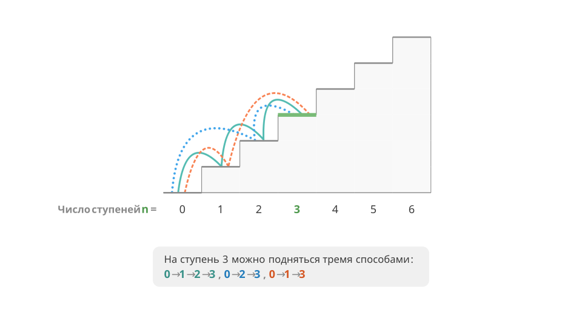

# Знакомство с динамическим программированием

<u>Динамическое программирование (dynamic programming)</u> — важный подход к построению алгоритмов. Задачу разбивают на меньшие подзадачи и сохраняют их решения. Это позволяет избежать повторных вычислений и существенно сократить время работы.

Начнём с классического примера. Сначала решим задачу полным перебором с возвратом, найдём повторяющиеся подзадачи, а затем постепенно перейдём к более эффективному решению методом динамического программирования.

!!! question "Подъём по лестнице"

    В лестнице $n$ ступеней. За шаг можно подняться на $1$ или $2$ ступени. Сколькими способами можно добраться до вершины?

Как показано на рисунке, для лестницы из $3$ ступеней есть $3$ способа подняться до вершины.



Нам нужно подсчитать способы подъёма. **Можно перебрать их все поиском с возвратом**. Представим подъём как последовательность выборов. Начнём с земли и на каждом шаге будем выбирать подъём на $1$ или $2$ ступени. Достигнув вершины, увеличим счётчик на $1$. Если шаг ведёт выше вершины, отсечём эту ветвь. Вот реализация:

```src
[file]{climbing_stairs_backtrack}-[class]{}-[func]{climbing_stairs_backtrack}
```

## Способ 1. Полный перебор

При поиске с возвратом обычно не выделяют подзадачи явно. Решение рассматривают как последовательность выборов и ищут все возможные варианты, пробуя очередной шаг и отсекая неподходящие ветви.

Посмотрим на ту же задачу с точки зрения разбиения. Пусть на ступень $i$ можно подняться $dp[i]$ способами. Тогда исходная задача — вычислить $dp[i]$, а её подзадачи таковы:

$$
dp[i-1], dp[i-2], \dots, dp[2], dp[1]
$$

За один шаг можно пройти вверх $1$ или $2$ ступени. Если мы стоим на ступени $i$, до этого мы стояли либо на ступени $i - 1$, либо на ступени $i - 2$. Иными словами, только со ступени $i -1$ или $i - 2$ можно одним шагом попасть на ступень $i$.

Отсюда важный вывод: **число способов достичь ступени $i - 1$ плюс число способов достичь ступени $i - 2$ равно числу способов достичь ступени $i$**. Запишем это формулой:

$$
dp[i] = dp[i-1] + dp[i-2]
$$

Таким образом, подзадачи о подъёме по лестнице связаны рекуррентным соотношением: **решение исходной задачи строится из решений подзадач**. На рисунке показана эта связь.


Рекуррентная формула даёт решение полным перебором. Начиная с $dp[n]$, **рекурсивно сводим каждую большую задачу к сумме решений двух меньших**. Достигнув простейших подзадач $dp[1]$ и $dp[2]$, возвращаем известные значения $dp[1] = 1$ и $dp[2] = 2$: для ступеней $1$ и $2$ число способов подъёма равно соответственно $1$ и $2$.

Как и обычный поиск с возвратом, приведённый ниже код выполняет поиск в глубину, но записывается короче:

```src
[file]{climbing_stairs_dfs}-[class]{}-[func]{climbing_stairs_dfs}
```

На рисунке показано дерево рекурсии полного перебора. Для задачи $dp[n]$ глубина дерева равна $n$, а временная сложность составляет $O(2^n)$. При экспоненциальном росте объём вычислений увеличивается стремительно: для достаточно большого $n$ ответа придётся ждать долго.


На рисунке видно, что **причина экспоненциальной сложности — повторяющиеся подзадачи**. Например, $dp[9]$ раскладывается на $dp[8]$ и $dp[7]$, а $dp[8]$ — на $dp[7]$ и $dp[6]$. В обоих случаях встречается $dp[7]$.

Каждая такая подзадача в свою очередь порождает ещё меньшие повторяющиеся подзадачи, и повторы продолжаются всё глубже. Именно на них уходит подавляющая часть вычислений.

## Способ 2. Поиск с мемоизацией

Чтобы ускорить алгоритм, **будем решать каждую повторяющуюся подзадачу лишь один раз**. Заведём массив `mem`, в котором будем сохранять решения и по ним отсекать ветви при повторном поиске.

1. Впервые вычислив $dp[i]$, сохраним значение в `mem[i]` для дальнейшего использования.
2. Когда снова понадобится $dp[i]$, возьмём результат прямо из `mem[i]` и обойдёмся без повторного решения подзадачи.

Вот соответствующий код:

```src
[file]{climbing_stairs_dfs_mem}-[class]{}-[func]{climbing_stairs_dfs_mem}
```

На рисунке видно, насколько велик выигрыш: **при мемоизации каждая повторяющаяся подзадача решается один раз, и временная сложность снижается до $O(n)$**.


## Способ 3. Динамическое программирование

**Поиск с мемоизацией идёт сверху вниз**: начиная с исходной задачи в корне дерева, мы рекурсивно разбиваем большие подзадачи на меньшие до тех пор, пока не дойдём до листьев с известными решениями. Затем при возврате из рекурсии уровень за уровнем объединяем решения подзадач и получаем решение исходной задачи.

**Динамическое программирование идёт в обратном направлении — снизу вверх**. Начинаем с решений простейших подзадач и итеративно строим решения всё более крупных, пока не получим ответ для исходной задачи.

Поскольку возвращаться по дереву вызовов не нужно, достаточно цикла без рекурсии. В следующем коде мы создаём массив `dp` для решений подзадач. Он играет ту же роль, что и массив `mem` при поиске с мемоизацией:

```src
[file]{climbing_stairs_dp}-[class]{}-[func]{climbing_stairs_dp}
```

На рисунке показано выполнение этого кода по шагам.


Как и при поиске с возвратом, в динамическом программировании определённый этап решения называют состоянием. Каждому состоянию соответствует подзадача и её локально оптимальное решение. Например, в задаче о лестнице состояние задаётся номером текущей ступени $i$.

Введём основные термины динамического программирования.

- Массив `dp` называется <u>таблицей dp</u>. Величина $dp[i]$ — решение подзадачи для состояния $i$.
- Состояния простейших подзадач (ступени $1$ и $2$) называют <u>начальными состояниями</u>.
- Рекуррентную формулу $dp[i] = dp[i-1] + dp[i-2]$ называют <u>формулой перехода между состояниями</u>.

## Экономия памяти

Возможно, вы уже заметили: **поскольку $dp[i]$ зависит только от $dp[i-1]$ и $dp[i-2]$, хранить все решения подзадач в массиве `dp` необязательно**. Достаточно двух переменных, значения которых будем сдвигать на каждом шаге:

```src
[file]{climbing_stairs_dp}-[class]{}-[func]{climbing_stairs_dp_comp}
```

В этом коде мы обошлись без массива `dp`, поэтому пространственная сложность снизилась с $O(n)$ до $O(1)$.

В задачах динамического программирования текущее состояние часто зависит лишь от нескольких предыдущих. Тогда можно хранить только нужные состояния и экономить память, уменьшая размерность таблицы. **Этот приём называют методом скользящих переменных или скользящего массива**.
