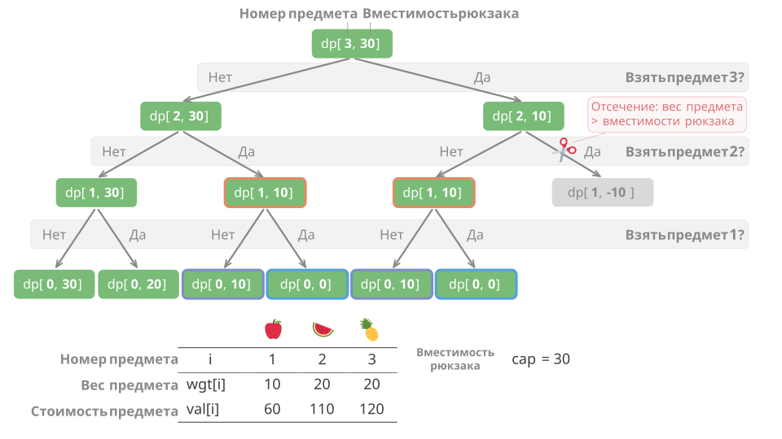
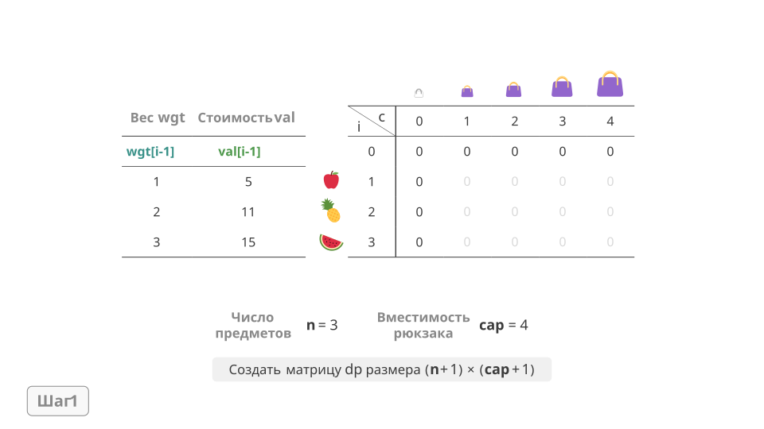
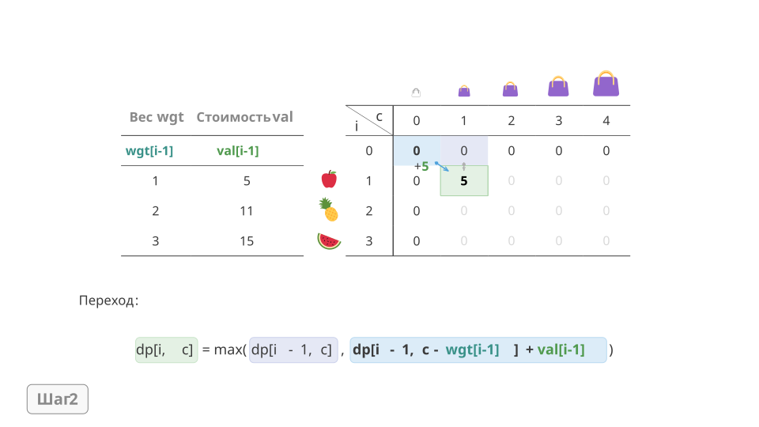
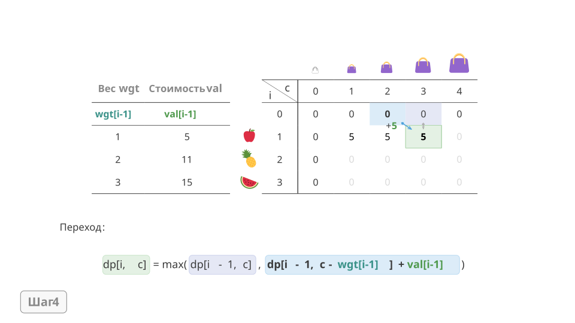
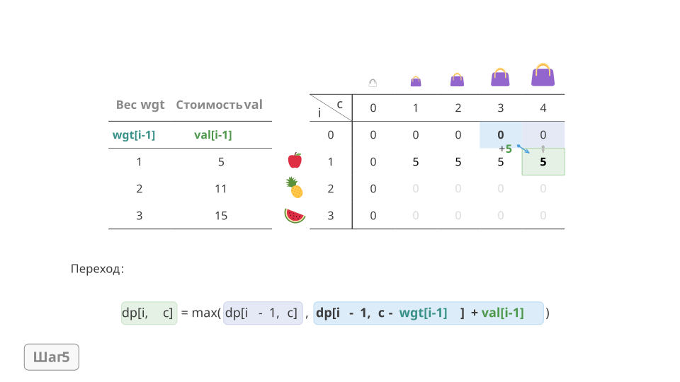
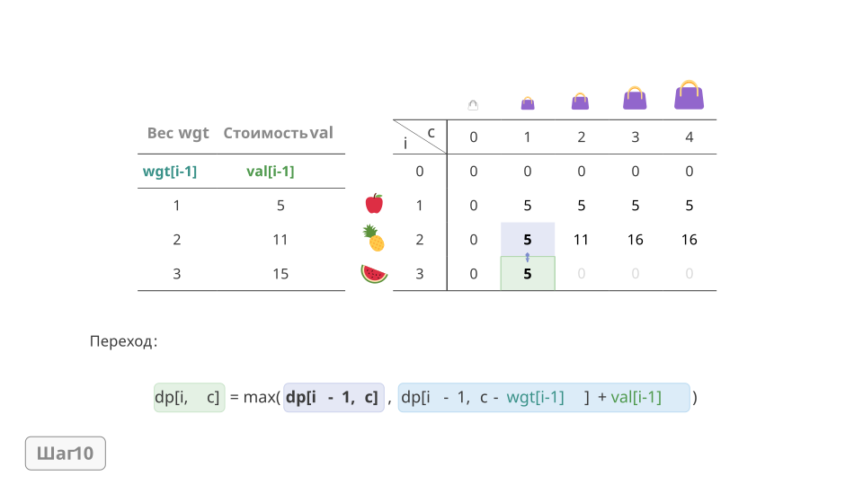
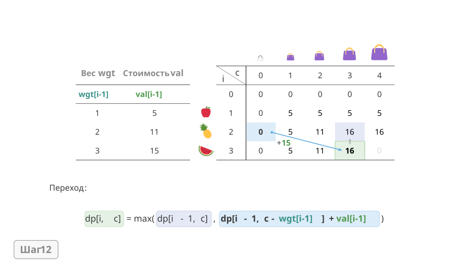
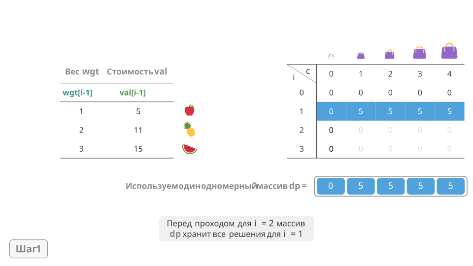
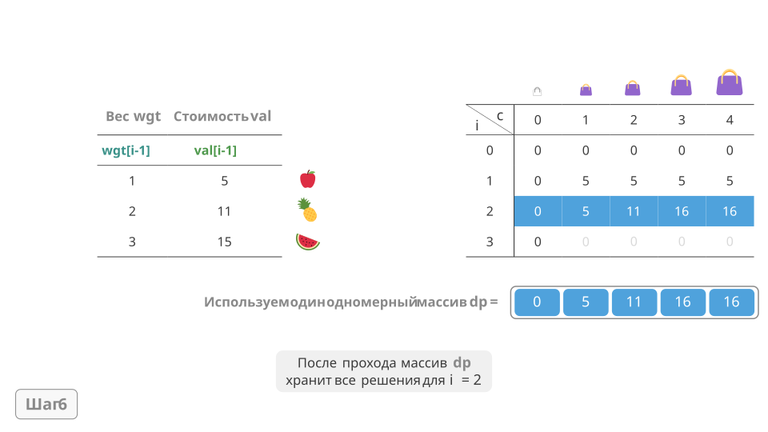

# Задача о рюкзаке 0–1

Задача о рюкзаке — одна из самых распространённых в динамическом программировании. С неё удобно начинать знакомство с методом. У задачи много разновидностей: рюкзак 0–1, неограниченный рюкзак, рюкзак с ограниченным числом экземпляров каждого предмета и другие.

В этом разделе разберём самый распространённый вариант — рюкзак 0–1.

!!! question

    Даны $n$ предметов. Предмет с номером $i$ имеет вес $wgt[i-1]$ и стоимость $val[i-1]$. Вместимость рюкзака равна $cap$. Каждый предмет можно взять только один раз. Какую максимальную стоимость можно набрать, не превысив вместимость?

На рисунке номера предметов $i$ начинаются с $1$, а индексы массивов — с $0$. Поэтому предмету $i$ соответствуют вес $wgt[i-1]$ и стоимость $val[i-1]$.


В задаче о рюкзаке 0–1 мы делаем выбор $n$ раз: для каждого предмета решаем, пропустить его или взять. Значит, задачу можно представить деревом решений.

Нужно найти максимальную стоимость предметов при ограниченной вместимости рюкзака. Такая постановка подсказывает, что, вероятно, подойдёт динамическое программирование.

**Шаг 1. Описать выбор на каждом шаге и определить состояния для таблицы $dp$**

Если пропустить предмет, доступная вместимость не изменится, а если взять его — уменьшится. Отсюда определение состояния: номер рассматриваемого предмета $i$ и вместимость рюкзака $c$. Обозначим состояние $[i, c]$.

Подзадача для состояния $[i, c]$: **найти максимальную стоимость при выборе из первых $i$ предметов для рюкзака вместимостью $c$**. Обозначим ответ $dp[i, c]$.

Требуется вычислить $dp[n, cap]$, поэтому нам понадобится двумерная таблица размера $(n+1) \times (cap+1)$. Обозначим её $dp$.

**Шаг 2. Найти оптимальную подструктуру и вывести формулу перехода**

Когда решение по предмету $i$ принято, остаётся подзадача для первых $i-1$ предметов. Возможны два случая.

- **Пропустить предмет $i$**. Вместимость не меняется, переходим в состояние $[i-1, c]$.
- **Взять предмет $i$**. Вместимость уменьшается на $wgt[i-1]$, стоимость возрастает на $val[i-1]$, а оставшаяся подзадача имеет состояние $[i-1, c-wgt[i-1]]$.

Теперь видна оптимальная подструктура: **максимальная стоимость $dp[i, c]$ равна большей из двух стоимостей — без предмета $i$ и с предметом $i$**. Отсюда следует формула перехода:

$$
dp[i, c] = \max(dp[i-1, c], dp[i-1, c - wgt[i-1]] + val[i-1])
$$

Если вес текущего предмета $wgt[i - 1]$ больше оставшейся вместимости $c$, единственный вариант — пропустить его.

**Шаг 3. Определить граничные условия и порядок переходов**

Если предметов нет или вместимость равна $0$, максимальная стоимость равна $0$. Поэтому первый столбец $dp[i, 0]$ и первая строка $dp[0, c]$ заполняются значением $0$.

Состояние $[i, c]$ зависит от состояния сверху $[i-1, c]$ и состояния выше и левее $[i-1, c-wgt[i-1]]$. Достаточно обойти всю таблицу $dp$ в прямом порядке двумя вложенными циклами.

Запишем три решения в таком порядке: полный перебор, поиск с мемоизацией, динамическое программирование.

### Способ 1. Полный перебор

Опишем элементы рекурсивного поиска.

- **Параметры рекурсии**: состояние $[i, c]$.
- **Возвращаемое значение**: решение подзадачи $dp[i, c]$.
- **Условие остановки**: когда предметов больше нет ($i = 0$) или оставшаяся вместимость равна $0$, завершаем рекурсию и возвращаем стоимость $0$.
- **Отсечение**: если предмет тяжелее, чем позволяет оставшееся место, его можно только пропустить.

```src
[file]{knapsack}-[class]{}-[func]{knapsack_dfs}
```

На рисунке от каждого предмета отходят две ветви поиска: пропустить или взять. Поэтому временная сложность составляет $O(2^n)$.

В дереве рекурсии видны повторяющиеся подзадачи, например $dp[1, 10]$. Когда много предметов и велика вместимость рюкзака, повторов становится гораздо больше, особенно если многие предметы имеют одинаковый вес.



### Способ 2. Поиск с мемоизацией

Чтобы решать каждую повторяющуюся подзадачу лишь раз, сохраним результаты в массиве `mem`. Ячейка `mem[i][c]` соответствует $dp[i, c]$.

С мемоизацией **время работы определяется числом подзадач** и составляет $O(n \times cap)$. Реализация:

```src
[file]{knapsack}-[class]{}-[func]{knapsack_dfs_mem}
```

На рисунке показано, какие ветви отсекает поиск с мемоизацией.


### Способ 3. Динамическое программирование

Динамическое программирование сводится к заполнению таблицы $dp$ по формуле перехода:

```src
[file]{knapsack}-[class]{}-[func]{knapsack_dp}
```

Как видно на рисунке, время и память определяются размером массива `dp`. Обе оценки равны $O(n \times cap)$.

=== "<1>"
    

=== "<2>"
    

=== "<3>"
    

=== "<4>"
    

=== "<5>"
    

=== "<6>"
    

=== "<7>"
    

=== "<8>"
    

=== "<9>"
    

=== "<10>"
    

=== "<11>"
    

=== "<12>"
    

=== "<13>"
    

=== "<14>"
    

### Экономия памяти

Каждое состояние зависит только от предыдущей строки. Можно использовать два массива, меняя их ролями, и сократить пространственную сложность с $O(n \times cap)$ до $O(cap)$.

А можно ли обойтись одним массивом? Каждое состояние зависит от ячейки прямо над ним или выше и левее. Когда мы начинаем обход строки $i$, в единственном массиве ещё лежат состояния строки $i-1$.

- При обходе вместимостей по возрастанию значение предыдущей строки $dp[i-1, c-wgt[i-1]]$, нужное для вычисления $dp[i, c]$, может быть уже перезаписано. Тогда один и тот же предмет можно ошибочно учесть несколько раз.
- При обратном обходе нужные значения сохраняются до чтения, и переход выполняется правильно.

На рисунке показано, как в одном массиве сменяются строки $i = 1$ и $i = 2$. Проследите, чем отличаются прямой и обратный порядки обхода.

=== "<1>"
    

=== "<2>"
    

=== "<3>"
    

=== "<4>"
    

=== "<5>"
    

=== "<6>"
    

В коде достаточно убрать у массива `dp` первое измерение $i$ и развернуть порядок обхода во внутреннем цикле:

```src
[file]{knapsack}-[class]{}-[func]{knapsack_dp_comp}
```
