# 14.4 &nbsp; Задача о рюкзаке 0–1

Задача о рюкзаке — одна из самых распространённых в динамическом программировании. С неё удобно начинать знакомство с методом. У задачи много разновидностей: рюкзак 0–1, неограниченный рюкзак, рюкзак с ограниченным числом экземпляров каждого предмета и другие.

В этом разделе разберём самый распространённый вариант — рюкзак 0–1.

!!! question

    Даны $n$ предметов. Предмет с номером $i$ имеет вес $wgt[i-1]$ и стоимость $val[i-1]$. Вместимость рюкзака равна $cap$. Каждый предмет можно взять только один раз. Какую максимальную стоимость можно набрать, не превысив вместимость?

На рисунке номера предметов $i$ начинаются с $1$, а индексы массивов — с $0$. Поэтому предмету $i$ соответствуют вес $wgt[i-1]$ и стоимость $val[i-1]$.

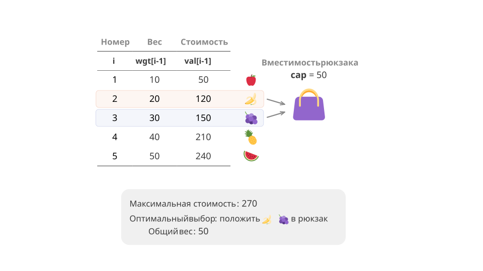{ class="animation-figure" }

<p align="center"> Рисунок 14-17 &nbsp; Пример данных для задачи о рюкзаке 0–1 </p>

В задаче о рюкзаке 0–1 мы делаем выбор $n$ раз: для каждого предмета решаем, пропустить его или взять. Значит, задачу можно представить деревом решений.

Нужно найти максимальную стоимость предметов при ограниченной вместимости рюкзака. Такая постановка подсказывает, что, вероятно, подойдёт динамическое программирование.

**Шаг 1. Описать выбор на каждом шаге и определить состояния для таблицы $dp$**

Если пропустить предмет, доступная вместимость не изменится, а если взять его — уменьшится. Отсюда определение состояния: номер рассматриваемого предмета $i$ и вместимость рюкзака $c$. Обозначим состояние $[i, c]$.

Подзадача для состояния $[i, c]$: **найти максимальную стоимость при выборе из первых $i$ предметов для рюкзака вместимостью $c$**. Обозначим ответ $dp[i, c]$.

Требуется вычислить $dp[n, cap]$, поэтому нам понадобится двумерная таблица размера $(n+1) \times (cap+1)$. Обозначим её $dp$.

**Шаг 2. Найти оптимальную подструктуру и вывести формулу перехода**

Когда решение по предмету $i$ принято, остаётся подзадача для первых $i-1$ предметов. Возможны два случая.

- **Пропустить предмет $i$**. Вместимость не меняется, переходим в состояние $[i-1, c]$.
- **Взять предмет $i$**. Вместимость уменьшается на $wgt[i-1]$, стоимость возрастает на $val[i-1]$, а оставшаяся подзадача имеет состояние $[i-1, c-wgt[i-1]]$.

Теперь видна оптимальная подструктура: **максимальная стоимость $dp[i, c]$ равна большей из двух стоимостей — без предмета $i$ и с предметом $i$**. Отсюда следует формула перехода:

$$
dp[i, c] = \max(dp[i-1, c], dp[i-1, c - wgt[i-1]] + val[i-1])
$$

Если вес текущего предмета $wgt[i - 1]$ больше оставшейся вместимости $c$, единственный вариант — пропустить его.

**Шаг 3. Определить граничные условия и порядок переходов**

Если предметов нет или вместимость равна $0$, максимальная стоимость равна $0$. Поэтому первый столбец $dp[i, 0]$ и первая строка $dp[0, c]$ заполняются значением $0$.

Состояние $[i, c]$ зависит от состояния сверху $[i-1, c]$ и состояния выше и левее $[i-1, c-wgt[i-1]]$. Достаточно обойти всю таблицу $dp$ в прямом порядке двумя вложенными циклами.

Запишем три решения в таком порядке: полный перебор, поиск с мемоизацией, динамическое программирование.

### 1. &nbsp; Способ 1. Полный перебор

Опишем элементы рекурсивного поиска.

- **Параметры рекурсии**: состояние $[i, c]$.
- **Возвращаемое значение**: решение подзадачи $dp[i, c]$.
- **Условие остановки**: когда предметов больше нет ($i = 0$) или оставшаяся вместимость равна $0$, завершаем рекурсию и возвращаем стоимость $0$.
- **Отсечение**: если предмет тяжелее, чем позволяет оставшееся место, его можно только пропустить.

=== "Python"

    ```python title="knapsack.py"
    def knapsack_dfs(wgt: list[int], val: list[int], i: int, c: int) -> int:
        """Рюкзак 0–1: полный перебор"""
        # Если предметы закончились или места не осталось, вернуть стоимость 0
        if i == 0 or c == 0:
            return 0
        # Если предмет тяжелее допустимого, остаётся только пропустить его
        if wgt[i - 1] > c:
            return knapsack_dfs(wgt, val, i - 1, c)
        # Вычислить максимальную стоимость без предмета i и с ним
        no = knapsack_dfs(wgt, val, i - 1, c)
        yes = knapsack_dfs(wgt, val, i - 1, c - wgt[i - 1]) + val[i - 1]
        # Вернуть большую из двух стоимостей
        return max(no, yes)
    ```

=== "C++"

    ```cpp title="knapsack.cpp"
    /* Рюкзак 0–1: полный перебор */
    int knapsackDFS(vector<int> &wgt, vector<int> &val, int i, int c) {
        // Если предметы закончились или места не осталось, вернуть стоимость 0
        if (i == 0 || c == 0) {
            return 0;
        }
        // Если предмет тяжелее допустимого, остаётся только пропустить его
        if (wgt[i - 1] > c) {
            return knapsackDFS(wgt, val, i - 1, c);
        }
        // Вычислить максимальную стоимость без предмета i и с ним
        int no = knapsackDFS(wgt, val, i - 1, c);
        int yes = knapsackDFS(wgt, val, i - 1, c - wgt[i - 1]) + val[i - 1];
        // Вернуть большую из двух стоимостей
        return max(no, yes);
    }
    ```

=== "Java"

    ```java title="knapsack.java"
    /* Рюкзак 0–1: полный перебор */
    int knapsackDFS(int[] wgt, int[] val, int i, int c) {
        // Если предметы закончились или места не осталось, вернуть стоимость 0
        if (i == 0 || c == 0) {
            return 0;
        }
        // Если предмет тяжелее допустимого, остаётся только пропустить его
        if (wgt[i - 1] > c) {
            return knapsackDFS(wgt, val, i - 1, c);
        }
        // Вычислить максимальную стоимость без предмета i и с ним
        int no = knapsackDFS(wgt, val, i - 1, c);
        int yes = knapsackDFS(wgt, val, i - 1, c - wgt[i - 1]) + val[i - 1];
        // Вернуть большую из двух стоимостей
        return Math.max(no, yes);
    }
    ```

=== "C#"

    ```csharp title="knapsack.cs"
    /* Рюкзак 0–1: полный перебор */
    int KnapsackDFS(int[] weight, int[] val, int i, int c) {
        // Если предметы закончились или места не осталось, вернуть стоимость 0
        if (i == 0 || c == 0) {
            return 0;
        }
        // Если предмет тяжелее допустимого, остаётся только пропустить его
        if (weight[i - 1] > c) {
            return KnapsackDFS(weight, val, i - 1, c);
        }
        // Вычислить максимальную стоимость без предмета i и с ним
        int no = KnapsackDFS(weight, val, i - 1, c);
        int yes = KnapsackDFS(weight, val, i - 1, c - weight[i - 1]) + val[i - 1];
        // Вернуть большую из двух стоимостей
        return Math.Max(no, yes);
    }
    ```

=== "Go"

    ```go title="knapsack.go"
    /* Рюкзак 0–1: полный перебор */
    func knapsackDFS(wgt, val []int, i, c int) int {
        // Если предметы закончились или места не осталось, вернуть стоимость 0
        if i == 0 || c == 0 {
            return 0
        }
        // Если предмет тяжелее допустимого, остаётся только пропустить его
        if wgt[i-1] > c {
            return knapsackDFS(wgt, val, i-1, c)
        }
        // Вычислить максимальную стоимость без предмета i и с ним
        no := knapsackDFS(wgt, val, i-1, c)
        yes := knapsackDFS(wgt, val, i-1, c-wgt[i-1]) + val[i-1]
        // Вернуть большую из двух стоимостей
        return int(math.Max(float64(no), float64(yes)))
    }
    ```

=== "Swift"

    ```swift title="knapsack.swift"
    /* Рюкзак 0–1: полный перебор */
    func knapsackDFS(wgt: [Int], val: [Int], i: Int, c: Int) -> Int {
        // Если предметы закончились или места не осталось, вернуть стоимость 0
        if i == 0 || c == 0 {
            return 0
        }
        // Если предмет тяжелее допустимого, остаётся только пропустить его
        if wgt[i - 1] > c {
            return knapsackDFS(wgt: wgt, val: val, i: i - 1, c: c)
        }
        // Вычислить максимальную стоимость без предмета i и с ним
        let no = knapsackDFS(wgt: wgt, val: val, i: i - 1, c: c)
        let yes = knapsackDFS(wgt: wgt, val: val, i: i - 1, c: c - wgt[i - 1]) + val[i - 1]
        // Вернуть большую из двух стоимостей
        return max(no, yes)
    }
    ```

=== "JS"

    ```javascript title="knapsack.js"
    /* Рюкзак 0–1: полный перебор */
    function knapsackDFS(wgt, val, i, c) {
        // Если предметы закончились или места не осталось, вернуть стоимость 0
        if (i === 0 || c === 0) {
            return 0;
        }
        // Если предмет тяжелее допустимого, остаётся только пропустить его
        if (wgt[i - 1] > c) {
            return knapsackDFS(wgt, val, i - 1, c);
        }
        // Вычислить максимальную стоимость без предмета i и с ним
        const no = knapsackDFS(wgt, val, i - 1, c);
        const yes = knapsackDFS(wgt, val, i - 1, c - wgt[i - 1]) + val[i - 1];
        // Вернуть большую из двух стоимостей
        return Math.max(no, yes);
    }
    ```

=== "TS"

    ```typescript title="knapsack.ts"
    /* Рюкзак 0–1: полный перебор */
    function knapsackDFS(
        wgt: Array<number>,
        val: Array<number>,
        i: number,
        c: number
    ): number {
        // Если предметы закончились или места не осталось, вернуть стоимость 0
        if (i === 0 || c === 0) {
            return 0;
        }
        // Если предмет тяжелее допустимого, остаётся только пропустить его
        if (wgt[i - 1] > c) {
            return knapsackDFS(wgt, val, i - 1, c);
        }
        // Вычислить максимальную стоимость без предмета i и с ним
        const no = knapsackDFS(wgt, val, i - 1, c);
        const yes = knapsackDFS(wgt, val, i - 1, c - wgt[i - 1]) + val[i - 1];
        // Вернуть большую из двух стоимостей
        return Math.max(no, yes);
    }
    ```

=== "Dart"

    ```dart title="knapsack.dart"
    /* Рюкзак 0–1: полный перебор */
    int knapsackDFS(List<int> wgt, List<int> val, int i, int c) {
      // Если предметы закончились или места не осталось, вернуть стоимость 0
      if (i == 0 || c == 0) {
        return 0;
      }
      // Если предмет тяжелее допустимого, остаётся только пропустить его
      if (wgt[i - 1] > c) {
        return knapsackDFS(wgt, val, i - 1, c);
      }
      // Вычислить максимальную стоимость без предмета i и с ним
      int no = knapsackDFS(wgt, val, i - 1, c);
      int yes = knapsackDFS(wgt, val, i - 1, c - wgt[i - 1]) + val[i - 1];
      // Вернуть большую из двух стоимостей
      return max(no, yes);
    }
    ```

=== "Rust"

    ```rust title="knapsack.rs"
    /* Рюкзак 0–1: полный перебор */
    fn knapsack_dfs(wgt: &[i32], val: &[i32], i: usize, c: usize) -> i32 {
        // Если предметы закончились или места не осталось, вернуть стоимость 0
        if i == 0 || c == 0 {
            return 0;
        }
        // Если предмет тяжелее допустимого, остаётся только пропустить его
        if wgt[i - 1] > c as i32 {
            return knapsack_dfs(wgt, val, i - 1, c);
        }
        // Вычислить максимальную стоимость без предмета i и с ним
        let no = knapsack_dfs(wgt, val, i - 1, c);
        let yes = knapsack_dfs(wgt, val, i - 1, c - wgt[i - 1] as usize) + val[i - 1];
        // Вернуть большую из двух стоимостей
        std::cmp::max(no, yes)
    }
    ```

=== "C"

    ```c title="knapsack.c"
    /* Рюкзак 0–1: полный перебор */
    int knapsackDFS(int wgt[], int val[], int i, int c) {
        // Если предметы закончились или места не осталось, вернуть стоимость 0
        if (i == 0 || c == 0) {
            return 0;
        }
        // Если предмет тяжелее допустимого, остаётся только пропустить его
        if (wgt[i - 1] > c) {
            return knapsackDFS(wgt, val, i - 1, c);
        }
        // Вычислить максимальную стоимость без предмета i и с ним
        int no = knapsackDFS(wgt, val, i - 1, c);
        int yes = knapsackDFS(wgt, val, i - 1, c - wgt[i - 1]) + val[i - 1];
        // Вернуть большую из двух стоимостей
        return myMax(no, yes);
    }
    ```

=== "Kotlin"

    ```kotlin title="knapsack.kt"
    /* Рюкзак 0–1: полный перебор */
    fun knapsackDFS(
        wgt: IntArray,
        _val: IntArray,
        i: Int,
        c: Int
    ): Int {
        // Если предметы закончились или места не осталось, вернуть стоимость 0
        if (i == 0 || c == 0) {
            return 0
        }
        // Если предмет тяжелее допустимого, остаётся только пропустить его
        if (wgt[i - 1] > c) {
            return knapsackDFS(wgt, _val, i - 1, c)
        }
        // Вычислить максимальную стоимость без предмета i и с ним
        val no = knapsackDFS(wgt, _val, i - 1, c)
        val yes = knapsackDFS(wgt, _val, i - 1, c - wgt[i - 1]) + _val[i - 1]
        // Вернуть большую из двух стоимостей
        return max(no, yes)
    }
    ```

=== "Ruby"

    ```ruby title="knapsack.rb"
    ### Рюкзак 0–1: полный перебор ###
    def knapsack_dfs(wgt, val, i, c)
      # Если предметы закончились или места не осталось, вернуть стоимость 0
      return 0 if i == 0 || c == 0
      # Если предмет тяжелее допустимого, остаётся только пропустить его
      return knapsack_dfs(wgt, val, i - 1, c) if wgt[i - 1] > c
      # Вычислить максимальную стоимость без предмета i и с ним
      no = knapsack_dfs(wgt, val, i - 1, c)
      yes = knapsack_dfs(wgt, val, i - 1, c - wgt[i - 1]) + val[i - 1]
      # Вернуть большую из двух стоимостей
      [no, yes].max
    end
    ```

??? pythontutor "Визуализация выполнения"

    <div style="height: 549px; width: 100%;"><iframe class="pythontutor-iframe" title="Визуализация выполнения" src="https://pythontutor.com/iframe-embed.html#code=def%20knapsack_dfs%28wgt%3A%20list%5Bint%5D,%20val%3A%20list%5Bint%5D,%20i%3A%20int,%20c%3A%20int%29%20-%3E%20int%3A%0A%20%20%20%20%22%22%22%D0%A0%D1%8E%D0%BA%D0%B7%D0%B0%D0%BA%200%E2%80%931%3A%20%D0%BF%D0%BE%D0%BB%D0%BD%D1%8B%D0%B9%20%D0%BF%D0%B5%D1%80%D0%B5%D0%B1%D0%BE%D1%80%22%22%22%0A%20%20%20%20%23%20%D0%95%D1%81%D0%BB%D0%B8%20%D0%BF%D1%80%D0%B5%D0%B4%D0%BC%D0%B5%D1%82%D1%8B%20%D0%B7%D0%B0%D0%BA%D0%BE%D0%BD%D1%87%D0%B8%D0%BB%D0%B8%D1%81%D1%8C%20%D0%B8%D0%BB%D0%B8%20%D0%BC%D0%B5%D1%81%D1%82%D0%B0%20%D0%BD%D0%B5%20%D0%BE%D1%81%D1%82%D0%B0%D0%BB%D0%BE%D1%81%D1%8C,%20%D0%B2%D0%B5%D1%80%D0%BD%D1%83%D1%82%D1%8C%20%D1%81%D1%82%D0%BE%D0%B8%D0%BC%D0%BE%D1%81%D1%82%D1%8C%200%0A%20%20%20%20if%20i%20%3D%3D%200%20or%20c%20%3D%3D%200%3A%0A%20%20%20%20%20%20%20%20return%200%0A%20%20%20%20%23%20%D0%95%D1%81%D0%BB%D0%B8%20%D0%BF%D1%80%D0%B5%D0%B4%D0%BC%D0%B5%D1%82%20%D1%82%D1%8F%D0%B6%D0%B5%D0%BB%D0%B5%D0%B5%20%D0%B4%D0%BE%D0%BF%D1%83%D1%81%D1%82%D0%B8%D0%BC%D0%BE%D0%B3%D0%BE,%20%D0%BE%D1%81%D1%82%D0%B0%D1%91%D1%82%D1%81%D1%8F%20%D1%82%D0%BE%D0%BB%D1%8C%D0%BA%D0%BE%20%D0%BF%D1%80%D0%BE%D0%BF%D1%83%D1%81%D1%82%D0%B8%D1%82%D1%8C%20%D0%B5%D0%B3%D0%BE%0A%20%20%20%20if%20wgt%5Bi%20-%201%5D%20%3E%20c%3A%0A%20%20%20%20%20%20%20%20return%20knapsack_dfs%28wgt,%20val,%20i%20-%201,%20c%29%0A%20%20%20%20%23%20%D0%92%D1%8B%D1%87%D0%B8%D1%81%D0%BB%D0%B8%D1%82%D1%8C%20%D0%BC%D0%B0%D0%BA%D1%81%D0%B8%D0%BC%D0%B0%D0%BB%D1%8C%D0%BD%D1%83%D1%8E%20%D1%81%D1%82%D0%BE%D0%B8%D0%BC%D0%BE%D1%81%D1%82%D1%8C%20%D0%B1%D0%B5%D0%B7%20%D0%BF%D1%80%D0%B5%D0%B4%D0%BC%D0%B5%D1%82%D0%B0%20i%20%D0%B8%20%D1%81%20%D0%BD%D0%B8%D0%BC%0A%20%20%20%20no%20%3D%20knapsack_dfs%28wgt,%20val,%20i%20-%201,%20c%29%0A%20%20%20%20yes%20%3D%20knapsack_dfs%28wgt,%20val,%20i%20-%201,%20c%20-%20wgt%5Bi%20-%201%5D%29%20%2B%20val%5Bi%20-%201%5D%0A%20%20%20%20%23%20%D0%92%D0%B5%D1%80%D0%BD%D1%83%D1%82%D1%8C%20%D0%B1%D0%BE%D0%BB%D1%8C%D1%88%D1%83%D1%8E%20%D0%B8%D0%B7%20%D0%B4%D0%B2%D1%83%D1%85%20%D1%81%D1%82%D0%BE%D0%B8%D0%BC%D0%BE%D1%81%D1%82%D0%B5%D0%B9%0A%20%20%20%20return%20max%28no,%20yes%29%0A%0A%0A%22%22%22Driver%20Code%22%22%22%0Aif%20__name__%20%3D%3D%20%22__main__%22%3A%0A%20%20%20%20wgt%20%3D%20%5B10,%2020,%2030,%2040,%2050%5D%0A%20%20%20%20val%20%3D%20%5B50,%20120,%20150,%20210,%20240%5D%0A%20%20%20%20cap%20%3D%2050%0A%20%20%20%20n%20%3D%20len%28wgt%29%0A%0A%20%20%20%20%23%20%D0%9F%D0%BE%D0%BB%D0%BD%D1%8B%D0%B9%20%D0%BF%D0%B5%D1%80%D0%B5%D0%B1%D0%BE%D1%80%0A%20%20%20%20res%20%3D%20knapsack_dfs%28wgt,%20val,%20n,%20cap%29%0A%20%20%20%20print%28f%22%D0%9C%D0%B0%D0%BA%D1%81%D0%B8%D0%BC%D0%B0%D0%BB%D1%8C%D0%BD%D0%B0%D1%8F%20%D1%81%D1%82%D0%BE%D0%B8%D0%BC%D0%BE%D1%81%D1%82%D1%8C%20%D0%BF%D1%80%D0%B5%D0%B4%D0%BC%D0%B5%D1%82%D0%BE%D0%B2,%20%D0%BF%D0%BE%D0%BC%D0%B5%D1%89%D0%B0%D1%8E%D1%89%D0%B8%D1%85%D1%81%D1%8F%20%D0%B2%20%D1%80%D1%8E%D0%BA%D0%B7%D0%B0%D0%BA%3A%20%7Bres%7D%22%29&codeDivHeight=472&codeDivWidth=350&cumulative=false&curInstr=7&heapPrimitives=nevernest&origin=opt-frontend.js&py=311&rawInputLstJSON=%5B%5D&textReferences=false"> </iframe></div>
    <div style="margin-top: 5px;"><a href="https://pythontutor.com/iframe-embed.html#code=def%20knapsack_dfs%28wgt%3A%20list%5Bint%5D,%20val%3A%20list%5Bint%5D,%20i%3A%20int,%20c%3A%20int%29%20-%3E%20int%3A%0A%20%20%20%20%22%22%22%D0%A0%D1%8E%D0%BA%D0%B7%D0%B0%D0%BA%200%E2%80%931%3A%20%D0%BF%D0%BE%D0%BB%D0%BD%D1%8B%D0%B9%20%D0%BF%D0%B5%D1%80%D0%B5%D0%B1%D0%BE%D1%80%22%22%22%0A%20%20%20%20%23%20%D0%95%D1%81%D0%BB%D0%B8%20%D0%BF%D1%80%D0%B5%D0%B4%D0%BC%D0%B5%D1%82%D1%8B%20%D0%B7%D0%B0%D0%BA%D0%BE%D0%BD%D1%87%D0%B8%D0%BB%D0%B8%D1%81%D1%8C%20%D0%B8%D0%BB%D0%B8%20%D0%BC%D0%B5%D1%81%D1%82%D0%B0%20%D0%BD%D0%B5%20%D0%BE%D1%81%D1%82%D0%B0%D0%BB%D0%BE%D1%81%D1%8C,%20%D0%B2%D0%B5%D1%80%D0%BD%D1%83%D1%82%D1%8C%20%D1%81%D1%82%D0%BE%D0%B8%D0%BC%D0%BE%D1%81%D1%82%D1%8C%200%0A%20%20%20%20if%20i%20%3D%3D%200%20or%20c%20%3D%3D%200%3A%0A%20%20%20%20%20%20%20%20return%200%0A%20%20%20%20%23%20%D0%95%D1%81%D0%BB%D0%B8%20%D0%BF%D1%80%D0%B5%D0%B4%D0%BC%D0%B5%D1%82%20%D1%82%D1%8F%D0%B6%D0%B5%D0%BB%D0%B5%D0%B5%20%D0%B4%D0%BE%D0%BF%D1%83%D1%81%D1%82%D0%B8%D0%BC%D0%BE%D0%B3%D0%BE,%20%D0%BE%D1%81%D1%82%D0%B0%D1%91%D1%82%D1%81%D1%8F%20%D1%82%D0%BE%D0%BB%D1%8C%D0%BA%D0%BE%20%D0%BF%D1%80%D0%BE%D0%BF%D1%83%D1%81%D1%82%D0%B8%D1%82%D1%8C%20%D0%B5%D0%B3%D0%BE%0A%20%20%20%20if%20wgt%5Bi%20-%201%5D%20%3E%20c%3A%0A%20%20%20%20%20%20%20%20return%20knapsack_dfs%28wgt,%20val,%20i%20-%201,%20c%29%0A%20%20%20%20%23%20%D0%92%D1%8B%D1%87%D0%B8%D1%81%D0%BB%D0%B8%D1%82%D1%8C%20%D0%BC%D0%B0%D0%BA%D1%81%D0%B8%D0%BC%D0%B0%D0%BB%D1%8C%D0%BD%D1%83%D1%8E%20%D1%81%D1%82%D0%BE%D0%B8%D0%BC%D0%BE%D1%81%D1%82%D1%8C%20%D0%B1%D0%B5%D0%B7%20%D0%BF%D1%80%D0%B5%D0%B4%D0%BC%D0%B5%D1%82%D0%B0%20i%20%D0%B8%20%D1%81%20%D0%BD%D0%B8%D0%BC%0A%20%20%20%20no%20%3D%20knapsack_dfs%28wgt,%20val,%20i%20-%201,%20c%29%0A%20%20%20%20yes%20%3D%20knapsack_dfs%28wgt,%20val,%20i%20-%201,%20c%20-%20wgt%5Bi%20-%201%5D%29%20%2B%20val%5Bi%20-%201%5D%0A%20%20%20%20%23%20%D0%92%D0%B5%D1%80%D0%BD%D1%83%D1%82%D1%8C%20%D0%B1%D0%BE%D0%BB%D1%8C%D1%88%D1%83%D1%8E%20%D0%B8%D0%B7%20%D0%B4%D0%B2%D1%83%D1%85%20%D1%81%D1%82%D0%BE%D0%B8%D0%BC%D0%BE%D1%81%D1%82%D0%B5%D0%B9%0A%20%20%20%20return%20max%28no,%20yes%29%0A%0A%0A%22%22%22Driver%20Code%22%22%22%0Aif%20__name__%20%3D%3D%20%22__main__%22%3A%0A%20%20%20%20wgt%20%3D%20%5B10,%2020,%2030,%2040,%2050%5D%0A%20%20%20%20val%20%3D%20%5B50,%20120,%20150,%20210,%20240%5D%0A%20%20%20%20cap%20%3D%2050%0A%20%20%20%20n%20%3D%20len%28wgt%29%0A%0A%20%20%20%20%23%20%D0%9F%D0%BE%D0%BB%D0%BD%D1%8B%D0%B9%20%D0%BF%D0%B5%D1%80%D0%B5%D0%B1%D0%BE%D1%80%0A%20%20%20%20res%20%3D%20knapsack_dfs%28wgt,%20val,%20n,%20cap%29%0A%20%20%20%20print%28f%22%D0%9C%D0%B0%D0%BA%D1%81%D0%B8%D0%BC%D0%B0%D0%BB%D1%8C%D0%BD%D0%B0%D1%8F%20%D1%81%D1%82%D0%BE%D0%B8%D0%BC%D0%BE%D1%81%D1%82%D1%8C%20%D0%BF%D1%80%D0%B5%D0%B4%D0%BC%D0%B5%D1%82%D0%BE%D0%B2,%20%D0%BF%D0%BE%D0%BC%D0%B5%D1%89%D0%B0%D1%8E%D1%89%D0%B8%D1%85%D1%81%D1%8F%20%D0%B2%20%D1%80%D1%8E%D0%BA%D0%B7%D0%B0%D0%BA%3A%20%7Bres%7D%22%29&codeDivHeight=800&codeDivWidth=600&cumulative=false&curInstr=7&heapPrimitives=nevernest&origin=opt-frontend.js&py=311&rawInputLstJSON=%5B%5D&textReferences=false" target="_blank" rel="noopener noreferrer">Во весь экран ></a></div>

На рисунке от каждого предмета отходят две ветви поиска: пропустить или взять. Поэтому временная сложность составляет $O(2^n)$.

В дереве рекурсии видны повторяющиеся подзадачи, например $dp[1, 10]$. Когда много предметов и велика вместимость рюкзака, повторов становится гораздо больше, особенно если многие предметы имеют одинаковый вес.

{ class="animation-figure" }

<p align="center"> Рисунок 14-18 &nbsp; Дерево рекурсии полного перебора для задачи о рюкзаке 0–1 </p>

### 2. &nbsp; Способ 2. Поиск с мемоизацией

Чтобы решать каждую повторяющуюся подзадачу лишь раз, сохраним результаты в массиве `mem`. Ячейка `mem[i][c]` соответствует $dp[i, c]$.

С мемоизацией **время работы определяется числом подзадач** и составляет $O(n \times cap)$. Реализация:

=== "Python"

    ```python title="knapsack.py"
    def knapsack_dfs_mem(
        wgt: list[int], val: list[int], mem: list[list[int]], i: int, c: int
    ) -> int:
        """Рюкзак 0–1: поиск с мемоизацией"""
        # Если предметы закончились или места не осталось, вернуть стоимость 0
        if i == 0 or c == 0:
            return 0
        # Если результат сохранён, сразу вернуть его
        if mem[i][c] != -1:
            return mem[i][c]
        # Если предмет тяжелее допустимого, остаётся только пропустить его
        if wgt[i - 1] > c:
            return knapsack_dfs_mem(wgt, val, mem, i - 1, c)
        # Вычислить максимальную стоимость без предмета i и с ним
        no = knapsack_dfs_mem(wgt, val, mem, i - 1, c)
        yes = knapsack_dfs_mem(wgt, val, mem, i - 1, c - wgt[i - 1]) + val[i - 1]
        # Сохранить и вернуть большую из двух стоимостей
        mem[i][c] = max(no, yes)
        return mem[i][c]
    ```

=== "C++"

    ```cpp title="knapsack.cpp"
    /* Рюкзак 0–1: поиск с мемоизацией */
    int knapsackDFSMem(vector<int> &wgt, vector<int> &val, vector<vector<int>> &mem, int i, int c) {
        // Если предметы закончились или места не осталось, вернуть стоимость 0
        if (i == 0 || c == 0) {
            return 0;
        }
        // Если результат сохранён, сразу вернуть его
        if (mem[i][c] != -1) {
            return mem[i][c];
        }
        // Если предмет тяжелее допустимого, остаётся только пропустить его
        if (wgt[i - 1] > c) {
            return knapsackDFSMem(wgt, val, mem, i - 1, c);
        }
        // Вычислить максимальную стоимость без предмета i и с ним
        int no = knapsackDFSMem(wgt, val, mem, i - 1, c);
        int yes = knapsackDFSMem(wgt, val, mem, i - 1, c - wgt[i - 1]) + val[i - 1];
        // Сохранить и вернуть большую из двух стоимостей
        mem[i][c] = max(no, yes);
        return mem[i][c];
    }
    ```

=== "Java"

    ```java title="knapsack.java"
    /* Рюкзак 0–1: поиск с мемоизацией */
    int knapsackDFSMem(int[] wgt, int[] val, int[][] mem, int i, int c) {
        // Если предметы закончились или места не осталось, вернуть стоимость 0
        if (i == 0 || c == 0) {
            return 0;
        }
        // Если результат сохранён, сразу вернуть его
        if (mem[i][c] != -1) {
            return mem[i][c];
        }
        // Если предмет тяжелее допустимого, остаётся только пропустить его
        if (wgt[i - 1] > c) {
            return knapsackDFSMem(wgt, val, mem, i - 1, c);
        }
        // Вычислить максимальную стоимость без предмета i и с ним
        int no = knapsackDFSMem(wgt, val, mem, i - 1, c);
        int yes = knapsackDFSMem(wgt, val, mem, i - 1, c - wgt[i - 1]) + val[i - 1];
        // Сохранить и вернуть большую из двух стоимостей
        mem[i][c] = Math.max(no, yes);
        return mem[i][c];
    }
    ```

=== "C#"

    ```csharp title="knapsack.cs"
    /* Рюкзак 0–1: поиск с мемоизацией */
    int KnapsackDFSMem(int[] weight, int[] val, int[][] mem, int i, int c) {
        // Если предметы закончились или места не осталось, вернуть стоимость 0
        if (i == 0 || c == 0) {
            return 0;
        }
        // Если результат сохранён, сразу вернуть его
        if (mem[i][c] != -1) {
            return mem[i][c];
        }
        // Если предмет тяжелее допустимого, остаётся только пропустить его
        if (weight[i - 1] > c) {
            return KnapsackDFSMem(weight, val, mem, i - 1, c);
        }
        // Вычислить максимальную стоимость без предмета i и с ним
        int no = KnapsackDFSMem(weight, val, mem, i - 1, c);
        int yes = KnapsackDFSMem(weight, val, mem, i - 1, c - weight[i - 1]) + val[i - 1];
        // Сохранить и вернуть большую из двух стоимостей
        mem[i][c] = Math.Max(no, yes);
        return mem[i][c];
    }
    ```

=== "Go"

    ```go title="knapsack.go"
    /* Рюкзак 0–1: поиск с мемоизацией */
    func knapsackDFSMem(wgt, val []int, mem [][]int, i, c int) int {
        // Если предметы закончились или места не осталось, вернуть стоимость 0
        if i == 0 || c == 0 {
            return 0
        }
        // Если результат сохранён, сразу вернуть его
        if mem[i][c] != -1 {
            return mem[i][c]
        }
        // Если предмет тяжелее допустимого, остаётся только пропустить его
        if wgt[i-1] > c {
            return knapsackDFSMem(wgt, val, mem, i-1, c)
        }
        // Вычислить максимальную стоимость без предмета i и с ним
        no := knapsackDFSMem(wgt, val, mem, i-1, c)
        yes := knapsackDFSMem(wgt, val, mem, i-1, c-wgt[i-1]) + val[i-1]
        // Вернуть большую из двух стоимостей
        mem[i][c] = int(math.Max(float64(no), float64(yes)))
        return mem[i][c]
    }
    ```

=== "Swift"

    ```swift title="knapsack.swift"
    /* Рюкзак 0–1: поиск с мемоизацией */
    func knapsackDFSMem(wgt: [Int], val: [Int], mem: inout [[Int]], i: Int, c: Int) -> Int {
        // Если предметы закончились или места не осталось, вернуть стоимость 0
        if i == 0 || c == 0 {
            return 0
        }
        // Если результат сохранён, сразу вернуть его
        if mem[i][c] != -1 {
            return mem[i][c]
        }
        // Если предмет тяжелее допустимого, остаётся только пропустить его
        if wgt[i - 1] > c {
            return knapsackDFSMem(wgt: wgt, val: val, mem: &mem, i: i - 1, c: c)
        }
        // Вычислить максимальную стоимость без предмета i и с ним
        let no = knapsackDFSMem(wgt: wgt, val: val, mem: &mem, i: i - 1, c: c)
        let yes = knapsackDFSMem(wgt: wgt, val: val, mem: &mem, i: i - 1, c: c - wgt[i - 1]) + val[i - 1]
        // Сохранить и вернуть большую из двух стоимостей
        mem[i][c] = max(no, yes)
        return mem[i][c]
    }
    ```

=== "JS"

    ```javascript title="knapsack.js"
    /* Рюкзак 0–1: поиск с мемоизацией */
    function knapsackDFSMem(wgt, val, mem, i, c) {
        // Если предметы закончились или места не осталось, вернуть стоимость 0
        if (i === 0 || c === 0) {
            return 0;
        }
        // Если результат сохранён, сразу вернуть его
        if (mem[i][c] !== -1) {
            return mem[i][c];
        }
        // Если предмет тяжелее допустимого, остаётся только пропустить его
        if (wgt[i - 1] > c) {
            return knapsackDFSMem(wgt, val, mem, i - 1, c);
        }
        // Вычислить максимальную стоимость без предмета i и с ним
        const no = knapsackDFSMem(wgt, val, mem, i - 1, c);
        const yes =
            knapsackDFSMem(wgt, val, mem, i - 1, c - wgt[i - 1]) + val[i - 1];
        // Сохранить и вернуть большую из двух стоимостей
        mem[i][c] = Math.max(no, yes);
        return mem[i][c];
    }
    ```

=== "TS"

    ```typescript title="knapsack.ts"
    /* Рюкзак 0–1: поиск с мемоизацией */
    function knapsackDFSMem(
        wgt: Array<number>,
        val: Array<number>,
        mem: Array<Array<number>>,
        i: number,
        c: number
    ): number {
        // Если предметы закончились или места не осталось, вернуть стоимость 0
        if (i === 0 || c === 0) {
            return 0;
        }
        // Если результат сохранён, сразу вернуть его
        if (mem[i][c] !== -1) {
            return mem[i][c];
        }
        // Если предмет тяжелее допустимого, остаётся только пропустить его
        if (wgt[i - 1] > c) {
            return knapsackDFSMem(wgt, val, mem, i - 1, c);
        }
        // Вычислить максимальную стоимость без предмета i и с ним
        const no = knapsackDFSMem(wgt, val, mem, i - 1, c);
        const yes =
            knapsackDFSMem(wgt, val, mem, i - 1, c - wgt[i - 1]) + val[i - 1];
        // Сохранить и вернуть большую из двух стоимостей
        mem[i][c] = Math.max(no, yes);
        return mem[i][c];
    }
    ```

=== "Dart"

    ```dart title="knapsack.dart"
    /* Рюкзак 0–1: поиск с мемоизацией */
    int knapsackDFSMem(
      List<int> wgt,
      List<int> val,
      List<List<int>> mem,
      int i,
      int c,
    ) {
      // Если предметы закончились или места не осталось, вернуть стоимость 0
      if (i == 0 || c == 0) {
        return 0;
      }
      // Если результат сохранён, сразу вернуть его
      if (mem[i][c] != -1) {
        return mem[i][c];
      }
      // Если предмет тяжелее допустимого, остаётся только пропустить его
      if (wgt[i - 1] > c) {
        return knapsackDFSMem(wgt, val, mem, i - 1, c);
      }
      // Вычислить максимальную стоимость без предмета i и с ним
      int no = knapsackDFSMem(wgt, val, mem, i - 1, c);
      int yes = knapsackDFSMem(wgt, val, mem, i - 1, c - wgt[i - 1]) + val[i - 1];
      // Сохранить и вернуть большую из двух стоимостей
      mem[i][c] = max(no, yes);
      return mem[i][c];
    }
    ```

=== "Rust"

    ```rust title="knapsack.rs"
    /* Рюкзак 0–1: поиск с мемоизацией */
    fn knapsack_dfs_mem(wgt: &[i32], val: &[i32], mem: &mut Vec<Vec<i32>>, i: usize, c: usize) -> i32 {
        // Если предметы закончились или места не осталось, вернуть стоимость 0
        if i == 0 || c == 0 {
            return 0;
        }
        // Если результат сохранён, сразу вернуть его
        if mem[i][c] != -1 {
            return mem[i][c];
        }
        // Если предмет тяжелее допустимого, остаётся только пропустить его
        if wgt[i - 1] > c as i32 {
            return knapsack_dfs_mem(wgt, val, mem, i - 1, c);
        }
        // Вычислить максимальную стоимость без предмета i и с ним
        let no = knapsack_dfs_mem(wgt, val, mem, i - 1, c);
        let yes = knapsack_dfs_mem(wgt, val, mem, i - 1, c - wgt[i - 1] as usize) + val[i - 1];
        // Сохранить и вернуть большую из двух стоимостей
        mem[i][c] = std::cmp::max(no, yes);
        mem[i][c]
    }
    ```

=== "C"

    ```c title="knapsack.c"
    /* Рюкзак 0–1: поиск с мемоизацией */
    int knapsackDFSMem(int wgt[], int val[], int memCols, int **mem, int i, int c) {
        // Если предметы закончились или места не осталось, вернуть стоимость 0
        if (i == 0 || c == 0) {
            return 0;
        }
        // Если результат сохранён, сразу вернуть его
        if (mem[i][c] != -1) {
            return mem[i][c];
        }
        // Если предмет тяжелее допустимого, остаётся только пропустить его
        if (wgt[i - 1] > c) {
            return knapsackDFSMem(wgt, val, memCols, mem, i - 1, c);
        }
        // Вычислить максимальную стоимость без предмета i и с ним
        int no = knapsackDFSMem(wgt, val, memCols, mem, i - 1, c);
        int yes = knapsackDFSMem(wgt, val, memCols, mem, i - 1, c - wgt[i - 1]) + val[i - 1];
        // Сохранить и вернуть большую из двух стоимостей
        mem[i][c] = myMax(no, yes);
        return mem[i][c];
    }
    ```

=== "Kotlin"

    ```kotlin title="knapsack.kt"
    /* Рюкзак 0–1: поиск с мемоизацией */
    fun knapsackDFSMem(
        wgt: IntArray,
        _val: IntArray,
        mem: Array<IntArray>,
        i: Int,
        c: Int
    ): Int {
        // Если предметы закончились или места не осталось, вернуть стоимость 0
        if (i == 0 || c == 0) {
            return 0
        }
        // Если результат сохранён, сразу вернуть его
        if (mem[i][c] != -1) {
            return mem[i][c]
        }
        // Если предмет тяжелее допустимого, остаётся только пропустить его
        if (wgt[i - 1] > c) {
            return knapsackDFSMem(wgt, _val, mem, i - 1, c)
        }
        // Вычислить максимальную стоимость без предмета i и с ним
        val no = knapsackDFSMem(wgt, _val, mem, i - 1, c)
        val yes = knapsackDFSMem(wgt, _val, mem, i - 1, c - wgt[i - 1]) + _val[i - 1]
        // Сохранить и вернуть большую из двух стоимостей
        mem[i][c] = max(no, yes)
        return mem[i][c]
    }
    ```

=== "Ruby"

    ```ruby title="knapsack.rb"
    ### Рюкзак 0–1: поиск с мемоизацией ###
    def knapsack_dfs_mem(wgt, val, mem, i, c)
      # Если предметы закончились или места не осталось, вернуть стоимость 0
      return 0 if i == 0 || c == 0
      # Если результат сохранён, сразу вернуть его
      return mem[i][c] if mem[i][c] != -1
      # Если предмет тяжелее допустимого, остаётся только пропустить его
      return knapsack_dfs_mem(wgt, val, mem, i - 1, c) if wgt[i - 1] > c
      # Вычислить максимальную стоимость без предмета i и с ним
      no = knapsack_dfs_mem(wgt, val, mem, i - 1, c)
      yes = knapsack_dfs_mem(wgt, val, mem, i - 1, c - wgt[i - 1]) + val[i - 1]
      # Сохранить и вернуть большую из двух стоимостей
      mem[i][c] = [no, yes].max
    end
    ```

??? pythontutor "Визуализация выполнения"

    <div style="height: 549px; width: 100%;"><iframe class="pythontutor-iframe" title="Визуализация выполнения" src="https://pythontutor.com/iframe-embed.html#code=def%20knapsack_dfs_mem%28%0A%20%20%20%20wgt%3A%20list%5Bint%5D,%20val%3A%20list%5Bint%5D,%20mem%3A%20list%5Blist%5Bint%5D%5D,%20i%3A%20int,%20c%3A%20int%0A%29%20-%3E%20int%3A%0A%20%20%20%20%22%22%22%D0%A0%D1%8E%D0%BA%D0%B7%D0%B0%D0%BA%200%E2%80%931%3A%20%D0%BF%D0%BE%D0%B8%D1%81%D0%BA%20%D1%81%20%D0%BC%D0%B5%D0%BC%D0%BE%D0%B8%D0%B7%D0%B0%D1%86%D0%B8%D0%B5%D0%B9%22%22%22%0A%20%20%20%20%23%20%D0%95%D1%81%D0%BB%D0%B8%20%D0%BF%D1%80%D0%B5%D0%B4%D0%BC%D0%B5%D1%82%D1%8B%20%D0%B7%D0%B0%D0%BA%D0%BE%D0%BD%D1%87%D0%B8%D0%BB%D0%B8%D1%81%D1%8C%20%D0%B8%D0%BB%D0%B8%20%D0%BC%D0%B5%D1%81%D1%82%D0%B0%20%D0%BD%D0%B5%20%D0%BE%D1%81%D1%82%D0%B0%D0%BB%D0%BE%D1%81%D1%8C,%20%D0%B2%D0%B5%D1%80%D0%BD%D1%83%D1%82%D1%8C%20%D1%81%D1%82%D0%BE%D0%B8%D0%BC%D0%BE%D1%81%D1%82%D1%8C%200%0A%20%20%20%20if%20i%20%3D%3D%200%20or%20c%20%3D%3D%200%3A%0A%20%20%20%20%20%20%20%20return%200%0A%20%20%20%20%23%20%D0%95%D1%81%D0%BB%D0%B8%20%D1%80%D0%B5%D0%B7%D1%83%D0%BB%D1%8C%D1%82%D0%B0%D1%82%20%D1%81%D0%BE%D1%85%D1%80%D0%B0%D0%BD%D1%91%D0%BD,%20%D1%81%D1%80%D0%B0%D0%B7%D1%83%20%D0%B2%D0%B5%D1%80%D0%BD%D1%83%D1%82%D1%8C%20%D0%B5%D0%B3%D0%BE%0A%20%20%20%20if%20mem%5Bi%5D%5Bc%5D%20%21%3D%20-1%3A%0A%20%20%20%20%20%20%20%20return%20mem%5Bi%5D%5Bc%5D%0A%20%20%20%20%23%20%D0%95%D1%81%D0%BB%D0%B8%20%D0%BF%D1%80%D0%B5%D0%B4%D0%BC%D0%B5%D1%82%20%D1%82%D1%8F%D0%B6%D0%B5%D0%BB%D0%B5%D0%B5%20%D0%B4%D0%BE%D0%BF%D1%83%D1%81%D1%82%D0%B8%D0%BC%D0%BE%D0%B3%D0%BE,%20%D0%BE%D1%81%D1%82%D0%B0%D1%91%D1%82%D1%81%D1%8F%20%D1%82%D0%BE%D0%BB%D1%8C%D0%BA%D0%BE%20%D0%BF%D1%80%D0%BE%D0%BF%D1%83%D1%81%D1%82%D0%B8%D1%82%D1%8C%20%D0%B5%D0%B3%D0%BE%0A%20%20%20%20if%20wgt%5Bi%20-%201%5D%20%3E%20c%3A%0A%20%20%20%20%20%20%20%20return%20knapsack_dfs_mem%28wgt,%20val,%20mem,%20i%20-%201,%20c%29%0A%20%20%20%20%23%20%D0%92%D1%8B%D1%87%D0%B8%D1%81%D0%BB%D0%B8%D1%82%D1%8C%20%D0%BC%D0%B0%D0%BA%D1%81%D0%B8%D0%BC%D0%B0%D0%BB%D1%8C%D0%BD%D1%83%D1%8E%20%D1%81%D1%82%D0%BE%D0%B8%D0%BC%D0%BE%D1%81%D1%82%D1%8C%20%D0%B1%D0%B5%D0%B7%20%D0%BF%D1%80%D0%B5%D0%B4%D0%BC%D0%B5%D1%82%D0%B0%20i%20%D0%B8%20%D1%81%20%D0%BD%D0%B8%D0%BC%0A%20%20%20%20no%20%3D%20knapsack_dfs_mem%28wgt,%20val,%20mem,%20i%20-%201,%20c%29%0A%20%20%20%20yes%20%3D%20knapsack_dfs_mem%28wgt,%20val,%20mem,%20i%20-%201,%20c%20-%20wgt%5Bi%20-%201%5D%29%20%2B%20val%5Bi%20-%201%5D%0A%20%20%20%20%23%20%D0%A1%D0%BE%D1%85%D1%80%D0%B0%D0%BD%D0%B8%D1%82%D1%8C%20%D0%B8%20%D0%B2%D0%B5%D1%80%D0%BD%D1%83%D1%82%D1%8C%20%D0%B1%D0%BE%D0%BB%D1%8C%D1%88%D1%83%D1%8E%20%D0%B8%D0%B7%20%D0%B4%D0%B2%D1%83%D1%85%20%D1%81%D1%82%D0%BE%D0%B8%D0%BC%D0%BE%D1%81%D1%82%D0%B5%D0%B9%0A%20%20%20%20mem%5Bi%5D%5Bc%5D%20%3D%20max%28no,%20yes%29%0A%20%20%20%20return%20mem%5Bi%5D%5Bc%5D%0A%0A%0A%22%22%22Driver%20Code%22%22%22%0Aif%20__name__%20%3D%3D%20%22__main__%22%3A%0A%20%20%20%20wgt%20%3D%20%5B10,%2020,%2030,%2040,%2050%5D%0A%20%20%20%20val%20%3D%20%5B50,%20120,%20150,%20210,%20240%5D%0A%20%20%20%20cap%20%3D%2050%0A%20%20%20%20n%20%3D%20len%28wgt%29%0A%0A%20%20%20%20%23%20%D0%9F%D0%BE%D0%B8%D1%81%D0%BA%20%D1%81%20%D0%BC%D0%B5%D0%BC%D0%BE%D0%B8%D0%B7%D0%B0%D1%86%D0%B8%D0%B5%D0%B9%0A%20%20%20%20mem%20%3D%20%5B%5B-1%5D%20%2A%20%28cap%20%2B%201%29%20for%20_%20in%20range%28n%20%2B%201%29%5D%0A%20%20%20%20res%20%3D%20knapsack_dfs_mem%28wgt,%20val,%20mem,%20n,%20cap%29%0A%20%20%20%20print%28f%22%D0%9C%D0%B0%D0%BA%D1%81%D0%B8%D0%BC%D0%B0%D0%BB%D1%8C%D0%BD%D0%B0%D1%8F%20%D1%81%D1%82%D0%BE%D0%B8%D0%BC%D0%BE%D1%81%D1%82%D1%8C%20%D0%BF%D1%80%D0%B5%D0%B4%D0%BC%D0%B5%D1%82%D0%BE%D0%B2,%20%D0%BF%D0%BE%D0%BC%D0%B5%D1%89%D0%B0%D1%8E%D1%89%D0%B8%D1%85%D1%81%D1%8F%20%D0%B2%20%D1%80%D1%8E%D0%BA%D0%B7%D0%B0%D0%BA%3A%20%7Bres%7D%22%29&codeDivHeight=472&codeDivWidth=350&cumulative=false&curInstr=20&heapPrimitives=nevernest&origin=opt-frontend.js&py=311&rawInputLstJSON=%5B%5D&textReferences=false"> </iframe></div>
    <div style="margin-top: 5px;"><a href="https://pythontutor.com/iframe-embed.html#code=def%20knapsack_dfs_mem%28%0A%20%20%20%20wgt%3A%20list%5Bint%5D,%20val%3A%20list%5Bint%5D,%20mem%3A%20list%5Blist%5Bint%5D%5D,%20i%3A%20int,%20c%3A%20int%0A%29%20-%3E%20int%3A%0A%20%20%20%20%22%22%22%D0%A0%D1%8E%D0%BA%D0%B7%D0%B0%D0%BA%200%E2%80%931%3A%20%D0%BF%D0%BE%D0%B8%D1%81%D0%BA%20%D1%81%20%D0%BC%D0%B5%D0%BC%D0%BE%D0%B8%D0%B7%D0%B0%D1%86%D0%B8%D0%B5%D0%B9%22%22%22%0A%20%20%20%20%23%20%D0%95%D1%81%D0%BB%D0%B8%20%D0%BF%D1%80%D0%B5%D0%B4%D0%BC%D0%B5%D1%82%D1%8B%20%D0%B7%D0%B0%D0%BA%D0%BE%D0%BD%D1%87%D0%B8%D0%BB%D0%B8%D1%81%D1%8C%20%D0%B8%D0%BB%D0%B8%20%D0%BC%D0%B5%D1%81%D1%82%D0%B0%20%D0%BD%D0%B5%20%D0%BE%D1%81%D1%82%D0%B0%D0%BB%D0%BE%D1%81%D1%8C,%20%D0%B2%D0%B5%D1%80%D0%BD%D1%83%D1%82%D1%8C%20%D1%81%D1%82%D0%BE%D0%B8%D0%BC%D0%BE%D1%81%D1%82%D1%8C%200%0A%20%20%20%20if%20i%20%3D%3D%200%20or%20c%20%3D%3D%200%3A%0A%20%20%20%20%20%20%20%20return%200%0A%20%20%20%20%23%20%D0%95%D1%81%D0%BB%D0%B8%20%D1%80%D0%B5%D0%B7%D1%83%D0%BB%D1%8C%D1%82%D0%B0%D1%82%20%D1%81%D0%BE%D1%85%D1%80%D0%B0%D0%BD%D1%91%D0%BD,%20%D1%81%D1%80%D0%B0%D0%B7%D1%83%20%D0%B2%D0%B5%D1%80%D0%BD%D1%83%D1%82%D1%8C%20%D0%B5%D0%B3%D0%BE%0A%20%20%20%20if%20mem%5Bi%5D%5Bc%5D%20%21%3D%20-1%3A%0A%20%20%20%20%20%20%20%20return%20mem%5Bi%5D%5Bc%5D%0A%20%20%20%20%23%20%D0%95%D1%81%D0%BB%D0%B8%20%D0%BF%D1%80%D0%B5%D0%B4%D0%BC%D0%B5%D1%82%20%D1%82%D1%8F%D0%B6%D0%B5%D0%BB%D0%B5%D0%B5%20%D0%B4%D0%BE%D0%BF%D1%83%D1%81%D1%82%D0%B8%D0%BC%D0%BE%D0%B3%D0%BE,%20%D0%BE%D1%81%D1%82%D0%B0%D1%91%D1%82%D1%81%D1%8F%20%D1%82%D0%BE%D0%BB%D1%8C%D0%BA%D0%BE%20%D0%BF%D1%80%D0%BE%D0%BF%D1%83%D1%81%D1%82%D0%B8%D1%82%D1%8C%20%D0%B5%D0%B3%D0%BE%0A%20%20%20%20if%20wgt%5Bi%20-%201%5D%20%3E%20c%3A%0A%20%20%20%20%20%20%20%20return%20knapsack_dfs_mem%28wgt,%20val,%20mem,%20i%20-%201,%20c%29%0A%20%20%20%20%23%20%D0%92%D1%8B%D1%87%D0%B8%D1%81%D0%BB%D0%B8%D1%82%D1%8C%20%D0%BC%D0%B0%D0%BA%D1%81%D0%B8%D0%BC%D0%B0%D0%BB%D1%8C%D0%BD%D1%83%D1%8E%20%D1%81%D1%82%D0%BE%D0%B8%D0%BC%D0%BE%D1%81%D1%82%D1%8C%20%D0%B1%D0%B5%D0%B7%20%D0%BF%D1%80%D0%B5%D0%B4%D0%BC%D0%B5%D1%82%D0%B0%20i%20%D0%B8%20%D1%81%20%D0%BD%D0%B8%D0%BC%0A%20%20%20%20no%20%3D%20knapsack_dfs_mem%28wgt,%20val,%20mem,%20i%20-%201,%20c%29%0A%20%20%20%20yes%20%3D%20knapsack_dfs_mem%28wgt,%20val,%20mem,%20i%20-%201,%20c%20-%20wgt%5Bi%20-%201%5D%29%20%2B%20val%5Bi%20-%201%5D%0A%20%20%20%20%23%20%D0%A1%D0%BE%D1%85%D1%80%D0%B0%D0%BD%D0%B8%D1%82%D1%8C%20%D0%B8%20%D0%B2%D0%B5%D1%80%D0%BD%D1%83%D1%82%D1%8C%20%D0%B1%D0%BE%D0%BB%D1%8C%D1%88%D1%83%D1%8E%20%D0%B8%D0%B7%20%D0%B4%D0%B2%D1%83%D1%85%20%D1%81%D1%82%D0%BE%D0%B8%D0%BC%D0%BE%D1%81%D1%82%D0%B5%D0%B9%0A%20%20%20%20mem%5Bi%5D%5Bc%5D%20%3D%20max%28no,%20yes%29%0A%20%20%20%20return%20mem%5Bi%5D%5Bc%5D%0A%0A%0A%22%22%22Driver%20Code%22%22%22%0Aif%20__name__%20%3D%3D%20%22__main__%22%3A%0A%20%20%20%20wgt%20%3D%20%5B10,%2020,%2030,%2040,%2050%5D%0A%20%20%20%20val%20%3D%20%5B50,%20120,%20150,%20210,%20240%5D%0A%20%20%20%20cap%20%3D%2050%0A%20%20%20%20n%20%3D%20len%28wgt%29%0A%0A%20%20%20%20%23%20%D0%9F%D0%BE%D0%B8%D1%81%D0%BA%20%D1%81%20%D0%BC%D0%B5%D0%BC%D0%BE%D0%B8%D0%B7%D0%B0%D1%86%D0%B8%D0%B5%D0%B9%0A%20%20%20%20mem%20%3D%20%5B%5B-1%5D%20%2A%20%28cap%20%2B%201%29%20for%20_%20in%20range%28n%20%2B%201%29%5D%0A%20%20%20%20res%20%3D%20knapsack_dfs_mem%28wgt,%20val,%20mem,%20n,%20cap%29%0A%20%20%20%20print%28f%22%D0%9C%D0%B0%D0%BA%D1%81%D0%B8%D0%BC%D0%B0%D0%BB%D1%8C%D0%BD%D0%B0%D1%8F%20%D1%81%D1%82%D0%BE%D0%B8%D0%BC%D0%BE%D1%81%D1%82%D1%8C%20%D0%BF%D1%80%D0%B5%D0%B4%D0%BC%D0%B5%D1%82%D0%BE%D0%B2,%20%D0%BF%D0%BE%D0%BC%D0%B5%D1%89%D0%B0%D1%8E%D1%89%D0%B8%D1%85%D1%81%D1%8F%20%D0%B2%20%D1%80%D1%8E%D0%BA%D0%B7%D0%B0%D0%BA%3A%20%7Bres%7D%22%29&codeDivHeight=800&codeDivWidth=600&cumulative=false&curInstr=20&heapPrimitives=nevernest&origin=opt-frontend.js&py=311&rawInputLstJSON=%5B%5D&textReferences=false" target="_blank" rel="noopener noreferrer">Во весь экран ></a></div>

На рисунке показано, какие ветви отсекает поиск с мемоизацией.

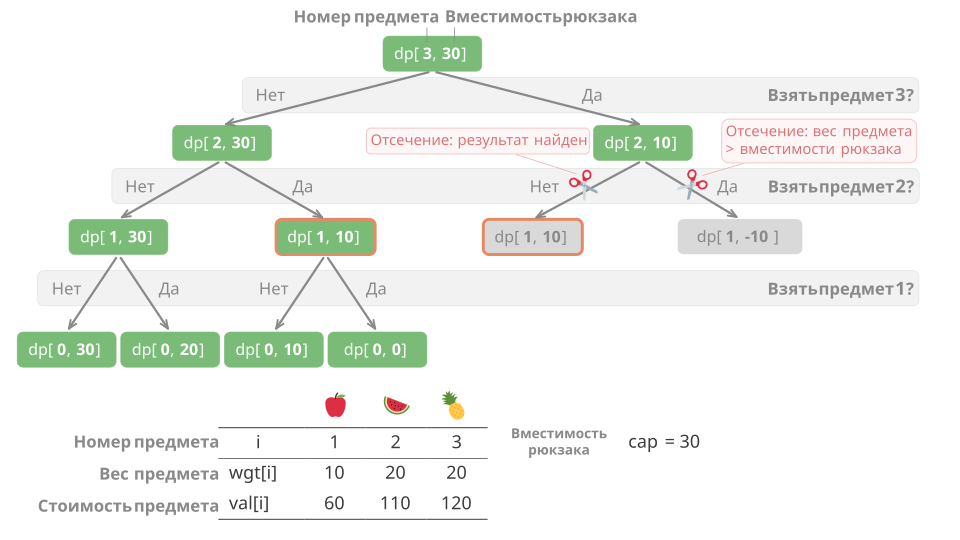{ class="animation-figure" }

<p align="center"> Рисунок 14-19 &nbsp; Дерево рекурсии поиска с мемоизацией для задачи о рюкзаке 0–1 </p>

### 3. &nbsp; Способ 3. Динамическое программирование

Динамическое программирование сводится к заполнению таблицы $dp$ по формуле перехода:

=== "Python"

    ```python title="knapsack.py"
    def knapsack_dp(wgt: list[int], val: list[int], cap: int) -> int:
        """Рюкзак 0–1: динамическое программирование"""
        n = len(wgt)
        # Инициализировать таблицу dp
        dp = [[0] * (cap + 1) for _ in range(n + 1)]
        # Переход между состояниями
        for i in range(1, n + 1):
            for c in range(1, cap + 1):
                if wgt[i - 1] > c:
                    # Если предмет i тяжелее допустимого, пропустить его
                    dp[i][c] = dp[i - 1][c]
                else:
                    # Взять максимум из двух вариантов: без предмета i и с ним
                    dp[i][c] = max(dp[i - 1][c], dp[i - 1][c - wgt[i - 1]] + val[i - 1])
        return dp[n][cap]
    ```

=== "C++"

    ```cpp title="knapsack.cpp"
    /* Рюкзак 0–1: динамическое программирование */
    int knapsackDP(vector<int> &wgt, vector<int> &val, int cap) {
        int n = wgt.size();
        // Инициализировать таблицу dp
        vector<vector<int>> dp(n + 1, vector<int>(cap + 1, 0));
        // Переход между состояниями
        for (int i = 1; i <= n; i++) {
            for (int c = 1; c <= cap; c++) {
                if (wgt[i - 1] > c) {
                    // Если предмет i тяжелее допустимого, пропустить его
                    dp[i][c] = dp[i - 1][c];
                } else {
                    // Взять максимум из двух вариантов: без предмета i и с ним
                    dp[i][c] = max(dp[i - 1][c], dp[i - 1][c - wgt[i - 1]] + val[i - 1]);
                }
            }
        }
        return dp[n][cap];
    }
    ```

=== "Java"

    ```java title="knapsack.java"
    /* Рюкзак 0–1: динамическое программирование */
    int knapsackDP(int[] wgt, int[] val, int cap) {
        int n = wgt.length;
        // Инициализировать таблицу dp
        int[][] dp = new int[n + 1][cap + 1];
        // Переход между состояниями
        for (int i = 1; i <= n; i++) {
            for (int c = 1; c <= cap; c++) {
                if (wgt[i - 1] > c) {
                    // Если предмет i тяжелее допустимого, пропустить его
                    dp[i][c] = dp[i - 1][c];
                } else {
                    // Взять максимум из двух вариантов: без предмета i и с ним
                    dp[i][c] = Math.max(dp[i - 1][c], dp[i - 1][c - wgt[i - 1]] + val[i - 1]);
                }
            }
        }
        return dp[n][cap];
    }
    ```

=== "C#"

    ```csharp title="knapsack.cs"
    /* Рюкзак 0–1: динамическое программирование */
    int KnapsackDP(int[] weight, int[] val, int cap) {
        int n = weight.Length;
        // Инициализировать таблицу dp
        int[,] dp = new int[n + 1, cap + 1];
        // Переход между состояниями
        for (int i = 1; i <= n; i++) {
            for (int c = 1; c <= cap; c++) {
                if (weight[i - 1] > c) {
                    // Если предмет i тяжелее допустимого, пропустить его
                    dp[i, c] = dp[i - 1, c];
                } else {
                    // Взять максимум из двух вариантов: без предмета i и с ним
                    dp[i, c] = Math.Max(dp[i - 1, c - weight[i - 1]] + val[i - 1], dp[i - 1, c]);
                }
            }
        }
        return dp[n, cap];
    }
    ```

=== "Go"

    ```go title="knapsack.go"
    /* Рюкзак 0–1: динамическое программирование */
    func knapsackDP(wgt, val []int, cap int) int {
        n := len(wgt)
        // Инициализировать таблицу dp
        dp := make([][]int, n+1)
        for i := 0; i <= n; i++ {
            dp[i] = make([]int, cap+1)
        }
        // Переход между состояниями
        for i := 1; i <= n; i++ {
            for c := 1; c <= cap; c++ {
                if wgt[i-1] > c {
                    // Если предмет i тяжелее допустимого, пропустить его
                    dp[i][c] = dp[i-1][c]
                } else {
                    // Взять максимум из двух вариантов: без предмета i и с ним
                    dp[i][c] = int(math.Max(float64(dp[i-1][c]), float64(dp[i-1][c-wgt[i-1]]+val[i-1])))
                }
            }
        }
        return dp[n][cap]
    }
    ```

=== "Swift"

    ```swift title="knapsack.swift"
    /* Рюкзак 0–1: динамическое программирование */
    func knapsackDP(wgt: [Int], val: [Int], cap: Int) -> Int {
        let n = wgt.count
        // Инициализировать таблицу dp
        var dp = Array(repeating: Array(repeating: 0, count: cap + 1), count: n + 1)
        // Переход между состояниями
        for i in 1 ... n {
            for c in 1 ... cap {
                if wgt[i - 1] > c {
                    // Если предмет i тяжелее допустимого, пропустить его
                    dp[i][c] = dp[i - 1][c]
                } else {
                    // Взять максимум из двух вариантов: без предмета i и с ним
                    dp[i][c] = max(dp[i - 1][c], dp[i - 1][c - wgt[i - 1]] + val[i - 1])
                }
            }
        }
        return dp[n][cap]
    }
    ```

=== "JS"

    ```javascript title="knapsack.js"
    /* Рюкзак 0–1: динамическое программирование */
    function knapsackDP(wgt, val, cap) {
        const n = wgt.length;
        // Инициализировать таблицу dp
        const dp = Array(n + 1)
            .fill(0)
            .map(() => Array(cap + 1).fill(0));
        // Переход между состояниями
        for (let i = 1; i <= n; i++) {
            for (let c = 1; c <= cap; c++) {
                if (wgt[i - 1] > c) {
                    // Если предмет i тяжелее допустимого, пропустить его
                    dp[i][c] = dp[i - 1][c];
                } else {
                    // Взять максимум из двух вариантов: без предмета i и с ним
                    dp[i][c] = Math.max(
                        dp[i - 1][c],
                        dp[i - 1][c - wgt[i - 1]] + val[i - 1]
                    );
                }
            }
        }
        return dp[n][cap];
    }
    ```

=== "TS"

    ```typescript title="knapsack.ts"
    /* Рюкзак 0–1: динамическое программирование */
    function knapsackDP(
        wgt: Array<number>,
        val: Array<number>,
        cap: number
    ): number {
        const n = wgt.length;
        // Инициализировать таблицу dp
        const dp = Array.from({ length: n + 1 }, () =>
            Array.from({ length: cap + 1 }, () => 0)
        );
        // Переход между состояниями
        for (let i = 1; i <= n; i++) {
            for (let c = 1; c <= cap; c++) {
                if (wgt[i - 1] > c) {
                    // Если предмет i тяжелее допустимого, пропустить его
                    dp[i][c] = dp[i - 1][c];
                } else {
                    // Взять максимум из двух вариантов: без предмета i и с ним
                    dp[i][c] = Math.max(
                        dp[i - 1][c],
                        dp[i - 1][c - wgt[i - 1]] + val[i - 1]
                    );
                }
            }
        }
        return dp[n][cap];
    }
    ```

=== "Dart"

    ```dart title="knapsack.dart"
    /* Рюкзак 0–1: динамическое программирование */
    int knapsackDP(List<int> wgt, List<int> val, int cap) {
      int n = wgt.length;
      // Инициализировать таблицу dp
      List<List<int>> dp = List.generate(n + 1, (index) => List.filled(cap + 1, 0));
      // Переход между состояниями
      for (int i = 1; i <= n; i++) {
        for (int c = 1; c <= cap; c++) {
          if (wgt[i - 1] > c) {
            // Если предмет i тяжелее допустимого, пропустить его
            dp[i][c] = dp[i - 1][c];
          } else {
            // Взять максимум из двух вариантов: без предмета i и с ним
            dp[i][c] = max(dp[i - 1][c], dp[i - 1][c - wgt[i - 1]] + val[i - 1]);
          }
        }
      }
      return dp[n][cap];
    }
    ```

=== "Rust"

    ```rust title="knapsack.rs"
    /* Рюкзак 0–1: динамическое программирование */
    fn knapsack_dp(wgt: &[i32], val: &[i32], cap: usize) -> i32 {
        let n = wgt.len();
        // Инициализировать таблицу dp
        let mut dp = vec![vec![0; cap + 1]; n + 1];
        // Переход между состояниями
        for i in 1..=n {
            for c in 1..=cap {
                if wgt[i - 1] > c as i32 {
                    // Если предмет i тяжелее допустимого, пропустить его
                    dp[i][c] = dp[i - 1][c];
                } else {
                    // Взять максимум из двух вариантов: без предмета i и с ним
                    dp[i][c] = std::cmp::max(
                        dp[i - 1][c],
                        dp[i - 1][c - wgt[i - 1] as usize] + val[i - 1],
                    );
                }
            }
        }
        dp[n][cap]
    }
    ```

=== "C"

    ```c title="knapsack.c"
    /* Рюкзак 0–1: динамическое программирование */
    int knapsackDP(int wgt[], int val[], int cap, int wgtSize) {
        int n = wgtSize;
        // Инициализировать таблицу dp
        int **dp = malloc((n + 1) * sizeof(int *));
        for (int i = 0; i <= n; i++) {
            dp[i] = calloc(cap + 1, sizeof(int));
        }
        // Переход между состояниями
        for (int i = 1; i <= n; i++) {
            for (int c = 1; c <= cap; c++) {
                if (wgt[i - 1] > c) {
                    // Если предмет i тяжелее допустимого, пропустить его
                    dp[i][c] = dp[i - 1][c];
                } else {
                    // Взять максимум из двух вариантов: без предмета i и с ним
                    dp[i][c] = myMax(dp[i - 1][c], dp[i - 1][c - wgt[i - 1]] + val[i - 1]);
                }
            }
        }
        int res = dp[n][cap];
        // Освободить память
        for (int i = 0; i <= n; i++) {
            free(dp[i]);
        }
        return res;
    }
    ```

=== "Kotlin"

    ```kotlin title="knapsack.kt"
    /* Рюкзак 0–1: динамическое программирование */
    fun knapsackDP(wgt: IntArray, _val: IntArray, cap: Int): Int {
        val n = wgt.size
        // Инициализировать таблицу dp
        val dp = Array(n + 1) { IntArray(cap + 1) }
        // Переход между состояниями
        for (i in 1..n) {
            for (c in 1..cap) {
                if (wgt[i - 1] > c) {
                    // Если предмет i тяжелее допустимого, пропустить его
                    dp[i][c] = dp[i - 1][c]
                } else {
                    // Взять максимум из двух вариантов: без предмета i и с ним
                    dp[i][c] = max(dp[i - 1][c], dp[i - 1][c - wgt[i - 1]] + _val[i - 1])
                }
            }
        }
        return dp[n][cap]
    }
    ```

=== "Ruby"

    ```ruby title="knapsack.rb"
    ### Рюкзак 0–1: динамическое программирование ###
    def knapsack_dp(wgt, val, cap)
      n = wgt.length
      # Инициализировать таблицу dp
      dp = Array.new(n + 1) { Array.new(cap + 1, 0) }
      # Переход между состояниями
      for i in 1...(n + 1)
        for c in 1...(cap + 1)
          if wgt[i - 1] > c
            # Если предмет i тяжелее допустимого, пропустить его
            dp[i][c] = dp[i - 1][c]
          else
            # Взять максимум из двух вариантов: без предмета i и с ним
            dp[i][c] = [dp[i - 1][c], dp[i - 1][c - wgt[i - 1]] + val[i - 1]].max
          end
        end
      end
      dp[n][cap]
    end
    ```

??? pythontutor "Визуализация выполнения"

    <div style="height: 549px; width: 100%;"><iframe class="pythontutor-iframe" title="Визуализация выполнения" src="https://pythontutor.com/iframe-embed.html#code=def%20knapsack_dp%28wgt%3A%20list%5Bint%5D,%20val%3A%20list%5Bint%5D,%20cap%3A%20int%29%20-%3E%20int%3A%0A%20%20%20%20%22%22%22%D0%A0%D1%8E%D0%BA%D0%B7%D0%B0%D0%BA%200%E2%80%931%3A%20%D0%B4%D0%B8%D0%BD%D0%B0%D0%BC%D0%B8%D1%87%D0%B5%D1%81%D0%BA%D0%BE%D0%B5%20%D0%BF%D1%80%D0%BE%D0%B3%D1%80%D0%B0%D0%BC%D0%BC%D0%B8%D1%80%D0%BE%D0%B2%D0%B0%D0%BD%D0%B8%D0%B5%22%22%22%0A%20%20%20%20n%20%3D%20len%28wgt%29%0A%20%20%20%20%23%20%D0%98%D0%BD%D0%B8%D1%86%D0%B8%D0%B0%D0%BB%D0%B8%D0%B7%D0%B8%D1%80%D0%BE%D0%B2%D0%B0%D1%82%D1%8C%20%D1%82%D0%B0%D0%B1%D0%BB%D0%B8%D1%86%D1%83%20dp%0A%20%20%20%20dp%20%3D%20%5B%5B0%5D%20%2A%20%28cap%20%2B%201%29%20for%20_%20in%20range%28n%20%2B%201%29%5D%0A%20%20%20%20%23%20%D0%9F%D0%B5%D1%80%D0%B5%D1%85%D0%BE%D0%B4%20%D0%BC%D0%B5%D0%B6%D0%B4%D1%83%20%D1%81%D0%BE%D1%81%D1%82%D0%BE%D1%8F%D0%BD%D0%B8%D1%8F%D0%BC%D0%B8%0A%20%20%20%20for%20i%20in%20range%281,%20n%20%2B%201%29%3A%0A%20%20%20%20%20%20%20%20for%20c%20in%20range%281,%20cap%20%2B%201%29%3A%0A%20%20%20%20%20%20%20%20%20%20%20%20if%20wgt%5Bi%20-%201%5D%20%3E%20c%3A%0A%20%20%20%20%20%20%20%20%20%20%20%20%20%20%20%20%23%20%D0%95%D1%81%D0%BB%D0%B8%20%D0%BF%D1%80%D0%B5%D0%B4%D0%BC%D0%B5%D1%82%20i%20%D1%82%D1%8F%D0%B6%D0%B5%D0%BB%D0%B5%D0%B5%20%D0%B4%D0%BE%D0%BF%D1%83%D1%81%D1%82%D0%B8%D0%BC%D0%BE%D0%B3%D0%BE,%20%D0%BF%D1%80%D0%BE%D0%BF%D1%83%D1%81%D1%82%D0%B8%D1%82%D1%8C%20%D0%B5%D0%B3%D0%BE%0A%20%20%20%20%20%20%20%20%20%20%20%20%20%20%20%20dp%5Bi%5D%5Bc%5D%20%3D%20dp%5Bi%20-%201%5D%5Bc%5D%0A%20%20%20%20%20%20%20%20%20%20%20%20else%3A%0A%20%20%20%20%20%20%20%20%20%20%20%20%20%20%20%20%23%20%D0%92%D0%B7%D1%8F%D1%82%D1%8C%20%D0%BC%D0%B0%D0%BA%D1%81%D0%B8%D0%BC%D1%83%D0%BC%20%D0%B8%D0%B7%20%D0%B4%D0%B2%D1%83%D1%85%20%D0%B2%D0%B0%D1%80%D0%B8%D0%B0%D0%BD%D1%82%D0%BE%D0%B2%3A%20%D0%B1%D0%B5%D0%B7%20%D0%BF%D1%80%D0%B5%D0%B4%D0%BC%D0%B5%D1%82%D0%B0%20i%20%D0%B8%20%D1%81%20%D0%BD%D0%B8%D0%BC%0A%20%20%20%20%20%20%20%20%20%20%20%20%20%20%20%20dp%5Bi%5D%5Bc%5D%20%3D%20max%28dp%5Bi%20-%201%5D%5Bc%5D,%20dp%5Bi%20-%201%5D%5Bc%20-%20wgt%5Bi%20-%201%5D%5D%20%2B%20val%5Bi%20-%201%5D%29%0A%20%20%20%20return%20dp%5Bn%5D%5Bcap%5D%0A%0A%0A%22%22%22Driver%20Code%22%22%22%0Aif%20__name__%20%3D%3D%20%22__main__%22%3A%0A%20%20%20%20wgt%20%3D%20%5B10,%2020,%2030,%2040,%2050%5D%0A%20%20%20%20val%20%3D%20%5B50,%20120,%20150,%20210,%20240%5D%0A%20%20%20%20cap%20%3D%2050%0A%20%20%20%20n%20%3D%20len%28wgt%29%0A%0A%20%20%20%20%23%20%D0%94%D0%B8%D0%BD%D0%B0%D0%BC%D0%B8%D1%87%D0%B5%D1%81%D0%BA%D0%BE%D0%B5%20%D0%BF%D1%80%D0%BE%D0%B3%D1%80%D0%B0%D0%BC%D0%BC%D0%B8%D1%80%D0%BE%D0%B2%D0%B0%D0%BD%D0%B8%D0%B5%0A%20%20%20%20res%20%3D%20knapsack_dp%28wgt,%20val,%20cap%29%0A%20%20%20%20print%28f%22%D0%9C%D0%B0%D0%BA%D1%81%D0%B8%D0%BC%D0%B0%D0%BB%D1%8C%D0%BD%D0%B0%D1%8F%20%D1%81%D1%82%D0%BE%D0%B8%D0%BC%D0%BE%D1%81%D1%82%D1%8C%20%D0%BF%D1%80%D0%B5%D0%B4%D0%BC%D0%B5%D1%82%D0%BE%D0%B2,%20%D0%BF%D0%BE%D0%BC%D0%B5%D1%89%D0%B0%D1%8E%D1%89%D0%B8%D1%85%D1%81%D1%8F%20%D0%B2%20%D1%80%D1%8E%D0%BA%D0%B7%D0%B0%D0%BA%3A%20%7Bres%7D%22%29&codeDivHeight=472&codeDivWidth=350&cumulative=false&curInstr=7&heapPrimitives=nevernest&origin=opt-frontend.js&py=311&rawInputLstJSON=%5B%5D&textReferences=false"> </iframe></div>
    <div style="margin-top: 5px;"><a href="https://pythontutor.com/iframe-embed.html#code=def%20knapsack_dp%28wgt%3A%20list%5Bint%5D,%20val%3A%20list%5Bint%5D,%20cap%3A%20int%29%20-%3E%20int%3A%0A%20%20%20%20%22%22%22%D0%A0%D1%8E%D0%BA%D0%B7%D0%B0%D0%BA%200%E2%80%931%3A%20%D0%B4%D0%B8%D0%BD%D0%B0%D0%BC%D0%B8%D1%87%D0%B5%D1%81%D0%BA%D0%BE%D0%B5%20%D0%BF%D1%80%D0%BE%D0%B3%D1%80%D0%B0%D0%BC%D0%BC%D0%B8%D1%80%D0%BE%D0%B2%D0%B0%D0%BD%D0%B8%D0%B5%22%22%22%0A%20%20%20%20n%20%3D%20len%28wgt%29%0A%20%20%20%20%23%20%D0%98%D0%BD%D0%B8%D1%86%D0%B8%D0%B0%D0%BB%D0%B8%D0%B7%D0%B8%D1%80%D0%BE%D0%B2%D0%B0%D1%82%D1%8C%20%D1%82%D0%B0%D0%B1%D0%BB%D0%B8%D1%86%D1%83%20dp%0A%20%20%20%20dp%20%3D%20%5B%5B0%5D%20%2A%20%28cap%20%2B%201%29%20for%20_%20in%20range%28n%20%2B%201%29%5D%0A%20%20%20%20%23%20%D0%9F%D0%B5%D1%80%D0%B5%D1%85%D0%BE%D0%B4%20%D0%BC%D0%B5%D0%B6%D0%B4%D1%83%20%D1%81%D0%BE%D1%81%D1%82%D0%BE%D1%8F%D0%BD%D0%B8%D1%8F%D0%BC%D0%B8%0A%20%20%20%20for%20i%20in%20range%281,%20n%20%2B%201%29%3A%0A%20%20%20%20%20%20%20%20for%20c%20in%20range%281,%20cap%20%2B%201%29%3A%0A%20%20%20%20%20%20%20%20%20%20%20%20if%20wgt%5Bi%20-%201%5D%20%3E%20c%3A%0A%20%20%20%20%20%20%20%20%20%20%20%20%20%20%20%20%23%20%D0%95%D1%81%D0%BB%D0%B8%20%D0%BF%D1%80%D0%B5%D0%B4%D0%BC%D0%B5%D1%82%20i%20%D1%82%D1%8F%D0%B6%D0%B5%D0%BB%D0%B5%D0%B5%20%D0%B4%D0%BE%D0%BF%D1%83%D1%81%D1%82%D0%B8%D0%BC%D0%BE%D0%B3%D0%BE,%20%D0%BF%D1%80%D0%BE%D0%BF%D1%83%D1%81%D1%82%D0%B8%D1%82%D1%8C%20%D0%B5%D0%B3%D0%BE%0A%20%20%20%20%20%20%20%20%20%20%20%20%20%20%20%20dp%5Bi%5D%5Bc%5D%20%3D%20dp%5Bi%20-%201%5D%5Bc%5D%0A%20%20%20%20%20%20%20%20%20%20%20%20else%3A%0A%20%20%20%20%20%20%20%20%20%20%20%20%20%20%20%20%23%20%D0%92%D0%B7%D1%8F%D1%82%D1%8C%20%D0%BC%D0%B0%D0%BA%D1%81%D0%B8%D0%BC%D1%83%D0%BC%20%D0%B8%D0%B7%20%D0%B4%D0%B2%D1%83%D1%85%20%D0%B2%D0%B0%D1%80%D0%B8%D0%B0%D0%BD%D1%82%D0%BE%D0%B2%3A%20%D0%B1%D0%B5%D0%B7%20%D0%BF%D1%80%D0%B5%D0%B4%D0%BC%D0%B5%D1%82%D0%B0%20i%20%D0%B8%20%D1%81%20%D0%BD%D0%B8%D0%BC%0A%20%20%20%20%20%20%20%20%20%20%20%20%20%20%20%20dp%5Bi%5D%5Bc%5D%20%3D%20max%28dp%5Bi%20-%201%5D%5Bc%5D,%20dp%5Bi%20-%201%5D%5Bc%20-%20wgt%5Bi%20-%201%5D%5D%20%2B%20val%5Bi%20-%201%5D%29%0A%20%20%20%20return%20dp%5Bn%5D%5Bcap%5D%0A%0A%0A%22%22%22Driver%20Code%22%22%22%0Aif%20__name__%20%3D%3D%20%22__main__%22%3A%0A%20%20%20%20wgt%20%3D%20%5B10,%2020,%2030,%2040,%2050%5D%0A%20%20%20%20val%20%3D%20%5B50,%20120,%20150,%20210,%20240%5D%0A%20%20%20%20cap%20%3D%2050%0A%20%20%20%20n%20%3D%20len%28wgt%29%0A%0A%20%20%20%20%23%20%D0%94%D0%B8%D0%BD%D0%B0%D0%BC%D0%B8%D1%87%D0%B5%D1%81%D0%BA%D0%BE%D0%B5%20%D0%BF%D1%80%D0%BE%D0%B3%D1%80%D0%B0%D0%BC%D0%BC%D0%B8%D1%80%D0%BE%D0%B2%D0%B0%D0%BD%D0%B8%D0%B5%0A%20%20%20%20res%20%3D%20knapsack_dp%28wgt,%20val,%20cap%29%0A%20%20%20%20print%28f%22%D0%9C%D0%B0%D0%BA%D1%81%D0%B8%D0%BC%D0%B0%D0%BB%D1%8C%D0%BD%D0%B0%D1%8F%20%D1%81%D1%82%D0%BE%D0%B8%D0%BC%D0%BE%D1%81%D1%82%D1%8C%20%D0%BF%D1%80%D0%B5%D0%B4%D0%BC%D0%B5%D1%82%D0%BE%D0%B2,%20%D0%BF%D0%BE%D0%BC%D0%B5%D1%89%D0%B0%D1%8E%D1%89%D0%B8%D1%85%D1%81%D1%8F%20%D0%B2%20%D1%80%D1%8E%D0%BA%D0%B7%D0%B0%D0%BA%3A%20%7Bres%7D%22%29&codeDivHeight=800&codeDivWidth=600&cumulative=false&curInstr=7&heapPrimitives=nevernest&origin=opt-frontend.js&py=311&rawInputLstJSON=%5B%5D&textReferences=false" target="_blank" rel="noopener noreferrer">Во весь экран ></a></div>

Как видно на рисунке, время и память определяются размером массива `dp`. Обе оценки равны $O(n \times cap)$.

=== "<1>"
    { class="animation-figure" }

=== "<2>"
    { class="animation-figure" }

=== "<3>"
    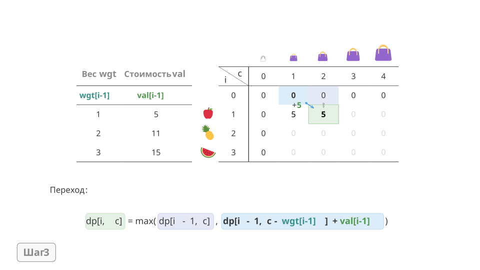{ class="animation-figure" }

=== "<4>"
    { class="animation-figure" }

=== "<5>"
    { class="animation-figure" }

=== "<6>"
    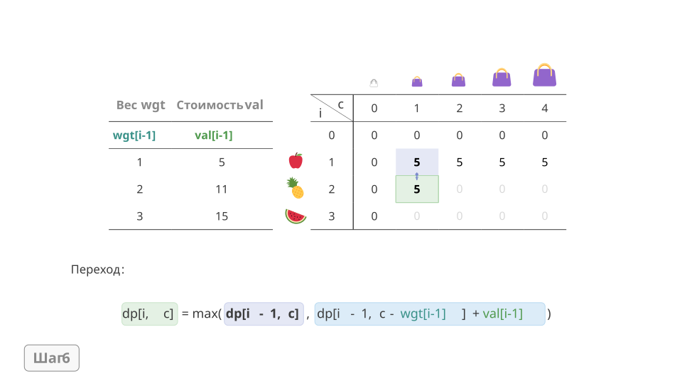{ class="animation-figure" }

=== "<7>"
    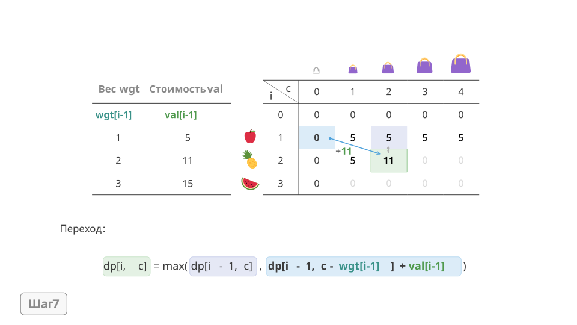{ class="animation-figure" }

=== "<8>"
    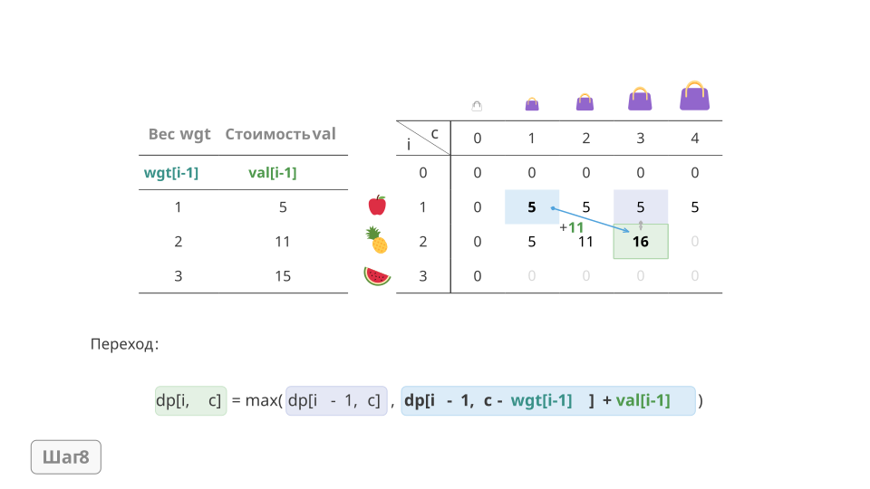{ class="animation-figure" }

=== "<9>"
    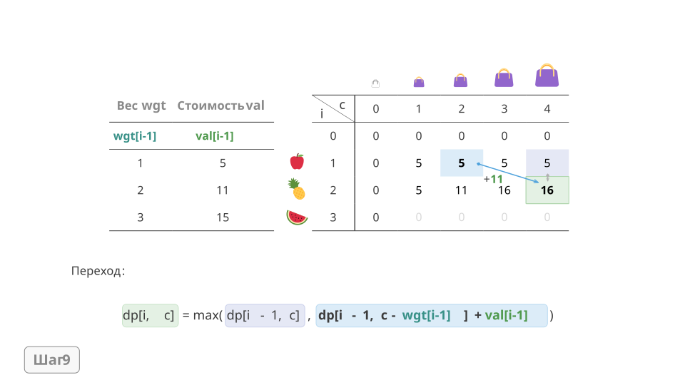{ class="animation-figure" }

=== "<10>"
    { class="animation-figure" }

=== "<11>"
    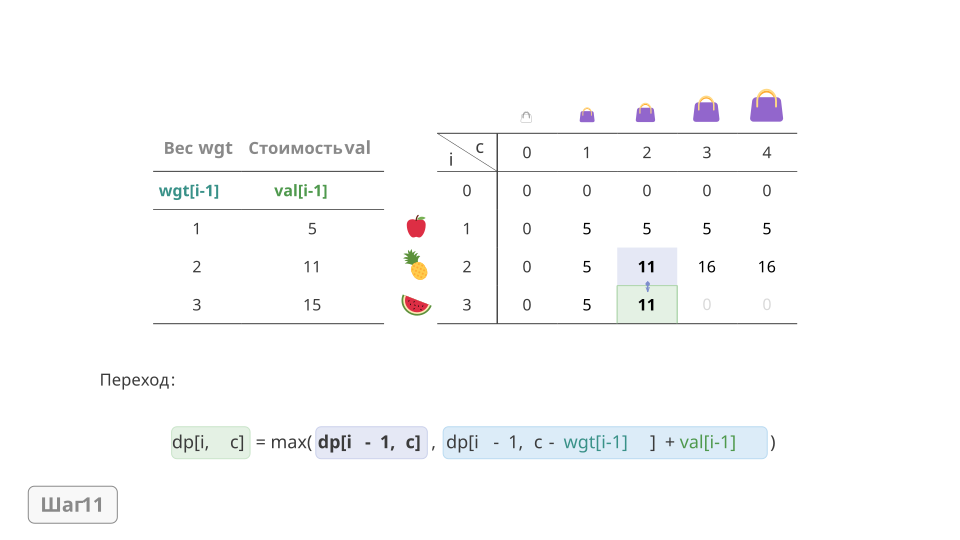{ class="animation-figure" }

=== "<12>"
    { class="animation-figure" }

=== "<13>"
    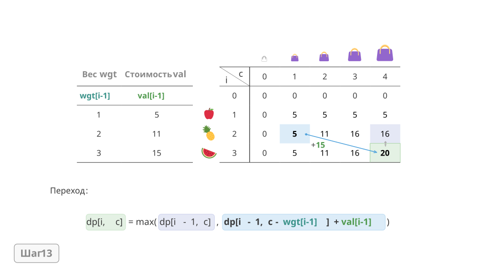{ class="animation-figure" }

=== "<14>"
    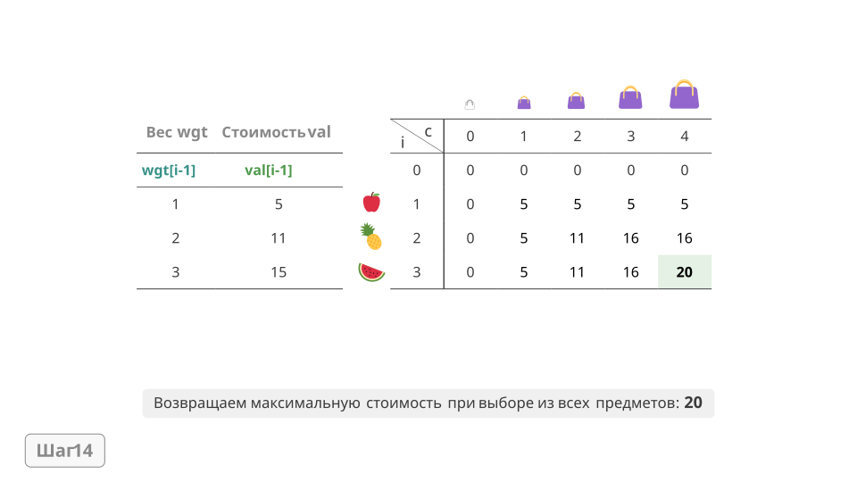{ class="animation-figure" }

<p align="center"> Рисунок 14-20 &nbsp; Решение задачи о рюкзаке 0–1 методом динамического программирования </p>

### 4. &nbsp; Экономия памяти

Каждое состояние зависит только от предыдущей строки. Можно использовать два массива, меняя их ролями, и сократить пространственную сложность с $O(n \times cap)$ до $O(cap)$.

А можно ли обойтись одним массивом? Каждое состояние зависит от ячейки прямо над ним или выше и левее. Когда мы начинаем обход строки $i$, в единственном массиве ещё лежат состояния строки $i-1$.

- При обходе вместимостей по возрастанию значение предыдущей строки $dp[i-1, c-wgt[i-1]]$, нужное для вычисления $dp[i, c]$, может быть уже перезаписано. Тогда один и тот же предмет можно ошибочно учесть несколько раз.
- При обратном обходе нужные значения сохраняются до чтения, и переход выполняется правильно.

На рисунке показано, как в одном массиве сменяются строки $i = 1$ и $i = 2$. Проследите, чем отличаются прямой и обратный порядки обхода.

=== "<1>"
    { class="animation-figure" }

=== "<2>"
    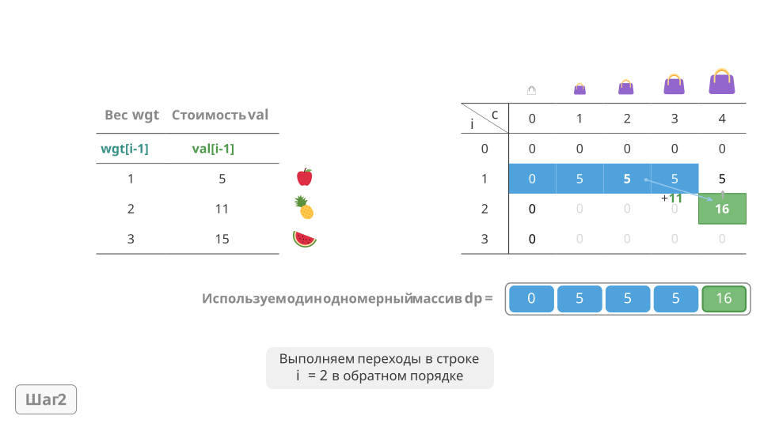{ class="animation-figure" }

=== "<3>"
    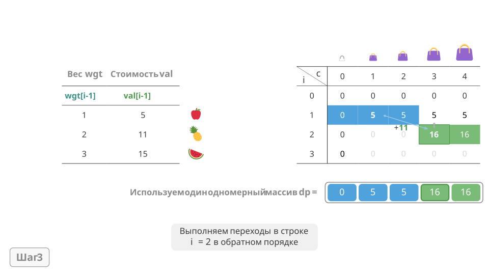{ class="animation-figure" }

=== "<4>"
    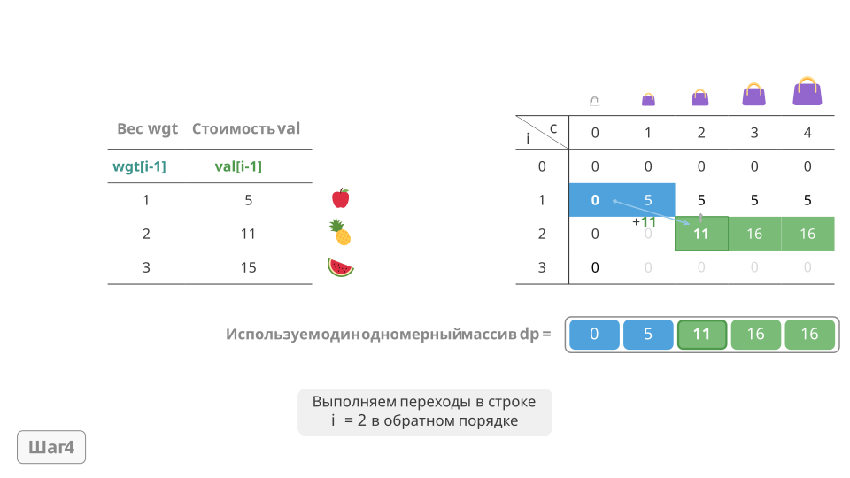{ class="animation-figure" }

=== "<5>"
    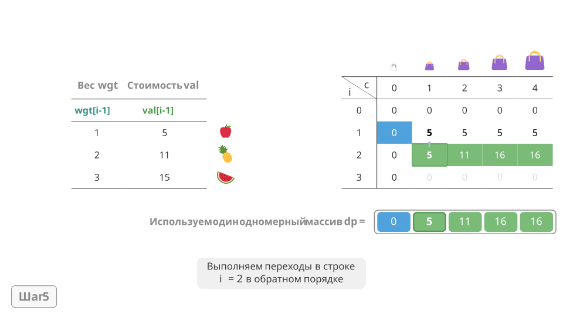{ class="animation-figure" }

=== "<6>"
    { class="animation-figure" }

<p align="center"> Рисунок 14-21 &nbsp; Решение задачи о рюкзаке 0–1 с экономией памяти </p>

В коде достаточно убрать у массива `dp` первое измерение $i$ и развернуть порядок обхода во внутреннем цикле:

=== "Python"

    ```python title="knapsack.py"
    def knapsack_dp_comp(wgt: list[int], val: list[int], cap: int) -> int:
        """Рюкзак 0–1: динамическое программирование с экономией памяти"""
        n = len(wgt)
        # Инициализировать таблицу dp
        dp = [0] * (cap + 1)
        # Переход между состояниями
        for i in range(1, n + 1):
            # Обход в обратном порядке
            for c in range(cap, 0, -1):
                if wgt[i - 1] > c:
                    # Если предмет i тяжелее допустимого, пропустить его
                    dp[c] = dp[c]
                else:
                    # Взять максимум из двух вариантов: без предмета i и с ним
                    dp[c] = max(dp[c], dp[c - wgt[i - 1]] + val[i - 1])
        return dp[cap]
    ```

=== "C++"

    ```cpp title="knapsack.cpp"
    /* Рюкзак 0–1: динамическое программирование с экономией памяти */
    int knapsackDPComp(vector<int> &wgt, vector<int> &val, int cap) {
        int n = wgt.size();
        // Инициализировать таблицу dp
        vector<int> dp(cap + 1, 0);
        // Переход между состояниями
        for (int i = 1; i <= n; i++) {
            // Обход в обратном порядке
            for (int c = cap; c >= 1; c--) {
                if (wgt[i - 1] <= c) {
                    // Взять максимум из двух вариантов: без предмета i и с ним
                    dp[c] = max(dp[c], dp[c - wgt[i - 1]] + val[i - 1]);
                }
            }
        }
        return dp[cap];
    }
    ```

=== "Java"

    ```java title="knapsack.java"
    /* Рюкзак 0–1: динамическое программирование с экономией памяти */
    int knapsackDPComp(int[] wgt, int[] val, int cap) {
        int n = wgt.length;
        // Инициализировать таблицу dp
        int[] dp = new int[cap + 1];
        // Переход между состояниями
        for (int i = 1; i <= n; i++) {
            // Обход в обратном порядке
            for (int c = cap; c >= 1; c--) {
                if (wgt[i - 1] <= c) {
                    // Взять максимум из двух вариантов: без предмета i и с ним
                    dp[c] = Math.max(dp[c], dp[c - wgt[i - 1]] + val[i - 1]);
                }
            }
        }
        return dp[cap];
    }
    ```

=== "C#"

    ```csharp title="knapsack.cs"
    /* Рюкзак 0–1: динамическое программирование с экономией памяти */
    int KnapsackDPComp(int[] weight, int[] val, int cap) {
        int n = weight.Length;
        // Инициализировать таблицу dp
        int[] dp = new int[cap + 1];
        // Переход между состояниями
        for (int i = 1; i <= n; i++) {
            // Обход в обратном порядке
            for (int c = cap; c > 0; c--) {
                if (weight[i - 1] > c) {
                    // Если предмет i тяжелее допустимого, пропустить его
                    dp[c] = dp[c];
                } else {
                    // Взять максимум из двух вариантов: без предмета i и с ним
                    dp[c] = Math.Max(dp[c], dp[c - weight[i - 1]] + val[i - 1]);
                }
            }
        }
        return dp[cap];
    }
    ```

=== "Go"

    ```go title="knapsack.go"
    /* Рюкзак 0–1: динамическое программирование с экономией памяти */
    func knapsackDPComp(wgt, val []int, cap int) int {
        n := len(wgt)
        // Инициализировать таблицу dp
        dp := make([]int, cap+1)
        // Переход между состояниями
        for i := 1; i <= n; i++ {
            // Обход в обратном порядке
            for c := cap; c >= 1; c-- {
                if wgt[i-1] <= c {
                    // Взять максимум из двух вариантов: без предмета i и с ним
                    dp[c] = int(math.Max(float64(dp[c]), float64(dp[c-wgt[i-1]]+val[i-1])))
                }
            }
        }
        return dp[cap]
    }
    ```

=== "Swift"

    ```swift title="knapsack.swift"
    /* Рюкзак 0–1: динамическое программирование с экономией памяти */
    func knapsackDPComp(wgt: [Int], val: [Int], cap: Int) -> Int {
        let n = wgt.count
        // Инициализировать таблицу dp
        var dp = Array(repeating: 0, count: cap + 1)
        // Переход между состояниями
        for i in 1 ... n {
            // Обход в обратном порядке
            for c in (1 ... cap).reversed() {
                if wgt[i - 1] <= c {
                    // Взять максимум из двух вариантов: без предмета i и с ним
                    dp[c] = max(dp[c], dp[c - wgt[i - 1]] + val[i - 1])
                }
            }
        }
        return dp[cap]
    }
    ```

=== "JS"

    ```javascript title="knapsack.js"
    /* Рюкзак 0–1: динамическое программирование с экономией памяти */
    function knapsackDPComp(wgt, val, cap) {
        const n = wgt.length;
        // Инициализировать таблицу dp
        const dp = Array(cap + 1).fill(0);
        // Переход между состояниями
        for (let i = 1; i <= n; i++) {
            // Обход в обратном порядке
            for (let c = cap; c >= 1; c--) {
                if (wgt[i - 1] <= c) {
                    // Взять максимум из двух вариантов: без предмета i и с ним
                    dp[c] = Math.max(dp[c], dp[c - wgt[i - 1]] + val[i - 1]);
                }
            }
        }
        return dp[cap];
    }
    ```

=== "TS"

    ```typescript title="knapsack.ts"
    /* Рюкзак 0–1: динамическое программирование с экономией памяти */
    function knapsackDPComp(
        wgt: Array<number>,
        val: Array<number>,
        cap: number
    ): number {
        const n = wgt.length;
        // Инициализировать таблицу dp
        const dp = Array(cap + 1).fill(0);
        // Переход между состояниями
        for (let i = 1; i <= n; i++) {
            // Обход в обратном порядке
            for (let c = cap; c >= 1; c--) {
                if (wgt[i - 1] <= c) {
                    // Взять максимум из двух вариантов: без предмета i и с ним
                    dp[c] = Math.max(dp[c], dp[c - wgt[i - 1]] + val[i - 1]);
                }
            }
        }
        return dp[cap];
    }
    ```

=== "Dart"

    ```dart title="knapsack.dart"
    /* Рюкзак 0–1: динамическое программирование с экономией памяти */
    int knapsackDPComp(List<int> wgt, List<int> val, int cap) {
      int n = wgt.length;
      // Инициализировать таблицу dp
      List<int> dp = List.filled(cap + 1, 0);
      // Переход между состояниями
      for (int i = 1; i <= n; i++) {
        // Обход в обратном порядке
        for (int c = cap; c >= 1; c--) {
          if (wgt[i - 1] <= c) {
            // Взять максимум из двух вариантов: без предмета i и с ним
            dp[c] = max(dp[c], dp[c - wgt[i - 1]] + val[i - 1]);
          }
        }
      }
      return dp[cap];
    }
    ```

=== "Rust"

    ```rust title="knapsack.rs"
    /* Рюкзак 0–1: динамическое программирование с экономией памяти */
    fn knapsack_dp_comp(wgt: &[i32], val: &[i32], cap: usize) -> i32 {
        let n = wgt.len();
        // Инициализировать таблицу dp
        let mut dp = vec![0; cap + 1];
        // Переход между состояниями
        for i in 1..=n {
            // Обход в обратном порядке
            for c in (1..=cap).rev() {
                if wgt[i - 1] <= c as i32 {
                    // Взять максимум из двух вариантов: без предмета i и с ним
                    dp[c] = std::cmp::max(dp[c], dp[c - wgt[i - 1] as usize] + val[i - 1]);
                }
            }
        }
        dp[cap]
    }
    ```

=== "C"

    ```c title="knapsack.c"
    /* Рюкзак 0–1: динамическое программирование с экономией памяти */
    int knapsackDPComp(int wgt[], int val[], int cap, int wgtSize) {
        int n = wgtSize;
        // Инициализировать таблицу dp
        int *dp = calloc(cap + 1, sizeof(int));
        // Переход между состояниями
        for (int i = 1; i <= n; i++) {
            // Обход в обратном порядке
            for (int c = cap; c >= 1; c--) {
                if (wgt[i - 1] <= c) {
                    // Взять максимум из двух вариантов: без предмета i и с ним
                    dp[c] = myMax(dp[c], dp[c - wgt[i - 1]] + val[i - 1]);
                }
            }
        }
        int res = dp[cap];
        // Освободить память
        free(dp);
        return res;
    }
    ```

=== "Kotlin"

    ```kotlin title="knapsack.kt"
    /* Рюкзак 0–1: динамическое программирование с экономией памяти */
    fun knapsackDPComp(wgt: IntArray, _val: IntArray, cap: Int): Int {
        val n = wgt.size
        // Инициализировать таблицу dp
        val dp = IntArray(cap + 1)
        // Переход между состояниями
        for (i in 1..n) {
            // Обход в обратном порядке
            for (c in cap downTo 1) {
                if (wgt[i - 1] <= c) {
                    // Взять максимум из двух вариантов: без предмета i и с ним
                    dp[c] = max(dp[c], dp[c - wgt[i - 1]] + _val[i - 1])
                }
            }
        }
        return dp[cap]
    }
    ```

=== "Ruby"

    ```ruby title="knapsack.rb"
    ### Рюкзак 0–1: динамическое программирование с экономией памяти ###
    def knapsack_dp_comp(wgt, val, cap)
      n = wgt.length
      # Инициализировать таблицу dp
      dp = Array.new(cap + 1, 0)
      # Переход между состояниями
      for i in 1...(n + 1)
        # Обход в обратном порядке
        for c in cap.downto(1)
          if wgt[i - 1] > c
            # Если предмет i тяжелее допустимого, пропустить его
            dp[c] = dp[c]
          else
            # Взять максимум из двух вариантов: без предмета i и с ним
            dp[c] = [dp[c], dp[c - wgt[i - 1]] + val[i - 1]].max
          end
        end
      end
      dp[cap]
    end
    ```

??? pythontutor "Визуализация выполнения"

    <div style="height: 549px; width: 100%;"><iframe class="pythontutor-iframe" title="Визуализация выполнения" src="https://pythontutor.com/iframe-embed.html#code=def%20knapsack_dp_comp%28wgt%3A%20list%5Bint%5D,%20val%3A%20list%5Bint%5D,%20cap%3A%20int%29%20-%3E%20int%3A%0A%20%20%20%20%22%22%22%D0%A0%D1%8E%D0%BA%D0%B7%D0%B0%D0%BA%200%E2%80%931%3A%20%D0%B4%D0%B8%D0%BD%D0%B0%D0%BC%D0%B8%D1%87%D0%B5%D1%81%D0%BA%D0%BE%D0%B5%20%D0%BF%D1%80%D0%BE%D0%B3%D1%80%D0%B0%D0%BC%D0%BC%D0%B8%D1%80%D0%BE%D0%B2%D0%B0%D0%BD%D0%B8%D0%B5%20%D1%81%20%D1%8D%D0%BA%D0%BE%D0%BD%D0%BE%D0%BC%D0%B8%D0%B5%D0%B9%20%D0%BF%D0%B0%D0%BC%D1%8F%D1%82%D0%B8%22%22%22%0A%20%20%20%20n%20%3D%20len%28wgt%29%0A%20%20%20%20%23%20%D0%98%D0%BD%D0%B8%D1%86%D0%B8%D0%B0%D0%BB%D0%B8%D0%B7%D0%B8%D1%80%D0%BE%D0%B2%D0%B0%D1%82%D1%8C%20%D1%82%D0%B0%D0%B1%D0%BB%D0%B8%D1%86%D1%83%20dp%0A%20%20%20%20dp%20%3D%20%5B0%5D%20%2A%20%28cap%20%2B%201%29%0A%20%20%20%20%23%20%D0%9F%D0%B5%D1%80%D0%B5%D1%85%D0%BE%D0%B4%20%D0%BC%D0%B5%D0%B6%D0%B4%D1%83%20%D1%81%D0%BE%D1%81%D1%82%D0%BE%D1%8F%D0%BD%D0%B8%D1%8F%D0%BC%D0%B8%0A%20%20%20%20for%20i%20in%20range%281,%20n%20%2B%201%29%3A%0A%20%20%20%20%20%20%20%20%23%20%D0%9E%D0%B1%D1%85%D0%BE%D0%B4%20%D0%B2%20%D0%BE%D0%B1%D1%80%D0%B0%D1%82%D0%BD%D0%BE%D0%BC%20%D0%BF%D0%BE%D1%80%D1%8F%D0%B4%D0%BA%D0%B5%0A%20%20%20%20%20%20%20%20for%20c%20in%20range%28cap,%200,%20-1%29%3A%0A%20%20%20%20%20%20%20%20%20%20%20%20if%20wgt%5Bi%20-%201%5D%20%3E%20c%3A%0A%20%20%20%20%20%20%20%20%20%20%20%20%20%20%20%20%23%20%D0%95%D1%81%D0%BB%D0%B8%20%D0%BF%D1%80%D0%B5%D0%B4%D0%BC%D0%B5%D1%82%20i%20%D1%82%D1%8F%D0%B6%D0%B5%D0%BB%D0%B5%D0%B5%20%D0%B4%D0%BE%D0%BF%D1%83%D1%81%D1%82%D0%B8%D0%BC%D0%BE%D0%B3%D0%BE,%20%D0%BF%D1%80%D0%BE%D0%BF%D1%83%D1%81%D1%82%D0%B8%D1%82%D1%8C%20%D0%B5%D0%B3%D0%BE%0A%20%20%20%20%20%20%20%20%20%20%20%20%20%20%20%20dp%5Bc%5D%20%3D%20dp%5Bc%5D%0A%20%20%20%20%20%20%20%20%20%20%20%20else%3A%0A%20%20%20%20%20%20%20%20%20%20%20%20%20%20%20%20%23%20%D0%92%D0%B7%D1%8F%D1%82%D1%8C%20%D0%BC%D0%B0%D0%BA%D1%81%D0%B8%D0%BC%D1%83%D0%BC%20%D0%B8%D0%B7%20%D0%B4%D0%B2%D1%83%D1%85%20%D0%B2%D0%B0%D1%80%D0%B8%D0%B0%D0%BD%D1%82%D0%BE%D0%B2%3A%20%D0%B1%D0%B5%D0%B7%20%D0%BF%D1%80%D0%B5%D0%B4%D0%BC%D0%B5%D1%82%D0%B0%20i%20%D0%B8%20%D1%81%20%D0%BD%D0%B8%D0%BC%0A%20%20%20%20%20%20%20%20%20%20%20%20%20%20%20%20dp%5Bc%5D%20%3D%20max%28dp%5Bc%5D,%20dp%5Bc%20-%20wgt%5Bi%20-%201%5D%5D%20%2B%20val%5Bi%20-%201%5D%29%0A%20%20%20%20return%20dp%5Bcap%5D%0A%0A%0A%22%22%22Driver%20Code%22%22%22%0Aif%20__name__%20%3D%3D%20%22__main__%22%3A%0A%20%20%20%20wgt%20%3D%20%5B10,%2020,%2030,%2040,%2050%5D%0A%20%20%20%20val%20%3D%20%5B50,%20120,%20150,%20210,%20240%5D%0A%20%20%20%20cap%20%3D%2050%0A%20%20%20%20n%20%3D%20len%28wgt%29%0A%0A%20%20%20%20%23%20%D0%94%D0%B8%D0%BD%D0%B0%D0%BC%D0%B8%D1%87%D0%B5%D1%81%D0%BA%D0%BE%D0%B5%20%D0%BF%D1%80%D0%BE%D0%B3%D1%80%D0%B0%D0%BC%D0%BC%D0%B8%D1%80%D0%BE%D0%B2%D0%B0%D0%BD%D0%B8%D0%B5%20%D1%81%20%D1%8D%D0%BA%D0%BE%D0%BD%D0%BE%D0%BC%D0%B8%D0%B5%D0%B9%20%D0%BF%D0%B0%D0%BC%D1%8F%D1%82%D0%B8%0A%20%20%20%20res%20%3D%20knapsack_dp_comp%28wgt,%20val,%20cap%29%0A%20%20%20%20print%28f%22%D0%9C%D0%B0%D0%BA%D1%81%D0%B8%D0%BC%D0%B0%D0%BB%D1%8C%D0%BD%D0%B0%D1%8F%20%D1%81%D1%82%D0%BE%D0%B8%D0%BC%D0%BE%D1%81%D1%82%D1%8C%20%D0%BF%D1%80%D0%B5%D0%B4%D0%BC%D0%B5%D1%82%D0%BE%D0%B2,%20%D0%BF%D0%BE%D0%BC%D0%B5%D1%89%D0%B0%D1%8E%D1%89%D0%B8%D1%85%D1%81%D1%8F%20%D0%B2%20%D1%80%D1%8E%D0%BA%D0%B7%D0%B0%D0%BA%3A%20%7Bres%7D%22%29&codeDivHeight=472&codeDivWidth=350&cumulative=false&curInstr=7&heapPrimitives=nevernest&origin=opt-frontend.js&py=311&rawInputLstJSON=%5B%5D&textReferences=false"> </iframe></div>
    <div style="margin-top: 5px;"><a href="https://pythontutor.com/iframe-embed.html#code=def%20knapsack_dp_comp%28wgt%3A%20list%5Bint%5D,%20val%3A%20list%5Bint%5D,%20cap%3A%20int%29%20-%3E%20int%3A%0A%20%20%20%20%22%22%22%D0%A0%D1%8E%D0%BA%D0%B7%D0%B0%D0%BA%200%E2%80%931%3A%20%D0%B4%D0%B8%D0%BD%D0%B0%D0%BC%D0%B8%D1%87%D0%B5%D1%81%D0%BA%D0%BE%D0%B5%20%D0%BF%D1%80%D0%BE%D0%B3%D1%80%D0%B0%D0%BC%D0%BC%D0%B8%D1%80%D0%BE%D0%B2%D0%B0%D0%BD%D0%B8%D0%B5%20%D1%81%20%D1%8D%D0%BA%D0%BE%D0%BD%D0%BE%D0%BC%D0%B8%D0%B5%D0%B9%20%D0%BF%D0%B0%D0%BC%D1%8F%D1%82%D0%B8%22%22%22%0A%20%20%20%20n%20%3D%20len%28wgt%29%0A%20%20%20%20%23%20%D0%98%D0%BD%D0%B8%D1%86%D0%B8%D0%B0%D0%BB%D0%B8%D0%B7%D0%B8%D1%80%D0%BE%D0%B2%D0%B0%D1%82%D1%8C%20%D1%82%D0%B0%D0%B1%D0%BB%D0%B8%D1%86%D1%83%20dp%0A%20%20%20%20dp%20%3D%20%5B0%5D%20%2A%20%28cap%20%2B%201%29%0A%20%20%20%20%23%20%D0%9F%D0%B5%D1%80%D0%B5%D1%85%D0%BE%D0%B4%20%D0%BC%D0%B5%D0%B6%D0%B4%D1%83%20%D1%81%D0%BE%D1%81%D1%82%D0%BE%D1%8F%D0%BD%D0%B8%D1%8F%D0%BC%D0%B8%0A%20%20%20%20for%20i%20in%20range%281,%20n%20%2B%201%29%3A%0A%20%20%20%20%20%20%20%20%23%20%D0%9E%D0%B1%D1%85%D0%BE%D0%B4%20%D0%B2%20%D0%BE%D0%B1%D1%80%D0%B0%D1%82%D0%BD%D0%BE%D0%BC%20%D0%BF%D0%BE%D1%80%D1%8F%D0%B4%D0%BA%D0%B5%0A%20%20%20%20%20%20%20%20for%20c%20in%20range%28cap,%200,%20-1%29%3A%0A%20%20%20%20%20%20%20%20%20%20%20%20if%20wgt%5Bi%20-%201%5D%20%3E%20c%3A%0A%20%20%20%20%20%20%20%20%20%20%20%20%20%20%20%20%23%20%D0%95%D1%81%D0%BB%D0%B8%20%D0%BF%D1%80%D0%B5%D0%B4%D0%BC%D0%B5%D1%82%20i%20%D1%82%D1%8F%D0%B6%D0%B5%D0%BB%D0%B5%D0%B5%20%D0%B4%D0%BE%D0%BF%D1%83%D1%81%D1%82%D0%B8%D0%BC%D0%BE%D0%B3%D0%BE,%20%D0%BF%D1%80%D0%BE%D0%BF%D1%83%D1%81%D1%82%D0%B8%D1%82%D1%8C%20%D0%B5%D0%B3%D0%BE%0A%20%20%20%20%20%20%20%20%20%20%20%20%20%20%20%20dp%5Bc%5D%20%3D%20dp%5Bc%5D%0A%20%20%20%20%20%20%20%20%20%20%20%20else%3A%0A%20%20%20%20%20%20%20%20%20%20%20%20%20%20%20%20%23%20%D0%92%D0%B7%D1%8F%D1%82%D1%8C%20%D0%BC%D0%B0%D0%BA%D1%81%D0%B8%D0%BC%D1%83%D0%BC%20%D0%B8%D0%B7%20%D0%B4%D0%B2%D1%83%D1%85%20%D0%B2%D0%B0%D1%80%D0%B8%D0%B0%D0%BD%D1%82%D0%BE%D0%B2%3A%20%D0%B1%D0%B5%D0%B7%20%D0%BF%D1%80%D0%B5%D0%B4%D0%BC%D0%B5%D1%82%D0%B0%20i%20%D0%B8%20%D1%81%20%D0%BD%D0%B8%D0%BC%0A%20%20%20%20%20%20%20%20%20%20%20%20%20%20%20%20dp%5Bc%5D%20%3D%20max%28dp%5Bc%5D,%20dp%5Bc%20-%20wgt%5Bi%20-%201%5D%5D%20%2B%20val%5Bi%20-%201%5D%29%0A%20%20%20%20return%20dp%5Bcap%5D%0A%0A%0A%22%22%22Driver%20Code%22%22%22%0Aif%20__name__%20%3D%3D%20%22__main__%22%3A%0A%20%20%20%20wgt%20%3D%20%5B10,%2020,%2030,%2040,%2050%5D%0A%20%20%20%20val%20%3D%20%5B50,%20120,%20150,%20210,%20240%5D%0A%20%20%20%20cap%20%3D%2050%0A%20%20%20%20n%20%3D%20len%28wgt%29%0A%0A%20%20%20%20%23%20%D0%94%D0%B8%D0%BD%D0%B0%D0%BC%D0%B8%D1%87%D0%B5%D1%81%D0%BA%D0%BE%D0%B5%20%D0%BF%D1%80%D0%BE%D0%B3%D1%80%D0%B0%D0%BC%D0%BC%D0%B8%D1%80%D0%BE%D0%B2%D0%B0%D0%BD%D0%B8%D0%B5%20%D1%81%20%D1%8D%D0%BA%D0%BE%D0%BD%D0%BE%D0%BC%D0%B8%D0%B5%D0%B9%20%D0%BF%D0%B0%D0%BC%D1%8F%D1%82%D0%B8%0A%20%20%20%20res%20%3D%20knapsack_dp_comp%28wgt,%20val,%20cap%29%0A%20%20%20%20print%28f%22%D0%9C%D0%B0%D0%BA%D1%81%D0%B8%D0%BC%D0%B0%D0%BB%D1%8C%D0%BD%D0%B0%D1%8F%20%D1%81%D1%82%D0%BE%D0%B8%D0%BC%D0%BE%D1%81%D1%82%D1%8C%20%D0%BF%D1%80%D0%B5%D0%B4%D0%BC%D0%B5%D1%82%D0%BE%D0%B2,%20%D0%BF%D0%BE%D0%BC%D0%B5%D1%89%D0%B0%D1%8E%D1%89%D0%B8%D1%85%D1%81%D1%8F%20%D0%B2%20%D1%80%D1%8E%D0%BA%D0%B7%D0%B0%D0%BA%3A%20%7Bres%7D%22%29&codeDivHeight=800&codeDivWidth=600&cumulative=false&curInstr=7&heapPrimitives=nevernest&origin=opt-frontend.js&py=311&rawInputLstJSON=%5B%5D&textReferences=false" target="_blank" rel="noopener noreferrer">Во весь экран ></a></div>
