# Задача о неограниченном рюкзаке

Разберём ещё одну распространённую задачу о рюкзаке — неограниченный рюкзак, а затем познакомимся с её частным случаем, разменом монет.

## Задача о неограниченном рюкзаке

!!! question

    Даны $n$ видов предметов. Предмет вида $i$ имеет вес $wgt[i-1]$ и стоимость $val[i-1]$. Вместимость рюкзака равна $cap$. **Каждый предмет можно выбирать многократно**. Какую максимальную стоимость можно набрать, не превысив вместимость? Пример приведён на рисунке.


### Решение методом динамического программирования

Эта задача очень похожа на рюкзак 0–1. **Единственное отличие — число экземпляров каждого предмета не ограничено**.

- В рюкзаке 0–1 у каждого предмета один экземпляр. Если мы взяли предмет $i$, то дальше можно выбирать только из первых $i-1$ предметов.
- В неограниченном рюкзаке экземпляров каждого вида сколько угодно. Взяв предмет $i$, **мы по-прежнему можем выбирать из первых $i$ видов**.

Для состояния $[i, c]$ в неограниченном рюкзаке возможны два случая.

- **Пропустить предмет $i$**. Как и в рюкзаке 0–1, переходим к $[i-1, c]$.
- **Взять предмет $i$**. Теперь, в отличие от рюкзака 0–1, переходим к $[i, c-wgt[i-1]]$.

Получаем новую формулу перехода:

$$
dp[i, c] = \max(dp[i-1, c], dp[i, c - wgt[i-1]] + val[i-1])
$$

### Реализация

Если сравнить код двух решений, единственное изменение в переходе — замена $i-1$ на $i$ в одном месте:

```src
[file]{unbounded_knapsack}-[class]{}-[func]{unbounded_knapsack_dp}
```

### Экономия памяти

Текущее состояние зависит от ячеек слева и сверху, **поэтому после сокращения таблицы $dp$ каждую строку нужно обходить в прямом порядке**.

Это направление противоположно порядку обхода для рюкзака 0–1. Проследите разницу на рисунке.

=== "<1>"
    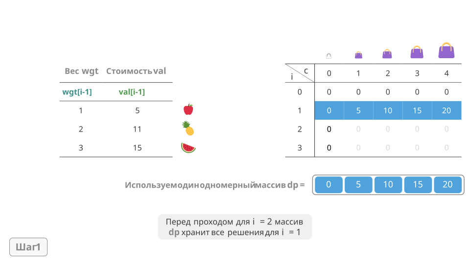

=== "<2>"
    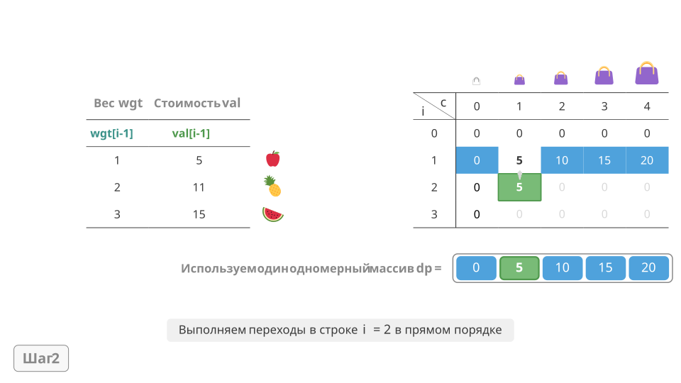

=== "<3>"
    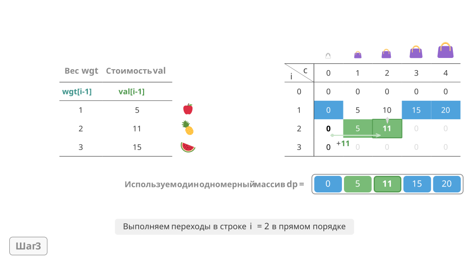

=== "<4>"
    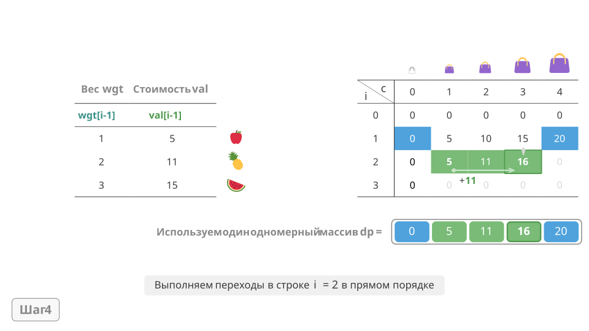

=== "<5>"
    

=== "<6>"
    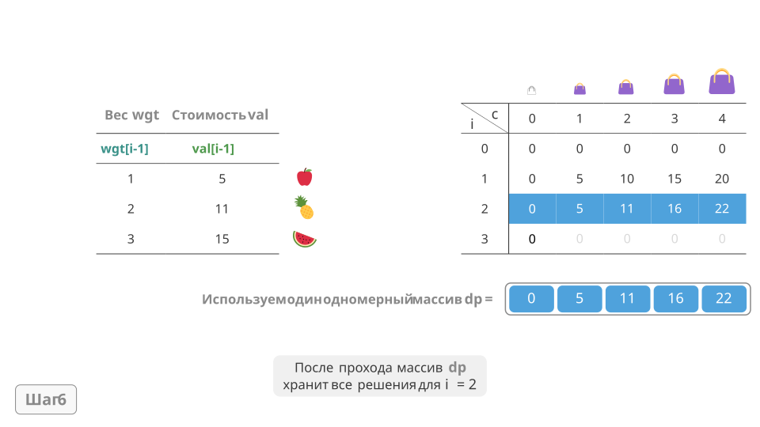

В коде достаточно убрать первое измерение у массива `dp`:

```src
[file]{unbounded_knapsack}-[class]{}-[func]{unbounded_knapsack_dp_comp}
```

## Задача о размене монет

Задача о рюкзаке представляет большое семейство задач динамического программирования. Один из его представителей — размен монет.

!!! question

    Даны монеты $n$ видов. У монеты вида $i$ номинал $coins[i - 1]$. Требуется набрать сумму $amt$. **Монеты каждого вида можно брать многократно**. Каково наименьшее число монет для этой суммы? Если набрать её невозможно, верните $-1$. Пример показан на рисунке.


### Решение методом динамического программирования

**Размен монет можно рассматривать как частный случай неограниченного рюкзака**. Сопоставим эти задачи.

- Одну постановку можно перевести в другую: предмету соответствует монета, весу предмета — номинал монеты, а вместимости рюкзака — нужная сумма.
- Цели оптимизации противоположны: в задаче о рюкзаке мы максимизируем стоимость предметов, а при размене минимизируем число монет.
- В рюкзаке достаточно не превысить вместимость, а при размене необходимо набрать сумму в точности.

**Шаг 1. Описать выбор на каждом шаге и определить состояния для таблицы $dp$**

Подзадача для состояния $[i, a]$: **найти наименьшее число монет первых $i$ видов, которыми можно набрать сумму $a$**. Обозначим ответ $dp[i, a]$.

Двумерная таблица $dp$ имеет размер $(n+1) \times (amt+1)$.

**Шаг 2. Найти оптимальную подструктуру и вывести формулу перехода**

Формула перехода отличается от формулы для неограниченного рюкзака в двух отношениях.

- Мы ищем минимум, поэтому меняем операцию $\max()$ на $\min()$.
- Оптимизируем число монет, а не стоимость предметов. При выборе монеты достаточно выполнить $+1$.

$$
dp[i, a] = \min(dp[i-1, a], dp[i, a - coins[i-1]] + 1)
$$

**Шаг 3. Определить граничные условия и порядок переходов**

Чтобы набрать сумму $0$, достаточно $0$ монет. Поэтому в первом столбце все значения $dp[i, 0]$ равны $0$.

Без монет **невозможно набрать ни одну сумму $> 0$**. Такое решение недопустимо. Чтобы функция $\min()$ в формуле перехода отбрасывала недопустимые решения, можно обозначить их значением $+ \infty$, то есть в первой строке всем $dp[0, a]$ присвоить $+ \infty$.

### Реализация

В большинстве языков программирования целочисленного значения $+ \infty$ нет. Его можно было бы заменить максимальным значением типа `int`, но тогда операция $+ 1$ в формуле перехода может вызвать переполнение.

Поэтому обозначим недопустимое решение числом $amt + 1$: для суммы $amt$ в любом допустимом решении нужно не более $amt$ монет. В конце проверяем, равно ли $dp[n, amt]$ значению $amt + 1$. Если да, возвращаем $-1$: нужную сумму набрать невозможно. Реализация:

```src
[file]{coin_change}-[class]{}-[func]{coin_change_dp}
```

На рисунке показано, как динамическое программирование решает задачу о размене. Процесс очень похож на решение задачи о неограниченном рюкзаке.

=== "<1>"
    

=== "<2>"
    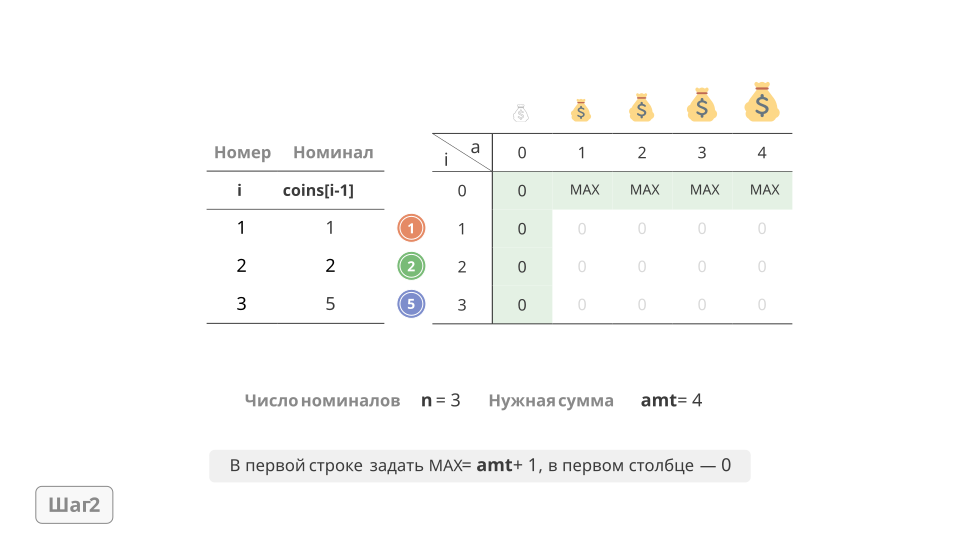

=== "<3>"
    

=== "<4>"
    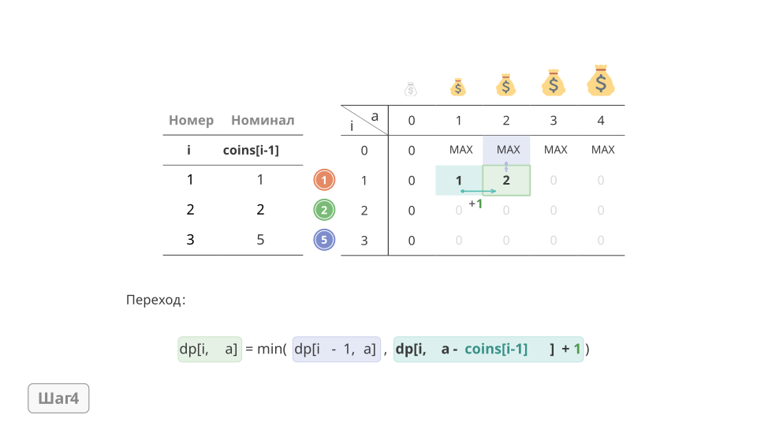

=== "<5>"
    

=== "<6>"
    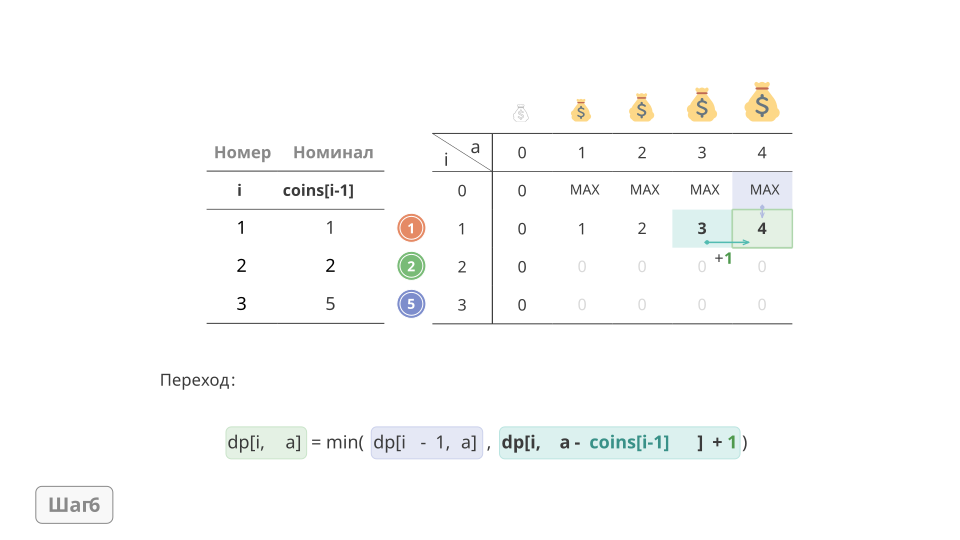

=== "<7>"
    

=== "<8>"
    

=== "<9>"
    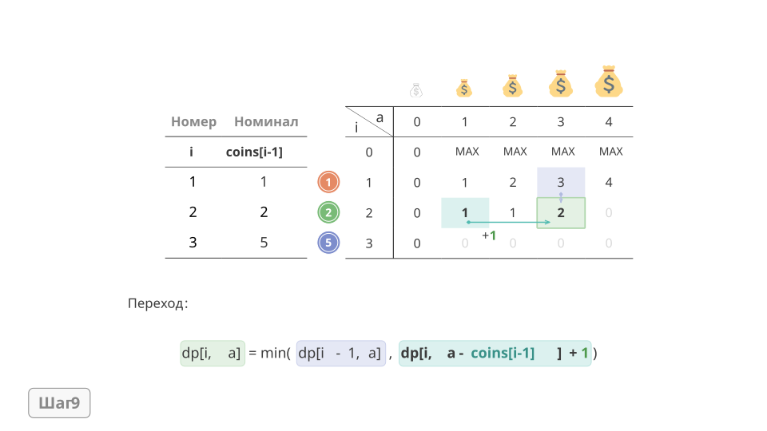

=== "<10>"
    

=== "<11>"
    

=== "<12>"
    

=== "<13>"
    

=== "<14>"
    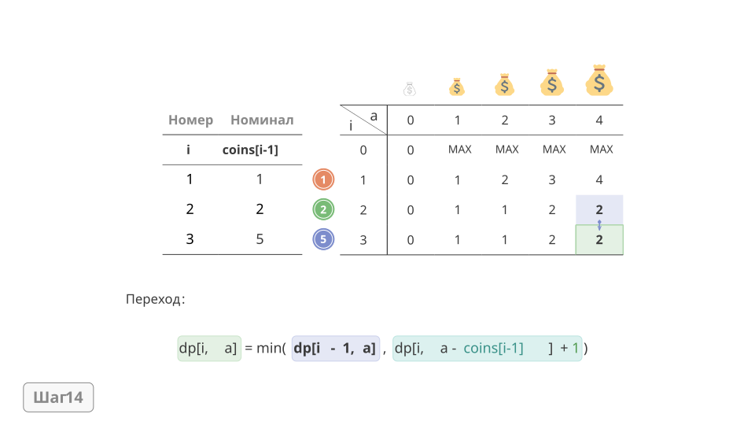

=== "<15>"
    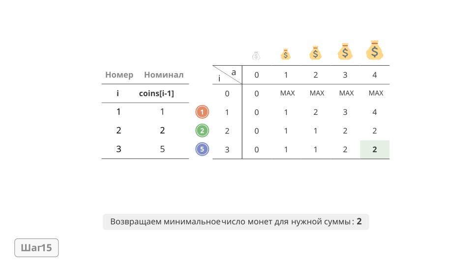

### Экономия памяти

Для экономии памяти используем тот же приём, что и в неограниченном рюкзаке:

```src
[file]{coin_change}-[class]{}-[func]{coin_change_dp_comp}
```

## Задача о размене монет II

!!! question

    Даны монеты $n$ видов. У монеты вида $i$ номинал $coins[i - 1]$. Требуется набрать сумму $amt$. Монеты каждого вида можно брать многократно. **Сколько комбинаций монет дают нужную сумму?** Пример показан на рисунке.


### Решение методом динамического программирования

Теперь нас интересует число комбинаций. Подзадача такова: **подсчитать комбинации монет первых $i$ видов, дающие сумму $a$**. Таблица $dp$ по-прежнему двумерна, её размер — $(n+1) \times (amt + 1)$.

Число комбинаций для текущего состояния равно сумме чисел комбинаций в двух случаях: когда мы не берём текущую монету и когда берём её. Получаем формулу перехода:

$$
dp[i, a] = dp[i-1, a] + dp[i, a - coins[i-1]]
$$

Сумму $0$ можно набрать, не взяв ни одной монеты. Поэтому в первом столбце все $dp[i, 0]$ инициализируем значением $1$. Без монет невозможно набрать ни одну сумму $>0$, так что в первой строке все $dp[0, a]$ равны $0$.

### Реализация

```src
[file]{coin_change_ii}-[class]{}-[func]{coin_change_ii_dp}
```

### Экономия памяти

Оптимизация памяти та же: достаточно убрать измерение, отвечающее за виды монет:

```src
[file]{coin_change_ii}-[class]{}-[func]{coin_change_ii_dp_comp}
```
