# 14.5 &nbsp; Задача о неограниченном рюкзаке

Разберём ещё одну распространённую задачу о рюкзаке — неограниченный рюкзак, а затем познакомимся с её частным случаем, разменом монет.

## 14.5.1 &nbsp; Задача о неограниченном рюкзаке

!!! question

    Даны $n$ видов предметов. Предмет вида $i$ имеет вес $wgt[i-1]$ и стоимость $val[i-1]$. Вместимость рюкзака равна $cap$. **Каждый предмет можно выбирать многократно**. Какую максимальную стоимость можно набрать, не превысив вместимость? Пример приведён на рисунке.

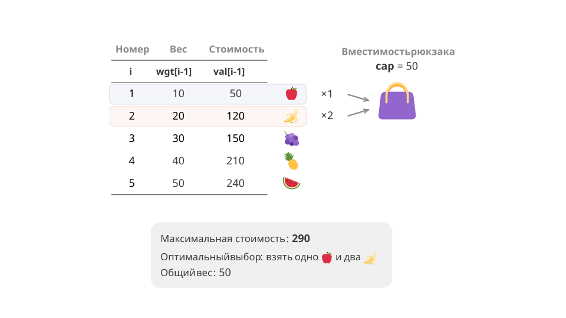{ class="animation-figure" }

<p align="center"> Рисунок 14-22 &nbsp; Пример данных для задачи о неограниченном рюкзаке </p>

### 1. &nbsp; Решение методом динамического программирования

Эта задача очень похожа на рюкзак 0–1. **Единственное отличие — число экземпляров каждого предмета не ограничено**.

- В рюкзаке 0–1 у каждого предмета один экземпляр. Если мы взяли предмет $i$, то дальше можно выбирать только из первых $i-1$ предметов.
- В неограниченном рюкзаке экземпляров каждого вида сколько угодно. Взяв предмет $i$, **мы по-прежнему можем выбирать из первых $i$ видов**.

Для состояния $[i, c]$ в неограниченном рюкзаке возможны два случая.

- **Пропустить предмет $i$**. Как и в рюкзаке 0–1, переходим к $[i-1, c]$.
- **Взять предмет $i$**. Теперь, в отличие от рюкзака 0–1, переходим к $[i, c-wgt[i-1]]$.

Получаем новую формулу перехода:

$$
dp[i, c] = \max(dp[i-1, c], dp[i, c - wgt[i-1]] + val[i-1])
$$

### 2. &nbsp; Реализация

Если сравнить код двух решений, единственное изменение в переходе — замена $i-1$ на $i$ в одном месте:

=== "Python"

    ```python title="unbounded_knapsack.py"
    def unbounded_knapsack_dp(wgt: list[int], val: list[int], cap: int) -> int:
        """Неограниченный рюкзак: динамическое программирование"""
        n = len(wgt)
        # Инициализировать таблицу dp
        dp = [[0] * (cap + 1) for _ in range(n + 1)]
        # Переход между состояниями
        for i in range(1, n + 1):
            for c in range(1, cap + 1):
                if wgt[i - 1] > c:
                    # Если предмет i тяжелее допустимого, пропустить его
                    dp[i][c] = dp[i - 1][c]
                else:
                    # Взять максимум из двух вариантов: без предмета i и с ним
                    dp[i][c] = max(dp[i - 1][c], dp[i][c - wgt[i - 1]] + val[i - 1])
        return dp[n][cap]
    ```

=== "C++"

    ```cpp title="unbounded_knapsack.cpp"
    /* Неограниченный рюкзак: динамическое программирование */
    int unboundedKnapsackDP(vector<int> &wgt, vector<int> &val, int cap) {
        int n = wgt.size();
        // Инициализировать таблицу dp
        vector<vector<int>> dp(n + 1, vector<int>(cap + 1, 0));
        // Переход между состояниями
        for (int i = 1; i <= n; i++) {
            for (int c = 1; c <= cap; c++) {
                if (wgt[i - 1] > c) {
                    // Если предмет i тяжелее допустимого, пропустить его
                    dp[i][c] = dp[i - 1][c];
                } else {
                    // Взять максимум из двух вариантов: без предмета i и с ним
                    dp[i][c] = max(dp[i - 1][c], dp[i][c - wgt[i - 1]] + val[i - 1]);
                }
            }
        }
        return dp[n][cap];
    }
    ```

=== "Java"

    ```java title="unbounded_knapsack.java"
    /* Неограниченный рюкзак: динамическое программирование */
    int unboundedKnapsackDP(int[] wgt, int[] val, int cap) {
        int n = wgt.length;
        // Инициализировать таблицу dp
        int[][] dp = new int[n + 1][cap + 1];
        // Переход между состояниями
        for (int i = 1; i <= n; i++) {
            for (int c = 1; c <= cap; c++) {
                if (wgt[i - 1] > c) {
                    // Если предмет i тяжелее допустимого, пропустить его
                    dp[i][c] = dp[i - 1][c];
                } else {
                    // Взять максимум из двух вариантов: без предмета i и с ним
                    dp[i][c] = Math.max(dp[i - 1][c], dp[i][c - wgt[i - 1]] + val[i - 1]);
                }
            }
        }
        return dp[n][cap];
    }
    ```

=== "C#"

    ```csharp title="unbounded_knapsack.cs"
    /* Неограниченный рюкзак: динамическое программирование */
    int UnboundedKnapsackDP(int[] wgt, int[] val, int cap) {
        int n = wgt.Length;
        // Инициализировать таблицу dp
        int[,] dp = new int[n + 1, cap + 1];
        // Переход между состояниями
        for (int i = 1; i <= n; i++) {
            for (int c = 1; c <= cap; c++) {
                if (wgt[i - 1] > c) {
                    // Если предмет i тяжелее допустимого, пропустить его
                    dp[i, c] = dp[i - 1, c];
                } else {
                    // Взять максимум из двух вариантов: без предмета i и с ним
                    dp[i, c] = Math.Max(dp[i - 1, c], dp[i, c - wgt[i - 1]] + val[i - 1]);
                }
            }
        }
        return dp[n, cap];
    }
    ```

=== "Go"

    ```go title="unbounded_knapsack.go"
    /* Неограниченный рюкзак: динамическое программирование */
    func unboundedKnapsackDP(wgt, val []int, cap int) int {
        n := len(wgt)
        // Инициализировать таблицу dp
        dp := make([][]int, n+1)
        for i := 0; i <= n; i++ {
            dp[i] = make([]int, cap+1)
        }
        // Переход между состояниями
        for i := 1; i <= n; i++ {
            for c := 1; c <= cap; c++ {
                if wgt[i-1] > c {
                    // Если предмет i тяжелее допустимого, пропустить его
                    dp[i][c] = dp[i-1][c]
                } else {
                    // Взять максимум из двух вариантов: без предмета i и с ним
                    dp[i][c] = int(math.Max(float64(dp[i-1][c]), float64(dp[i][c-wgt[i-1]]+val[i-1])))
                }
            }
        }
        return dp[n][cap]
    }
    ```

=== "Swift"

    ```swift title="unbounded_knapsack.swift"
    /* Неограниченный рюкзак: динамическое программирование */
    func unboundedKnapsackDP(wgt: [Int], val: [Int], cap: Int) -> Int {
        let n = wgt.count
        // Инициализировать таблицу dp
        var dp = Array(repeating: Array(repeating: 0, count: cap + 1), count: n + 1)
        // Переход между состояниями
        for i in 1 ... n {
            for c in 1 ... cap {
                if wgt[i - 1] > c {
                    // Если предмет i тяжелее допустимого, пропустить его
                    dp[i][c] = dp[i - 1][c]
                } else {
                    // Взять максимум из двух вариантов: без предмета i и с ним
                    dp[i][c] = max(dp[i - 1][c], dp[i][c - wgt[i - 1]] + val[i - 1])
                }
            }
        }
        return dp[n][cap]
    }
    ```

=== "JS"

    ```javascript title="unbounded_knapsack.js"
    /* Неограниченный рюкзак: динамическое программирование */
    function unboundedKnapsackDP(wgt, val, cap) {
        const n = wgt.length;
        // Инициализировать таблицу dp
        const dp = Array.from({ length: n + 1 }, () =>
            Array.from({ length: cap + 1 }, () => 0)
        );
        // Переход между состояниями
        for (let i = 1; i <= n; i++) {
            for (let c = 1; c <= cap; c++) {
                if (wgt[i - 1] > c) {
                    // Если предмет i тяжелее допустимого, пропустить его
                    dp[i][c] = dp[i - 1][c];
                } else {
                    // Взять максимум из двух вариантов: без предмета i и с ним
                    dp[i][c] = Math.max(
                        dp[i - 1][c],
                        dp[i][c - wgt[i - 1]] + val[i - 1]
                    );
                }
            }
        }
        return dp[n][cap];
    }
    ```

=== "TS"

    ```typescript title="unbounded_knapsack.ts"
    /* Неограниченный рюкзак: динамическое программирование */
    function unboundedKnapsackDP(
        wgt: Array<number>,
        val: Array<number>,
        cap: number
    ): number {
        const n = wgt.length;
        // Инициализировать таблицу dp
        const dp = Array.from({ length: n + 1 }, () =>
            Array.from({ length: cap + 1 }, () => 0)
        );
        // Переход между состояниями
        for (let i = 1; i <= n; i++) {
            for (let c = 1; c <= cap; c++) {
                if (wgt[i - 1] > c) {
                    // Если предмет i тяжелее допустимого, пропустить его
                    dp[i][c] = dp[i - 1][c];
                } else {
                    // Взять максимум из двух вариантов: без предмета i и с ним
                    dp[i][c] = Math.max(
                        dp[i - 1][c],
                        dp[i][c - wgt[i - 1]] + val[i - 1]
                    );
                }
            }
        }
        return dp[n][cap];
    }
    ```

=== "Dart"

    ```dart title="unbounded_knapsack.dart"
    /* Неограниченный рюкзак: динамическое программирование */
    int unboundedKnapsackDP(List<int> wgt, List<int> val, int cap) {
      int n = wgt.length;
      // Инициализировать таблицу dp
      List<List<int>> dp = List.generate(n + 1, (index) => List.filled(cap + 1, 0));
      // Переход между состояниями
      for (int i = 1; i <= n; i++) {
        for (int c = 1; c <= cap; c++) {
          if (wgt[i - 1] > c) {
            // Если предмет i тяжелее допустимого, пропустить его
            dp[i][c] = dp[i - 1][c];
          } else {
            // Взять максимум из двух вариантов: без предмета i и с ним
            dp[i][c] = max(dp[i - 1][c], dp[i][c - wgt[i - 1]] + val[i - 1]);
          }
        }
      }
      return dp[n][cap];
    }
    ```

=== "Rust"

    ```rust title="unbounded_knapsack.rs"
    /* Неограниченный рюкзак: динамическое программирование */
    fn unbounded_knapsack_dp(wgt: &[i32], val: &[i32], cap: usize) -> i32 {
        let n = wgt.len();
        // Инициализировать таблицу dp
        let mut dp = vec![vec![0; cap + 1]; n + 1];
        // Переход между состояниями
        for i in 1..=n {
            for c in 1..=cap {
                if wgt[i - 1] > c as i32 {
                    // Если предмет i тяжелее допустимого, пропустить его
                    dp[i][c] = dp[i - 1][c];
                } else {
                    // Взять максимум из двух вариантов: без предмета i и с ним
                    dp[i][c] = std::cmp::max(dp[i - 1][c], dp[i][c - wgt[i - 1] as usize] + val[i - 1]);
                }
            }
        }
        return dp[n][cap];
    }
    ```

=== "C"

    ```c title="unbounded_knapsack.c"
    /* Неограниченный рюкзак: динамическое программирование */
    int unboundedKnapsackDP(int wgt[], int val[], int cap, int wgtSize) {
        int n = wgtSize;
        // Инициализировать таблицу dp
        int **dp = malloc((n + 1) * sizeof(int *));
        for (int i = 0; i <= n; i++) {
            dp[i] = calloc(cap + 1, sizeof(int));
        }
        // Переход между состояниями
        for (int i = 1; i <= n; i++) {
            for (int c = 1; c <= cap; c++) {
                if (wgt[i - 1] > c) {
                    // Если предмет i тяжелее допустимого, пропустить его
                    dp[i][c] = dp[i - 1][c];
                } else {
                    // Взять максимум из двух вариантов: без предмета i и с ним
                    dp[i][c] = myMax(dp[i - 1][c], dp[i][c - wgt[i - 1]] + val[i - 1]);
                }
            }
        }
        int res = dp[n][cap];
        // Освободить память
        for (int i = 0; i <= n; i++) {
            free(dp[i]);
        }
        return res;
    }
    ```

=== "Kotlin"

    ```kotlin title="unbounded_knapsack.kt"
    /* Неограниченный рюкзак: динамическое программирование */
    fun unboundedKnapsackDP(wgt: IntArray, _val: IntArray, cap: Int): Int {
        val n = wgt.size
        // Инициализировать таблицу dp
        val dp = Array(n + 1) { IntArray(cap + 1) }
        // Переход между состояниями
        for (i in 1..n) {
            for (c in 1..cap) {
                if (wgt[i - 1] > c) {
                    // Если предмет i тяжелее допустимого, пропустить его
                    dp[i][c] = dp[i - 1][c]
                } else {
                    // Взять максимум из двух вариантов: без предмета i и с ним
                    dp[i][c] = max(dp[i - 1][c], dp[i][c - wgt[i - 1]] + _val[i - 1])
                }
            }
        }
        return dp[n][cap]
    }
    ```

=== "Ruby"

    ```ruby title="unbounded_knapsack.rb"
    ### Неограниченный рюкзак: динамическое программирование ###
    def unbounded_knapsack_dp(wgt, val, cap)
      n = wgt.length
      # Инициализировать таблицу dp
      dp = Array.new(n + 1) { Array.new(cap + 1, 0) }
      # Переход между состояниями
      for i in 1...(n + 1)
        for c in 1...(cap + 1)
          if wgt[i - 1] > c
            # Если предмет i тяжелее допустимого, пропустить его
            dp[i][c] = dp[i - 1][c]
          else
            # Взять максимум из двух вариантов: без предмета i и с ним
            dp[i][c] = [dp[i - 1][c], dp[i][c - wgt[i - 1]] + val[i - 1]].max
          end
        end
      end
      dp[n][cap]
    end
    ```

??? pythontutor "Визуализация выполнения"

    <div style="height: 549px; width: 100%;"><iframe class="pythontutor-iframe" title="Визуализация выполнения" src="https://pythontutor.com/iframe-embed.html#code=def%20unbounded_knapsack_dp%28wgt%3A%20list%5Bint%5D,%20val%3A%20list%5Bint%5D,%20cap%3A%20int%29%20-%3E%20int%3A%0A%20%20%20%20%22%22%22%D0%9D%D0%B5%D0%BE%D0%B3%D1%80%D0%B0%D0%BD%D0%B8%D1%87%D0%B5%D0%BD%D0%BD%D1%8B%D0%B9%20%D1%80%D1%8E%D0%BA%D0%B7%D0%B0%D0%BA%3A%20%D0%B4%D0%B8%D0%BD%D0%B0%D0%BC%D0%B8%D1%87%D0%B5%D1%81%D0%BA%D0%BE%D0%B5%20%D0%BF%D1%80%D0%BE%D0%B3%D1%80%D0%B0%D0%BC%D0%BC%D0%B8%D1%80%D0%BE%D0%B2%D0%B0%D0%BD%D0%B8%D0%B5%22%22%22%0A%20%20%20%20n%20%3D%20len%28wgt%29%0A%20%20%20%20%23%20%D0%98%D0%BD%D0%B8%D1%86%D0%B8%D0%B0%D0%BB%D0%B8%D0%B7%D0%B8%D1%80%D0%BE%D0%B2%D0%B0%D1%82%D1%8C%20%D1%82%D0%B0%D0%B1%D0%BB%D0%B8%D1%86%D1%83%20dp%0A%20%20%20%20dp%20%3D%20%5B%5B0%5D%20%2A%20%28cap%20%2B%201%29%20for%20_%20in%20range%28n%20%2B%201%29%5D%0A%20%20%20%20%23%20%D0%9F%D0%B5%D1%80%D0%B5%D1%85%D0%BE%D0%B4%20%D0%BC%D0%B5%D0%B6%D0%B4%D1%83%20%D1%81%D0%BE%D1%81%D1%82%D0%BE%D1%8F%D0%BD%D0%B8%D1%8F%D0%BC%D0%B8%0A%20%20%20%20for%20i%20in%20range%281,%20n%20%2B%201%29%3A%0A%20%20%20%20%20%20%20%20for%20c%20in%20range%281,%20cap%20%2B%201%29%3A%0A%20%20%20%20%20%20%20%20%20%20%20%20if%20wgt%5Bi%20-%201%5D%20%3E%20c%3A%0A%20%20%20%20%20%20%20%20%20%20%20%20%20%20%20%20%23%20%D0%95%D1%81%D0%BB%D0%B8%20%D0%BF%D1%80%D0%B5%D0%B4%D0%BC%D0%B5%D1%82%20i%20%D1%82%D1%8F%D0%B6%D0%B5%D0%BB%D0%B5%D0%B5%20%D0%B4%D0%BE%D0%BF%D1%83%D1%81%D1%82%D0%B8%D0%BC%D0%BE%D0%B3%D0%BE,%20%D0%BF%D1%80%D0%BE%D0%BF%D1%83%D1%81%D1%82%D0%B8%D1%82%D1%8C%20%D0%B5%D0%B3%D0%BE%0A%20%20%20%20%20%20%20%20%20%20%20%20%20%20%20%20dp%5Bi%5D%5Bc%5D%20%3D%20dp%5Bi%20-%201%5D%5Bc%5D%0A%20%20%20%20%20%20%20%20%20%20%20%20else%3A%0A%20%20%20%20%20%20%20%20%20%20%20%20%20%20%20%20%23%20%D0%92%D0%B7%D1%8F%D1%82%D1%8C%20%D0%BC%D0%B0%D0%BA%D1%81%D0%B8%D0%BC%D1%83%D0%BC%20%D0%B8%D0%B7%20%D0%B4%D0%B2%D1%83%D1%85%20%D0%B2%D0%B0%D1%80%D0%B8%D0%B0%D0%BD%D1%82%D0%BE%D0%B2%3A%20%D0%B1%D0%B5%D0%B7%20%D0%BF%D1%80%D0%B5%D0%B4%D0%BC%D0%B5%D1%82%D0%B0%20i%20%D0%B8%20%D1%81%20%D0%BD%D0%B8%D0%BC%0A%20%20%20%20%20%20%20%20%20%20%20%20%20%20%20%20dp%5Bi%5D%5Bc%5D%20%3D%20max%28dp%5Bi%20-%201%5D%5Bc%5D,%20dp%5Bi%5D%5Bc%20-%20wgt%5Bi%20-%201%5D%5D%20%2B%20val%5Bi%20-%201%5D%29%0A%20%20%20%20return%20dp%5Bn%5D%5Bcap%5D%0A%0A%0A%22%22%22Driver%20Code%22%22%22%0Aif%20__name__%20%3D%3D%20%22__main__%22%3A%0A%20%20%20%20wgt%20%3D%20%5B1,%202,%203%5D%0A%20%20%20%20val%20%3D%20%5B5,%2011,%2015%5D%0A%20%20%20%20cap%20%3D%204%0A%0A%20%20%20%20%23%20%D0%94%D0%B8%D0%BD%D0%B0%D0%BC%D0%B8%D1%87%D0%B5%D1%81%D0%BA%D0%BE%D0%B5%20%D0%BF%D1%80%D0%BE%D0%B3%D1%80%D0%B0%D0%BC%D0%BC%D0%B8%D1%80%D0%BE%D0%B2%D0%B0%D0%BD%D0%B8%D0%B5%0A%20%20%20%20res%20%3D%20unbounded_knapsack_dp%28wgt,%20val,%20cap%29%0A%20%20%20%20print%28f%22%D0%9C%D0%B0%D0%BA%D1%81%D0%B8%D0%BC%D0%B0%D0%BB%D1%8C%D0%BD%D0%B0%D1%8F%20%D1%81%D1%82%D0%BE%D0%B8%D0%BC%D0%BE%D1%81%D1%82%D1%8C%20%D0%BF%D1%80%D0%B5%D0%B4%D0%BC%D0%B5%D1%82%D0%BE%D0%B2,%20%D0%BF%D0%BE%D0%BC%D0%B5%D1%89%D0%B0%D1%8E%D1%89%D0%B8%D1%85%D1%81%D1%8F%20%D0%B2%20%D1%80%D1%8E%D0%BA%D0%B7%D0%B0%D0%BA%3A%20%7Bres%7D%22%29&codeDivHeight=472&codeDivWidth=350&cumulative=false&curInstr=6&heapPrimitives=nevernest&origin=opt-frontend.js&py=311&rawInputLstJSON=%5B%5D&textReferences=false"> </iframe></div>
    <div style="margin-top: 5px;"><a href="https://pythontutor.com/iframe-embed.html#code=def%20unbounded_knapsack_dp%28wgt%3A%20list%5Bint%5D,%20val%3A%20list%5Bint%5D,%20cap%3A%20int%29%20-%3E%20int%3A%0A%20%20%20%20%22%22%22%D0%9D%D0%B5%D0%BE%D0%B3%D1%80%D0%B0%D0%BD%D0%B8%D1%87%D0%B5%D0%BD%D0%BD%D1%8B%D0%B9%20%D1%80%D1%8E%D0%BA%D0%B7%D0%B0%D0%BA%3A%20%D0%B4%D0%B8%D0%BD%D0%B0%D0%BC%D0%B8%D1%87%D0%B5%D1%81%D0%BA%D0%BE%D0%B5%20%D0%BF%D1%80%D0%BE%D0%B3%D1%80%D0%B0%D0%BC%D0%BC%D0%B8%D1%80%D0%BE%D0%B2%D0%B0%D0%BD%D0%B8%D0%B5%22%22%22%0A%20%20%20%20n%20%3D%20len%28wgt%29%0A%20%20%20%20%23%20%D0%98%D0%BD%D0%B8%D1%86%D0%B8%D0%B0%D0%BB%D0%B8%D0%B7%D0%B8%D1%80%D0%BE%D0%B2%D0%B0%D1%82%D1%8C%20%D1%82%D0%B0%D0%B1%D0%BB%D0%B8%D1%86%D1%83%20dp%0A%20%20%20%20dp%20%3D%20%5B%5B0%5D%20%2A%20%28cap%20%2B%201%29%20for%20_%20in%20range%28n%20%2B%201%29%5D%0A%20%20%20%20%23%20%D0%9F%D0%B5%D1%80%D0%B5%D1%85%D0%BE%D0%B4%20%D0%BC%D0%B5%D0%B6%D0%B4%D1%83%20%D1%81%D0%BE%D1%81%D1%82%D0%BE%D1%8F%D0%BD%D0%B8%D1%8F%D0%BC%D0%B8%0A%20%20%20%20for%20i%20in%20range%281,%20n%20%2B%201%29%3A%0A%20%20%20%20%20%20%20%20for%20c%20in%20range%281,%20cap%20%2B%201%29%3A%0A%20%20%20%20%20%20%20%20%20%20%20%20if%20wgt%5Bi%20-%201%5D%20%3E%20c%3A%0A%20%20%20%20%20%20%20%20%20%20%20%20%20%20%20%20%23%20%D0%95%D1%81%D0%BB%D0%B8%20%D0%BF%D1%80%D0%B5%D0%B4%D0%BC%D0%B5%D1%82%20i%20%D1%82%D1%8F%D0%B6%D0%B5%D0%BB%D0%B5%D0%B5%20%D0%B4%D0%BE%D0%BF%D1%83%D1%81%D1%82%D0%B8%D0%BC%D0%BE%D0%B3%D0%BE,%20%D0%BF%D1%80%D0%BE%D0%BF%D1%83%D1%81%D1%82%D0%B8%D1%82%D1%8C%20%D0%B5%D0%B3%D0%BE%0A%20%20%20%20%20%20%20%20%20%20%20%20%20%20%20%20dp%5Bi%5D%5Bc%5D%20%3D%20dp%5Bi%20-%201%5D%5Bc%5D%0A%20%20%20%20%20%20%20%20%20%20%20%20else%3A%0A%20%20%20%20%20%20%20%20%20%20%20%20%20%20%20%20%23%20%D0%92%D0%B7%D1%8F%D1%82%D1%8C%20%D0%BC%D0%B0%D0%BA%D1%81%D0%B8%D0%BC%D1%83%D0%BC%20%D0%B8%D0%B7%20%D0%B4%D0%B2%D1%83%D1%85%20%D0%B2%D0%B0%D1%80%D0%B8%D0%B0%D0%BD%D1%82%D0%BE%D0%B2%3A%20%D0%B1%D0%B5%D0%B7%20%D0%BF%D1%80%D0%B5%D0%B4%D0%BC%D0%B5%D1%82%D0%B0%20i%20%D0%B8%20%D1%81%20%D0%BD%D0%B8%D0%BC%0A%20%20%20%20%20%20%20%20%20%20%20%20%20%20%20%20dp%5Bi%5D%5Bc%5D%20%3D%20max%28dp%5Bi%20-%201%5D%5Bc%5D,%20dp%5Bi%5D%5Bc%20-%20wgt%5Bi%20-%201%5D%5D%20%2B%20val%5Bi%20-%201%5D%29%0A%20%20%20%20return%20dp%5Bn%5D%5Bcap%5D%0A%0A%0A%22%22%22Driver%20Code%22%22%22%0Aif%20__name__%20%3D%3D%20%22__main__%22%3A%0A%20%20%20%20wgt%20%3D%20%5B1,%202,%203%5D%0A%20%20%20%20val%20%3D%20%5B5,%2011,%2015%5D%0A%20%20%20%20cap%20%3D%204%0A%0A%20%20%20%20%23%20%D0%94%D0%B8%D0%BD%D0%B0%D0%BC%D0%B8%D1%87%D0%B5%D1%81%D0%BA%D0%BE%D0%B5%20%D0%BF%D1%80%D0%BE%D0%B3%D1%80%D0%B0%D0%BC%D0%BC%D0%B8%D1%80%D0%BE%D0%B2%D0%B0%D0%BD%D0%B8%D0%B5%0A%20%20%20%20res%20%3D%20unbounded_knapsack_dp%28wgt,%20val,%20cap%29%0A%20%20%20%20print%28f%22%D0%9C%D0%B0%D0%BA%D1%81%D0%B8%D0%BC%D0%B0%D0%BB%D1%8C%D0%BD%D0%B0%D1%8F%20%D1%81%D1%82%D0%BE%D0%B8%D0%BC%D0%BE%D1%81%D1%82%D1%8C%20%D0%BF%D1%80%D0%B5%D0%B4%D0%BC%D0%B5%D1%82%D0%BE%D0%B2,%20%D0%BF%D0%BE%D0%BC%D0%B5%D1%89%D0%B0%D1%8E%D1%89%D0%B8%D1%85%D1%81%D1%8F%20%D0%B2%20%D1%80%D1%8E%D0%BA%D0%B7%D0%B0%D0%BA%3A%20%7Bres%7D%22%29&codeDivHeight=800&codeDivWidth=600&cumulative=false&curInstr=6&heapPrimitives=nevernest&origin=opt-frontend.js&py=311&rawInputLstJSON=%5B%5D&textReferences=false" target="_blank" rel="noopener noreferrer">Во весь экран ></a></div>

### 3. &nbsp; Экономия памяти

Текущее состояние зависит от ячеек слева и сверху, **поэтому после сокращения таблицы $dp$ каждую строку нужно обходить в прямом порядке**.

Это направление противоположно порядку обхода для рюкзака 0–1. Проследите разницу на рисунке.

=== "<1>"
    { class="animation-figure" }

=== "<2>"
    { class="animation-figure" }

=== "<3>"
    { class="animation-figure" }

=== "<4>"
    { class="animation-figure" }

=== "<5>"
    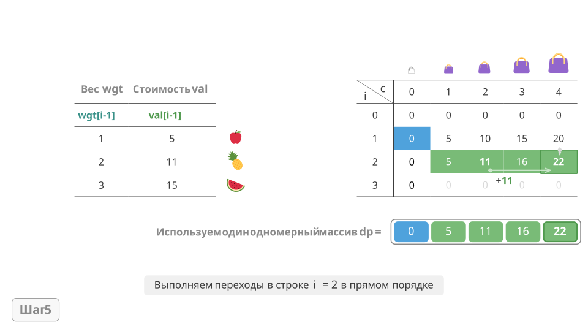{ class="animation-figure" }

=== "<6>"
    { class="animation-figure" }

<p align="center"> Рисунок 14-23 &nbsp; Решение задачи о неограниченном рюкзаке с экономией памяти </p>

В коде достаточно убрать первое измерение у массива `dp`:

=== "Python"

    ```python title="unbounded_knapsack.py"
    def unbounded_knapsack_dp_comp(wgt: list[int], val: list[int], cap: int) -> int:
        """Неограниченный рюкзак: динамическое программирование с экономией памяти"""
        n = len(wgt)
        # Инициализировать таблицу dp
        dp = [0] * (cap + 1)
        # Переход между состояниями
        for i in range(1, n + 1):
            # Обход в прямом порядке
            for c in range(1, cap + 1):
                if wgt[i - 1] > c:
                    # Если предмет i тяжелее допустимого, пропустить его
                    dp[c] = dp[c]
                else:
                    # Взять максимум из двух вариантов: без предмета i и с ним
                    dp[c] = max(dp[c], dp[c - wgt[i - 1]] + val[i - 1])
        return dp[cap]
    ```

=== "C++"

    ```cpp title="unbounded_knapsack.cpp"
    /* Неограниченный рюкзак: динамическое программирование с экономией памяти */
    int unboundedKnapsackDPComp(vector<int> &wgt, vector<int> &val, int cap) {
        int n = wgt.size();
        // Инициализировать таблицу dp
        vector<int> dp(cap + 1, 0);
        // Переход между состояниями
        for (int i = 1; i <= n; i++) {
            for (int c = 1; c <= cap; c++) {
                if (wgt[i - 1] > c) {
                    // Если предмет i тяжелее допустимого, пропустить его
                    dp[c] = dp[c];
                } else {
                    // Взять максимум из двух вариантов: без предмета i и с ним
                    dp[c] = max(dp[c], dp[c - wgt[i - 1]] + val[i - 1]);
                }
            }
        }
        return dp[cap];
    }
    ```

=== "Java"

    ```java title="unbounded_knapsack.java"
    /* Неограниченный рюкзак: динамическое программирование с экономией памяти */
    int unboundedKnapsackDPComp(int[] wgt, int[] val, int cap) {
        int n = wgt.length;
        // Инициализировать таблицу dp
        int[] dp = new int[cap + 1];
        // Переход между состояниями
        for (int i = 1; i <= n; i++) {
            for (int c = 1; c <= cap; c++) {
                if (wgt[i - 1] > c) {
                    // Если предмет i тяжелее допустимого, пропустить его
                    dp[c] = dp[c];
                } else {
                    // Взять максимум из двух вариантов: без предмета i и с ним
                    dp[c] = Math.max(dp[c], dp[c - wgt[i - 1]] + val[i - 1]);
                }
            }
        }
        return dp[cap];
    }
    ```

=== "C#"

    ```csharp title="unbounded_knapsack.cs"
    /* Неограниченный рюкзак: динамическое программирование с экономией памяти */
    int UnboundedKnapsackDPComp(int[] wgt, int[] val, int cap) {
        int n = wgt.Length;
        // Инициализировать таблицу dp
        int[] dp = new int[cap + 1];
        // Переход между состояниями
        for (int i = 1; i <= n; i++) {
            for (int c = 1; c <= cap; c++) {
                if (wgt[i - 1] > c) {
                    // Если предмет i тяжелее допустимого, пропустить его
                    dp[c] = dp[c];
                } else {
                    // Взять максимум из двух вариантов: без предмета i и с ним
                    dp[c] = Math.Max(dp[c], dp[c - wgt[i - 1]] + val[i - 1]);
                }
            }
        }
        return dp[cap];
    }
    ```

=== "Go"

    ```go title="unbounded_knapsack.go"
    /* Неограниченный рюкзак: динамическое программирование с экономией памяти */
    func unboundedKnapsackDPComp(wgt, val []int, cap int) int {
        n := len(wgt)
        // Инициализировать таблицу dp
        dp := make([]int, cap+1)
        // Переход между состояниями
        for i := 1; i <= n; i++ {
            for c := 1; c <= cap; c++ {
                if wgt[i-1] > c {
                    // Если предмет i тяжелее допустимого, пропустить его
                    dp[c] = dp[c]
                } else {
                    // Взять максимум из двух вариантов: без предмета i и с ним
                    dp[c] = int(math.Max(float64(dp[c]), float64(dp[c-wgt[i-1]]+val[i-1])))
                }
            }
        }
        return dp[cap]
    }
    ```

=== "Swift"

    ```swift title="unbounded_knapsack.swift"
    /* Неограниченный рюкзак: динамическое программирование с экономией памяти */
    func unboundedKnapsackDPComp(wgt: [Int], val: [Int], cap: Int) -> Int {
        let n = wgt.count
        // Инициализировать таблицу dp
        var dp = Array(repeating: 0, count: cap + 1)
        // Переход между состояниями
        for i in 1 ... n {
            for c in 1 ... cap {
                if wgt[i - 1] > c {
                    // Если предмет i тяжелее допустимого, пропустить его
                    dp[c] = dp[c]
                } else {
                    // Взять максимум из двух вариантов: без предмета i и с ним
                    dp[c] = max(dp[c], dp[c - wgt[i - 1]] + val[i - 1])
                }
            }
        }
        return dp[cap]
    }
    ```

=== "JS"

    ```javascript title="unbounded_knapsack.js"
    /* Неограниченный рюкзак: динамическое программирование с экономией памяти */
    function unboundedKnapsackDPComp(wgt, val, cap) {
        const n = wgt.length;
        // Инициализировать таблицу dp
        const dp = Array.from({ length: cap + 1 }, () => 0);
        // Переход между состояниями
        for (let i = 1; i <= n; i++) {
            for (let c = 1; c <= cap; c++) {
                if (wgt[i - 1] > c) {
                    // Если предмет i тяжелее допустимого, пропустить его
                    dp[c] = dp[c];
                } else {
                    // Взять максимум из двух вариантов: без предмета i и с ним
                    dp[c] = Math.max(dp[c], dp[c - wgt[i - 1]] + val[i - 1]);
                }
            }
        }
        return dp[cap];
    }
    ```

=== "TS"

    ```typescript title="unbounded_knapsack.ts"
    /* Неограниченный рюкзак: динамическое программирование с экономией памяти */
    function unboundedKnapsackDPComp(
        wgt: Array<number>,
        val: Array<number>,
        cap: number
    ): number {
        const n = wgt.length;
        // Инициализировать таблицу dp
        const dp = Array.from({ length: cap + 1 }, () => 0);
        // Переход между состояниями
        for (let i = 1; i <= n; i++) {
            for (let c = 1; c <= cap; c++) {
                if (wgt[i - 1] > c) {
                    // Если предмет i тяжелее допустимого, пропустить его
                    dp[c] = dp[c];
                } else {
                    // Взять максимум из двух вариантов: без предмета i и с ним
                    dp[c] = Math.max(dp[c], dp[c - wgt[i - 1]] + val[i - 1]);
                }
            }
        }
        return dp[cap];
    }
    ```

=== "Dart"

    ```dart title="unbounded_knapsack.dart"
    /* Неограниченный рюкзак: динамическое программирование с экономией памяти */
    int unboundedKnapsackDPComp(List<int> wgt, List<int> val, int cap) {
      int n = wgt.length;
      // Инициализировать таблицу dp
      List<int> dp = List.filled(cap + 1, 0);
      // Переход между состояниями
      for (int i = 1; i <= n; i++) {
        for (int c = 1; c <= cap; c++) {
          if (wgt[i - 1] > c) {
            // Если предмет i тяжелее допустимого, пропустить его
            dp[c] = dp[c];
          } else {
            // Взять максимум из двух вариантов: без предмета i и с ним
            dp[c] = max(dp[c], dp[c - wgt[i - 1]] + val[i - 1]);
          }
        }
      }
      return dp[cap];
    }
    ```

=== "Rust"

    ```rust title="unbounded_knapsack.rs"
    /* Неограниченный рюкзак: динамическое программирование с экономией памяти */
    fn unbounded_knapsack_dp_comp(wgt: &[i32], val: &[i32], cap: usize) -> i32 {
        let n = wgt.len();
        // Инициализировать таблицу dp
        let mut dp = vec![0; cap + 1];
        // Переход между состояниями
        for i in 1..=n {
            for c in 1..=cap {
                if wgt[i - 1] > c as i32 {
                    // Если предмет i тяжелее допустимого, пропустить его
                    dp[c] = dp[c];
                } else {
                    // Взять максимум из двух вариантов: без предмета i и с ним
                    dp[c] = std::cmp::max(dp[c], dp[c - wgt[i - 1] as usize] + val[i - 1]);
                }
            }
        }
        dp[cap]
    }
    ```

=== "C"

    ```c title="unbounded_knapsack.c"
    /* Неограниченный рюкзак: динамическое программирование с экономией памяти */
    int unboundedKnapsackDPComp(int wgt[], int val[], int cap, int wgtSize) {
        int n = wgtSize;
        // Инициализировать таблицу dp
        int *dp = calloc(cap + 1, sizeof(int));
        // Переход между состояниями
        for (int i = 1; i <= n; i++) {
            for (int c = 1; c <= cap; c++) {
                if (wgt[i - 1] > c) {
                    // Если предмет i тяжелее допустимого, пропустить его
                    dp[c] = dp[c];
                } else {
                    // Взять максимум из двух вариантов: без предмета i и с ним
                    dp[c] = myMax(dp[c], dp[c - wgt[i - 1]] + val[i - 1]);
                }
            }
        }
        int res = dp[cap];
        // Освободить память
        free(dp);
        return res;
    }
    ```

=== "Kotlin"

    ```kotlin title="unbounded_knapsack.kt"
    /* Неограниченный рюкзак: динамическое программирование с экономией памяти */
    fun unboundedKnapsackDPComp(
        wgt: IntArray,
        _val: IntArray,
        cap: Int
    ): Int {
        val n = wgt.size
        // Инициализировать таблицу dp
        val dp = IntArray(cap + 1)
        // Переход между состояниями
        for (i in 1..n) {
            for (c in 1..cap) {
                if (wgt[i - 1] > c) {
                    // Если предмет i тяжелее допустимого, пропустить его
                    dp[c] = dp[c]
                } else {
                    // Взять максимум из двух вариантов: без предмета i и с ним
                    dp[c] = max(dp[c], dp[c - wgt[i - 1]] + _val[i - 1])
                }
            }
        }
        return dp[cap]
    }
    ```

=== "Ruby"

    ```ruby title="unbounded_knapsack.rb"
    ### Неограниченный рюкзак: динамическое программирование с экономией памяти ###
    def unbounded_knapsack_dp_comp(wgt, val, cap)
      n = wgt.length
      # Инициализировать таблицу dp
      dp = Array.new(cap + 1, 0)
      # Переход между состояниями
      for i in 1...(n + 1)
        # Обход в прямом порядке
        for c in 1...(cap + 1)
          if wgt[i -1] > c
            # Если предмет i тяжелее допустимого, пропустить его
            dp[c] = dp[c]
          else
            # Взять максимум из двух вариантов: без предмета i и с ним
            dp[c] = [dp[c], dp[c - wgt[i - 1]] + val[i - 1]].max
          end
        end
      end
      dp[cap]
    end
    ```

??? pythontutor "Визуализация выполнения"

    <div style="height: 549px; width: 100%;"><iframe class="pythontutor-iframe" title="Визуализация выполнения" src="https://pythontutor.com/iframe-embed.html#code=def%20unbounded_knapsack_dp_comp%28wgt%3A%20list%5Bint%5D,%20val%3A%20list%5Bint%5D,%20cap%3A%20int%29%20-%3E%20int%3A%0A%20%20%20%20%22%22%22%D0%9D%D0%B5%D0%BE%D0%B3%D1%80%D0%B0%D0%BD%D0%B8%D1%87%D0%B5%D0%BD%D0%BD%D1%8B%D0%B9%20%D1%80%D1%8E%D0%BA%D0%B7%D0%B0%D0%BA%3A%20%D0%B4%D0%B8%D0%BD%D0%B0%D0%BC%D0%B8%D1%87%D0%B5%D1%81%D0%BA%D0%BE%D0%B5%20%D0%BF%D1%80%D0%BE%D0%B3%D1%80%D0%B0%D0%BC%D0%BC%D0%B8%D1%80%D0%BE%D0%B2%D0%B0%D0%BD%D0%B8%D0%B5%20%D1%81%20%D1%8D%D0%BA%D0%BE%D0%BD%D0%BE%D0%BC%D0%B8%D0%B5%D0%B9%20%D0%BF%D0%B0%D0%BC%D1%8F%D1%82%D0%B8%22%22%22%0A%20%20%20%20n%20%3D%20len%28wgt%29%0A%20%20%20%20%23%20%D0%98%D0%BD%D0%B8%D1%86%D0%B8%D0%B0%D0%BB%D0%B8%D0%B7%D0%B8%D1%80%D0%BE%D0%B2%D0%B0%D1%82%D1%8C%20%D1%82%D0%B0%D0%B1%D0%BB%D0%B8%D1%86%D1%83%20dp%0A%20%20%20%20dp%20%3D%20%5B0%5D%20%2A%20%28cap%20%2B%201%29%0A%20%20%20%20%23%20%D0%9F%D0%B5%D1%80%D0%B5%D1%85%D0%BE%D0%B4%20%D0%BC%D0%B5%D0%B6%D0%B4%D1%83%20%D1%81%D0%BE%D1%81%D1%82%D0%BE%D1%8F%D0%BD%D0%B8%D1%8F%D0%BC%D0%B8%0A%20%20%20%20for%20i%20in%20range%281,%20n%20%2B%201%29%3A%0A%20%20%20%20%20%20%20%20%23%20%D0%9E%D0%B1%D1%85%D0%BE%D0%B4%20%D0%B2%20%D0%BF%D1%80%D1%8F%D0%BC%D0%BE%D0%BC%20%D0%BF%D0%BE%D1%80%D1%8F%D0%B4%D0%BA%D0%B5%0A%20%20%20%20%20%20%20%20for%20c%20in%20range%281,%20cap%20%2B%201%29%3A%0A%20%20%20%20%20%20%20%20%20%20%20%20if%20wgt%5Bi%20-%201%5D%20%3E%20c%3A%0A%20%20%20%20%20%20%20%20%20%20%20%20%20%20%20%20%23%20%D0%95%D1%81%D0%BB%D0%B8%20%D0%BF%D1%80%D0%B5%D0%B4%D0%BC%D0%B5%D1%82%20i%20%D1%82%D1%8F%D0%B6%D0%B5%D0%BB%D0%B5%D0%B5%20%D0%B4%D0%BE%D0%BF%D1%83%D1%81%D1%82%D0%B8%D0%BC%D0%BE%D0%B3%D0%BE,%20%D0%BF%D1%80%D0%BE%D0%BF%D1%83%D1%81%D1%82%D0%B8%D1%82%D1%8C%20%D0%B5%D0%B3%D0%BE%0A%20%20%20%20%20%20%20%20%20%20%20%20%20%20%20%20dp%5Bc%5D%20%3D%20dp%5Bc%5D%0A%20%20%20%20%20%20%20%20%20%20%20%20else%3A%0A%20%20%20%20%20%20%20%20%20%20%20%20%20%20%20%20%23%20%D0%92%D0%B7%D1%8F%D1%82%D1%8C%20%D0%BC%D0%B0%D0%BA%D1%81%D0%B8%D0%BC%D1%83%D0%BC%20%D0%B8%D0%B7%20%D0%B4%D0%B2%D1%83%D1%85%20%D0%B2%D0%B0%D1%80%D0%B8%D0%B0%D0%BD%D1%82%D0%BE%D0%B2%3A%20%D0%B1%D0%B5%D0%B7%20%D0%BF%D1%80%D0%B5%D0%B4%D0%BC%D0%B5%D1%82%D0%B0%20i%20%D0%B8%20%D1%81%20%D0%BD%D0%B8%D0%BC%0A%20%20%20%20%20%20%20%20%20%20%20%20%20%20%20%20dp%5Bc%5D%20%3D%20max%28dp%5Bc%5D,%20dp%5Bc%20-%20wgt%5Bi%20-%201%5D%5D%20%2B%20val%5Bi%20-%201%5D%29%0A%20%20%20%20return%20dp%5Bcap%5D%0A%0A%0A%22%22%22Driver%20Code%22%22%22%0Aif%20__name__%20%3D%3D%20%22__main__%22%3A%0A%20%20%20%20wgt%20%3D%20%5B1,%202,%203%5D%0A%20%20%20%20val%20%3D%20%5B5,%2011,%2015%5D%0A%20%20%20%20cap%20%3D%204%0A%0A%20%20%20%20%23%20%D0%94%D0%B8%D0%BD%D0%B0%D0%BC%D0%B8%D1%87%D0%B5%D1%81%D0%BA%D0%BE%D0%B5%20%D0%BF%D1%80%D0%BE%D0%B3%D1%80%D0%B0%D0%BC%D0%BC%D0%B8%D1%80%D0%BE%D0%B2%D0%B0%D0%BD%D0%B8%D0%B5%20%D1%81%20%D1%8D%D0%BA%D0%BE%D0%BD%D0%BE%D0%BC%D0%B8%D0%B5%D0%B9%20%D0%BF%D0%B0%D0%BC%D1%8F%D1%82%D0%B8%0A%20%20%20%20res%20%3D%20unbounded_knapsack_dp_comp%28wgt,%20val,%20cap%29%0A%20%20%20%20print%28f%22%D0%9C%D0%B0%D0%BA%D1%81%D0%B8%D0%BC%D0%B0%D0%BB%D1%8C%D0%BD%D0%B0%D1%8F%20%D1%81%D1%82%D0%BE%D0%B8%D0%BC%D0%BE%D1%81%D1%82%D1%8C%20%D0%BF%D1%80%D0%B5%D0%B4%D0%BC%D0%B5%D1%82%D0%BE%D0%B2,%20%D0%BF%D0%BE%D0%BC%D0%B5%D1%89%D0%B0%D1%8E%D1%89%D0%B8%D1%85%D1%81%D1%8F%20%D0%B2%20%D1%80%D1%8E%D0%BA%D0%B7%D0%B0%D0%BA%3A%20%7Bres%7D%22%29&codeDivHeight=472&codeDivWidth=350&cumulative=false&curInstr=6&heapPrimitives=nevernest&origin=opt-frontend.js&py=311&rawInputLstJSON=%5B%5D&textReferences=false"> </iframe></div>
    <div style="margin-top: 5px;"><a href="https://pythontutor.com/iframe-embed.html#code=def%20unbounded_knapsack_dp_comp%28wgt%3A%20list%5Bint%5D,%20val%3A%20list%5Bint%5D,%20cap%3A%20int%29%20-%3E%20int%3A%0A%20%20%20%20%22%22%22%D0%9D%D0%B5%D0%BE%D0%B3%D1%80%D0%B0%D0%BD%D0%B8%D1%87%D0%B5%D0%BD%D0%BD%D1%8B%D0%B9%20%D1%80%D1%8E%D0%BA%D0%B7%D0%B0%D0%BA%3A%20%D0%B4%D0%B8%D0%BD%D0%B0%D0%BC%D0%B8%D1%87%D0%B5%D1%81%D0%BA%D0%BE%D0%B5%20%D0%BF%D1%80%D0%BE%D0%B3%D1%80%D0%B0%D0%BC%D0%BC%D0%B8%D1%80%D0%BE%D0%B2%D0%B0%D0%BD%D0%B8%D0%B5%20%D1%81%20%D1%8D%D0%BA%D0%BE%D0%BD%D0%BE%D0%BC%D0%B8%D0%B5%D0%B9%20%D0%BF%D0%B0%D0%BC%D1%8F%D1%82%D0%B8%22%22%22%0A%20%20%20%20n%20%3D%20len%28wgt%29%0A%20%20%20%20%23%20%D0%98%D0%BD%D0%B8%D1%86%D0%B8%D0%B0%D0%BB%D0%B8%D0%B7%D0%B8%D1%80%D0%BE%D0%B2%D0%B0%D1%82%D1%8C%20%D1%82%D0%B0%D0%B1%D0%BB%D0%B8%D1%86%D1%83%20dp%0A%20%20%20%20dp%20%3D%20%5B0%5D%20%2A%20%28cap%20%2B%201%29%0A%20%20%20%20%23%20%D0%9F%D0%B5%D1%80%D0%B5%D1%85%D0%BE%D0%B4%20%D0%BC%D0%B5%D0%B6%D0%B4%D1%83%20%D1%81%D0%BE%D1%81%D1%82%D0%BE%D1%8F%D0%BD%D0%B8%D1%8F%D0%BC%D0%B8%0A%20%20%20%20for%20i%20in%20range%281,%20n%20%2B%201%29%3A%0A%20%20%20%20%20%20%20%20%23%20%D0%9E%D0%B1%D1%85%D0%BE%D0%B4%20%D0%B2%20%D0%BF%D1%80%D1%8F%D0%BC%D0%BE%D0%BC%20%D0%BF%D0%BE%D1%80%D1%8F%D0%B4%D0%BA%D0%B5%0A%20%20%20%20%20%20%20%20for%20c%20in%20range%281,%20cap%20%2B%201%29%3A%0A%20%20%20%20%20%20%20%20%20%20%20%20if%20wgt%5Bi%20-%201%5D%20%3E%20c%3A%0A%20%20%20%20%20%20%20%20%20%20%20%20%20%20%20%20%23%20%D0%95%D1%81%D0%BB%D0%B8%20%D0%BF%D1%80%D0%B5%D0%B4%D0%BC%D0%B5%D1%82%20i%20%D1%82%D1%8F%D0%B6%D0%B5%D0%BB%D0%B5%D0%B5%20%D0%B4%D0%BE%D0%BF%D1%83%D1%81%D1%82%D0%B8%D0%BC%D0%BE%D0%B3%D0%BE,%20%D0%BF%D1%80%D0%BE%D0%BF%D1%83%D1%81%D1%82%D0%B8%D1%82%D1%8C%20%D0%B5%D0%B3%D0%BE%0A%20%20%20%20%20%20%20%20%20%20%20%20%20%20%20%20dp%5Bc%5D%20%3D%20dp%5Bc%5D%0A%20%20%20%20%20%20%20%20%20%20%20%20else%3A%0A%20%20%20%20%20%20%20%20%20%20%20%20%20%20%20%20%23%20%D0%92%D0%B7%D1%8F%D1%82%D1%8C%20%D0%BC%D0%B0%D0%BA%D1%81%D0%B8%D0%BC%D1%83%D0%BC%20%D0%B8%D0%B7%20%D0%B4%D0%B2%D1%83%D1%85%20%D0%B2%D0%B0%D1%80%D0%B8%D0%B0%D0%BD%D1%82%D0%BE%D0%B2%3A%20%D0%B1%D0%B5%D0%B7%20%D0%BF%D1%80%D0%B5%D0%B4%D0%BC%D0%B5%D1%82%D0%B0%20i%20%D0%B8%20%D1%81%20%D0%BD%D0%B8%D0%BC%0A%20%20%20%20%20%20%20%20%20%20%20%20%20%20%20%20dp%5Bc%5D%20%3D%20max%28dp%5Bc%5D,%20dp%5Bc%20-%20wgt%5Bi%20-%201%5D%5D%20%2B%20val%5Bi%20-%201%5D%29%0A%20%20%20%20return%20dp%5Bcap%5D%0A%0A%0A%22%22%22Driver%20Code%22%22%22%0Aif%20__name__%20%3D%3D%20%22__main__%22%3A%0A%20%20%20%20wgt%20%3D%20%5B1,%202,%203%5D%0A%20%20%20%20val%20%3D%20%5B5,%2011,%2015%5D%0A%20%20%20%20cap%20%3D%204%0A%0A%20%20%20%20%23%20%D0%94%D0%B8%D0%BD%D0%B0%D0%BC%D0%B8%D1%87%D0%B5%D1%81%D0%BA%D0%BE%D0%B5%20%D0%BF%D1%80%D0%BE%D0%B3%D1%80%D0%B0%D0%BC%D0%BC%D0%B8%D1%80%D0%BE%D0%B2%D0%B0%D0%BD%D0%B8%D0%B5%20%D1%81%20%D1%8D%D0%BA%D0%BE%D0%BD%D0%BE%D0%BC%D0%B8%D0%B5%D0%B9%20%D0%BF%D0%B0%D0%BC%D1%8F%D1%82%D0%B8%0A%20%20%20%20res%20%3D%20unbounded_knapsack_dp_comp%28wgt,%20val,%20cap%29%0A%20%20%20%20print%28f%22%D0%9C%D0%B0%D0%BA%D1%81%D0%B8%D0%BC%D0%B0%D0%BB%D1%8C%D0%BD%D0%B0%D1%8F%20%D1%81%D1%82%D0%BE%D0%B8%D0%BC%D0%BE%D1%81%D1%82%D1%8C%20%D0%BF%D1%80%D0%B5%D0%B4%D0%BC%D0%B5%D1%82%D0%BE%D0%B2,%20%D0%BF%D0%BE%D0%BC%D0%B5%D1%89%D0%B0%D1%8E%D1%89%D0%B8%D1%85%D1%81%D1%8F%20%D0%B2%20%D1%80%D1%8E%D0%BA%D0%B7%D0%B0%D0%BA%3A%20%7Bres%7D%22%29&codeDivHeight=800&codeDivWidth=600&cumulative=false&curInstr=6&heapPrimitives=nevernest&origin=opt-frontend.js&py=311&rawInputLstJSON=%5B%5D&textReferences=false" target="_blank" rel="noopener noreferrer">Во весь экран ></a></div>

## 14.5.2 &nbsp; Задача о размене монет

Задача о рюкзаке представляет большое семейство задач динамического программирования. Один из его представителей — размен монет.

!!! question

    Даны монеты $n$ видов. У монеты вида $i$ номинал $coins[i - 1]$. Требуется набрать сумму $amt$. **Монеты каждого вида можно брать многократно**. Каково наименьшее число монет для этой суммы? Если набрать её невозможно, верните $-1$. Пример показан на рисунке.

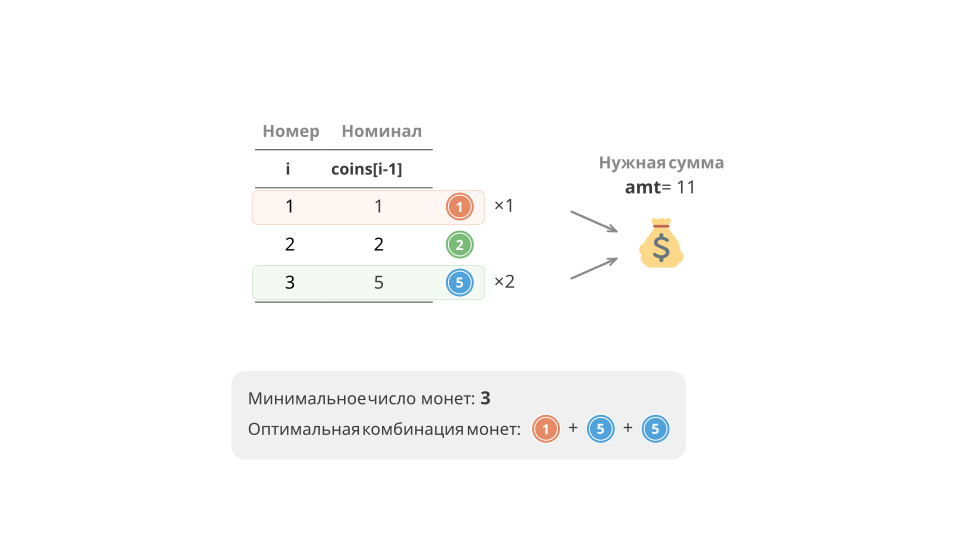{ class="animation-figure" }

<p align="center"> Рисунок 14-24 &nbsp; Пример данных для задачи о размене монет </p>

### 1. &nbsp; Решение методом динамического программирования

**Размен монет можно рассматривать как частный случай неограниченного рюкзака**. Сопоставим эти задачи.

- Одну постановку можно перевести в другую: предмету соответствует монета, весу предмета — номинал монеты, а вместимости рюкзака — нужная сумма.
- Цели оптимизации противоположны: в задаче о рюкзаке мы максимизируем стоимость предметов, а при размене минимизируем число монет.
- В рюкзаке достаточно не превысить вместимость, а при размене необходимо набрать сумму в точности.

**Шаг 1. Описать выбор на каждом шаге и определить состояния для таблицы $dp$**

Подзадача для состояния $[i, a]$: **найти наименьшее число монет первых $i$ видов, которыми можно набрать сумму $a$**. Обозначим ответ $dp[i, a]$.

Двумерная таблица $dp$ имеет размер $(n+1) \times (amt+1)$.

**Шаг 2. Найти оптимальную подструктуру и вывести формулу перехода**

Формула перехода отличается от формулы для неограниченного рюкзака в двух отношениях.

- Мы ищем минимум, поэтому меняем операцию $\max()$ на $\min()$.
- Оптимизируем число монет, а не стоимость предметов. При выборе монеты достаточно выполнить $+1$.

$$
dp[i, a] = \min(dp[i-1, a], dp[i, a - coins[i-1]] + 1)
$$

**Шаг 3. Определить граничные условия и порядок переходов**

Чтобы набрать сумму $0$, достаточно $0$ монет. Поэтому в первом столбце все значения $dp[i, 0]$ равны $0$.

Без монет **невозможно набрать ни одну сумму $> 0$**. Такое решение недопустимо. Чтобы функция $\min()$ в формуле перехода отбрасывала недопустимые решения, можно обозначить их значением $+ \infty$, то есть в первой строке всем $dp[0, a]$ присвоить $+ \infty$.

### 2. &nbsp; Реализация

В большинстве языков программирования целочисленного значения $+ \infty$ нет. Его можно было бы заменить максимальным значением типа `int`, но тогда операция $+ 1$ в формуле перехода может вызвать переполнение.

Поэтому обозначим недопустимое решение числом $amt + 1$: для суммы $amt$ в любом допустимом решении нужно не более $amt$ монет. В конце проверяем, равно ли $dp[n, amt]$ значению $amt + 1$. Если да, возвращаем $-1$: нужную сумму набрать невозможно. Реализация:

=== "Python"

    ```python title="coin_change.py"
    def coin_change_dp(coins: list[int], amt: int) -> int:
        """Размен монет: динамическое программирование"""
        n = len(coins)
        MAX = amt + 1
        # Инициализировать таблицу dp
        dp = [[0] * (amt + 1) for _ in range(n + 1)]
        # Переход: первая строка и первый столбец
        for a in range(1, amt + 1):
            dp[0][a] = MAX
        # Переход: остальные строки и столбцы
        for i in range(1, n + 1):
            for a in range(1, amt + 1):
                if coins[i - 1] > a:
                    # Если номинал превышает нужную сумму, не брать монету i
                    dp[i][a] = dp[i - 1][a]
                else:
                    # Взять минимум из двух вариантов: без монеты i и с ней
                    dp[i][a] = min(dp[i - 1][a], dp[i][a - coins[i - 1]] + 1)
        return dp[n][amt] if dp[n][amt] != MAX else -1
    ```

=== "C++"

    ```cpp title="coin_change.cpp"
    /* Размен монет: динамическое программирование */
    int coinChangeDP(vector<int> &coins, int amt) {
        int n = coins.size();
        int MAX = amt + 1;
        // Инициализировать таблицу dp
        vector<vector<int>> dp(n + 1, vector<int>(amt + 1, 0));
        // Переход: первая строка и первый столбец
        for (int a = 1; a <= amt; a++) {
            dp[0][a] = MAX;
        }
        // Переход: остальные строки и столбцы
        for (int i = 1; i <= n; i++) {
            for (int a = 1; a <= amt; a++) {
                if (coins[i - 1] > a) {
                    // Если номинал превышает нужную сумму, не брать монету i
                    dp[i][a] = dp[i - 1][a];
                } else {
                    // Взять минимум из двух вариантов: без монеты i и с ней
                    dp[i][a] = min(dp[i - 1][a], dp[i][a - coins[i - 1]] + 1);
                }
            }
        }
        return dp[n][amt] != MAX ? dp[n][amt] : -1;
    }
    ```

=== "Java"

    ```java title="coin_change.java"
    /* Размен монет: динамическое программирование */
    int coinChangeDP(int[] coins, int amt) {
        int n = coins.length;
        int MAX = amt + 1;
        // Инициализировать таблицу dp
        int[][] dp = new int[n + 1][amt + 1];
        // Переход: первая строка и первый столбец
        for (int a = 1; a <= amt; a++) {
            dp[0][a] = MAX;
        }
        // Переход: остальные строки и столбцы
        for (int i = 1; i <= n; i++) {
            for (int a = 1; a <= amt; a++) {
                if (coins[i - 1] > a) {
                    // Если номинал превышает нужную сумму, не брать монету i
                    dp[i][a] = dp[i - 1][a];
                } else {
                    // Взять минимум из двух вариантов: без монеты i и с ней
                    dp[i][a] = Math.min(dp[i - 1][a], dp[i][a - coins[i - 1]] + 1);
                }
            }
        }
        return dp[n][amt] != MAX ? dp[n][amt] : -1;
    }
    ```

=== "C#"

    ```csharp title="coin_change.cs"
    /* Размен монет: динамическое программирование */
    int CoinChangeDP(int[] coins, int amt) {
        int n = coins.Length;
        int MAX = amt + 1;
        // Инициализировать таблицу dp
        int[,] dp = new int[n + 1, amt + 1];
        // Переход: первая строка и первый столбец
        for (int a = 1; a <= amt; a++) {
            dp[0, a] = MAX;
        }
        // Переход: остальные строки и столбцы
        for (int i = 1; i <= n; i++) {
            for (int a = 1; a <= amt; a++) {
                if (coins[i - 1] > a) {
                    // Если номинал превышает нужную сумму, не брать монету i
                    dp[i, a] = dp[i - 1, a];
                } else {
                    // Взять минимум из двух вариантов: без монеты i и с ней
                    dp[i, a] = Math.Min(dp[i - 1, a], dp[i, a - coins[i - 1]] + 1);
                }
            }
        }
        return dp[n, amt] != MAX ? dp[n, amt] : -1;
    }
    ```

=== "Go"

    ```go title="coin_change.go"
    /* Размен монет: динамическое программирование */
    func coinChangeDP(coins []int, amt int) int {
        n := len(coins)
        max := amt + 1
        // Инициализировать таблицу dp
        dp := make([][]int, n+1)
        for i := 0; i <= n; i++ {
            dp[i] = make([]int, amt+1)
        }
        // Переход: первая строка и первый столбец
        for a := 1; a <= amt; a++ {
            dp[0][a] = max
        }
        // Переход: остальные строки и столбцы
        for i := 1; i <= n; i++ {
            for a := 1; a <= amt; a++ {
                if coins[i-1] > a {
                    // Если номинал превышает нужную сумму, не брать монету i
                    dp[i][a] = dp[i-1][a]
                } else {
                    // Взять минимум из двух вариантов: без монеты i и с ней
                    dp[i][a] = int(math.Min(float64(dp[i-1][a]), float64(dp[i][a-coins[i-1]]+1)))
                }
            }
        }
        if dp[n][amt] != max {
            return dp[n][amt]
        }
        return -1
    }
    ```

=== "Swift"

    ```swift title="coin_change.swift"
    /* Размен монет: динамическое программирование */
    func coinChangeDP(coins: [Int], amt: Int) -> Int {
        let n = coins.count
        let MAX = amt + 1
        // Инициализировать таблицу dp
        var dp = Array(repeating: Array(repeating: 0, count: amt + 1), count: n + 1)
        // Переход: первая строка и первый столбец
        for a in 1 ... amt {
            dp[0][a] = MAX
        }
        // Переход: остальные строки и столбцы
        for i in 1 ... n {
            for a in 1 ... amt {
                if coins[i - 1] > a {
                    // Если номинал превышает нужную сумму, не брать монету i
                    dp[i][a] = dp[i - 1][a]
                } else {
                    // Взять минимум из двух вариантов: без монеты i и с ней
                    dp[i][a] = min(dp[i - 1][a], dp[i][a - coins[i - 1]] + 1)
                }
            }
        }
        return dp[n][amt] != MAX ? dp[n][amt] : -1
    }
    ```

=== "JS"

    ```javascript title="coin_change.js"
    /* Размен монет: динамическое программирование */
    function coinChangeDP(coins, amt) {
        const n = coins.length;
        const MAX = amt + 1;
        // Инициализировать таблицу dp
        const dp = Array.from({ length: n + 1 }, () =>
            Array.from({ length: amt + 1 }, () => 0)
        );
        // Переход: первая строка и первый столбец
        for (let a = 1; a <= amt; a++) {
            dp[0][a] = MAX;
        }
        // Переход: остальные строки и столбцы
        for (let i = 1; i <= n; i++) {
            for (let a = 1; a <= amt; a++) {
                if (coins[i - 1] > a) {
                    // Если номинал превышает нужную сумму, не брать монету i
                    dp[i][a] = dp[i - 1][a];
                } else {
                    // Взять минимум из двух вариантов: без монеты i и с ней
                    dp[i][a] = Math.min(dp[i - 1][a], dp[i][a - coins[i - 1]] + 1);
                }
            }
        }
        return dp[n][amt] !== MAX ? dp[n][amt] : -1;
    }
    ```

=== "TS"

    ```typescript title="coin_change.ts"
    /* Размен монет: динамическое программирование */
    function coinChangeDP(coins: Array<number>, amt: number): number {
        const n = coins.length;
        const MAX = amt + 1;
        // Инициализировать таблицу dp
        const dp = Array.from({ length: n + 1 }, () =>
            Array.from({ length: amt + 1 }, () => 0)
        );
        // Переход: первая строка и первый столбец
        for (let a = 1; a <= amt; a++) {
            dp[0][a] = MAX;
        }
        // Переход: остальные строки и столбцы
        for (let i = 1; i <= n; i++) {
            for (let a = 1; a <= amt; a++) {
                if (coins[i - 1] > a) {
                    // Если номинал превышает нужную сумму, не брать монету i
                    dp[i][a] = dp[i - 1][a];
                } else {
                    // Взять минимум из двух вариантов: без монеты i и с ней
                    dp[i][a] = Math.min(dp[i - 1][a], dp[i][a - coins[i - 1]] + 1);
                }
            }
        }
        return dp[n][amt] !== MAX ? dp[n][amt] : -1;
    }
    ```

=== "Dart"

    ```dart title="coin_change.dart"
    /* Размен монет: динамическое программирование */
    int coinChangeDP(List<int> coins, int amt) {
      int n = coins.length;
      int MAX = amt + 1;
      // Инициализировать таблицу dp
      List<List<int>> dp = List.generate(n + 1, (index) => List.filled(amt + 1, 0));
      // Переход: первая строка и первый столбец
      for (int a = 1; a <= amt; a++) {
        dp[0][a] = MAX;
      }
      // Переход: остальные строки и столбцы
      for (int i = 1; i <= n; i++) {
        for (int a = 1; a <= amt; a++) {
          if (coins[i - 1] > a) {
            // Если номинал превышает нужную сумму, не брать монету i
            dp[i][a] = dp[i - 1][a];
          } else {
            // Взять минимум из двух вариантов: без монеты i и с ней
            dp[i][a] = min(dp[i - 1][a], dp[i][a - coins[i - 1]] + 1);
          }
        }
      }
      return dp[n][amt] != MAX ? dp[n][amt] : -1;
    }
    ```

=== "Rust"

    ```rust title="coin_change.rs"
    /* Размен монет: динамическое программирование */
    fn coin_change_dp(coins: &[i32], amt: usize) -> i32 {
        let n = coins.len();
        let max = amt + 1;
        // Инициализировать таблицу dp
        let mut dp = vec![vec![0; amt + 1]; n + 1];
        // Переход: первая строка и первый столбец
        for a in 1..=amt {
            dp[0][a] = max;
        }
        // Переход: остальные строки и столбцы
        for i in 1..=n {
            for a in 1..=amt {
                if coins[i - 1] > a as i32 {
                    // Если номинал превышает нужную сумму, не брать монету i
                    dp[i][a] = dp[i - 1][a];
                } else {
                    // Взять минимум из двух вариантов: без монеты i и с ней
                    dp[i][a] = std::cmp::min(dp[i - 1][a], dp[i][a - coins[i - 1] as usize] + 1);
                }
            }
        }
        if dp[n][amt] != max {
            return dp[n][amt] as i32;
        } else {
            -1
        }
    }
    ```

=== "C"

    ```c title="coin_change.c"
    /* Размен монет: динамическое программирование */
    int coinChangeDP(int coins[], int amt, int coinsSize) {
        int n = coinsSize;
        int MAX = amt + 1;
        // Инициализировать таблицу dp
        int **dp = malloc((n + 1) * sizeof(int *));
        for (int i = 0; i <= n; i++) {
            dp[i] = calloc(amt + 1, sizeof(int));
        }
        // Переход: первая строка и первый столбец
        for (int a = 1; a <= amt; a++) {
            dp[0][a] = MAX;
        }
        // Переход: остальные строки и столбцы
        for (int i = 1; i <= n; i++) {
            for (int a = 1; a <= amt; a++) {
                if (coins[i - 1] > a) {
                    // Если номинал превышает нужную сумму, не брать монету i
                    dp[i][a] = dp[i - 1][a];
                } else {
                    // Взять минимум из двух вариантов: без монеты i и с ней
                    dp[i][a] = myMin(dp[i - 1][a], dp[i][a - coins[i - 1]] + 1);
                }
            }
        }
        int res = dp[n][amt] != MAX ? dp[n][amt] : -1;
        // Освободить память
        for (int i = 0; i <= n; i++) {
            free(dp[i]);
        }
        free(dp);
        return res;
    }
    ```

=== "Kotlin"

    ```kotlin title="coin_change.kt"
    /* Размен монет: динамическое программирование */
    fun coinChangeDP(coins: IntArray, amt: Int): Int {
        val n = coins.size
        val MAX = amt + 1
        // Инициализировать таблицу dp
        val dp = Array(n + 1) { IntArray(amt + 1) }
        // Переход: первая строка и первый столбец
        for (a in 1..amt) {
            dp[0][a] = MAX
        }
        // Переход: остальные строки и столбцы
        for (i in 1..n) {
            for (a in 1..amt) {
                if (coins[i - 1] > a) {
                    // Если номинал превышает нужную сумму, не брать монету i
                    dp[i][a] = dp[i - 1][a]
                } else {
                    // Взять минимум из двух вариантов: без монеты i и с ней
                    dp[i][a] = min(dp[i - 1][a], dp[i][a - coins[i - 1]] + 1)
                }
            }
        }
        return if (dp[n][amt] != MAX) dp[n][amt] else -1
    }
    ```

=== "Ruby"

    ```ruby title="coin_change.rb"
    ### Размен монет: динамическое программирование ###
    def coin_change_dp(coins, amt)
      n = coins.length
      _MAX = amt + 1
      # Инициализировать таблицу dp
      dp = Array.new(n + 1) { Array.new(amt + 1, 0) }
      # Переход: первая строка и первый столбец
      (1...(amt + 1)).each { |a| dp[0][a] = _MAX }
      # Переход: остальные строки и столбцы
      for i in 1...(n + 1)
        for a in 1...(amt + 1)
          if coins[i - 1] > a
            # Если номинал превышает нужную сумму, не брать монету i
            dp[i][a] = dp[i - 1][a]
          else
            # Взять минимум из двух вариантов: без монеты i и с ней
            dp[i][a] = [dp[i - 1][a], dp[i][a - coins[i - 1]] + 1].min
          end
        end
      end
      dp[n][amt] != _MAX ? dp[n][amt] : -1
    end
    ```

??? pythontutor "Визуализация выполнения"

    <div style="height: 549px; width: 100%;"><iframe class="pythontutor-iframe" title="Визуализация выполнения" src="https://pythontutor.com/iframe-embed.html#code=def%20coin_change_dp%28coins%3A%20list%5Bint%5D,%20amt%3A%20int%29%20-%3E%20int%3A%0A%20%20%20%20%22%22%22%D0%A0%D0%B0%D0%B7%D0%BC%D0%B5%D0%BD%20%D0%BC%D0%BE%D0%BD%D0%B5%D1%82%3A%20%D0%B4%D0%B8%D0%BD%D0%B0%D0%BC%D0%B8%D1%87%D0%B5%D1%81%D0%BA%D0%BE%D0%B5%20%D0%BF%D1%80%D0%BE%D0%B3%D1%80%D0%B0%D0%BC%D0%BC%D0%B8%D1%80%D0%BE%D0%B2%D0%B0%D0%BD%D0%B8%D0%B5%22%22%22%0A%20%20%20%20n%20%3D%20len%28coins%29%0A%20%20%20%20MAX%20%3D%20amt%20%2B%201%0A%20%20%20%20%23%20%D0%98%D0%BD%D0%B8%D1%86%D0%B8%D0%B0%D0%BB%D0%B8%D0%B7%D0%B8%D1%80%D0%BE%D0%B2%D0%B0%D1%82%D1%8C%20%D1%82%D0%B0%D0%B1%D0%BB%D0%B8%D1%86%D1%83%20dp%0A%20%20%20%20dp%20%3D%20%5B%5B0%5D%20%2A%20%28amt%20%2B%201%29%20for%20_%20in%20range%28n%20%2B%201%29%5D%0A%20%20%20%20%23%20%D0%9F%D0%B5%D1%80%D0%B5%D1%85%D0%BE%D0%B4%3A%20%D0%BF%D0%B5%D1%80%D0%B2%D0%B0%D1%8F%20%D1%81%D1%82%D1%80%D0%BE%D0%BA%D0%B0%20%D0%B8%20%D0%BF%D0%B5%D1%80%D0%B2%D1%8B%D0%B9%20%D1%81%D1%82%D0%BE%D0%BB%D0%B1%D0%B5%D1%86%0A%20%20%20%20for%20a%20in%20range%281,%20amt%20%2B%201%29%3A%0A%20%20%20%20%20%20%20%20dp%5B0%5D%5Ba%5D%20%3D%20MAX%0A%20%20%20%20%23%20%D0%9F%D0%B5%D1%80%D0%B5%D1%85%D0%BE%D0%B4%3A%20%D0%BE%D1%81%D1%82%D0%B0%D0%BB%D1%8C%D0%BD%D1%8B%D0%B5%20%D1%81%D1%82%D1%80%D0%BE%D0%BA%D0%B8%20%D0%B8%20%D1%81%D1%82%D0%BE%D0%BB%D0%B1%D1%86%D1%8B%0A%20%20%20%20for%20i%20in%20range%281,%20n%20%2B%201%29%3A%0A%20%20%20%20%20%20%20%20for%20a%20in%20range%281,%20amt%20%2B%201%29%3A%0A%20%20%20%20%20%20%20%20%20%20%20%20if%20coins%5Bi%20-%201%5D%20%3E%20a%3A%0A%20%20%20%20%20%20%20%20%20%20%20%20%20%20%20%20%23%20%D0%95%D1%81%D0%BB%D0%B8%20%D0%BD%D0%BE%D0%BC%D0%B8%D0%BD%D0%B0%D0%BB%20%D0%BF%D1%80%D0%B5%D0%B2%D1%8B%D1%88%D0%B0%D0%B5%D1%82%20%D0%BD%D1%83%D0%B6%D0%BD%D1%83%D1%8E%20%D1%81%D1%83%D0%BC%D0%BC%D1%83,%20%D0%BD%D0%B5%20%D0%B1%D1%80%D0%B0%D1%82%D1%8C%20%D0%BC%D0%BE%D0%BD%D0%B5%D1%82%D1%83%20i%0A%20%20%20%20%20%20%20%20%20%20%20%20%20%20%20%20dp%5Bi%5D%5Ba%5D%20%3D%20dp%5Bi%20-%201%5D%5Ba%5D%0A%20%20%20%20%20%20%20%20%20%20%20%20else%3A%0A%20%20%20%20%20%20%20%20%20%20%20%20%20%20%20%20%23%20%D0%92%D0%B7%D1%8F%D1%82%D1%8C%20%D0%BC%D0%B8%D0%BD%D0%B8%D0%BC%D1%83%D0%BC%20%D0%B8%D0%B7%20%D0%B4%D0%B2%D1%83%D1%85%20%D0%B2%D0%B0%D1%80%D0%B8%D0%B0%D0%BD%D1%82%D0%BE%D0%B2%3A%20%D0%B1%D0%B5%D0%B7%20%D0%BC%D0%BE%D0%BD%D0%B5%D1%82%D1%8B%20i%20%D0%B8%20%D1%81%20%D0%BD%D0%B5%D0%B9%0A%20%20%20%20%20%20%20%20%20%20%20%20%20%20%20%20dp%5Bi%5D%5Ba%5D%20%3D%20min%28dp%5Bi%20-%201%5D%5Ba%5D,%20dp%5Bi%5D%5Ba%20-%20coins%5Bi%20-%201%5D%5D%20%2B%201%29%0A%20%20%20%20return%20dp%5Bn%5D%5Bamt%5D%20if%20dp%5Bn%5D%5Bamt%5D%20%21%3D%20MAX%20else%20-1%0A%0A%0A%22%22%22Driver%20Code%22%22%22%0Aif%20__name__%20%3D%3D%20%22__main__%22%3A%0A%20%20%20%20coins%20%3D%20%5B1,%202,%205%5D%0A%20%20%20%20amt%20%3D%204%0A%0A%20%20%20%20%23%20%D0%94%D0%B8%D0%BD%D0%B0%D0%BC%D0%B8%D1%87%D0%B5%D1%81%D0%BA%D0%BE%D0%B5%20%D0%BF%D1%80%D0%BE%D0%B3%D1%80%D0%B0%D0%BC%D0%BC%D0%B8%D1%80%D0%BE%D0%B2%D0%B0%D0%BD%D0%B8%D0%B5%0A%20%20%20%20res%20%3D%20coin_change_dp%28coins,%20amt%29%0A%20%20%20%20print%28f%22%D0%9C%D0%B8%D0%BD%D0%B8%D0%BC%D0%B0%D0%BB%D1%8C%D0%BD%D0%BE%D0%B5%20%D1%87%D0%B8%D1%81%D0%BB%D0%BE%20%D0%BC%D0%BE%D0%BD%D0%B5%D1%82%20%D0%B4%D0%BB%D1%8F%20%D0%B7%D0%B0%D0%B4%D0%B0%D0%BD%D0%BD%D0%BE%D0%B9%20%D1%81%D1%83%D0%BC%D0%BC%D1%8B%3A%20%7Bres%7D%22%29&codeDivHeight=472&codeDivWidth=350&cumulative=false&curInstr=5&heapPrimitives=nevernest&origin=opt-frontend.js&py=311&rawInputLstJSON=%5B%5D&textReferences=false"> </iframe></div>
    <div style="margin-top: 5px;"><a href="https://pythontutor.com/iframe-embed.html#code=def%20coin_change_dp%28coins%3A%20list%5Bint%5D,%20amt%3A%20int%29%20-%3E%20int%3A%0A%20%20%20%20%22%22%22%D0%A0%D0%B0%D0%B7%D0%BC%D0%B5%D0%BD%20%D0%BC%D0%BE%D0%BD%D0%B5%D1%82%3A%20%D0%B4%D0%B8%D0%BD%D0%B0%D0%BC%D0%B8%D1%87%D0%B5%D1%81%D0%BA%D0%BE%D0%B5%20%D0%BF%D1%80%D0%BE%D0%B3%D1%80%D0%B0%D0%BC%D0%BC%D0%B8%D1%80%D0%BE%D0%B2%D0%B0%D0%BD%D0%B8%D0%B5%22%22%22%0A%20%20%20%20n%20%3D%20len%28coins%29%0A%20%20%20%20MAX%20%3D%20amt%20%2B%201%0A%20%20%20%20%23%20%D0%98%D0%BD%D0%B8%D1%86%D0%B8%D0%B0%D0%BB%D0%B8%D0%B7%D0%B8%D1%80%D0%BE%D0%B2%D0%B0%D1%82%D1%8C%20%D1%82%D0%B0%D0%B1%D0%BB%D0%B8%D1%86%D1%83%20dp%0A%20%20%20%20dp%20%3D%20%5B%5B0%5D%20%2A%20%28amt%20%2B%201%29%20for%20_%20in%20range%28n%20%2B%201%29%5D%0A%20%20%20%20%23%20%D0%9F%D0%B5%D1%80%D0%B5%D1%85%D0%BE%D0%B4%3A%20%D0%BF%D0%B5%D1%80%D0%B2%D0%B0%D1%8F%20%D1%81%D1%82%D1%80%D0%BE%D0%BA%D0%B0%20%D0%B8%20%D0%BF%D0%B5%D1%80%D0%B2%D1%8B%D0%B9%20%D1%81%D1%82%D0%BE%D0%BB%D0%B1%D0%B5%D1%86%0A%20%20%20%20for%20a%20in%20range%281,%20amt%20%2B%201%29%3A%0A%20%20%20%20%20%20%20%20dp%5B0%5D%5Ba%5D%20%3D%20MAX%0A%20%20%20%20%23%20%D0%9F%D0%B5%D1%80%D0%B5%D1%85%D0%BE%D0%B4%3A%20%D0%BE%D1%81%D1%82%D0%B0%D0%BB%D1%8C%D0%BD%D1%8B%D0%B5%20%D1%81%D1%82%D1%80%D0%BE%D0%BA%D0%B8%20%D0%B8%20%D1%81%D1%82%D0%BE%D0%BB%D0%B1%D1%86%D1%8B%0A%20%20%20%20for%20i%20in%20range%281,%20n%20%2B%201%29%3A%0A%20%20%20%20%20%20%20%20for%20a%20in%20range%281,%20amt%20%2B%201%29%3A%0A%20%20%20%20%20%20%20%20%20%20%20%20if%20coins%5Bi%20-%201%5D%20%3E%20a%3A%0A%20%20%20%20%20%20%20%20%20%20%20%20%20%20%20%20%23%20%D0%95%D1%81%D0%BB%D0%B8%20%D0%BD%D0%BE%D0%BC%D0%B8%D0%BD%D0%B0%D0%BB%20%D0%BF%D1%80%D0%B5%D0%B2%D1%8B%D1%88%D0%B0%D0%B5%D1%82%20%D0%BD%D1%83%D0%B6%D0%BD%D1%83%D1%8E%20%D1%81%D1%83%D0%BC%D0%BC%D1%83,%20%D0%BD%D0%B5%20%D0%B1%D1%80%D0%B0%D1%82%D1%8C%20%D0%BC%D0%BE%D0%BD%D0%B5%D1%82%D1%83%20i%0A%20%20%20%20%20%20%20%20%20%20%20%20%20%20%20%20dp%5Bi%5D%5Ba%5D%20%3D%20dp%5Bi%20-%201%5D%5Ba%5D%0A%20%20%20%20%20%20%20%20%20%20%20%20else%3A%0A%20%20%20%20%20%20%20%20%20%20%20%20%20%20%20%20%23%20%D0%92%D0%B7%D1%8F%D1%82%D1%8C%20%D0%BC%D0%B8%D0%BD%D0%B8%D0%BC%D1%83%D0%BC%20%D0%B8%D0%B7%20%D0%B4%D0%B2%D1%83%D1%85%20%D0%B2%D0%B0%D1%80%D0%B8%D0%B0%D0%BD%D1%82%D0%BE%D0%B2%3A%20%D0%B1%D0%B5%D0%B7%20%D0%BC%D0%BE%D0%BD%D0%B5%D1%82%D1%8B%20i%20%D0%B8%20%D1%81%20%D0%BD%D0%B5%D0%B9%0A%20%20%20%20%20%20%20%20%20%20%20%20%20%20%20%20dp%5Bi%5D%5Ba%5D%20%3D%20min%28dp%5Bi%20-%201%5D%5Ba%5D,%20dp%5Bi%5D%5Ba%20-%20coins%5Bi%20-%201%5D%5D%20%2B%201%29%0A%20%20%20%20return%20dp%5Bn%5D%5Bamt%5D%20if%20dp%5Bn%5D%5Bamt%5D%20%21%3D%20MAX%20else%20-1%0A%0A%0A%22%22%22Driver%20Code%22%22%22%0Aif%20__name__%20%3D%3D%20%22__main__%22%3A%0A%20%20%20%20coins%20%3D%20%5B1,%202,%205%5D%0A%20%20%20%20amt%20%3D%204%0A%0A%20%20%20%20%23%20%D0%94%D0%B8%D0%BD%D0%B0%D0%BC%D0%B8%D1%87%D0%B5%D1%81%D0%BA%D0%BE%D0%B5%20%D0%BF%D1%80%D0%BE%D0%B3%D1%80%D0%B0%D0%BC%D0%BC%D0%B8%D1%80%D0%BE%D0%B2%D0%B0%D0%BD%D0%B8%D0%B5%0A%20%20%20%20res%20%3D%20coin_change_dp%28coins,%20amt%29%0A%20%20%20%20print%28f%22%D0%9C%D0%B8%D0%BD%D0%B8%D0%BC%D0%B0%D0%BB%D1%8C%D0%BD%D0%BE%D0%B5%20%D1%87%D0%B8%D1%81%D0%BB%D0%BE%20%D0%BC%D0%BE%D0%BD%D0%B5%D1%82%20%D0%B4%D0%BB%D1%8F%20%D0%B7%D0%B0%D0%B4%D0%B0%D0%BD%D0%BD%D0%BE%D0%B9%20%D1%81%D1%83%D0%BC%D0%BC%D1%8B%3A%20%7Bres%7D%22%29&codeDivHeight=800&codeDivWidth=600&cumulative=false&curInstr=5&heapPrimitives=nevernest&origin=opt-frontend.js&py=311&rawInputLstJSON=%5B%5D&textReferences=false" target="_blank" rel="noopener noreferrer">Во весь экран ></a></div>

На рисунке показано, как динамическое программирование решает задачу о размене. Процесс очень похож на решение задачи о неограниченном рюкзаке.

=== "<1>"
    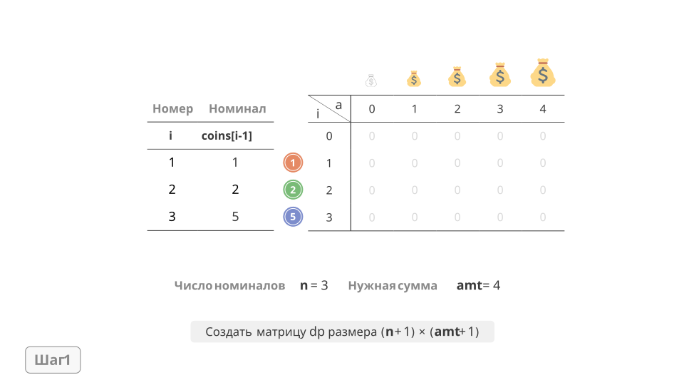{ class="animation-figure" }

=== "<2>"
    { class="animation-figure" }

=== "<3>"
    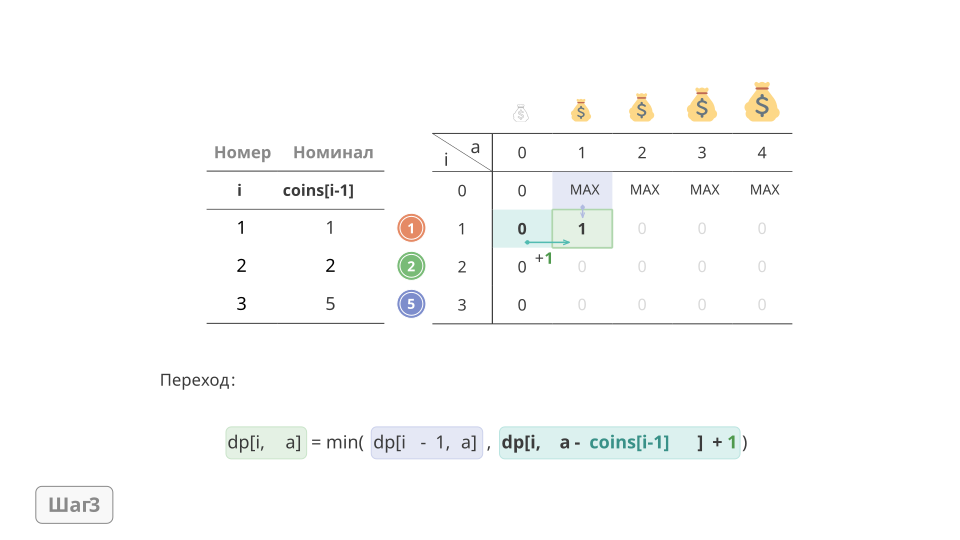{ class="animation-figure" }

=== "<4>"
    { class="animation-figure" }

=== "<5>"
    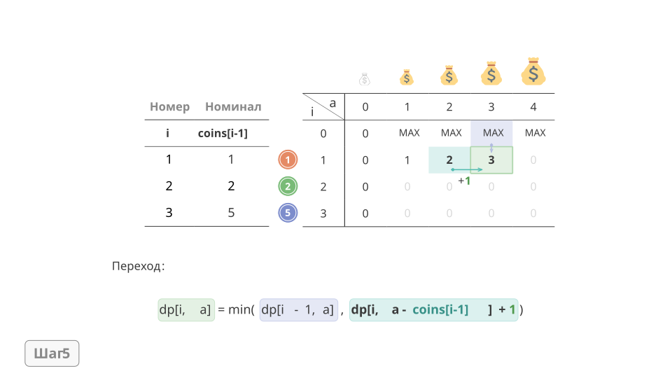{ class="animation-figure" }

=== "<6>"
    { class="animation-figure" }

=== "<7>"
    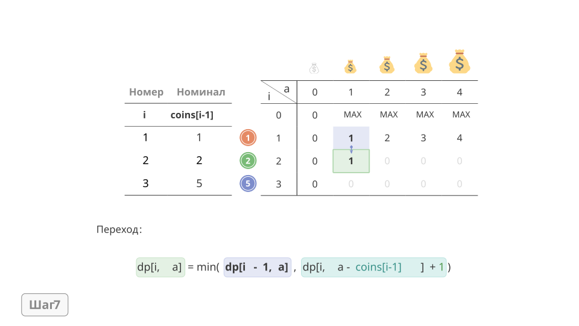{ class="animation-figure" }

=== "<8>"
    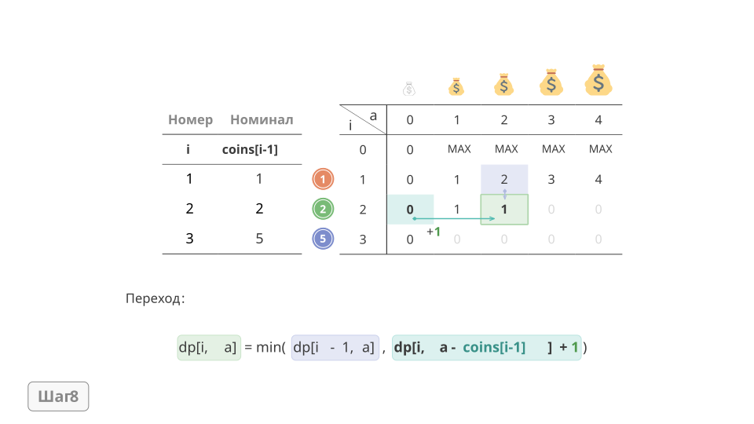{ class="animation-figure" }

=== "<9>"
    { class="animation-figure" }

=== "<10>"
    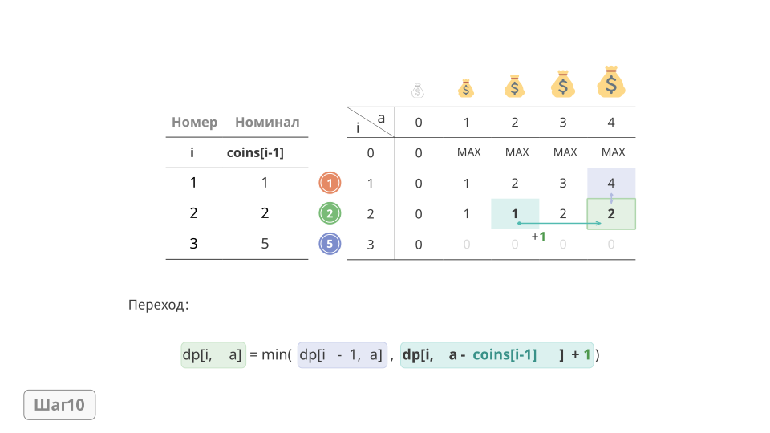{ class="animation-figure" }

=== "<11>"
    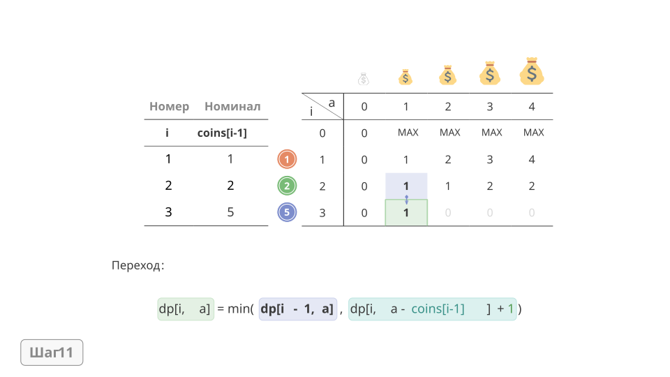{ class="animation-figure" }

=== "<12>"
    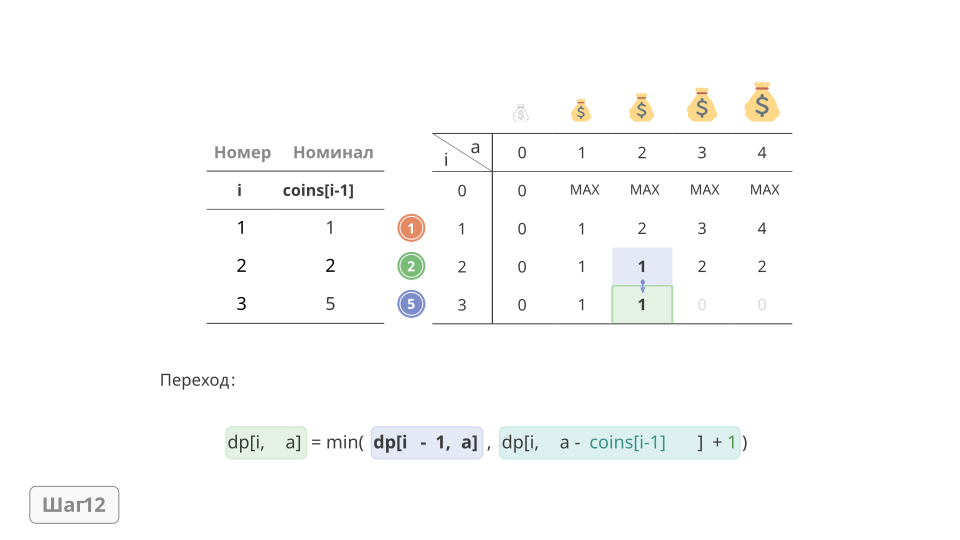{ class="animation-figure" }

=== "<13>"
    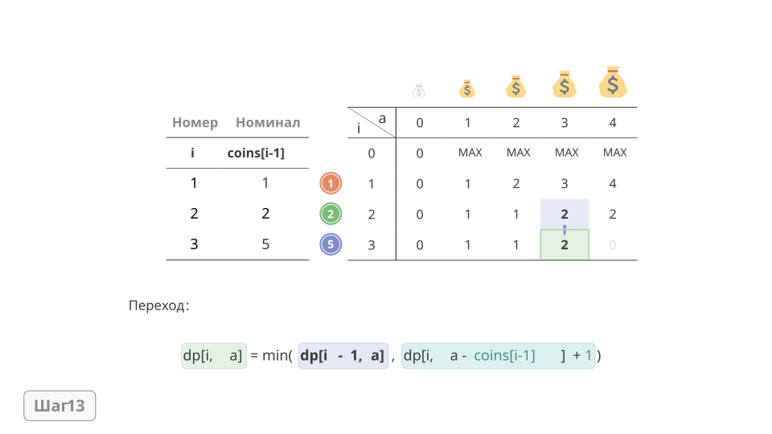{ class="animation-figure" }

=== "<14>"
    { class="animation-figure" }

=== "<15>"
    { class="animation-figure" }

<p align="center"> Рисунок 14-25 &nbsp; Решение задачи о размене монет методом динамического программирования </p>

### 3. &nbsp; Экономия памяти

Для экономии памяти используем тот же приём, что и в неограниченном рюкзаке:

=== "Python"

    ```python title="coin_change.py"
    def coin_change_dp_comp(coins: list[int], amt: int) -> int:
        """Размен монет: динамическое программирование с экономией памяти"""
        n = len(coins)
        MAX = amt + 1
        # Инициализировать таблицу dp
        dp = [MAX] * (amt + 1)
        dp[0] = 0
        # Переход между состояниями
        for i in range(1, n + 1):
            # Обход в прямом порядке
            for a in range(1, amt + 1):
                if coins[i - 1] > a:
                    # Если номинал превышает нужную сумму, не брать монету i
                    dp[a] = dp[a]
                else:
                    # Взять минимум из двух вариантов: без монеты i и с ней
                    dp[a] = min(dp[a], dp[a - coins[i - 1]] + 1)
        return dp[amt] if dp[amt] != MAX else -1
    ```

=== "C++"

    ```cpp title="coin_change.cpp"
    /* Размен монет: динамическое программирование с экономией памяти */
    int coinChangeDPComp(vector<int> &coins, int amt) {
        int n = coins.size();
        int MAX = amt + 1;
        // Инициализировать таблицу dp
        vector<int> dp(amt + 1, MAX);
        dp[0] = 0;
        // Переход между состояниями
        for (int i = 1; i <= n; i++) {
            for (int a = 1; a <= amt; a++) {
                if (coins[i - 1] > a) {
                    // Если номинал превышает нужную сумму, не брать монету i
                    dp[a] = dp[a];
                } else {
                    // Взять минимум из двух вариантов: без монеты i и с ней
                    dp[a] = min(dp[a], dp[a - coins[i - 1]] + 1);
                }
            }
        }
        return dp[amt] != MAX ? dp[amt] : -1;
    }
    ```

=== "Java"

    ```java title="coin_change.java"
    /* Размен монет: динамическое программирование с экономией памяти */
    int coinChangeDPComp(int[] coins, int amt) {
        int n = coins.length;
        int MAX = amt + 1;
        // Инициализировать таблицу dp
        int[] dp = new int[amt + 1];
        Arrays.fill(dp, MAX);
        dp[0] = 0;
        // Переход между состояниями
        for (int i = 1; i <= n; i++) {
            for (int a = 1; a <= amt; a++) {
                if (coins[i - 1] > a) {
                    // Если номинал превышает нужную сумму, не брать монету i
                    dp[a] = dp[a];
                } else {
                    // Взять минимум из двух вариантов: без монеты i и с ней
                    dp[a] = Math.min(dp[a], dp[a - coins[i - 1]] + 1);
                }
            }
        }
        return dp[amt] != MAX ? dp[amt] : -1;
    }
    ```

=== "C#"

    ```csharp title="coin_change.cs"
    /* Размен монет: динамическое программирование с экономией памяти */
    int CoinChangeDPComp(int[] coins, int amt) {
        int n = coins.Length;
        int MAX = amt + 1;
        // Инициализировать таблицу dp
        int[] dp = new int[amt + 1];
        Array.Fill(dp, MAX);
        dp[0] = 0;
        // Переход между состояниями
        for (int i = 1; i <= n; i++) {
            for (int a = 1; a <= amt; a++) {
                if (coins[i - 1] > a) {
                    // Если номинал превышает нужную сумму, не брать монету i
                    dp[a] = dp[a];
                } else {
                    // Взять минимум из двух вариантов: без монеты i и с ней
                    dp[a] = Math.Min(dp[a], dp[a - coins[i - 1]] + 1);
                }
            }
        }
        return dp[amt] != MAX ? dp[amt] : -1;
    }
    ```

=== "Go"

    ```go title="coin_change.go"
    /* Размен монет: динамическое программирование */
    func coinChangeDPComp(coins []int, amt int) int {
        n := len(coins)
        max := amt + 1
        // Инициализировать таблицу dp
        dp := make([]int, amt+1)
        for i := 1; i <= amt; i++ {
            dp[i] = max
        }
        // Переход между состояниями
        for i := 1; i <= n; i++ {
            // Обход в прямом порядке
            for a := 1; a <= amt; a++ {
                if coins[i-1] > a {
                    // Если номинал превышает нужную сумму, не брать монету i
                    dp[a] = dp[a]
                } else {
                    // Взять минимум из двух вариантов: без монеты i и с ней
                    dp[a] = int(math.Min(float64(dp[a]), float64(dp[a-coins[i-1]]+1)))
                }
            }
        }
        if dp[amt] != max {
            return dp[amt]
        }
        return -1
    }
    ```

=== "Swift"

    ```swift title="coin_change.swift"
    /* Размен монет: динамическое программирование с экономией памяти */
    func coinChangeDPComp(coins: [Int], amt: Int) -> Int {
        let n = coins.count
        let MAX = amt + 1
        // Инициализировать таблицу dp
        var dp = Array(repeating: MAX, count: amt + 1)
        dp[0] = 0
        // Переход между состояниями
        for i in 1 ... n {
            for a in 1 ... amt {
                if coins[i - 1] > a {
                    // Если номинал превышает нужную сумму, не брать монету i
                    dp[a] = dp[a]
                } else {
                    // Взять минимум из двух вариантов: без монеты i и с ней
                    dp[a] = min(dp[a], dp[a - coins[i - 1]] + 1)
                }
            }
        }
        return dp[amt] != MAX ? dp[amt] : -1
    }
    ```

=== "JS"

    ```javascript title="coin_change.js"
    /* Размен монет: динамическое программирование с экономией памяти */
    function coinChangeDPComp(coins, amt) {
        const n = coins.length;
        const MAX = amt + 1;
        // Инициализировать таблицу dp
        const dp = Array.from({ length: amt + 1 }, () => MAX);
        dp[0] = 0;
        // Переход между состояниями
        for (let i = 1; i <= n; i++) {
            for (let a = 1; a <= amt; a++) {
                if (coins[i - 1] > a) {
                    // Если номинал превышает нужную сумму, не брать монету i
                    dp[a] = dp[a];
                } else {
                    // Взять минимум из двух вариантов: без монеты i и с ней
                    dp[a] = Math.min(dp[a], dp[a - coins[i - 1]] + 1);
                }
            }
        }
        return dp[amt] !== MAX ? dp[amt] : -1;
    }
    ```

=== "TS"

    ```typescript title="coin_change.ts"
    /* Размен монет: динамическое программирование с экономией памяти */
    function coinChangeDPComp(coins: Array<number>, amt: number): number {
        const n = coins.length;
        const MAX = amt + 1;
        // Инициализировать таблицу dp
        const dp = Array.from({ length: amt + 1 }, () => MAX);
        dp[0] = 0;
        // Переход между состояниями
        for (let i = 1; i <= n; i++) {
            for (let a = 1; a <= amt; a++) {
                if (coins[i - 1] > a) {
                    // Если номинал превышает нужную сумму, не брать монету i
                    dp[a] = dp[a];
                } else {
                    // Взять минимум из двух вариантов: без монеты i и с ней
                    dp[a] = Math.min(dp[a], dp[a - coins[i - 1]] + 1);
                }
            }
        }
        return dp[amt] !== MAX ? dp[amt] : -1;
    }
    ```

=== "Dart"

    ```dart title="coin_change.dart"
    /* Размен монет: динамическое программирование с экономией памяти */
    int coinChangeDPComp(List<int> coins, int amt) {
      int n = coins.length;
      int MAX = amt + 1;
      // Инициализировать таблицу dp
      List<int> dp = List.filled(amt + 1, MAX);
      dp[0] = 0;
      // Переход между состояниями
      for (int i = 1; i <= n; i++) {
        for (int a = 1; a <= amt; a++) {
          if (coins[i - 1] > a) {
            // Если номинал превышает нужную сумму, не брать монету i
            dp[a] = dp[a];
          } else {
            // Взять минимум из двух вариантов: без монеты i и с ней
            dp[a] = min(dp[a], dp[a - coins[i - 1]] + 1);
          }
        }
      }
      return dp[amt] != MAX ? dp[amt] : -1;
    }
    ```

=== "Rust"

    ```rust title="coin_change.rs"
    /* Размен монет: динамическое программирование с экономией памяти */
    fn coin_change_dp_comp(coins: &[i32], amt: usize) -> i32 {
        let n = coins.len();
        let max = amt + 1;
        // Инициализировать таблицу dp
        let mut dp = vec![0; amt + 1];
        dp.fill(max);
        dp[0] = 0;
        // Переход между состояниями
        for i in 1..=n {
            for a in 1..=amt {
                if coins[i - 1] > a as i32 {
                    // Если номинал превышает нужную сумму, не брать монету i
                    dp[a] = dp[a];
                } else {
                    // Взять минимум из двух вариантов: без монеты i и с ней
                    dp[a] = std::cmp::min(dp[a], dp[a - coins[i - 1] as usize] + 1);
                }
            }
        }
        if dp[amt] != max {
            return dp[amt] as i32;
        } else {
            -1
        }
    }
    ```

=== "C"

    ```c title="coin_change.c"
    /* Размен монет: динамическое программирование с экономией памяти */
    int coinChangeDPComp(int coins[], int amt, int coinsSize) {
        int n = coinsSize;
        int MAX = amt + 1;
        // Инициализировать таблицу dp
        int *dp = malloc((amt + 1) * sizeof(int));
        for (int j = 1; j <= amt; j++) {
            dp[j] = MAX;
        } 
        dp[0] = 0;

        // Переход между состояниями
        for (int i = 1; i <= n; i++) {
            for (int a = 1; a <= amt; a++) {
                if (coins[i - 1] > a) {
                    // Если номинал превышает нужную сумму, не брать монету i
                    dp[a] = dp[a];
                } else {
                    // Взять минимум из двух вариантов: без монеты i и с ней
                    dp[a] = myMin(dp[a], dp[a - coins[i - 1]] + 1);
                }
            }
        }
        int res = dp[amt] != MAX ? dp[amt] : -1;
        // Освободить память
        free(dp);
        return res;
    }
    ```

=== "Kotlin"

    ```kotlin title="coin_change.kt"
    /* Размен монет: динамическое программирование с экономией памяти */
    fun coinChangeDPComp(coins: IntArray, amt: Int): Int {
        val n = coins.size
        val MAX = amt + 1
        // Инициализировать таблицу dp
        val dp = IntArray(amt + 1)
        dp.fill(MAX)
        dp[0] = 0
        // Переход между состояниями
        for (i in 1..n) {
            for (a in 1..amt) {
                if (coins[i - 1] > a) {
                    // Если номинал превышает нужную сумму, не брать монету i
                    dp[a] = dp[a]
                } else {
                    // Взять минимум из двух вариантов: без монеты i и с ней
                    dp[a] = min(dp[a], dp[a - coins[i - 1]] + 1)
                }
            }
        }
        return if (dp[amt] != MAX) dp[amt] else -1
    }
    ```

=== "Ruby"

    ```ruby title="coin_change.rb"
    ### Размен монет: динамическое программирование с экономией памяти ###
    def coin_change_dp_comp(coins, amt)
      n = coins.length
      _MAX = amt + 1
      # Инициализировать таблицу dp
      dp = Array.new(amt + 1, _MAX)
      dp[0] = 0
      # Переход между состояниями
      for i in 1...(n + 1)
        # Обход в прямом порядке
        for a in 1...(amt + 1)
          if coins[i - 1] > a
            # Если номинал превышает нужную сумму, не брать монету i
            dp[a] = dp[a]
          else
            # Взять минимум из двух вариантов: без монеты i и с ней
            dp[a] = [dp[a], dp[a - coins[i - 1]] + 1].min
          end
        end
      end
      dp[amt] != _MAX ? dp[amt] : -1
    end
    ```

??? pythontutor "Визуализация выполнения"

    <div style="height: 549px; width: 100%;"><iframe class="pythontutor-iframe" title="Визуализация выполнения" src="https://pythontutor.com/iframe-embed.html#code=def%20coin_change_dp_comp%28coins%3A%20list%5Bint%5D,%20amt%3A%20int%29%20-%3E%20int%3A%0A%20%20%20%20%22%22%22%D0%A0%D0%B0%D0%B7%D0%BC%D0%B5%D0%BD%20%D0%BC%D0%BE%D0%BD%D0%B5%D1%82%3A%20%D0%B4%D0%B8%D0%BD%D0%B0%D0%BC%D0%B8%D1%87%D0%B5%D1%81%D0%BA%D0%BE%D0%B5%20%D0%BF%D1%80%D0%BE%D0%B3%D1%80%D0%B0%D0%BC%D0%BC%D0%B8%D1%80%D0%BE%D0%B2%D0%B0%D0%BD%D0%B8%D0%B5%20%D1%81%20%D1%8D%D0%BA%D0%BE%D0%BD%D0%BE%D0%BC%D0%B8%D0%B5%D0%B9%20%D0%BF%D0%B0%D0%BC%D1%8F%D1%82%D0%B8%22%22%22%0A%20%20%20%20n%20%3D%20len%28coins%29%0A%20%20%20%20MAX%20%3D%20amt%20%2B%201%0A%20%20%20%20%23%20%D0%98%D0%BD%D0%B8%D1%86%D0%B8%D0%B0%D0%BB%D0%B8%D0%B7%D0%B8%D1%80%D0%BE%D0%B2%D0%B0%D1%82%D1%8C%20%D1%82%D0%B0%D0%B1%D0%BB%D0%B8%D1%86%D1%83%20dp%0A%20%20%20%20dp%20%3D%20%5BMAX%5D%20%2A%20%28amt%20%2B%201%29%0A%20%20%20%20dp%5B0%5D%20%3D%200%0A%20%20%20%20%23%20%D0%9F%D0%B5%D1%80%D0%B5%D1%85%D0%BE%D0%B4%20%D0%BC%D0%B5%D0%B6%D0%B4%D1%83%20%D1%81%D0%BE%D1%81%D1%82%D0%BE%D1%8F%D0%BD%D0%B8%D1%8F%D0%BC%D0%B8%0A%20%20%20%20for%20i%20in%20range%281,%20n%20%2B%201%29%3A%0A%20%20%20%20%20%20%20%20%23%20%D0%9E%D0%B1%D1%85%D0%BE%D0%B4%20%D0%B2%20%D0%BF%D1%80%D1%8F%D0%BC%D0%BE%D0%BC%20%D0%BF%D0%BE%D1%80%D1%8F%D0%B4%D0%BA%D0%B5%0A%20%20%20%20%20%20%20%20for%20a%20in%20range%281,%20amt%20%2B%201%29%3A%0A%20%20%20%20%20%20%20%20%20%20%20%20if%20coins%5Bi%20-%201%5D%20%3E%20a%3A%0A%20%20%20%20%20%20%20%20%20%20%20%20%20%20%20%20%23%20%D0%95%D1%81%D0%BB%D0%B8%20%D0%BD%D0%BE%D0%BC%D0%B8%D0%BD%D0%B0%D0%BB%20%D0%BF%D1%80%D0%B5%D0%B2%D1%8B%D1%88%D0%B0%D0%B5%D1%82%20%D0%BD%D1%83%D0%B6%D0%BD%D1%83%D1%8E%20%D1%81%D1%83%D0%BC%D0%BC%D1%83,%20%D0%BD%D0%B5%20%D0%B1%D1%80%D0%B0%D1%82%D1%8C%20%D0%BC%D0%BE%D0%BD%D0%B5%D1%82%D1%83%20i%0A%20%20%20%20%20%20%20%20%20%20%20%20%20%20%20%20dp%5Ba%5D%20%3D%20dp%5Ba%5D%0A%20%20%20%20%20%20%20%20%20%20%20%20else%3A%0A%20%20%20%20%20%20%20%20%20%20%20%20%20%20%20%20%23%20%D0%92%D0%B7%D1%8F%D1%82%D1%8C%20%D0%BC%D0%B8%D0%BD%D0%B8%D0%BC%D1%83%D0%BC%20%D0%B8%D0%B7%20%D0%B4%D0%B2%D1%83%D1%85%20%D0%B2%D0%B0%D1%80%D0%B8%D0%B0%D0%BD%D1%82%D0%BE%D0%B2%3A%20%D0%B1%D0%B5%D0%B7%20%D0%BC%D0%BE%D0%BD%D0%B5%D1%82%D1%8B%20i%20%D0%B8%20%D1%81%20%D0%BD%D0%B5%D0%B9%0A%20%20%20%20%20%20%20%20%20%20%20%20%20%20%20%20dp%5Ba%5D%20%3D%20min%28dp%5Ba%5D,%20dp%5Ba%20-%20coins%5Bi%20-%201%5D%5D%20%2B%201%29%0A%20%20%20%20return%20dp%5Bamt%5D%20if%20dp%5Bamt%5D%20%21%3D%20MAX%20else%20-1%0A%0A%0A%22%22%22Driver%20Code%22%22%22%0Aif%20__name__%20%3D%3D%20%22__main__%22%3A%0A%20%20%20%20coins%20%3D%20%5B1,%202,%205%5D%0A%20%20%20%20amt%20%3D%204%0A%0A%20%20%20%20%23%20%D0%94%D0%B8%D0%BD%D0%B0%D0%BC%D0%B8%D1%87%D0%B5%D1%81%D0%BA%D0%BE%D0%B5%20%D0%BF%D1%80%D0%BE%D0%B3%D1%80%D0%B0%D0%BC%D0%BC%D0%B8%D1%80%D0%BE%D0%B2%D0%B0%D0%BD%D0%B8%D0%B5%20%D1%81%20%D1%8D%D0%BA%D0%BE%D0%BD%D0%BE%D0%BC%D0%B8%D0%B5%D0%B9%20%D0%BF%D0%B0%D0%BC%D1%8F%D1%82%D0%B8%0A%20%20%20%20res%20%3D%20coin_change_dp_comp%28coins,%20amt%29%0A%20%20%20%20print%28f%22%D0%9C%D0%B8%D0%BD%D0%B8%D0%BC%D0%B0%D0%BB%D1%8C%D0%BD%D0%BE%D0%B5%20%D1%87%D0%B8%D1%81%D0%BB%D0%BE%20%D0%BC%D0%BE%D0%BD%D0%B5%D1%82%20%D0%B4%D0%BB%D1%8F%20%D0%B7%D0%B0%D0%B4%D0%B0%D0%BD%D0%BD%D0%BE%D0%B9%20%D1%81%D1%83%D0%BC%D0%BC%D1%8B%3A%20%7Bres%7D%22%29&codeDivHeight=472&codeDivWidth=350&cumulative=false&curInstr=5&heapPrimitives=nevernest&origin=opt-frontend.js&py=311&rawInputLstJSON=%5B%5D&textReferences=false"> </iframe></div>
    <div style="margin-top: 5px;"><a href="https://pythontutor.com/iframe-embed.html#code=def%20coin_change_dp_comp%28coins%3A%20list%5Bint%5D,%20amt%3A%20int%29%20-%3E%20int%3A%0A%20%20%20%20%22%22%22%D0%A0%D0%B0%D0%B7%D0%BC%D0%B5%D0%BD%20%D0%BC%D0%BE%D0%BD%D0%B5%D1%82%3A%20%D0%B4%D0%B8%D0%BD%D0%B0%D0%BC%D0%B8%D1%87%D0%B5%D1%81%D0%BA%D0%BE%D0%B5%20%D0%BF%D1%80%D0%BE%D0%B3%D1%80%D0%B0%D0%BC%D0%BC%D0%B8%D1%80%D0%BE%D0%B2%D0%B0%D0%BD%D0%B8%D0%B5%20%D1%81%20%D1%8D%D0%BA%D0%BE%D0%BD%D0%BE%D0%BC%D0%B8%D0%B5%D0%B9%20%D0%BF%D0%B0%D0%BC%D1%8F%D1%82%D0%B8%22%22%22%0A%20%20%20%20n%20%3D%20len%28coins%29%0A%20%20%20%20MAX%20%3D%20amt%20%2B%201%0A%20%20%20%20%23%20%D0%98%D0%BD%D0%B8%D1%86%D0%B8%D0%B0%D0%BB%D0%B8%D0%B7%D0%B8%D1%80%D0%BE%D0%B2%D0%B0%D1%82%D1%8C%20%D1%82%D0%B0%D0%B1%D0%BB%D0%B8%D1%86%D1%83%20dp%0A%20%20%20%20dp%20%3D%20%5BMAX%5D%20%2A%20%28amt%20%2B%201%29%0A%20%20%20%20dp%5B0%5D%20%3D%200%0A%20%20%20%20%23%20%D0%9F%D0%B5%D1%80%D0%B5%D1%85%D0%BE%D0%B4%20%D0%BC%D0%B5%D0%B6%D0%B4%D1%83%20%D1%81%D0%BE%D1%81%D1%82%D0%BE%D1%8F%D0%BD%D0%B8%D1%8F%D0%BC%D0%B8%0A%20%20%20%20for%20i%20in%20range%281,%20n%20%2B%201%29%3A%0A%20%20%20%20%20%20%20%20%23%20%D0%9E%D0%B1%D1%85%D0%BE%D0%B4%20%D0%B2%20%D0%BF%D1%80%D1%8F%D0%BC%D0%BE%D0%BC%20%D0%BF%D0%BE%D1%80%D1%8F%D0%B4%D0%BA%D0%B5%0A%20%20%20%20%20%20%20%20for%20a%20in%20range%281,%20amt%20%2B%201%29%3A%0A%20%20%20%20%20%20%20%20%20%20%20%20if%20coins%5Bi%20-%201%5D%20%3E%20a%3A%0A%20%20%20%20%20%20%20%20%20%20%20%20%20%20%20%20%23%20%D0%95%D1%81%D0%BB%D0%B8%20%D0%BD%D0%BE%D0%BC%D0%B8%D0%BD%D0%B0%D0%BB%20%D0%BF%D1%80%D0%B5%D0%B2%D1%8B%D1%88%D0%B0%D0%B5%D1%82%20%D0%BD%D1%83%D0%B6%D0%BD%D1%83%D1%8E%20%D1%81%D1%83%D0%BC%D0%BC%D1%83,%20%D0%BD%D0%B5%20%D0%B1%D1%80%D0%B0%D1%82%D1%8C%20%D0%BC%D0%BE%D0%BD%D0%B5%D1%82%D1%83%20i%0A%20%20%20%20%20%20%20%20%20%20%20%20%20%20%20%20dp%5Ba%5D%20%3D%20dp%5Ba%5D%0A%20%20%20%20%20%20%20%20%20%20%20%20else%3A%0A%20%20%20%20%20%20%20%20%20%20%20%20%20%20%20%20%23%20%D0%92%D0%B7%D1%8F%D1%82%D1%8C%20%D0%BC%D0%B8%D0%BD%D0%B8%D0%BC%D1%83%D0%BC%20%D0%B8%D0%B7%20%D0%B4%D0%B2%D1%83%D1%85%20%D0%B2%D0%B0%D1%80%D0%B8%D0%B0%D0%BD%D1%82%D0%BE%D0%B2%3A%20%D0%B1%D0%B5%D0%B7%20%D0%BC%D0%BE%D0%BD%D0%B5%D1%82%D1%8B%20i%20%D0%B8%20%D1%81%20%D0%BD%D0%B5%D0%B9%0A%20%20%20%20%20%20%20%20%20%20%20%20%20%20%20%20dp%5Ba%5D%20%3D%20min%28dp%5Ba%5D,%20dp%5Ba%20-%20coins%5Bi%20-%201%5D%5D%20%2B%201%29%0A%20%20%20%20return%20dp%5Bamt%5D%20if%20dp%5Bamt%5D%20%21%3D%20MAX%20else%20-1%0A%0A%0A%22%22%22Driver%20Code%22%22%22%0Aif%20__name__%20%3D%3D%20%22__main__%22%3A%0A%20%20%20%20coins%20%3D%20%5B1,%202,%205%5D%0A%20%20%20%20amt%20%3D%204%0A%0A%20%20%20%20%23%20%D0%94%D0%B8%D0%BD%D0%B0%D0%BC%D0%B8%D1%87%D0%B5%D1%81%D0%BA%D0%BE%D0%B5%20%D0%BF%D1%80%D0%BE%D0%B3%D1%80%D0%B0%D0%BC%D0%BC%D0%B8%D1%80%D0%BE%D0%B2%D0%B0%D0%BD%D0%B8%D0%B5%20%D1%81%20%D1%8D%D0%BA%D0%BE%D0%BD%D0%BE%D0%BC%D0%B8%D0%B5%D0%B9%20%D0%BF%D0%B0%D0%BC%D1%8F%D1%82%D0%B8%0A%20%20%20%20res%20%3D%20coin_change_dp_comp%28coins,%20amt%29%0A%20%20%20%20print%28f%22%D0%9C%D0%B8%D0%BD%D0%B8%D0%BC%D0%B0%D0%BB%D1%8C%D0%BD%D0%BE%D0%B5%20%D1%87%D0%B8%D1%81%D0%BB%D0%BE%20%D0%BC%D0%BE%D0%BD%D0%B5%D1%82%20%D0%B4%D0%BB%D1%8F%20%D0%B7%D0%B0%D0%B4%D0%B0%D0%BD%D0%BD%D0%BE%D0%B9%20%D1%81%D1%83%D0%BC%D0%BC%D1%8B%3A%20%7Bres%7D%22%29&codeDivHeight=800&codeDivWidth=600&cumulative=false&curInstr=5&heapPrimitives=nevernest&origin=opt-frontend.js&py=311&rawInputLstJSON=%5B%5D&textReferences=false" target="_blank" rel="noopener noreferrer">Во весь экран ></a></div>

## 14.5.3 &nbsp; Задача о размене монет II

!!! question

    Даны монеты $n$ видов. У монеты вида $i$ номинал $coins[i - 1]$. Требуется набрать сумму $amt$. Монеты каждого вида можно брать многократно. **Сколько комбинаций монет дают нужную сумму?** Пример показан на рисунке.

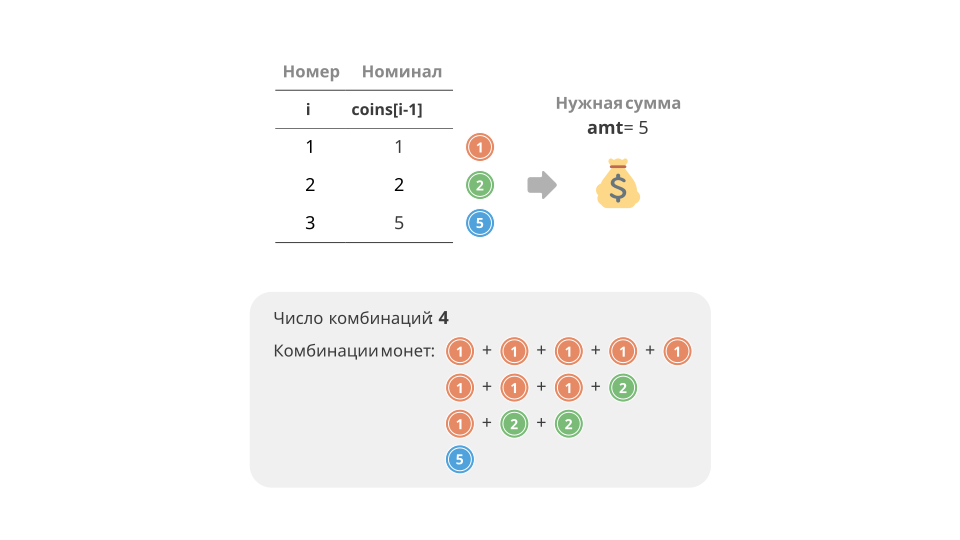{ class="animation-figure" }

<p align="center"> Рисунок 14-26 &nbsp; Пример данных для задачи о размене монет II </p>

### 1. &nbsp; Решение методом динамического программирования

Теперь нас интересует число комбинаций. Подзадача такова: **подсчитать комбинации монет первых $i$ видов, дающие сумму $a$**. Таблица $dp$ по-прежнему двумерна, её размер — $(n+1) \times (amt + 1)$.

Число комбинаций для текущего состояния равно сумме чисел комбинаций в двух случаях: когда мы не берём текущую монету и когда берём её. Получаем формулу перехода:

$$
dp[i, a] = dp[i-1, a] + dp[i, a - coins[i-1]]
$$

Сумму $0$ можно набрать, не взяв ни одной монеты. Поэтому в первом столбце все $dp[i, 0]$ инициализируем значением $1$. Без монет невозможно набрать ни одну сумму $>0$, так что в первой строке все $dp[0, a]$ равны $0$.

### 2. &nbsp; Реализация

=== "Python"

    ```python title="coin_change_ii.py"
    def coin_change_ii_dp(coins: list[int], amt: int) -> int:
        """Размен монет II: динамическое программирование"""
        n = len(coins)
        # Инициализировать таблицу dp
        dp = [[0] * (amt + 1) for _ in range(n + 1)]
        # Инициализировать первый столбец
        for i in range(n + 1):
            dp[i][0] = 1
        # Переход между состояниями
        for i in range(1, n + 1):
            for a in range(1, amt + 1):
                if coins[i - 1] > a:
                    # Если номинал превышает нужную сумму, не брать монету i
                    dp[i][a] = dp[i - 1][a]
                else:
                    # Сложить число комбинаций без монеты i и с ней
                    dp[i][a] = dp[i - 1][a] + dp[i][a - coins[i - 1]]
        return dp[n][amt]
    ```

=== "C++"

    ```cpp title="coin_change_ii.cpp"
    /* Размен монет II: динамическое программирование */
    int coinChangeIIDP(vector<int> &coins, int amt) {
        int n = coins.size();
        // Инициализировать таблицу dp
        vector<vector<int>> dp(n + 1, vector<int>(amt + 1, 0));
        // Инициализировать первый столбец
        for (int i = 0; i <= n; i++) {
            dp[i][0] = 1;
        }
        // Переход между состояниями
        for (int i = 1; i <= n; i++) {
            for (int a = 1; a <= amt; a++) {
                if (coins[i - 1] > a) {
                    // Если номинал превышает нужную сумму, не брать монету i
                    dp[i][a] = dp[i - 1][a];
                } else {
                    // Сложить число комбинаций без монеты i и с ней
                    dp[i][a] = dp[i - 1][a] + dp[i][a - coins[i - 1]];
                }
            }
        }
        return dp[n][amt];
    }
    ```

=== "Java"

    ```java title="coin_change_ii.java"
    /* Размен монет II: динамическое программирование */
    int coinChangeIIDP(int[] coins, int amt) {
        int n = coins.length;
        // Инициализировать таблицу dp
        int[][] dp = new int[n + 1][amt + 1];
        // Инициализировать первый столбец
        for (int i = 0; i <= n; i++) {
            dp[i][0] = 1;
        }
        // Переход между состояниями
        for (int i = 1; i <= n; i++) {
            for (int a = 1; a <= amt; a++) {
                if (coins[i - 1] > a) {
                    // Если номинал превышает нужную сумму, не брать монету i
                    dp[i][a] = dp[i - 1][a];
                } else {
                    // Сложить число комбинаций без монеты i и с ней
                    dp[i][a] = dp[i - 1][a] + dp[i][a - coins[i - 1]];
                }
            }
        }
        return dp[n][amt];
    }
    ```

=== "C#"

    ```csharp title="coin_change_ii.cs"
    /* Размен монет II: динамическое программирование */
    int CoinChangeIIDP(int[] coins, int amt) {
        int n = coins.Length;
        // Инициализировать таблицу dp
        int[,] dp = new int[n + 1, amt + 1];
        // Инициализировать первый столбец
        for (int i = 0; i <= n; i++) {
            dp[i, 0] = 1;
        }
        // Переход между состояниями
        for (int i = 1; i <= n; i++) {
            for (int a = 1; a <= amt; a++) {
                if (coins[i - 1] > a) {
                    // Если номинал превышает нужную сумму, не брать монету i
                    dp[i, a] = dp[i - 1, a];
                } else {
                    // Сложить число комбинаций без монеты i и с ней
                    dp[i, a] = dp[i - 1, a] + dp[i, a - coins[i - 1]];
                }
            }
        }
        return dp[n, amt];
    }
    ```

=== "Go"

    ```go title="coin_change_ii.go"
    /* Размен монет II: динамическое программирование */
    func coinChangeIIDP(coins []int, amt int) int {
        n := len(coins)
        // Инициализировать таблицу dp
        dp := make([][]int, n+1)
        for i := 0; i <= n; i++ {
            dp[i] = make([]int, amt+1)
        }
        // Инициализировать первый столбец
        for i := 0; i <= n; i++ {
            dp[i][0] = 1
        }
        // Переход: остальные строки и столбцы
        for i := 1; i <= n; i++ {
            for a := 1; a <= amt; a++ {
                if coins[i-1] > a {
                    // Если номинал превышает нужную сумму, не брать монету i
                    dp[i][a] = dp[i-1][a]
                } else {
                    // Сложить число комбинаций без монеты i и с ней
                    dp[i][a] = dp[i-1][a] + dp[i][a-coins[i-1]]
                }
            }
        }
        return dp[n][amt]
    }
    ```

=== "Swift"

    ```swift title="coin_change_ii.swift"
    /* Размен монет II: динамическое программирование */
    func coinChangeIIDP(coins: [Int], amt: Int) -> Int {
        let n = coins.count
        // Инициализировать таблицу dp
        var dp = Array(repeating: Array(repeating: 0, count: amt + 1), count: n + 1)
        // Инициализировать первый столбец
        for i in 0 ... n {
            dp[i][0] = 1
        }
        // Переход между состояниями
        for i in 1 ... n {
            for a in 1 ... amt {
                if coins[i - 1] > a {
                    // Если номинал превышает нужную сумму, не брать монету i
                    dp[i][a] = dp[i - 1][a]
                } else {
                    // Сложить число комбинаций без монеты i и с ней
                    dp[i][a] = dp[i - 1][a] + dp[i][a - coins[i - 1]]
                }
            }
        }
        return dp[n][amt]
    }
    ```

=== "JS"

    ```javascript title="coin_change_ii.js"
    /* Размен монет II: динамическое программирование */
    function coinChangeIIDP(coins, amt) {
        const n = coins.length;
        // Инициализировать таблицу dp
        const dp = Array.from({ length: n + 1 }, () =>
            Array.from({ length: amt + 1 }, () => 0)
        );
        // Инициализировать первый столбец
        for (let i = 0; i <= n; i++) {
            dp[i][0] = 1;
        }
        // Переход между состояниями
        for (let i = 1; i <= n; i++) {
            for (let a = 1; a <= amt; a++) {
                if (coins[i - 1] > a) {
                    // Если номинал превышает нужную сумму, не брать монету i
                    dp[i][a] = dp[i - 1][a];
                } else {
                    // Сложить число комбинаций без монеты i и с ней
                    dp[i][a] = dp[i - 1][a] + dp[i][a - coins[i - 1]];
                }
            }
        }
        return dp[n][amt];
    }
    ```

=== "TS"

    ```typescript title="coin_change_ii.ts"
    /* Размен монет II: динамическое программирование */
    function coinChangeIIDP(coins: Array<number>, amt: number): number {
        const n = coins.length;
        // Инициализировать таблицу dp
        const dp = Array.from({ length: n + 1 }, () =>
            Array.from({ length: amt + 1 }, () => 0)
        );
        // Инициализировать первый столбец
        for (let i = 0; i <= n; i++) {
            dp[i][0] = 1;
        }
        // Переход между состояниями
        for (let i = 1; i <= n; i++) {
            for (let a = 1; a <= amt; a++) {
                if (coins[i - 1] > a) {
                    // Если номинал превышает нужную сумму, не брать монету i
                    dp[i][a] = dp[i - 1][a];
                } else {
                    // Сложить число комбинаций без монеты i и с ней
                    dp[i][a] = dp[i - 1][a] + dp[i][a - coins[i - 1]];
                }
            }
        }
        return dp[n][amt];
    }
    ```

=== "Dart"

    ```dart title="coin_change_ii.dart"
    /* Размен монет II: динамическое программирование */
    int coinChangeIIDP(List<int> coins, int amt) {
      int n = coins.length;
      // Инициализировать таблицу dp
      List<List<int>> dp = List.generate(n + 1, (index) => List.filled(amt + 1, 0));
      // Инициализировать первый столбец
      for (int i = 0; i <= n; i++) {
        dp[i][0] = 1;
      }
      // Переход между состояниями
      for (int i = 1; i <= n; i++) {
        for (int a = 1; a <= amt; a++) {
          if (coins[i - 1] > a) {
            // Если номинал превышает нужную сумму, не брать монету i
            dp[i][a] = dp[i - 1][a];
          } else {
            // Сложить число комбинаций без монеты i и с ней
            dp[i][a] = dp[i - 1][a] + dp[i][a - coins[i - 1]];
          }
        }
      }
      return dp[n][amt];
    }
    ```

=== "Rust"

    ```rust title="coin_change_ii.rs"
    /* Размен монет II: динамическое программирование */
    fn coin_change_ii_dp(coins: &[i32], amt: usize) -> i32 {
        let n = coins.len();
        // Инициализировать таблицу dp
        let mut dp = vec![vec![0; amt + 1]; n + 1];
        // Инициализировать первый столбец
        for i in 0..=n {
            dp[i][0] = 1;
        }
        // Переход между состояниями
        for i in 1..=n {
            for a in 1..=amt {
                if coins[i - 1] > a as i32 {
                    // Если номинал превышает нужную сумму, не брать монету i
                    dp[i][a] = dp[i - 1][a];
                } else {
                    // Сложить число комбинаций без монеты i и с ней
                    dp[i][a] = dp[i - 1][a] + dp[i][a - coins[i - 1] as usize];
                }
            }
        }
        dp[n][amt]
    }
    ```

=== "C"

    ```c title="coin_change_ii.c"
    /* Размен монет II: динамическое программирование */
    int coinChangeIIDP(int coins[], int amt, int coinsSize) {
        int n = coinsSize;
        // Инициализировать таблицу dp
        int **dp = malloc((n + 1) * sizeof(int *));
        for (int i = 0; i <= n; i++) {
            dp[i] = calloc(amt + 1, sizeof(int));
        }
        // Инициализировать первый столбец
        for (int i = 0; i <= n; i++) {
            dp[i][0] = 1;
        }
        // Переход между состояниями
        for (int i = 1; i <= n; i++) {
            for (int a = 1; a <= amt; a++) {
                if (coins[i - 1] > a) {
                    // Если номинал превышает нужную сумму, не брать монету i
                    dp[i][a] = dp[i - 1][a];
                } else {
                    // Сложить число комбинаций без монеты i и с ней
                    dp[i][a] = dp[i - 1][a] + dp[i][a - coins[i - 1]];
                }
            }
        }
        int res = dp[n][amt];
        // Освободить память
        for (int i = 0; i <= n; i++) {
            free(dp[i]);
        }
        free(dp);
        return res;
    }
    ```

=== "Kotlin"

    ```kotlin title="coin_change_ii.kt"
    /* Размен монет II: динамическое программирование */
    fun coinChangeIIDP(coins: IntArray, amt: Int): Int {
        val n = coins.size
        // Инициализировать таблицу dp
        val dp = Array(n + 1) { IntArray(amt + 1) }
        // Инициализировать первый столбец
        for (i in 0..n) {
            dp[i][0] = 1
        }
        // Переход между состояниями
        for (i in 1..n) {
            for (a in 1..amt) {
                if (coins[i - 1] > a) {
                    // Если номинал превышает нужную сумму, не брать монету i
                    dp[i][a] = dp[i - 1][a]
                } else {
                    // Сложить число комбинаций без монеты i и с ней
                    dp[i][a] = dp[i - 1][a] + dp[i][a - coins[i - 1]]
                }
            }
        }
        return dp[n][amt]
    }
    ```

=== "Ruby"

    ```ruby title="coin_change_ii.rb"
    ### Размен монет II: динамическое программирование ###
    def coin_change_ii_dp(coins, amt)
      n = coins.length
      # Инициализировать таблицу dp
      dp = Array.new(n + 1) { Array.new(amt + 1, 0) }
      # Инициализировать первый столбец
      (0...(n + 1)).each { |i| dp[i][0] = 1 }
      # Переход между состояниями
      for i in 1...(n + 1)
        for a in 1...(amt + 1)
          if coins[i - 1] > a
            # Если номинал превышает нужную сумму, не брать монету i
            dp[i][a] = dp[i - 1][a]
          else
            # Сложить число комбинаций без монеты i и с ней
            dp[i][a] = dp[i - 1][a] + dp[i][a - coins[i - 1]]
          end
        end
      end
      dp[n][amt]
    end
    ```

??? pythontutor "Визуализация выполнения"

    <div style="height: 549px; width: 100%;"><iframe class="pythontutor-iframe" title="Визуализация выполнения" src="https://pythontutor.com/iframe-embed.html#code=def%20coin_change_ii_dp%28coins%3A%20list%5Bint%5D,%20amt%3A%20int%29%20-%3E%20int%3A%0A%20%20%20%20%22%22%22%D0%A0%D0%B0%D0%B7%D0%BC%D0%B5%D0%BD%20%D0%BC%D0%BE%D0%BD%D0%B5%D1%82%20II%3A%20%D0%B4%D0%B8%D0%BD%D0%B0%D0%BC%D0%B8%D1%87%D0%B5%D1%81%D0%BA%D0%BE%D0%B5%20%D0%BF%D1%80%D0%BE%D0%B3%D1%80%D0%B0%D0%BC%D0%BC%D0%B8%D1%80%D0%BE%D0%B2%D0%B0%D0%BD%D0%B8%D0%B5%22%22%22%0A%20%20%20%20n%20%3D%20len%28coins%29%0A%20%20%20%20%23%20%D0%98%D0%BD%D0%B8%D1%86%D0%B8%D0%B0%D0%BB%D0%B8%D0%B7%D0%B8%D1%80%D0%BE%D0%B2%D0%B0%D1%82%D1%8C%20%D1%82%D0%B0%D0%B1%D0%BB%D0%B8%D1%86%D1%83%20dp%0A%20%20%20%20dp%20%3D%20%5B%5B0%5D%20%2A%20%28amt%20%2B%201%29%20for%20_%20in%20range%28n%20%2B%201%29%5D%0A%20%20%20%20%23%20%D0%98%D0%BD%D0%B8%D1%86%D0%B8%D0%B0%D0%BB%D0%B8%D0%B7%D0%B8%D1%80%D0%BE%D0%B2%D0%B0%D1%82%D1%8C%20%D0%BF%D0%B5%D1%80%D0%B2%D1%8B%D0%B9%20%D1%81%D1%82%D0%BE%D0%BB%D0%B1%D0%B5%D1%86%0A%20%20%20%20for%20i%20in%20range%28n%20%2B%201%29%3A%0A%20%20%20%20%20%20%20%20dp%5Bi%5D%5B0%5D%20%3D%201%0A%20%20%20%20%23%20%D0%9F%D0%B5%D1%80%D0%B5%D1%85%D0%BE%D0%B4%20%D0%BC%D0%B5%D0%B6%D0%B4%D1%83%20%D1%81%D0%BE%D1%81%D1%82%D0%BE%D1%8F%D0%BD%D0%B8%D1%8F%D0%BC%D0%B8%0A%20%20%20%20for%20i%20in%20range%281,%20n%20%2B%201%29%3A%0A%20%20%20%20%20%20%20%20for%20a%20in%20range%281,%20amt%20%2B%201%29%3A%0A%20%20%20%20%20%20%20%20%20%20%20%20if%20coins%5Bi%20-%201%5D%20%3E%20a%3A%0A%20%20%20%20%20%20%20%20%20%20%20%20%20%20%20%20%23%20%D0%95%D1%81%D0%BB%D0%B8%20%D0%BD%D0%BE%D0%BC%D0%B8%D0%BD%D0%B0%D0%BB%20%D0%BF%D1%80%D0%B5%D0%B2%D1%8B%D1%88%D0%B0%D0%B5%D1%82%20%D0%BD%D1%83%D0%B6%D0%BD%D1%83%D1%8E%20%D1%81%D1%83%D0%BC%D0%BC%D1%83,%20%D0%BD%D0%B5%20%D0%B1%D1%80%D0%B0%D1%82%D1%8C%20%D0%BC%D0%BE%D0%BD%D0%B5%D1%82%D1%83%20i%0A%20%20%20%20%20%20%20%20%20%20%20%20%20%20%20%20dp%5Bi%5D%5Ba%5D%20%3D%20dp%5Bi%20-%201%5D%5Ba%5D%0A%20%20%20%20%20%20%20%20%20%20%20%20else%3A%0A%20%20%20%20%20%20%20%20%20%20%20%20%20%20%20%20%23%20%D0%A1%D0%BB%D0%BE%D0%B6%D0%B8%D1%82%D1%8C%20%D1%87%D0%B8%D1%81%D0%BB%D0%BE%20%D0%BA%D0%BE%D0%BC%D0%B1%D0%B8%D0%BD%D0%B0%D1%86%D0%B8%D0%B9%20%D0%B1%D0%B5%D0%B7%20%D0%BC%D0%BE%D0%BD%D0%B5%D1%82%D1%8B%20i%20%D0%B8%20%D1%81%20%D0%BD%D0%B5%D0%B9%0A%20%20%20%20%20%20%20%20%20%20%20%20%20%20%20%20dp%5Bi%5D%5Ba%5D%20%3D%20dp%5Bi%20-%201%5D%5Ba%5D%20%2B%20dp%5Bi%5D%5Ba%20-%20coins%5Bi%20-%201%5D%5D%0A%20%20%20%20return%20dp%5Bn%5D%5Bamt%5D%0A%0A%0A%22%22%22Driver%20Code%22%22%22%0Aif%20__name__%20%3D%3D%20%22__main__%22%3A%0A%20%20%20%20coins%20%3D%20%5B1,%202,%205%5D%0A%20%20%20%20amt%20%3D%205%0A%0A%20%20%20%20%23%20%D0%94%D0%B8%D0%BD%D0%B0%D0%BC%D0%B8%D1%87%D0%B5%D1%81%D0%BA%D0%BE%D0%B5%20%D0%BF%D1%80%D0%BE%D0%B3%D1%80%D0%B0%D0%BC%D0%BC%D0%B8%D1%80%D0%BE%D0%B2%D0%B0%D0%BD%D0%B8%D0%B5%0A%20%20%20%20res%20%3D%20coin_change_ii_dp%28coins,%20amt%29%0A%20%20%20%20print%28f%22%D0%A7%D0%B8%D1%81%D0%BB%D0%BE%20%D0%BA%D0%BE%D0%BC%D0%B1%D0%B8%D0%BD%D0%B0%D1%86%D0%B8%D0%B9%20%D0%BC%D0%BE%D0%BD%D0%B5%D1%82%20%D0%B4%D0%BB%D1%8F%20%D0%B7%D0%B0%D0%B4%D0%B0%D0%BD%D0%BD%D0%BE%D0%B9%20%D1%81%D1%83%D0%BC%D0%BC%D1%8B%3A%20%7Bres%7D%22%29&codeDivHeight=472&codeDivWidth=350&cumulative=false&curInstr=5&heapPrimitives=nevernest&origin=opt-frontend.js&py=311&rawInputLstJSON=%5B%5D&textReferences=false"> </iframe></div>
    <div style="margin-top: 5px;"><a href="https://pythontutor.com/iframe-embed.html#code=def%20coin_change_ii_dp%28coins%3A%20list%5Bint%5D,%20amt%3A%20int%29%20-%3E%20int%3A%0A%20%20%20%20%22%22%22%D0%A0%D0%B0%D0%B7%D0%BC%D0%B5%D0%BD%20%D0%BC%D0%BE%D0%BD%D0%B5%D1%82%20II%3A%20%D0%B4%D0%B8%D0%BD%D0%B0%D0%BC%D0%B8%D1%87%D0%B5%D1%81%D0%BA%D0%BE%D0%B5%20%D0%BF%D1%80%D0%BE%D0%B3%D1%80%D0%B0%D0%BC%D0%BC%D0%B8%D1%80%D0%BE%D0%B2%D0%B0%D0%BD%D0%B8%D0%B5%22%22%22%0A%20%20%20%20n%20%3D%20len%28coins%29%0A%20%20%20%20%23%20%D0%98%D0%BD%D0%B8%D1%86%D0%B8%D0%B0%D0%BB%D0%B8%D0%B7%D0%B8%D1%80%D0%BE%D0%B2%D0%B0%D1%82%D1%8C%20%D1%82%D0%B0%D0%B1%D0%BB%D0%B8%D1%86%D1%83%20dp%0A%20%20%20%20dp%20%3D%20%5B%5B0%5D%20%2A%20%28amt%20%2B%201%29%20for%20_%20in%20range%28n%20%2B%201%29%5D%0A%20%20%20%20%23%20%D0%98%D0%BD%D0%B8%D1%86%D0%B8%D0%B0%D0%BB%D0%B8%D0%B7%D0%B8%D1%80%D0%BE%D0%B2%D0%B0%D1%82%D1%8C%20%D0%BF%D0%B5%D1%80%D0%B2%D1%8B%D0%B9%20%D1%81%D1%82%D0%BE%D0%BB%D0%B1%D0%B5%D1%86%0A%20%20%20%20for%20i%20in%20range%28n%20%2B%201%29%3A%0A%20%20%20%20%20%20%20%20dp%5Bi%5D%5B0%5D%20%3D%201%0A%20%20%20%20%23%20%D0%9F%D0%B5%D1%80%D0%B5%D1%85%D0%BE%D0%B4%20%D0%BC%D0%B5%D0%B6%D0%B4%D1%83%20%D1%81%D0%BE%D1%81%D1%82%D0%BE%D1%8F%D0%BD%D0%B8%D1%8F%D0%BC%D0%B8%0A%20%20%20%20for%20i%20in%20range%281,%20n%20%2B%201%29%3A%0A%20%20%20%20%20%20%20%20for%20a%20in%20range%281,%20amt%20%2B%201%29%3A%0A%20%20%20%20%20%20%20%20%20%20%20%20if%20coins%5Bi%20-%201%5D%20%3E%20a%3A%0A%20%20%20%20%20%20%20%20%20%20%20%20%20%20%20%20%23%20%D0%95%D1%81%D0%BB%D0%B8%20%D0%BD%D0%BE%D0%BC%D0%B8%D0%BD%D0%B0%D0%BB%20%D0%BF%D1%80%D0%B5%D0%B2%D1%8B%D1%88%D0%B0%D0%B5%D1%82%20%D0%BD%D1%83%D0%B6%D0%BD%D1%83%D1%8E%20%D1%81%D1%83%D0%BC%D0%BC%D1%83,%20%D0%BD%D0%B5%20%D0%B1%D1%80%D0%B0%D1%82%D1%8C%20%D0%BC%D0%BE%D0%BD%D0%B5%D1%82%D1%83%20i%0A%20%20%20%20%20%20%20%20%20%20%20%20%20%20%20%20dp%5Bi%5D%5Ba%5D%20%3D%20dp%5Bi%20-%201%5D%5Ba%5D%0A%20%20%20%20%20%20%20%20%20%20%20%20else%3A%0A%20%20%20%20%20%20%20%20%20%20%20%20%20%20%20%20%23%20%D0%A1%D0%BB%D0%BE%D0%B6%D0%B8%D1%82%D1%8C%20%D1%87%D0%B8%D1%81%D0%BB%D0%BE%20%D0%BA%D0%BE%D0%BC%D0%B1%D0%B8%D0%BD%D0%B0%D1%86%D0%B8%D0%B9%20%D0%B1%D0%B5%D0%B7%20%D0%BC%D0%BE%D0%BD%D0%B5%D1%82%D1%8B%20i%20%D0%B8%20%D1%81%20%D0%BD%D0%B5%D0%B9%0A%20%20%20%20%20%20%20%20%20%20%20%20%20%20%20%20dp%5Bi%5D%5Ba%5D%20%3D%20dp%5Bi%20-%201%5D%5Ba%5D%20%2B%20dp%5Bi%5D%5Ba%20-%20coins%5Bi%20-%201%5D%5D%0A%20%20%20%20return%20dp%5Bn%5D%5Bamt%5D%0A%0A%0A%22%22%22Driver%20Code%22%22%22%0Aif%20__name__%20%3D%3D%20%22__main__%22%3A%0A%20%20%20%20coins%20%3D%20%5B1,%202,%205%5D%0A%20%20%20%20amt%20%3D%205%0A%0A%20%20%20%20%23%20%D0%94%D0%B8%D0%BD%D0%B0%D0%BC%D0%B8%D1%87%D0%B5%D1%81%D0%BA%D0%BE%D0%B5%20%D0%BF%D1%80%D0%BE%D0%B3%D1%80%D0%B0%D0%BC%D0%BC%D0%B8%D1%80%D0%BE%D0%B2%D0%B0%D0%BD%D0%B8%D0%B5%0A%20%20%20%20res%20%3D%20coin_change_ii_dp%28coins,%20amt%29%0A%20%20%20%20print%28f%22%D0%A7%D0%B8%D1%81%D0%BB%D0%BE%20%D0%BA%D0%BE%D0%BC%D0%B1%D0%B8%D0%BD%D0%B0%D1%86%D0%B8%D0%B9%20%D0%BC%D0%BE%D0%BD%D0%B5%D1%82%20%D0%B4%D0%BB%D1%8F%20%D0%B7%D0%B0%D0%B4%D0%B0%D0%BD%D0%BD%D0%BE%D0%B9%20%D1%81%D1%83%D0%BC%D0%BC%D1%8B%3A%20%7Bres%7D%22%29&codeDivHeight=800&codeDivWidth=600&cumulative=false&curInstr=5&heapPrimitives=nevernest&origin=opt-frontend.js&py=311&rawInputLstJSON=%5B%5D&textReferences=false" target="_blank" rel="noopener noreferrer">Во весь экран ></a></div>

### 3. &nbsp; Экономия памяти

Оптимизация памяти та же: достаточно убрать измерение, отвечающее за виды монет:

=== "Python"

    ```python title="coin_change_ii.py"
    def coin_change_ii_dp_comp(coins: list[int], amt: int) -> int:
        """Размен монет II: динамическое программирование с экономией памяти"""
        n = len(coins)
        # Инициализировать таблицу dp
        dp = [0] * (amt + 1)
        dp[0] = 1
        # Переход между состояниями
        for i in range(1, n + 1):
            # Обход в прямом порядке
            for a in range(1, amt + 1):
                if coins[i - 1] > a:
                    # Если номинал превышает нужную сумму, не брать монету i
                    dp[a] = dp[a]
                else:
                    # Сложить число комбинаций без монеты i и с ней
                    dp[a] = dp[a] + dp[a - coins[i - 1]]
        return dp[amt]
    ```

=== "C++"

    ```cpp title="coin_change_ii.cpp"
    /* Размен монет II: динамическое программирование с экономией памяти */
    int coinChangeIIDPComp(vector<int> &coins, int amt) {
        int n = coins.size();
        // Инициализировать таблицу dp
        vector<int> dp(amt + 1, 0);
        dp[0] = 1;
        // Переход между состояниями
        for (int i = 1; i <= n; i++) {
            for (int a = 1; a <= amt; a++) {
                if (coins[i - 1] > a) {
                    // Если номинал превышает нужную сумму, не брать монету i
                    dp[a] = dp[a];
                } else {
                    // Сложить число комбинаций без монеты i и с ней
                    dp[a] = dp[a] + dp[a - coins[i - 1]];
                }
            }
        }
        return dp[amt];
    }
    ```

=== "Java"

    ```java title="coin_change_ii.java"
    /* Размен монет II: динамическое программирование с экономией памяти */
    int coinChangeIIDPComp(int[] coins, int amt) {
        int n = coins.length;
        // Инициализировать таблицу dp
        int[] dp = new int[amt + 1];
        dp[0] = 1;
        // Переход между состояниями
        for (int i = 1; i <= n; i++) {
            for (int a = 1; a <= amt; a++) {
                if (coins[i - 1] > a) {
                    // Если номинал превышает нужную сумму, не брать монету i
                    dp[a] = dp[a];
                } else {
                    // Сложить число комбинаций без монеты i и с ней
                    dp[a] = dp[a] + dp[a - coins[i - 1]];
                }
            }
        }
        return dp[amt];
    }
    ```

=== "C#"

    ```csharp title="coin_change_ii.cs"
    /* Размен монет II: динамическое программирование с экономией памяти */
    int CoinChangeIIDPComp(int[] coins, int amt) {
        int n = coins.Length;
        // Инициализировать таблицу dp
        int[] dp = new int[amt + 1];
        dp[0] = 1;
        // Переход между состояниями
        for (int i = 1; i <= n; i++) {
            for (int a = 1; a <= amt; a++) {
                if (coins[i - 1] > a) {
                    // Если номинал превышает нужную сумму, не брать монету i
                    dp[a] = dp[a];
                } else {
                    // Сложить число комбинаций без монеты i и с ней
                    dp[a] = dp[a] + dp[a - coins[i - 1]];
                }
            }
        }
        return dp[amt];
    }
    ```

=== "Go"

    ```go title="coin_change_ii.go"
    /* Размен монет II: динамическое программирование с экономией памяти */
    func coinChangeIIDPComp(coins []int, amt int) int {
        n := len(coins)
        // Инициализировать таблицу dp
        dp := make([]int, amt+1)
        dp[0] = 1
        // Переход между состояниями
        for i := 1; i <= n; i++ {
            // Обход в прямом порядке
            for a := 1; a <= amt; a++ {
                if coins[i-1] > a {
                    // Если номинал превышает нужную сумму, не брать монету i
                    dp[a] = dp[a]
                } else {
                    // Сложить число комбинаций без монеты i и с ней
                    dp[a] = dp[a] + dp[a-coins[i-1]]
                }
            }
        }
        return dp[amt]
    }
    ```

=== "Swift"

    ```swift title="coin_change_ii.swift"
    /* Размен монет II: динамическое программирование с экономией памяти */
    func coinChangeIIDPComp(coins: [Int], amt: Int) -> Int {
        let n = coins.count
        // Инициализировать таблицу dp
        var dp = Array(repeating: 0, count: amt + 1)
        dp[0] = 1
        // Переход между состояниями
        for i in 1 ... n {
            for a in 1 ... amt {
                if coins[i - 1] > a {
                    // Если номинал превышает нужную сумму, не брать монету i
                    dp[a] = dp[a]
                } else {
                    // Сложить число комбинаций без монеты i и с ней
                    dp[a] = dp[a] + dp[a - coins[i - 1]]
                }
            }
        }
        return dp[amt]
    }
    ```

=== "JS"

    ```javascript title="coin_change_ii.js"
    /* Размен монет II: динамическое программирование с экономией памяти */
    function coinChangeIIDPComp(coins, amt) {
        const n = coins.length;
        // Инициализировать таблицу dp
        const dp = Array.from({ length: amt + 1 }, () => 0);
        dp[0] = 1;
        // Переход между состояниями
        for (let i = 1; i <= n; i++) {
            for (let a = 1; a <= amt; a++) {
                if (coins[i - 1] > a) {
                    // Если номинал превышает нужную сумму, не брать монету i
                    dp[a] = dp[a];
                } else {
                    // Сложить число комбинаций без монеты i и с ней
                    dp[a] = dp[a] + dp[a - coins[i - 1]];
                }
            }
        }
        return dp[amt];
    }
    ```

=== "TS"

    ```typescript title="coin_change_ii.ts"
    /* Размен монет II: динамическое программирование с экономией памяти */
    function coinChangeIIDPComp(coins: Array<number>, amt: number): number {
        const n = coins.length;
        // Инициализировать таблицу dp
        const dp = Array.from({ length: amt + 1 }, () => 0);
        dp[0] = 1;
        // Переход между состояниями
        for (let i = 1; i <= n; i++) {
            for (let a = 1; a <= amt; a++) {
                if (coins[i - 1] > a) {
                    // Если номинал превышает нужную сумму, не брать монету i
                    dp[a] = dp[a];
                } else {
                    // Сложить число комбинаций без монеты i и с ней
                    dp[a] = dp[a] + dp[a - coins[i - 1]];
                }
            }
        }
        return dp[amt];
    }
    ```

=== "Dart"

    ```dart title="coin_change_ii.dart"
    /* Размен монет II: динамическое программирование с экономией памяти */
    int coinChangeIIDPComp(List<int> coins, int amt) {
      int n = coins.length;
      // Инициализировать таблицу dp
      List<int> dp = List.filled(amt + 1, 0);
      dp[0] = 1;
      // Переход между состояниями
      for (int i = 1; i <= n; i++) {
        for (int a = 1; a <= amt; a++) {
          if (coins[i - 1] > a) {
            // Если номинал превышает нужную сумму, не брать монету i
            dp[a] = dp[a];
          } else {
            // Сложить число комбинаций без монеты i и с ней
            dp[a] = dp[a] + dp[a - coins[i - 1]];
          }
        }
      }
      return dp[amt];
    }
    ```

=== "Rust"

    ```rust title="coin_change_ii.rs"
    /* Размен монет II: динамическое программирование с экономией памяти */
    fn coin_change_ii_dp_comp(coins: &[i32], amt: usize) -> i32 {
        let n = coins.len();
        // Инициализировать таблицу dp
        let mut dp = vec![0; amt + 1];
        dp[0] = 1;
        // Переход между состояниями
        for i in 1..=n {
            for a in 1..=amt {
                if coins[i - 1] > a as i32 {
                    // Если номинал превышает нужную сумму, не брать монету i
                    dp[a] = dp[a];
                } else {
                    // Сложить число комбинаций без монеты i и с ней
                    dp[a] = dp[a] + dp[a - coins[i - 1] as usize];
                }
            }
        }
        dp[amt]
    }
    ```

=== "C"

    ```c title="coin_change_ii.c"
    /* Размен монет II: динамическое программирование с экономией памяти */
    int coinChangeIIDPComp(int coins[], int amt, int coinsSize) {
        int n = coinsSize;
        // Инициализировать таблицу dp
        int *dp = calloc(amt + 1, sizeof(int));
        dp[0] = 1;
        // Переход между состояниями
        for (int i = 1; i <= n; i++) {
            for (int a = 1; a <= amt; a++) {
                if (coins[i - 1] > a) {
                    // Если номинал превышает нужную сумму, не брать монету i
                    dp[a] = dp[a];
                } else {
                    // Сложить число комбинаций без монеты i и с ней
                    dp[a] = dp[a] + dp[a - coins[i - 1]];
                }
            }
        }
        int res = dp[amt];
        // Освободить память
        free(dp);
        return res;
    }
    ```

=== "Kotlin"

    ```kotlin title="coin_change_ii.kt"
    /* Размен монет II: динамическое программирование с экономией памяти */
    fun coinChangeIIDPComp(coins: IntArray, amt: Int): Int {
        val n = coins.size
        // Инициализировать таблицу dp
        val dp = IntArray(amt + 1)
        dp[0] = 1
        // Переход между состояниями
        for (i in 1..n) {
            for (a in 1..amt) {
                if (coins[i - 1] > a) {
                    // Если номинал превышает нужную сумму, не брать монету i
                    dp[a] = dp[a]
                } else {
                    // Сложить число комбинаций без монеты i и с ней
                    dp[a] = dp[a] + dp[a - coins[i - 1]]
                }
            }
        }
        return dp[amt]
    }
    ```

=== "Ruby"

    ```ruby title="coin_change_ii.rb"
    ### Размен монет II: динамическое программирование с экономией памяти ###
    def coin_change_ii_dp_comp(coins, amt)
      n = coins.length
      # Инициализировать таблицу dp
      dp = Array.new(amt + 1, 0)
      dp[0] = 1
      # Переход между состояниями
      for i in 1...(n + 1)
        # Обход в прямом порядке
        for a in 1...(amt + 1)
          if coins[i - 1] > a
            # Если номинал превышает нужную сумму, не брать монету i
            dp[a] = dp[a]
          else
            # Сложить число комбинаций без монеты i и с ней
            dp[a] = dp[a] + dp[a - coins[i - 1]]
          end
        end
      end
      dp[amt]
    end
    ```

??? pythontutor "Визуализация выполнения"

    <div style="height: 549px; width: 100%;"><iframe class="pythontutor-iframe" title="Визуализация выполнения" src="https://pythontutor.com/iframe-embed.html#code=def%20coin_change_ii_dp_comp%28coins%3A%20list%5Bint%5D,%20amt%3A%20int%29%20-%3E%20int%3A%0A%20%20%20%20%22%22%22%D0%A0%D0%B0%D0%B7%D0%BC%D0%B5%D0%BD%20%D0%BC%D0%BE%D0%BD%D0%B5%D1%82%20II%3A%20%D0%B4%D0%B8%D0%BD%D0%B0%D0%BC%D0%B8%D1%87%D0%B5%D1%81%D0%BA%D0%BE%D0%B5%20%D0%BF%D1%80%D0%BE%D0%B3%D1%80%D0%B0%D0%BC%D0%BC%D0%B8%D1%80%D0%BE%D0%B2%D0%B0%D0%BD%D0%B8%D0%B5%20%D1%81%20%D1%8D%D0%BA%D0%BE%D0%BD%D0%BE%D0%BC%D0%B8%D0%B5%D0%B9%20%D0%BF%D0%B0%D0%BC%D1%8F%D1%82%D0%B8%22%22%22%0A%20%20%20%20n%20%3D%20len%28coins%29%0A%20%20%20%20%23%20%D0%98%D0%BD%D0%B8%D1%86%D0%B8%D0%B0%D0%BB%D0%B8%D0%B7%D0%B8%D1%80%D0%BE%D0%B2%D0%B0%D1%82%D1%8C%20%D1%82%D0%B0%D0%B1%D0%BB%D0%B8%D1%86%D1%83%20dp%0A%20%20%20%20dp%20%3D%20%5B0%5D%20%2A%20%28amt%20%2B%201%29%0A%20%20%20%20dp%5B0%5D%20%3D%201%0A%20%20%20%20%23%20%D0%9F%D0%B5%D1%80%D0%B5%D1%85%D0%BE%D0%B4%20%D0%BC%D0%B5%D0%B6%D0%B4%D1%83%20%D1%81%D0%BE%D1%81%D1%82%D0%BE%D1%8F%D0%BD%D0%B8%D1%8F%D0%BC%D0%B8%0A%20%20%20%20for%20i%20in%20range%281,%20n%20%2B%201%29%3A%0A%20%20%20%20%20%20%20%20%23%20%D0%9E%D0%B1%D1%85%D0%BE%D0%B4%20%D0%B2%20%D0%BF%D1%80%D1%8F%D0%BC%D0%BE%D0%BC%20%D0%BF%D0%BE%D1%80%D1%8F%D0%B4%D0%BA%D0%B5%0A%20%20%20%20%20%20%20%20for%20a%20in%20range%281,%20amt%20%2B%201%29%3A%0A%20%20%20%20%20%20%20%20%20%20%20%20if%20coins%5Bi%20-%201%5D%20%3E%20a%3A%0A%20%20%20%20%20%20%20%20%20%20%20%20%20%20%20%20%23%20%D0%95%D1%81%D0%BB%D0%B8%20%D0%BD%D0%BE%D0%BC%D0%B8%D0%BD%D0%B0%D0%BB%20%D0%BF%D1%80%D0%B5%D0%B2%D1%8B%D1%88%D0%B0%D0%B5%D1%82%20%D0%BD%D1%83%D0%B6%D0%BD%D1%83%D1%8E%20%D1%81%D1%83%D0%BC%D0%BC%D1%83,%20%D0%BD%D0%B5%20%D0%B1%D1%80%D0%B0%D1%82%D1%8C%20%D0%BC%D0%BE%D0%BD%D0%B5%D1%82%D1%83%20i%0A%20%20%20%20%20%20%20%20%20%20%20%20%20%20%20%20dp%5Ba%5D%20%3D%20dp%5Ba%5D%0A%20%20%20%20%20%20%20%20%20%20%20%20else%3A%0A%20%20%20%20%20%20%20%20%20%20%20%20%20%20%20%20%23%20%D0%A1%D0%BB%D0%BE%D0%B6%D0%B8%D1%82%D1%8C%20%D1%87%D0%B8%D1%81%D0%BB%D0%BE%20%D0%BA%D0%BE%D0%BC%D0%B1%D0%B8%D0%BD%D0%B0%D1%86%D0%B8%D0%B9%20%D0%B1%D0%B5%D0%B7%20%D0%BC%D0%BE%D0%BD%D0%B5%D1%82%D1%8B%20i%20%D0%B8%20%D1%81%20%D0%BD%D0%B5%D0%B9%0A%20%20%20%20%20%20%20%20%20%20%20%20%20%20%20%20dp%5Ba%5D%20%3D%20dp%5Ba%5D%20%2B%20dp%5Ba%20-%20coins%5Bi%20-%201%5D%5D%0A%20%20%20%20return%20dp%5Bamt%5D%0A%0A%0A%22%22%22Driver%20Code%22%22%22%0Aif%20__name__%20%3D%3D%20%22__main__%22%3A%0A%20%20%20%20coins%20%3D%20%5B1,%202,%205%5D%0A%20%20%20%20amt%20%3D%205%0A%0A%20%20%20%20%23%20%D0%94%D0%B8%D0%BD%D0%B0%D0%BC%D0%B8%D1%87%D0%B5%D1%81%D0%BA%D0%BE%D0%B5%20%D0%BF%D1%80%D0%BE%D0%B3%D1%80%D0%B0%D0%BC%D0%BC%D0%B8%D1%80%D0%BE%D0%B2%D0%B0%D0%BD%D0%B8%D0%B5%20%D1%81%20%D1%8D%D0%BA%D0%BE%D0%BD%D0%BE%D0%BC%D0%B8%D0%B5%D0%B9%20%D0%BF%D0%B0%D0%BC%D1%8F%D1%82%D0%B8%0A%20%20%20%20res%20%3D%20coin_change_ii_dp_comp%28coins,%20amt%29%0A%20%20%20%20print%28f%22%D0%A7%D0%B8%D1%81%D0%BB%D0%BE%20%D0%BA%D0%BE%D0%BC%D0%B1%D0%B8%D0%BD%D0%B0%D1%86%D0%B8%D0%B9%20%D0%BC%D0%BE%D0%BD%D0%B5%D1%82%20%D0%B4%D0%BB%D1%8F%20%D0%B7%D0%B0%D0%B4%D0%B0%D0%BD%D0%BD%D0%BE%D0%B9%20%D1%81%D1%83%D0%BC%D0%BC%D1%8B%3A%20%7Bres%7D%22%29&codeDivHeight=472&codeDivWidth=350&cumulative=false&curInstr=5&heapPrimitives=nevernest&origin=opt-frontend.js&py=311&rawInputLstJSON=%5B%5D&textReferences=false"> </iframe></div>
    <div style="margin-top: 5px;"><a href="https://pythontutor.com/iframe-embed.html#code=def%20coin_change_ii_dp_comp%28coins%3A%20list%5Bint%5D,%20amt%3A%20int%29%20-%3E%20int%3A%0A%20%20%20%20%22%22%22%D0%A0%D0%B0%D0%B7%D0%BC%D0%B5%D0%BD%20%D0%BC%D0%BE%D0%BD%D0%B5%D1%82%20II%3A%20%D0%B4%D0%B8%D0%BD%D0%B0%D0%BC%D0%B8%D1%87%D0%B5%D1%81%D0%BA%D0%BE%D0%B5%20%D0%BF%D1%80%D0%BE%D0%B3%D1%80%D0%B0%D0%BC%D0%BC%D0%B8%D1%80%D0%BE%D0%B2%D0%B0%D0%BD%D0%B8%D0%B5%20%D1%81%20%D1%8D%D0%BA%D0%BE%D0%BD%D0%BE%D0%BC%D0%B8%D0%B5%D0%B9%20%D0%BF%D0%B0%D0%BC%D1%8F%D1%82%D0%B8%22%22%22%0A%20%20%20%20n%20%3D%20len%28coins%29%0A%20%20%20%20%23%20%D0%98%D0%BD%D0%B8%D1%86%D0%B8%D0%B0%D0%BB%D0%B8%D0%B7%D0%B8%D1%80%D0%BE%D0%B2%D0%B0%D1%82%D1%8C%20%D1%82%D0%B0%D0%B1%D0%BB%D0%B8%D1%86%D1%83%20dp%0A%20%20%20%20dp%20%3D%20%5B0%5D%20%2A%20%28amt%20%2B%201%29%0A%20%20%20%20dp%5B0%5D%20%3D%201%0A%20%20%20%20%23%20%D0%9F%D0%B5%D1%80%D0%B5%D1%85%D0%BE%D0%B4%20%D0%BC%D0%B5%D0%B6%D0%B4%D1%83%20%D1%81%D0%BE%D1%81%D1%82%D0%BE%D1%8F%D0%BD%D0%B8%D1%8F%D0%BC%D0%B8%0A%20%20%20%20for%20i%20in%20range%281,%20n%20%2B%201%29%3A%0A%20%20%20%20%20%20%20%20%23%20%D0%9E%D0%B1%D1%85%D0%BE%D0%B4%20%D0%B2%20%D0%BF%D1%80%D1%8F%D0%BC%D0%BE%D0%BC%20%D0%BF%D0%BE%D1%80%D1%8F%D0%B4%D0%BA%D0%B5%0A%20%20%20%20%20%20%20%20for%20a%20in%20range%281,%20amt%20%2B%201%29%3A%0A%20%20%20%20%20%20%20%20%20%20%20%20if%20coins%5Bi%20-%201%5D%20%3E%20a%3A%0A%20%20%20%20%20%20%20%20%20%20%20%20%20%20%20%20%23%20%D0%95%D1%81%D0%BB%D0%B8%20%D0%BD%D0%BE%D0%BC%D0%B8%D0%BD%D0%B0%D0%BB%20%D0%BF%D1%80%D0%B5%D0%B2%D1%8B%D1%88%D0%B0%D0%B5%D1%82%20%D0%BD%D1%83%D0%B6%D0%BD%D1%83%D1%8E%20%D1%81%D1%83%D0%BC%D0%BC%D1%83,%20%D0%BD%D0%B5%20%D0%B1%D1%80%D0%B0%D1%82%D1%8C%20%D0%BC%D0%BE%D0%BD%D0%B5%D1%82%D1%83%20i%0A%20%20%20%20%20%20%20%20%20%20%20%20%20%20%20%20dp%5Ba%5D%20%3D%20dp%5Ba%5D%0A%20%20%20%20%20%20%20%20%20%20%20%20else%3A%0A%20%20%20%20%20%20%20%20%20%20%20%20%20%20%20%20%23%20%D0%A1%D0%BB%D0%BE%D0%B6%D0%B8%D1%82%D1%8C%20%D1%87%D0%B8%D1%81%D0%BB%D0%BE%20%D0%BA%D0%BE%D0%BC%D0%B1%D0%B8%D0%BD%D0%B0%D1%86%D0%B8%D0%B9%20%D0%B1%D0%B5%D0%B7%20%D0%BC%D0%BE%D0%BD%D0%B5%D1%82%D1%8B%20i%20%D0%B8%20%D1%81%20%D0%BD%D0%B5%D0%B9%0A%20%20%20%20%20%20%20%20%20%20%20%20%20%20%20%20dp%5Ba%5D%20%3D%20dp%5Ba%5D%20%2B%20dp%5Ba%20-%20coins%5Bi%20-%201%5D%5D%0A%20%20%20%20return%20dp%5Bamt%5D%0A%0A%0A%22%22%22Driver%20Code%22%22%22%0Aif%20__name__%20%3D%3D%20%22__main__%22%3A%0A%20%20%20%20coins%20%3D%20%5B1,%202,%205%5D%0A%20%20%20%20amt%20%3D%205%0A%0A%20%20%20%20%23%20%D0%94%D0%B8%D0%BD%D0%B0%D0%BC%D0%B8%D1%87%D0%B5%D1%81%D0%BA%D0%BE%D0%B5%20%D0%BF%D1%80%D0%BE%D0%B3%D1%80%D0%B0%D0%BC%D0%BC%D0%B8%D1%80%D0%BE%D0%B2%D0%B0%D0%BD%D0%B8%D0%B5%20%D1%81%20%D1%8D%D0%BA%D0%BE%D0%BD%D0%BE%D0%BC%D0%B8%D0%B5%D0%B9%20%D0%BF%D0%B0%D0%BC%D1%8F%D1%82%D0%B8%0A%20%20%20%20res%20%3D%20coin_change_ii_dp_comp%28coins,%20amt%29%0A%20%20%20%20print%28f%22%D0%A7%D0%B8%D1%81%D0%BB%D0%BE%20%D0%BA%D0%BE%D0%BC%D0%B1%D0%B8%D0%BD%D0%B0%D1%86%D0%B8%D0%B9%20%D0%BC%D0%BE%D0%BD%D0%B5%D1%82%20%D0%B4%D0%BB%D1%8F%20%D0%B7%D0%B0%D0%B4%D0%B0%D0%BD%D0%BD%D0%BE%D0%B9%20%D1%81%D1%83%D0%BC%D0%BC%D1%8B%3A%20%7Bres%7D%22%29&codeDivHeight=800&codeDivWidth=600&cumulative=false&curInstr=5&heapPrimitives=nevernest&origin=opt-frontend.js&py=311&rawInputLstJSON=%5B%5D&textReferences=false" target="_blank" rel="noopener noreferrer">Во весь экран ></a></div>
