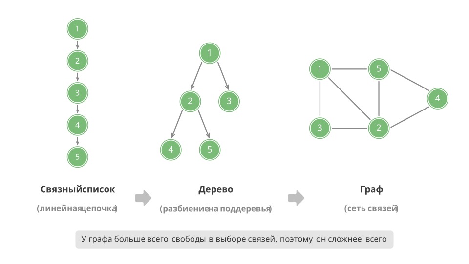
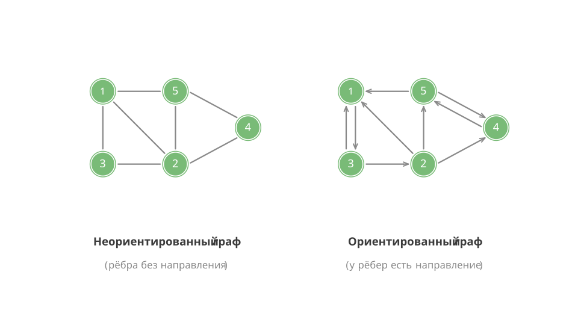
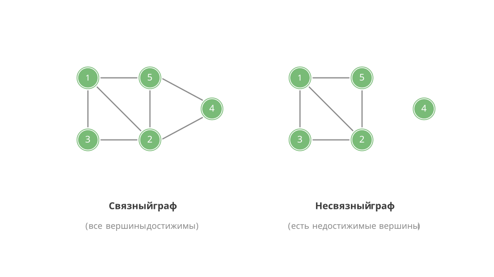
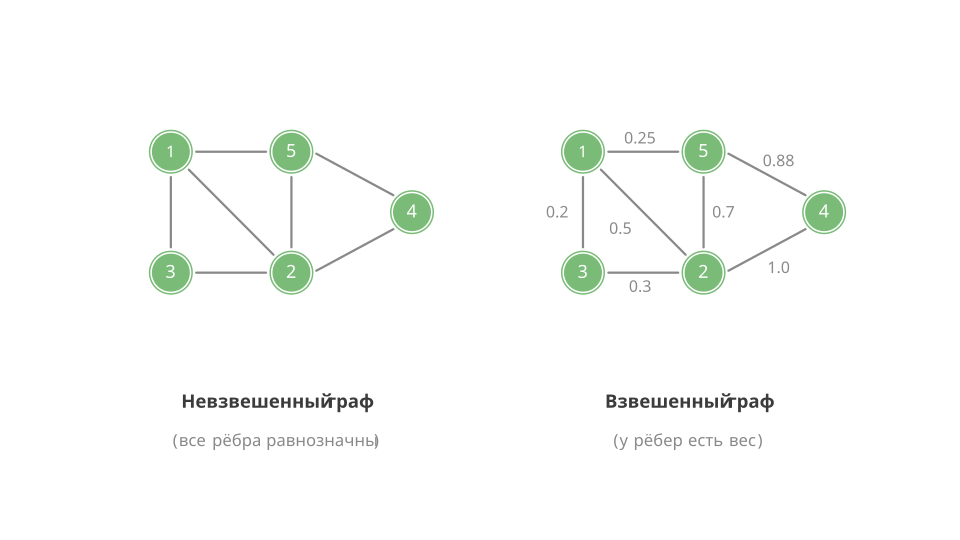
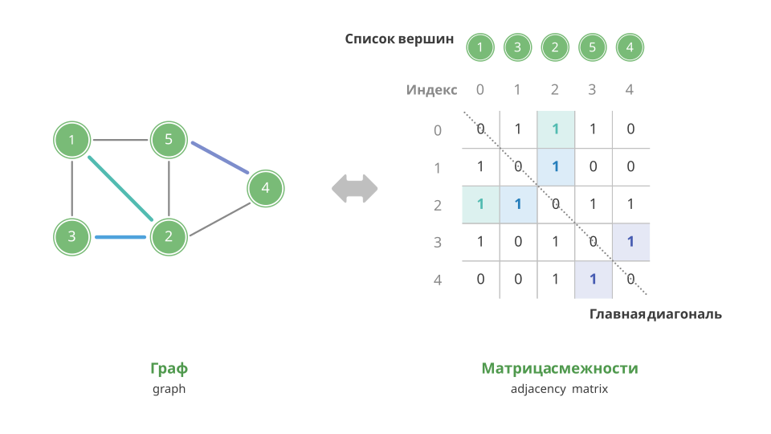
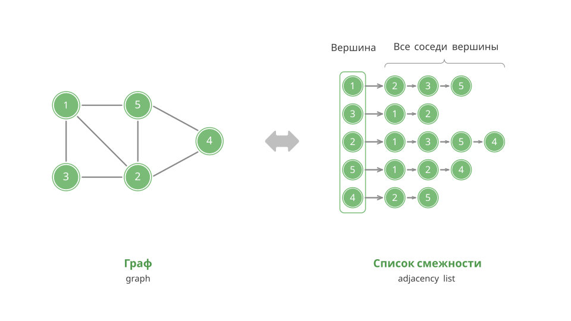

# Граф

<u>Граф (graph)</u> — нелинейная структура данных, состоящая из <u>вершин (vertex)</u> и <u>рёбер (edge)</u>. Абстрактно граф $G$ задаётся множеством вершин $V$ и множеством рёбер $E$. Ниже показан граф с пятью вершинами и семью рёбрами.

$$
\begin{aligned}
V & = \{ 1, 2, 3, 4, 5 \} \newline
E & = \{ (1,2), (1,3), (1,5), (2,3), (2,4), (2,5), (4,5) \} \newline
G & = \{ V, E \} \newline
\end{aligned}
$$

Если представить вершины узлами, а рёбра — связывающими их ссылками (указателями), граф можно рассматривать как обобщение связного списка. Как видно на рисунке, **сеть связей в графе допускает больше вариантов, чем линейная цепочка в списке или ветвление в дереве**, поэтому граф устроен сложнее.

## Основные виды графов и термины

По наличию направления у рёбер различают <u>неориентированные графы (undirected graph)</u> и <u>ориентированные графы (directed graph)</u>, как показано ниже.

- В неориентированном графе ребро задаёт двустороннюю связь между вершинами. Пример — дружба в WeChat или QQ.
- В ориентированном графе у ребра есть направление. Рёбра $A \rightarrow B$ и $A \leftarrow B$ независимы: например, подписка на пользователя в Weibo или Douyin не означает ответной подписки.

По достижимости вершин различают <u>связные графы (connected graph)</u> и <u>несвязные графы (disconnected graph)</u>, как показано ниже.

- В связном графе из любой вершины можно добраться до любой другой.
- В несвязном графе найдётся вершина, из которой хотя бы одна другая вершина недостижима.

Каждому ребру можно приписать величину, называемую весом. Получится <u>взвешенный граф (weighted graph)</u>, как на рисунке ниже. Например, в мобильной игре Honor of Kings степень близости игроков оценивают по времени, проведённому в совместной игре. Такую сеть отношений можно представить взвешенным графом.

При работе с графами часто используют следующие термины.

- <u>Смежность (adjacency)</u>. Две вершины называют смежными, если их соединяет ребро. На рисунке выше с вершиной 1 смежны вершины 2, 3 и 5.
- <u>Путь (path)</u>. Последовательность рёбер, по которым можно пройти из вершины A в вершину B, называют путём из A в B. На рисунке выше один из путей из вершины 1 в вершину 4 проходит через вершины 1-5-2-4.
- <u>Степень (degree)</u> вершины — число инцидентных ей рёбер. В ориентированном графе <u>степень захода (in-degree)</u> — число рёбер, входящих в вершину, а <u>степень исхода (out-degree)</u> — число рёбер, выходящих из неё.

## Представление графа

Два распространённых способа представить граф — матрица смежности и список смежности. Рассмотрим их на примере неориентированного графа.

### Матрица смежности

Пусть в графе $n$ вершин. <u>Матрица смежности (adjacency matrix)</u> имеет размер $n \times n$. Каждая строка и каждый столбец соответствуют вершине, а элементы описывают рёбра: $1$ означает, что ребро между двумя вершинами есть, $0$ — что его нет.

На рисунке ниже $M$ — матрица смежности, а $V$ — список вершин. Значение $M[i, j] = 1$ означает, что вершины $V[i]$ и $V[j]$ соединены ребром. Значение $M[i, j] = 0$ означает, что такого ребра нет.

Перечислим свойства матрицы смежности.

- В простом графе вершину нельзя соединить с самой собой, поэтому элементы главной диагонали не несут информации о связях.
- В неориентированном графе оба направления равноправны, поэтому матрица смежности симметрична относительно главной диагонали.
- Если вместо $1$ и $0$ записывать веса, матрица может представлять взвешенный граф.

Матрица смежности даёт прямой доступ к ребру по соответствующей ячейке. Добавление, удаление, проверка и изменение ребра занимают время $O(1)$. Однако пространственная сложность матрицы составляет $O(n^2)$, поэтому она требует много памяти.

### Список смежности

<u>Список смежности (adjacency list)</u> представляет граф с помощью $n$ связных списков, узлы которых обозначают вершины. Список с номером $i$ соответствует вершине $i$ и хранит всех её соседей, то есть все вершины, соединённые с ней ребром. Пример приведён ниже.

Список смежности хранит только существующие рёбра, а их общее число обычно намного меньше $n^2$. Это экономит память. Однако для поиска ребра приходится перебирать узлы списка, поэтому поиск медленнее, чем в матрице смежности.

На рисунке видно, что **список смежности по устройству напоминает хеш-таблицу с цепочками. Значит, для ускорения поиска подойдут похожие приёмы**. Например, длинный список можно заменить АВЛ-деревом или красно-чёрным деревом, сократив время поиска с $O(n)$ до $O(\log n)$. Если заменить список хеш-таблицей, временная сложность снизится до $O(1)$.

## Где применяют графы

Многие реальные системы можно описать графом, а связанные с ними задачи свести к вычислениям на графах. Примеры приведены в таблице.

 Таблица <id> &nbsp; Графы в повседневной жизни 

|          | Вершина | Ребро                   | Задача на графе   |
| -------- | ---- | -------------------- | ------------ |
| Социальная сеть | Пользователь | Дружба             | Рекомендация возможных друзей |
| Сеть метро | Станция | Сообщение между станциями       | Поиск кратчайшего маршрута |
| Солнечная система   | Небесное тело | Гравитационное взаимодействие небесных тел | Расчёт орбит планет |
