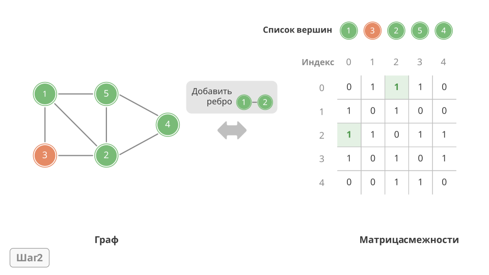
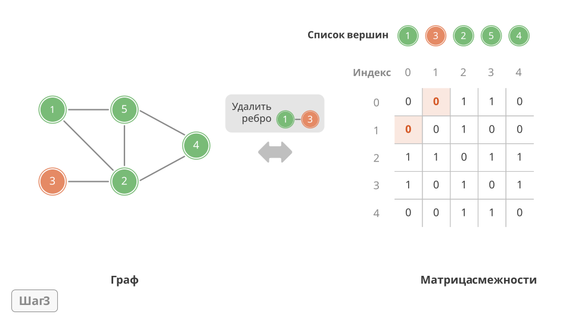
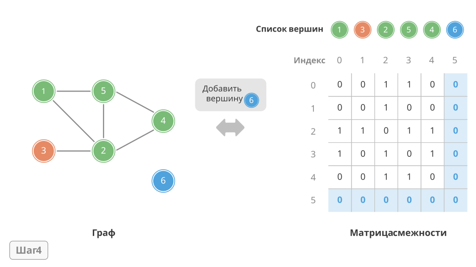
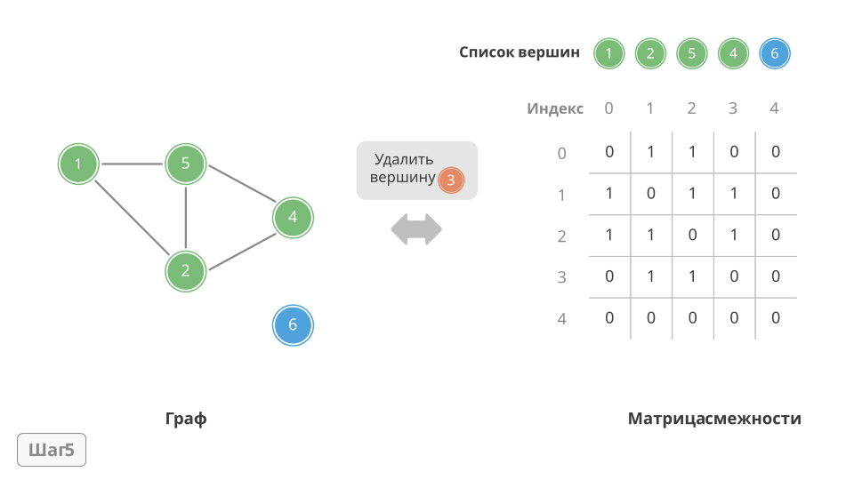
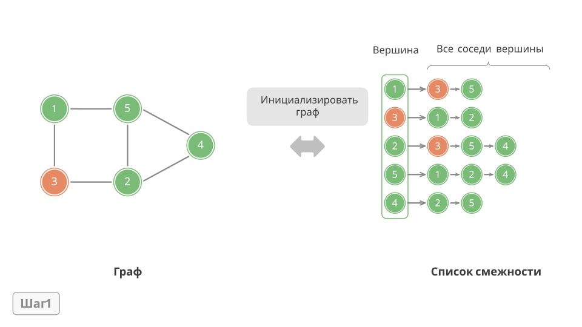
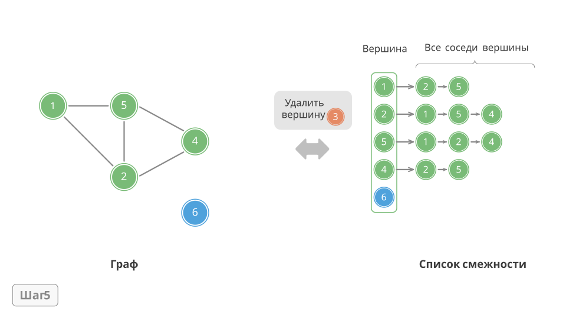

# Основные операции с графом

Основные операции с графом делятся на операции с рёбрами и операции с вершинами. Их реализация зависит от того, используется ли матрица смежности или список смежности.

## Реализация на матрице смежности

На рисунке ниже показаны операции с неориентированным графом из $n$ вершин.

- **Добавление или удаление ребра**. Достаточно изменить соответствующие ячейки матрицы за время $O(1)$. Граф неориентированный, поэтому нужно обновить оба направления.
- **Добавление вершины**. В конец матрицы добавляют строку и столбец, заполненные значением $0$. Это занимает время $O(n)$.
- **Удаление вершины**. Из матрицы удаляют одну строку и один столбец. В худшем случае, когда удаляются первая строка и первый столбец, нужно сдвинуть $(n-1)^2$ элементов вверх и влево. Это занимает время $O(n^2)$.
- **Инициализация**. По $n$ входным вершинам создаём список `vertices` длины $n$ за время $O(n)$. Инициализация матрицы смежности `adjMat` размером $n \times n$ занимает время $O(n^2)$.

=== "<1>"
    

=== "<2>"
    

=== "<3>"
    

=== "<4>"
    

=== "<5>"
    

Так выглядит реализация графа на матрице смежности:

```src
[file]{graph_adjacency_matrix}-[class]{graph_adj_mat}-[func]{}
```

## Реализация на списке смежности

Пусть в неориентированном графе $n$ вершин и $m$ рёбер. На рисунке ниже показано, как выполнять операции с таким графом.

- **Добавление ребра**. Запись о ребре добавляется в конец списка вершины за время $O(1)$. В неориентированном графе нужно добавить записи для обоих направлений.
- **Удаление ребра**. На поиск и удаление заданного ребра в списке вершины уходит время $O(m)$. В неориентированном графе нужно удалить записи для обоих направлений.
- **Добавление вершины**. В список смежности добавляют связный список, головным узлом которого служит новая вершина. Это занимает время $O(1)$.
- **Удаление вершины**. Нужно обойти весь список смежности и удалить все рёбра, инцидентные заданной вершине. Это занимает время $O(n + m)$.
- **Инициализация**. В списке смежности создают $n$ вершин и $2m$ записей о рёбрах за время $O(n + m)$.

=== "<1>"
    

=== "<2>"
    

=== "<3>"
    

=== "<4>"
    

=== "<5>"
    

Ниже приведён код для списка смежности. От схемы выше он отличается в следующих деталях.

- Чтобы упростить код и облегчить добавление и удаление вершин, вместо связных списков используем списки на основе динамических массивов.
- Список смежности храним в хеш-таблице: `key` — объект вершины, `value` — список её соседей (на схеме — связный список).

Для представления вершин в списке смежности используется класс `Vertex`. Допустим, что, как в матрице смежности, вершины различаются по индексам в списке. Тогда при удалении вершины с индексом $i$ пришлось бы обойти весь список смежности и уменьшить все индексы больше $i$ на $1$. Это неэффективно. Если же каждая вершина — отдельный объект `Vertex`, после удаления одной вершины менять остальные не нужно.

```src
[file]{graph_adjacency_list}-[class]{graph_adj_list}-[func]{}
```

## Сравнение эффективности

Пусть в графе $n$ вершин и $m$ рёбер. В таблице сравниваются затраты времени и памяти для матрицы и списков смежности. Столбец «Список смежности (связные списки)» соответствует рассмотренной реализации. В варианте «Список смежности (хеш-таблицы)» каждый список соседей заменён хеш-таблицей.

<p align="center"> Таблица <id> &nbsp; Сравнение матрицы и списков смежности </p>

|              | Матрица смежности | Список смежности (связные списки) | Список смежности (хеш-таблицы) |
| ------------ | -------- | -------------- | ---------------- |
| Проверка смежности | $O(1)$   | $O(n)$         | $O(1)$           |
| Добавить ребро       | $O(1)$   | $O(1)$         | $O(1)$           |
| Удалить ребро       | $O(1)$   | $O(n)$         | $O(1)$           |
| Добавить вершину     | $O(n)$   | $O(1)$         | $O(1)$           |
| Удалить вершину     | $O(n^2)$ | $O(n + m)$     | $O(n)$           |
| Занимаемая память | $O(n^2)$ | $O(n + m)$     | $O(n + m)$       |

По таблице может показаться, что списки смежности с хеш-таблицами лучше всего используют и время, и память. На практике операции с рёбрами быстрее в матрице смежности: достаточно одного чтения из массива или одного присваивания. Таким образом, матрица смежности выигрывает во времени за счёт памяти, а список смежности экономит память ценой времени.
