# Обход графа

Дерево описывает отношения «один ко многим», а граф допускает произвольные отношения «многие ко многим». Поэтому дерево можно рассматривать как частный случай графа. Тогда и **обход дерева оказывается частным случаем обхода графа**.

Для обхода и деревьев, и графов применяют алгоритмы поиска. Различают два вида обхода графа: <u>обход в ширину</u> и <u>обход в глубину</u>.

## Обход в ширину

**Обход в ширину идёт от ближних вершин к дальним. Начиная из выбранной вершины, он посещает прежде всего ближайшие вершины и расширяет область поиска слой за слоем**. На рисунке ниже обход начинается в левом верхнем углу. Сначала рассматриваются все соседи этой вершины, затем соседи следующей и так далее, пока не будут посещены все вершины.

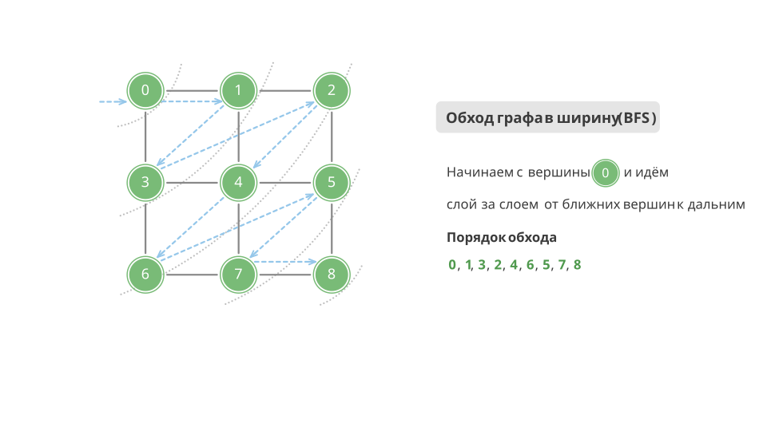

### Реализация алгоритма

Для BFS обычно используют очередь, как в коде ниже. Очередь работает по принципу «первым пришёл — первым вышел», что и позволяет посещать вершины от ближних к дальним.

1. Добавьте начальную вершину `startVet` в очередь и запустите цикл.
2. На каждой итерации извлекайте первую вершину из очереди и записывайте её в результат. Затем добавляйте её соседей в конец очереди.
3. Повторяйте шаг `2.`, пока не будут посещены все вершины.

Чтобы избежать повторных посещений, будем хранить посещённые вершины в хеш-множестве `visited`.

!!! tip

    Хеш-множество можно представить как хеш-таблицу, которая хранит только `key` без `value`. Добавление, удаление, поиск и изменение `key` имеют временную сложность $O(1)$. Поскольку каждый `key` уникален, хеш-множество часто применяют для устранения дубликатов.

```src
[file]{graph_bfs}-[class]{}-[func]{graph_bfs}
```

Сопоставьте код с пошаговой схемой ниже, чтобы увидеть, как он работает.

=== "<1>"
    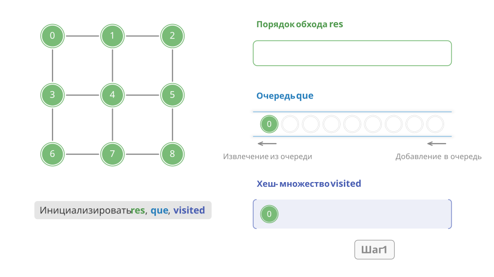

=== "<2>"
    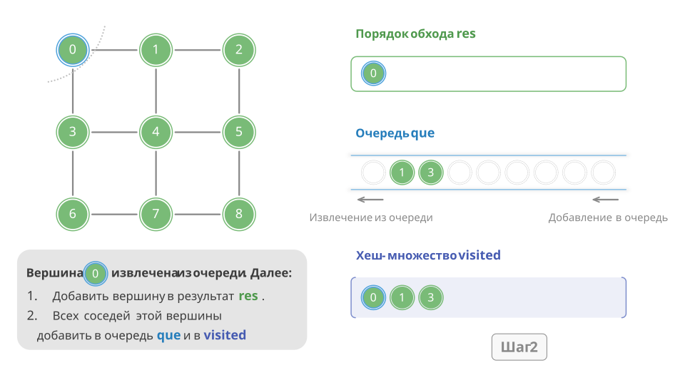

=== "<3>"
    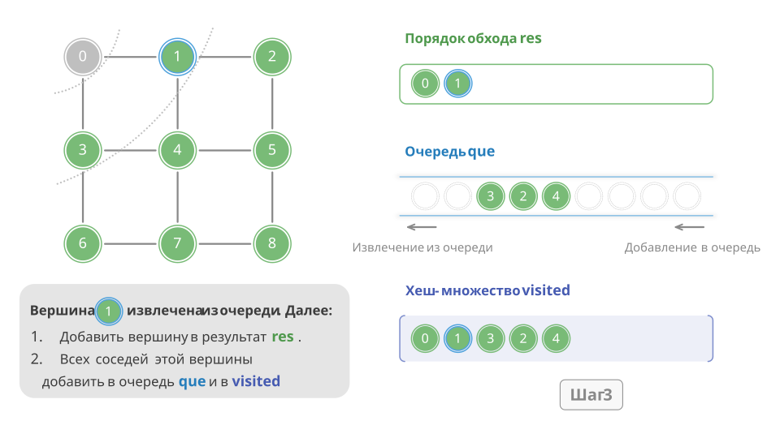

=== "<4>"
    

=== "<5>"
    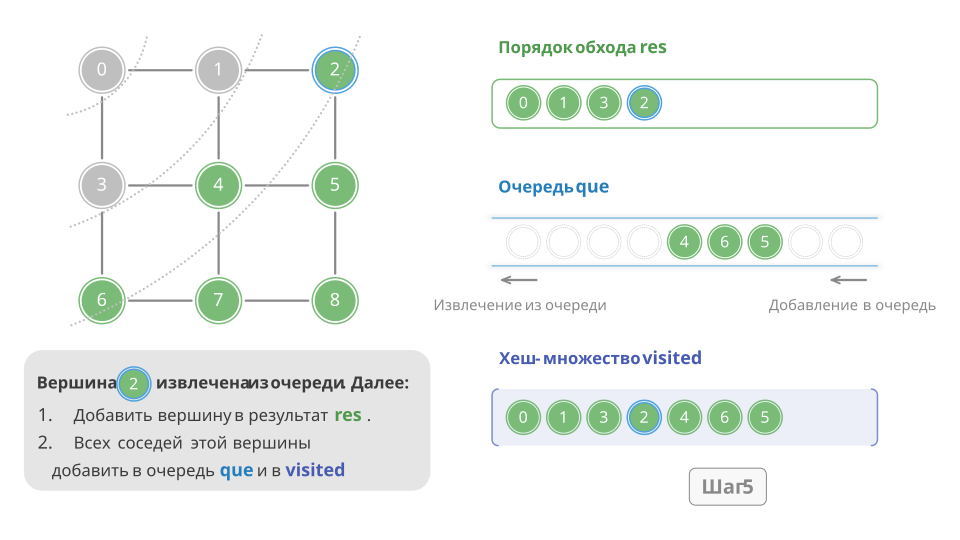

=== "<6>"
    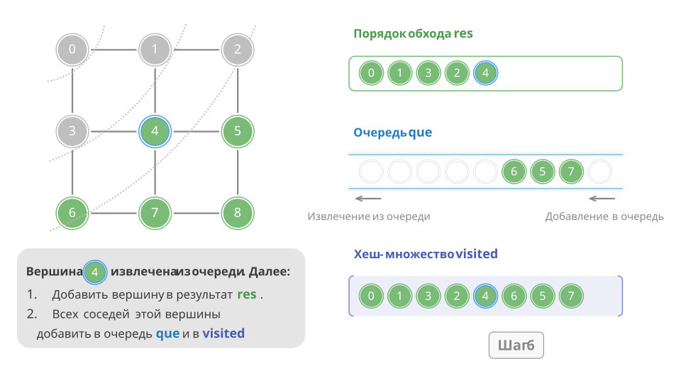

=== "<7>"
    

=== "<8>"
    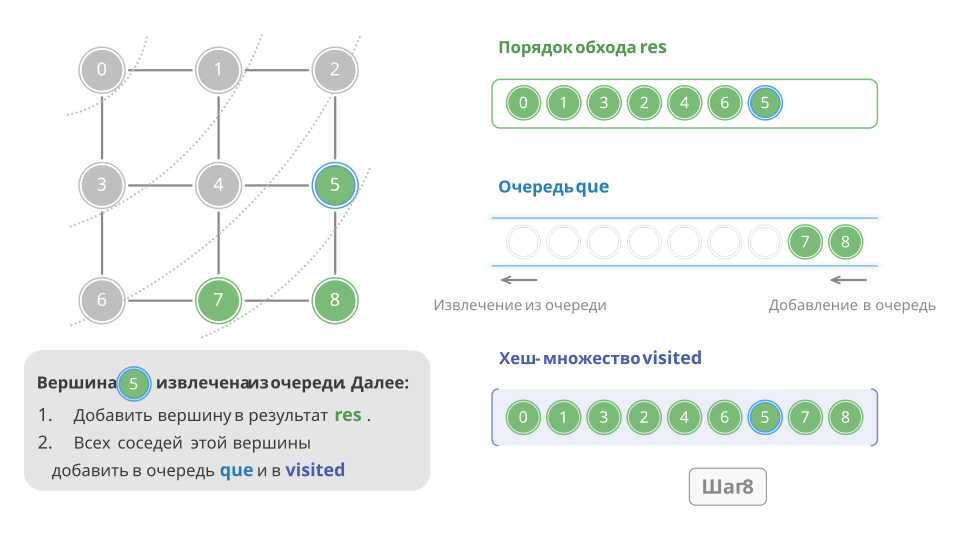

=== "<9>"
    

=== "<10>"
    

=== "<11>"
    

!!! question "Однозначен ли порядок обхода в ширину?"

    Нет. Обход в ширину требует лишь идти от ближних вершин к дальним, **а вершины на одинаковом расстоянии могут посещаться в произвольном порядке**. Например, на рисунке выше можно поменять местами $1$ и $3$, а также переставить $2$, $4$ и $6$.

### Анализ сложности

**Временная сложность**. Каждая вершина один раз попадает в очередь и один раз извлекается из неё, что в сумме занимает $O(|V|)$ времени. При переборе соседей каждое ребро неориентированного графа рассматривается $2$ раза, на что уходит $O(2|E|)$ времени. Итого получаем $O(|V| + |E|)$.

**Пространственная сложность**. Список `res`, хеш-множество `visited` и очередь `que` содержат не более $|V|$ вершин каждый, поэтому требуется $O(|V|)$ памяти.

## Обход в глубину

**Обход в глубину идёт по выбранной ветви до конца и возвращается, когда дальше идти некуда**. На рисунке ниже начинаем с левой верхней вершины и каждый раз переходим к соседу текущей вершины. Достигнув конца ветви, возвращаемся и углубляемся по следующей. Так продолжается, пока не будут посещены все вершины.


### Реализация алгоритма

Такой обход с углублением и возвратом обычно реализуют рекурсивно. Как и при обходе в ширину, хеш-множество `visited` хранит посещённые вершины и предотвращает повторные посещения.

```src
[file]{graph_dfs}-[class]{}-[func]{graph_dfs}
```

Ход обхода в глубину показан на рисунке ниже.

- **Прямой пунктир означает переход на уровень глубже**: начинается новый рекурсивный вызов для посещения новой вершины.
- **Изогнутый пунктир означает возврат на уровень выше**: рекурсивный вызов завершился, и управление вернулось туда, откуда его запустили.

Сопоставьте рисунок с кодом и проследите весь обход DFS мысленно или на бумаге. Отметьте, когда начинается и когда завершается каждый рекурсивный вызов.

=== "<1>"
    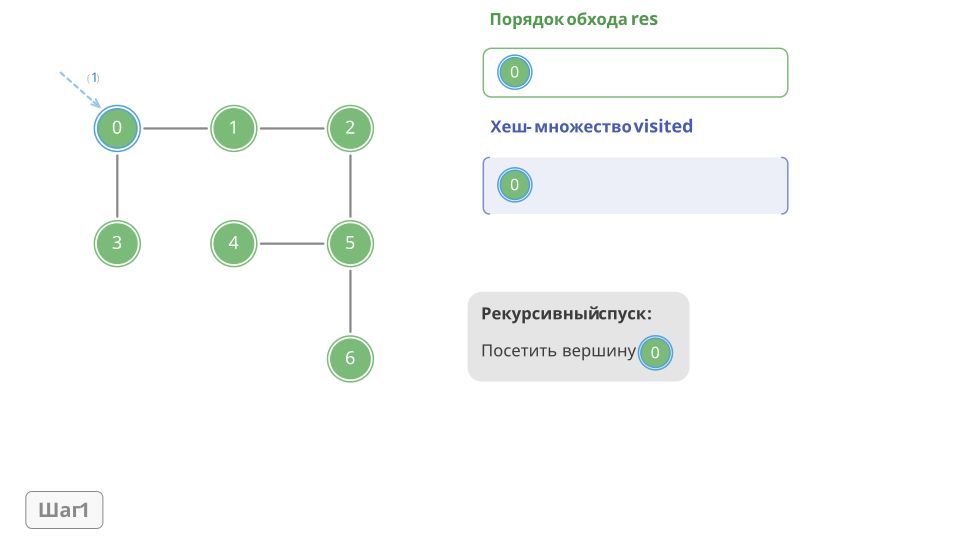

=== "<2>"
    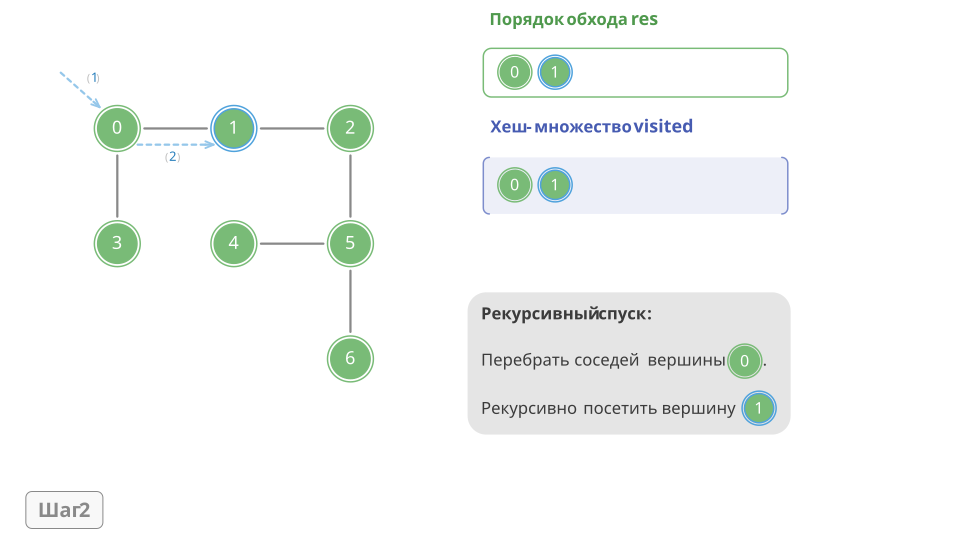

=== "<3>"
    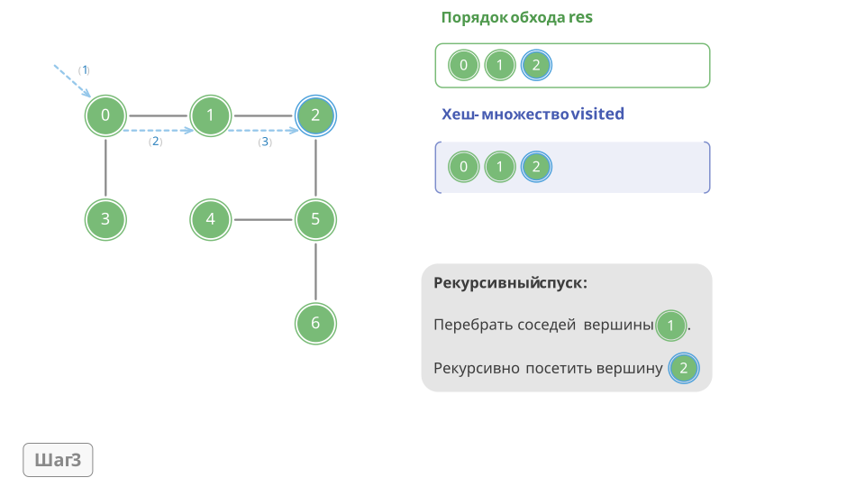

=== "<4>"
    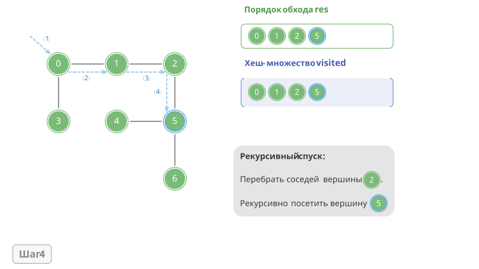

=== "<5>"
    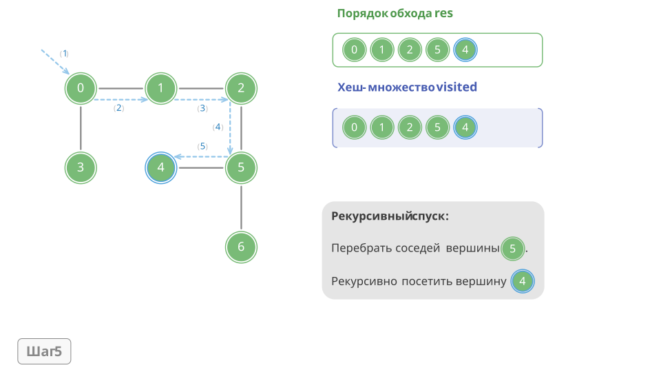

=== "<6>"
    

=== "<7>"
    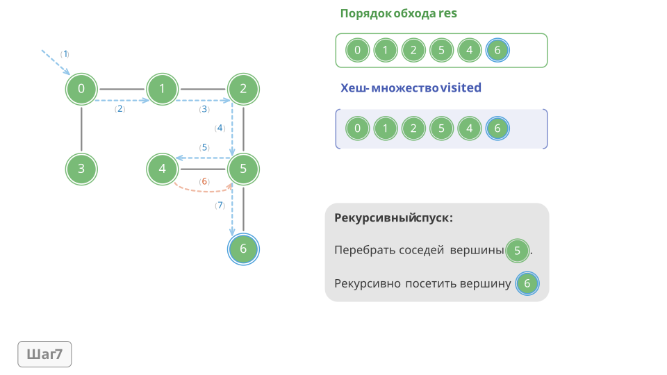

=== "<8>"
    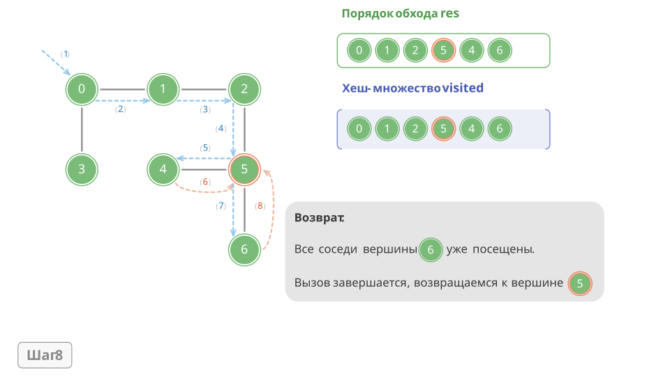

=== "<9>"
    

=== "<10>"
    

=== "<11>"
    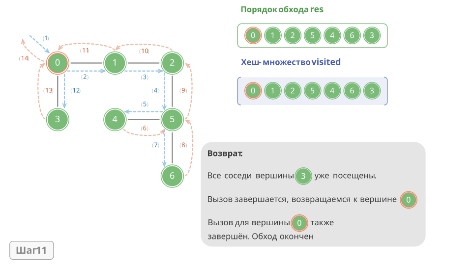

!!! question "Однозначен ли порядок обхода в глубину?"

    Как и при обходе в ширину, возможны разные последовательности. Из каждой вершины можно сначала пойти в любом из доступных направлений. При любом порядке перебора соседей это по-прежнему обход в глубину.
    
    Например, при обходе дерева последовательности «корень $\rightarrow$ левое поддерево $\rightarrow$ правое поддерево», «левое поддерево $\rightarrow$ корень $\rightarrow$ правое поддерево» и «левое поддерево $\rightarrow$ правое поддерево $\rightarrow$ корень» соответствуют прямому, симметричному и обратному обходу. Приоритеты в них разные, но все три относятся к обходу в глубину.

### Анализ сложности

**Временная сложность**. Каждая вершина посещается $1$ раз, что суммарно занимает $O(|V|)$ времени. Каждое ребро рассматривается $2$ раза, на что уходит $O(2|E|)$ времени. Итоговая сложность — $O(|V| + |E|)$.

**Пространственная сложность**. Список `res` и хеш-множество `visited` содержат не более $|V|$ вершин каждый. Максимальная глубина рекурсии равна $|V|$. Всего требуется $O(|V|)$ памяти.
