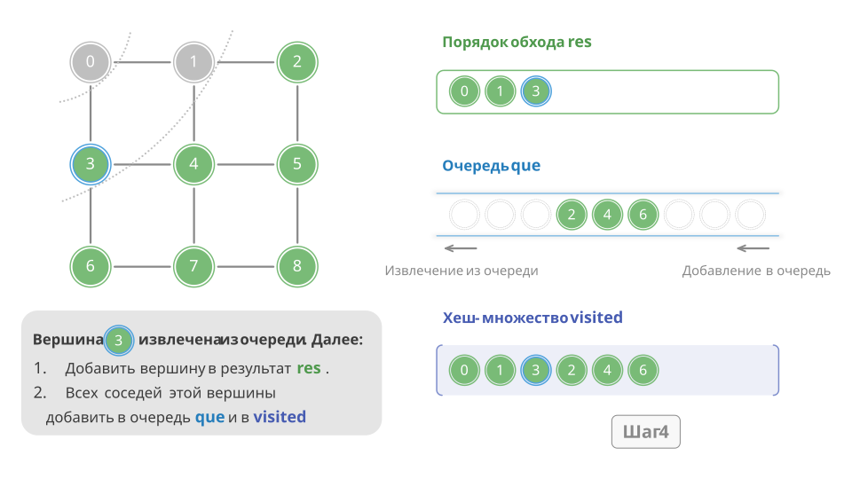
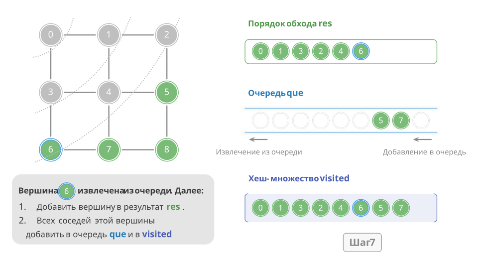
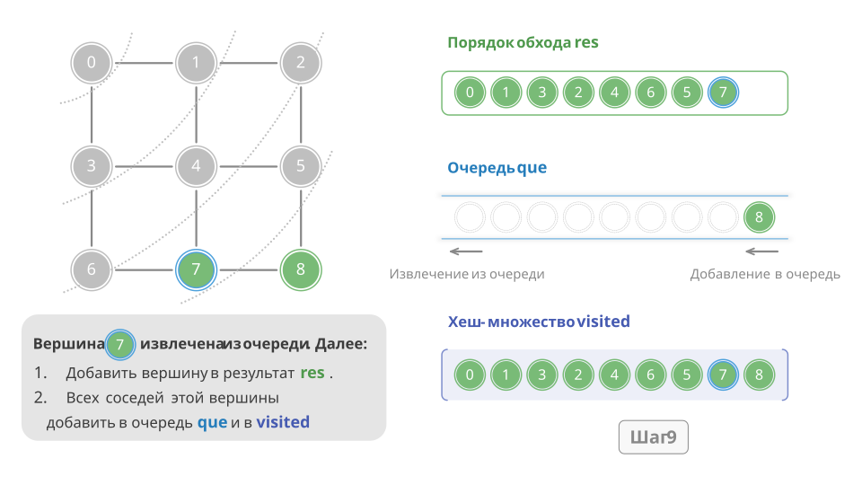
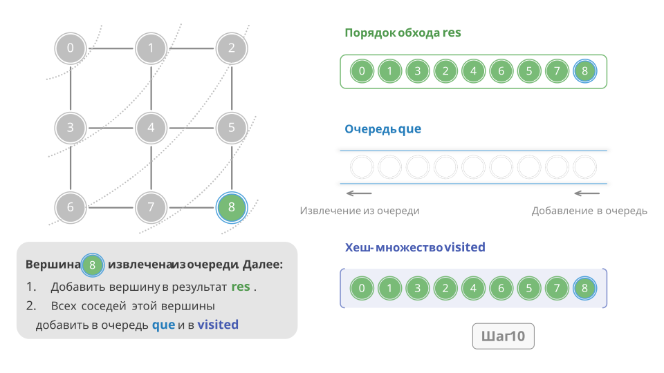
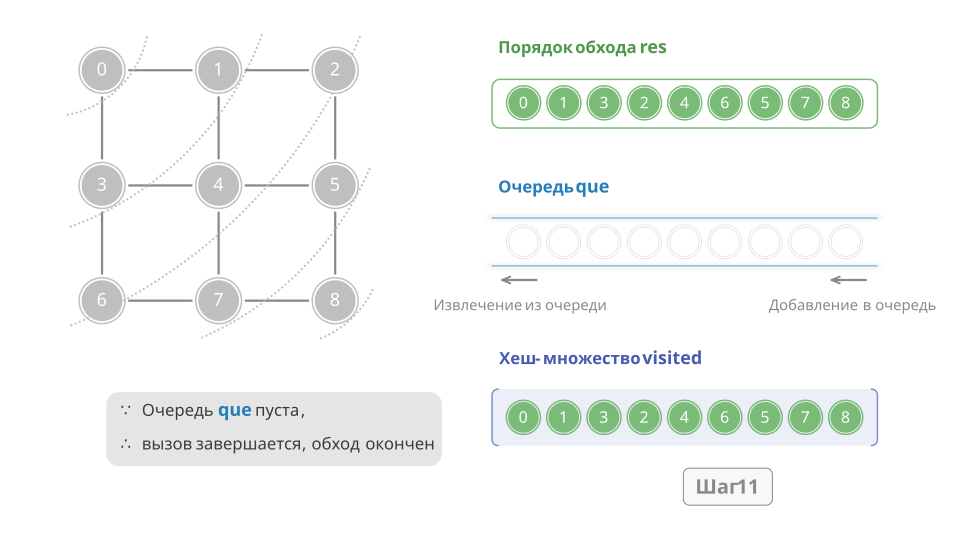
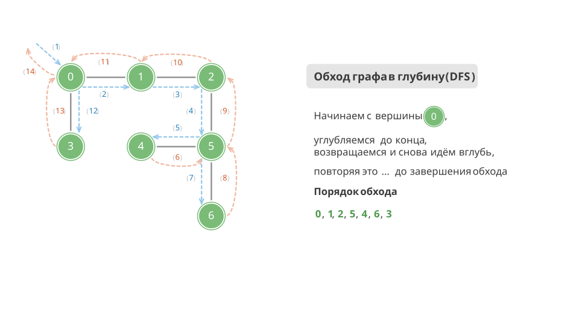
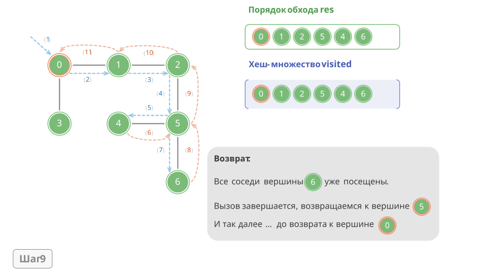
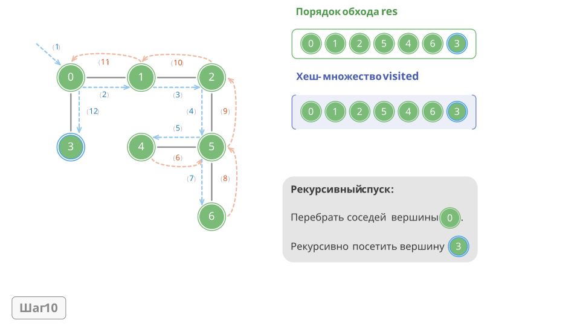

# 9.3 &nbsp; Обход графа

Дерево описывает отношения «один ко многим», а граф допускает произвольные отношения «многие ко многим». Поэтому дерево можно рассматривать как частный случай графа. Тогда и **обход дерева оказывается частным случаем обхода графа**.

Для обхода и деревьев, и графов применяют алгоритмы поиска. Различают два вида обхода графа: <u>обход в ширину</u> и <u>обход в глубину</u>.

## 9.3.1 &nbsp; Обход в ширину

**Обход в ширину идёт от ближних вершин к дальним. Начиная из выбранной вершины, он посещает прежде всего ближайшие вершины и расширяет область поиска слой за слоем**. На рисунке 9-9 обход начинается в левом верхнем углу. Сначала рассматриваются все соседи этой вершины, затем соседи следующей и так далее, пока не будут посещены все вершины.

{ class="animation-figure" }

<p align="center"> Рисунок 9-9 &nbsp; Обход графа в ширину </p>

### 1. &nbsp; Реализация алгоритма

Для BFS обычно используют очередь, как в коде ниже. Очередь работает по принципу «первым пришёл — первым вышел», что и позволяет посещать вершины от ближних к дальним.

1. Добавьте начальную вершину `startVet` в очередь и запустите цикл.
2. На каждой итерации извлекайте первую вершину из очереди и записывайте её в результат. Затем добавляйте её соседей в конец очереди.
3. Повторяйте шаг `2.`, пока не будут посещены все вершины.

Чтобы избежать повторных посещений, будем хранить посещённые вершины в хеш-множестве `visited`.

!!! tip

    Хеш-множество можно представить как хеш-таблицу, которая хранит только `key` без `value`. Добавление, удаление, поиск и изменение `key` имеют временную сложность $O(1)$. Поскольку каждый `key` уникален, хеш-множество часто применяют для устранения дубликатов.

=== "Python"

    ```python title="graph_bfs.py"
    def graph_bfs(graph: GraphAdjList, start_vet: Vertex) -> list[Vertex]:
        """Обход в ширину"""
        # Список смежности позволяет получить всех соседей заданной вершины
        # Порядок обхода вершин
        res = []
        # Хеш-множество посещённых вершин
        visited = set[Vertex]([start_vet])
        # Очередь для обхода BFS
        que = deque[Vertex]([start_vet])
        # Начать с вершины vet и повторять, пока не будут посещены все вершины
        while len(que) > 0:
            vet = que.popleft()  # Извлечь первую вершину из очереди
            res.append(vet)  # Записать посещённую вершину
            # Перебрать всех соседей этой вершины
            for adj_vet in graph.adj_list[vet]:
                if adj_vet in visited:
                    continue  # Пропустить посещённые вершины
                que.append(adj_vet)  # Добавить в очередь только непосещённые вершины
                visited.add(adj_vet)  # Отметить вершину как посещённую
        # Вернуть порядок обхода вершин
        return res
    ```

=== "C++"

    ```cpp title="graph_bfs.cpp"
    /* Обход в ширину */
    // Список смежности позволяет получить всех соседей заданной вершины
    vector<Vertex *> graphBFS(GraphAdjList &graph, Vertex *startVet) {
        // Порядок обхода вершин
        vector<Vertex *> res;
        // Хеш-множество посещённых вершин
        unordered_set<Vertex *> visited = {startVet};
        // Очередь для обхода BFS
        queue<Vertex *> que;
        que.push(startVet);
        // Начать с вершины vet и повторять, пока не будут посещены все вершины
        while (!que.empty()) {
            Vertex *vet = que.front();
            que.pop();          // Извлечь первую вершину из очереди
            res.push_back(vet); // Записать посещённую вершину
            // Перебрать всех соседей этой вершины
            for (auto adjVet : graph.adjList[vet]) {
                if (visited.count(adjVet))
                    continue;            // Пропустить посещённые вершины
                que.push(adjVet);        // Добавить в очередь только непосещённые вершины
                visited.emplace(adjVet); // Отметить вершину как посещённую
            }
        }
        // Вернуть порядок обхода вершин
        return res;
    }
    ```

=== "Java"

    ```java title="graph_bfs.java"
    /* Обход в ширину */
    // Список смежности позволяет получить всех соседей заданной вершины
    List<Vertex> graphBFS(GraphAdjList graph, Vertex startVet) {
        // Порядок обхода вершин
        List<Vertex> res = new ArrayList<>();
        // Хеш-множество посещённых вершин
        Set<Vertex> visited = new HashSet<>();
        visited.add(startVet);
        // Очередь для обхода BFS
        Queue<Vertex> que = new LinkedList<>();
        que.offer(startVet);
        // Начать с вершины vet и повторять, пока не будут посещены все вершины
        while (!que.isEmpty()) {
            Vertex vet = que.poll(); // Извлечь первую вершину из очереди
            res.add(vet);            // Записать посещённую вершину
            // Перебрать всех соседей этой вершины
            for (Vertex adjVet : graph.adjList.get(vet)) {
                if (visited.contains(adjVet))
                    continue;        // Пропустить посещённые вершины
                que.offer(adjVet);   // Добавить в очередь только непосещённые вершины
                visited.add(adjVet); // Отметить вершину как посещённую
            }
        }
        // Вернуть порядок обхода вершин
        return res;
    }
    ```

=== "C#"

    ```csharp title="graph_bfs.cs"
    /* Обход в ширину */
    // Список смежности позволяет получить всех соседей заданной вершины
    List<Vertex> GraphBFS(GraphAdjList graph, Vertex startVet) {
        // Порядок обхода вершин
        List<Vertex> res = [];
        // Хеш-множество посещённых вершин
        HashSet<Vertex> visited = [startVet];
        // Очередь для обхода BFS
        Queue<Vertex> que = new();
        que.Enqueue(startVet);
        // Начать с вершины vet и повторять, пока не будут посещены все вершины
        while (que.Count > 0) {
            Vertex vet = que.Dequeue(); // Извлечь первую вершину из очереди
            res.Add(vet);               // Записать посещённую вершину
            foreach (Vertex adjVet in graph.adjList[vet]) {
                if (visited.Contains(adjVet)) {
                    continue;          // Пропустить посещённые вершины
                }
                que.Enqueue(adjVet);   // Добавить в очередь только непосещённые вершины
                visited.Add(adjVet);   // Отметить вершину как посещённую
            }
        }

        // Вернуть порядок обхода вершин
        return res;
    }
    ```

=== "Go"

    ```go title="graph_bfs.go"
    /* Обход в ширину */
    // Список смежности позволяет получить всех соседей заданной вершины
    func graphBFS(g *graphAdjList, startVet Vertex) []Vertex {
        // Порядок обхода вершин
        res := make([]Vertex, 0)
        // Хеш-множество посещённых вершин
        visited := make(map[Vertex]struct{})
        visited[startVet] = struct{}{}
        // Для BFS нужна очередь. Реализуем её на срезе
        queue := make([]Vertex, 0)
        queue = append(queue, startVet)
        // Начать с вершины vet и повторять, пока не будут посещены все вершины
        for len(queue) > 0 {
            // Извлечь первую вершину из очереди
            vet := queue[0]
            queue = queue[1:]
            // Записать посещённую вершину
            res = append(res, vet)
            // Перебрать всех соседей этой вершины
            for _, adjVet := range g.adjList[vet] {
                _, isExist := visited[adjVet]
                // Добавить в очередь только непосещённые вершины
                if !isExist {
                    queue = append(queue, adjVet)
                    visited[adjVet] = struct{}{}
                }
            }
        }
        // Вернуть порядок обхода вершин
        return res
    }
    ```

=== "Swift"

    ```swift title="graph_bfs.swift"
    /* Обход в ширину */
    // Список смежности позволяет получить всех соседей заданной вершины
    func graphBFS(graph: GraphAdjList, startVet: Vertex) -> [Vertex] {
        // Порядок обхода вершин
        var res: [Vertex] = []
        // Хеш-множество посещённых вершин
        var visited: Set<Vertex> = [startVet]
        // Очередь для обхода BFS
        var que: [Vertex] = [startVet]
        // Начать с вершины vet и повторять, пока не будут посещены все вершины
        while !que.isEmpty {
            let vet = que.removeFirst() // Извлечь первую вершину из очереди
            res.append(vet) // Записать посещённую вершину
            // Перебрать всех соседей этой вершины
            for adjVet in graph.adjList[vet] ?? [] {
                if visited.contains(adjVet) {
                    continue // Пропустить посещённые вершины
                }
                que.append(adjVet) // Добавить в очередь только непосещённые вершины
                visited.insert(adjVet) // Отметить вершину как посещённую
            }
        }
        // Вернуть порядок обхода вершин
        return res
    }
    ```

=== "JS"

    ```javascript title="graph_bfs.js"
    /* Обход в ширину */
    // Список смежности позволяет получить всех соседей заданной вершины
    function graphBFS(graph, startVet) {
        // Порядок обхода вершин
        const res = [];
        // Хеш-множество посещённых вершин
        const visited = new Set();
        visited.add(startVet);
        // Очередь для обхода BFS
        const que = [startVet];
        // Начать с вершины vet и повторять, пока не будут посещены все вершины
        while (que.length) {
            const vet = que.shift(); // Извлечь первую вершину из очереди
            res.push(vet); // Записать посещённую вершину
            // Перебрать всех соседей этой вершины
            for (const adjVet of graph.adjList.get(vet) ?? []) {
                if (visited.has(adjVet)) {
                    continue; // Пропустить посещённые вершины
                }
                que.push(adjVet); // Добавить в очередь только непосещённые вершины
                visited.add(adjVet); // Отметить вершину как посещённую
            }
        }
        // Вернуть порядок обхода вершин
        return res;
    }
    ```

=== "TS"

    ```typescript title="graph_bfs.ts"
    /* Обход в ширину */
    // Список смежности позволяет получить всех соседей заданной вершины
    function graphBFS(graph: GraphAdjList, startVet: Vertex): Vertex[] {
        // Порядок обхода вершин
        const res: Vertex[] = [];
        // Хеш-множество посещённых вершин
        const visited: Set<Vertex> = new Set();
        visited.add(startVet);
        // Очередь для обхода BFS
        const que = [startVet];
        // Начать с вершины vet и повторять, пока не будут посещены все вершины
        while (que.length) {
            const vet = que.shift(); // Извлечь первую вершину из очереди
            res.push(vet); // Записать посещённую вершину
            // Перебрать всех соседей этой вершины
            for (const adjVet of graph.adjList.get(vet) ?? []) {
                if (visited.has(adjVet)) {
                    continue; // Пропустить посещённые вершины
                }
                que.push(adjVet); // Добавить в очередь только непосещённые вершины
                visited.add(adjVet); // Отметить вершину как посещённую
            }
        }
        // Вернуть порядок обхода вершин
        return res;
    }
    ```

=== "Dart"

    ```dart title="graph_bfs.dart"
    /* Обход в ширину */
    List<Vertex> graphBFS(GraphAdjList graph, Vertex startVet) {
      // Список смежности позволяет получить всех соседей заданной вершины
      // Порядок обхода вершин
      List<Vertex> res = [];
      // Хеш-множество посещённых вершин
      Set<Vertex> visited = {};
      visited.add(startVet);
      // Очередь для обхода BFS
      Queue<Vertex> que = Queue();
      que.add(startVet);
      // Начать с вершины vet и повторять, пока не будут посещены все вершины
      while (que.isNotEmpty) {
        Vertex vet = que.removeFirst(); // Извлечь первую вершину из очереди
        res.add(vet); // Записать посещённую вершину
        // Перебрать всех соседей этой вершины
        for (Vertex adjVet in graph.adjList[vet]!) {
          if (visited.contains(adjVet)) {
            continue; // Пропустить посещённые вершины
          }
          que.add(adjVet); // Добавить в очередь только непосещённые вершины
          visited.add(adjVet); // Отметить вершину как посещённую
        }
      }
      // Вернуть порядок обхода вершин
      return res;
    }
    ```

=== "Rust"

    ```rust title="graph_bfs.rs"
    /* Обход в ширину */
    // Список смежности позволяет получить всех соседей заданной вершины
    fn graph_bfs(graph: GraphAdjList, start_vet: Vertex) -> Vec<Vertex> {
        // Порядок обхода вершин
        let mut res = vec![];
        // Хеш-множество посещённых вершин
        let mut visited = HashSet::new();
        visited.insert(start_vet);
        // Очередь для обхода BFS
        let mut que = VecDeque::new();
        que.push_back(start_vet);
        // Начать с вершины vet и повторять, пока не будут посещены все вершины
        while let Some(vet) = que.pop_front() {
            res.push(vet); // Записать посещённую вершину

            // Перебрать всех соседей этой вершины
            if let Some(adj_vets) = graph.adj_list.get(&vet) {
                for &adj_vet in adj_vets {
                    if visited.contains(&adj_vet) {
                        continue; // Пропустить посещённые вершины
                    }
                    que.push_back(adj_vet); // Добавить в очередь только непосещённые вершины
                    visited.insert(adj_vet); // Отметить вершину как посещённую
                }
            }
        }
        // Вернуть порядок обхода вершин
        res
    }
    ```

=== "C"

    ```c title="graph_bfs.c"
    /* Структура очереди узлов */
    typedef struct {
        Vertex *vertices[MAX_SIZE];
        int front, rear, size;
    } Queue;

    /* Конструктор */
    Queue *newQueue() {
        Queue *q = (Queue *)malloc(sizeof(Queue));
        q->front = q->rear = q->size = 0;
        return q;
    }

    /* Проверить, пуста ли очередь */
    int isEmpty(Queue *q) {
        return q->size == 0;
    }

    /* Добавить в очередь */
    void enqueue(Queue *q, Vertex *vet) {
        q->vertices[q->rear] = vet;
        q->rear = (q->rear + 1) % MAX_SIZE;
        q->size++;
    }

    /* Извлечь из очереди */
    Vertex *dequeue(Queue *q) {
        Vertex *vet = q->vertices[q->front];
        q->front = (q->front + 1) % MAX_SIZE;
        q->size--;
        return vet;
    }

    /* Проверить, посещена ли вершина */
    int isVisited(Vertex **visited, int size, Vertex *vet) {
        // Последовательно найти узел за время O(n)
        for (int i = 0; i < size; i++) {
            if (visited[i] == vet)
                return 1;
        }
        return 0;
    }

    /* Обход в ширину */
    // Список смежности позволяет получить всех соседей заданной вершины
    void graphBFS(GraphAdjList *graph, Vertex *startVet, Vertex **res, int *resSize, Vertex **visited, int *visitedSize) {
        // Очередь для обхода BFS
        Queue *queue = newQueue();
        enqueue(queue, startVet);
        visited[(*visitedSize)++] = startVet;
        // Начать с вершины vet и повторять, пока не будут посещены все вершины
        while (!isEmpty(queue)) {
            Vertex *vet = dequeue(queue); // Извлечь первую вершину из очереди
            res[(*resSize)++] = vet;      // Записать посещённую вершину
            // Перебрать всех соседей этой вершины
            AdjListNode *node = findNode(graph, vet);
            while (node != NULL) {
                // Пропустить посещённые вершины
                if (!isVisited(visited, *visitedSize, node->vertex)) {
                    enqueue(queue, node->vertex);             // Добавить в очередь только непосещённые вершины
                    visited[(*visitedSize)++] = node->vertex; // Отметить вершину как посещённую
                }
                node = node->next;
            }
        }
        // Освободить память
        free(queue);
    }
    ```

=== "Kotlin"

    ```kotlin title="graph_bfs.kt"
    /* Обход в ширину */
    // Список смежности позволяет получить всех соседей заданной вершины
    fun graphBFS(graph: GraphAdjList, startVet: Vertex): MutableList<Vertex?> {
        // Порядок обхода вершин
        val res = mutableListOf<Vertex?>()
        // Хеш-множество посещённых вершин
        val visited = HashSet<Vertex>()
        visited.add(startVet)
        // Очередь для обхода BFS
        val que = LinkedList<Vertex>()
        que.offer(startVet)
        // Начать с вершины vet и повторять, пока не будут посещены все вершины
        while (!que.isEmpty()) {
            val vet = que.poll() // Извлечь первую вершину из очереди
            res.add(vet)         // Записать посещённую вершину
            // Перебрать всех соседей этой вершины
            for (adjVet in graph.adjList[vet]!!) {
                if (visited.contains(adjVet))
                    continue        // Пропустить посещённые вершины
                que.offer(adjVet)   // Добавить в очередь только непосещённые вершины
                visited.add(adjVet) // Отметить вершину как посещённую
            }
        }
        // Вернуть порядок обхода вершин
        return res
    }
    ```

=== "Ruby"

    ```ruby title="graph_bfs.rb"
    ### Обход в ширину ###
    def graph_bfs(graph, start_vet)
      # Список смежности позволяет получить всех соседей заданной вершины
      # Порядок обхода вершин
      res = []
      # Хеш-множество посещённых вершин
      visited = Set.new([start_vet])
      # Очередь для обхода BFS
      que = [start_vet]
      # Начать с вершины vet и повторять, пока не будут посещены все вершины
      while que.length > 0
        vet = que.shift # Извлечь первую вершину из очереди
        res << vet # Записать посещённую вершину
        # Перебрать всех соседей этой вершины
        for adj_vet in graph.adj_list[vet]
          next if visited.include?(adj_vet) # Пропустить посещённые вершины
          que << adj_vet # Добавить в очередь только непосещённые вершины
          visited.add(adj_vet) # Отметить вершину как посещённую
        end
      end
      # Вернуть порядок обхода вершин
      res
    end
    ```

??? pythontutor "Визуализация выполнения"

    <div style="height: 549px; width: 100%;"><iframe class="pythontutor-iframe" title="Визуализация выполнения" src="https://pythontutor.com/iframe-embed.html#code=from%20collections%20import%20deque%0A%0Aclass%20Vertex%3A%0A%20%20%22%22%22%D0%9A%D0%BB%D0%B0%D1%81%D1%81%20%D0%B2%D0%B5%D1%80%D1%88%D0%B8%D0%BD%D1%8B%22%22%22%0A%20%20def%20__init__%28self,%20val%3A%20int%29%3A%0A%20%20%20%20self.val%20%3D%20val%0A%0Adef%20vals_to_vets%28vals%3A%20list%5Bint%5D%29%20-%3E%20list%5B%22Vertex%22%5D%3A%0A%20%20%22%22%22%D0%A1%D0%BF%D0%B8%D1%81%D0%BE%D0%BA%20%D0%B7%D0%BD%D0%B0%D1%87%D0%B5%D0%BD%D0%B8%D0%B9%20vals%20%E2%86%92%20%D1%81%D0%BF%D0%B8%D1%81%D0%BE%D0%BA%20%D0%B2%D0%B5%D1%80%D1%88%D0%B8%D0%BD%20vets%22%22%22%0A%20%20return%20%5BVertex%28val%29%20for%20val%20in%20vals%5D%0A%0Aclass%20GraphAdjList%3A%0A%20%20%22%22%22%D0%9D%D0%B5%D0%BE%D1%80%D0%B8%D0%B5%D0%BD%D1%82%D0%B8%D1%80%D0%BE%D0%B2%D0%B0%D0%BD%D0%BD%D1%8B%D0%B9%20%D0%B3%D1%80%D0%B0%D1%84%3A%20%D1%81%D0%BF%D0%B8%D1%81%D0%BA%D0%B8%20%D1%81%D0%BC%D0%B5%D0%B6%D0%BD%D0%BE%D1%81%D1%82%D0%B8%22%22%22%0A%0A%20%20def%20__init__%28self,%20edges%3A%20list%5Blist%5BVertex%5D%5D%29%3A%0A%20%20%20%20%22%22%22%D0%9A%D0%BE%D0%BD%D1%81%D1%82%D1%80%D1%83%D0%BA%D1%82%D0%BE%D1%80%22%22%22%0A%20%20%20%20self.adj_list%20%3D%20dict%5BVertex,%20list%5BVertex%5D%5D%28%29%0A%20%20%20%20for%20edge%20in%20edges%3A%0A%20%20%20%20%20%20self.add_vertex%28edge%5B0%5D%29%0A%20%20%20%20%20%20self.add_vertex%28edge%5B1%5D%29%0A%20%20%20%20%20%20self.add_edge%28edge%5B0%5D,%20edge%5B1%5D%29%0A%0A%20%20def%20add_edge%28self,%20vet1%3A%20Vertex,%20vet2%3A%20Vertex%29%3A%0A%20%20%20%20%22%22%22%D0%94%D0%BE%D0%B1%D0%B0%D0%B2%D0%B8%D1%82%D1%8C%20%D1%80%D0%B5%D0%B1%D1%80%D0%BE%22%22%22%0A%20%20%20%20if%20vet1%20not%20in%20self.adj_list%20or%20vet2%20not%20in%20self.adj_list%20or%20vet1%20%3D%3D%20vet2%3A%0A%20%20%20%20%20%20raise%20ValueError%28%29%0A%20%20%20%20self.adj_list%5Bvet1%5D.append%28vet2%29%0A%20%20%20%20self.adj_list%5Bvet2%5D.append%28vet1%29%0A%0A%20%20def%20add_vertex%28self,%20vet%3A%20Vertex%29%3A%0A%20%20%20%20%22%22%22%D0%94%D0%BE%D0%B1%D0%B0%D0%B2%D0%B8%D1%82%D1%8C%20%D0%B2%D0%B5%D1%80%D1%88%D0%B8%D0%BD%D1%83%22%22%22%0A%20%20%20%20if%20vet%20in%20self.adj_list%3A%0A%20%20%20%20%20%20return%0A%20%20%20%20self.adj_list%5Bvet%5D%20%3D%20%5B%5D%0A%0A%0Adef%20graph_bfs%28graph%3A%20GraphAdjList,%20start_vet%3A%20Vertex%29%20-%3E%20list%5BVertex%5D%3A%0A%20%20%22%22%22%D0%9E%D0%B1%D1%85%D0%BE%D0%B4%20%D0%B2%20%D1%88%D0%B8%D1%80%D0%B8%D0%BD%D1%83%22%22%22%0A%20%20%23%20%D0%9F%D0%BE%D1%80%D1%8F%D0%B4%D0%BE%D0%BA%20%D0%BE%D0%B1%D1%85%D0%BE%D0%B4%D0%B0%0A%20%20res%20%3D%20%5B%5D%0A%20%20%23%20%D0%A5%D0%B5%D1%88-%D1%82%D0%B0%D0%B1%D0%BB%D0%B8%D1%86%D0%B0%20%D0%BF%D0%BE%D1%81%D0%B5%D1%89%D0%B5%D0%BD%D0%B8%D0%B9%0A%20%20visited%20%3D%20set%5BVertex%5D%28%5Bstart_vet%5D%29%0A%20%20%23%20%D0%9E%D1%87%D0%B5%D1%80%D0%B5%D0%B4%D1%8C%20BFS%0A%20%20que%20%3D%20deque%5BVertex%5D%28%5Bstart_vet%5D%29%0A%20%20%23%20%D0%9E%D1%82%20vet%20%D0%B4%D0%BE%20%D0%BF%D0%BE%D1%81%D0%B5%D1%89%D0%B5%D0%BD%D0%B8%D1%8F%20%D0%B2%D1%81%D0%B5%D1%85%20%D0%B2%D0%B5%D1%80%D1%88%D0%B8%D0%BD%0A%20%20while%20len%28que%29%20%3E%200%3A%0A%20%20%20%20vet%20%3D%20que.popleft%28%29%20%20%23%20%D0%98%D0%B7%D0%B2%D0%BB%D0%B5%D1%87%D1%8C%20%D0%B3%D0%BE%D0%BB%D0%BE%D0%B2%D1%83%20%D0%BE%D1%87%D0%B5%D1%80%D0%B5%D0%B4%D0%B8%0A%20%20%20%20res.append%28vet%29%20%20%23%20%D0%97%D0%B0%D0%BF%D0%B8%D1%81%D0%B0%D1%82%D1%8C%20%D0%B2%D0%B5%D1%80%D1%88%D0%B8%D0%BD%D1%83%0A%20%20%20%20%23%20%D0%9F%D0%B5%D1%80%D0%B5%D0%B1%D1%80%D0%B0%D1%82%D1%8C%20%D0%B2%D1%81%D0%B5%D1%85%20%D1%81%D0%BE%D1%81%D0%B5%D0%B4%D0%B5%D0%B9%0A%20%20%20%20for%20adj_vet%20in%20graph.adj_list%5Bvet%5D%3A%0A%20%20%20%20%20%20if%20adj_vet%20in%20visited%3A%0A%20%20%20%20%20%20%20%20continue%20%20%23%20%D0%9F%D1%80%D0%BE%D0%BF%D1%83%D1%81%D1%82%D0%B8%D1%82%D1%8C%20%D0%BF%D0%BE%D1%81%D0%B5%D1%89%D1%91%D0%BD%D0%BD%D1%8B%D1%85%0A%20%20%20%20%20%20que.append%28adj_vet%29%20%20%23%20%D0%92%20%D0%BE%D1%87%D0%B5%D1%80%D0%B5%D0%B4%D1%8C%20%E2%80%94%20%D1%82%D0%BE%D0%BB%D1%8C%D0%BA%D0%BE%20%D0%BD%D0%BE%D0%B2%D1%8B%D1%85%0A%20%20%20%20%20%20visited.add%28adj_vet%29%20%20%23%20%D0%9E%D1%82%D0%BC%D0%B5%D1%82%D0%B8%D1%82%D1%8C%20%D0%BF%D0%BE%D1%81%D0%B5%D1%89%D0%B5%D0%BD%D0%B8%D0%B5%0A%20%20%23%20%D0%92%D0%B5%D1%80%D0%BD%D1%83%D1%82%D1%8C%20%D0%BF%D0%BE%D1%80%D1%8F%D0%B4%D0%BE%D0%BA%20%D0%BE%D0%B1%D1%85%D0%BE%D0%B4%D0%B0%0A%20%20return%20res%0A%0A%22%22%22Driver%20Code%22%22%22%0Aif%20__name__%20%3D%3D%20%22__main__%22%3A%0A%20%20%23%20%D0%A1%D0%BE%D0%B7%D0%B4%D0%B0%D1%82%D1%8C%20%D0%BD%D0%B5%D0%BE%D1%80%D0%B8%D0%B5%D0%BD%D1%82%D0%B8%D1%80%D0%BE%D0%B2%D0%B0%D0%BD%D0%BD%D1%8B%D0%B9%20%D0%B3%D1%80%D0%B0%D1%84%0A%20%20v%20%3D%20vals_to_vets%28%5B0,%201,%202,%203,%204%5D%29%0A%20%20edges%20%3D%20%5B%0A%20%20%20%20%5Bv%5B0%5D,%20v%5B1%5D%5D,%0A%20%20%20%20%5Bv%5B0%5D,%20v%5B3%5D%5D,%0A%20%20%20%20%5Bv%5B1%5D,%20v%5B2%5D%5D,%0A%20%20%20%20%5Bv%5B1%5D,%20v%5B4%5D%5D,%0A%20%20%20%20%5Bv%5B3%5D,%20v%5B4%5D%5D,%0A%20%20%5D%0A%20%20graph%20%3D%20GraphAdjList%28edges%29%0A%20%20del%20edges%0A%0A%20%20%23%20%D0%9E%D0%B1%D1%85%D0%BE%D0%B4%20%D0%B2%20%D1%88%D0%B8%D1%80%D0%B8%D0%BD%D1%83%0A%20%20res%20%3D%20graph_bfs%28graph,%20v%5B0%5D%29&codeDivHeight=472&codeDivWidth=350&cumulative=false&curInstr=131&heapPrimitives=nevernest&origin=opt-frontend.js&py=311&rawInputLstJSON=%5B%5D&textReferences=false"> </iframe></div>
    <div style="margin-top: 5px;"><a href="https://pythontutor.com/iframe-embed.html#code=from%20collections%20import%20deque%0A%0Aclass%20Vertex%3A%0A%20%20%22%22%22%D0%9A%D0%BB%D0%B0%D1%81%D1%81%20%D0%B2%D0%B5%D1%80%D1%88%D0%B8%D0%BD%D1%8B%22%22%22%0A%20%20def%20__init__%28self,%20val%3A%20int%29%3A%0A%20%20%20%20self.val%20%3D%20val%0A%0Adef%20vals_to_vets%28vals%3A%20list%5Bint%5D%29%20-%3E%20list%5B%22Vertex%22%5D%3A%0A%20%20%22%22%22%D0%A1%D0%BF%D0%B8%D1%81%D0%BE%D0%BA%20%D0%B7%D0%BD%D0%B0%D1%87%D0%B5%D0%BD%D0%B8%D0%B9%20vals%20%E2%86%92%20%D1%81%D0%BF%D0%B8%D1%81%D0%BE%D0%BA%20%D0%B2%D0%B5%D1%80%D1%88%D0%B8%D0%BD%20vets%22%22%22%0A%20%20return%20%5BVertex%28val%29%20for%20val%20in%20vals%5D%0A%0Aclass%20GraphAdjList%3A%0A%20%20%22%22%22%D0%9D%D0%B5%D0%BE%D1%80%D0%B8%D0%B5%D0%BD%D1%82%D0%B8%D1%80%D0%BE%D0%B2%D0%B0%D0%BD%D0%BD%D1%8B%D0%B9%20%D0%B3%D1%80%D0%B0%D1%84%3A%20%D1%81%D0%BF%D0%B8%D1%81%D0%BA%D0%B8%20%D1%81%D0%BC%D0%B5%D0%B6%D0%BD%D0%BE%D1%81%D1%82%D0%B8%22%22%22%0A%0A%20%20def%20__init__%28self,%20edges%3A%20list%5Blist%5BVertex%5D%5D%29%3A%0A%20%20%20%20%22%22%22%D0%9A%D0%BE%D0%BD%D1%81%D1%82%D1%80%D1%83%D0%BA%D1%82%D0%BE%D1%80%22%22%22%0A%20%20%20%20self.adj_list%20%3D%20dict%5BVertex,%20list%5BVertex%5D%5D%28%29%0A%20%20%20%20for%20edge%20in%20edges%3A%0A%20%20%20%20%20%20self.add_vertex%28edge%5B0%5D%29%0A%20%20%20%20%20%20self.add_vertex%28edge%5B1%5D%29%0A%20%20%20%20%20%20self.add_edge%28edge%5B0%5D,%20edge%5B1%5D%29%0A%0A%20%20def%20add_edge%28self,%20vet1%3A%20Vertex,%20vet2%3A%20Vertex%29%3A%0A%20%20%20%20%22%22%22%D0%94%D0%BE%D0%B1%D0%B0%D0%B2%D0%B8%D1%82%D1%8C%20%D1%80%D0%B5%D0%B1%D1%80%D0%BE%22%22%22%0A%20%20%20%20if%20vet1%20not%20in%20self.adj_list%20or%20vet2%20not%20in%20self.adj_list%20or%20vet1%20%3D%3D%20vet2%3A%0A%20%20%20%20%20%20raise%20ValueError%28%29%0A%20%20%20%20self.adj_list%5Bvet1%5D.append%28vet2%29%0A%20%20%20%20self.adj_list%5Bvet2%5D.append%28vet1%29%0A%0A%20%20def%20add_vertex%28self,%20vet%3A%20Vertex%29%3A%0A%20%20%20%20%22%22%22%D0%94%D0%BE%D0%B1%D0%B0%D0%B2%D0%B8%D1%82%D1%8C%20%D0%B2%D0%B5%D1%80%D1%88%D0%B8%D0%BD%D1%83%22%22%22%0A%20%20%20%20if%20vet%20in%20self.adj_list%3A%0A%20%20%20%20%20%20return%0A%20%20%20%20self.adj_list%5Bvet%5D%20%3D%20%5B%5D%0A%0A%0Adef%20graph_bfs%28graph%3A%20GraphAdjList,%20start_vet%3A%20Vertex%29%20-%3E%20list%5BVertex%5D%3A%0A%20%20%22%22%22%D0%9E%D0%B1%D1%85%D0%BE%D0%B4%20%D0%B2%20%D1%88%D0%B8%D1%80%D0%B8%D0%BD%D1%83%22%22%22%0A%20%20%23%20%D0%9F%D0%BE%D1%80%D1%8F%D0%B4%D0%BE%D0%BA%20%D0%BE%D0%B1%D1%85%D0%BE%D0%B4%D0%B0%0A%20%20res%20%3D%20%5B%5D%0A%20%20%23%20%D0%A5%D0%B5%D1%88-%D1%82%D0%B0%D0%B1%D0%BB%D0%B8%D1%86%D0%B0%20%D0%BF%D0%BE%D1%81%D0%B5%D1%89%D0%B5%D0%BD%D0%B8%D0%B9%0A%20%20visited%20%3D%20set%5BVertex%5D%28%5Bstart_vet%5D%29%0A%20%20%23%20%D0%9E%D1%87%D0%B5%D1%80%D0%B5%D0%B4%D1%8C%20BFS%0A%20%20que%20%3D%20deque%5BVertex%5D%28%5Bstart_vet%5D%29%0A%20%20%23%20%D0%9E%D1%82%20vet%20%D0%B4%D0%BE%20%D0%BF%D0%BE%D1%81%D0%B5%D1%89%D0%B5%D0%BD%D0%B8%D1%8F%20%D0%B2%D1%81%D0%B5%D1%85%20%D0%B2%D0%B5%D1%80%D1%88%D0%B8%D0%BD%0A%20%20while%20len%28que%29%20%3E%200%3A%0A%20%20%20%20vet%20%3D%20que.popleft%28%29%20%20%23%20%D0%98%D0%B7%D0%B2%D0%BB%D0%B5%D1%87%D1%8C%20%D0%B3%D0%BE%D0%BB%D0%BE%D0%B2%D1%83%20%D0%BE%D1%87%D0%B5%D1%80%D0%B5%D0%B4%D0%B8%0A%20%20%20%20res.append%28vet%29%20%20%23%20%D0%97%D0%B0%D0%BF%D0%B8%D1%81%D0%B0%D1%82%D1%8C%20%D0%B2%D0%B5%D1%80%D1%88%D0%B8%D0%BD%D1%83%0A%20%20%20%20%23%20%D0%9F%D0%B5%D1%80%D0%B5%D0%B1%D1%80%D0%B0%D1%82%D1%8C%20%D0%B2%D1%81%D0%B5%D1%85%20%D1%81%D0%BE%D1%81%D0%B5%D0%B4%D0%B5%D0%B9%0A%20%20%20%20for%20adj_vet%20in%20graph.adj_list%5Bvet%5D%3A%0A%20%20%20%20%20%20if%20adj_vet%20in%20visited%3A%0A%20%20%20%20%20%20%20%20continue%20%20%23%20%D0%9F%D1%80%D0%BE%D0%BF%D1%83%D1%81%D1%82%D0%B8%D1%82%D1%8C%20%D0%BF%D0%BE%D1%81%D0%B5%D1%89%D1%91%D0%BD%D0%BD%D1%8B%D1%85%0A%20%20%20%20%20%20que.append%28adj_vet%29%20%20%23%20%D0%92%20%D0%BE%D1%87%D0%B5%D1%80%D0%B5%D0%B4%D1%8C%20%E2%80%94%20%D1%82%D0%BE%D0%BB%D1%8C%D0%BA%D0%BE%20%D0%BD%D0%BE%D0%B2%D1%8B%D1%85%0A%20%20%20%20%20%20visited.add%28adj_vet%29%20%20%23%20%D0%9E%D1%82%D0%BC%D0%B5%D1%82%D0%B8%D1%82%D1%8C%20%D0%BF%D0%BE%D1%81%D0%B5%D1%89%D0%B5%D0%BD%D0%B8%D0%B5%0A%20%20%23%20%D0%92%D0%B5%D1%80%D0%BD%D1%83%D1%82%D1%8C%20%D0%BF%D0%BE%D1%80%D1%8F%D0%B4%D0%BE%D0%BA%20%D0%BE%D0%B1%D1%85%D0%BE%D0%B4%D0%B0%0A%20%20return%20res%0A%0A%22%22%22Driver%20Code%22%22%22%0Aif%20__name__%20%3D%3D%20%22__main__%22%3A%0A%20%20%23%20%D0%A1%D0%BE%D0%B7%D0%B4%D0%B0%D1%82%D1%8C%20%D0%BD%D0%B5%D0%BE%D1%80%D0%B8%D0%B5%D0%BD%D1%82%D0%B8%D1%80%D0%BE%D0%B2%D0%B0%D0%BD%D0%BD%D1%8B%D0%B9%20%D0%B3%D1%80%D0%B0%D1%84%0A%20%20v%20%3D%20vals_to_vets%28%5B0,%201,%202,%203,%204%5D%29%0A%20%20edges%20%3D%20%5B%0A%20%20%20%20%5Bv%5B0%5D,%20v%5B1%5D%5D,%0A%20%20%20%20%5Bv%5B0%5D,%20v%5B3%5D%5D,%0A%20%20%20%20%5Bv%5B1%5D,%20v%5B2%5D%5D,%0A%20%20%20%20%5Bv%5B1%5D,%20v%5B4%5D%5D,%0A%20%20%20%20%5Bv%5B3%5D,%20v%5B4%5D%5D,%0A%20%20%5D%0A%20%20graph%20%3D%20GraphAdjList%28edges%29%0A%20%20del%20edges%0A%0A%20%20%23%20%D0%9E%D0%B1%D1%85%D0%BE%D0%B4%20%D0%B2%20%D1%88%D0%B8%D1%80%D0%B8%D0%BD%D1%83%0A%20%20res%20%3D%20graph_bfs%28graph,%20v%5B0%5D%29&codeDivHeight=800&codeDivWidth=600&cumulative=false&curInstr=131&heapPrimitives=nevernest&origin=opt-frontend.js&py=311&rawInputLstJSON=%5B%5D&textReferences=false" target="_blank" rel="noopener noreferrer">Во весь экран ></a></div>

Сопоставьте код с пошаговой схемой ниже, чтобы увидеть, как он работает.

=== "<1>"
    { class="animation-figure" }

=== "<2>"
    { class="animation-figure" }

=== "<3>"
    { class="animation-figure" }

=== "<4>"
    { class="animation-figure" }

=== "<5>"
    { class="animation-figure" }

=== "<6>"
    { class="animation-figure" }

=== "<7>"
    { class="animation-figure" }

=== "<8>"
    { class="animation-figure" }

=== "<9>"
    { class="animation-figure" }

=== "<10>"
    { class="animation-figure" }

=== "<11>"
    { class="animation-figure" }

<p align="center"> Рисунок 9-10 &nbsp; Шаги обхода графа в ширину </p>

!!! question "Однозначен ли порядок обхода в ширину?"

    Нет. Обход в ширину требует лишь идти от ближних вершин к дальним, **а вершины на одинаковом расстоянии могут посещаться в произвольном порядке**. Например, на рисунке 9-10 можно поменять местами $1$ и $3$, а также переставить $2$, $4$ и $6$.

### 2. &nbsp; Анализ сложности

**Временная сложность**. Каждая вершина один раз попадает в очередь и один раз извлекается из неё, что в сумме занимает $O(|V|)$ времени. При переборе соседей каждое ребро неориентированного графа рассматривается $2$ раза, на что уходит $O(2|E|)$ времени. Итого получаем $O(|V| + |E|)$.

**Пространственная сложность**. Список `res`, хеш-множество `visited` и очередь `que` содержат не более $|V|$ вершин каждый, поэтому требуется $O(|V|)$ памяти.

## 9.3.2 &nbsp; Обход в глубину

**Обход в глубину идёт по выбранной ветви до конца и возвращается, когда дальше идти некуда**. На рисунке 9-11 начинаем с левой верхней вершины и каждый раз переходим к соседу текущей вершины. Достигнув конца ветви, возвращаемся и углубляемся по следующей. Так продолжается, пока не будут посещены все вершины.

{ class="animation-figure" }

<p align="center"> Рисунок 9-11 &nbsp; Обход графа в глубину </p>

### 1. &nbsp; Реализация алгоритма

Такой обход с углублением и возвратом обычно реализуют рекурсивно. Как и при обходе в ширину, хеш-множество `visited` хранит посещённые вершины и предотвращает повторные посещения.

=== "Python"

    ```python title="graph_dfs.py"
    def dfs(graph: GraphAdjList, visited: set[Vertex], res: list[Vertex], vet: Vertex):
        """Вспомогательная функция обхода в глубину"""
        res.append(vet)  # Записать посещённую вершину
        visited.add(vet)  # Отметить вершину как посещённую
        # Перебрать всех соседей этой вершины
        for adjVet in graph.adj_list[vet]:
            if adjVet in visited:
                continue  # Пропустить посещённые вершины
            # Рекурсивно посетить соседнюю вершину
            dfs(graph, visited, res, adjVet)

    def graph_dfs(graph: GraphAdjList, start_vet: Vertex) -> list[Vertex]:
        """Обход в глубину"""
        # Список смежности позволяет получить всех соседей заданной вершины
        # Порядок обхода вершин
        res = []
        # Хеш-множество посещённых вершин
        visited = set[Vertex]()
        dfs(graph, visited, res, start_vet)
        return res
    ```

=== "C++"

    ```cpp title="graph_dfs.cpp"
    /* Вспомогательная функция обхода в глубину */
    void dfs(GraphAdjList &graph, unordered_set<Vertex *> &visited, vector<Vertex *> &res, Vertex *vet) {
        res.push_back(vet);   // Записать посещённую вершину
        visited.emplace(vet); // Отметить вершину как посещённую
        // Перебрать всех соседей этой вершины
        for (Vertex *adjVet : graph.adjList[vet]) {
            if (visited.count(adjVet))
                continue; // Пропустить посещённые вершины
            // Рекурсивно посетить соседнюю вершину
            dfs(graph, visited, res, adjVet);
        }
    }

    /* Обход в глубину */
    // Список смежности позволяет получить всех соседей заданной вершины
    vector<Vertex *> graphDFS(GraphAdjList &graph, Vertex *startVet) {
        // Порядок обхода вершин
        vector<Vertex *> res;
        // Хеш-множество посещённых вершин
        unordered_set<Vertex *> visited;
        dfs(graph, visited, res, startVet);
        return res;
    }
    ```

=== "Java"

    ```java title="graph_dfs.java"
    /* Вспомогательная функция обхода в глубину */
    void dfs(GraphAdjList graph, Set<Vertex> visited, List<Vertex> res, Vertex vet) {
        res.add(vet);     // Записать посещённую вершину
        visited.add(vet); // Отметить вершину как посещённую
        // Перебрать всех соседей этой вершины
        for (Vertex adjVet : graph.adjList.get(vet)) {
            if (visited.contains(adjVet))
                continue; // Пропустить посещённые вершины
            // Рекурсивно посетить соседнюю вершину
            dfs(graph, visited, res, adjVet);
        }
    }

    /* Обход в глубину */
    // Список смежности позволяет получить всех соседей заданной вершины
    List<Vertex> graphDFS(GraphAdjList graph, Vertex startVet) {
        // Порядок обхода вершин
        List<Vertex> res = new ArrayList<>();
        // Хеш-множество посещённых вершин
        Set<Vertex> visited = new HashSet<>();
        dfs(graph, visited, res, startVet);
        return res;
    }
    ```

=== "C#"

    ```csharp title="graph_dfs.cs"
    /* Вспомогательная функция обхода в глубину */
    void DFS(GraphAdjList graph, HashSet<Vertex> visited, List<Vertex> res, Vertex vet) {
        res.Add(vet);     // Записать посещённую вершину
        visited.Add(vet); // Отметить вершину как посещённую
        // Перебрать всех соседей этой вершины
        foreach (Vertex adjVet in graph.adjList[vet]) {
            if (visited.Contains(adjVet)) {
                continue; // Пропустить посещённые вершины                             
            }
            // Рекурсивно посетить соседнюю вершину
            DFS(graph, visited, res, adjVet);
        }
    }

    /* Обход в глубину */
    // Список смежности позволяет получить всех соседей заданной вершины
    List<Vertex> GraphDFS(GraphAdjList graph, Vertex startVet) {
        // Порядок обхода вершин
        List<Vertex> res = [];
        // Хеш-множество посещённых вершин
        HashSet<Vertex> visited = [];
        DFS(graph, visited, res, startVet);
        return res;
    }
    ```

=== "Go"

    ```go title="graph_dfs.go"
    /* Вспомогательная функция обхода в глубину */
    func dfs(g *graphAdjList, visited map[Vertex]struct{}, res *[]Vertex, vet Vertex) {
        // append возвращает новую ссылку на срез, поэтому нужно обновить исходную ссылку
        *res = append(*res, vet)
        visited[vet] = struct{}{}
        // Перебрать всех соседей этой вершины
        for _, adjVet := range g.adjList[vet] {
            _, isExist := visited[adjVet]
            // Рекурсивно посетить соседнюю вершину
            if !isExist {
                dfs(g, visited, res, adjVet)
            }
        }
    }

    /* Обход в глубину */
    // Список смежности позволяет получить всех соседей заданной вершины
    func graphDFS(g *graphAdjList, startVet Vertex) []Vertex {
        // Порядок обхода вершин
        res := make([]Vertex, 0)
        // Хеш-множество посещённых вершин
        visited := make(map[Vertex]struct{})
        dfs(g, visited, &res, startVet)
        // Вернуть порядок обхода вершин
        return res
    }
    ```

=== "Swift"

    ```swift title="graph_dfs.swift"
    /* Вспомогательная функция обхода в глубину */
    func dfs(graph: GraphAdjList, visited: inout Set<Vertex>, res: inout [Vertex], vet: Vertex) {
        res.append(vet) // Записать посещённую вершину
        visited.insert(vet) // Отметить вершину как посещённую
        // Перебрать всех соседей этой вершины
        for adjVet in graph.adjList[vet] ?? [] {
            if visited.contains(adjVet) {
                continue // Пропустить посещённые вершины
            }
            // Рекурсивно посетить соседнюю вершину
            dfs(graph: graph, visited: &visited, res: &res, vet: adjVet)
        }
    }

    /* Обход в глубину */
    // Список смежности позволяет получить всех соседей заданной вершины
    func graphDFS(graph: GraphAdjList, startVet: Vertex) -> [Vertex] {
        // Порядок обхода вершин
        var res: [Vertex] = []
        // Хеш-множество посещённых вершин
        var visited: Set<Vertex> = []
        dfs(graph: graph, visited: &visited, res: &res, vet: startVet)
        return res
    }
    ```

=== "JS"

    ```javascript title="graph_dfs.js"
    /* Обход в глубину */
    // Список смежности позволяет получить всех соседей заданной вершины
    function dfs(graph, visited, res, vet) {
        res.push(vet); // Записать посещённую вершину
        visited.add(vet); // Отметить вершину как посещённую
        // Перебрать всех соседей этой вершины
        for (const adjVet of graph.adjList.get(vet)) {
            if (visited.has(adjVet)) {
                continue; // Пропустить посещённые вершины
            }
            // Рекурсивно посетить соседнюю вершину
            dfs(graph, visited, res, adjVet);
        }
    }

    /* Обход в глубину */
    // Список смежности позволяет получить всех соседей заданной вершины
    function graphDFS(graph, startVet) {
        // Порядок обхода вершин
        const res = [];
        // Хеш-множество посещённых вершин
        const visited = new Set();
        dfs(graph, visited, res, startVet);
        return res;
    }
    ```

=== "TS"

    ```typescript title="graph_dfs.ts"
    /* Вспомогательная функция обхода в глубину */
    function dfs(
        graph: GraphAdjList,
        visited: Set<Vertex>,
        res: Vertex[],
        vet: Vertex
    ): void {
        res.push(vet); // Записать посещённую вершину
        visited.add(vet); // Отметить вершину как посещённую
        // Перебрать всех соседей этой вершины
        for (const adjVet of graph.adjList.get(vet)) {
            if (visited.has(adjVet)) {
                continue; // Пропустить посещённые вершины
            }
            // Рекурсивно посетить соседнюю вершину
            dfs(graph, visited, res, adjVet);
        }
    }

    /* Обход в глубину */
    // Список смежности позволяет получить всех соседей заданной вершины
    function graphDFS(graph: GraphAdjList, startVet: Vertex): Vertex[] {
        // Порядок обхода вершин
        const res: Vertex[] = [];
        // Хеш-множество посещённых вершин
        const visited: Set<Vertex> = new Set();
        dfs(graph, visited, res, startVet);
        return res;
    }
    ```

=== "Dart"

    ```dart title="graph_dfs.dart"
    /* Вспомогательная функция обхода в глубину */
    void dfs(
      GraphAdjList graph,
      Set<Vertex> visited,
      List<Vertex> res,
      Vertex vet,
    ) {
      res.add(vet); // Записать посещённую вершину
      visited.add(vet); // Отметить вершину как посещённую
      // Перебрать всех соседей этой вершины
      for (Vertex adjVet in graph.adjList[vet]!) {
        if (visited.contains(adjVet)) {
          continue; // Пропустить посещённые вершины
        }
        // Рекурсивно посетить соседнюю вершину
        dfs(graph, visited, res, adjVet);
      }
    }

    /* Обход в глубину */
    List<Vertex> graphDFS(GraphAdjList graph, Vertex startVet) {
      // Порядок обхода вершин
      List<Vertex> res = [];
      // Хеш-множество посещённых вершин
      Set<Vertex> visited = {};
      dfs(graph, visited, res, startVet);
      return res;
    }
    ```

=== "Rust"

    ```rust title="graph_dfs.rs"
    /* Вспомогательная функция обхода в глубину */
    fn dfs(graph: &GraphAdjList, visited: &mut HashSet<Vertex>, res: &mut Vec<Vertex>, vet: Vertex) {
        res.push(vet); // Записать посещённую вершину
        visited.insert(vet); // Отметить вершину как посещённую
                             // Перебрать всех соседей этой вершины
        if let Some(adj_vets) = graph.adj_list.get(&vet) {
            for &adj_vet in adj_vets {
                if visited.contains(&adj_vet) {
                    continue; // Пропустить посещённые вершины
                }
                // Рекурсивно посетить соседнюю вершину
                dfs(graph, visited, res, adj_vet);
            }
        }
    }

    /* Обход в глубину */
    // Список смежности позволяет получить всех соседей заданной вершины
    fn graph_dfs(graph: GraphAdjList, start_vet: Vertex) -> Vec<Vertex> {
        // Порядок обхода вершин
        let mut res = vec![];
        // Хеш-множество посещённых вершин
        let mut visited = HashSet::new();
        dfs(&graph, &mut visited, &mut res, start_vet);

        res
    }
    ```

=== "C"

    ```c title="graph_dfs.c"
    /* Проверить, посещена ли вершина */
    int isVisited(Vertex **res, int size, Vertex *vet) {
        // Последовательно найти узел за время O(n)
        for (int i = 0; i < size; i++) {
            if (res[i] == vet) {
                return 1;
            }
        }
        return 0;
    }

    /* Вспомогательная функция обхода в глубину */
    void dfs(GraphAdjList *graph, Vertex **res, int *resSize, Vertex *vet) {
        // Записать посещённую вершину
        res[(*resSize)++] = vet;
        // Перебрать всех соседей этой вершины
        AdjListNode *node = findNode(graph, vet);
        while (node != NULL) {
            // Пропустить посещённые вершины
            if (!isVisited(res, *resSize, node->vertex)) {
                // Рекурсивно посетить соседнюю вершину
                dfs(graph, res, resSize, node->vertex);
            }
            node = node->next;
        }
    }

    /* Обход в глубину */
    // Список смежности позволяет получить всех соседей заданной вершины
    void graphDFS(GraphAdjList *graph, Vertex *startVet, Vertex **res, int *resSize) {
        dfs(graph, res, resSize, startVet);
    }
    ```

=== "Kotlin"

    ```kotlin title="graph_dfs.kt"
    /* Вспомогательная функция обхода в глубину */
    fun dfs(
        graph: GraphAdjList,
        visited: MutableSet<Vertex?>,
        res: MutableList<Vertex?>,
        vet: Vertex?
    ) {
        res.add(vet)     // Записать посещённую вершину
        visited.add(vet) // Отметить вершину как посещённую
        // Перебрать всех соседей этой вершины
        for (adjVet in graph.adjList[vet]!!) {
            if (visited.contains(adjVet))
                continue  // Пропустить посещённые вершины
            // Рекурсивно посетить соседнюю вершину
            dfs(graph, visited, res, adjVet)
        }
    }

    /* Обход в глубину */
    // Список смежности позволяет получить всех соседей заданной вершины
    fun graphDFS(graph: GraphAdjList, startVet: Vertex?): MutableList<Vertex?> {
        // Порядок обхода вершин
        val res = mutableListOf<Vertex?>()
        // Хеш-множество посещённых вершин
        val visited = HashSet<Vertex?>()
        dfs(graph, visited, res, startVet)
        return res
    }
    ```

=== "Ruby"

    ```ruby title="graph_dfs.rb"
    ### Вспомогательная функция обхода в глубину ###
    def dfs(graph, visited, res, vet)
      res << vet # Записать посещённую вершину
      visited.add(vet) # Отметить вершину как посещённую
      # Перебрать всех соседей этой вершины
      for adj_vet in graph.adj_list[vet]
        next if visited.include?(adj_vet) # Пропустить посещённые вершины
        # Рекурсивно посетить соседнюю вершину
        dfs(graph, visited, res, adj_vet)
      end
    end

    ### Обход в глубину ###
    def graph_dfs(graph, start_vet)
      # Список смежности позволяет получить всех соседей заданной вершины
      # Порядок обхода вершин
      res = []
      # Хеш-множество посещённых вершин
      visited = Set.new
      dfs(graph, visited, res, start_vet)
      res
    end
    ```

??? pythontutor "Визуализация выполнения"

    <div style="height: 549px; width: 100%;"><iframe class="pythontutor-iframe" title="Визуализация выполнения" src="https://pythontutor.com/iframe-embed.html#code=class%20Vertex%3A%0A%20%20%22%22%22%D0%9A%D0%BB%D0%B0%D1%81%D1%81%20%D0%B2%D0%B5%D1%80%D1%88%D0%B8%D0%BD%D1%8B%22%22%22%0A%20%20def%20__init__%28self,%20val%3A%20int%29%3A%0A%20%20%20%20self.val%20%3D%20val%0A%0Adef%20vals_to_vets%28vals%3A%20list%5Bint%5D%29%20-%3E%20list%5B%22Vertex%22%5D%3A%0A%20%20%22%22%22%D0%A1%D0%BF%D0%B8%D1%81%D0%BE%D0%BA%20%D0%B7%D0%BD%D0%B0%D1%87%D0%B5%D0%BD%D0%B8%D0%B9%20vals%20%E2%86%92%20%D1%81%D0%BF%D0%B8%D1%81%D0%BE%D0%BA%20%D0%B2%D0%B5%D1%80%D1%88%D0%B8%D0%BD%20vets%22%22%22%0A%20%20return%20%5BVertex%28val%29%20for%20val%20in%20vals%5D%0A%0Aclass%20GraphAdjList%3A%0A%20%20%22%22%22%D0%9D%D0%B5%D0%BE%D1%80%D0%B8%D0%B5%D0%BD%D1%82%D0%B8%D1%80%D0%BE%D0%B2%D0%B0%D0%BD%D0%BD%D1%8B%D0%B9%20%D0%B3%D1%80%D0%B0%D1%84%3A%20%D1%81%D0%BF%D0%B8%D1%81%D0%BA%D0%B8%20%D1%81%D0%BC%D0%B5%D0%B6%D0%BD%D0%BE%D1%81%D1%82%D0%B8%22%22%22%0A%0A%20%20def%20__init__%28self,%20edges%3A%20list%5Blist%5BVertex%5D%5D%29%3A%0A%20%20%20%20%22%22%22%D0%9A%D0%BE%D0%BD%D1%81%D1%82%D1%80%D1%83%D0%BA%D1%82%D0%BE%D1%80%22%22%22%0A%20%20%20%20self.adj_list%20%3D%20dict%5BVertex,%20list%5BVertex%5D%5D%28%29%0A%20%20%20%20for%20edge%20in%20edges%3A%0A%20%20%20%20%20%20self.add_vertex%28edge%5B0%5D%29%0A%20%20%20%20%20%20self.add_vertex%28edge%5B1%5D%29%0A%20%20%20%20%20%20self.add_edge%28edge%5B0%5D,%20edge%5B1%5D%29%0A%0A%20%20def%20add_edge%28self,%20vet1%3A%20Vertex,%20vet2%3A%20Vertex%29%3A%0A%20%20%20%20%22%22%22%D0%94%D0%BE%D0%B1%D0%B0%D0%B2%D0%B8%D1%82%D1%8C%20%D1%80%D0%B5%D0%B1%D1%80%D0%BE%22%22%22%0A%20%20%20%20if%20vet1%20not%20in%20self.adj_list%20or%20vet2%20not%20in%20self.adj_list%20or%20vet1%20%3D%3D%20vet2%3A%0A%20%20%20%20%20%20raise%20ValueError%28%29%0A%20%20%20%20self.adj_list%5Bvet1%5D.append%28vet2%29%0A%20%20%20%20self.adj_list%5Bvet2%5D.append%28vet1%29%0A%0A%20%20def%20add_vertex%28self,%20vet%3A%20Vertex%29%3A%0A%20%20%20%20%22%22%22%D0%94%D0%BE%D0%B1%D0%B0%D0%B2%D0%B8%D1%82%D1%8C%20%D0%B2%D0%B5%D1%80%D1%88%D0%B8%D0%BD%D1%83%22%22%22%0A%20%20%20%20if%20vet%20in%20self.adj_list%3A%0A%20%20%20%20%20%20return%0A%20%20%20%20self.adj_list%5Bvet%5D%20%3D%20%5B%5D%0A%0A%0Adef%20dfs%28graph%3A%20GraphAdjList,%20visited%3A%20set%5BVertex%5D,%20res%3A%20list%5BVertex%5D,%20vet%3A%20Vertex%29%3A%0A%20%20%22%22%22%D0%A0%D0%B5%D0%BA%D1%83%D1%80%D1%81%D0%B8%D0%B2%D0%BD%D1%8B%D0%B9%20%D1%88%D0%B0%D0%B3%20DFS%22%22%22%0A%20%20res.append%28vet%29%20%20%23%20%D0%97%D0%B0%D0%BF%D0%B8%D1%81%D0%B0%D1%82%D1%8C%20%D0%B2%D0%B5%D1%80%D1%88%D0%B8%D0%BD%D1%83%0A%20%20visited.add%28vet%29%20%20%23%20%D0%9E%D1%82%D0%BC%D0%B5%D1%82%D0%B8%D1%82%D1%8C%20%D0%BF%D0%BE%D1%81%D0%B5%D1%89%D0%B5%D0%BD%D0%B8%D0%B5%0A%20%20%23%20%D0%9F%D0%B5%D1%80%D0%B5%D0%B1%D1%80%D0%B0%D1%82%D1%8C%20%D0%B2%D1%81%D0%B5%D1%85%20%D1%81%D0%BE%D1%81%D0%B5%D0%B4%D0%B5%D0%B9%0A%20%20for%20adjVet%20in%20graph.adj_list%5Bvet%5D%3A%0A%20%20%20%20if%20adjVet%20in%20visited%3A%0A%20%20%20%20%20%20continue%20%20%23%20%D0%9F%D1%80%D0%BE%D0%BF%D1%83%D1%81%D1%82%D0%B8%D1%82%D1%8C%20%D0%BF%D0%BE%D1%81%D0%B5%D1%89%D1%91%D0%BD%D0%BD%D1%8B%D1%85%0A%20%20%20%20%23%20%D0%92%D1%8B%D0%B7%D0%B2%D0%B0%D1%82%D1%8C%20DFS%20%D0%B4%D0%BB%D1%8F%20%D1%81%D0%BE%D1%81%D0%B5%D0%B4%D0%B0%0A%20%20%20%20dfs%28graph,%20visited,%20res,%20adjVet%29%0A%0A%0Adef%20graph_dfs%28graph%3A%20GraphAdjList,%20start_vet%3A%20Vertex%29%20-%3E%20list%5BVertex%5D%3A%0A%20%20%22%22%22%D0%9E%D0%B1%D1%85%D0%BE%D0%B4%20%D0%B2%20%D0%B3%D0%BB%D1%83%D0%B1%D0%B8%D0%BD%D1%83%22%22%22%0A%20%20%23%20%D0%A1%D0%BF%D0%B8%D1%81%D0%BE%D0%BA%20%D1%81%D0%BC%D0%B5%D0%B6%D0%BD%D0%BE%D1%81%D1%82%D0%B8%20%D0%B4%D0%B0%D1%91%D1%82%20%D0%B2%D1%81%D0%B5%D1%85%20%D1%81%D0%BE%D1%81%D0%B5%D0%B4%D0%B5%D0%B9%20%D0%B2%D0%B5%D1%80%D1%88%D0%B8%D0%BD%D1%8B%0A%20%20%23%20%D0%9F%D0%BE%D1%80%D1%8F%D0%B4%D0%BE%D0%BA%20%D0%BE%D0%B1%D1%85%D0%BE%D0%B4%D0%B0%0A%20%20res%20%3D%20%5B%5D%0A%20%20%23%20%D0%A5%D0%B5%D1%88-%D1%82%D0%B0%D0%B1%D0%BB%D0%B8%D1%86%D0%B0%20%D0%BF%D0%BE%D1%81%D0%B5%D1%89%D0%B5%D0%BD%D0%B8%D0%B9%0A%20%20visited%20%3D%20set%5BVertex%5D%28%29%0A%20%20dfs%28graph,%20visited,%20res,%20start_vet%29%0A%20%20return%20res%0A%0A%0A%22%22%22Driver%20Code%22%22%22%0Aif%20__name__%20%3D%3D%20%22__main__%22%3A%0A%20%20%23%20%D0%A1%D0%BE%D0%B7%D0%B4%D0%B0%D1%82%D1%8C%20%D0%BD%D0%B5%D0%BE%D1%80%D0%B8%D0%B5%D0%BD%D1%82%D0%B8%D1%80%D0%BE%D0%B2%D0%B0%D0%BD%D0%BD%D1%8B%D0%B9%20%D0%B3%D1%80%D0%B0%D1%84%0A%20%20v%20%3D%20vals_to_vets%28%5B0,%201,%202,%203,%204%5D%29%0A%20%20edges%20%3D%20%5B%0A%20%20%20%20%5Bv%5B0%5D,%20v%5B1%5D%5D,%0A%20%20%20%20%5Bv%5B0%5D,%20v%5B3%5D%5D,%0A%20%20%20%20%5Bv%5B1%5D,%20v%5B2%5D%5D,%0A%20%20%20%20%5Bv%5B1%5D,%20v%5B4%5D%5D,%0A%20%20%20%20%5Bv%5B3%5D,%20v%5B4%5D%5D,%0A%20%20%5D%0A%20%20graph%20%3D%20GraphAdjList%28edges%29%0A%0A%20%20%23%20%D0%9E%D0%B1%D1%85%D0%BE%D0%B4%20%D0%B2%20%D0%B3%D0%BB%D1%83%D0%B1%D0%B8%D0%BD%D1%83%0A%20%20res%20%3D%20graph_dfs%28graph,%20v%5B0%5D%29&codeDivHeight=472&codeDivWidth=350&cumulative=false&curInstr=130&heapPrimitives=nevernest&origin=opt-frontend.js&py=311&rawInputLstJSON=%5B%5D&textReferences=false"> </iframe></div>
    <div style="margin-top: 5px;"><a href="https://pythontutor.com/iframe-embed.html#code=class%20Vertex%3A%0A%20%20%22%22%22%D0%9A%D0%BB%D0%B0%D1%81%D1%81%20%D0%B2%D0%B5%D1%80%D1%88%D0%B8%D0%BD%D1%8B%22%22%22%0A%20%20def%20__init__%28self,%20val%3A%20int%29%3A%0A%20%20%20%20self.val%20%3D%20val%0A%0Adef%20vals_to_vets%28vals%3A%20list%5Bint%5D%29%20-%3E%20list%5B%22Vertex%22%5D%3A%0A%20%20%22%22%22%D0%A1%D0%BF%D0%B8%D1%81%D0%BE%D0%BA%20%D0%B7%D0%BD%D0%B0%D1%87%D0%B5%D0%BD%D0%B8%D0%B9%20vals%20%E2%86%92%20%D1%81%D0%BF%D0%B8%D1%81%D0%BE%D0%BA%20%D0%B2%D0%B5%D1%80%D1%88%D0%B8%D0%BD%20vets%22%22%22%0A%20%20return%20%5BVertex%28val%29%20for%20val%20in%20vals%5D%0A%0Aclass%20GraphAdjList%3A%0A%20%20%22%22%22%D0%9D%D0%B5%D0%BE%D1%80%D0%B8%D0%B5%D0%BD%D1%82%D0%B8%D1%80%D0%BE%D0%B2%D0%B0%D0%BD%D0%BD%D1%8B%D0%B9%20%D0%B3%D1%80%D0%B0%D1%84%3A%20%D1%81%D0%BF%D0%B8%D1%81%D0%BA%D0%B8%20%D1%81%D0%BC%D0%B5%D0%B6%D0%BD%D0%BE%D1%81%D1%82%D0%B8%22%22%22%0A%0A%20%20def%20__init__%28self,%20edges%3A%20list%5Blist%5BVertex%5D%5D%29%3A%0A%20%20%20%20%22%22%22%D0%9A%D0%BE%D0%BD%D1%81%D1%82%D1%80%D1%83%D0%BA%D1%82%D0%BE%D1%80%22%22%22%0A%20%20%20%20self.adj_list%20%3D%20dict%5BVertex,%20list%5BVertex%5D%5D%28%29%0A%20%20%20%20for%20edge%20in%20edges%3A%0A%20%20%20%20%20%20self.add_vertex%28edge%5B0%5D%29%0A%20%20%20%20%20%20self.add_vertex%28edge%5B1%5D%29%0A%20%20%20%20%20%20self.add_edge%28edge%5B0%5D,%20edge%5B1%5D%29%0A%0A%20%20def%20add_edge%28self,%20vet1%3A%20Vertex,%20vet2%3A%20Vertex%29%3A%0A%20%20%20%20%22%22%22%D0%94%D0%BE%D0%B1%D0%B0%D0%B2%D0%B8%D1%82%D1%8C%20%D1%80%D0%B5%D0%B1%D1%80%D0%BE%22%22%22%0A%20%20%20%20if%20vet1%20not%20in%20self.adj_list%20or%20vet2%20not%20in%20self.adj_list%20or%20vet1%20%3D%3D%20vet2%3A%0A%20%20%20%20%20%20raise%20ValueError%28%29%0A%20%20%20%20self.adj_list%5Bvet1%5D.append%28vet2%29%0A%20%20%20%20self.adj_list%5Bvet2%5D.append%28vet1%29%0A%0A%20%20def%20add_vertex%28self,%20vet%3A%20Vertex%29%3A%0A%20%20%20%20%22%22%22%D0%94%D0%BE%D0%B1%D0%B0%D0%B2%D0%B8%D1%82%D1%8C%20%D0%B2%D0%B5%D1%80%D1%88%D0%B8%D0%BD%D1%83%22%22%22%0A%20%20%20%20if%20vet%20in%20self.adj_list%3A%0A%20%20%20%20%20%20return%0A%20%20%20%20self.adj_list%5Bvet%5D%20%3D%20%5B%5D%0A%0A%0Adef%20dfs%28graph%3A%20GraphAdjList,%20visited%3A%20set%5BVertex%5D,%20res%3A%20list%5BVertex%5D,%20vet%3A%20Vertex%29%3A%0A%20%20%22%22%22%D0%A0%D0%B5%D0%BA%D1%83%D1%80%D1%81%D0%B8%D0%B2%D0%BD%D1%8B%D0%B9%20%D1%88%D0%B0%D0%B3%20DFS%22%22%22%0A%20%20res.append%28vet%29%20%20%23%20%D0%97%D0%B0%D0%BF%D0%B8%D1%81%D0%B0%D1%82%D1%8C%20%D0%B2%D0%B5%D1%80%D1%88%D0%B8%D0%BD%D1%83%0A%20%20visited.add%28vet%29%20%20%23%20%D0%9E%D1%82%D0%BC%D0%B5%D1%82%D0%B8%D1%82%D1%8C%20%D0%BF%D0%BE%D1%81%D0%B5%D1%89%D0%B5%D0%BD%D0%B8%D0%B5%0A%20%20%23%20%D0%9F%D0%B5%D1%80%D0%B5%D0%B1%D1%80%D0%B0%D1%82%D1%8C%20%D0%B2%D1%81%D0%B5%D1%85%20%D1%81%D0%BE%D1%81%D0%B5%D0%B4%D0%B5%D0%B9%0A%20%20for%20adjVet%20in%20graph.adj_list%5Bvet%5D%3A%0A%20%20%20%20if%20adjVet%20in%20visited%3A%0A%20%20%20%20%20%20continue%20%20%23%20%D0%9F%D1%80%D0%BE%D0%BF%D1%83%D1%81%D1%82%D0%B8%D1%82%D1%8C%20%D0%BF%D0%BE%D1%81%D0%B5%D1%89%D1%91%D0%BD%D0%BD%D1%8B%D1%85%0A%20%20%20%20%23%20%D0%92%D1%8B%D0%B7%D0%B2%D0%B0%D1%82%D1%8C%20DFS%20%D0%B4%D0%BB%D1%8F%20%D1%81%D0%BE%D1%81%D0%B5%D0%B4%D0%B0%0A%20%20%20%20dfs%28graph,%20visited,%20res,%20adjVet%29%0A%0A%0Adef%20graph_dfs%28graph%3A%20GraphAdjList,%20start_vet%3A%20Vertex%29%20-%3E%20list%5BVertex%5D%3A%0A%20%20%22%22%22%D0%9E%D0%B1%D1%85%D0%BE%D0%B4%20%D0%B2%20%D0%B3%D0%BB%D1%83%D0%B1%D0%B8%D0%BD%D1%83%22%22%22%0A%20%20%23%20%D0%A1%D0%BF%D0%B8%D1%81%D0%BE%D0%BA%20%D1%81%D0%BC%D0%B5%D0%B6%D0%BD%D0%BE%D1%81%D1%82%D0%B8%20%D0%B4%D0%B0%D1%91%D1%82%20%D0%B2%D1%81%D0%B5%D1%85%20%D1%81%D0%BE%D1%81%D0%B5%D0%B4%D0%B5%D0%B9%20%D0%B2%D0%B5%D1%80%D1%88%D0%B8%D0%BD%D1%8B%0A%20%20%23%20%D0%9F%D0%BE%D1%80%D1%8F%D0%B4%D0%BE%D0%BA%20%D0%BE%D0%B1%D1%85%D0%BE%D0%B4%D0%B0%0A%20%20res%20%3D%20%5B%5D%0A%20%20%23%20%D0%A5%D0%B5%D1%88-%D1%82%D0%B0%D0%B1%D0%BB%D0%B8%D1%86%D0%B0%20%D0%BF%D0%BE%D1%81%D0%B5%D1%89%D0%B5%D0%BD%D0%B8%D0%B9%0A%20%20visited%20%3D%20set%5BVertex%5D%28%29%0A%20%20dfs%28graph,%20visited,%20res,%20start_vet%29%0A%20%20return%20res%0A%0A%0A%22%22%22Driver%20Code%22%22%22%0Aif%20__name__%20%3D%3D%20%22__main__%22%3A%0A%20%20%23%20%D0%A1%D0%BE%D0%B7%D0%B4%D0%B0%D1%82%D1%8C%20%D0%BD%D0%B5%D0%BE%D1%80%D0%B8%D0%B5%D0%BD%D1%82%D0%B8%D1%80%D0%BE%D0%B2%D0%B0%D0%BD%D0%BD%D1%8B%D0%B9%20%D0%B3%D1%80%D0%B0%D1%84%0A%20%20v%20%3D%20vals_to_vets%28%5B0,%201,%202,%203,%204%5D%29%0A%20%20edges%20%3D%20%5B%0A%20%20%20%20%5Bv%5B0%5D,%20v%5B1%5D%5D,%0A%20%20%20%20%5Bv%5B0%5D,%20v%5B3%5D%5D,%0A%20%20%20%20%5Bv%5B1%5D,%20v%5B2%5D%5D,%0A%20%20%20%20%5Bv%5B1%5D,%20v%5B4%5D%5D,%0A%20%20%20%20%5Bv%5B3%5D,%20v%5B4%5D%5D,%0A%20%20%5D%0A%20%20graph%20%3D%20GraphAdjList%28edges%29%0A%0A%20%20%23%20%D0%9E%D0%B1%D1%85%D0%BE%D0%B4%20%D0%B2%20%D0%B3%D0%BB%D1%83%D0%B1%D0%B8%D0%BD%D1%83%0A%20%20res%20%3D%20graph_dfs%28graph,%20v%5B0%5D%29&codeDivHeight=800&codeDivWidth=600&cumulative=false&curInstr=130&heapPrimitives=nevernest&origin=opt-frontend.js&py=311&rawInputLstJSON=%5B%5D&textReferences=false" target="_blank" rel="noopener noreferrer">Во весь экран ></a></div>

Ход обхода в глубину показан на рисунке 9-12.

- **Прямой пунктир означает переход на уровень глубже**: начинается новый рекурсивный вызов для посещения новой вершины.
- **Изогнутый пунктир означает возврат на уровень выше**: рекурсивный вызов завершился, и управление вернулось туда, откуда его запустили.

Сопоставьте рисунок с кодом и проследите весь обход DFS мысленно или на бумаге. Отметьте, когда начинается и когда завершается каждый рекурсивный вызов.

=== "<1>"
    { class="animation-figure" }

=== "<2>"
    { class="animation-figure" }

=== "<3>"
    { class="animation-figure" }

=== "<4>"
    { class="animation-figure" }

=== "<5>"
    { class="animation-figure" }

=== "<6>"
    { class="animation-figure" }

=== "<7>"
    { class="animation-figure" }

=== "<8>"
    { class="animation-figure" }

=== "<9>"
    { class="animation-figure" }

=== "<10>"
    { class="animation-figure" }

=== "<11>"
    { class="animation-figure" }

<p align="center"> Рисунок 9-12 &nbsp; Шаги обхода графа в глубину </p>

!!! question "Однозначен ли порядок обхода в глубину?"

    Как и при обходе в ширину, возможны разные последовательности. Из каждой вершины можно сначала пойти в любом из доступных направлений. При любом порядке перебора соседей это по-прежнему обход в глубину.
    
    Например, при обходе дерева последовательности «корень $\rightarrow$ левое поддерево $\rightarrow$ правое поддерево», «левое поддерево $\rightarrow$ корень $\rightarrow$ правое поддерево» и «левое поддерево $\rightarrow$ правое поддерево $\rightarrow$ корень» соответствуют прямому, симметричному и обратному обходу. Приоритеты в них разные, но все три относятся к обходу в глубину.

### 2. &nbsp; Анализ сложности

**Временная сложность**. Каждая вершина посещается $1$ раз, что суммарно занимает $O(|V|)$ времени. Каждое ребро рассматривается $2$ раза, на что уходит $O(2|E|)$ времени. Итоговая сложность — $O(|V| + |E|)$.

**Пространственная сложность**. Список `res` и хеш-множество `visited` содержат не более $|V|$ вершин каждый. Максимальная глубина рекурсии равна $|V|$. Всего требуется $O(|V|)$ памяти.
