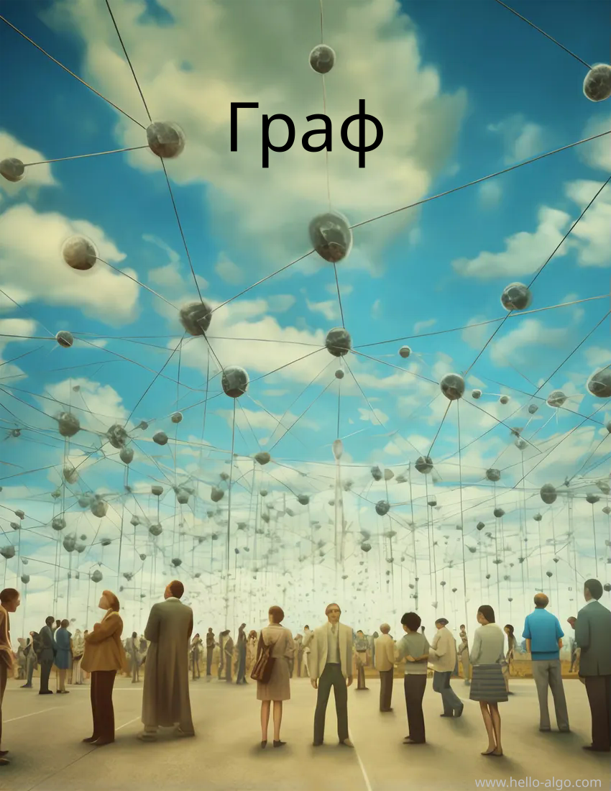

# Глава 9. &nbsp; Графы

{ class="cover-image" }

!!! abstract

    На жизненном пути каждый из нас похож на узел, связанный с другими бесчисленными невидимыми рёбрами.
    
    Каждая встреча и каждое расставание оставляют свой след в этой огромной сети.

## Содержание главы

- [9.1 &nbsp; Граф](graph.md)
- [9.2 &nbsp; Основные операции с графом](graph_operations.md)
- [9.3 &nbsp; Обход графа](graph_traversal.md)
- [9.4 &nbsp; Итоги](summary.md)
- [9.5 &nbsp; Упражнения](exercises.md)
