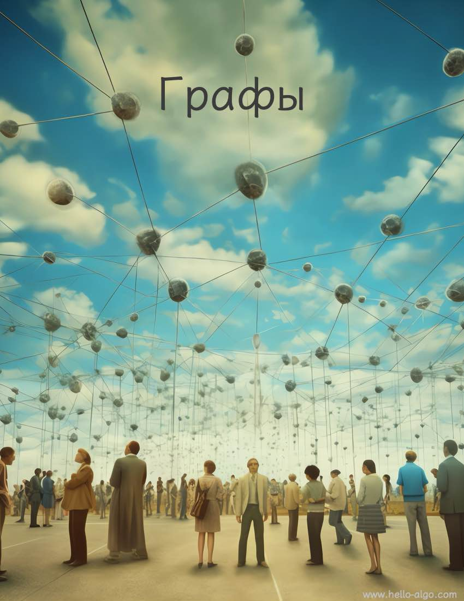

# Графы

!!! abstract

    На жизненном пути каждый из нас похож на узел, связанный с другими бесчисленными невидимыми рёбрами.
    
    Каждая встреча и каждое расставание оставляют свой след в этой огромной сети.
