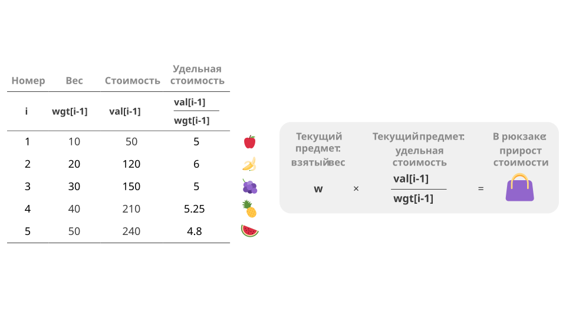
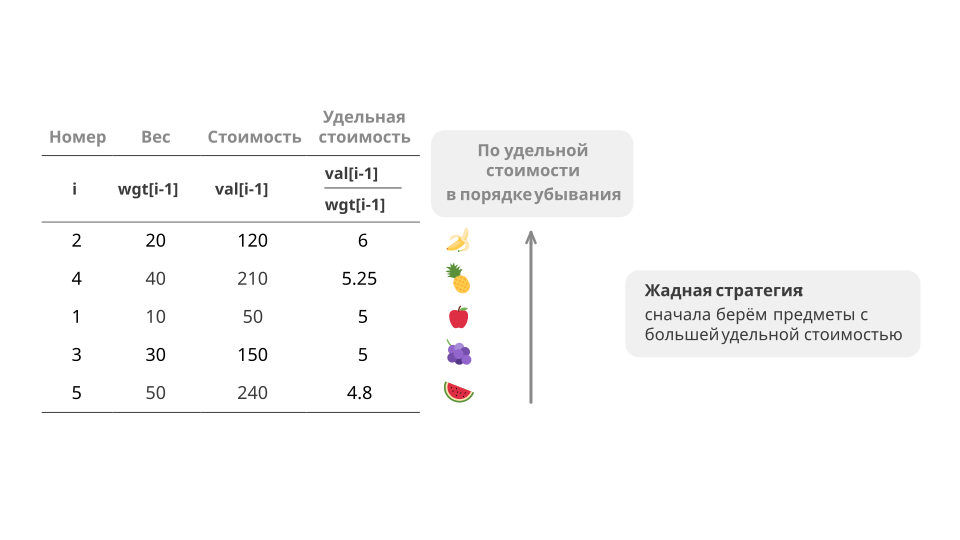
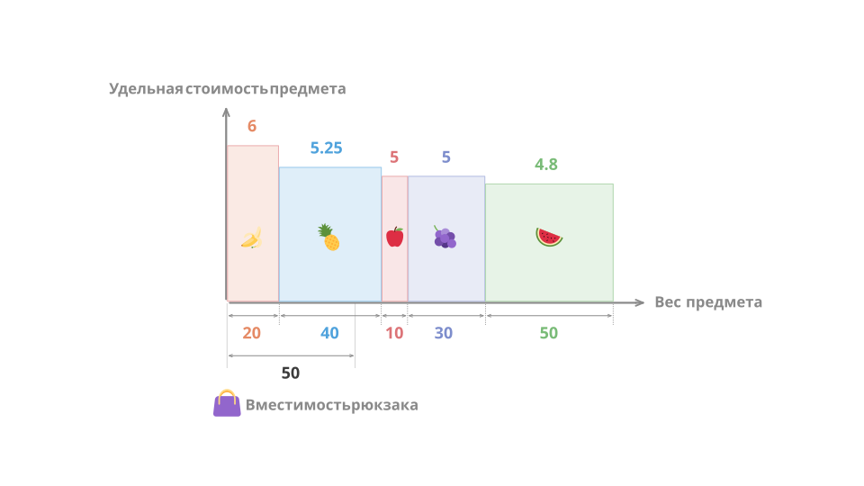

# Задача о дробном рюкзаке

!!! question

    Даны $n$ предметов и рюкзак вместимостью $cap$. Предмет с номером $i$ имеет вес $wgt[i-1]$ и стоимость $val[i-1]$. Каждый предмет можно выбрать только один раз, **но разрешается взять и его часть, стоимость которой пропорциональна доле взятого веса**. Какую максимальную стоимость можно набрать при заданной вместимости рюкзака? Пример приведён на рисунке ниже.


Задача о дробном рюкзаке во многом похожа на задачу о рюкзаке 0–1. Состояние задаётся текущим предметом $i$ и вместимостью $c$. Требуется найти максимальную стоимость при заданной вместимости.

Отличие в том, что здесь можно взять лишь часть предмета. Как показано ниже, **предмет можно разделить в любой пропорции и рассчитать стоимость части по её доле в общем весе**.

1. Для предмета $i$ стоимость единицы веса равна $val[i-1] / wgt[i-1]$. Эту величину называют удельной стоимостью.
2. Если положить в рюкзак часть предмета $i$ весом $w$, стоимость содержимого увеличится на $w \times val[i-1] / wgt[i-1]$.



### Выбор жадной стратегии

Чтобы получить наибольшую суммарную стоимость содержимого рюкзака, **нужно максимизировать стоимость, приходящуюся на единицу веса**. Отсюда следует жадная стратегия, показанная ниже.

1. Отсортируем предметы по убыванию удельной стоимости.
2. Переберём предметы, **на каждом шаге выбирая предмет с наибольшей удельной стоимостью среди оставшихся**.
3. Если свободного места недостаточно, заполним рюкзак частью текущего предмета.



### Реализация

Введём класс предметов `Item`, чтобы их было удобно сортировать по удельной стоимости. В цикле будем повторять жадный выбор, а когда рюкзак заполнится, выйдем из цикла и вернём результат:

```src
[file]{fractional_knapsack}-[class]{}-[func]{fractional_knapsack}
```

Встроенная сортировка обычно имеет временную сложность $O(n \log n)$ и пространственную сложность $O(\log n)$ или $O(n)$ в зависимости от реализации в конкретном языке.

Помимо сортировки, в худшем случае придётся пройти весь список предметов. **Временная сложность этого обхода составляет $O(n)$**, где $n$ — число предметов.

Мы создаём список объектов `Item`, **поэтому пространственная сложность составляет $O(n)$**.

### Доказательство корректности

Применим доказательство от противного. Пусть предмет $x$ имеет наибольшую удельную стоимость. Предположим, что некоторый алгоритм нашёл решение с максимальной стоимостью `res`, но в этом решении нет предмета $x$.

Вынем из рюкзака единицу веса любого предмета и заменим её единицей веса предмета $x$. Поскольку у предмета $x$ наибольшая удельная стоимость, после замены суммарная стоимость обязательно превысит `res`. **Это противоречит оптимальности `res`, а значит, оптимальное решение должно включать предмет $x$**.

Аналогичное противоречие можно получить и для остальных предметов в решении. Итак, **предмет с большей удельной стоимостью всегда выгоднее**. Тем самым обоснована жадная стратегия.

Если, как на рисунке ниже, отложить вес предмета по горизонтальной оси, а удельную стоимость по вертикальной, то задача о дробном рюкзаке сведётся к поиску наибольшей площади над отрезком заданной длины. Эта аналогия помогает геометрически объяснить, почему работает жадная стратегия.


