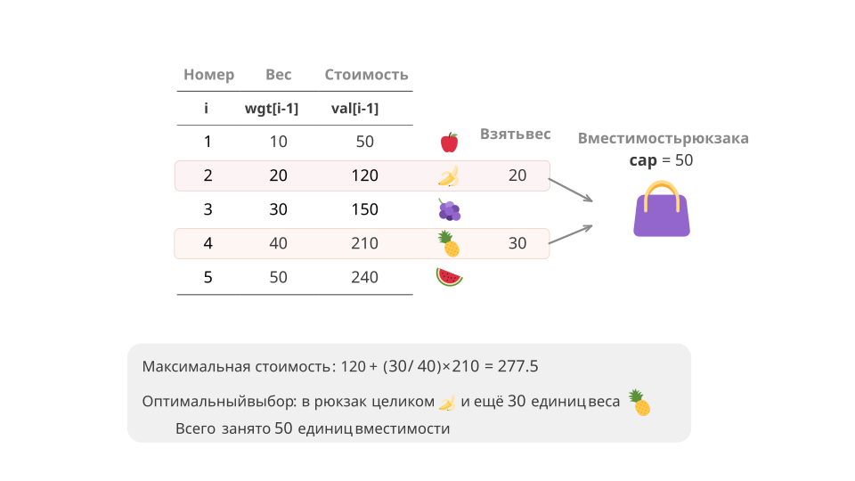

# 15.2 &nbsp; Задача о дробном рюкзаке

!!! question

    Даны $n$ предметов и рюкзак вместимостью $cap$. Предмет с номером $i$ имеет вес $wgt[i-1]$ и стоимость $val[i-1]$. Каждый предмет можно выбрать только один раз, **но разрешается взять и его часть, стоимость которой пропорциональна доле взятого веса**. Какую максимальную стоимость можно набрать при заданной вместимости рюкзака? Пример приведён на рисунке 15-3.

{ class="animation-figure" }

<p align="center"> Рисунок 15-3 &nbsp; Исходные данные примера для дробного рюкзака </p>

Задача о дробном рюкзаке во многом похожа на задачу о рюкзаке 0–1. Состояние задаётся текущим предметом $i$ и вместимостью $c$. Требуется найти максимальную стоимость при заданной вместимости.

Отличие в том, что здесь можно взять лишь часть предмета. Как показано ниже, **предмет можно разделить в любой пропорции и рассчитать стоимость части по её доле в общем весе**.

1. Для предмета $i$ стоимость единицы веса равна $val[i-1] / wgt[i-1]$. Эту величину называют удельной стоимостью.
2. Если положить в рюкзак часть предмета $i$ весом $w$, стоимость содержимого увеличится на $w \times val[i-1] / wgt[i-1]$.

{ class="animation-figure" }

<p align="center"> Рисунок 15-4 &nbsp; Стоимость единицы веса предмета </p>

### 1. &nbsp; Выбор жадной стратегии

Чтобы получить наибольшую суммарную стоимость содержимого рюкзака, **нужно максимизировать стоимость, приходящуюся на единицу веса**. Отсюда следует жадная стратегия, показанная ниже.

1. Отсортируем предметы по убыванию удельной стоимости.
2. Переберём предметы, **на каждом шаге выбирая предмет с наибольшей удельной стоимостью среди оставшихся**.
3. Если свободного места недостаточно, заполним рюкзак частью текущего предмета.

{ class="animation-figure" }

<p align="center"> Рисунок 15-5 &nbsp; Жадная стратегия для задачи о дробном рюкзаке </p>

### 2. &nbsp; Реализация

Введём класс предметов `Item`, чтобы их было удобно сортировать по удельной стоимости. В цикле будем повторять жадный выбор, а когда рюкзак заполнится, выйдем из цикла и вернём результат:

=== "Python"

    ```python title="fractional_knapsack.py"
    class Item:
        """Предмет"""

        def __init__(self, w: int, v: int):
            self.w = w  # Вес предмета
            self.v = v  # Стоимость предмета

    def fractional_knapsack(wgt: list[int], val: list[int], cap: int) -> int:
        """Дробный рюкзак: жадный алгоритм"""
        # Создаём список предметов с двумя свойствами: весом и стоимостью
        items = [Item(w, v) for w, v in zip(wgt, val)]
        # Сортируем по убыванию удельной стоимости item.v / item.w
        items.sort(key=lambda item: item.v / item.w, reverse=True)
        # На каждом шаге делаем жадный выбор
        res = 0
        for item in items:
            if item.w <= cap:
                # Если места достаточно, кладём предмет целиком
                res += item.v
                cap -= item.w
            else:
                # Если места недостаточно, кладём часть предмета
                res += (item.v / item.w) * cap
                # Рюкзак заполнен, выходим из цикла
                break
        return res
    ```

=== "C++"

    ```cpp title="fractional_knapsack.cpp"
    /* Предмет */
    class Item {
      public:
        int w; // Вес предмета
        int v; // Стоимость предмета

        Item(int w, int v) : w(w), v(v) {
        }
    };

    /* Дробный рюкзак: жадный алгоритм */
    double fractionalKnapsack(vector<int> &wgt, vector<int> &val, int cap) {
        // Создаём список предметов с двумя свойствами: весом и стоимостью
        vector<Item> items;
        for (int i = 0; i < wgt.size(); i++) {
            items.push_back(Item(wgt[i], val[i]));
        }
        // Сортируем по убыванию удельной стоимости item.v / item.w
        sort(items.begin(), items.end(), [](Item &a, Item &b) { return (double)a.v / a.w > (double)b.v / b.w; });
        // На каждом шаге делаем жадный выбор
        double res = 0;
        for (auto &item : items) {
            if (item.w <= cap) {
                // Если места достаточно, кладём предмет целиком
                res += item.v;
                cap -= item.w;
            } else {
                // Если места недостаточно, кладём часть предмета
                res += (double)item.v / item.w * cap;
                // Рюкзак заполнен, выходим из цикла
                break;
            }
        }
        return res;
    }
    ```

=== "Java"

    ```java title="fractional_knapsack.java"
    /* Предмет */
    class Item {
        int w; // Вес предмета
        int v; // Стоимость предмета

        public Item(int w, int v) {
            this.w = w;
            this.v = v;
        }
    }

    /* Дробный рюкзак: жадный алгоритм */
    double fractionalKnapsack(int[] wgt, int[] val, int cap) {
        // Создаём список предметов с двумя свойствами: весом и стоимостью
        Item[] items = new Item[wgt.length];
        for (int i = 0; i < wgt.length; i++) {
            items[i] = new Item(wgt[i], val[i]);
        }
        // Сортируем по убыванию удельной стоимости item.v / item.w
        Arrays.sort(items, Comparator.comparingDouble(item -> -((double) item.v / item.w)));
        // На каждом шаге делаем жадный выбор
        double res = 0;
        for (Item item : items) {
            if (item.w <= cap) {
                // Если места достаточно, кладём предмет целиком
                res += item.v;
                cap -= item.w;
            } else {
                // Если места недостаточно, кладём часть предмета
                res += (double) item.v / item.w * cap;
                // Рюкзак заполнен, выходим из цикла
                break;
            }
        }
        return res;
    }
    ```

=== "C#"

    ```csharp title="fractional_knapsack.cs"
    /* Предмет */
    class Item(int w, int v) {
        public int w = w; // Вес предмета
        public int v = v; // Стоимость предмета
    }

    /* Дробный рюкзак: жадный алгоритм */
    double FractionalKnapsack(int[] wgt, int[] val, int cap) {
        // Создаём список предметов с двумя свойствами: весом и стоимостью
        Item[] items = new Item[wgt.Length];
        for (int i = 0; i < wgt.Length; i++) {
            items[i] = new Item(wgt[i], val[i]);
        }
        // Сортируем по убыванию удельной стоимости item.v / item.w
        Array.Sort(items, (x, y) => ((double)y.v / y.w).CompareTo((double)x.v / x.w));
        // На каждом шаге делаем жадный выбор
        double res = 0;
        foreach (Item item in items) {
            if (item.w <= cap) {
                // Если места достаточно, кладём предмет целиком
                res += item.v;
                cap -= item.w;
            } else {
                // Если места недостаточно, кладём часть предмета
                res += (double)item.v / item.w * cap;
                // Рюкзак заполнен, выходим из цикла
                break;
            }
        }
        return res;
    }
    ```

=== "Go"

    ```go title="fractional_knapsack.go"
    /* Предмет */
    type Item struct {
        w int // Вес предмета
        v int // Стоимость предмета
    }

    /* Дробный рюкзак: жадный алгоритм */
    func fractionalKnapsack(wgt []int, val []int, cap int) float64 {
        // Создаём список предметов с двумя свойствами: весом и стоимостью
        items := make([]Item, len(wgt))
        for i := 0; i < len(wgt); i++ {
            items[i] = Item{wgt[i], val[i]}
        }
        // Сортируем по убыванию удельной стоимости item.v / item.w
        sort.Slice(items, func(i, j int) bool {
            return float64(items[i].v)/float64(items[i].w) > float64(items[j].v)/float64(items[j].w)
        })
        // На каждом шаге делаем жадный выбор
        res := 0.0
        for _, item := range items {
            if item.w <= cap {
                // Если места достаточно, кладём предмет целиком
                res += float64(item.v)
                cap -= item.w
            } else {
                // Если места недостаточно, кладём часть предмета
                res += float64(item.v) / float64(item.w) * float64(cap)
                // Рюкзак заполнен, выходим из цикла
                break
            }
        }
        return res
    }
    ```

=== "Swift"

    ```swift title="fractional_knapsack.swift"
    /* Предмет */
    class Item {
        var w: Int // Вес предмета
        var v: Int // Стоимость предмета

        init(w: Int, v: Int) {
            self.w = w
            self.v = v
        }
    }

    /* Дробный рюкзак: жадный алгоритм */
    func fractionalKnapsack(wgt: [Int], val: [Int], cap: Int) -> Double {
        // Создаём список предметов с двумя свойствами: весом и стоимостью
        var items = zip(wgt, val).map { Item(w: $0, v: $1) }
        // Сортируем по убыванию удельной стоимости item.v / item.w
        items.sort { -(Double($0.v) / Double($0.w)) < -(Double($1.v) / Double($1.w)) }
        // На каждом шаге делаем жадный выбор
        var res = 0.0
        var cap = cap
        for item in items {
            if item.w <= cap {
                // Если места достаточно, кладём предмет целиком
                res += Double(item.v)
                cap -= item.w
            } else {
                // Если места недостаточно, кладём часть предмета
                res += Double(item.v) / Double(item.w) * Double(cap)
                // Рюкзак заполнен, выходим из цикла
                break
            }
        }
        return res
    }
    ```

=== "JS"

    ```javascript title="fractional_knapsack.js"
    /* Предмет */
    class Item {
        constructor(w, v) {
            this.w = w; // Вес предмета
            this.v = v; // Стоимость предмета
        }
    }

    /* Дробный рюкзак: жадный алгоритм */
    function fractionalKnapsack(wgt, val, cap) {
        // Создаём список предметов с двумя свойствами: весом и стоимостью
        const items = wgt.map((w, i) => new Item(w, val[i]));
        // Сортируем по убыванию удельной стоимости item.v / item.w
        items.sort((a, b) => b.v / b.w - a.v / a.w);
        // На каждом шаге делаем жадный выбор
        let res = 0;
        for (const item of items) {
            if (item.w <= cap) {
                // Если места достаточно, кладём предмет целиком
                res += item.v;
                cap -= item.w;
            } else {
                // Если места недостаточно, кладём часть предмета
                res += (item.v / item.w) * cap;
                // Рюкзак заполнен, выходим из цикла
                break;
            }
        }
        return res;
    }
    ```

=== "TS"

    ```typescript title="fractional_knapsack.ts"
    /* Предмет */
    class Item {
        w: number; // Вес предмета
        v: number; // Стоимость предмета

        constructor(w: number, v: number) {
            this.w = w;
            this.v = v;
        }
    }

    /* Дробный рюкзак: жадный алгоритм */
    function fractionalKnapsack(wgt: number[], val: number[], cap: number): number {
        // Создаём список предметов с двумя свойствами: весом и стоимостью
        const items: Item[] = wgt.map((w, i) => new Item(w, val[i]));
        // Сортируем по убыванию удельной стоимости item.v / item.w
        items.sort((a, b) => b.v / b.w - a.v / a.w);
        // На каждом шаге делаем жадный выбор
        let res = 0;
        for (const item of items) {
            if (item.w <= cap) {
                // Если места достаточно, кладём предмет целиком
                res += item.v;
                cap -= item.w;
            } else {
                // Если места недостаточно, кладём часть предмета
                res += (item.v / item.w) * cap;
                // Рюкзак заполнен, выходим из цикла
                break;
            }
        }
        return res;
    }
    ```

=== "Dart"

    ```dart title="fractional_knapsack.dart"
    /* Предмет */
    class Item {
      int w; // Вес предмета
      int v; // Стоимость предмета

      Item(this.w, this.v);
    }

    /* Дробный рюкзак: жадный алгоритм */
    double fractionalKnapsack(List<int> wgt, List<int> val, int cap) {
      // Создаём список предметов с двумя свойствами: весом и стоимостью
      List<Item> items = List.generate(wgt.length, (i) => Item(wgt[i], val[i]));
      // Сортируем по убыванию удельной стоимости item.v / item.w
      items.sort((a, b) => (b.v / b.w).compareTo(a.v / a.w));
      // На каждом шаге делаем жадный выбор
      double res = 0;
      for (Item item in items) {
        if (item.w <= cap) {
          // Если места достаточно, кладём предмет целиком
          res += item.v;
          cap -= item.w;
        } else {
          // Если места недостаточно, кладём часть предмета
          res += item.v / item.w * cap;
          // Рюкзак заполнен, выходим из цикла
          break;
        }
      }
      return res;
    }
    ```

=== "Rust"

    ```rust title="fractional_knapsack.rs"
    /* Предмет */
    struct Item {
        w: i32, // Вес предмета
        v: i32, // Стоимость предмета
    }

    impl Item {
        fn new(w: i32, v: i32) -> Self {
            Self { w, v }
        }
    }

    /* Дробный рюкзак: жадный алгоритм */
    fn fractional_knapsack(wgt: &[i32], val: &[i32], mut cap: i32) -> f64 {
        // Создаём список предметов с двумя свойствами: весом и стоимостью
        let mut items = wgt
            .iter()
            .zip(val.iter())
            .map(|(&w, &v)| Item::new(w, v))
            .collect::<Vec<Item>>();
        // Сортируем по убыванию удельной стоимости item.v / item.w
        items.sort_by(|a, b| {
            (b.v as f64 / b.w as f64)
                .partial_cmp(&(a.v as f64 / a.w as f64))
                .unwrap()
        });
        // На каждом шаге делаем жадный выбор
        let mut res = 0.0;
        for item in &items {
            if item.w <= cap {
                // Если места достаточно, кладём предмет целиком
                res += item.v as f64;
                cap -= item.w;
            } else {
                // Если места недостаточно, кладём часть предмета
                res += item.v as f64 / item.w as f64 * cap as f64;
                // Рюкзак заполнен, выходим из цикла
                break;
            }
        }
        res
    }
    ```

=== "C"

    ```c title="fractional_knapsack.c"
    /* Предмет */
    typedef struct {
        int w; // Вес предмета
        int v; // Стоимость предмета
    } Item;

    /* Дробный рюкзак: жадный алгоритм */
    float fractionalKnapsack(int wgt[], int val[], int itemCount, int cap) {
        // Создаём список предметов с двумя свойствами: весом и стоимостью
        Item *items = malloc(sizeof(Item) * itemCount);
        for (int i = 0; i < itemCount; i++) {
            items[i] = (Item){.w = wgt[i], .v = val[i]};
        }
        // Сортируем по убыванию удельной стоимости item.v / item.w
        qsort(items, (size_t)itemCount, sizeof(Item), sortByValueDensity);
        // На каждом шаге делаем жадный выбор
        float res = 0.0;
        for (int i = 0; i < itemCount; i++) {
            if (items[i].w <= cap) {
                // Если места достаточно, кладём предмет целиком
                res += items[i].v;
                cap -= items[i].w;
            } else {
                // Если места недостаточно, кладём часть предмета
                res += (float)cap / items[i].w * items[i].v;
                cap = 0;
                break;
            }
        }
        free(items);
        return res;
    }
    ```

=== "Kotlin"

    ```kotlin title="fractional_knapsack.kt"
    /* Предмет */
    class Item(
        val w: Int, // Вес предмета
        val v: Int  // Стоимость предмета
    )

    /* Дробный рюкзак: жадный алгоритм */
    fun fractionalKnapsack(wgt: IntArray, _val: IntArray, c: Int): Double {
        // Создаём список предметов с двумя свойствами: весом и стоимостью
        var cap = c
        val items = arrayOfNulls<Item>(wgt.size)
        for (i in wgt.indices) {
            items[i] = Item(wgt[i], _val[i])
        }
        // Сортируем по убыванию удельной стоимости item.v / item.w
        items.sortBy { item: Item? -> -(item!!.v.toDouble() / item.w) }
        // На каждом шаге делаем жадный выбор
        var res = 0.0
        for (item in items) {
            if (item!!.w <= cap) {
                // Если места достаточно, кладём предмет целиком
                res += item.v
                cap -= item.w
            } else {
                // Если места недостаточно, кладём часть предмета
                res += item.v.toDouble() / item.w * cap
                // Рюкзак заполнен, выходим из цикла
                break
            }
        }
        return res
    }
    ```

=== "Ruby"

    ```ruby title="fractional_knapsack.rb"
    ### Предмет ###
    class Item
      attr_accessor :w # Вес предмета
      attr_accessor :v # Стоимость предмета

      def initialize(w, v)
        @w = w
        @v = v
      end
    end

    ### Дробный рюкзак: жадный алгоритм ###
    def fractional_knapsack(wgt, val, cap)
      # Создаём список предметов с двумя свойствами: весом и стоимостью
      items = wgt.each_with_index.map { |w, i| Item.new(w, val[i]) }
      # Сортируем по убыванию удельной стоимости item.v / item.w
      items.sort! { |a, b| (b.v.to_f / b.w) <=> (a.v.to_f / a.w) }
      # На каждом шаге делаем жадный выбор
      res = 0
      for item in items
        if item.w <= cap
          # Если места достаточно, кладём предмет целиком
          res += item.v
          cap -= item.w
        else
          # Если места недостаточно, кладём часть предмета
          res += (item.v.to_f / item.w) * cap
          # Рюкзак заполнен, выходим из цикла
          break
        end
      end
      res
    end
    ```

??? pythontutor "Визуализация выполнения"

    <div style="height: 549px; width: 100%;"><iframe class="pythontutor-iframe" title="Визуализация выполнения" src="https://pythontutor.com/iframe-embed.html#code=class%20Item%3A%0A%20%20%20%20%22%22%22%D0%9F%D1%80%D0%B5%D0%B4%D0%BC%D0%B5%D1%82%22%22%22%0A%20%20%20%20def%20__init__%28self,%20w%3A%20int,%20v%3A%20int%29%3A%0A%20%20%20%20%20%20%20%20self.w%20%3D%20w%20%20%23%20%D0%92%D0%B5%D1%81%20%D0%BF%D1%80%D0%B5%D0%B4%D0%BC%D0%B5%D1%82%D0%B0%0A%20%20%20%20%20%20%20%20self.v%20%3D%20v%20%20%23%20%D0%A1%D1%82%D0%BE%D0%B8%D0%BC%D0%BE%D1%81%D1%82%D1%8C%20%D0%BF%D1%80%D0%B5%D0%B4%D0%BC%D0%B5%D1%82%D0%B0%0A%0Adef%20fractional_knapsack%28wgt%3A%20list%5Bint%5D,%20val%3A%20list%5Bint%5D,%20cap%3A%20int%29%20-%3E%20int%3A%0A%20%20%20%20%22%22%22%D0%94%D1%80%D0%BE%D0%B1%D0%BD%D1%8B%D0%B9%20%D1%80%D1%8E%D0%BA%D0%B7%D0%B0%D0%BA%3A%20%D0%B6%D0%B0%D0%B4%D0%BD%D1%8B%D0%B9%20%D0%B0%D0%BB%D0%B3%D0%BE%D1%80%D0%B8%D1%82%D0%BC%22%22%22%0A%20%20%20%20%23%20%D0%A1%D0%BE%D0%B7%D0%B4%D0%B0%D1%91%D0%BC%20%D1%81%D0%BF%D0%B8%D1%81%D0%BE%D0%BA%20%D0%BF%D1%80%D0%B5%D0%B4%D0%BC%D0%B5%D1%82%D0%BE%D0%B2%20%D1%81%20%D0%B4%D0%B2%D1%83%D0%BC%D1%8F%20%D1%81%D0%B2%D0%BE%D0%B9%D1%81%D1%82%D0%B2%D0%B0%D0%BC%D0%B8%3A%20%D0%B2%D0%B5%D1%81%D0%BE%D0%BC%20%D0%B8%20%D1%81%D1%82%D0%BE%D0%B8%D0%BC%D0%BE%D1%81%D1%82%D1%8C%D1%8E%0A%20%20%20%20items%20%3D%20%5BItem%28w,%20v%29%20for%20w,%20v%20in%20zip%28wgt,%20val%29%5D%0A%20%20%20%20%23%20%D0%A1%D0%BE%D1%80%D1%82%D0%B8%D1%80%D1%83%D0%B5%D0%BC%20%D0%BF%D0%BE%20%D1%83%D0%B1%D1%8B%D0%B2%D0%B0%D0%BD%D0%B8%D1%8E%20%D1%83%D0%B4%D0%B5%D0%BB%D1%8C%D0%BD%D0%BE%D0%B9%20%D1%81%D1%82%D0%BE%D0%B8%D0%BC%D0%BE%D1%81%D1%82%D0%B8%20item.v%20/%20item.w%0A%20%20%20%20items.sort%28key%3Dlambda%20item%3A%20item.v%20/%20item.w,%20reverse%3DTrue%29%0A%20%20%20%20%23%20%D0%9D%D0%B0%20%D0%BA%D0%B0%D0%B6%D0%B4%D0%BE%D0%BC%20%D1%88%D0%B0%D0%B3%D0%B5%20%D0%B4%D0%B5%D0%BB%D0%B0%D0%B5%D0%BC%20%D0%B6%D0%B0%D0%B4%D0%BD%D1%8B%D0%B9%20%D0%B2%D1%8B%D0%B1%D0%BE%D1%80%0A%20%20%20%20res%20%3D%200%0A%20%20%20%20for%20item%20in%20items%3A%0A%20%20%20%20%20%20%20%20if%20item.w%20%3C%3D%20cap%3A%0A%20%20%20%20%20%20%20%20%20%20%20%20%23%20%D0%95%D1%81%D0%BB%D0%B8%20%D0%BC%D0%B5%D1%81%D1%82%D0%B0%20%D0%B4%D0%BE%D1%81%D1%82%D0%B0%D1%82%D0%BE%D1%87%D0%BD%D0%BE,%20%D0%BA%D0%BB%D0%B0%D0%B4%D1%91%D0%BC%20%D0%BF%D1%80%D0%B5%D0%B4%D0%BC%D0%B5%D1%82%20%D1%86%D0%B5%D0%BB%D0%B8%D0%BA%D0%BE%D0%BC%0A%20%20%20%20%20%20%20%20%20%20%20%20res%20%2B%3D%20item.v%0A%20%20%20%20%20%20%20%20%20%20%20%20cap%20-%3D%20item.w%0A%20%20%20%20%20%20%20%20else%3A%0A%20%20%20%20%20%20%20%20%20%20%20%20%23%20%D0%95%D1%81%D0%BB%D0%B8%20%D0%BC%D0%B5%D1%81%D1%82%D0%B0%20%D0%BD%D0%B5%D0%B4%D0%BE%D1%81%D1%82%D0%B0%D1%82%D0%BE%D1%87%D0%BD%D0%BE,%20%D0%BA%D0%BB%D0%B0%D0%B4%D1%91%D0%BC%20%D1%87%D0%B0%D1%81%D1%82%D1%8C%20%D0%BF%D1%80%D0%B5%D0%B4%D0%BC%D0%B5%D1%82%D0%B0%0A%20%20%20%20%20%20%20%20%20%20%20%20res%20%2B%3D%20%28item.v%20/%20item.w%29%20%2A%20cap%0A%20%20%20%20%20%20%20%20%20%20%20%20%23%20%D0%A0%D1%8E%D0%BA%D0%B7%D0%B0%D0%BA%20%D0%B7%D0%B0%D0%BF%D0%BE%D0%BB%D0%BD%D0%B5%D0%BD,%20%D0%B2%D1%8B%D1%85%D0%BE%D0%B4%D0%B8%D0%BC%20%D0%B8%D0%B7%20%D1%86%D0%B8%D0%BA%D0%BB%D0%B0%0A%20%20%20%20%20%20%20%20%20%20%20%20break%0A%20%20%20%20return%20res%0A%0A%22%22%22Driver%20Code%22%22%22%0Aif%20__name__%20%3D%3D%20%22__main__%22%3A%0A%20%20%20%20wgt%20%3D%20%5B10,%2020,%2030,%2040,%2050%5D%0A%20%20%20%20val%20%3D%20%5B50,%20120,%20150,%20210,%20240%5D%0A%20%20%20%20cap%20%3D%2050%0A%20%20%20%20n%20%3D%20len%28wgt%29%0A%0A%20%20%20%20%23%20%D0%96%D0%B0%D0%B4%D0%BD%D1%8B%D0%B9%20%D0%B0%D0%BB%D0%B3%D0%BE%D1%80%D0%B8%D1%82%D0%BC%0A%20%20%20%20res%20%3D%20fractional_knapsack%28wgt,%20val,%20cap%29%0A%20%20%20%20print%28f%22%D0%9C%D0%B0%D0%BA%D1%81%D0%B8%D0%BC%D0%B0%D0%BB%D1%8C%D0%BD%D0%B0%D1%8F%20%D1%81%D1%82%D0%BE%D0%B8%D0%BC%D0%BE%D1%81%D1%82%D1%8C%20%D0%BF%D1%80%D0%B8%20%D0%B7%D0%B0%D0%B4%D0%B0%D0%BD%D0%BD%D0%BE%D0%B9%20%D0%B2%D0%BC%D0%B5%D1%81%D1%82%D0%B8%D0%BC%D0%BE%D1%81%D1%82%D0%B8%20%D1%80%D1%8E%D0%BA%D0%B7%D0%B0%D0%BA%D0%B0%3A%20%7Bres%7D%22%29&codeDivHeight=472&codeDivWidth=350&cumulative=false&curInstr=8&heapPrimitives=nevernest&origin=opt-frontend.js&py=311&rawInputLstJSON=%5B%5D&textReferences=false"> </iframe></div>
    <div style="margin-top: 5px;"><a href="https://pythontutor.com/iframe-embed.html#code=class%20Item%3A%0A%20%20%20%20%22%22%22%D0%9F%D1%80%D0%B5%D0%B4%D0%BC%D0%B5%D1%82%22%22%22%0A%20%20%20%20def%20__init__%28self,%20w%3A%20int,%20v%3A%20int%29%3A%0A%20%20%20%20%20%20%20%20self.w%20%3D%20w%20%20%23%20%D0%92%D0%B5%D1%81%20%D0%BF%D1%80%D0%B5%D0%B4%D0%BC%D0%B5%D1%82%D0%B0%0A%20%20%20%20%20%20%20%20self.v%20%3D%20v%20%20%23%20%D0%A1%D1%82%D0%BE%D0%B8%D0%BC%D0%BE%D1%81%D1%82%D1%8C%20%D0%BF%D1%80%D0%B5%D0%B4%D0%BC%D0%B5%D1%82%D0%B0%0A%0Adef%20fractional_knapsack%28wgt%3A%20list%5Bint%5D,%20val%3A%20list%5Bint%5D,%20cap%3A%20int%29%20-%3E%20int%3A%0A%20%20%20%20%22%22%22%D0%94%D1%80%D0%BE%D0%B1%D0%BD%D1%8B%D0%B9%20%D1%80%D1%8E%D0%BA%D0%B7%D0%B0%D0%BA%3A%20%D0%B6%D0%B0%D0%B4%D0%BD%D1%8B%D0%B9%20%D0%B0%D0%BB%D0%B3%D0%BE%D1%80%D0%B8%D1%82%D0%BC%22%22%22%0A%20%20%20%20%23%20%D0%A1%D0%BE%D0%B7%D0%B4%D0%B0%D1%91%D0%BC%20%D1%81%D0%BF%D0%B8%D1%81%D0%BE%D0%BA%20%D0%BF%D1%80%D0%B5%D0%B4%D0%BC%D0%B5%D1%82%D0%BE%D0%B2%20%D1%81%20%D0%B4%D0%B2%D1%83%D0%BC%D1%8F%20%D1%81%D0%B2%D0%BE%D0%B9%D1%81%D1%82%D0%B2%D0%B0%D0%BC%D0%B8%3A%20%D0%B2%D0%B5%D1%81%D0%BE%D0%BC%20%D0%B8%20%D1%81%D1%82%D0%BE%D0%B8%D0%BC%D0%BE%D1%81%D1%82%D1%8C%D1%8E%0A%20%20%20%20items%20%3D%20%5BItem%28w,%20v%29%20for%20w,%20v%20in%20zip%28wgt,%20val%29%5D%0A%20%20%20%20%23%20%D0%A1%D0%BE%D1%80%D1%82%D0%B8%D1%80%D1%83%D0%B5%D0%BC%20%D0%BF%D0%BE%20%D1%83%D0%B1%D1%8B%D0%B2%D0%B0%D0%BD%D0%B8%D1%8E%20%D1%83%D0%B4%D0%B5%D0%BB%D1%8C%D0%BD%D0%BE%D0%B9%20%D1%81%D1%82%D0%BE%D0%B8%D0%BC%D0%BE%D1%81%D1%82%D0%B8%20item.v%20/%20item.w%0A%20%20%20%20items.sort%28key%3Dlambda%20item%3A%20item.v%20/%20item.w,%20reverse%3DTrue%29%0A%20%20%20%20%23%20%D0%9D%D0%B0%20%D0%BA%D0%B0%D0%B6%D0%B4%D0%BE%D0%BC%20%D1%88%D0%B0%D0%B3%D0%B5%20%D0%B4%D0%B5%D0%BB%D0%B0%D0%B5%D0%BC%20%D0%B6%D0%B0%D0%B4%D0%BD%D1%8B%D0%B9%20%D0%B2%D1%8B%D0%B1%D0%BE%D1%80%0A%20%20%20%20res%20%3D%200%0A%20%20%20%20for%20item%20in%20items%3A%0A%20%20%20%20%20%20%20%20if%20item.w%20%3C%3D%20cap%3A%0A%20%20%20%20%20%20%20%20%20%20%20%20%23%20%D0%95%D1%81%D0%BB%D0%B8%20%D0%BC%D0%B5%D1%81%D1%82%D0%B0%20%D0%B4%D0%BE%D1%81%D1%82%D0%B0%D1%82%D0%BE%D1%87%D0%BD%D0%BE,%20%D0%BA%D0%BB%D0%B0%D0%B4%D1%91%D0%BC%20%D0%BF%D1%80%D0%B5%D0%B4%D0%BC%D0%B5%D1%82%20%D1%86%D0%B5%D0%BB%D0%B8%D0%BA%D0%BE%D0%BC%0A%20%20%20%20%20%20%20%20%20%20%20%20res%20%2B%3D%20item.v%0A%20%20%20%20%20%20%20%20%20%20%20%20cap%20-%3D%20item.w%0A%20%20%20%20%20%20%20%20else%3A%0A%20%20%20%20%20%20%20%20%20%20%20%20%23%20%D0%95%D1%81%D0%BB%D0%B8%20%D0%BC%D0%B5%D1%81%D1%82%D0%B0%20%D0%BD%D0%B5%D0%B4%D0%BE%D1%81%D1%82%D0%B0%D1%82%D0%BE%D1%87%D0%BD%D0%BE,%20%D0%BA%D0%BB%D0%B0%D0%B4%D1%91%D0%BC%20%D1%87%D0%B0%D1%81%D1%82%D1%8C%20%D0%BF%D1%80%D0%B5%D0%B4%D0%BC%D0%B5%D1%82%D0%B0%0A%20%20%20%20%20%20%20%20%20%20%20%20res%20%2B%3D%20%28item.v%20/%20item.w%29%20%2A%20cap%0A%20%20%20%20%20%20%20%20%20%20%20%20%23%20%D0%A0%D1%8E%D0%BA%D0%B7%D0%B0%D0%BA%20%D0%B7%D0%B0%D0%BF%D0%BE%D0%BB%D0%BD%D0%B5%D0%BD,%20%D0%B2%D1%8B%D1%85%D0%BE%D0%B4%D0%B8%D0%BC%20%D0%B8%D0%B7%20%D1%86%D0%B8%D0%BA%D0%BB%D0%B0%0A%20%20%20%20%20%20%20%20%20%20%20%20break%0A%20%20%20%20return%20res%0A%0A%22%22%22Driver%20Code%22%22%22%0Aif%20__name__%20%3D%3D%20%22__main__%22%3A%0A%20%20%20%20wgt%20%3D%20%5B10,%2020,%2030,%2040,%2050%5D%0A%20%20%20%20val%20%3D%20%5B50,%20120,%20150,%20210,%20240%5D%0A%20%20%20%20cap%20%3D%2050%0A%20%20%20%20n%20%3D%20len%28wgt%29%0A%0A%20%20%20%20%23%20%D0%96%D0%B0%D0%B4%D0%BD%D1%8B%D0%B9%20%D0%B0%D0%BB%D0%B3%D0%BE%D1%80%D0%B8%D1%82%D0%BC%0A%20%20%20%20res%20%3D%20fractional_knapsack%28wgt,%20val,%20cap%29%0A%20%20%20%20print%28f%22%D0%9C%D0%B0%D0%BA%D1%81%D0%B8%D0%BC%D0%B0%D0%BB%D1%8C%D0%BD%D0%B0%D1%8F%20%D1%81%D1%82%D0%BE%D0%B8%D0%BC%D0%BE%D1%81%D1%82%D1%8C%20%D0%BF%D1%80%D0%B8%20%D0%B7%D0%B0%D0%B4%D0%B0%D0%BD%D0%BD%D0%BE%D0%B9%20%D0%B2%D0%BC%D0%B5%D1%81%D1%82%D0%B8%D0%BC%D0%BE%D1%81%D1%82%D0%B8%20%D1%80%D1%8E%D0%BA%D0%B7%D0%B0%D0%BA%D0%B0%3A%20%7Bres%7D%22%29&codeDivHeight=800&codeDivWidth=600&cumulative=false&curInstr=8&heapPrimitives=nevernest&origin=opt-frontend.js&py=311&rawInputLstJSON=%5B%5D&textReferences=false" target="_blank" rel="noopener noreferrer">Во весь экран ></a></div>

Встроенная сортировка обычно имеет временную сложность $O(n \log n)$ и пространственную сложность $O(\log n)$ или $O(n)$ в зависимости от реализации в конкретном языке.

Помимо сортировки, в худшем случае придётся пройти весь список предметов. **Временная сложность этого обхода составляет $O(n)$**, где $n$ — число предметов.

Мы создаём список объектов `Item`, **поэтому пространственная сложность составляет $O(n)$**.

### 3. &nbsp; Доказательство корректности

Применим доказательство от противного. Пусть предмет $x$ имеет наибольшую удельную стоимость. Предположим, что некоторый алгоритм нашёл решение с максимальной стоимостью `res`, но в этом решении нет предмета $x$.

Вынем из рюкзака единицу веса любого предмета и заменим её единицей веса предмета $x$. Поскольку у предмета $x$ наибольшая удельная стоимость, после замены суммарная стоимость обязательно превысит `res`. **Это противоречит оптимальности `res`, а значит, оптимальное решение должно включать предмет $x$**.

Аналогичное противоречие можно получить и для остальных предметов в решении. Итак, **предмет с большей удельной стоимостью всегда выгоднее**. Тем самым обоснована жадная стратегия.

Если, как на рисунке 15-6, отложить вес предмета по горизонтальной оси, а удельную стоимость по вертикальной, то задача о дробном рюкзаке сведётся к поиску наибольшей площади над отрезком заданной длины. Эта аналогия помогает геометрически объяснить, почему работает жадная стратегия.

{ class="animation-figure" }

<p align="center"> Рисунок 15-6 &nbsp; Геометрическое представление задачи о дробном рюкзаке </p>
