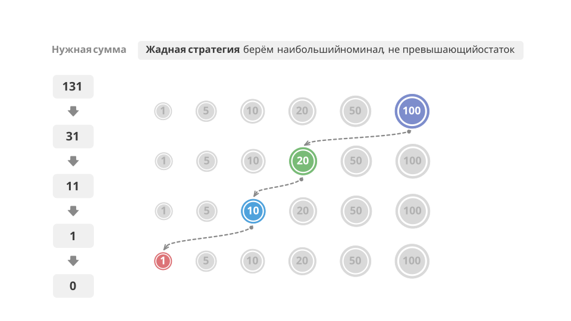

# Жадный алгоритм

<u>Жадный алгоритм (greedy algorithm)</u> — распространённый метод решения задач оптимизации. На каждом шаге он выбирает вариант, который выглядит наилучшим в данный момент. Так алгоритм принимает локально оптимальные решения в расчёте на глобальный оптимум. Жадные алгоритмы просты и эффективны, поэтому широко применяются на практике.

Для решения задач оптимизации часто используют и жадные алгоритмы, и динамическое программирование. У них есть общие черты: например, оба подхода опираются на оптимальную подструктуру. Однако работают они по-разному.

- В динамическом программировании выбор на текущем этапе учитывает все варианты решений на предыдущих этапах. Решение текущей подзадачи строится из решений предыдущих подзадач.
- Жадный алгоритм не пересматривает прошлые решения. На каждом шаге он делает очередной жадный выбор и уменьшает оставшуюся задачу, пока не решит её целиком.

Посмотрим, как работает жадный алгоритм, на примере задачи о размене монет. Мы уже встречались с ней в разделе «Задача о неограниченном рюкзаке».

!!! question

    Даны монеты $n$ номиналов. Номинал монеты вида $i$ равен $coins[i - 1]$. Нужно набрать сумму $amt$ наименьшим числом монет. Монеты каждого вида можно брать многократно. Если набрать сумму невозможно, верните $-1$.

Жадная стратегия для этой задачи показана ниже. Чтобы набрать заданную сумму, **выбираем монету с номиналом, ближайшим к оставшейся сумме и не превышающим её**. Повторяем этот шаг, пока не наберём всю сумму.



Реализуем этот алгоритм:

```src
[file]{coin_change_greedy}-[class]{}-[func]{coin_change_greedy}
```

Как коротко получилось! Жадный алгоритм решает задачу о размене примерно за десять строк кода.

## Достоинства и ограничения жадных алгоритмов

**Жадные алгоритмы понятны, просты в реализации и обычно весьма эффективны**. Обозначим наименьший номинал через $\min(coins)$. В приведённом коде жадный выбор повторяется не более $amt / \min(coins)$ раз, поэтому временная сложность равна $O(amt / \min(coins))$. Это на порядок меньше, чем $O(n \times amt)$ у решения методом динамического программирования.

Однако **при некоторых наборах номиналов жадный алгоритм не находит оптимального решения**. На рисунке ниже приведены два примера.

- **Положительный пример: $coins = [1, 5, 10, 20, 50, 100]$**. Для этого набора монет жадный алгоритм находит оптимальное решение при любой сумме $amt$.
- **Контрпример: $coins = [1, 20, 50]$**. Пусть $amt = 60$. Жадный алгоритм находит размен $50 + 1 \times 10$. Число монет равно $11$. Динамическое программирование находит оптимальный размен $20 + 20 + 20$ и сокращает число монет до $3$.
- **Контрпример: $coins = [1, 49, 50]$**. Пусть $amt = 98$. Жадный алгоритм находит размен $50 + 1 \times 48$. Число монет равно $49$. Динамическое программирование находит оптимальный размен $49 + 49$ и сокращает число монет до $2$.


Таким образом, в задаче о размене жадный алгоритм не гарантирует глобального оптимума и иногда даёт результат, далёкий от него. Для этой задачи лучше подходит динамическое программирование.

Обычно жадные алгоритмы применяют в двух случаях.

1. **Оптимальное решение гарантировано**. В этом случае жадный алгоритм часто оказывается лучшим выбором, поскольку обычно эффективнее поиска с возвратом и динамического программирования.
2. **Можно найти решение, близкое к оптимальному**. Здесь тоже пригоден жадный алгоритм. Во многих сложных задачах очень трудно найти глобальный оптимум, и возможность быстро получить достаточно хорошее решение уже ценна.

## Свойства задач, решаемых жадным алгоритмом

Для каких задач подходит жадный алгоритм? Иначе говоря, когда он гарантированно находит оптимальное решение?

У жадных алгоритмов условия применимости строже, чем у динамического программирования. Особенно важны два свойства задачи.

- **Свойство жадного выбора**. Жадный алгоритм гарантирует оптимум только тогда, когда локально оптимальный выбор на каждом шаге позволяет прийти к глобально оптимальному решению.
- **Оптимальная подструктура**. Оптимальное решение исходной задачи содержит оптимальные решения подзадач.

Оптимальную подструктуру мы уже рассмотрели в главе о динамическом программировании. Заметим лишь, что в некоторых задачах она неочевидна, хотя их всё же можно решить жадным алгоритмом.

Посмотрим, как установить свойство жадного выбора. Его легко сформулировать, **однако для многих задач доказать это свойство непросто**.

Например, в задаче о размене легко привести контрпример и опровергнуть свойство жадного выбора для конкретного набора номиналов. Доказать его труднее. **Каким условиям должен удовлетворять набор номиналов, чтобы задачу можно было решить жадным алгоритмом**? Интуиция и примеры часто дают лишь расплывчатый ответ, а строгое математическое доказательство построить нелегко.

!!! quote

    В одной из научных работ предложен алгоритм с временной сложностью $O(n^3)$. Он определяет, найдёт ли жадный алгоритм для данного набора номиналов оптимальный размен любой суммы.

    Pearson, D. A polynomial-time algorithm for the change-making problem[J]. Operations Research Letters, 2005, 33(3): 231-234.

## Как решить задачу жадным алгоритмом

Решение задачи жадным алгоритмом обычно состоит из трёх шагов.

1. **Анализ задачи**. Разберитесь в её особенностях: как задать состояние, что нужно оптимизировать и какие действуют ограничения. Этот шаг знаком нам по поиску с возвратом и динамическому программированию.
2. **Выбор жадной стратегии**. Определите, как делать жадный выбор на каждом шаге. Стратегия должна уменьшать задачу с каждым шагом и в итоге привести к её решению.
3. **Доказательство корректности**. Обычно нужно доказать, что задача обладает свойством жадного выбора и оптимальной подструктурой. Здесь могут пригодиться, например, математическая индукция или доказательство от противного.

Выбор жадной стратегии — центральный этап решения. На практике возникают две основные трудности.

- **Для разных задач жадные стратегии могут существенно различаться**. Во многих задачах стратегия лежит на поверхности: достаточно немного порассуждать и попробовать несколько вариантов. В сложной задаче удачная стратегия может быть совсем неочевидной. Тогда многое зависит от опыта решения задач и умения работать с алгоритмами.
- **Некоторые жадные стратегии обманчивы**. Можно уверенно выбрать стратегию, написать и запустить программу, а затем обнаружить, что часть тестов не проходит. Такая стратегия верна лишь для некоторых входных данных. Задача о размене монет — характерный пример.

Чтобы убедиться в корректности жадной стратегии, нужно дать строгое математическое доказательство. **Обычно для этого используют доказательство от противного или математическую индукцию**.

Само доказательство тоже бывает непростым. Если пока неясно, с чего начать, обычно отлаживают код на тестовых примерах, шаг за шагом уточняя и проверяя жадную стратегию.

## Типичные задачи на жадные алгоритмы

Жадные алгоритмы часто применяют в задачах оптимизации со свойством жадного выбора и оптимальной подструктурой. Вот несколько типичных примеров.

- **Размен монет**. При некоторых наборах номиналов жадный алгоритм всегда даёт оптимальный результат.
- **Выбор непересекающихся интервалов**. Пусть для каждой работы задан интервал времени, а выполнить требуется как можно больше работ. Если каждый раз выбирать из доступных работу, которая заканчивается раньше всех, жадный алгоритм найдёт оптимальное расписание.
- **Дробный рюкзак**. Даны предметы и предельный вес груза. Требуется выбрать груз наибольшей суммарной стоимости, не превышая этот вес. В ряде случаев жадный алгоритм находит оптимальное решение, если каждый раз выбирать предмет с наибольшим отношением стоимости к весу.
- **Покупка и продажа акций**. Известны цены акции за некоторый период. Покупать и продавать её можно многократно, но после покупки нужно продать акцию, прежде чем покупать снова. Цель — получить максимальную прибыль.
- **Кодирование Хаффмана**. Это жадный алгоритм сжатия данных без потерь. При построении дерева Хаффмана на каждом шаге объединяют два узла с наименьшими частотами. Полученное дерево имеет минимальную взвешенную длину путей, а значит, и минимальную длину закодированного сообщения.
- **Алгоритм Дейкстры**. Этот жадный алгоритм находит кратчайшие пути от заданной начальной вершины до всех остальных вершин графа, если веса всех рёбер неотрицательны.
