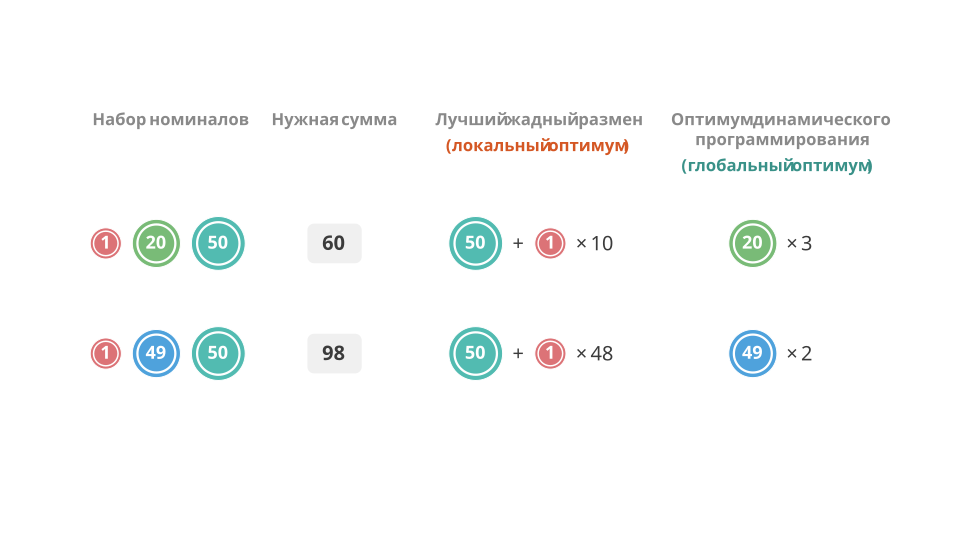

# 15.1 &nbsp; Жадный алгоритм

<u>Жадный алгоритм (greedy algorithm)</u> — распространённый метод решения задач оптимизации. На каждом шаге он выбирает вариант, который выглядит наилучшим в данный момент. Так алгоритм принимает локально оптимальные решения в расчёте на глобальный оптимум. Жадные алгоритмы просты и эффективны, поэтому широко применяются на практике.

Для решения задач оптимизации часто используют и жадные алгоритмы, и динамическое программирование. У них есть общие черты: например, оба подхода опираются на оптимальную подструктуру. Однако работают они по-разному.

- В динамическом программировании выбор на текущем этапе учитывает все варианты решений на предыдущих этапах. Решение текущей подзадачи строится из решений предыдущих подзадач.
- Жадный алгоритм не пересматривает прошлые решения. На каждом шаге он делает очередной жадный выбор и уменьшает оставшуюся задачу, пока не решит её целиком.

Посмотрим, как работает жадный алгоритм, на примере задачи о размене монет. Мы уже встречались с ней в разделе «Задача о неограниченном рюкзаке».

!!! question

    Даны монеты $n$ номиналов. Номинал монеты вида $i$ равен $coins[i - 1]$. Нужно набрать сумму $amt$ наименьшим числом монет. Монеты каждого вида можно брать многократно. Если набрать сумму невозможно, верните $-1$.

Жадная стратегия для этой задачи показана ниже. Чтобы набрать заданную сумму, **выбираем монету с номиналом, ближайшим к оставшейся сумме и не превышающим её**. Повторяем этот шаг, пока не наберём всю сумму.

{ class="animation-figure" }

<p align="center"> Рисунок 15-1 &nbsp; Жадная стратегия размена монет </p>

Реализуем этот алгоритм:

=== "Python"

    ```python title="coin_change_greedy.py"
    def coin_change_greedy(coins: list[int], amt: int) -> int:
        """Размен монет: жадный алгоритм"""
        # Список coins предполагается отсортированным
        i = len(coins) - 1
        count = 0
        # Повторяем жадный выбор, пока остаток суммы не обнулится
        while amt > 0:
            # Ищем наибольший номинал, не превышающий остаток
            while i > 0 and coins[i] > amt:
                i -= 1
            # Берём coins[i]
            amt -= coins[i]
            count += 1
        # Если решения не нашлось, возвращаем -1
        return count if amt == 0 else -1
    ```

=== "C++"

    ```cpp title="coin_change_greedy.cpp"
    /* Размен монет: жадный алгоритм */
    int coinChangeGreedy(vector<int> &coins, int amt) {
        // Список coins предполагается отсортированным
        int i = coins.size() - 1;
        int count = 0;
        // Повторяем жадный выбор, пока остаток суммы не обнулится
        while (amt > 0) {
            // Ищем наибольший номинал, не превышающий остаток
            while (i > 0 && coins[i] > amt) {
                i--;
            }
            // Берём coins[i]
            amt -= coins[i];
            count++;
        }
        // Если решения не нашлось, возвращаем -1
        return amt == 0 ? count : -1;
    }
    ```

=== "Java"

    ```java title="coin_change_greedy.java"
    /* Размен монет: жадный алгоритм */
    int coinChangeGreedy(int[] coins, int amt) {
        // Список coins предполагается отсортированным
        int i = coins.length - 1;
        int count = 0;
        // Повторяем жадный выбор, пока остаток суммы не обнулится
        while (amt > 0) {
            // Ищем наибольший номинал, не превышающий остаток
            while (i > 0 && coins[i] > amt) {
                i--;
            }
            // Берём coins[i]
            amt -= coins[i];
            count++;
        }
        // Если решения не нашлось, возвращаем -1
        return amt == 0 ? count : -1;
    }
    ```

=== "C#"

    ```csharp title="coin_change_greedy.cs"
    /* Размен монет: жадный алгоритм */
    int CoinChangeGreedy(int[] coins, int amt) {
        // Список coins предполагается отсортированным
        int i = coins.Length - 1;
        int count = 0;
        // Повторяем жадный выбор, пока остаток суммы не обнулится
        while (amt > 0) {
            // Ищем наибольший номинал, не превышающий остаток
            while (i > 0 && coins[i] > amt) {
                i--;
            }
            // Берём coins[i]
            amt -= coins[i];
            count++;
        }
        // Если решения не нашлось, возвращаем -1
        return amt == 0 ? count : -1;
    }
    ```

=== "Go"

    ```go title="coin_change_greedy.go"
    /* Размен монет: жадный алгоритм */
    func coinChangeGreedy(coins []int, amt int) int {
        // Список coins предполагается отсортированным
        i := len(coins) - 1
        count := 0
        // Повторяем жадный выбор, пока остаток суммы не обнулится
        for amt > 0 {
            // Ищем наибольший номинал, не превышающий остаток
            for i > 0 && coins[i] > amt {
                i--
            }
            // Берём coins[i]
            amt -= coins[i]
            count++
        }
        // Если решения не нашлось, возвращаем -1
        if amt != 0 {
            return -1
        }
        return count
    }
    ```

=== "Swift"

    ```swift title="coin_change_greedy.swift"
    /* Размен монет: жадный алгоритм */
    func coinChangeGreedy(coins: [Int], amt: Int) -> Int {
        // Список coins предполагается отсортированным
        var i = coins.count - 1
        var count = 0
        var amt = amt
        // Повторяем жадный выбор, пока остаток суммы не обнулится
        while amt > 0 {
            // Ищем наибольший номинал, не превышающий остаток
            while i > 0 && coins[i] > amt {
                i -= 1
            }
            // Берём coins[i]
            amt -= coins[i]
            count += 1
        }
        // Если решения не нашлось, возвращаем -1
        return amt == 0 ? count : -1
    }
    ```

=== "JS"

    ```javascript title="coin_change_greedy.js"
    /* Размен монет: жадный алгоритм */
    function coinChangeGreedy(coins, amt) {
        // Массив coins предполагается отсортированным
        let i = coins.length - 1;
        let count = 0;
        // Повторяем жадный выбор, пока остаток суммы не обнулится
        while (amt > 0) {
            // Ищем наибольший номинал, не превышающий остаток
            while (i > 0 && coins[i] > amt) {
                i--;
            }
            // Берём coins[i]
            amt -= coins[i];
            count++;
        }
        // Если решения не нашлось, возвращаем -1
        return amt === 0 ? count : -1;
    }
    ```

=== "TS"

    ```typescript title="coin_change_greedy.ts"
    /* Размен монет: жадный алгоритм */
    function coinChangeGreedy(coins: number[], amt: number): number {
        // Массив coins предполагается отсортированным
        let i = coins.length - 1;
        let count = 0;
        // Повторяем жадный выбор, пока остаток суммы не обнулится
        while (amt > 0) {
            // Ищем наибольший номинал, не превышающий остаток
            while (i > 0 && coins[i] > amt) {
                i--;
            }
            // Берём coins[i]
            amt -= coins[i];
            count++;
        }
        // Если решения не нашлось, возвращаем -1
        return amt === 0 ? count : -1;
    }
    ```

=== "Dart"

    ```dart title="coin_change_greedy.dart"
    /* Размен монет: жадный алгоритм */
    int coinChangeGreedy(List<int> coins, int amt) {
      // Список coins предполагается отсортированным
      int i = coins.length - 1;
      int count = 0;
      // Повторяем жадный выбор, пока остаток суммы не обнулится
      while (amt > 0) {
        // Ищем наибольший номинал, не превышающий остаток
        while (i > 0 && coins[i] > amt) {
          i--;
        }
        // Берём coins[i]
        amt -= coins[i];
        count++;
      }
      // Если решения не нашлось, возвращаем -1
      return amt == 0 ? count : -1;
    }
    ```

=== "Rust"

    ```rust title="coin_change_greedy.rs"
    /* Размен монет: жадный алгоритм */
    fn coin_change_greedy(coins: &[i32], mut amt: i32) -> i32 {
        // Список coins предполагается отсортированным
        let mut i = coins.len() - 1;
        let mut count = 0;
        // Повторяем жадный выбор, пока остаток суммы не обнулится
        while amt > 0 {
            // Ищем наибольший номинал, не превышающий остаток
            while i > 0 && coins[i] > amt {
                i -= 1;
            }
            // Берём coins[i]
            amt -= coins[i];
            count += 1;
        }
        // Если решения не нашлось, возвращаем -1
        if amt == 0 {
            count
        } else {
            -1
        }
    }
    ```

=== "C"

    ```c title="coin_change_greedy.c"
    /* Размен монет: жадный алгоритм */
    int coinChangeGreedy(int *coins, int size, int amt) {
        // Список coins предполагается отсортированным
        int i = size - 1;
        int count = 0;
        // Повторяем жадный выбор, пока остаток суммы не обнулится
        while (amt > 0) {
            // Ищем наибольший номинал, не превышающий остаток
            while (i > 0 && coins[i] > amt) {
                i--;
            }
            // Берём coins[i]
            amt -= coins[i];
            count++;
        }
        // Если решения не нашлось, возвращаем -1
        return amt == 0 ? count : -1;
    }
    ```

=== "Kotlin"

    ```kotlin title="coin_change_greedy.kt"
    /* Размен монет: жадный алгоритм */
    fun coinChangeGreedy(coins: IntArray, amt: Int): Int {
        // Список coins предполагается отсортированным
        var am = amt
        var i = coins.size - 1
        var count = 0
        // Повторяем жадный выбор, пока остаток суммы не обнулится
        while (am > 0) {
            // Ищем наибольший номинал, не превышающий остаток
            while (i > 0 && coins[i] > am) {
                i--
            }
            // Берём coins[i]
            am -= coins[i]
            count++
        }
        // Если решения не нашлось, возвращаем -1
        return if (am == 0) count else -1
    }
    ```

=== "Ruby"

    ```ruby title="coin_change_greedy.rb"
    ### Размен монет: жадный алгоритм ###
    def coin_change_greedy(coins, amt)
      # Список coins предполагается отсортированным
      i = coins.length - 1
      count = 0
      # Повторяем жадный выбор, пока остаток суммы не обнулится
      while amt > 0
        # Ищем наибольший номинал, не превышающий остаток
        while i > 0 && coins[i] > amt
          i -= 1
        end
        # Берём coins[i]
        amt -= coins[i]
        count += 1
      end
      # Если решения не нашлось, возвращаем -1
      amt == 0 ? count : -1
    end
    ```

??? pythontutor "Визуализация выполнения"

    <div style="height: 549px; width: 100%;"><iframe class="pythontutor-iframe" title="Визуализация выполнения" src="https://pythontutor.com/iframe-embed.html#code=def%20coin_change_greedy%28coins%3A%20list%5Bint%5D,%20amt%3A%20int%29%20-%3E%20int%3A%0A%20%20%20%20%22%22%22%D0%A0%D0%B0%D0%B7%D0%BC%D0%B5%D0%BD%20%D0%BC%D0%BE%D0%BD%D0%B5%D1%82%3A%20%D0%B6%D0%B0%D0%B4%D0%BD%D1%8B%D0%B9%20%D0%B0%D0%BB%D0%B3%D0%BE%D1%80%D0%B8%D1%82%D0%BC%22%22%22%0A%20%20%20%20%23%20%D0%A1%D0%BF%D0%B8%D1%81%D0%BE%D0%BA%20coins%20%D0%BF%D1%80%D0%B5%D0%B4%D0%BF%D0%BE%D0%BB%D0%B0%D0%B3%D0%B0%D0%B5%D1%82%D1%81%D1%8F%20%D0%BE%D1%82%D1%81%D0%BE%D1%80%D1%82%D0%B8%D1%80%D0%BE%D0%B2%D0%B0%D0%BD%D0%BD%D1%8B%D0%BC%0A%20%20%20%20i%20%3D%20len%28coins%29%20-%201%0A%20%20%20%20count%20%3D%200%0A%20%20%20%20%23%20%D0%9F%D0%BE%D0%B2%D1%82%D0%BE%D1%80%D1%8F%D0%B5%D0%BC%20%D0%B6%D0%B0%D0%B4%D0%BD%D1%8B%D0%B9%20%D0%B2%D1%8B%D0%B1%D0%BE%D1%80,%20%D0%BF%D0%BE%D0%BA%D0%B0%20%D0%BE%D1%81%D1%82%D0%B0%D1%82%D0%BE%D0%BA%20%D1%81%D1%83%D0%BC%D0%BC%D1%8B%20%D0%BD%D0%B5%20%D0%BE%D0%B1%D0%BD%D1%83%D0%BB%D0%B8%D1%82%D1%81%D1%8F%0A%20%20%20%20while%20amt%20%3E%200%3A%0A%20%20%20%20%20%20%20%20%23%20%D0%98%D1%89%D0%B5%D0%BC%20%D0%BD%D0%B0%D0%B8%D0%B1%D0%BE%D0%BB%D1%8C%D1%88%D0%B8%D0%B9%20%D0%BD%D0%BE%D0%BC%D0%B8%D0%BD%D0%B0%D0%BB,%20%D0%BD%D0%B5%20%D0%BF%D1%80%D0%B5%D0%B2%D1%8B%D1%88%D0%B0%D1%8E%D1%89%D0%B8%D0%B9%20%D0%BE%D1%81%D1%82%D0%B0%D1%82%D0%BE%D0%BA%0A%20%20%20%20%20%20%20%20while%20i%20%3E%200%20and%20coins%5Bi%5D%20%3E%20amt%3A%0A%20%20%20%20%20%20%20%20%20%20%20%20i%20-%3D%201%0A%20%20%20%20%20%20%20%20%23%20%D0%91%D0%B5%D1%80%D1%91%D0%BC%20coins%5Bi%5D%0A%20%20%20%20%20%20%20%20amt%20-%3D%20coins%5Bi%5D%0A%20%20%20%20%20%20%20%20count%20%2B%3D%201%0A%20%20%20%20%23%20%D0%95%D1%81%D0%BB%D0%B8%20%D1%80%D0%B5%D1%88%D0%B5%D0%BD%D0%B8%D1%8F%20%D0%BD%D0%B5%20%D0%BD%D0%B0%D1%88%D0%BB%D0%BE%D1%81%D1%8C,%20%D0%B2%D0%BE%D0%B7%D0%B2%D1%80%D0%B0%D1%89%D0%B0%D0%B5%D0%BC%20-1%0A%20%20%20%20return%20count%20if%20amt%20%3D%3D%200%20else%20-1%0A%0A%0A%22%22%22Driver%20Code%22%22%22%0Aif%20__name__%20%3D%3D%20%22__main__%22%3A%0A%20%20%20%20%23%20%D0%94%D0%BB%D1%8F%20%D1%8D%D1%82%D0%B8%D1%85%20%D0%BD%D0%BE%D0%BC%D0%B8%D0%BD%D0%B0%D0%BB%D0%BE%D0%B2%20%D0%B6%D0%B0%D0%B4%D0%BD%D1%8B%D0%B9%20%D0%B0%D0%BB%D0%B3%D0%BE%D1%80%D0%B8%D1%82%D0%BC%20%D0%B3%D0%B0%D1%80%D0%B0%D0%BD%D1%82%D0%B8%D1%80%D1%83%D0%B5%D1%82%20%D0%B3%D0%BB%D0%BE%D0%B1%D0%B0%D0%BB%D1%8C%D0%BD%D1%8B%D0%B9%20%D0%BE%D0%BF%D1%82%D0%B8%D0%BC%D1%83%D0%BC%0A%20%20%20%20coins%20%3D%20%5B1,%205,%2010,%2020,%2050,%20100%5D%0A%20%20%20%20amt%20%3D%20186%0A%20%20%20%20res%20%3D%20coin_change_greedy%28coins,%20amt%29%0A%20%20%20%20print%28f%22%5Cncoins%20%3D%20%7Bcoins%7D,%20amt%20%3D%20%7Bamt%7D%22%29%0A%20%20%20%20print%28f%22%D0%94%D0%BB%D1%8F%20%D1%81%D1%83%D0%BC%D0%BC%D1%8B%20%7Bamt%7D%20%D0%BC%D0%B8%D0%BD%D0%B8%D0%BC%D0%B0%D0%BB%D1%8C%D0%BD%D0%BE%D0%B5%20%D1%87%D0%B8%D1%81%D0%BB%D0%BE%20%D0%BC%D0%BE%D0%BD%D0%B5%D1%82%3A%20%7Bres%7D%22%29%0A%0A%20%20%20%20%23%20%D0%94%D0%BB%D1%8F%20%D1%8D%D1%82%D0%B8%D1%85%20%D0%BD%D0%BE%D0%BC%D0%B8%D0%BD%D0%B0%D0%BB%D0%BE%D0%B2%20%D0%B6%D0%B0%D0%B4%D0%BD%D1%8B%D0%B9%20%D0%B0%D0%BB%D0%B3%D0%BE%D1%80%D0%B8%D1%82%D0%BC%20%D0%BD%D0%B5%20%D0%B3%D0%B0%D1%80%D0%B0%D0%BD%D1%82%D0%B8%D1%80%D1%83%D0%B5%D1%82%20%D0%B3%D0%BB%D0%BE%D0%B1%D0%B0%D0%BB%D1%8C%D0%BD%D0%BE%D0%B3%D0%BE%20%D0%BE%D0%BF%D1%82%D0%B8%D0%BC%D1%83%D0%BC%D0%B0%0A%20%20%20%20coins%20%3D%20%5B1,%2020,%2050%5D%0A%20%20%20%20amt%20%3D%2060%0A%20%20%20%20res%20%3D%20coin_change_greedy%28coins,%20amt%29%0A%20%20%20%20print%28f%22%5Cncoins%20%3D%20%7Bcoins%7D,%20amt%20%3D%20%7Bamt%7D%22%29%0A%20%20%20%20print%28f%22%D0%94%D0%BB%D1%8F%20%D1%81%D1%83%D0%BC%D0%BC%D1%8B%20%7Bamt%7D%20%D0%BC%D0%B8%D0%BD%D0%B8%D0%BC%D0%B0%D0%BB%D1%8C%D0%BD%D0%BE%D0%B5%20%D1%87%D0%B8%D1%81%D0%BB%D0%BE%20%D0%BC%D0%BE%D0%BD%D0%B5%D1%82%3A%20%7Bres%7D%22%29%0A%20%20%20%20print%28f%22%D0%9D%D0%B0%20%D1%81%D0%B0%D0%BC%D0%BE%D0%BC%20%D0%B4%D0%B5%D0%BB%D0%B5%20%D0%BC%D0%B8%D0%BD%D0%B8%D0%BC%D1%83%D0%BC%20%E2%80%94%203%20%D0%BC%D0%BE%D0%BD%D0%B5%D1%82%D1%8B%3A%2020%20%2B%2020%20%2B%2020%22%29&codeDivHeight=472&codeDivWidth=350&cumulative=false&curInstr=5&heapPrimitives=nevernest&origin=opt-frontend.js&py=311&rawInputLstJSON=%5B%5D&textReferences=false"> </iframe></div>
    <div style="margin-top: 5px;"><a href="https://pythontutor.com/iframe-embed.html#code=def%20coin_change_greedy%28coins%3A%20list%5Bint%5D,%20amt%3A%20int%29%20-%3E%20int%3A%0A%20%20%20%20%22%22%22%D0%A0%D0%B0%D0%B7%D0%BC%D0%B5%D0%BD%20%D0%BC%D0%BE%D0%BD%D0%B5%D1%82%3A%20%D0%B6%D0%B0%D0%B4%D0%BD%D1%8B%D0%B9%20%D0%B0%D0%BB%D0%B3%D0%BE%D1%80%D0%B8%D1%82%D0%BC%22%22%22%0A%20%20%20%20%23%20%D0%A1%D0%BF%D0%B8%D1%81%D0%BE%D0%BA%20coins%20%D0%BF%D1%80%D0%B5%D0%B4%D0%BF%D0%BE%D0%BB%D0%B0%D0%B3%D0%B0%D0%B5%D1%82%D1%81%D1%8F%20%D0%BE%D1%82%D1%81%D0%BE%D1%80%D1%82%D0%B8%D1%80%D0%BE%D0%B2%D0%B0%D0%BD%D0%BD%D1%8B%D0%BC%0A%20%20%20%20i%20%3D%20len%28coins%29%20-%201%0A%20%20%20%20count%20%3D%200%0A%20%20%20%20%23%20%D0%9F%D0%BE%D0%B2%D1%82%D0%BE%D1%80%D1%8F%D0%B5%D0%BC%20%D0%B6%D0%B0%D0%B4%D0%BD%D1%8B%D0%B9%20%D0%B2%D1%8B%D0%B1%D0%BE%D1%80,%20%D0%BF%D0%BE%D0%BA%D0%B0%20%D0%BE%D1%81%D1%82%D0%B0%D1%82%D0%BE%D0%BA%20%D1%81%D1%83%D0%BC%D0%BC%D1%8B%20%D0%BD%D0%B5%20%D0%BE%D0%B1%D0%BD%D1%83%D0%BB%D0%B8%D1%82%D1%81%D1%8F%0A%20%20%20%20while%20amt%20%3E%200%3A%0A%20%20%20%20%20%20%20%20%23%20%D0%98%D1%89%D0%B5%D0%BC%20%D0%BD%D0%B0%D0%B8%D0%B1%D0%BE%D0%BB%D1%8C%D1%88%D0%B8%D0%B9%20%D0%BD%D0%BE%D0%BC%D0%B8%D0%BD%D0%B0%D0%BB,%20%D0%BD%D0%B5%20%D0%BF%D1%80%D0%B5%D0%B2%D1%8B%D1%88%D0%B0%D1%8E%D1%89%D0%B8%D0%B9%20%D0%BE%D1%81%D1%82%D0%B0%D1%82%D0%BE%D0%BA%0A%20%20%20%20%20%20%20%20while%20i%20%3E%200%20and%20coins%5Bi%5D%20%3E%20amt%3A%0A%20%20%20%20%20%20%20%20%20%20%20%20i%20-%3D%201%0A%20%20%20%20%20%20%20%20%23%20%D0%91%D0%B5%D1%80%D1%91%D0%BC%20coins%5Bi%5D%0A%20%20%20%20%20%20%20%20amt%20-%3D%20coins%5Bi%5D%0A%20%20%20%20%20%20%20%20count%20%2B%3D%201%0A%20%20%20%20%23%20%D0%95%D1%81%D0%BB%D0%B8%20%D1%80%D0%B5%D1%88%D0%B5%D0%BD%D0%B8%D1%8F%20%D0%BD%D0%B5%20%D0%BD%D0%B0%D1%88%D0%BB%D0%BE%D1%81%D1%8C,%20%D0%B2%D0%BE%D0%B7%D0%B2%D1%80%D0%B0%D1%89%D0%B0%D0%B5%D0%BC%20-1%0A%20%20%20%20return%20count%20if%20amt%20%3D%3D%200%20else%20-1%0A%0A%0A%22%22%22Driver%20Code%22%22%22%0Aif%20__name__%20%3D%3D%20%22__main__%22%3A%0A%20%20%20%20%23%20%D0%94%D0%BB%D1%8F%20%D1%8D%D1%82%D0%B8%D1%85%20%D0%BD%D0%BE%D0%BC%D0%B8%D0%BD%D0%B0%D0%BB%D0%BE%D0%B2%20%D0%B6%D0%B0%D0%B4%D0%BD%D1%8B%D0%B9%20%D0%B0%D0%BB%D0%B3%D0%BE%D1%80%D0%B8%D1%82%D0%BC%20%D0%B3%D0%B0%D1%80%D0%B0%D0%BD%D1%82%D0%B8%D1%80%D1%83%D0%B5%D1%82%20%D0%B3%D0%BB%D0%BE%D0%B1%D0%B0%D0%BB%D1%8C%D0%BD%D1%8B%D0%B9%20%D0%BE%D0%BF%D1%82%D0%B8%D0%BC%D1%83%D0%BC%0A%20%20%20%20coins%20%3D%20%5B1,%205,%2010,%2020,%2050,%20100%5D%0A%20%20%20%20amt%20%3D%20186%0A%20%20%20%20res%20%3D%20coin_change_greedy%28coins,%20amt%29%0A%20%20%20%20print%28f%22%5Cncoins%20%3D%20%7Bcoins%7D,%20amt%20%3D%20%7Bamt%7D%22%29%0A%20%20%20%20print%28f%22%D0%94%D0%BB%D1%8F%20%D1%81%D1%83%D0%BC%D0%BC%D1%8B%20%7Bamt%7D%20%D0%BC%D0%B8%D0%BD%D0%B8%D0%BC%D0%B0%D0%BB%D1%8C%D0%BD%D0%BE%D0%B5%20%D1%87%D0%B8%D1%81%D0%BB%D0%BE%20%D0%BC%D0%BE%D0%BD%D0%B5%D1%82%3A%20%7Bres%7D%22%29%0A%0A%20%20%20%20%23%20%D0%94%D0%BB%D1%8F%20%D1%8D%D1%82%D0%B8%D1%85%20%D0%BD%D0%BE%D0%BC%D0%B8%D0%BD%D0%B0%D0%BB%D0%BE%D0%B2%20%D0%B6%D0%B0%D0%B4%D0%BD%D1%8B%D0%B9%20%D0%B0%D0%BB%D0%B3%D0%BE%D1%80%D0%B8%D1%82%D0%BC%20%D0%BD%D0%B5%20%D0%B3%D0%B0%D1%80%D0%B0%D0%BD%D1%82%D0%B8%D1%80%D1%83%D0%B5%D1%82%20%D0%B3%D0%BB%D0%BE%D0%B1%D0%B0%D0%BB%D1%8C%D0%BD%D0%BE%D0%B3%D0%BE%20%D0%BE%D0%BF%D1%82%D0%B8%D0%BC%D1%83%D0%BC%D0%B0%0A%20%20%20%20coins%20%3D%20%5B1,%2020,%2050%5D%0A%20%20%20%20amt%20%3D%2060%0A%20%20%20%20res%20%3D%20coin_change_greedy%28coins,%20amt%29%0A%20%20%20%20print%28f%22%5Cncoins%20%3D%20%7Bcoins%7D,%20amt%20%3D%20%7Bamt%7D%22%29%0A%20%20%20%20print%28f%22%D0%94%D0%BB%D1%8F%20%D1%81%D1%83%D0%BC%D0%BC%D1%8B%20%7Bamt%7D%20%D0%BC%D0%B8%D0%BD%D0%B8%D0%BC%D0%B0%D0%BB%D1%8C%D0%BD%D0%BE%D0%B5%20%D1%87%D0%B8%D1%81%D0%BB%D0%BE%20%D0%BC%D0%BE%D0%BD%D0%B5%D1%82%3A%20%7Bres%7D%22%29%0A%20%20%20%20print%28f%22%D0%9D%D0%B0%20%D1%81%D0%B0%D0%BC%D0%BE%D0%BC%20%D0%B4%D0%B5%D0%BB%D0%B5%20%D0%BC%D0%B8%D0%BD%D0%B8%D0%BC%D1%83%D0%BC%20%E2%80%94%203%20%D0%BC%D0%BE%D0%BD%D0%B5%D1%82%D1%8B%3A%2020%20%2B%2020%20%2B%2020%22%29&codeDivHeight=800&codeDivWidth=600&cumulative=false&curInstr=5&heapPrimitives=nevernest&origin=opt-frontend.js&py=311&rawInputLstJSON=%5B%5D&textReferences=false" target="_blank" rel="noopener noreferrer">Во весь экран ></a></div>

Как коротко получилось! Жадный алгоритм решает задачу о размене примерно за десять строк кода.

## 15.1.1 &nbsp; Достоинства и ограничения жадных алгоритмов

**Жадные алгоритмы понятны, просты в реализации и обычно весьма эффективны**. Обозначим наименьший номинал через $\min(coins)$. В приведённом коде жадный выбор повторяется не более $amt / \min(coins)$ раз, поэтому временная сложность равна $O(amt / \min(coins))$. Это на порядок меньше, чем $O(n \times amt)$ у решения методом динамического программирования.

Однако **при некоторых наборах номиналов жадный алгоритм не находит оптимального решения**. На рисунке 15-2 приведены два примера.

- **Положительный пример: $coins = [1, 5, 10, 20, 50, 100]$**. Для этого набора монет жадный алгоритм находит оптимальное решение при любой сумме $amt$.
- **Контрпример: $coins = [1, 20, 50]$**. Пусть $amt = 60$. Жадный алгоритм находит размен $50 + 1 \times 10$. Число монет равно $11$. Динамическое программирование находит оптимальный размен $20 + 20 + 20$ и сокращает число монет до $3$.
- **Контрпример: $coins = [1, 49, 50]$**. Пусть $amt = 98$. Жадный алгоритм находит размен $50 + 1 \times 48$. Число монет равно $49$. Динамическое программирование находит оптимальный размен $49 + 49$ и сокращает число монет до $2$.

{ class="animation-figure" }

<p align="center"> Рисунок 15-2 &nbsp; Примеры, в которых жадный алгоритм не находит оптимального решения </p>

Таким образом, в задаче о размене жадный алгоритм не гарантирует глобального оптимума и иногда даёт результат, далёкий от него. Для этой задачи лучше подходит динамическое программирование.

Обычно жадные алгоритмы применяют в двух случаях.

1. **Оптимальное решение гарантировано**. В этом случае жадный алгоритм часто оказывается лучшим выбором, поскольку обычно эффективнее поиска с возвратом и динамического программирования.
2. **Можно найти решение, близкое к оптимальному**. Здесь тоже пригоден жадный алгоритм. Во многих сложных задачах очень трудно найти глобальный оптимум, и возможность быстро получить достаточно хорошее решение уже ценна.

## 15.1.2 &nbsp; Свойства задач, решаемых жадным алгоритмом

Для каких задач подходит жадный алгоритм? Иначе говоря, когда он гарантированно находит оптимальное решение?

У жадных алгоритмов условия применимости строже, чем у динамического программирования. Особенно важны два свойства задачи.

- **Свойство жадного выбора**. Жадный алгоритм гарантирует оптимум только тогда, когда локально оптимальный выбор на каждом шаге позволяет прийти к глобально оптимальному решению.
- **Оптимальная подструктура**. Оптимальное решение исходной задачи содержит оптимальные решения подзадач.

Оптимальную подструктуру мы уже рассмотрели в главе о динамическом программировании. Заметим лишь, что в некоторых задачах она неочевидна, хотя их всё же можно решить жадным алгоритмом.

Посмотрим, как установить свойство жадного выбора. Его легко сформулировать, **однако для многих задач доказать это свойство непросто**.

Например, в задаче о размене легко привести контрпример и опровергнуть свойство жадного выбора для конкретного набора номиналов. Доказать его труднее. **Каким условиям должен удовлетворять набор номиналов, чтобы задачу можно было решить жадным алгоритмом**? Интуиция и примеры часто дают лишь расплывчатый ответ, а строгое математическое доказательство построить нелегко.

!!! quote

    В одной из научных работ предложен алгоритм с временной сложностью $O(n^3)$. Он определяет, найдёт ли жадный алгоритм для данного набора номиналов оптимальный размен любой суммы.

    Pearson, D. A polynomial-time algorithm for the change-making problem[J]. Operations Research Letters, 2005, 33(3): 231-234.

## 15.1.3 &nbsp; Как решить задачу жадным алгоритмом

Решение задачи жадным алгоритмом обычно состоит из трёх шагов.

1. **Анализ задачи**. Разберитесь в её особенностях: как задать состояние, что нужно оптимизировать и какие действуют ограничения. Этот шаг знаком нам по поиску с возвратом и динамическому программированию.
2. **Выбор жадной стратегии**. Определите, как делать жадный выбор на каждом шаге. Стратегия должна уменьшать задачу с каждым шагом и в итоге привести к её решению.
3. **Доказательство корректности**. Обычно нужно доказать, что задача обладает свойством жадного выбора и оптимальной подструктурой. Здесь могут пригодиться, например, математическая индукция или доказательство от противного.

Выбор жадной стратегии — центральный этап решения. На практике возникают две основные трудности.

- **Для разных задач жадные стратегии могут существенно различаться**. Во многих задачах стратегия лежит на поверхности: достаточно немного порассуждать и попробовать несколько вариантов. В сложной задаче удачная стратегия может быть совсем неочевидной. Тогда многое зависит от опыта решения задач и умения работать с алгоритмами.
- **Некоторые жадные стратегии обманчивы**. Можно уверенно выбрать стратегию, написать и запустить программу, а затем обнаружить, что часть тестов не проходит. Такая стратегия верна лишь для некоторых входных данных. Задача о размене монет — характерный пример.

Чтобы убедиться в корректности жадной стратегии, нужно дать строгое математическое доказательство. **Обычно для этого используют доказательство от противного или математическую индукцию**.

Само доказательство тоже бывает непростым. Если пока неясно, с чего начать, обычно отлаживают код на тестовых примерах, шаг за шагом уточняя и проверяя жадную стратегию.

## 15.1.4 &nbsp; Типичные задачи на жадные алгоритмы

Жадные алгоритмы часто применяют в задачах оптимизации со свойством жадного выбора и оптимальной подструктурой. Вот несколько типичных примеров.

- **Размен монет**. При некоторых наборах номиналов жадный алгоритм всегда даёт оптимальный результат.
- **Выбор непересекающихся интервалов**. Пусть для каждой работы задан интервал времени, а выполнить требуется как можно больше работ. Если каждый раз выбирать из доступных работу, которая заканчивается раньше всех, жадный алгоритм найдёт оптимальное расписание.
- **Дробный рюкзак**. Даны предметы и предельный вес груза. Требуется выбрать груз наибольшей суммарной стоимости, не превышая этот вес. В ряде случаев жадный алгоритм находит оптимальное решение, если каждый раз выбирать предмет с наибольшим отношением стоимости к весу.
- **Покупка и продажа акций**. Известны цены акции за некоторый период. Покупать и продавать её можно многократно, но после покупки нужно продать акцию, прежде чем покупать снова. Цель — получить максимальную прибыль.
- **Кодирование Хаффмана**. Это жадный алгоритм сжатия данных без потерь. При построении дерева Хаффмана на каждом шаге объединяют два узла с наименьшими частотами. Полученное дерево имеет минимальную взвешенную длину путей, а значит, и минимальную длину закодированного сообщения.
- **Алгоритм Дейкстры**. Этот жадный алгоритм находит кратчайшие пути от заданной начальной вершины до всех остальных вершин графа, если веса всех рёбер неотрицательны.
