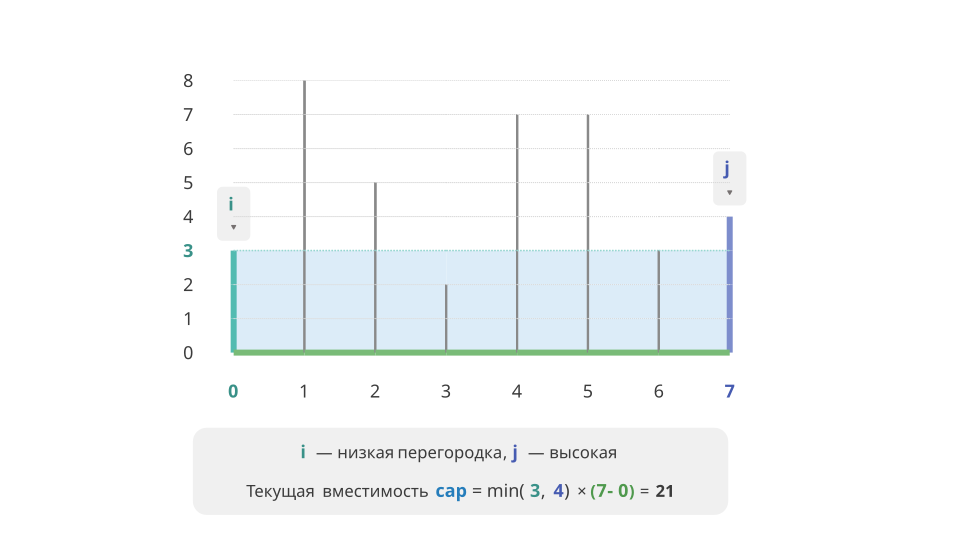
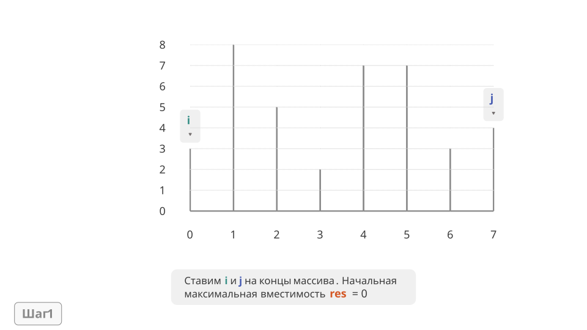
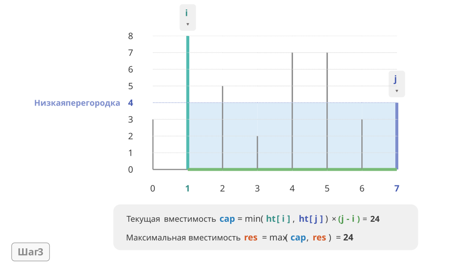
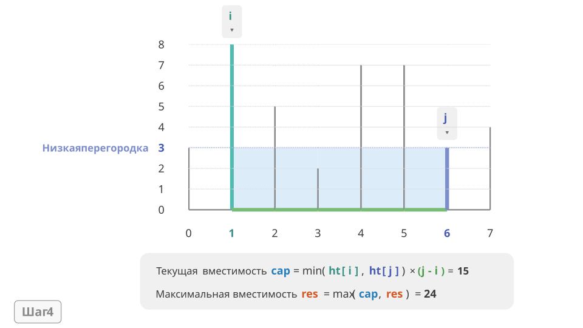
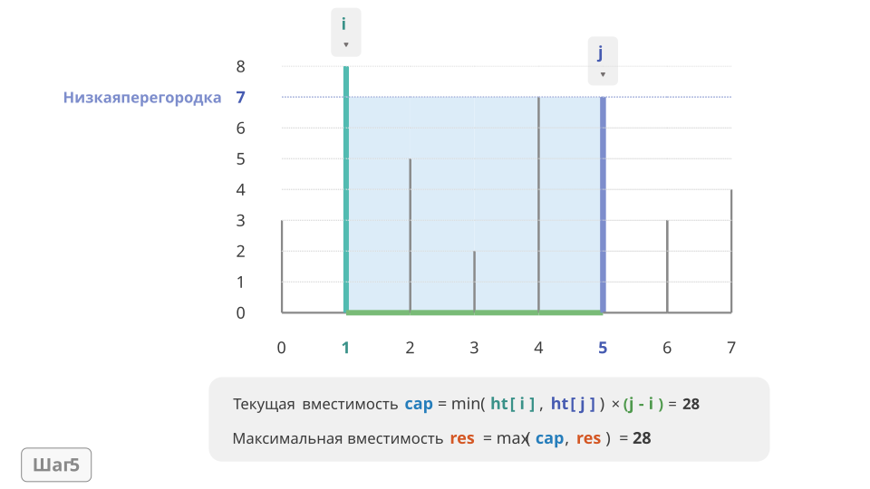
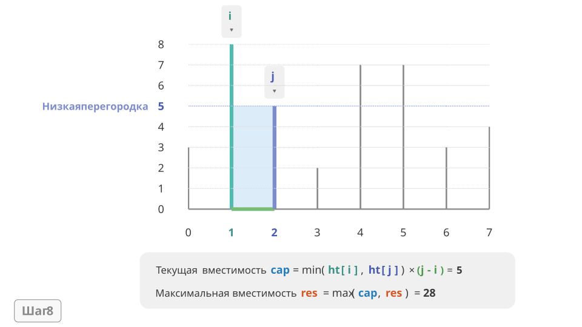
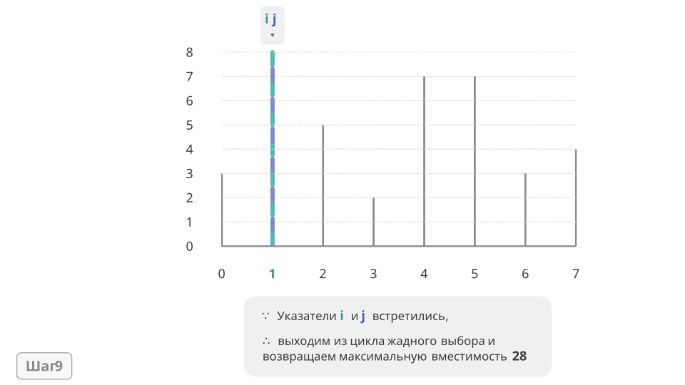
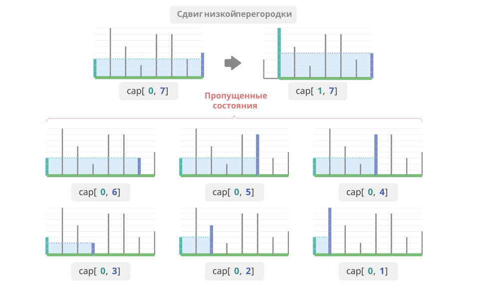

# Задача о максимальной вместимости

!!! question

    Дан массив $ht$, каждый элемент которого задаёт высоту вертикальной перегородки. Любые две перегородки вместе с пространством между ними образуют сосуд.
    
    Вместимость сосуда равна его площади — произведению высоты на ширину. Высоту определяет более низкая перегородка, а ширина равна разности индексов двух перегородок в массиве.
    
    Выберите в массиве две перегородки так, чтобы вместимость образованного ими сосуда была наибольшей. Верните эту вместимость. Пример приведён на рисунке ниже.


Сосуд задаётся парой перегородок. **Поэтому состояние задачи — пара их индексов $[i, j]$**.

По условию вместимость равна произведению высоты на ширину. Высоту задаёт более низкая перегородка, а ширину — разность индексов. Обозначим вместимость через $cap[i, j]$. Получим формулу:

$$
cap[i, j] = \min(ht[i], ht[j]) \times (j - i)
$$

Пусть длина массива равна $n$. Тогда число пар перегородок, то есть общее число состояний, равно $C_n^2 = \frac{n(n - 1)}{2}$. Самый прямой способ найти максимальную вместимость — **перебрать все состояния**. Его временная сложность составляет $O(n^2)$.

### Выбор жадной стратегии

Задачу можно решить эффективнее. Выберем, как на рисунке ниже, состояние $[i, j]$, в котором $i < j$ и $ht[i] < ht[j]$. Тогда перегородка $i$ ниже, а $j$ выше.



Как видно на рисунке ниже, **если сдвинуть указатель у высокой перегородки $j$ в сторону низкой $i$, вместимость обязательно уменьшится**.

При сдвиге высокой перегородки $j$ ширина $j-i$ обязательно уменьшается. Высоту задаёт низкая перегородка, поэтому высота может лишь остаться прежней (если $i$ по-прежнему ниже) или уменьшиться (если новой низкой перегородкой станет $j$).


Отсюда следует, что **вместимость может увеличиться только при сдвиге низкой перегородки $i$ внутрь**. Ширина обязательно уменьшится, **но высота может вырасти**: на новой позиции $i$ перегородка может оказаться выше прежней. Например, на рисунке ниже площадь после сдвига низкой перегородки увеличилась.


Теперь сформулируем жадную стратегию. Поставим два указателя на противоположные концы сосуда. На каждом шаге будем сдвигать внутрь указатель у более низкой перегородки, пока указатели не встретятся.

На рисунке ниже показано, как работает эта стратегия.

1. В начальном состоянии указатели $i$ и $j$ находятся на противоположных концах массива.
2. Вычисляем вместимость $cap[i, j]$ для текущего состояния и обновляем максимум.
3. Сравниваем высоты перегородок $i$ и $j$ и сдвигаем указатель у более низкой на одну позицию внутрь.
4. Повторяем шаги `2.` и `3.`, пока указатели $i$ и $j$ не встретятся.

=== "<1>"
    

=== "<2>"
    

=== "<3>"
    

=== "<4>"
    

=== "<5>"
    

=== "<6>"
    

=== "<7>"
    

=== "<8>"
    

=== "<9>"
    

### Реализация

Цикл выполняется не более $n$ раз, **поэтому временная сложность составляет $O(n)$**.

Переменные $i$, $j$ и $res$ занимают постоянный объём дополнительной памяти, **поэтому пространственная сложность составляет $O(1)$**.

```src
[file]{max_capacity}-[class]{}-[func]{max_capacity}
```

### Доказательство корректности

Жадный алгоритм быстрее полного перебора, потому что при каждом выборе он пропускает часть состояний.

Например, пусть в состоянии $cap[i, j]$ перегородка $i$ ниже, а $j$ выше. Если по жадному правилу сдвинуть указатель у низкой перегородки $i$ на одну позицию внутрь, алгоритм пропустит состояния, показанные ниже. **В дальнейшем он уже не сможет проверить вместимость этих сосудов**.

$$
cap[i, i+1], cap[i, i+2], \dots, cap[i, j-2], cap[i, j-1]
$$



Заметим, что **пропущены именно те состояния, в которых указатель у высокой перегородки $j$ сдвигается внутрь, а другой остаётся на месте**. Мы уже доказали, что при таком сдвиге вместимость обязательно уменьшается. Значит, ни одно пропущенное состояние не может быть оптимальным, и **мы не упустим оптимальное решение**.

Таким образом, сдвиг низкой перегородки безопасен, а жадная стратегия корректна.
