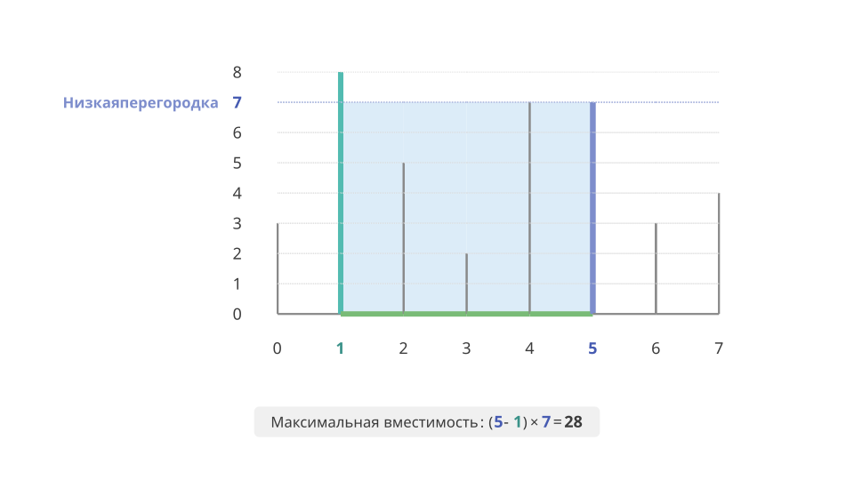
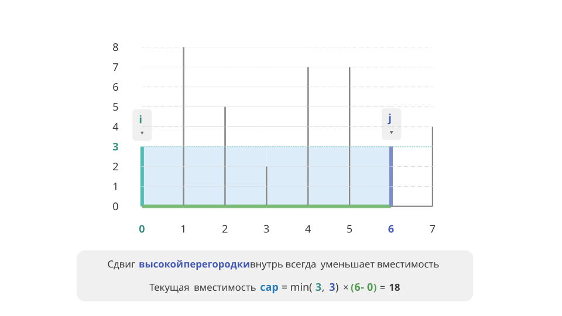
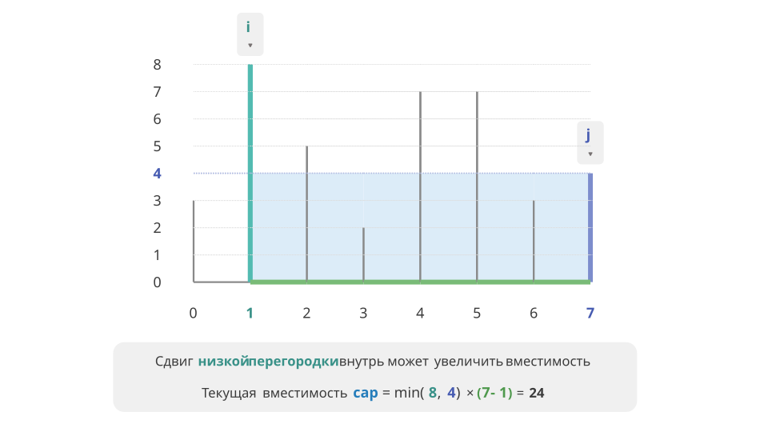
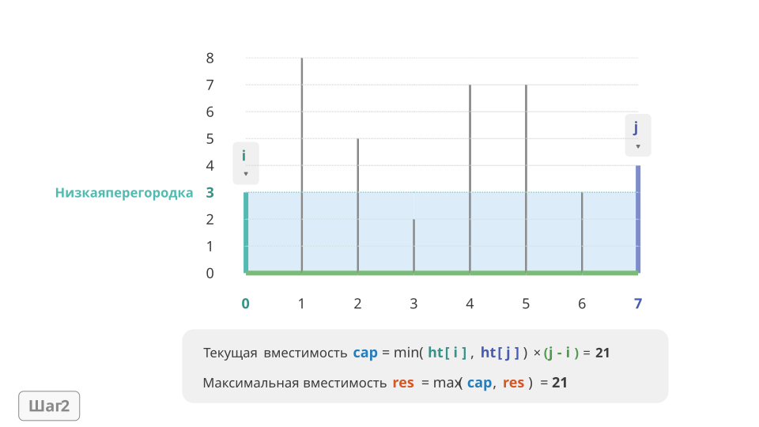
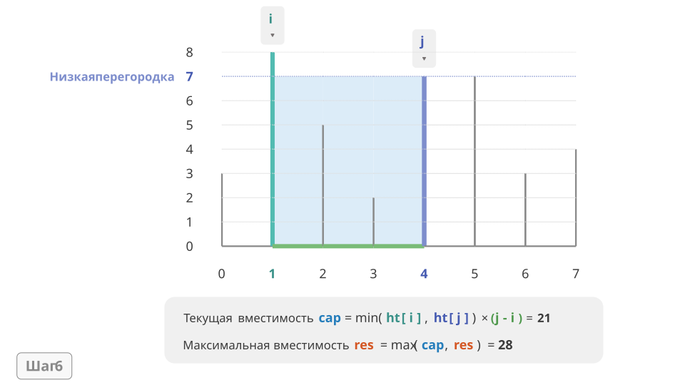
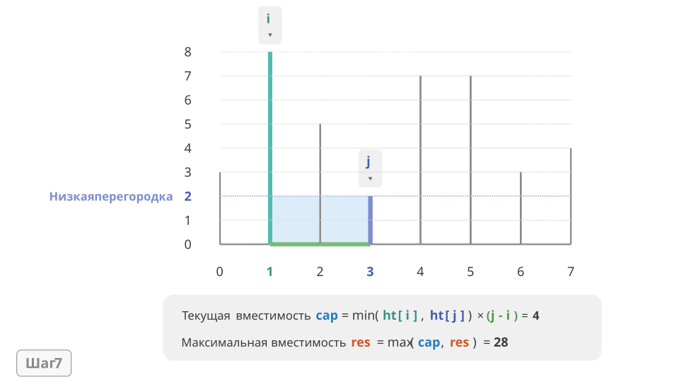

# 15.3 &nbsp; Задача о максимальной вместимости

!!! question

    Дан массив $ht$, каждый элемент которого задаёт высоту вертикальной перегородки. Любые две перегородки вместе с пространством между ними образуют сосуд.
    
    Вместимость сосуда равна его площади — произведению высоты на ширину. Высоту определяет более низкая перегородка, а ширина равна разности индексов двух перегородок в массиве.
    
    Выберите в массиве две перегородки так, чтобы вместимость образованного ими сосуда была наибольшей. Верните эту вместимость. Пример приведён на рисунке 15-7.

{ class="animation-figure" }

<p align="center"> Рисунок 15-7 &nbsp; Исходные данные примера для задачи о максимальной вместимости </p>

Сосуд задаётся парой перегородок. **Поэтому состояние задачи — пара их индексов $[i, j]$**.

По условию вместимость равна произведению высоты на ширину. Высоту задаёт более низкая перегородка, а ширину — разность индексов. Обозначим вместимость через $cap[i, j]$. Получим формулу:

$$
cap[i, j] = \min(ht[i], ht[j]) \times (j - i)
$$

Пусть длина массива равна $n$. Тогда число пар перегородок, то есть общее число состояний, равно $C_n^2 = \frac{n(n - 1)}{2}$. Самый прямой способ найти максимальную вместимость — **перебрать все состояния**. Его временная сложность составляет $O(n^2)$.

### 1. &nbsp; Выбор жадной стратегии

Задачу можно решить эффективнее. Выберем, как на рисунке 15-8, состояние $[i, j]$, в котором $i < j$ и $ht[i] < ht[j]$. Тогда перегородка $i$ ниже, а $j$ выше.

{ class="animation-figure" }

<p align="center"> Рисунок 15-8 &nbsp; Начальное состояние </p>

Как видно на рисунке 15-9, **если сдвинуть указатель у высокой перегородки $j$ в сторону низкой $i$, вместимость обязательно уменьшится**.

При сдвиге высокой перегородки $j$ ширина $j-i$ обязательно уменьшается. Высоту задаёт низкая перегородка, поэтому высота может лишь остаться прежней (если $i$ по-прежнему ниже) или уменьшиться (если новой низкой перегородкой станет $j$).

{ class="animation-figure" }

<p align="center"> Рисунок 15-9 &nbsp; Состояние после сдвига высокой перегородки внутрь </p>

Отсюда следует, что **вместимость может увеличиться только при сдвиге низкой перегородки $i$ внутрь**. Ширина обязательно уменьшится, **но высота может вырасти**: на новой позиции $i$ перегородка может оказаться выше прежней. Например, на рисунке 15-10 площадь после сдвига низкой перегородки увеличилась.

{ class="animation-figure" }

<p align="center"> Рисунок 15-10 &nbsp; Состояние после сдвига низкой перегородки внутрь </p>

Теперь сформулируем жадную стратегию. Поставим два указателя на противоположные концы сосуда. На каждом шаге будем сдвигать внутрь указатель у более низкой перегородки, пока указатели не встретятся.

На рисунке 15-11 показано, как работает эта стратегия.

1. В начальном состоянии указатели $i$ и $j$ находятся на противоположных концах массива.
2. Вычисляем вместимость $cap[i, j]$ для текущего состояния и обновляем максимум.
3. Сравниваем высоты перегородок $i$ и $j$ и сдвигаем указатель у более низкой на одну позицию внутрь.
4. Повторяем шаги `2.` и `3.`, пока указатели $i$ и $j$ не встретятся.

=== "<1>"
    { class="animation-figure" }

=== "<2>"
    { class="animation-figure" }

=== "<3>"
    { class="animation-figure" }

=== "<4>"
    { class="animation-figure" }

=== "<5>"
    { class="animation-figure" }

=== "<6>"
    { class="animation-figure" }

=== "<7>"
    { class="animation-figure" }

=== "<8>"
    { class="animation-figure" }

=== "<9>"
    { class="animation-figure" }

<p align="center"> Рисунок 15-11 &nbsp; Шаги жадного алгоритма поиска максимальной вместимости </p>

### 2. &nbsp; Реализация

Цикл выполняется не более $n$ раз, **поэтому временная сложность составляет $O(n)$**.

Переменные $i$, $j$ и $res$ занимают постоянный объём дополнительной памяти, **поэтому пространственная сложность составляет $O(1)$**.

=== "Python"

    ```python title="max_capacity.py"
    def max_capacity(ht: list[int]) -> int:
        """Максимальная вместимость: жадный алгоритм"""
        # Ставим i и j на противоположные концы массива
        i, j = 0, len(ht) - 1
        # Изначально максимальная вместимость равна 0
        res = 0
        # Повторяем жадный выбор, пока перегородки не встретятся
        while i < j:
            # Обновляем максимальную вместимость
            cap = min(ht[i], ht[j]) * (j - i)
            res = max(res, cap)
            # Сдвигаем указатель у более низкой перегородки к центру
            if ht[i] < ht[j]:
                i += 1
            else:
                j -= 1
        return res
    ```

=== "C++"

    ```cpp title="max_capacity.cpp"
    /* Максимальная вместимость: жадный алгоритм */
    int maxCapacity(vector<int> &ht) {
        // Ставим i и j на противоположные концы массива
        int i = 0, j = ht.size() - 1;
        // Изначально максимальная вместимость равна 0
        int res = 0;
        // Повторяем жадный выбор, пока перегородки не встретятся
        while (i < j) {
            // Обновляем максимальную вместимость
            int cap = min(ht[i], ht[j]) * (j - i);
            res = max(res, cap);
            // Сдвигаем указатель у более низкой перегородки к центру
            if (ht[i] < ht[j]) {
                i++;
            } else {
                j--;
            }
        }
        return res;
    }
    ```

=== "Java"

    ```java title="max_capacity.java"
    /* Максимальная вместимость: жадный алгоритм */
    int maxCapacity(int[] ht) {
        // Ставим i и j на противоположные концы массива
        int i = 0, j = ht.length - 1;
        // Изначально максимальная вместимость равна 0
        int res = 0;
        // Повторяем жадный выбор, пока перегородки не встретятся
        while (i < j) {
            // Обновляем максимальную вместимость
            int cap = Math.min(ht[i], ht[j]) * (j - i);
            res = Math.max(res, cap);
            // Сдвигаем указатель у более низкой перегородки к центру
            if (ht[i] < ht[j]) {
                i++;
            } else {
                j--;
            }
        }
        return res;
    }
    ```

=== "C#"

    ```csharp title="max_capacity.cs"
    /* Максимальная вместимость: жадный алгоритм */
    int MaxCapacity(int[] ht) {
        // Ставим i и j на противоположные концы массива
        int i = 0, j = ht.Length - 1;
        // Изначально максимальная вместимость равна 0
        int res = 0;
        // Повторяем жадный выбор, пока перегородки не встретятся
        while (i < j) {
            // Обновляем максимальную вместимость
            int cap = Math.Min(ht[i], ht[j]) * (j - i);
            res = Math.Max(res, cap);
            // Сдвигаем указатель у более низкой перегородки к центру
            if (ht[i] < ht[j]) {
                i++;
            } else {
                j--;
            }
        }
        return res;
    }
    ```

=== "Go"

    ```go title="max_capacity.go"
    /* Максимальная вместимость: жадный алгоритм */
    func maxCapacity(ht []int) int {
        // Ставим i и j на противоположные концы массива
        i, j := 0, len(ht)-1
        // Изначально максимальная вместимость равна 0
        res := 0
        // Повторяем жадный выбор, пока перегородки не встретятся
        for i < j {
            // Обновляем максимальную вместимость
            capacity := int(math.Min(float64(ht[i]), float64(ht[j]))) * (j - i)
            res = int(math.Max(float64(res), float64(capacity)))
            // Сдвигаем указатель у более низкой перегородки к центру
            if ht[i] < ht[j] {
                i++
            } else {
                j--
            }
        }
        return res
    }
    ```

=== "Swift"

    ```swift title="max_capacity.swift"
    /* Максимальная вместимость: жадный алгоритм */
    func maxCapacity(ht: [Int]) -> Int {
        // Ставим i и j на противоположные концы массива
        var i = ht.startIndex, j = ht.endIndex - 1
        // Изначально максимальная вместимость равна 0
        var res = 0
        // Повторяем жадный выбор, пока перегородки не встретятся
        while i < j {
            // Обновляем максимальную вместимость
            let cap = min(ht[i], ht[j]) * (j - i)
            res = max(res, cap)
            // Сдвигаем указатель у более низкой перегородки к центру
            if ht[i] < ht[j] {
                i += 1
            } else {
                j -= 1
            }
        }
        return res
    }
    ```

=== "JS"

    ```javascript title="max_capacity.js"
    /* Максимальная вместимость: жадный алгоритм */
    function maxCapacity(ht) {
        // Ставим i и j на противоположные концы массива
        let i = 0,
            j = ht.length - 1;
        // Изначально максимальная вместимость равна 0
        let res = 0;
        // Повторяем жадный выбор, пока перегородки не встретятся
        while (i < j) {
            // Обновляем максимальную вместимость
            const cap = Math.min(ht[i], ht[j]) * (j - i);
            res = Math.max(res, cap);
            // Сдвигаем указатель у более низкой перегородки к центру
            if (ht[i] < ht[j]) {
                i += 1;
            } else {
                j -= 1;
            }
        }
        return res;
    }
    ```

=== "TS"

    ```typescript title="max_capacity.ts"
    /* Максимальная вместимость: жадный алгоритм */
    function maxCapacity(ht: number[]): number {
        // Ставим i и j на противоположные концы массива
        let i = 0,
            j = ht.length - 1;
        // Изначально максимальная вместимость равна 0
        let res = 0;
        // Повторяем жадный выбор, пока перегородки не встретятся
        while (i < j) {
            // Обновляем максимальную вместимость
            const cap: number = Math.min(ht[i], ht[j]) * (j - i);
            res = Math.max(res, cap);
            // Сдвигаем указатель у более низкой перегородки к центру
            if (ht[i] < ht[j]) {
                i += 1;
            } else {
                j -= 1;
            }
        }
        return res;
    }
    ```

=== "Dart"

    ```dart title="max_capacity.dart"
    /* Максимальная вместимость: жадный алгоритм */
    int maxCapacity(List<int> ht) {
      // Ставим i и j на противоположные концы массива
      int i = 0, j = ht.length - 1;
      // Изначально максимальная вместимость равна 0
      int res = 0;
      // Повторяем жадный выбор, пока перегородки не встретятся
      while (i < j) {
        // Обновляем максимальную вместимость
        int cap = min(ht[i], ht[j]) * (j - i);
        res = max(res, cap);
        // Сдвигаем указатель у более низкой перегородки к центру
        if (ht[i] < ht[j]) {
          i++;
        } else {
          j--;
        }
      }
      return res;
    }
    ```

=== "Rust"

    ```rust title="max_capacity.rs"
    /* Максимальная вместимость: жадный алгоритм */
    fn max_capacity(ht: &[i32]) -> i32 {
        // Ставим i и j на противоположные концы массива
        let mut i = 0;
        let mut j = ht.len() - 1;
        // Изначально максимальная вместимость равна 0
        let mut res = 0;
        // Повторяем жадный выбор, пока перегородки не встретятся
        while i < j {
            // Обновляем максимальную вместимость
            let cap = std::cmp::min(ht[i], ht[j]) * (j - i) as i32;
            res = std::cmp::max(res, cap);
            // Сдвигаем указатель у более низкой перегородки к центру
            if ht[i] < ht[j] {
                i += 1;
            } else {
                j -= 1;
            }
        }
        res
    }
    ```

=== "C"

    ```c title="max_capacity.c"
    /* Максимальная вместимость: жадный алгоритм */
    int maxCapacity(int ht[], int htLength) {
        // Ставим i и j на противоположные концы массива
        int i = 0;
        int j = htLength - 1;
        // Изначально максимальная вместимость равна 0
        int res = 0;
        // Повторяем жадный выбор, пока перегородки не встретятся
        while (i < j) {
            // Обновляем максимальную вместимость
            int capacity = myMin(ht[i], ht[j]) * (j - i);
            res = myMax(res, capacity);
            // Сдвигаем указатель у более низкой перегородки к центру
            if (ht[i] < ht[j]) {
                i++;
            } else {
                j--;
            }
        }
        return res;
    }
    ```

=== "Kotlin"

    ```kotlin title="max_capacity.kt"
    /* Максимальная вместимость: жадный алгоритм */
    fun maxCapacity(ht: IntArray): Int {
        // Ставим i и j на противоположные концы массива
        var i = 0
        var j = ht.size - 1
        // Изначально максимальная вместимость равна 0
        var res = 0
        // Повторяем жадный выбор, пока перегородки не встретятся
        while (i < j) {
            // Обновляем максимальную вместимость
            val cap = min(ht[i], ht[j]) * (j - i)
            res = max(res, cap)
            // Сдвигаем указатель у более низкой перегородки к центру
            if (ht[i] < ht[j]) {
                i++
            } else {
                j--
            }
        }
        return res
    }
    ```

=== "Ruby"

    ```ruby title="max_capacity.rb"
    ### Максимальная вместимость: жадный алгоритм ###
    def max_capacity(ht)
      # Ставим i и j на противоположные концы массива
      i, j = 0, ht.length - 1
      # Изначально максимальная вместимость равна 0
      res = 0

      # Повторяем жадный выбор, пока перегородки не встретятся
      while i < j
        # Обновляем максимальную вместимость
        cap = [ht[i], ht[j]].min * (j - i)
        res = [res, cap].max
        # Сдвигаем указатель у более низкой перегородки к центру
        if ht[i] < ht[j]
          i += 1
        else
          j -= 1
        end
      end

      res
    end
    ```

??? pythontutor "Визуализация выполнения"

    <div style="height: 549px; width: 100%;"><iframe class="pythontutor-iframe" title="Визуализация выполнения" src="https://pythontutor.com/iframe-embed.html#code=def%20max_capacity%28ht%3A%20list%5Bint%5D%29%20-%3E%20int%3A%0A%20%20%20%20%22%22%22%D0%9C%D0%B0%D0%BA%D1%81%D0%B8%D0%BC%D0%B0%D0%BB%D1%8C%D0%BD%D0%B0%D1%8F%20%D0%B2%D0%BC%D0%B5%D1%81%D1%82%D0%B8%D0%BC%D0%BE%D1%81%D1%82%D1%8C%3A%20%D0%B6%D0%B0%D0%B4%D0%BD%D1%8B%D0%B9%20%D0%B0%D0%BB%D0%B3%D0%BE%D1%80%D0%B8%D1%82%D0%BC%22%22%22%0A%20%20%20%20%23%20%D0%A1%D1%82%D0%B0%D0%B2%D0%B8%D0%BC%20i%20%D0%B8%20j%20%D0%BD%D0%B0%20%D0%BF%D1%80%D0%BE%D1%82%D0%B8%D0%B2%D0%BE%D0%BF%D0%BE%D0%BB%D0%BE%D0%B6%D0%BD%D1%8B%D0%B5%20%D0%BA%D0%BE%D0%BD%D1%86%D1%8B%20%D0%BC%D0%B0%D1%81%D1%81%D0%B8%D0%B2%D0%B0%0A%20%20%20%20i,%20j%20%3D%200,%20len%28ht%29%20-%201%0A%20%20%20%20%23%20%D0%98%D0%B7%D0%BD%D0%B0%D1%87%D0%B0%D0%BB%D1%8C%D0%BD%D0%BE%20%D0%BC%D0%B0%D0%BA%D1%81%D0%B8%D0%BC%D0%B0%D0%BB%D1%8C%D0%BD%D0%B0%D1%8F%20%D0%B2%D0%BC%D0%B5%D1%81%D1%82%D0%B8%D0%BC%D0%BE%D1%81%D1%82%D1%8C%20%D1%80%D0%B0%D0%B2%D0%BD%D0%B0%200%0A%20%20%20%20res%20%3D%200%0A%20%20%20%20%23%20%D0%9F%D0%BE%D0%B2%D1%82%D0%BE%D1%80%D1%8F%D0%B5%D0%BC%20%D0%B6%D0%B0%D0%B4%D0%BD%D1%8B%D0%B9%20%D0%B2%D1%8B%D0%B1%D0%BE%D1%80,%20%D0%BF%D0%BE%D0%BA%D0%B0%20%D0%BF%D0%B5%D1%80%D0%B5%D0%B3%D0%BE%D1%80%D0%BE%D0%B4%D0%BA%D0%B8%20%D0%BD%D0%B5%20%D0%B2%D1%81%D1%82%D1%80%D0%B5%D1%82%D1%8F%D1%82%D1%81%D1%8F%0A%20%20%20%20while%20i%20%3C%20j%3A%0A%20%20%20%20%20%20%20%20%23%20%D0%9E%D0%B1%D0%BD%D0%BE%D0%B2%D0%BB%D1%8F%D0%B5%D0%BC%20%D0%BC%D0%B0%D0%BA%D1%81%D0%B8%D0%BC%D0%B0%D0%BB%D1%8C%D0%BD%D1%83%D1%8E%20%D0%B2%D0%BC%D0%B5%D1%81%D1%82%D0%B8%D0%BC%D0%BE%D1%81%D1%82%D1%8C%0A%20%20%20%20%20%20%20%20cap%20%3D%20min%28ht%5Bi%5D,%20ht%5Bj%5D%29%20%2A%20%28j%20-%20i%29%0A%20%20%20%20%20%20%20%20res%20%3D%20max%28res,%20cap%29%0A%20%20%20%20%20%20%20%20%23%20%D0%A1%D0%B4%D0%B2%D0%B8%D0%B3%D0%B0%D0%B5%D0%BC%20%D1%83%D0%BA%D0%B0%D0%B7%D0%B0%D1%82%D0%B5%D0%BB%D1%8C%20%D1%83%20%D0%B1%D0%BE%D0%BB%D0%B5%D0%B5%20%D0%BD%D0%B8%D0%B7%D0%BA%D0%BE%D0%B9%20%D0%BF%D0%B5%D1%80%D0%B5%D0%B3%D0%BE%D1%80%D0%BE%D0%B4%D0%BA%D0%B8%20%D0%BA%20%D1%86%D0%B5%D0%BD%D1%82%D1%80%D1%83%0A%20%20%20%20%20%20%20%20if%20ht%5Bi%5D%20%3C%20ht%5Bj%5D%3A%0A%20%20%20%20%20%20%20%20%20%20%20%20i%20%2B%3D%201%0A%20%20%20%20%20%20%20%20else%3A%0A%20%20%20%20%20%20%20%20%20%20%20%20j%20-%3D%201%0A%20%20%20%20return%20res%0A%0A%0A%22%22%22Driver%20Code%22%22%22%0Aif%20__name__%20%3D%3D%20%22__main__%22%3A%0A%20%20%20%20ht%20%3D%20%5B3,%208,%205,%202,%207,%207,%203,%204%5D%0A%0A%20%20%20%20%23%20%D0%96%D0%B0%D0%B4%D0%BD%D1%8B%D0%B9%20%D0%B0%D0%BB%D0%B3%D0%BE%D1%80%D0%B8%D1%82%D0%BC%0A%20%20%20%20res%20%3D%20max_capacity%28ht%29%0A%20%20%20%20print%28f%22%D0%9C%D0%B0%D0%BA%D1%81%D0%B8%D0%BC%D0%B0%D0%BB%D1%8C%D0%BD%D0%B0%D1%8F%20%D0%B2%D0%BC%D0%B5%D1%81%D1%82%D0%B8%D0%BC%D0%BE%D1%81%D1%82%D1%8C%3A%20%7Bres%7D%22%29&codeDivHeight=472&codeDivWidth=350&cumulative=false&curInstr=4&heapPrimitives=nevernest&origin=opt-frontend.js&py=311&rawInputLstJSON=%5B%5D&textReferences=false"> </iframe></div>
    <div style="margin-top: 5px;"><a href="https://pythontutor.com/iframe-embed.html#code=def%20max_capacity%28ht%3A%20list%5Bint%5D%29%20-%3E%20int%3A%0A%20%20%20%20%22%22%22%D0%9C%D0%B0%D0%BA%D1%81%D0%B8%D0%BC%D0%B0%D0%BB%D1%8C%D0%BD%D0%B0%D1%8F%20%D0%B2%D0%BC%D0%B5%D1%81%D1%82%D0%B8%D0%BC%D0%BE%D1%81%D1%82%D1%8C%3A%20%D0%B6%D0%B0%D0%B4%D0%BD%D1%8B%D0%B9%20%D0%B0%D0%BB%D0%B3%D0%BE%D1%80%D0%B8%D1%82%D0%BC%22%22%22%0A%20%20%20%20%23%20%D0%A1%D1%82%D0%B0%D0%B2%D0%B8%D0%BC%20i%20%D0%B8%20j%20%D0%BD%D0%B0%20%D0%BF%D1%80%D0%BE%D1%82%D0%B8%D0%B2%D0%BE%D0%BF%D0%BE%D0%BB%D0%BE%D0%B6%D0%BD%D1%8B%D0%B5%20%D0%BA%D0%BE%D0%BD%D1%86%D1%8B%20%D0%BC%D0%B0%D1%81%D1%81%D0%B8%D0%B2%D0%B0%0A%20%20%20%20i,%20j%20%3D%200,%20len%28ht%29%20-%201%0A%20%20%20%20%23%20%D0%98%D0%B7%D0%BD%D0%B0%D1%87%D0%B0%D0%BB%D1%8C%D0%BD%D0%BE%20%D0%BC%D0%B0%D0%BA%D1%81%D0%B8%D0%BC%D0%B0%D0%BB%D1%8C%D0%BD%D0%B0%D1%8F%20%D0%B2%D0%BC%D0%B5%D1%81%D1%82%D0%B8%D0%BC%D0%BE%D1%81%D1%82%D1%8C%20%D1%80%D0%B0%D0%B2%D0%BD%D0%B0%200%0A%20%20%20%20res%20%3D%200%0A%20%20%20%20%23%20%D0%9F%D0%BE%D0%B2%D1%82%D0%BE%D1%80%D1%8F%D0%B5%D0%BC%20%D0%B6%D0%B0%D0%B4%D0%BD%D1%8B%D0%B9%20%D0%B2%D1%8B%D0%B1%D0%BE%D1%80,%20%D0%BF%D0%BE%D0%BA%D0%B0%20%D0%BF%D0%B5%D1%80%D0%B5%D0%B3%D0%BE%D1%80%D0%BE%D0%B4%D0%BA%D0%B8%20%D0%BD%D0%B5%20%D0%B2%D1%81%D1%82%D1%80%D0%B5%D1%82%D1%8F%D1%82%D1%81%D1%8F%0A%20%20%20%20while%20i%20%3C%20j%3A%0A%20%20%20%20%20%20%20%20%23%20%D0%9E%D0%B1%D0%BD%D0%BE%D0%B2%D0%BB%D1%8F%D0%B5%D0%BC%20%D0%BC%D0%B0%D0%BA%D1%81%D0%B8%D0%BC%D0%B0%D0%BB%D1%8C%D0%BD%D1%83%D1%8E%20%D0%B2%D0%BC%D0%B5%D1%81%D1%82%D0%B8%D0%BC%D0%BE%D1%81%D1%82%D1%8C%0A%20%20%20%20%20%20%20%20cap%20%3D%20min%28ht%5Bi%5D,%20ht%5Bj%5D%29%20%2A%20%28j%20-%20i%29%0A%20%20%20%20%20%20%20%20res%20%3D%20max%28res,%20cap%29%0A%20%20%20%20%20%20%20%20%23%20%D0%A1%D0%B4%D0%B2%D0%B8%D0%B3%D0%B0%D0%B5%D0%BC%20%D1%83%D0%BA%D0%B0%D0%B7%D0%B0%D1%82%D0%B5%D0%BB%D1%8C%20%D1%83%20%D0%B1%D0%BE%D0%BB%D0%B5%D0%B5%20%D0%BD%D0%B8%D0%B7%D0%BA%D0%BE%D0%B9%20%D0%BF%D0%B5%D1%80%D0%B5%D0%B3%D0%BE%D1%80%D0%BE%D0%B4%D0%BA%D0%B8%20%D0%BA%20%D1%86%D0%B5%D0%BD%D1%82%D1%80%D1%83%0A%20%20%20%20%20%20%20%20if%20ht%5Bi%5D%20%3C%20ht%5Bj%5D%3A%0A%20%20%20%20%20%20%20%20%20%20%20%20i%20%2B%3D%201%0A%20%20%20%20%20%20%20%20else%3A%0A%20%20%20%20%20%20%20%20%20%20%20%20j%20-%3D%201%0A%20%20%20%20return%20res%0A%0A%0A%22%22%22Driver%20Code%22%22%22%0Aif%20__name__%20%3D%3D%20%22__main__%22%3A%0A%20%20%20%20ht%20%3D%20%5B3,%208,%205,%202,%207,%207,%203,%204%5D%0A%0A%20%20%20%20%23%20%D0%96%D0%B0%D0%B4%D0%BD%D1%8B%D0%B9%20%D0%B0%D0%BB%D0%B3%D0%BE%D1%80%D0%B8%D1%82%D0%BC%0A%20%20%20%20res%20%3D%20max_capacity%28ht%29%0A%20%20%20%20print%28f%22%D0%9C%D0%B0%D0%BA%D1%81%D0%B8%D0%BC%D0%B0%D0%BB%D1%8C%D0%BD%D0%B0%D1%8F%20%D0%B2%D0%BC%D0%B5%D1%81%D1%82%D0%B8%D0%BC%D0%BE%D1%81%D1%82%D1%8C%3A%20%7Bres%7D%22%29&codeDivHeight=800&codeDivWidth=600&cumulative=false&curInstr=4&heapPrimitives=nevernest&origin=opt-frontend.js&py=311&rawInputLstJSON=%5B%5D&textReferences=false" target="_blank" rel="noopener noreferrer">Во весь экран ></a></div>

### 3. &nbsp; Доказательство корректности

Жадный алгоритм быстрее полного перебора, потому что при каждом выборе он пропускает часть состояний.

Например, пусть в состоянии $cap[i, j]$ перегородка $i$ ниже, а $j$ выше. Если по жадному правилу сдвинуть указатель у низкой перегородки $i$ на одну позицию внутрь, алгоритм пропустит состояния, показанные ниже. **В дальнейшем он уже не сможет проверить вместимость этих сосудов**.

$$
cap[i, i+1], cap[i, i+2], \dots, cap[i, j-2], cap[i, j-1]
$$

{ class="animation-figure" }

<p align="center"> Рисунок 15-12 &nbsp; Состояния, пропущенные при сдвиге низкой перегородки </p>

Заметим, что **пропущены именно те состояния, в которых указатель у высокой перегородки $j$ сдвигается внутрь, а другой остаётся на месте**. Мы уже доказали, что при таком сдвиге вместимость обязательно уменьшается. Значит, ни одно пропущенное состояние не может быть оптимальным, и **мы не упустим оптимальное решение**.

Таким образом, сдвиг низкой перегородки безопасен, а жадная стратегия корректна.
