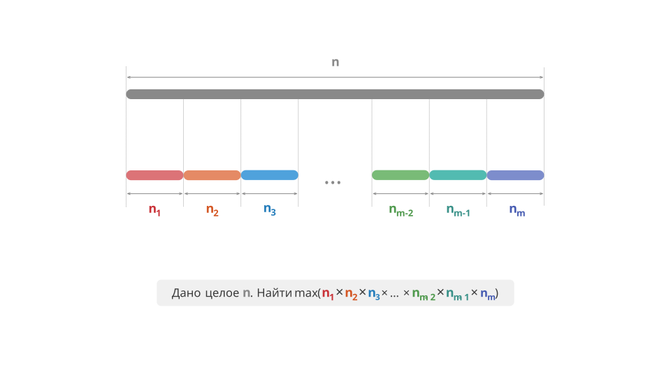
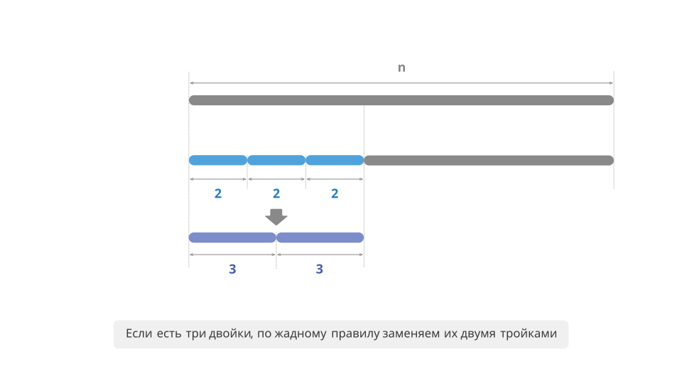
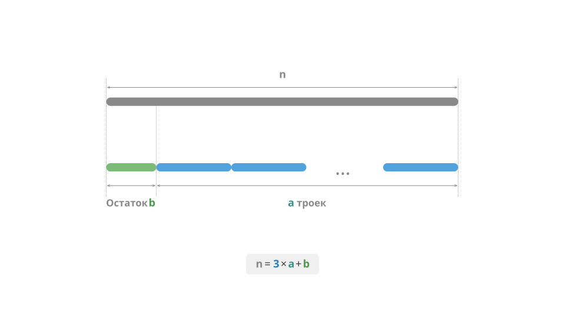

# Задача о максимальном произведении при разбиении

!!! question

    Дано положительное целое число $n$. Разбейте его на сумму как минимум двух положительных целых чисел. Какое наибольшее произведение можно получить, перемножив все части? Задача показана на рисунке ниже.



Пусть число $n$ разбито на $m$ целых слагаемых, которые станут множителями. Обозначим множитель с номером $i$ через $n_i$. Тогда

$$
n = \sum_{i=1}^{m}n_i
$$

Нужно найти наибольшее произведение всех целых множителей, то есть

$$
\max(\prod_{i=1}^{m}n_i)
$$

Сколько должно быть частей (величина $m$) и чему должна равняться каждая из них (величина $n_i$)?

### Выбор жадной стратегии

Произведение двух целых чисел часто бывает больше их суммы. Если отделить от $n$ слагаемое $2$, произведение двух частей будет равно $2(n-2)$. Сравним его с $n$:

$$
\begin{aligned}
2(n-2) & \geq n \newline
2n - n - 4 & \geq 0 \newline
n & \geq 4
\end{aligned}
$$

Как показано ниже, при $n \geq 4$ выделение множителя $2$ увеличивает произведение. **Отсюда следует, что все целые числа, большие или равные $4$, следует разбивать дальше**.

**Первая жадная стратегия**. Если в разбиении есть множитель $\geq 4$, его следует разбить дальше. В итоге должны остаться лишь множители трёх видов: $1$, $2$ и $3$.


Рассмотрим, какой множитель выгоднее. Из $1$, $2$ и $3$ хуже всего $1$: всегда выполняется $1 \times (n-1) < n$. Значит, выделив $1$, мы только уменьшим произведение.

Как показано ниже, при $n = 6$ выполняется $3 \times 3 > 2 \times 2 \times 2$. **Следовательно, выделять множители $3$ выгоднее, чем $2$**.

**Вторая жадная стратегия**. В разбиении должно быть не более двух множителей $2$. Три множителя $2$ всегда можно заменить двумя множителями $3$ и получить большее произведение.



Из этих наблюдений следует жадная стратегия.

1. Для входного целого числа $n$ последовательно выделяем множители $3$, пока остаток не станет равен $0$, $1$ или $2$.
2. Если остаток равен $0$, число $n$ кратно $3$, поэтому ничего менять не нужно.
3. Если остаток равен $2$, оставляем его целиком.
4. Если остаток равен $1$, то в силу неравенства $2 \times 2 > 1 \times 3$ заменяем последний множитель $3$ и остаток $1$ двумя множителями $2$.

### Реализация

Как показано ниже, разбивать число в цикле необязательно. Целочисленное деление с округлением вниз сразу даёт число множителей $3$, равное $a$, а операция взятия остатка даёт $b$. При этом:

$$
n = 3 a + b
$$

В граничных случаях $n \leq 3$ обязательно выделяем множитель $1$. Произведение равно $1 \times (n - 1)$.

```src
[file]{max_product_cutting}-[class]{}-[func]{max_product_cutting}
```



**Временная сложность зависит от реализации возведения в степень в конкретном языке программирования**. Например, в Python распространены три способа возведения в степень.

- Оператор `**` и функция `pow()` имеют временную сложность $O(\log⁡ a)$.
- Функция `math.pow()` вызывает функцию `pow()` из библиотеки C, которая возводит числа с плавающей точкой в степень за время $O(1)$.

Переменным $a$ и $b$ нужен постоянный объём дополнительной памяти, **поэтому пространственная сложность составляет $O(1)$**.

### Доказательство корректности

Докажем корректность от противного, рассматривая только случай $n \geq 4$.

1. **Все множители $\leq 3$**. Предположим, что в оптимальном разбиении есть множитель $x$ величиной $\geq 4$. Тогда его всегда можно разбить дальше и получить произведение $2(x-2)$, большее прежнего или равное ему. Это противоречит предположению.
2. **В разбиении нет множителя $1$**. Предположим, что оптимальное разбиение содержит множитель $1$. Тогда его можно прибавить к другому слагаемому и получить большее произведение. Это противоречит предположению.
3. **В разбиении не более двух множителей $2$**. Предположим, что оптимальное разбиение содержит три множителя $2$. Их можно заменить двумя множителями $3$, увеличив произведение. Это противоречит предположению.
