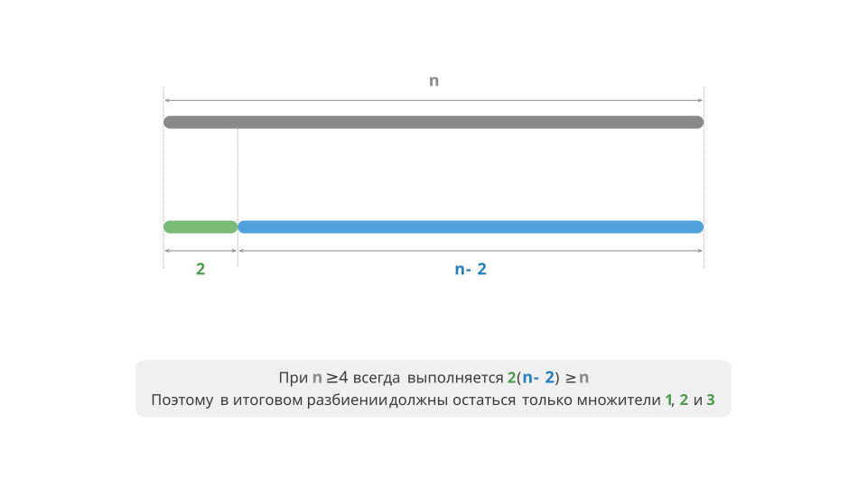

# 15.4 &nbsp; Задача о максимальном произведении при разбиении

!!! question

    Дано положительное целое число $n$. Разбейте его на сумму как минимум двух положительных целых чисел. Какое наибольшее произведение можно получить, перемножив все части? Задача показана на рисунке 15-13.

{ class="animation-figure" }

<p align="center"> Рисунок 15-13 &nbsp; Постановка задачи о максимальном произведении при разбиении </p>

Пусть число $n$ разбито на $m$ целых слагаемых, которые станут множителями. Обозначим множитель с номером $i$ через $n_i$. Тогда

$$
n = \sum_{i=1}^{m}n_i
$$

Нужно найти наибольшее произведение всех целых множителей, то есть

$$
\max(\prod_{i=1}^{m}n_i)
$$

Сколько должно быть частей (величина $m$) и чему должна равняться каждая из них (величина $n_i$)?

### 1. &nbsp; Выбор жадной стратегии

Произведение двух целых чисел часто бывает больше их суммы. Если отделить от $n$ слагаемое $2$, произведение двух частей будет равно $2(n-2)$. Сравним его с $n$:

$$
\begin{aligned}
2(n-2) & \geq n \newline
2n - n - 4 & \geq 0 \newline
n & \geq 4
\end{aligned}
$$

Как показано ниже, при $n \geq 4$ выделение множителя $2$ увеличивает произведение. **Отсюда следует, что все целые числа, большие или равные $4$, следует разбивать дальше**.

**Первая жадная стратегия**. Если в разбиении есть множитель $\geq 4$, его следует разбить дальше. В итоге должны остаться лишь множители трёх видов: $1$, $2$ и $3$.

{ class="animation-figure" }

<p align="center"> Рисунок 15-14 &nbsp; Разбиение увеличивает произведение </p>

Рассмотрим, какой множитель выгоднее. Из $1$, $2$ и $3$ хуже всего $1$: всегда выполняется $1 \times (n-1) < n$. Значит, выделив $1$, мы только уменьшим произведение.

Как показано ниже, при $n = 6$ выполняется $3 \times 3 > 2 \times 2 \times 2$. **Следовательно, выделять множители $3$ выгоднее, чем $2$**.

**Вторая жадная стратегия**. В разбиении должно быть не более двух множителей $2$. Три множителя $2$ всегда можно заменить двумя множителями $3$ и получить большее произведение.

{ class="animation-figure" }

<p align="center"> Рисунок 15-15 &nbsp; Оптимальные множители разбиения </p>

Из этих наблюдений следует жадная стратегия.

1. Для входного целого числа $n$ последовательно выделяем множители $3$, пока остаток не станет равен $0$, $1$ или $2$.
2. Если остаток равен $0$, число $n$ кратно $3$, поэтому ничего менять не нужно.
3. Если остаток равен $2$, оставляем его целиком.
4. Если остаток равен $1$, то в силу неравенства $2 \times 2 > 1 \times 3$ заменяем последний множитель $3$ и остаток $1$ двумя множителями $2$.

### 2. &nbsp; Реализация

Как показано ниже, разбивать число в цикле необязательно. Целочисленное деление с округлением вниз сразу даёт число множителей $3$, равное $a$, а операция взятия остатка даёт $b$. При этом:

$$
n = 3 a + b
$$

В граничных случаях $n \leq 3$ обязательно выделяем множитель $1$. Произведение равно $1 \times (n - 1)$.

=== "Python"

    ```python title="max_product_cutting.py"
    def max_product_cutting(n: int) -> int:
        """Максимальное произведение при разбиении: жадный алгоритм"""
        # При n <= 3 одно из слагаемых обязательно равно 1
        if n <= 3:
            return 1 * (n - 1)
        # Выделяем тройки жадно: a — число троек, b — остаток
        a, b = n // 3, n % 3
        if b == 1:
            # При остатке 1 заменяем пару множителей 1 * 3 на 2 * 2
            return int(math.pow(3, a - 1)) * 2 * 2
        if b == 2:
            # При остатке 2 ничего не меняем
            return int(math.pow(3, a)) * 2
        # При остатке 0 ничего не меняем
        return int(math.pow(3, a))
    ```

=== "C++"

    ```cpp title="max_product_cutting.cpp"
    /* Максимальное произведение при разбиении: жадный алгоритм */
    int maxProductCutting(int n) {
        // При n <= 3 одно из слагаемых обязательно равно 1
        if (n <= 3) {
            return 1 * (n - 1);
        }
        // Выделяем тройки жадно: a — число троек, b — остаток
        int a = n / 3;
        int b = n % 3;
        if (b == 1) {
            // При остатке 1 заменяем пару множителей 1 * 3 на 2 * 2
            return (int)pow(3, a - 1) * 2 * 2;
        }
        if (b == 2) {
            // При остатке 2 ничего не меняем
            return (int)pow(3, a) * 2;
        }
        // При остатке 0 ничего не меняем
        return (int)pow(3, a);
    }
    ```

=== "Java"

    ```java title="max_product_cutting.java"
    /* Максимальное произведение при разбиении: жадный алгоритм */
    int maxProductCutting(int n) {
        // При n <= 3 одно из слагаемых обязательно равно 1
        if (n <= 3) {
            return 1 * (n - 1);
        }
        // Выделяем тройки жадно: a — число троек, b — остаток
        int a = n / 3;
        int b = n % 3;
        if (b == 1) {
            // При остатке 1 заменяем пару множителей 1 * 3 на 2 * 2
            return (int) Math.pow(3, a - 1) * 2 * 2;
        }
        if (b == 2) {
            // При остатке 2 ничего не меняем
            return (int) Math.pow(3, a) * 2;
        }
        // При остатке 0 ничего не меняем
        return (int) Math.pow(3, a);
    }
    ```

=== "C#"

    ```csharp title="max_product_cutting.cs"
    /* Максимальное произведение при разбиении: жадный алгоритм */
    int MaxProductCutting(int n) {
        // При n <= 3 одно из слагаемых обязательно равно 1
        if (n <= 3) {
            return 1 * (n - 1);
        }
        // Выделяем тройки жадно: a — число троек, b — остаток
        int a = n / 3;
        int b = n % 3;
        if (b == 1) {
            // При остатке 1 заменяем пару множителей 1 * 3 на 2 * 2
            return (int)Math.Pow(3, a - 1) * 2 * 2;
        }
        if (b == 2) {
            // При остатке 2 ничего не меняем
            return (int)Math.Pow(3, a) * 2;
        }
        // При остатке 0 ничего не меняем
        return (int)Math.Pow(3, a);
    }
    ```

=== "Go"

    ```go title="max_product_cutting.go"
    /* Максимальное произведение при разбиении: жадный алгоритм */
    func maxProductCutting(n int) int {
        // При n <= 3 одно из слагаемых обязательно равно 1
        if n <= 3 {
            return 1 * (n - 1)
        }
        // Выделяем тройки жадно: a — число троек, b — остаток
        a := n / 3
        b := n % 3
        if b == 1 {
            // При остатке 1 заменяем пару множителей 1 * 3 на 2 * 2
            return int(math.Pow(3, float64(a-1))) * 2 * 2
        }
        if b == 2 {
            // При остатке 2 ничего не меняем
            return int(math.Pow(3, float64(a))) * 2
        }
        // При остатке 0 ничего не меняем
        return int(math.Pow(3, float64(a)))
    }
    ```

=== "Swift"

    ```swift title="max_product_cutting.swift"
    /* Максимальное произведение при разбиении: жадный алгоритм */
    func maxProductCutting(n: Int) -> Int {
        // При n <= 3 одно из слагаемых обязательно равно 1
        if n <= 3 {
            return 1 * (n - 1)
        }
        // Выделяем тройки жадно: a — число троек, b — остаток
        let a = n / 3
        let b = n % 3
        if b == 1 {
            // При остатке 1 заменяем пару множителей 1 * 3 на 2 * 2
            return pow(3, a - 1) * 2 * 2
        }
        if b == 2 {
            // При остатке 2 ничего не меняем
            return pow(3, a) * 2
        }
        // При остатке 0 ничего не меняем
        return pow(3, a)
    }
    ```

=== "JS"

    ```javascript title="max_product_cutting.js"
    /* Максимальное произведение при разбиении: жадный алгоритм */
    function maxProductCutting(n) {
        // При n <= 3 одно из слагаемых обязательно равно 1
        if (n <= 3) {
            return 1 * (n - 1);
        }
        // Выделяем тройки жадно: a — число троек, b — остаток
        let a = Math.floor(n / 3);
        let b = n % 3;
        if (b === 1) {
            // При остатке 1 заменяем пару множителей 1 * 3 на 2 * 2
            return Math.pow(3, a - 1) * 2 * 2;
        }
        if (b === 2) {
            // При остатке 2 ничего не меняем
            return Math.pow(3, a) * 2;
        }
        // При остатке 0 ничего не меняем
        return Math.pow(3, a);
    }
    ```

=== "TS"

    ```typescript title="max_product_cutting.ts"
    /* Максимальное произведение при разбиении: жадный алгоритм */
    function maxProductCutting(n: number): number {
        // При n <= 3 одно из слагаемых обязательно равно 1
        if (n <= 3) {
            return 1 * (n - 1);
        }
        // Выделяем тройки жадно: a — число троек, b — остаток
        let a: number = Math.floor(n / 3);
        let b: number = n % 3;
        if (b === 1) {
            // При остатке 1 заменяем пару множителей 1 * 3 на 2 * 2
            return Math.pow(3, a - 1) * 2 * 2;
        }
        if (b === 2) {
            // При остатке 2 ничего не меняем
            return Math.pow(3, a) * 2;
        }
        // При остатке 0 ничего не меняем
        return Math.pow(3, a);
    }
    ```

=== "Dart"

    ```dart title="max_product_cutting.dart"
    /* Максимальное произведение при разбиении: жадный алгоритм */
    int maxProductCutting(int n) {
      // При n <= 3 одно из слагаемых обязательно равно 1
      if (n <= 3) {
        return 1 * (n - 1);
      }
      // Выделяем тройки жадно: a — число троек, b — остаток
      int a = n ~/ 3;
      int b = n % 3;
      if (b == 1) {
        // При остатке 1 заменяем пару множителей 1 * 3 на 2 * 2
        return (pow(3, a - 1) * 2 * 2).toInt();
      }
      if (b == 2) {
        // При остатке 2 ничего не меняем
        return (pow(3, a) * 2).toInt();
      }
      // При остатке 0 ничего не меняем
      return pow(3, a).toInt();
    }
    ```

=== "Rust"

    ```rust title="max_product_cutting.rs"
    /* Максимальное произведение при разбиении: жадный алгоритм */
    fn max_product_cutting(n: i32) -> i32 {
        // При n <= 3 одно из слагаемых обязательно равно 1
        if n <= 3 {
            return 1 * (n - 1);
        }
        // Выделяем тройки жадно: a — число троек, b — остаток
        let a = n / 3;
        let b = n % 3;
        if b == 1 {
            // При остатке 1 заменяем пару множителей 1 * 3 на 2 * 2
            3_i32.pow(a as u32 - 1) * 2 * 2
        } else if b == 2 {
            // При остатке 2 ничего не меняем
            3_i32.pow(a as u32) * 2
        } else {
            // При остатке 0 ничего не меняем
            3_i32.pow(a as u32)
        }
    }
    ```

=== "C"

    ```c title="max_product_cutting.c"
    /* Максимальное произведение при разбиении: жадный алгоритм */
    int maxProductCutting(int n) {
        // При n <= 3 одно из слагаемых обязательно равно 1
        if (n <= 3) {
            return 1 * (n - 1);
        }
        // Выделяем тройки жадно: a — число троек, b — остаток
        int a = n / 3;
        int b = n % 3;
        if (b == 1) {
            // При остатке 1 заменяем пару множителей 1 * 3 на 2 * 2
            return pow(3, a - 1) * 2 * 2;
        }
        if (b == 2) {
            // При остатке 2 ничего не меняем
            return pow(3, a) * 2;
        }
        // При остатке 0 ничего не меняем
        return pow(3, a);
    }
    ```

=== "Kotlin"

    ```kotlin title="max_product_cutting.kt"
    /* Максимальное произведение при разбиении: жадный алгоритм */
    fun maxProductCutting(n: Int): Int {
        // При n <= 3 одно из слагаемых обязательно равно 1
        if (n <= 3) {
            return 1 * (n - 1)
        }
        // Выделяем тройки жадно: a — число троек, b — остаток
        val a = n / 3
        val b = n % 3
        if (b == 1) {
            // При остатке 1 заменяем пару множителей 1 * 3 на 2 * 2
            return 3.0.pow((a - 1)).toInt() * 2 * 2
        }
        if (b == 2) {
            // При остатке 2 ничего не меняем
            return 3.0.pow(a).toInt() * 2
        }
        // При остатке 0 ничего не меняем
        return 3.0.pow(a).toInt()
    }
    ```

=== "Ruby"

    ```ruby title="max_product_cutting.rb"
    ### Максимальное произведение при разбиении: жадный алгоритм ###
    def max_product_cutting(n)
      # При n <= 3 одно из слагаемых обязательно равно 1
      return 1 * (n - 1) if n <= 3
      # Выделяем тройки жадно: a — число троек, b — остаток
      a, b = n / 3, n % 3
      # При остатке 1 заменяем пару множителей 1 * 3 на 2 * 2
      return (3.pow(a - 1) * 2 * 2).to_i if b == 1
      # При остатке 2 ничего не меняем
      return (3.pow(a) * 2).to_i if b == 2
      # При остатке 0 ничего не меняем
      3.pow(a).to_i
    end
    ```

??? pythontutor "Визуализация выполнения"

    <div style="height: 549px; width: 100%;"><iframe class="pythontutor-iframe" title="Визуализация выполнения" src="https://pythontutor.com/iframe-embed.html#code=import%20math%0A%0Adef%20max_product_cutting%28n%3A%20int%29%20-%3E%20int%3A%0A%20%20%20%20%22%22%22%D0%9C%D0%B0%D0%BA%D1%81%D0%B8%D0%BC%D0%B0%D0%BB%D1%8C%D0%BD%D0%BE%D0%B5%20%D0%BF%D1%80%D0%BE%D0%B8%D0%B7%D0%B2%D0%B5%D0%B4%D0%B5%D0%BD%D0%B8%D0%B5%20%D0%BF%D1%80%D0%B8%20%D1%80%D0%B0%D0%B7%D0%B1%D0%B8%D0%B5%D0%BD%D0%B8%D0%B8%3A%20%D0%B6%D0%B0%D0%B4%D0%BD%D1%8B%D0%B9%20%D0%B0%D0%BB%D0%B3%D0%BE%D1%80%D0%B8%D1%82%D0%BC%22%22%22%0A%20%20%20%20%23%20%D0%9F%D1%80%D0%B8%20n%20%3C%3D%203%20%D0%BE%D0%B4%D0%BD%D0%BE%20%D0%B8%D0%B7%20%D1%81%D0%BB%D0%B0%D0%B3%D0%B0%D0%B5%D0%BC%D1%8B%D1%85%20%D0%BE%D0%B1%D1%8F%D0%B7%D0%B0%D1%82%D0%B5%D0%BB%D1%8C%D0%BD%D0%BE%20%D1%80%D0%B0%D0%B2%D0%BD%D0%BE%201%0A%20%20%20%20if%20n%20%3C%3D%203%3A%0A%20%20%20%20%20%20%20%20return%201%20%2A%20%28n%20-%201%29%0A%20%20%20%20%23%20%D0%92%D1%8B%D0%B4%D0%B5%D0%BB%D1%8F%D0%B5%D0%BC%20%D1%82%D1%80%D0%BE%D0%B9%D0%BA%D0%B8%20%D0%B6%D0%B0%D0%B4%D0%BD%D0%BE%3A%20a%20%E2%80%94%20%D1%87%D0%B8%D1%81%D0%BB%D0%BE%20%D1%82%D1%80%D0%BE%D0%B5%D0%BA,%20b%20%E2%80%94%20%D0%BE%D1%81%D1%82%D0%B0%D1%82%D0%BE%D0%BA%0A%20%20%20%20a,%20b%20%3D%20n%20//%203,%20n%20%25%203%0A%20%20%20%20if%20b%20%3D%3D%201%3A%0A%20%20%20%20%20%20%20%20%23%20%D0%9F%D1%80%D0%B8%20%D0%BE%D1%81%D1%82%D0%B0%D1%82%D0%BA%D0%B5%201%20%D0%B7%D0%B0%D0%BC%D0%B5%D0%BD%D1%8F%D0%B5%D0%BC%20%D0%BF%D0%B0%D1%80%D1%83%20%D0%BC%D0%BD%D0%BE%D0%B6%D0%B8%D1%82%D0%B5%D0%BB%D0%B5%D0%B9%201%20%2A%203%20%D0%BD%D0%B0%202%20%2A%202%0A%20%20%20%20%20%20%20%20return%20int%28math.pow%283,%20a%20-%201%29%29%20%2A%202%20%2A%202%0A%20%20%20%20if%20b%20%3D%3D%202%3A%0A%20%20%20%20%20%20%20%20%23%20%D0%9F%D1%80%D0%B8%20%D0%BE%D1%81%D1%82%D0%B0%D1%82%D0%BA%D0%B5%202%20%D0%BD%D0%B8%D1%87%D0%B5%D0%B3%D0%BE%20%D0%BD%D0%B5%20%D0%BC%D0%B5%D0%BD%D1%8F%D0%B5%D0%BC%0A%20%20%20%20%20%20%20%20return%20int%28math.pow%283,%20a%29%29%20%2A%202%0A%20%20%20%20%23%20%D0%9F%D1%80%D0%B8%20%D0%BE%D1%81%D1%82%D0%B0%D1%82%D0%BA%D0%B5%200%20%D0%BD%D0%B8%D1%87%D0%B5%D0%B3%D0%BE%20%D0%BD%D0%B5%20%D0%BC%D0%B5%D0%BD%D1%8F%D0%B5%D0%BC%0A%20%20%20%20return%20int%28math.pow%283,%20a%29%29%0A%0A%22%22%22Driver%20Code%22%22%22%0Aif%20__name__%20%3D%3D%20%22__main__%22%3A%0A%20%20%20%20n%20%3D%2058%0A%0A%20%20%20%20%23%20%D0%96%D0%B0%D0%B4%D0%BD%D1%8B%D0%B9%20%D0%B0%D0%BB%D0%B3%D0%BE%D1%80%D0%B8%D1%82%D0%BC%0A%20%20%20%20res%20%3D%20max_product_cutting%28n%29%0A%20%20%20%20print%28f%22%D0%9C%D0%B0%D0%BA%D1%81%D0%B8%D0%BC%D0%B0%D0%BB%D1%8C%D0%BD%D0%BE%D0%B5%20%D0%BF%D1%80%D0%BE%D0%B8%D0%B7%D0%B2%D0%B5%D0%B4%D0%B5%D0%BD%D0%B8%D0%B5%20%D0%BF%D1%80%D0%B8%20%D1%80%D0%B0%D0%B7%D0%B1%D0%B8%D0%B5%D0%BD%D0%B8%D0%B8%3A%20%7Bres%7D%22%29&codeDivHeight=472&codeDivWidth=350&cumulative=false&curInstr=5&heapPrimitives=nevernest&origin=opt-frontend.js&py=311&rawInputLstJSON=%5B%5D&textReferences=false"> </iframe></div>
    <div style="margin-top: 5px;"><a href="https://pythontutor.com/iframe-embed.html#code=import%20math%0A%0Adef%20max_product_cutting%28n%3A%20int%29%20-%3E%20int%3A%0A%20%20%20%20%22%22%22%D0%9C%D0%B0%D0%BA%D1%81%D0%B8%D0%BC%D0%B0%D0%BB%D1%8C%D0%BD%D0%BE%D0%B5%20%D0%BF%D1%80%D0%BE%D0%B8%D0%B7%D0%B2%D0%B5%D0%B4%D0%B5%D0%BD%D0%B8%D0%B5%20%D0%BF%D1%80%D0%B8%20%D1%80%D0%B0%D0%B7%D0%B1%D0%B8%D0%B5%D0%BD%D0%B8%D0%B8%3A%20%D0%B6%D0%B0%D0%B4%D0%BD%D1%8B%D0%B9%20%D0%B0%D0%BB%D0%B3%D0%BE%D1%80%D0%B8%D1%82%D0%BC%22%22%22%0A%20%20%20%20%23%20%D0%9F%D1%80%D0%B8%20n%20%3C%3D%203%20%D0%BE%D0%B4%D0%BD%D0%BE%20%D0%B8%D0%B7%20%D1%81%D0%BB%D0%B0%D0%B3%D0%B0%D0%B5%D0%BC%D1%8B%D1%85%20%D0%BE%D0%B1%D1%8F%D0%B7%D0%B0%D1%82%D0%B5%D0%BB%D1%8C%D0%BD%D0%BE%20%D1%80%D0%B0%D0%B2%D0%BD%D0%BE%201%0A%20%20%20%20if%20n%20%3C%3D%203%3A%0A%20%20%20%20%20%20%20%20return%201%20%2A%20%28n%20-%201%29%0A%20%20%20%20%23%20%D0%92%D1%8B%D0%B4%D0%B5%D0%BB%D1%8F%D0%B5%D0%BC%20%D1%82%D1%80%D0%BE%D0%B9%D0%BA%D0%B8%20%D0%B6%D0%B0%D0%B4%D0%BD%D0%BE%3A%20a%20%E2%80%94%20%D1%87%D0%B8%D1%81%D0%BB%D0%BE%20%D1%82%D1%80%D0%BE%D0%B5%D0%BA,%20b%20%E2%80%94%20%D0%BE%D1%81%D1%82%D0%B0%D1%82%D0%BE%D0%BA%0A%20%20%20%20a,%20b%20%3D%20n%20//%203,%20n%20%25%203%0A%20%20%20%20if%20b%20%3D%3D%201%3A%0A%20%20%20%20%20%20%20%20%23%20%D0%9F%D1%80%D0%B8%20%D0%BE%D1%81%D1%82%D0%B0%D1%82%D0%BA%D0%B5%201%20%D0%B7%D0%B0%D0%BC%D0%B5%D0%BD%D1%8F%D0%B5%D0%BC%20%D0%BF%D0%B0%D1%80%D1%83%20%D0%BC%D0%BD%D0%BE%D0%B6%D0%B8%D1%82%D0%B5%D0%BB%D0%B5%D0%B9%201%20%2A%203%20%D0%BD%D0%B0%202%20%2A%202%0A%20%20%20%20%20%20%20%20return%20int%28math.pow%283,%20a%20-%201%29%29%20%2A%202%20%2A%202%0A%20%20%20%20if%20b%20%3D%3D%202%3A%0A%20%20%20%20%20%20%20%20%23%20%D0%9F%D1%80%D0%B8%20%D0%BE%D1%81%D1%82%D0%B0%D1%82%D0%BA%D0%B5%202%20%D0%BD%D0%B8%D1%87%D0%B5%D0%B3%D0%BE%20%D0%BD%D0%B5%20%D0%BC%D0%B5%D0%BD%D1%8F%D0%B5%D0%BC%0A%20%20%20%20%20%20%20%20return%20int%28math.pow%283,%20a%29%29%20%2A%202%0A%20%20%20%20%23%20%D0%9F%D1%80%D0%B8%20%D0%BE%D1%81%D1%82%D0%B0%D1%82%D0%BA%D0%B5%200%20%D0%BD%D0%B8%D1%87%D0%B5%D0%B3%D0%BE%20%D0%BD%D0%B5%20%D0%BC%D0%B5%D0%BD%D1%8F%D0%B5%D0%BC%0A%20%20%20%20return%20int%28math.pow%283,%20a%29%29%0A%0A%22%22%22Driver%20Code%22%22%22%0Aif%20__name__%20%3D%3D%20%22__main__%22%3A%0A%20%20%20%20n%20%3D%2058%0A%0A%20%20%20%20%23%20%D0%96%D0%B0%D0%B4%D0%BD%D1%8B%D0%B9%20%D0%B0%D0%BB%D0%B3%D0%BE%D1%80%D0%B8%D1%82%D0%BC%0A%20%20%20%20res%20%3D%20max_product_cutting%28n%29%0A%20%20%20%20print%28f%22%D0%9C%D0%B0%D0%BA%D1%81%D0%B8%D0%BC%D0%B0%D0%BB%D1%8C%D0%BD%D0%BE%D0%B5%20%D0%BF%D1%80%D0%BE%D0%B8%D0%B7%D0%B2%D0%B5%D0%B4%D0%B5%D0%BD%D0%B8%D0%B5%20%D0%BF%D1%80%D0%B8%20%D1%80%D0%B0%D0%B7%D0%B1%D0%B8%D0%B5%D0%BD%D0%B8%D0%B8%3A%20%7Bres%7D%22%29&codeDivHeight=800&codeDivWidth=600&cumulative=false&curInstr=5&heapPrimitives=nevernest&origin=opt-frontend.js&py=311&rawInputLstJSON=%5B%5D&textReferences=false" target="_blank" rel="noopener noreferrer">Во весь экран ></a></div>

{ class="animation-figure" }

<p align="center"> Рисунок 15-16 &nbsp; Вычисление максимального произведения при разбиении </p>

**Временная сложность зависит от реализации возведения в степень в конкретном языке программирования**. Например, в Python распространены три способа возведения в степень.

- Оператор `**` и функция `pow()` имеют временную сложность $O(\log⁡ a)$.
- Функция `math.pow()` вызывает функцию `pow()` из библиотеки C, которая возводит числа с плавающей точкой в степень за время $O(1)$.

Переменным $a$ и $b$ нужен постоянный объём дополнительной памяти, **поэтому пространственная сложность составляет $O(1)$**.

### 3. &nbsp; Доказательство корректности

Докажем корректность от противного, рассматривая только случай $n \geq 4$.

1. **Все множители $\leq 3$**. Предположим, что в оптимальном разбиении есть множитель $x$ величиной $\geq 4$. Тогда его всегда можно разбить дальше и получить произведение $2(x-2)$, большее прежнего или равное ему. Это противоречит предположению.
2. **В разбиении нет множителя $1$**. Предположим, что оптимальное разбиение содержит множитель $1$. Тогда его можно прибавить к другому слагаемому и получить большее произведение. Это противоречит предположению.
3. **В разбиении не более двух множителей $2$**. Предположим, что оптимальное разбиение содержит три множителя $2$. Их можно заменить двумя множителями $3$, увеличив произведение. Это противоречит предположению.
