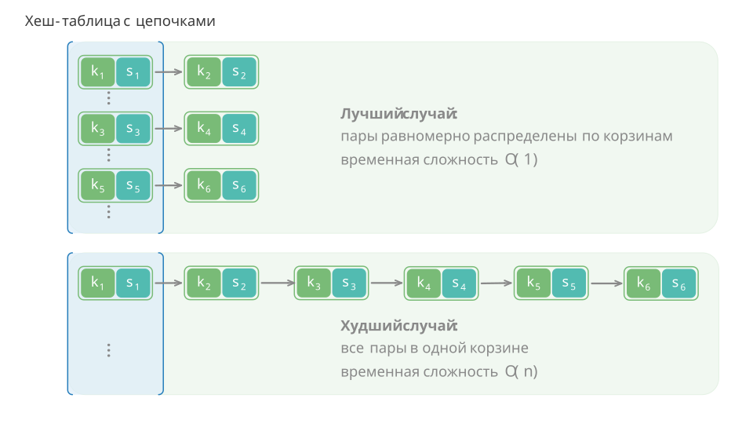

# Алгоритмы хеширования

В двух предыдущих разделах мы рассмотрели принципы работы хеш-таблицы и способы обработки хеш-коллизий. Однако и открытая адресация, и метод цепочек **лишь позволяют хеш-таблице корректно работать при возникновении коллизий, но не уменьшают вероятность появления самих коллизий**.

Если хеш-коллизии происходят слишком часто, производительность хеш-таблицы резко деградирует. Как показано на рисунке ниже, для хеш-таблицы с методом цепочек в идеальном случае пары ключ-значение равномерно распределены по всем бакетам, и это дает наилучшую эффективность поиска. В худшем же случае все пары ключ-значение оказываются в одном бакете, и временная сложность вырождается до $O(n)$ .



**Распределение пар ключ-значение определяется хеш-функцией**. Вспомним этапы вычисления хеш-функции: сначала вычисляется хеш-значение, затем оно берется по модулю длины массива:

```shell
index = hash(key) % capacity
```

Из этой формулы видно: при фиксированной емкости хеш-таблицы `capacity` **выходное значение определяет именно хеш-алгоритм `hash()`**, а значит, именно он определяет распределение пар ключ-значение в хеш-таблице.

Это означает, что для уменьшения вероятности хеш-коллизий нам следует сосредоточиться на проектировании хеш-алгоритма `hash()` .

## Цели хеш-алгоритма

Чтобы получить структуру данных хеш-таблицы, которая будет одновременно быстрой и надежной, хеш-алгоритм должен обладать следующими свойствами.

- **Детерминированность**: для одинакового входа хеш-алгоритм всегда должен выдавать одинаковый результат. Только так хеш-таблица остается надежной.
- **Высокая эффективность**: вычисление хеш-значения должно быть достаточно быстрым. Чем меньше вычислительные затраты, тем выше практическая ценность хеш-таблицы.
- **Равномерное распределение**: хеш-алгоритм должен стараться распределять пары ключ-значение в хеш-таблице равномерно. Чем равномернее распределение, тем ниже вероятность хеш-коллизий.

На практике хеш-алгоритмы используются не только для реализации хеш-таблиц, но и во многих других областях.

- **Хранение паролей**: чтобы защищать пароли пользователей, система обычно хранит не сами пароли в открытом виде, а их хеш-значения. Когда пользователь вводит пароль, система вычисляет хеш-значение введенного пароля и сравнивает его с сохраненным значением. Если они совпадают, пароль считается правильным.
- **Проверка целостности данных**: отправитель может вычислить хеш-значение данных и отправить его вместе с самими данными. Получатель затем вычисляет хеш-значение повторно и сравнивает его с полученным. Если они совпадают, данные считаются целостными.

Для приложений, связанных с криптографией, чтобы не допустить восстановления исходного пароля по хеш-значению и иных форм обратного анализа, хеш-алгоритм должен обладать более строгими свойствами безопасности.

- **Односторонность**: по хеш-значению нельзя восстановить какую-либо информацию о входных данных.
- **Устойчивость к коллизиям**: должно быть крайне трудно найти два разных входа, имеющих одинаковое хеш-значение.
- **Эффект лавины**: даже небольшое изменение во входных данных должно приводить к заметному и непредсказуемому изменению результата.

Обратите внимание: **«равномерное распределение» и «устойчивость к коллизиям» - это два независимых понятия** , и выполнение первого не означает автоматического выполнения второго. Например, при случайном распределении входных `key` хеш-функция `key % 100` может выдавать достаточно равномерное распределение. Однако этот хеш-алгоритм слишком прост: все `key` с одинаковыми двумя последними цифрами будут иметь одинаковый результат, а значит, по хеш-значению можно легко подобрать подходящие `key` и, например, взломать пароль.

## Проектирование хеш-алгоритма

Разработка хеш-алгоритма - это сложная задача, в которой нужно учитывать множество факторов. Однако для некоторых нетребовательных сценариев мы можем спроектировать и несколько простых хеш-алгоритмов.

- **Аддитивный хеш**: складываем ASCII-коды всех символов входной строки и используем полученную сумму как хеш-значение.
- **Мультипликативный хеш**: используем «некоррелированность» умножения. На каждом шаге умножаем текущее значение на константу и добавляем ASCII-код очередного символа.
- **XOR-хеш**: последовательно накапливаем элементы входных данных в одном хеш-значении через операцию XOR.
- **Ротационный хеш**: последовательно накапливаем ASCII-коды символов, причем перед каждым накоплением выполняем циклический сдвиг хеш-значения.

```src
[file]{simple_hash}-[class]{}-[func]{rot_hash}
```

Нетрудно заметить, что последний шаг каждого из этих хеш-алгоритмов - взятие по модулю большого простого числа $1000000007$ , чтобы гарантировать, что хеш-значение остается в разумных границах. Стоит задуматься: почему подчеркивается именно взятие по модулю простого числа, и какие недостатки возникают при использовании составного модуля? Это интересный вопрос.

Сначала дадим вывод: **использование большого простого числа в качестве модуля позволяет в максимальной степени обеспечивать равномерное распределение хеш-значений**. Поскольку простое число не имеет общих делителей с другими числами, это помогает уменьшить периодические закономерности, возникающие из-за операции взятия остатка, и тем самым снизить число хеш-коллизий.

Рассмотрим пример. Предположим, мы выбрали составное число $9$ в качестве модуля. Оно делится на $3$ , поэтому все `key` , которые делятся на $3$ , будут отображаться только в три хеш-значения: $0$ , $3$ , $6$ .

$$
\begin{aligned}
\text{modulus} & = 9 \newline
\text{key} & = \{ 0, 3, 6, 9, 12, 15, 18, 21, 24, 27, 30, 33, \dots \} \newline
\text{hash} & = \{ 0, 3, 6, 0, 3, 6, 0, 3, 6, 0, 3, 6,\dots \}
\end{aligned}
$$

Если входные `key` как раз удовлетворяют такому распределению в виде арифметической прогрессии, то хеш-значения начнут скучиваться, а это усугубит хеш-коллизии. Теперь предположим, что мы заменили `modulus` на простое число $13$. Поскольку между `key` и `modulus` нет общих делителей, равномерность распределения хеш-значений заметно улучшится.

$$
\begin{aligned}
\text{modulus} & = 13 \newline
\text{key} & = \{ 0, 3, 6, 9, 12, 15, 18, 21, 24, 27, 30, 33, \dots \} \newline
\text{hash} & = \{ 0, 3, 6, 9, 12, 2, 5, 8, 11, 1, 4, 7, \dots \}
\end{aligned}
$$

Следует отметить: если можно гарантировать, что `key` распределены случайно и равномерно, то выбор простого или составного числа в качестве модуля не так важен - оба варианта способны дать равномерное распределение хеш-значений. Но если в распределении `key` присутствует периодичность, то взятие по модулю составного числа гораздо легче приводит к кластеризации.

Итак, на практике мы обычно выбираем простое число в качестве модуля, причем это простое число желательно брать достаточно большим, чтобы по возможности убрать периодические закономерности и повысить устойчивость хеш-алгоритма.

## Распространенные хеш-алгоритмы

Нетрудно заметить, что описанные выше простые хеш-алгоритмы довольно хрупкие и далеки от поставленных целей. Например, сложение и XOR подчиняются коммутативному закону, поэтому аддитивный хеш и XOR-хеш не различают строки, состоящие из одних и тех же символов, но в разном порядке. Это может усиливать хеш-коллизии и даже создавать некоторые проблемы безопасности.

На практике мы обычно используем стандартные хеш-алгоритмы, такие как MD5, SHA-1, SHA-2 и SHA-3. Они могут отображать входные данные произвольной длины в хеш-значения фиксированной длины.

На протяжении почти ста лет хеш-алгоритмы непрерывно развивались и оптимизировались. Одни исследователи старались повысить их производительность, а другие исследователи и хакеры сосредоточивались на поиске уязвимостей в их безопасности. В таблице ниже приведены распространенные хеш-алгоритмы, которые часто встречаются в реальных приложениях.

- MD5 и SHA-1 уже многократно были успешно атакованы, поэтому они выведены из большинства сценариев, где требуется безопасность.
- SHA-256 из семейства SHA-2 является одним из самых надежных хеш-алгоритмов. На сегодняшний день не известно успешных практических атак, поэтому он широко используется в самых разных протоколах и системах безопасности.
- SHA-3 по сравнению с SHA-2 требует меньших затрат на реализацию и обеспечивает более высокую вычислительную эффективность, но на данный момент распространен слабее, чем семейство SHA-2.

<p align="center"> Таблица <id> &nbsp; Распространенные хеш-алгоритмы </p>

|          | MD5                            | SHA-1            | SHA-2                        | SHA-3               |
| -------- | ------------------------------ | ---------------- | ---------------------------- | ------------------- |
| Год появления | 1992                           | 1995             | 2002                         | 2008                |
| Длина вывода | 128 bit                        | 160 bit          | 256/512 bit                  | 224/256/384/512 bit |
| Хеш-коллизии | Частые                         | Частые           | Редкие                       | Редкие              |
| Уровень безопасности | Низкий, успешно атакован | Низкий, успешно атакован | Высокий               | Высокий             |
| Применение | Устарел, но еще используется для проверки целостности данных | Устарел         | Проверка криптовалютных транзакций, цифровые подписи и т. д. | Может использоваться как замена SHA-2    |

## Хеш-значения структур данных

Мы знаем, что `key` в хеш-таблице могут быть целыми числами, вещественными числами, строками и другими типами данных. Языки программирования обычно предоставляют встроенные хеш-алгоритмы для этих типов, чтобы вычислять индексы бакетов в хеш-таблице. Возьмем Python: в нем можно вызвать функцию `hash()` , чтобы вычислить хеш-значения для различных типов данных.

- Хеш-значение целого числа и булева значения совпадает с самим значением.
- Вычисление хеш-значений для вещественных чисел и строк устроено сложнее. Интересующиеся читатели могут изучить это самостоятельно.
- Хеш-значение кортежа получается путем хеширования каждого элемента, а затем объединения этих хеш-значений в одно итоговое значение.
- Хеш-значение объекта обычно строится на основе его адреса в памяти. Если переопределить метод хеширования объекта, можно реализовать вычисление хеша по содержимому.

!!! tip

    Обратите внимание: определения и способы вычисления встроенных хеш-значений в разных языках программирования отличаются.

```snippet
builtin_hash
```

??? pythontutor "Визуализация выполнения"

    @tutor builtin_hash_tutor

Во многих языках программирования **в качестве `key` хеш-таблицы можно использовать только неизменяемые объекты** . Если, например, использовать список (динамический массив) как `key` , то после изменения содержимого списка изменится и его хеш-значение, из-за чего мы уже не сможем найти прежнее `value` в хеш-таблице.

Хотя у пользовательских объектов (например, у узла связного списка) поля являются изменяемыми, сам объект все же может быть хешируемым. **Причина в том, что хеш-значение объекта обычно строится на основе адреса в памяти** : даже если содержимое объекта меняется, его адрес памяти остается прежним, а значит, и хеш-значение не меняется.

Внимательный читатель мог заметить, что при запуске программы в разных консолях выводимые хеш-значения отличаются. **Это связано с тем, что интерпретатор Python при каждом запуске добавляет в хеш-функцию строк случайную соль (salt)**. Такой подход эффективно защищает от атак типа HashDoS и повышает безопасность хеш-алгоритма.
