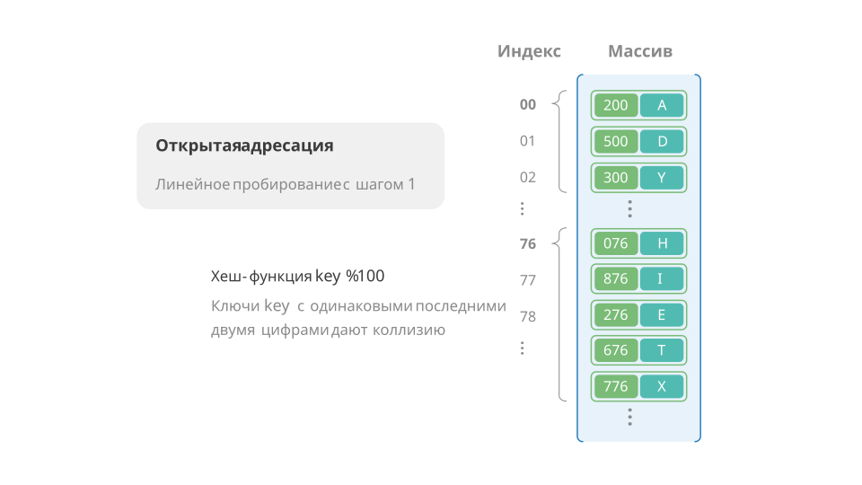

# 6.2 &nbsp; Коллизии

Как отмечалось в предыдущем разделе, **множество возможных входов хеш-функции обычно гораздо больше множества её выходов**, поэтому в принципе избежать коллизий нельзя. Если на входе допустимы любые целые числа, а результат ограничен индексами массива, одному индексу корзины обязательно будут соответствовать несколько чисел.

Коллизии могут привести к ошибочному результату поиска и сделать хеш-таблицу непригодной для работы. Можно при каждой коллизии расширять таблицу, пока коллизия не исчезнет. Это простой и действенный, но слишком затратный подход: расширение требует переноса большого объёма данных и повторного вычисления хешей. Для повышения эффективности воспользуемся двумя приёмами.

1. Изменим структуру таблицы так, **чтобы она корректно работала и при коллизиях**.
2. Будем расширять таблицу лишь при необходимости, когда коллизии становятся серьёзной проблемой.

Два основных способа изменить структуру хеш-таблицы — метод цепочек и открытая адресация.

## 6.2.1 &nbsp; Метод цепочек

В исходной хеш-таблице в каждой корзине хранилась только одна пара. При <u>методе цепочек (separate chaining)</u> вместо одиночного элемента используется связный список: каждая пара образует узел, и все пары, между которыми возникла коллизия, хранятся в одном списке. Ниже показан пример такой таблицы.

{ class="animation-figure" }

<p align="center"> Рисунок 6-5 &nbsp; Хеш-таблица с цепочками </p>

При использовании метода цепочек операции с хеш-таблицей меняются следующим образом.

- **Поиск**. По ключу `key` хеш-функция вычисляет индекс корзины. Переходим к первому узлу списка и обходим его, сравнивая ключи `key`, пока не найдём нужную пару.
- **Вставка**. Сначала с помощью хеш-функции находим начало списка, затем добавляем в него узел с парой «ключ — значение».
- **Удаление**. По результату хеш-функции находим начало списка, обходим список, находим нужный узел и удаляем его.

У метода цепочек есть следующие недостатки.

- **Дополнительный расход памяти**. Связному списку нужны указатели на узлы, поэтому он занимает больше памяти, чем массив.
- **Снижение скорости поиска**. Чтобы найти нужный элемент, приходится последовательно обходить список.

Ниже приведена простая реализация хеш-таблицы с цепочками. Обратите внимание на две детали.

- Для простоты вместо связных списков используем списки на основе динамических массивов. Таким образом, хеш-таблица представляет собой массив корзин, а каждая корзина — список.
- В реализации предусмотрено расширение таблицы. Когда коэффициент заполнения превышает $\frac{2}{3}$, увеличиваем ёмкость в $2$ раза.

=== "Python"

    ```python title="hash_map_chaining.py"
    class HashMapChaining:
        """Хеш-таблица с цепочками"""

        def __init__(self):
            """Конструктор"""
            self.size = 0  # Число пар «ключ — значение»
            self.capacity = 4  # Ёмкость хеш-таблицы
            self.load_thres = 2.0 / 3.0  # Порог коэффициента заполнения для расширения
            self.extend_ratio = 2  # Во сколько раз увеличивается ёмкость
            self.buckets = [[] for _ in range(self.capacity)]  # Массив корзин

        def hash_func(self, key: int) -> int:
            """Хеш-функция"""
            return key % self.capacity

        def load_factor(self) -> float:
            """Коэффициент заполнения"""
            return self.size / self.capacity

        def get(self, key: int) -> str | None:
            """Поиск"""
            index = self.hash_func(key)
            bucket = self.buckets[index]
            # Обойти корзину и при совпадении ключа key вернуть соответствующее значение val
            for pair in bucket:
                if pair.key == key:
                    return pair.val
            # Если ключ key не найден, вернуть None
            return None

        def put(self, key: int, val: str):
            """Вставка"""
            # Расширить таблицу, если коэффициент заполнения превысил порог
            if self.load_factor() > self.load_thres:
                self.extend()
            index = self.hash_func(key)
            bucket = self.buckets[index]
            # Обойти корзину. Если найден ключ key, обновить val и завершить операцию
            for pair in bucket:
                if pair.key == key:
                    pair.val = val
                    return
            # Если ключа key нет, добавить пару в конец списка
            pair = Pair(key, val)
            bucket.append(pair)
            self.size += 1

        def remove(self, key: int):
            """Удаление"""
            index = self.hash_func(key)
            bucket = self.buckets[index]
            # Обойти корзину и удалить из неё нужную пару
            for pair in bucket:
                if pair.key == key:
                    bucket.remove(pair)
                    self.size -= 1
                    break

        def extend(self):
            """Расширить хеш-таблицу"""
            # Временно сохранить исходную хеш-таблицу
            buckets = self.buckets
            # Создать новую таблицу увеличенной ёмкости
            self.capacity *= self.extend_ratio
            self.buckets = [[] for _ in range(self.capacity)]
            self.size = 0
            # Перенести пары из исходной таблицы в новую
            for bucket in buckets:
                for pair in bucket:
                    self.put(pair.key, pair.val)

        def print(self):
            """Вывести хеш-таблицу"""
            for bucket in self.buckets:
                res = []
                for pair in bucket:
                    res.append(str(pair.key) + " -> " + pair.val)
                print(res)
    ```

=== "C++"

    ```cpp title="hash_map_chaining.cpp"
    /* Хеш-таблица с цепочками */
    class HashMapChaining {
      private:
        int size;                       // Число пар «ключ — значение»
        int capacity;                   // Ёмкость хеш-таблицы
        double loadThres;               // Порог коэффициента заполнения для расширения
        int extendRatio;                // Во сколько раз увеличивается ёмкость
        vector<vector<Pair *>> buckets; // Массив корзин

      public:
        /* Конструктор */
        HashMapChaining() : size(0), capacity(4), loadThres(2.0 / 3.0), extendRatio(2) {
            buckets.resize(capacity);
        }

        /* Деструктор */
        ~HashMapChaining() {
            for (auto &bucket : buckets) {
                for (Pair *pair : bucket) {
                    // Освободить память
                    delete pair;
                }
            }
        }

        /* Хеш-функция */
        int hashFunc(int key) {
            return key % capacity;
        }

        /* Коэффициент заполнения */
        double loadFactor() {
            return (double)size / (double)capacity;
        }

        /* Поиск */
        string get(int key) {
            int index = hashFunc(key);
            // Обойти корзину и при совпадении ключа key вернуть соответствующее значение val
            for (Pair *pair : buckets[index]) {
                if (pair->key == key) {
                    return pair->val;
                }
            }
            // Если ключ key не найден, вернуть пустую строку
            return "";
        }

        /* Вставка */
        void put(int key, string val) {
            // Расширить таблицу, если коэффициент заполнения превысил порог
            if (loadFactor() > loadThres) {
                extend();
            }
            int index = hashFunc(key);
            // Обойти корзину. Если найден ключ key, обновить val и завершить операцию
            for (Pair *pair : buckets[index]) {
                if (pair->key == key) {
                    pair->val = val;
                    return;
                }
            }
            // Если ключа key нет, добавить пару в конец списка
            buckets[index].push_back(new Pair(key, val));
            size++;
        }

        /* Удаление */
        void remove(int key) {
            int index = hashFunc(key);
            auto &bucket = buckets[index];
            // Обойти корзину и удалить из неё нужную пару
            for (int i = 0; i < bucket.size(); i++) {
                if (bucket[i]->key == key) {
                    Pair *tmp = bucket[i];
                    bucket.erase(bucket.begin() + i); // Удалить из списка пару «ключ — значение»
                    delete tmp;                       // Освободить память
                    size--;
                    return;
                }
            }
        }

        /* Расширить хеш-таблицу */
        void extend() {
            // Временно сохранить исходную хеш-таблицу
            vector<vector<Pair *>> bucketsTmp = buckets;
            // Создать новую таблицу увеличенной ёмкости
            capacity *= extendRatio;
            buckets.clear();
            buckets.resize(capacity);
            size = 0;
            // Перенести пары из исходной таблицы в новую
            for (auto &bucket : bucketsTmp) {
                for (Pair *pair : bucket) {
                    put(pair->key, pair->val);
                    // Освободить память
                    delete pair;
                }
            }
        }

        /* Вывести хеш-таблицу */
        void print() {
            for (auto &bucket : buckets) {
                cout << "[";
                for (Pair *pair : bucket) {
                    cout << pair->key << " -> " << pair->val << ", ";
                }
                cout << "]\n";
            }
        }
    };
    ```

=== "Java"

    ```java title="hash_map_chaining.java"
    /* Хеш-таблица с цепочками */
    class HashMapChaining {
        int size; // Число пар «ключ — значение»
        int capacity; // Ёмкость хеш-таблицы
        double loadThres; // Порог коэффициента заполнения для расширения
        int extendRatio; // Во сколько раз увеличивается ёмкость
        List<List<Pair>> buckets; // Массив корзин

        /* Конструктор */
        public HashMapChaining() {
            size = 0;
            capacity = 4;
            loadThres = 2.0 / 3.0;
            extendRatio = 2;
            buckets = new ArrayList<>(capacity);
            for (int i = 0; i < capacity; i++) {
                buckets.add(new ArrayList<>());
            }
        }

        /* Хеш-функция */
        int hashFunc(int key) {
            return key % capacity;
        }

        /* Коэффициент заполнения */
        double loadFactor() {
            return (double) size / capacity;
        }

        /* Поиск */
        String get(int key) {
            int index = hashFunc(key);
            List<Pair> bucket = buckets.get(index);
            // Обойти корзину и при совпадении ключа key вернуть соответствующее значение val
            for (Pair pair : bucket) {
                if (pair.key == key) {
                    return pair.val;
                }
            }
            // Если ключ key не найден, вернуть null
            return null;
        }

        /* Вставка */
        void put(int key, String val) {
            // Расширить таблицу, если коэффициент заполнения превысил порог
            if (loadFactor() > loadThres) {
                extend();
            }
            int index = hashFunc(key);
            List<Pair> bucket = buckets.get(index);
            // Обойти корзину. Если найден ключ key, обновить val и завершить операцию
            for (Pair pair : bucket) {
                if (pair.key == key) {
                    pair.val = val;
                    return;
                }
            }
            // Если ключа key нет, добавить пару в конец списка
            Pair pair = new Pair(key, val);
            bucket.add(pair);
            size++;
        }

        /* Удаление */
        void remove(int key) {
            int index = hashFunc(key);
            List<Pair> bucket = buckets.get(index);
            // Обойти корзину и удалить из неё нужную пару
            for (Pair pair : bucket) {
                if (pair.key == key) {
                    bucket.remove(pair);
                    size--;
                    break;
                }
            }
        }

        /* Расширить хеш-таблицу */
        void extend() {
            // Временно сохранить исходную хеш-таблицу
            List<List<Pair>> bucketsTmp = buckets;
            // Создать новую таблицу увеличенной ёмкости
            capacity *= extendRatio;
            buckets = new ArrayList<>(capacity);
            for (int i = 0; i < capacity; i++) {
                buckets.add(new ArrayList<>());
            }
            size = 0;
            // Перенести пары из исходной таблицы в новую
            for (List<Pair> bucket : bucketsTmp) {
                for (Pair pair : bucket) {
                    put(pair.key, pair.val);
                }
            }
        }

        /* Вывести хеш-таблицу */
        void print() {
            for (List<Pair> bucket : buckets) {
                List<String> res = new ArrayList<>();
                for (Pair pair : bucket) {
                    res.add(pair.key + " -> " + pair.val);
                }
                System.out.println(res);
            }
        }
    }
    ```

=== "C#"

    ```csharp title="hash_map_chaining.cs"
    /* Хеш-таблица с цепочками */
    class HashMapChaining {
        int size; // Число пар «ключ — значение»
        int capacity; // Ёмкость хеш-таблицы
        double loadThres; // Порог коэффициента заполнения для расширения
        int extendRatio; // Во сколько раз увеличивается ёмкость
        List<List<Pair>> buckets; // Массив корзин

        /* Конструктор */
        public HashMapChaining() {
            size = 0;
            capacity = 4;
            loadThres = 2.0 / 3.0;
            extendRatio = 2;
            buckets = new List<List<Pair>>(capacity);
            for (int i = 0; i < capacity; i++) {
                buckets.Add([]);
            }
        }

        /* Хеш-функция */
        int HashFunc(int key) {
            return key % capacity;
        }

        /* Коэффициент заполнения */
        double LoadFactor() {
            return (double)size / capacity;
        }

        /* Поиск */
        public string? Get(int key) {
            int index = HashFunc(key);
            // Обойти корзину и при совпадении ключа key вернуть соответствующее значение val
            foreach (Pair pair in buckets[index]) {
                if (pair.key == key) {
                    return pair.val;
                }
            }
            // Если ключ key не найден, вернуть null
            return null;
        }

        /* Вставка */
        public void Put(int key, string val) {
            // Расширить таблицу, если коэффициент заполнения превысил порог
            if (LoadFactor() > loadThres) {
                Extend();
            }
            int index = HashFunc(key);
            // Обойти корзину. Если найден ключ key, обновить val и завершить операцию
            foreach (Pair pair in buckets[index]) {
                if (pair.key == key) {
                    pair.val = val;
                    return;
                }
            }
            // Если ключа key нет, добавить пару в конец списка
            buckets[index].Add(new Pair(key, val));
            size++;
        }

        /* Удаление */
        public void Remove(int key) {
            int index = HashFunc(key);
            // Обойти корзину и удалить из неё нужную пару
            foreach (Pair pair in buckets[index].ToList()) {
                if (pair.key == key) {
                    buckets[index].Remove(pair);
                    size--;
                    break;
                }
            }
        }

        /* Расширить хеш-таблицу */
        void Extend() {
            // Временно сохранить исходную хеш-таблицу
            List<List<Pair>> bucketsTmp = buckets;
            // Создать новую таблицу увеличенной ёмкости
            capacity *= extendRatio;
            buckets = new List<List<Pair>>(capacity);
            for (int i = 0; i < capacity; i++) {
                buckets.Add([]);
            }
            size = 0;
            // Перенести пары из исходной таблицы в новую
            foreach (List<Pair> bucket in bucketsTmp) {
                foreach (Pair pair in bucket) {
                    Put(pair.key, pair.val);
                }
            }
        }

        /* Вывести хеш-таблицу */
        public void Print() {
            foreach (List<Pair> bucket in buckets) {
                List<string> res = [];
                foreach (Pair pair in bucket) {
                    res.Add(pair.key + " -> " + pair.val);
                }
                foreach (string kv in res) {
                    Console.WriteLine(kv);
                }
            }
        }
    }
    ```

=== "Go"

    ```go title="hash_map_chaining.go"
    /* Хеш-таблица с цепочками */
    type hashMapChaining struct {
        size        int      // Число пар «ключ — значение»
        capacity    int      // Ёмкость хеш-таблицы
        loadThres   float64  // Порог коэффициента заполнения для расширения
        extendRatio int      // Во сколько раз увеличивается ёмкость
        buckets     [][]pair // Массив корзин
    }

    /* Конструктор */
    func newHashMapChaining() *hashMapChaining {
        buckets := make([][]pair, 4)
        for i := 0; i < 4; i++ {
            buckets[i] = make([]pair, 0)
        }
        return &hashMapChaining{
            size:        0,
            capacity:    4,
            loadThres:   2.0 / 3.0,
            extendRatio: 2,
            buckets:     buckets,
        }
    }

    /* Хеш-функция */
    func (m *hashMapChaining) hashFunc(key int) int {
        return key % m.capacity
    }

    /* Коэффициент заполнения */
    func (m *hashMapChaining) loadFactor() float64 {
        return float64(m.size) / float64(m.capacity)
    }

    /* Поиск */
    func (m *hashMapChaining) get(key int) string {
        idx := m.hashFunc(key)
        bucket := m.buckets[idx]
        // Обойти корзину и при совпадении ключа key вернуть соответствующее значение val
        for _, p := range bucket {
            if p.key == key {
                return p.val
            }
        }
        // Если ключ key не найден, вернуть пустую строку
        return ""
    }

    /* Вставка */
    func (m *hashMapChaining) put(key int, val string) {
        // Расширить таблицу, если коэффициент заполнения превысил порог
        if m.loadFactor() > m.loadThres {
            m.extend()
        }
        idx := m.hashFunc(key)
        // Обойти корзину. Если найден ключ key, обновить val и завершить операцию
        for i := range m.buckets[idx] {
            if m.buckets[idx][i].key == key {
                m.buckets[idx][i].val = val
                return
            }
        }
        // Если ключа key нет, добавить пару в конец списка
        p := pair{
            key: key,
            val: val,
        }
        m.buckets[idx] = append(m.buckets[idx], p)
        m.size += 1
    }

    /* Удаление */
    func (m *hashMapChaining) remove(key int) {
        idx := m.hashFunc(key)
        // Обойти корзину и удалить из неё нужную пару
        for i, p := range m.buckets[idx] {
            if p.key == key {
                // Удалить элемент из среза
                m.buckets[idx] = append(m.buckets[idx][:i], m.buckets[idx][i+1:]...)
                m.size -= 1
                break
            }
        }
    }

    /* Расширить хеш-таблицу */
    func (m *hashMapChaining) extend() {
        // Временно сохранить исходную хеш-таблицу
        tmpBuckets := make([][]pair, len(m.buckets))
        for i := 0; i < len(m.buckets); i++ {
            tmpBuckets[i] = make([]pair, len(m.buckets[i]))
            copy(tmpBuckets[i], m.buckets[i])
        }
        // Создать новую таблицу увеличенной ёмкости
        m.capacity *= m.extendRatio
        m.buckets = make([][]pair, m.capacity)
        for i := 0; i < m.capacity; i++ {
            m.buckets[i] = make([]pair, 0)
        }
        m.size = 0
        // Перенести пары из исходной таблицы в новую
        for _, bucket := range tmpBuckets {
            for _, p := range bucket {
                m.put(p.key, p.val)
            }
        }
    }

    /* Вывести хеш-таблицу */
    func (m *hashMapChaining) print() {
        var builder strings.Builder

        for _, bucket := range m.buckets {
            builder.WriteString("[")
            for _, p := range bucket {
                builder.WriteString(strconv.Itoa(p.key) + " -> " + p.val + " ")
            }
            builder.WriteString("]")
            fmt.Println(builder.String())
            builder.Reset()
        }
    }
    ```

=== "Swift"

    ```swift title="hash_map_chaining.swift"
    /* Хеш-таблица с цепочками */
    class HashMapChaining {
        var size: Int // Число пар «ключ — значение»
        var capacity: Int // Ёмкость хеш-таблицы
        var loadThres: Double // Порог коэффициента заполнения для расширения
        var extendRatio: Int // Во сколько раз увеличивается ёмкость
        var buckets: [[Pair]] // Массив корзин

        /* Конструктор */
        init() {
            size = 0
            capacity = 4
            loadThres = 2.0 / 3.0
            extendRatio = 2
            buckets = Array(repeating: [], count: capacity)
        }

        /* Хеш-функция */
        func hashFunc(key: Int) -> Int {
            key % capacity
        }

        /* Коэффициент заполнения */
        func loadFactor() -> Double {
            Double(size) / Double(capacity)
        }

        /* Поиск */
        func get(key: Int) -> String? {
            let index = hashFunc(key: key)
            let bucket = buckets[index]
            // Обойти корзину и при совпадении ключа key вернуть соответствующее значение val
            for pair in bucket {
                if pair.key == key {
                    return pair.val
                }
            }
            // Если ключ key не найден, вернуть nil
            return nil
        }

        /* Вставка */
        func put(key: Int, val: String) {
            // Расширить таблицу, если коэффициент заполнения превысил порог
            if loadFactor() > loadThres {
                extend()
            }
            let index = hashFunc(key: key)
            let bucket = buckets[index]
            // Обойти корзину. Если найден ключ key, обновить val и завершить операцию
            for pair in bucket {
                if pair.key == key {
                    pair.val = val
                    return
                }
            }
            // Если ключа key нет, добавить пару в конец списка
            let pair = Pair(key: key, val: val)
            buckets[index].append(pair)
            size += 1
        }

        /* Удаление */
        func remove(key: Int) {
            let index = hashFunc(key: key)
            let bucket = buckets[index]
            // Обойти корзину и удалить из неё нужную пару
            for (pairIndex, pair) in bucket.enumerated() {
                if pair.key == key {
                    buckets[index].remove(at: pairIndex)
                    size -= 1
                    break
                }
            }
        }

        /* Расширить хеш-таблицу */
        func extend() {
            // Временно сохранить исходную хеш-таблицу
            let bucketsTmp = buckets
            // Создать новую таблицу увеличенной ёмкости
            capacity *= extendRatio
            buckets = Array(repeating: [], count: capacity)
            size = 0
            // Перенести пары из исходной таблицы в новую
            for bucket in bucketsTmp {
                for pair in bucket {
                    put(key: pair.key, val: pair.val)
                }
            }
        }

        /* Вывести хеш-таблицу */
        func print() {
            for bucket in buckets {
                let res = bucket.map { "\($0.key) -> \($0.val)" }
                Swift.print(res)
            }
        }
    }
    ```

=== "JS"

    ```javascript title="hash_map_chaining.js"
    /* Хеш-таблица с цепочками */
    class HashMapChaining {
        #size; // Число пар «ключ — значение»
        #capacity; // Ёмкость хеш-таблицы
        #loadThres; // Порог коэффициента заполнения для расширения
        #extendRatio; // Во сколько раз увеличивается ёмкость
        #buckets; // Массив корзин

        /* Конструктор */
        constructor() {
            this.#size = 0;
            this.#capacity = 4;
            this.#loadThres = 2.0 / 3.0;
            this.#extendRatio = 2;
            this.#buckets = new Array(this.#capacity).fill(null).map((x) => []);
        }

        /* Хеш-функция */
        #hashFunc(key) {
            return key % this.#capacity;
        }

        /* Коэффициент заполнения */
        #loadFactor() {
            return this.#size / this.#capacity;
        }

        /* Поиск */
        get(key) {
            const index = this.#hashFunc(key);
            const bucket = this.#buckets[index];
            // Обойти корзину и при совпадении ключа key вернуть соответствующее значение val
            for (const pair of bucket) {
                if (pair.key === key) {
                    return pair.val;
                }
            }
            // Если ключ key не найден, вернуть null
            return null;
        }

        /* Вставка */
        put(key, val) {
            // Расширить таблицу, если коэффициент заполнения превысил порог
            if (this.#loadFactor() > this.#loadThres) {
                this.#extend();
            }
            const index = this.#hashFunc(key);
            const bucket = this.#buckets[index];
            // Обойти корзину. Если найден ключ key, обновить val и завершить операцию
            for (const pair of bucket) {
                if (pair.key === key) {
                    pair.val = val;
                    return;
                }
            }
            // Если ключа key нет, добавить пару в конец списка
            const pair = new Pair(key, val);
            bucket.push(pair);
            this.#size++;
        }

        /* Удаление */
        remove(key) {
            const index = this.#hashFunc(key);
            let bucket = this.#buckets[index];
            // Обойти корзину и удалить из неё нужную пару
            for (let i = 0; i < bucket.length; i++) {
                if (bucket[i].key === key) {
                    bucket.splice(i, 1);
                    this.#size--;
                    break;
                }
            }
        }

        /* Расширить хеш-таблицу */
        #extend() {
            // Временно сохранить исходную хеш-таблицу
            const bucketsTmp = this.#buckets;
            // Создать новую таблицу увеличенной ёмкости
            this.#capacity *= this.#extendRatio;
            this.#buckets = new Array(this.#capacity).fill(null).map((x) => []);
            this.#size = 0;
            // Перенести пары из исходной таблицы в новую
            for (const bucket of bucketsTmp) {
                for (const pair of bucket) {
                    this.put(pair.key, pair.val);
                }
            }
        }

        /* Вывести хеш-таблицу */
        print() {
            for (const bucket of this.#buckets) {
                let res = [];
                for (const pair of bucket) {
                    res.push(pair.key + ' -> ' + pair.val);
                }
                console.log(res);
            }
        }
    }
    ```

=== "TS"

    ```typescript title="hash_map_chaining.ts"
    /* Хеш-таблица с цепочками */
    class HashMapChaining {
        #size: number; // Число пар «ключ — значение»
        #capacity: number; // Ёмкость хеш-таблицы
        #loadThres: number; // Порог коэффициента заполнения для расширения
        #extendRatio: number; // Во сколько раз увеличивается ёмкость
        #buckets: Pair[][]; // Массив корзин

        /* Конструктор */
        constructor() {
            this.#size = 0;
            this.#capacity = 4;
            this.#loadThres = 2.0 / 3.0;
            this.#extendRatio = 2;
            this.#buckets = new Array(this.#capacity).fill(null).map((x) => []);
        }

        /* Хеш-функция */
        #hashFunc(key: number): number {
            return key % this.#capacity;
        }

        /* Коэффициент заполнения */
        #loadFactor(): number {
            return this.#size / this.#capacity;
        }

        /* Поиск */
        get(key: number): string | null {
            const index = this.#hashFunc(key);
            const bucket = this.#buckets[index];
            // Обойти корзину и при совпадении ключа key вернуть соответствующее значение val
            for (const pair of bucket) {
                if (pair.key === key) {
                    return pair.val;
                }
            }
            // Если ключ key не найден, вернуть null
            return null;
        }

        /* Вставка */
        put(key: number, val: string): void {
            // Расширить таблицу, если коэффициент заполнения превысил порог
            if (this.#loadFactor() > this.#loadThres) {
                this.#extend();
            }
            const index = this.#hashFunc(key);
            const bucket = this.#buckets[index];
            // Обойти корзину. Если найден ключ key, обновить val и завершить операцию
            for (const pair of bucket) {
                if (pair.key === key) {
                    pair.val = val;
                    return;
                }
            }
            // Если ключа key нет, добавить пару в конец списка
            const pair = new Pair(key, val);
            bucket.push(pair);
            this.#size++;
        }

        /* Удаление */
        remove(key: number): void {
            const index = this.#hashFunc(key);
            let bucket = this.#buckets[index];
            // Обойти корзину и удалить из неё нужную пару
            for (let i = 0; i < bucket.length; i++) {
                if (bucket[i].key === key) {
                    bucket.splice(i, 1);
                    this.#size--;
                    break;
                }
            }
        }

        /* Расширить хеш-таблицу */
        #extend(): void {
            // Временно сохранить исходную хеш-таблицу
            const bucketsTmp = this.#buckets;
            // Создать новую таблицу увеличенной ёмкости
            this.#capacity *= this.#extendRatio;
            this.#buckets = new Array(this.#capacity).fill(null).map((x) => []);
            this.#size = 0;
            // Перенести пары из исходной таблицы в новую
            for (const bucket of bucketsTmp) {
                for (const pair of bucket) {
                    this.put(pair.key, pair.val);
                }
            }
        }

        /* Вывести хеш-таблицу */
        print(): void {
            for (const bucket of this.#buckets) {
                let res = [];
                for (const pair of bucket) {
                    res.push(pair.key + ' -> ' + pair.val);
                }
                console.log(res);
            }
        }
    }
    ```

=== "Dart"

    ```dart title="hash_map_chaining.dart"
    /* Хеш-таблица с цепочками */
    class HashMapChaining {
      late int size; // Число пар «ключ — значение»
      late int capacity; // Ёмкость хеш-таблицы
      late double loadThres; // Порог коэффициента заполнения для расширения
      late int extendRatio; // Во сколько раз увеличивается ёмкость
      late List<List<Pair>> buckets; // Массив корзин

      /* Конструктор */
      HashMapChaining() {
        size = 0;
        capacity = 4;
        loadThres = 2.0 / 3.0;
        extendRatio = 2;
        buckets = List.generate(capacity, (_) => []);
      }

      /* Хеш-функция */
      int hashFunc(int key) {
        return key % capacity;
      }

      /* Коэффициент заполнения */
      double loadFactor() {
        return size / capacity;
      }

      /* Поиск */
      String? get(int key) {
        int index = hashFunc(key);
        List<Pair> bucket = buckets[index];
        // Обойти корзину и при совпадении ключа key вернуть соответствующее значение val
        for (Pair pair in bucket) {
          if (pair.key == key) {
            return pair.val;
          }
        }
        // Если ключ key не найден, вернуть null
        return null;
      }

      /* Вставка */
      void put(int key, String val) {
        // Расширить таблицу, если коэффициент заполнения превысил порог
        if (loadFactor() > loadThres) {
          extend();
        }
        int index = hashFunc(key);
        List<Pair> bucket = buckets[index];
        // Обойти корзину. Если найден ключ key, обновить val и завершить операцию
        for (Pair pair in bucket) {
          if (pair.key == key) {
            pair.val = val;
            return;
          }
        }
        // Если ключа key нет, добавить пару в конец списка
        Pair pair = Pair(key, val);
        bucket.add(pair);
        size++;
      }

      /* Удаление */
      void remove(int key) {
        int index = hashFunc(key);
        List<Pair> bucket = buckets[index];
        // Обойти корзину и удалить из неё нужную пару
        for (Pair pair in bucket) {
          if (pair.key == key) {
            bucket.remove(pair);
            size--;
            break;
          }
        }
      }

      /* Расширить хеш-таблицу */
      void extend() {
        // Временно сохранить исходную хеш-таблицу
        List<List<Pair>> bucketsTmp = buckets;
        // Создать новую таблицу увеличенной ёмкости
        capacity *= extendRatio;
        buckets = List.generate(capacity, (_) => []);
        size = 0;
        // Перенести пары из исходной таблицы в новую
        for (List<Pair> bucket in bucketsTmp) {
          for (Pair pair in bucket) {
            put(pair.key, pair.val);
          }
        }
      }

      /* Вывести хеш-таблицу */
      void printHashMap() {
        for (List<Pair> bucket in buckets) {
          List<String> res = [];
          for (Pair pair in bucket) {
            res.add("${pair.key} -> ${pair.val}");
          }
          print(res);
        }
      }
    }
    ```

=== "Rust"

    ```rust title="hash_map_chaining.rs"
    /* Хеш-таблица с цепочками */
    struct HashMapChaining {
        size: usize,
        capacity: usize,
        load_thres: f32,
        extend_ratio: usize,
        buckets: Vec<Vec<Pair>>,
    }

    impl HashMapChaining {
        /* Конструктор */
        fn new() -> Self {
            Self {
                size: 0,
                capacity: 4,
                load_thres: 2.0 / 3.0,
                extend_ratio: 2,
                buckets: vec![vec![]; 4],
            }
        }

        /* Хеш-функция */
        fn hash_func(&self, key: i32) -> usize {
            key as usize % self.capacity
        }

        /* Коэффициент заполнения */
        fn load_factor(&self) -> f32 {
            self.size as f32 / self.capacity as f32
        }

        /* Удаление */
        fn remove(&mut self, key: i32) -> Option<String> {
            let index = self.hash_func(key);

            // Обойти корзину и удалить из неё нужную пару
            for (i, p) in self.buckets[index].iter_mut().enumerate() {
                if p.key == key {
                    let pair = self.buckets[index].remove(i);
                    self.size -= 1;
                    return Some(pair.val);
                }
            }

            // Если ключ key не найден, вернуть None
            None
        }

        /* Расширить хеш-таблицу */
        fn extend(&mut self) {
            // Временно сохранить исходную хеш-таблицу
            let buckets_tmp = std::mem::take(&mut self.buckets);

            // Создать новую таблицу увеличенной ёмкости
            self.capacity *= self.extend_ratio;
            self.buckets = vec![Vec::new(); self.capacity as usize];
            self.size = 0;

            // Перенести пары из исходной таблицы в новую
            for bucket in buckets_tmp {
                for pair in bucket {
                    self.put(pair.key, pair.val);
                }
            }
        }

        /* Вывести хеш-таблицу */
        fn print(&self) {
            for bucket in &self.buckets {
                let mut res = Vec::new();
                for pair in bucket {
                    res.push(format!("{} -> {}", pair.key, pair.val));
                }
                println!("{:?}", res);
            }
        }

        /* Вставка */
        fn put(&mut self, key: i32, val: String) {
            // Расширить таблицу, если коэффициент заполнения превысил порог
            if self.load_factor() > self.load_thres {
                self.extend();
            }

            let index = self.hash_func(key);

            // Обойти корзину. Если найден ключ key, обновить val и завершить операцию
            for pair in self.buckets[index].iter_mut() {
                if pair.key == key {
                    pair.val = val;
                    return;
                }
            }

            // Если ключа key нет, добавить пару в конец списка
            let pair = Pair { key, val };
            self.buckets[index].push(pair);
            self.size += 1;
        }

        /* Поиск */
        fn get(&self, key: i32) -> Option<&str> {
            let index = self.hash_func(key);

            // Обойти корзину и при совпадении ключа key вернуть соответствующее значение val
            for pair in self.buckets[index].iter() {
                if pair.key == key {
                    return Some(&pair.val);
                }
            }

            // Если ключ key не найден, вернуть None
            None
        }
    }
    ```

=== "C"

    ```c title="hash_map_chaining.c"
    /* Узел связного списка */
    typedef struct Node {
        Pair *pair;
        struct Node *next;
    } Node;

    /* Хеш-таблица с цепочками */
    typedef struct {
        int size;         // Число пар «ключ — значение»
        int capacity;     // Ёмкость хеш-таблицы
        double loadThres; // Порог коэффициента заполнения для расширения
        int extendRatio;  // Во сколько раз увеличивается ёмкость
        Node **buckets;   // Массив корзин
    } HashMapChaining;

    /* Конструктор */
    HashMapChaining *newHashMapChaining() {
        HashMapChaining *hashMap = (HashMapChaining *)malloc(sizeof(HashMapChaining));
        hashMap->size = 0;
        hashMap->capacity = 4;
        hashMap->loadThres = 2.0 / 3.0;
        hashMap->extendRatio = 2;
        hashMap->buckets = (Node **)malloc(hashMap->capacity * sizeof(Node *));
        for (int i = 0; i < hashMap->capacity; i++) {
            hashMap->buckets[i] = NULL;
        }
        return hashMap;
    }

    /* Деструктор */
    void delHashMapChaining(HashMapChaining *hashMap) {
        for (int i = 0; i < hashMap->capacity; i++) {
            Node *cur = hashMap->buckets[i];
            while (cur) {
                Node *tmp = cur;
                cur = cur->next;
                free(tmp->pair);
                free(tmp);
            }
        }
        free(hashMap->buckets);
        free(hashMap);
    }

    /* Хеш-функция */
    int hashFunc(HashMapChaining *hashMap, int key) {
        return key % hashMap->capacity;
    }

    /* Коэффициент заполнения */
    double loadFactor(HashMapChaining *hashMap) {
        return (double)hashMap->size / (double)hashMap->capacity;
    }

    /* Поиск */
    char *get(HashMapChaining *hashMap, int key) {
        int index = hashFunc(hashMap, key);
        // Обойти корзину и при совпадении ключа key вернуть соответствующее значение val
        Node *cur = hashMap->buckets[index];
        while (cur) {
            if (cur->pair->key == key) {
                return cur->pair->val;
            }
            cur = cur->next;
        }
        return ""; // Если ключ key не найден, вернуть пустую строку
    }

    /* Вставка */
    void put(HashMapChaining *hashMap, int key, const char *val) {
        // Расширить таблицу, если коэффициент заполнения превысил порог
        if (loadFactor(hashMap) > hashMap->loadThres) {
            extend(hashMap);
        }
        int index = hashFunc(hashMap, key);
        // Обойти корзину. Если найден ключ key, обновить val и завершить операцию
        Node *cur = hashMap->buckets[index];
        while (cur) {
            if (cur->pair->key == key) {
                strcpy(cur->pair->val, val); // Если найден ключ key, обновить val и завершить операцию
                return;
            }
            cur = cur->next;
        }
        // Если ключа key нет, добавить пару в начало списка
        Pair *newPair = (Pair *)malloc(sizeof(Pair));
        newPair->key = key;
        strcpy(newPair->val, val);
        Node *newNode = (Node *)malloc(sizeof(Node));
        newNode->pair = newPair;
        newNode->next = hashMap->buckets[index];
        hashMap->buckets[index] = newNode;
        hashMap->size++;
    }

    /* Расширить хеш-таблицу */
    void extend(HashMapChaining *hashMap) {
        // Временно сохранить исходную хеш-таблицу
        int oldCapacity = hashMap->capacity;
        Node **oldBuckets = hashMap->buckets;
        // Создать новую таблицу увеличенной ёмкости
        hashMap->capacity *= hashMap->extendRatio;
        hashMap->buckets = (Node **)malloc(hashMap->capacity * sizeof(Node *));
        for (int i = 0; i < hashMap->capacity; i++) {
            hashMap->buckets[i] = NULL;
        }
        hashMap->size = 0;
        // Перенести пары из исходной таблицы в новую
        for (int i = 0; i < oldCapacity; i++) {
            Node *cur = oldBuckets[i];
            while (cur) {
                put(hashMap, cur->pair->key, cur->pair->val);
                Node *temp = cur;
                cur = cur->next;
                // Освободить память
                free(temp->pair);
                free(temp);
            }
        }

        free(oldBuckets);
    }

    /* Удаление */
    void removeItem(HashMapChaining *hashMap, int key) {
        int index = hashFunc(hashMap, key);
        Node *cur = hashMap->buckets[index];
        Node *pre = NULL;
        while (cur) {
            if (cur->pair->key == key) {
                // Удалить из списка пару «ключ — значение»
                if (pre) {
                    pre->next = cur->next;
                } else {
                    hashMap->buckets[index] = cur->next;
                }
                // Освободить память
                free(cur->pair);
                free(cur);
                hashMap->size--;
                return;
            }
            pre = cur;
            cur = cur->next;
        }
    }

    /* Вывести хеш-таблицу */
    void print(HashMapChaining *hashMap) {
        for (int i = 0; i < hashMap->capacity; i++) {
            Node *cur = hashMap->buckets[i];
            printf("[");
            while (cur) {
                printf("%d -> %s, ", cur->pair->key, cur->pair->val);
                cur = cur->next;
            }
            printf("]\n");
        }
    }
    ```

=== "Kotlin"

    ```kotlin title="hash_map_chaining.kt"
    /* Хеш-таблица с цепочками */
    class HashMapChaining {
        var size: Int // Число пар «ключ — значение»
        var capacity: Int // Ёмкость хеш-таблицы
        val loadThres: Double // Порог коэффициента заполнения для расширения
        val extendRatio: Int // Во сколько раз увеличивается ёмкость
        var buckets: MutableList<MutableList<Pair>> // Массив корзин

        /* Конструктор */
        init {
            size = 0
            capacity = 4
            loadThres = 2.0 / 3.0
            extendRatio = 2
            buckets = mutableListOf()
            for (i in 0..<capacity) {
                buckets.add(mutableListOf())
            }
        }

        /* Хеш-функция */
        fun hashFunc(key: Int): Int {
            return key % capacity
        }

        /* Коэффициент заполнения */
        fun loadFactor(): Double {
            return (size / capacity).toDouble()
        }

        /* Поиск */
        fun get(key: Int): String? {
            val index = hashFunc(key)
            val bucket = buckets[index]
            // Обойти корзину и при совпадении ключа key вернуть соответствующее значение val
            for (pair in bucket) {
                if (pair.key == key) return pair._val
            }
            // Если ключ key не найден, вернуть null
            return null
        }

        /* Вставка */
        fun put(key: Int, _val: String) {
            // Расширить таблицу, если коэффициент заполнения превысил порог
            if (loadFactor() > loadThres) {
                extend()
            }
            val index = hashFunc(key)
            val bucket = buckets[index]
            // Обойти корзину. Если найден ключ key, обновить val и завершить операцию
            for (pair in bucket) {
                if (pair.key == key) {
                    pair._val = _val
                    return
                }
            }
            // Если ключа key нет, добавить пару в конец списка
            val pair = Pair(key, _val)
            bucket.add(pair)
            size++
        }

        /* Удаление */
        fun remove(key: Int) {
            val index = hashFunc(key)
            val bucket = buckets[index]
            // Обойти корзину и удалить из неё нужную пару
            for (pair in bucket) {
                if (pair.key == key) {
                    bucket.remove(pair)
                    size--
                    break
                }
            }
        }

        /* Расширить хеш-таблицу */
        fun extend() {
            // Временно сохранить исходную хеш-таблицу
            val bucketsTmp = buckets
            // Создать новую таблицу увеличенной ёмкости
            capacity *= extendRatio
            // Размер mutablelist не фиксирован
            buckets = mutableListOf()
            for (i in 0..<capacity) {
                buckets.add(mutableListOf())
            }
            size = 0
            // Перенести пары из исходной таблицы в новую
            for (bucket in bucketsTmp) {
                for (pair in bucket) {
                    put(pair.key, pair._val)
                }
            }
        }

        /* Вывести хеш-таблицу */
        fun print() {
            for (bucket in buckets) {
                val res = mutableListOf<String>()
                for (pair in bucket) {
                    val k = pair.key
                    val v = pair._val
                    res.add("$k -> $v")
                }
                println(res)
            }
        }
    }
    ```

=== "Ruby"

    ```ruby title="hash_map_chaining.rb"
    ### Хеш-таблица с цепочками ###
    class HashMapChaining
      ### Конструктор ###
      def initialize
        @size = 0 # Число пар «ключ — значение»
        @capacity = 4 # Ёмкость хеш-таблицы
        @load_thres = 2.0 / 3.0 # Порог коэффициента заполнения для расширения
        @extend_ratio = 2 # Во сколько раз увеличивается ёмкость
        @buckets = Array.new(@capacity) { [] } # Массив корзин
      end

      ### Хеш-функция ###
      def hash_func(key)
        key % @capacity
      end

      ### Коэффициент заполнения ###
      def load_factor
        @size / @capacity.to_f
      end

      ### Поиск ###
      def get(key)
        index = hash_func(key)
        bucket = @buckets[index]
        # Обойти корзину и при совпадении ключа key вернуть соответствующее значение val
        for pair in bucket
          return pair.val if pair.key == key
        end
        # Если ключ key не найден, вернуть nil
        nil
      end

      ### Вставка ###
      def put(key, val)
        # Расширить таблицу, если коэффициент заполнения превысил порог
        extend if load_factor > @load_thres
        index = hash_func(key)
        bucket = @buckets[index]
        # Обойти корзину. Если найден ключ key, обновить val и завершить операцию
        for pair in bucket
          if pair.key == key
            pair.val = val
            return
          end
        end
        # Если ключа key нет, добавить пару в конец списка
        pair = Pair.new(key, val)
        bucket << pair
        @size += 1
      end

      ### Удаление ###
      def remove(key)
        index = hash_func(key)
        bucket = @buckets[index]
        # Обойти корзину и удалить из неё нужную пару
        for pair in bucket
          if pair.key == key
            bucket.delete(pair)
            @size -= 1
            break
          end
        end
      end

      ### Расширить хеш-таблицу ###
      def extend
        # Временно сохранить исходную хеш-таблицу
        buckets = @buckets
        # Создать новую таблицу увеличенной ёмкости
        @capacity *= @extend_ratio
        @buckets = Array.new(@capacity) { [] }
        @size = 0
        # Перенести пары из исходной таблицы в новую
        for bucket in buckets
          for pair in bucket
            put(pair.key, pair.val)
          end
        end
      end

      ### Вывести хеш-таблицу ###
      def print
        for bucket in @buckets
          res = []
          for pair in bucket
            res << "#{pair.key} -> #{pair.val}"
          end
          pp res
        end
      end
    end
    ```

??? pythontutor "Визуализация выполнения"

    <div style="height: 549px; width: 100%;"><iframe class="pythontutor-iframe" title="Визуализация выполнения" src="https://pythontutor.com/iframe-embed.html#code=class%20Pair%3A%0A%20%20%22%22%22%D0%9F%D0%B0%D1%80%D0%B0%20%C2%AB%D0%BA%D0%BB%D1%8E%D1%87%20%E2%80%94%20%D0%B7%D0%BD%D0%B0%D1%87%D0%B5%D0%BD%D0%B8%D0%B5%C2%BB%22%22%22%0A%20%20def%20__init__%28self,%20key%3A%20int,%20val%3A%20str%29%3A%0A%20%20%20%20self.key%20%3D%20key%0A%20%20%20%20self.val%20%3D%20val%0A%0Aclass%20HashMapChaining%3A%0A%20%20%22%22%22%D0%A5%D0%B5%D1%88-%D1%82%D0%B0%D0%B1%D0%BB%D0%B8%D1%86%D0%B0%20%D1%81%20%D1%86%D0%B5%D0%BF%D0%BE%D1%87%D0%BA%D0%B0%D0%BC%D0%B8%22%22%22%0A%0A%20%20def%20__init__%28self%29%3A%0A%20%20%20%20%22%22%22%D0%9A%D0%BE%D0%BD%D1%81%D1%82%D1%80%D1%83%D0%BA%D1%82%D0%BE%D1%80%22%22%22%0A%20%20%20%20self.size%20%3D%200%0A%20%20%20%20self.capacity%20%3D%204%0A%20%20%20%20self.load_thres%20%3D%202.0%20/%203.0%0A%20%20%20%20self.extend_ratio%20%3D%202%0A%20%20%20%20self.buckets%20%3D%20%5B%5B%5D%20for%20_%20in%20range%28self.capacity%29%5D%0A%0A%20%20def%20hash_func%28self,%20key%3A%20int%29%20-%3E%20int%3A%0A%20%20%20%20%22%22%22%D0%A5%D0%B5%D1%88-%D1%84%D1%83%D0%BD%D0%BA%D1%86%D0%B8%D1%8F%22%22%22%0A%20%20%20%20return%20key%20%25%20self.capacity%0A%0A%20%20def%20load_factor%28self%29%20-%3E%20float%3A%0A%20%20%20%20%22%22%22%D0%9A%D0%BE%D1%8D%D1%84%D1%84%D0%B8%D1%86%D0%B8%D0%B5%D0%BD%D1%82%20%D0%B7%D0%B0%D0%BF%D0%BE%D0%BB%D0%BD%D0%B5%D0%BD%D0%B8%D1%8F%22%22%22%0A%20%20%20%20return%20self.size%20/%20self.capacity%0A%0A%20%20def%20get%28self,%20key%3A%20int%29%20-%3E%20str%20%7C%20None%3A%0A%20%20%20%20%22%22%22%D0%9F%D0%BE%D0%B8%D1%81%D0%BA%22%22%22%0A%20%20%20%20index%20%3D%20self.hash_func%28key%29%0A%20%20%20%20bucket%20%3D%20self.buckets%5Bindex%5D%0A%20%20%20%20for%20pair%20in%20bucket%3A%0A%20%20%20%20%20%20if%20pair.key%20%3D%3D%20key%3A%0A%20%20%20%20%20%20%20%20return%20pair.val%0A%20%20%20%20return%20None%0A%0A%20%20def%20put%28self,%20key%3A%20int,%20val%3A%20str%29%3A%0A%20%20%20%20%22%22%22%D0%92%D1%81%D1%82%D0%B0%D0%B2%D0%BA%D0%B0%22%22%22%0A%20%20%20%20if%20self.load_factor%28%29%20%3E%20self.load_thres%3A%0A%20%20%20%20%20%20self.extend%28%29%0A%20%20%20%20index%20%3D%20self.hash_func%28key%29%0A%20%20%20%20bucket%20%3D%20self.buckets%5Bindex%5D%0A%20%20%20%20for%20pair%20in%20bucket%3A%0A%20%20%20%20%20%20if%20pair.key%20%3D%3D%20key%3A%0A%20%20%20%20%20%20%20%20pair.val%20%3D%20val%0A%20%20%20%20%20%20%20%20return%0A%20%20%20%20pair%20%3D%20Pair%28key,%20val%29%0A%20%20%20%20bucket.append%28pair%29%0A%20%20%20%20self.size%20%2B%3D%201%0A%0A%20%20def%20remove%28self,%20key%3A%20int%29%3A%0A%20%20%20%20%22%22%22%D0%A3%D0%B4%D0%B0%D0%BB%D0%B5%D0%BD%D0%B8%D0%B5%22%22%22%0A%20%20%20%20index%20%3D%20self.hash_func%28key%29%0A%20%20%20%20bucket%20%3D%20self.buckets%5Bindex%5D%0A%20%20%20%20for%20pair%20in%20bucket%3A%0A%20%20%20%20%20%20if%20pair.key%20%3D%3D%20key%3A%0A%20%20%20%20%20%20%20%20bucket.remove%28pair%29%0A%20%20%20%20%20%20%20%20self.size%20-%3D%201%0A%20%20%20%20%20%20%20%20break%0A%0A%20%20def%20extend%28self%29%3A%0A%20%20%20%20%22%22%22%D0%A0%D0%B0%D1%81%D1%88%D0%B8%D1%80%D0%B8%D1%82%D1%8C%20%D1%85%D0%B5%D1%88-%D1%82%D0%B0%D0%B1%D0%BB%D0%B8%D1%86%D1%83%22%22%22%0A%20%20%20%20buckets%20%3D%20self.buckets%0A%20%20%20%20self.capacity%20%2A%3D%20self.extend_ratio%0A%20%20%20%20self.buckets%20%3D%20%5B%5B%5D%20for%20_%20in%20range%28self.capacity%29%5D%0A%20%20%20%20self.size%20%3D%200%0A%20%20%20%20for%20bucket%20in%20buckets%3A%0A%20%20%20%20%20%20for%20pair%20in%20bucket%3A%0A%20%20%20%20%20%20%20%20self.put%28pair.key,%20pair.val%29%0A%0A%20%20def%20print%28self%29%3A%0A%20%20%20%20%22%22%22%D0%92%D1%8B%D0%B2%D0%B5%D1%81%D1%82%D0%B8%20%D1%85%D0%B5%D1%88-%D1%82%D0%B0%D0%B1%D0%BB%D0%B8%D1%86%D1%83%22%22%22%0A%20%20%20%20for%20bucket%20in%20self.buckets%3A%0A%20%20%20%20%20%20res%20%3D%20%5B%5D%0A%20%20%20%20%20%20for%20pair%20in%20bucket%3A%0A%20%20%20%20%20%20%20%20res.append%28str%28pair.key%29%20%2B%20%22%20-%3E%20%22%20%2B%20pair.val%29%0A%20%20%20%20%20%20print%28res%29%0A%0A%0A%22%22%22Driver%20Code%22%22%22%0Aif%20__name__%20%3D%3D%20%22__main__%22%3A%0A%20%20%23%20%D0%A1%D0%BE%D0%B7%D0%B4%D0%B0%D1%82%D1%8C%20%D1%85%D0%B5%D1%88-%D1%82%D0%B0%D0%B1%D0%BB%D0%B8%D1%86%D1%83%0A%20%20hashmap%20%3D%20HashMapChaining%28%29%0A%0A%20%20%23%20%D0%92%D1%81%D1%82%D0%B0%D0%B2%D0%BA%D0%B0%0A%20%20hashmap.put%2812836,%20%22%D0%A1%D1%8F%D0%BE%20%D0%A5%D0%B0%22%29%0A%20%20hashmap.put%2815937,%20%22%D0%A1%D1%8F%D0%BE%20%D0%9B%D0%BE%22%29%0A%20%20hashmap.put%2816750,%20%22%D0%A1%D1%8F%D0%BE%20%D0%A1%D1%83%D0%B0%D0%BD%D1%8C%22%29%0A%20%20hashmap.put%2813276,%20%22%D0%A1%D1%8F%D0%BE%20%D0%A4%D0%B0%22%29%0A%20%20hashmap.put%2810583,%20%22%D0%A1%D1%8F%D0%BE%20%D0%AF%22%29%0A%0A%20%20%23%20%D0%9F%D0%BE%D0%B8%D1%81%D0%BA%0A%20%20name%20%3D%20hashmap.get%2813276%29%0A%0A%20%20%23%20%D0%A3%D0%B4%D0%B0%D0%BB%D0%B5%D0%BD%D0%B8%D0%B5%0A%20%20hashmap.remove%2812836%29&codeDivHeight=472&codeDivWidth=350&cumulative=false&curInstr=4&heapPrimitives=nevernest&origin=opt-frontend.js&py=311&rawInputLstJSON=%5B%5D&textReferences=false"> </iframe></div>
    <div style="margin-top: 5px;"><a href="https://pythontutor.com/iframe-embed.html#code=class%20Pair%3A%0A%20%20%22%22%22%D0%9F%D0%B0%D1%80%D0%B0%20%C2%AB%D0%BA%D0%BB%D1%8E%D1%87%20%E2%80%94%20%D0%B7%D0%BD%D0%B0%D1%87%D0%B5%D0%BD%D0%B8%D0%B5%C2%BB%22%22%22%0A%20%20def%20__init__%28self,%20key%3A%20int,%20val%3A%20str%29%3A%0A%20%20%20%20self.key%20%3D%20key%0A%20%20%20%20self.val%20%3D%20val%0A%0Aclass%20HashMapChaining%3A%0A%20%20%22%22%22%D0%A5%D0%B5%D1%88-%D1%82%D0%B0%D0%B1%D0%BB%D0%B8%D1%86%D0%B0%20%D1%81%20%D1%86%D0%B5%D0%BF%D0%BE%D1%87%D0%BA%D0%B0%D0%BC%D0%B8%22%22%22%0A%0A%20%20def%20__init__%28self%29%3A%0A%20%20%20%20%22%22%22%D0%9A%D0%BE%D0%BD%D1%81%D1%82%D1%80%D1%83%D0%BA%D1%82%D0%BE%D1%80%22%22%22%0A%20%20%20%20self.size%20%3D%200%0A%20%20%20%20self.capacity%20%3D%204%0A%20%20%20%20self.load_thres%20%3D%202.0%20/%203.0%0A%20%20%20%20self.extend_ratio%20%3D%202%0A%20%20%20%20self.buckets%20%3D%20%5B%5B%5D%20for%20_%20in%20range%28self.capacity%29%5D%0A%0A%20%20def%20hash_func%28self,%20key%3A%20int%29%20-%3E%20int%3A%0A%20%20%20%20%22%22%22%D0%A5%D0%B5%D1%88-%D1%84%D1%83%D0%BD%D0%BA%D1%86%D0%B8%D1%8F%22%22%22%0A%20%20%20%20return%20key%20%25%20self.capacity%0A%0A%20%20def%20load_factor%28self%29%20-%3E%20float%3A%0A%20%20%20%20%22%22%22%D0%9A%D0%BE%D1%8D%D1%84%D1%84%D0%B8%D1%86%D0%B8%D0%B5%D0%BD%D1%82%20%D0%B7%D0%B0%D0%BF%D0%BE%D0%BB%D0%BD%D0%B5%D0%BD%D0%B8%D1%8F%22%22%22%0A%20%20%20%20return%20self.size%20/%20self.capacity%0A%0A%20%20def%20get%28self,%20key%3A%20int%29%20-%3E%20str%20%7C%20None%3A%0A%20%20%20%20%22%22%22%D0%9F%D0%BE%D0%B8%D1%81%D0%BA%22%22%22%0A%20%20%20%20index%20%3D%20self.hash_func%28key%29%0A%20%20%20%20bucket%20%3D%20self.buckets%5Bindex%5D%0A%20%20%20%20for%20pair%20in%20bucket%3A%0A%20%20%20%20%20%20if%20pair.key%20%3D%3D%20key%3A%0A%20%20%20%20%20%20%20%20return%20pair.val%0A%20%20%20%20return%20None%0A%0A%20%20def%20put%28self,%20key%3A%20int,%20val%3A%20str%29%3A%0A%20%20%20%20%22%22%22%D0%92%D1%81%D1%82%D0%B0%D0%B2%D0%BA%D0%B0%22%22%22%0A%20%20%20%20if%20self.load_factor%28%29%20%3E%20self.load_thres%3A%0A%20%20%20%20%20%20self.extend%28%29%0A%20%20%20%20index%20%3D%20self.hash_func%28key%29%0A%20%20%20%20bucket%20%3D%20self.buckets%5Bindex%5D%0A%20%20%20%20for%20pair%20in%20bucket%3A%0A%20%20%20%20%20%20if%20pair.key%20%3D%3D%20key%3A%0A%20%20%20%20%20%20%20%20pair.val%20%3D%20val%0A%20%20%20%20%20%20%20%20return%0A%20%20%20%20pair%20%3D%20Pair%28key,%20val%29%0A%20%20%20%20bucket.append%28pair%29%0A%20%20%20%20self.size%20%2B%3D%201%0A%0A%20%20def%20remove%28self,%20key%3A%20int%29%3A%0A%20%20%20%20%22%22%22%D0%A3%D0%B4%D0%B0%D0%BB%D0%B5%D0%BD%D0%B8%D0%B5%22%22%22%0A%20%20%20%20index%20%3D%20self.hash_func%28key%29%0A%20%20%20%20bucket%20%3D%20self.buckets%5Bindex%5D%0A%20%20%20%20for%20pair%20in%20bucket%3A%0A%20%20%20%20%20%20if%20pair.key%20%3D%3D%20key%3A%0A%20%20%20%20%20%20%20%20bucket.remove%28pair%29%0A%20%20%20%20%20%20%20%20self.size%20-%3D%201%0A%20%20%20%20%20%20%20%20break%0A%0A%20%20def%20extend%28self%29%3A%0A%20%20%20%20%22%22%22%D0%A0%D0%B0%D1%81%D1%88%D0%B8%D1%80%D0%B8%D1%82%D1%8C%20%D1%85%D0%B5%D1%88-%D1%82%D0%B0%D0%B1%D0%BB%D0%B8%D1%86%D1%83%22%22%22%0A%20%20%20%20buckets%20%3D%20self.buckets%0A%20%20%20%20self.capacity%20%2A%3D%20self.extend_ratio%0A%20%20%20%20self.buckets%20%3D%20%5B%5B%5D%20for%20_%20in%20range%28self.capacity%29%5D%0A%20%20%20%20self.size%20%3D%200%0A%20%20%20%20for%20bucket%20in%20buckets%3A%0A%20%20%20%20%20%20for%20pair%20in%20bucket%3A%0A%20%20%20%20%20%20%20%20self.put%28pair.key,%20pair.val%29%0A%0A%20%20def%20print%28self%29%3A%0A%20%20%20%20%22%22%22%D0%92%D1%8B%D0%B2%D0%B5%D1%81%D1%82%D0%B8%20%D1%85%D0%B5%D1%88-%D1%82%D0%B0%D0%B1%D0%BB%D0%B8%D1%86%D1%83%22%22%22%0A%20%20%20%20for%20bucket%20in%20self.buckets%3A%0A%20%20%20%20%20%20res%20%3D%20%5B%5D%0A%20%20%20%20%20%20for%20pair%20in%20bucket%3A%0A%20%20%20%20%20%20%20%20res.append%28str%28pair.key%29%20%2B%20%22%20-%3E%20%22%20%2B%20pair.val%29%0A%20%20%20%20%20%20print%28res%29%0A%0A%0A%22%22%22Driver%20Code%22%22%22%0Aif%20__name__%20%3D%3D%20%22__main__%22%3A%0A%20%20%23%20%D0%A1%D0%BE%D0%B7%D0%B4%D0%B0%D1%82%D1%8C%20%D1%85%D0%B5%D1%88-%D1%82%D0%B0%D0%B1%D0%BB%D0%B8%D1%86%D1%83%0A%20%20hashmap%20%3D%20HashMapChaining%28%29%0A%0A%20%20%23%20%D0%92%D1%81%D1%82%D0%B0%D0%B2%D0%BA%D0%B0%0A%20%20hashmap.put%2812836,%20%22%D0%A1%D1%8F%D0%BE%20%D0%A5%D0%B0%22%29%0A%20%20hashmap.put%2815937,%20%22%D0%A1%D1%8F%D0%BE%20%D0%9B%D0%BE%22%29%0A%20%20hashmap.put%2816750,%20%22%D0%A1%D1%8F%D0%BE%20%D0%A1%D1%83%D0%B0%D0%BD%D1%8C%22%29%0A%20%20hashmap.put%2813276,%20%22%D0%A1%D1%8F%D0%BE%20%D0%A4%D0%B0%22%29%0A%20%20hashmap.put%2810583,%20%22%D0%A1%D1%8F%D0%BE%20%D0%AF%22%29%0A%0A%20%20%23%20%D0%9F%D0%BE%D0%B8%D1%81%D0%BA%0A%20%20name%20%3D%20hashmap.get%2813276%29%0A%0A%20%20%23%20%D0%A3%D0%B4%D0%B0%D0%BB%D0%B5%D0%BD%D0%B8%D0%B5%0A%20%20hashmap.remove%2812836%29&codeDivHeight=800&codeDivWidth=600&cumulative=false&curInstr=4&heapPrimitives=nevernest&origin=opt-frontend.js&py=311&rawInputLstJSON=%5B%5D&textReferences=false" target="_blank" rel="noopener noreferrer">Во весь экран ></a></div>

Если связный список длинный, поиск за $O(n)$ становится неэффективным. **Список можно преобразовать в АВЛ-дерево или красно-чёрное дерево** и тем самым сократить время поиска до $O(\log n)$.

## 6.2.2 &nbsp; Открытая адресация

При <u>открытой адресации (open addressing)</u> коллизии разрешаются без дополнительных структур данных: при необходимости проверяется несколько позиций. Основные способы проверки — линейное пробирование, квадратичное пробирование и многократное хеширование.

Рассмотрим, как работает таблица с открытой адресацией, на примере линейного пробирования.

### 1. &nbsp; Линейное пробирование

При линейном пробировании позиции проверяются последовательно с фиксированным шагом. Операции с такой таблицей несколько отличаются от операций с простой хеш-таблицей.

- **Вставка**. Вычисляем индекс корзины с помощью хеш-функции. Если корзина занята, от места коллизии переходим к следующим корзинам с постоянным шагом (обычно $1$). Найдя пустую корзину, вставляем в неё элемент.
- **Поиск**. При коллизии движемся дальше с тем же шагом. Когда находим нужный элемент, возвращаем `value`. Если встретилась пустая корзина, искомого элемента в таблице нет: возвращаем `None`.

На рисунке 6-6 показаны пары в таблице с открытой адресацией и линейным пробированием. Данная хеш-функция направляет ключи `key` с одинаковыми последними двумя цифрами в одну корзину. Благодаря линейному пробированию пары размещаются последовательно в этой корзине и в корзинах под ней.

{ class="animation-figure" }

<p align="center"> Рисунок 6-6 &nbsp; Распределение пар в хеш-таблице с открытой адресацией и линейным пробированием </p>

Однако **линейное пробирование способствует образованию скоплений**. Чем длиннее ряд занятых ячеек, тем вероятнее коллизия в одной из них. Это, в свою очередь, удлиняет ряд. Возникает замкнутый круг, и со временем вставка, удаление, поиск и обновление замедляются.

Важно помнить: **в таблице с открытой адресацией нельзя просто удалить элемент**. На его месте останется пустая корзина `None`, а линейный поиск остановится, как только дойдёт до неё. Элементы, лежащие дальше по пути пробирования, окажутся недоступны: программа может ошибочно решить, что их нет. Это показано на рисунке 6-7.

{ class="animation-figure" }

<p align="center"> Рисунок 6-7 &nbsp; Как удаление элемента при открытой адресации нарушает поиск </p>

Проблему решает <u>ленивое удаление (lazy deletion)</u>. Вместо непосредственного удаления элемента из таблицы **корзину помечают константой `TOMBSTONE`**. И `None`, и `TOMBSTONE` обозначают свободную корзину, в которую можно вставить пару. Но при линейном поиске за меткой `TOMBSTONE` нужно продолжать обход: дальше ещё могут быть пары.

Однако **ленивое удаление может ускорить падение производительности таблицы**. Каждое удаление оставляет метку. Чем больше меток `TOMBSTONE`, тем дольше может идти поиск: прежде чем найти нужный элемент, иногда приходится пропустить несколько `TOMBSTONE`.

Поэтому при линейном пробировании запомним индекс первой метки `TOMBSTONE`. Когда искомый элемент найден, поменяем его местами с этой меткой `TOMBSTONE`. Тогда при поиске или вставке найденный элемент перемещается ближе к своей идеальной позиции — началу пробирования. Это ускоряет последующие поиски.

Следующий код реализует хеш-таблицу с открытой адресацией, линейным пробированием и ленивым удалением. Чтобы полнее использовать её ёмкость, рассматриваем массив как кольцевой: дойдя до конца, продолжаем обход с начала.

=== "Python"

    ```python title="hash_map_open_addressing.py"
    class HashMapOpenAddressing:
        """Хеш-таблица с открытой адресацией"""

        def __init__(self):
            """Конструктор"""
            self.size = 0  # Число пар «ключ — значение»
            self.capacity = 4  # Ёмкость хеш-таблицы
            self.load_thres = 2.0 / 3.0  # Порог коэффициента заполнения для расширения
            self.extend_ratio = 2  # Во сколько раз увеличивается ёмкость
            self.buckets: list[Pair | None] = [None] * self.capacity  # Массив корзин
            self.TOMBSTONE = Pair(-1, "-1")  # Метка удаления

        def hash_func(self, key: int) -> int:
            """Хеш-функция"""
            return key % self.capacity

        def load_factor(self) -> float:
            """Коэффициент заполнения"""
            return self.size / self.capacity

        def find_bucket(self, key: int) -> int:
            """Найти индекс корзины для ключа key"""
            index = self.hash_func(key)
            first_tombstone = -1
            for _ in range(self.capacity):
                bucket = self.buckets[index]
                if bucket is None:
                    break
                # Запомнить первую встретившуюся метку удаления
                if bucket is self.TOMBSTONE:
                    if first_tombstone == -1:
                        first_tombstone = index
                # При совпадении ключа key вернуть индекс его корзины
                elif bucket.key == key:
                    # Если ранее встретилась метка удаления, переместить пару на её место
                    if first_tombstone != -1:
                        self.buckets[first_tombstone] = bucket
                        self.buckets[index] = self.TOMBSTONE
                        return first_tombstone  # Вернуть индекс корзины после перемещения
                    return index  # Вернуть индекс корзины
                # Вычислить индекс корзины, после конца массива перейти в начало
                index = (index + 1) % self.capacity
            # Если ключа key нет, вернуть индекс для вставки
            return index if first_tombstone == -1 else first_tombstone

        def get(self, key: int) -> str:
            """Поиск"""
            # Найти индекс корзины для ключа key
            index = self.find_bucket(key)
            # Если пара найдена, вернуть её значение val
            if self.buckets[index] not in [None, self.TOMBSTONE]:
                return self.buckets[index].val
            # Если пары нет, вернуть None
            return None

        def put(self, key: int, val: str):
            """Вставка"""
            # Расширить таблицу, если коэффициент заполнения превысил порог
            if self.load_factor() > self.load_thres:
                self.extend()
            # Найти индекс корзины для ключа key
            index = self.find_bucket(key)
            # Если пара найдена, заменить val и завершить операцию
            if self.buckets[index] not in [None, self.TOMBSTONE]:
                self.buckets[index].val = val
                return
            # Если пары нет, добавить её
            self.buckets[index] = Pair(key, val)
            self.size += 1

        def remove(self, key: int):
            """Удаление"""
            # Найти индекс корзины для ключа key
            index = self.find_bucket(key)
            # Если пара найдена, заменить её меткой удаления
            if self.buckets[index] not in [None, self.TOMBSTONE]:
                self.buckets[index] = self.TOMBSTONE
                self.size -= 1

        def extend(self):
            """Расширить хеш-таблицу"""
            # Временно сохранить исходную хеш-таблицу
            buckets_tmp = self.buckets
            # Создать новую таблицу увеличенной ёмкости
            self.capacity *= self.extend_ratio
            self.buckets = [None] * self.capacity
            self.size = 0
            # Перенести пары из исходной таблицы в новую
            for pair in buckets_tmp:
                if pair not in [None, self.TOMBSTONE]:
                    self.put(pair.key, pair.val)

        def print(self):
            """Вывести хеш-таблицу"""
            for pair in self.buckets:
                if pair is None:
                    print("None")
                elif pair is self.TOMBSTONE:
                    print("TOMBSTONE")
                else:
                    print(pair.key, "->", pair.val)
    ```

=== "C++"

    ```cpp title="hash_map_open_addressing.cpp"
    /* Хеш-таблица с открытой адресацией */
    class HashMapOpenAddressing {
      private:
        int size;                             // Число пар «ключ — значение»
        int capacity = 4;                     // Ёмкость хеш-таблицы
        const double loadThres = 2.0 / 3.0;     // Порог коэффициента заполнения для расширения
        const int extendRatio = 2;            // Во сколько раз увеличивается ёмкость
        vector<Pair *> buckets;               // Массив корзин
        Pair *TOMBSTONE = new Pair(-1, "-1"); // Метка удаления

      public:
        /* Конструктор */
        HashMapOpenAddressing() : size(0), buckets(capacity, nullptr) {
        }

        /* Деструктор */
        ~HashMapOpenAddressing() {
            for (Pair *pair : buckets) {
                if (pair != nullptr && pair != TOMBSTONE) {
                    delete pair;
                }
            }
            delete TOMBSTONE;
        }

        /* Хеш-функция */
        int hashFunc(int key) {
            return key % capacity;
        }

        /* Коэффициент заполнения */
        double loadFactor() {
            return (double)size / capacity;
        }

        /* Найти индекс корзины для ключа key */
        int findBucket(int key) {
            int index = hashFunc(key);
            int firstTombstone = -1;
            // Линейное пробирование до первой пустой корзины
            while (buckets[index] != nullptr) {
                // При совпадении ключа key вернуть индекс его корзины
                if (buckets[index]->key == key) {
                    // Если ранее встретилась метка удаления, переместить пару на её место
                    if (firstTombstone != -1) {
                        buckets[firstTombstone] = buckets[index];
                        buckets[index] = TOMBSTONE;
                        return firstTombstone; // Вернуть индекс корзины после перемещения
                    }
                    return index; // Вернуть индекс корзины
                }
                // Запомнить первую встретившуюся метку удаления
                if (firstTombstone == -1 && buckets[index] == TOMBSTONE) {
                    firstTombstone = index;
                }
                // Вычислить индекс корзины, после конца массива перейти в начало
                index = (index + 1) % capacity;
            }
            // Если ключа key нет, вернуть индекс для вставки
            return firstTombstone == -1 ? index : firstTombstone;
        }

        /* Поиск */
        string get(int key) {
            // Найти индекс корзины для ключа key
            int index = findBucket(key);
            // Если пара найдена, вернуть её значение val
            if (buckets[index] != nullptr && buckets[index] != TOMBSTONE) {
                return buckets[index]->val;
            }
            // Если пары нет, вернуть пустую строку
            return "";
        }

        /* Вставка */
        void put(int key, string val) {
            // Расширить таблицу, если коэффициент заполнения превысил порог
            if (loadFactor() > loadThres) {
                extend();
            }
            // Найти индекс корзины для ключа key
            int index = findBucket(key);
            // Если пара найдена, заменить val и завершить операцию
            if (buckets[index] != nullptr && buckets[index] != TOMBSTONE) {
                buckets[index]->val = val;
                return;
            }
            // Если пары нет, добавить её
            buckets[index] = new Pair(key, val);
            size++;
        }

        /* Удаление */
        void remove(int key) {
            // Найти индекс корзины для ключа key
            int index = findBucket(key);
            // Если пара найдена, заменить её меткой удаления
            if (buckets[index] != nullptr && buckets[index] != TOMBSTONE) {
                delete buckets[index];
                buckets[index] = TOMBSTONE;
                size--;
            }
        }

        /* Расширить хеш-таблицу */
        void extend() {
            // Временно сохранить исходную хеш-таблицу
            vector<Pair *> bucketsTmp = buckets;
            // Создать новую таблицу увеличенной ёмкости
            capacity *= extendRatio;
            buckets = vector<Pair *>(capacity, nullptr);
            size = 0;
            // Перенести пары из исходной таблицы в новую
            for (Pair *pair : bucketsTmp) {
                if (pair != nullptr && pair != TOMBSTONE) {
                    put(pair->key, pair->val);
                    delete pair;
                }
            }
        }

        /* Вывести хеш-таблицу */
        void print() {
            for (Pair *pair : buckets) {
                if (pair == nullptr) {
                    cout << "nullptr" << endl;
                } else if (pair == TOMBSTONE) {
                    cout << "TOMBSTONE" << endl;
                } else {
                    cout << pair->key << " -> " << pair->val << endl;
                }
            }
        }
    };
    ```

=== "Java"

    ```java title="hash_map_open_addressing.java"
    /* Хеш-таблица с открытой адресацией */
    class HashMapOpenAddressing {
        private int size; // Число пар «ключ — значение»
        private int capacity = 4; // Ёмкость хеш-таблицы
        private final double loadThres = 2.0 / 3.0; // Порог коэффициента заполнения для расширения
        private final int extendRatio = 2; // Во сколько раз увеличивается ёмкость
        private Pair[] buckets; // Массив корзин
        private final Pair TOMBSTONE = new Pair(-1, "-1"); // Метка удаления

        /* Конструктор */
        public HashMapOpenAddressing() {
            size = 0;
            buckets = new Pair[capacity];
        }

        /* Хеш-функция */
        private int hashFunc(int key) {
            return key % capacity;
        }

        /* Коэффициент заполнения */
        private double loadFactor() {
            return (double) size / capacity;
        }

        /* Найти индекс корзины для ключа key */
        private int findBucket(int key) {
            int index = hashFunc(key);
            int firstTombstone = -1;
            // Линейное пробирование до первой пустой корзины
            while (buckets[index] != null) {
                // При совпадении ключа key вернуть индекс его корзины
                if (buckets[index].key == key) {
                    // Если ранее встретилась метка удаления, переместить пару на её место
                    if (firstTombstone != -1) {
                        buckets[firstTombstone] = buckets[index];
                        buckets[index] = TOMBSTONE;
                        return firstTombstone; // Вернуть индекс корзины после перемещения
                    }
                    return index; // Вернуть индекс корзины
                }
                // Запомнить первую встретившуюся метку удаления
                if (firstTombstone == -1 && buckets[index] == TOMBSTONE) {
                    firstTombstone = index;
                }
                // Вычислить индекс корзины, после конца массива перейти в начало
                index = (index + 1) % capacity;
            }
            // Если ключа key нет, вернуть индекс для вставки
            return firstTombstone == -1 ? index : firstTombstone;
        }

        /* Поиск */
        public String get(int key) {
            // Найти индекс корзины для ключа key
            int index = findBucket(key);
            // Если пара найдена, вернуть её значение val
            if (buckets[index] != null && buckets[index] != TOMBSTONE) {
                return buckets[index].val;
            }
            // Если пары нет, вернуть null
            return null;
        }

        /* Вставка */
        public void put(int key, String val) {
            // Расширить таблицу, если коэффициент заполнения превысил порог
            if (loadFactor() > loadThres) {
                extend();
            }
            // Найти индекс корзины для ключа key
            int index = findBucket(key);
            // Если пара найдена, заменить val и завершить операцию
            if (buckets[index] != null && buckets[index] != TOMBSTONE) {
                buckets[index].val = val;
                return;
            }
            // Если пары нет, добавить её
            buckets[index] = new Pair(key, val);
            size++;
        }

        /* Удаление */
        public void remove(int key) {
            // Найти индекс корзины для ключа key
            int index = findBucket(key);
            // Если пара найдена, заменить её меткой удаления
            if (buckets[index] != null && buckets[index] != TOMBSTONE) {
                buckets[index] = TOMBSTONE;
                size--;
            }
        }

        /* Расширить хеш-таблицу */
        private void extend() {
            // Временно сохранить исходную хеш-таблицу
            Pair[] bucketsTmp = buckets;
            // Создать новую таблицу увеличенной ёмкости
            capacity *= extendRatio;
            buckets = new Pair[capacity];
            size = 0;
            // Перенести пары из исходной таблицы в новую
            for (Pair pair : bucketsTmp) {
                if (pair != null && pair != TOMBSTONE) {
                    put(pair.key, pair.val);
                }
            }
        }

        /* Вывести хеш-таблицу */
        public void print() {
            for (Pair pair : buckets) {
                if (pair == null) {
                    System.out.println("null");
                } else if (pair == TOMBSTONE) {
                    System.out.println("TOMBSTONE");
                } else {
                    System.out.println(pair.key + " -> " + pair.val);
                }
            }
        }
    }
    ```

=== "C#"

    ```csharp title="hash_map_open_addressing.cs"
    /* Хеш-таблица с открытой адресацией */
    class HashMapOpenAddressing {
        int size; // Число пар «ключ — значение»
        int capacity = 4; // Ёмкость хеш-таблицы
        double loadThres = 2.0 / 3.0; // Порог коэффициента заполнения для расширения
        int extendRatio = 2; // Во сколько раз увеличивается ёмкость
        Pair[] buckets; // Массив корзин
        Pair TOMBSTONE = new(-1, "-1"); // Метка удаления

        /* Конструктор */
        public HashMapOpenAddressing() {
            size = 0;
            buckets = new Pair[capacity];
        }

        /* Хеш-функция */
        int HashFunc(int key) {
            return key % capacity;
        }

        /* Коэффициент заполнения */
        double LoadFactor() {
            return (double)size / capacity;
        }

        /* Найти индекс корзины для ключа key */
        int FindBucket(int key) {
            int index = HashFunc(key);
            int firstTombstone = -1;
            // Линейное пробирование до первой пустой корзины
            while (buckets[index] != null) {
                // При совпадении ключа key вернуть индекс его корзины
                if (buckets[index].key == key) {
                    // Если ранее встретилась метка удаления, переместить пару на её место
                    if (firstTombstone != -1) {
                        buckets[firstTombstone] = buckets[index];
                        buckets[index] = TOMBSTONE;
                        return firstTombstone; // Вернуть индекс корзины после перемещения
                    }
                    return index; // Вернуть индекс корзины
                }
                // Запомнить первую встретившуюся метку удаления
                if (firstTombstone == -1 && buckets[index] == TOMBSTONE) {
                    firstTombstone = index;
                }
                // Вычислить индекс корзины, после конца массива перейти в начало
                index = (index + 1) % capacity;
            }
            // Если ключа key нет, вернуть индекс для вставки
            return firstTombstone == -1 ? index : firstTombstone;
        }

        /* Поиск */
        public string? Get(int key) {
            // Найти индекс корзины для ключа key
            int index = FindBucket(key);
            // Если пара найдена, вернуть её значение val
            if (buckets[index] != null && buckets[index] != TOMBSTONE) {
                return buckets[index].val;
            }
            // Если пары нет, вернуть null
            return null;
        }

        /* Вставка */
        public void Put(int key, string val) {
            // Расширить таблицу, если коэффициент заполнения превысил порог
            if (LoadFactor() > loadThres) {
                Extend();
            }
            // Найти индекс корзины для ключа key
            int index = FindBucket(key);
            // Если пара найдена, заменить val и завершить операцию
            if (buckets[index] != null && buckets[index] != TOMBSTONE) {
                buckets[index].val = val;
                return;
            }
            // Если пары нет, добавить её
            buckets[index] = new Pair(key, val);
            size++;
        }

        /* Удаление */
        public void Remove(int key) {
            // Найти индекс корзины для ключа key
            int index = FindBucket(key);
            // Если пара найдена, заменить её меткой удаления
            if (buckets[index] != null && buckets[index] != TOMBSTONE) {
                buckets[index] = TOMBSTONE;
                size--;
            }
        }

        /* Расширить хеш-таблицу */
        void Extend() {
            // Временно сохранить исходную хеш-таблицу
            Pair[] bucketsTmp = buckets;
            // Создать новую таблицу увеличенной ёмкости
            capacity *= extendRatio;
            buckets = new Pair[capacity];
            size = 0;
            // Перенести пары из исходной таблицы в новую
            foreach (Pair pair in bucketsTmp) {
                if (pair != null && pair != TOMBSTONE) {
                    Put(pair.key, pair.val);
                }
            }
        }

        /* Вывести хеш-таблицу */
        public void Print() {
            foreach (Pair pair in buckets) {
                if (pair == null) {
                    Console.WriteLine("null");
                } else if (pair == TOMBSTONE) {
                    Console.WriteLine("TOMBSTONE");
                } else {
                    Console.WriteLine(pair.key + " -> " + pair.val);
                }
            }
        }
    }
    ```

=== "Go"

    ```go title="hash_map_open_addressing.go"
    /* Хеш-таблица с открытой адресацией */
    type hashMapOpenAddressing struct {
        size        int     // Число пар «ключ — значение»
        capacity    int     // Ёмкость хеш-таблицы
        loadThres   float64 // Порог коэффициента заполнения для расширения
        extendRatio int     // Во сколько раз увеличивается ёмкость
        buckets     []*pair // Массив корзин
        TOMBSTONE   *pair   // Метка удаления
    }

    /* Конструктор */
    func newHashMapOpenAddressing() *hashMapOpenAddressing {
        return &hashMapOpenAddressing{
            size:        0,
            capacity:    4,
            loadThres:   2.0 / 3.0,
            extendRatio: 2,
            buckets:     make([]*pair, 4),
            TOMBSTONE:   &pair{-1, "-1"},
        }
    }

    /* Хеш-функция */
    func (h *hashMapOpenAddressing) hashFunc(key int) int {
        return key % h.capacity // Вычислить хеш по ключу
    }

    /* Коэффициент заполнения */
    func (h *hashMapOpenAddressing) loadFactor() float64 {
        return float64(h.size) / float64(h.capacity) // Вычислить текущий коэффициент заполнения
    }

    /* Найти индекс корзины для ключа key */
    func (h *hashMapOpenAddressing) findBucket(key int) int {
        index := h.hashFunc(key) // Получить начальный индекс
        firstTombstone := -1     // Запомнить позицию первой встретившейся метки TOMBSTONE
        for h.buckets[index] != nil {
            if h.buckets[index].key == key {
                if firstTombstone != -1 {
                    // Если ранее встретилась метка удаления, переместить пару на её место
                    h.buckets[firstTombstone] = h.buckets[index]
                    h.buckets[index] = h.TOMBSTONE
                    return firstTombstone // Вернуть индекс корзины после перемещения
                }
                return index // Вернуть найденный индекс
            }
            if firstTombstone == -1 && h.buckets[index] == h.TOMBSTONE {
                firstTombstone = index // Запомнить позицию первой встретившейся метки удаления
            }
            index = (index + 1) % h.capacity // Линейное пробирование с переходом из конца массива в начало
        }
        // Если ключа key нет, вернуть индекс для вставки
        if firstTombstone != -1 {
            return firstTombstone
        }
        return index
    }

    /* Поиск */
    func (h *hashMapOpenAddressing) get(key int) string {
        index := h.findBucket(key) // Найти индекс корзины для ключа key
        if h.buckets[index] != nil && h.buckets[index] != h.TOMBSTONE {
            return h.buckets[index].val // Если пара найдена, вернуть её значение val
        }
        return "" // Если пары нет, вернуть ""
    }

    /* Вставка */
    func (h *hashMapOpenAddressing) put(key int, val string) {
        if h.loadFactor() > h.loadThres {
            h.extend() // Расширить таблицу, если коэффициент заполнения превысил порог
        }
        index := h.findBucket(key) // Найти индекс корзины для ключа key
        if h.buckets[index] == nil || h.buckets[index] == h.TOMBSTONE {
            h.buckets[index] = &pair{key, val} // Если пары нет, добавить её
            h.size++
        } else {
            h.buckets[index].val = val // Если пара найдена, заменить val
        }
    }

    /* Удаление */
    func (h *hashMapOpenAddressing) remove(key int) {
        index := h.findBucket(key) // Найти индекс корзины для ключа key
        if h.buckets[index] != nil && h.buckets[index] != h.TOMBSTONE {
            h.buckets[index] = h.TOMBSTONE // Если пара найдена, заменить её меткой удаления
            h.size--
        }
    }

    /* Расширить хеш-таблицу */
    func (h *hashMapOpenAddressing) extend() {
        oldBuckets := h.buckets               // Временно сохранить исходную хеш-таблицу
        h.capacity *= h.extendRatio           // Обновить ёмкость
        h.buckets = make([]*pair, h.capacity) // Создать новую таблицу увеличенной ёмкости
        h.size = 0                            // Сбросить число элементов
        // Перенести пары из исходной таблицы в новую
        for _, pair := range oldBuckets {
            if pair != nil && pair != h.TOMBSTONE {
                h.put(pair.key, pair.val)
            }
        }
    }

    /* Вывести хеш-таблицу */
    func (h *hashMapOpenAddressing) print() {
        for _, pair := range h.buckets {
            if pair == nil {
                fmt.Println("nil")
            } else if pair == h.TOMBSTONE {
                fmt.Println("TOMBSTONE")
            } else {
                fmt.Printf("%d -> %s\n", pair.key, pair.val)
            }
        }
    }
    ```

=== "Swift"

    ```swift title="hash_map_open_addressing.swift"
    /* Хеш-таблица с открытой адресацией */
    class HashMapOpenAddressing {
        var size: Int // Число пар «ключ — значение»
        var capacity: Int // Ёмкость хеш-таблицы
        var loadThres: Double // Порог коэффициента заполнения для расширения
        var extendRatio: Int // Во сколько раз увеличивается ёмкость
        var buckets: [Pair?] // Массив корзин
        var TOMBSTONE: Pair // Метка удаления

        /* Конструктор */
        init() {
            size = 0
            capacity = 4
            loadThres = 2.0 / 3.0
            extendRatio = 2
            buckets = Array(repeating: nil, count: capacity)
            TOMBSTONE = Pair(key: -1, val: "-1")
        }

        /* Хеш-функция */
        func hashFunc(key: Int) -> Int {
            key % capacity
        }

        /* Коэффициент заполнения */
        func loadFactor() -> Double {
            Double(size) / Double(capacity)
        }

        /* Найти индекс корзины для ключа key */
        func findBucket(key: Int) -> Int {
            var index = hashFunc(key: key)
            var firstTombstone = -1
            // Линейное пробирование до первой пустой корзины
            while buckets[index] != nil {
                // При совпадении ключа key вернуть индекс его корзины
                if buckets[index]!.key == key {
                    // Если ранее встретилась метка удаления, переместить пару на её место
                    if firstTombstone != -1 {
                        buckets[firstTombstone] = buckets[index]
                        buckets[index] = TOMBSTONE
                        return firstTombstone // Вернуть индекс корзины после перемещения
                    }
                    return index // Вернуть индекс корзины
                }
                // Запомнить первую встретившуюся метку удаления
                if firstTombstone == -1 && buckets[index] == TOMBSTONE {
                    firstTombstone = index
                }
                // Вычислить индекс корзины, после конца массива перейти в начало
                index = (index + 1) % capacity
            }
            // Если ключа key нет, вернуть индекс для вставки
            return firstTombstone == -1 ? index : firstTombstone
        }

        /* Поиск */
        func get(key: Int) -> String? {
            // Найти индекс корзины для ключа key
            let index = findBucket(key: key)
            // Если пара найдена, вернуть её значение val
            if buckets[index] != nil, buckets[index] != TOMBSTONE {
                return buckets[index]!.val
            }
            // Если пары нет, вернуть null
            return nil
        }

        /* Вставка */
        func put(key: Int, val: String) {
            // Расширить таблицу, если коэффициент заполнения превысил порог
            if loadFactor() > loadThres {
                extend()
            }
            // Найти индекс корзины для ключа key
            let index = findBucket(key: key)
            // Если пара найдена, заменить val и завершить операцию
            if buckets[index] != nil, buckets[index] != TOMBSTONE {
                buckets[index]!.val = val
                return
            }
            // Если пары нет, добавить её
            buckets[index] = Pair(key: key, val: val)
            size += 1
        }

        /* Удаление */
        func remove(key: Int) {
            // Найти индекс корзины для ключа key
            let index = findBucket(key: key)
            // Если пара найдена, заменить её меткой удаления
            if buckets[index] != nil, buckets[index] != TOMBSTONE {
                buckets[index] = TOMBSTONE
                size -= 1
            }
        }

        /* Расширить хеш-таблицу */
        func extend() {
            // Временно сохранить исходную хеш-таблицу
            let bucketsTmp = buckets
            // Создать новую таблицу увеличенной ёмкости
            capacity *= extendRatio
            buckets = Array(repeating: nil, count: capacity)
            size = 0
            // Перенести пары из исходной таблицы в новую
            for pair in bucketsTmp {
                if let pair, pair != TOMBSTONE {
                    put(key: pair.key, val: pair.val)
                }
            }
        }

        /* Вывести хеш-таблицу */
        func print() {
            for pair in buckets {
                if pair == nil {
                    Swift.print("null")
                } else if pair == TOMBSTONE {
                    Swift.print("TOMBSTONE")
                } else {
                    Swift.print("\(pair!.key) -> \(pair!.val)")
                }
            }
        }
    }
    ```

=== "JS"

    ```javascript title="hash_map_open_addressing.js"
    /* Хеш-таблица с открытой адресацией */
    class HashMapOpenAddressing {
        #size; // Число пар «ключ — значение»
        #capacity; // Ёмкость хеш-таблицы
        #loadThres; // Порог коэффициента заполнения для расширения
        #extendRatio; // Во сколько раз увеличивается ёмкость
        #buckets; // Массив корзин
        #TOMBSTONE; // Метка удаления

        /* Конструктор */
        constructor() {
            this.#size = 0; // Число пар «ключ — значение»
            this.#capacity = 4; // Ёмкость хеш-таблицы
            this.#loadThres = 2.0 / 3.0; // Порог коэффициента заполнения для расширения
            this.#extendRatio = 2; // Во сколько раз увеличивается ёмкость
            this.#buckets = Array(this.#capacity).fill(null); // Массив корзин
            this.#TOMBSTONE = new Pair(-1, '-1'); // Метка удаления
        }

        /* Хеш-функция */
        #hashFunc(key) {
            return key % this.#capacity;
        }

        /* Коэффициент заполнения */
        #loadFactor() {
            return this.#size / this.#capacity;
        }

        /* Найти индекс корзины для ключа key */
        #findBucket(key) {
            let index = this.#hashFunc(key);
            let firstTombstone = -1;
            // Линейное пробирование до первой пустой корзины
            while (this.#buckets[index] !== null) {
                // При совпадении ключа key вернуть индекс его корзины
                if (this.#buckets[index].key === key) {
                    // Если ранее встретилась метка удаления, переместить пару на её место
                    if (firstTombstone !== -1) {
                        this.#buckets[firstTombstone] = this.#buckets[index];
                        this.#buckets[index] = this.#TOMBSTONE;
                        return firstTombstone; // Вернуть индекс корзины после перемещения
                    }
                    return index; // Вернуть индекс корзины
                }
                // Запомнить первую встретившуюся метку удаления
                if (
                    firstTombstone === -1 &&
                    this.#buckets[index] === this.#TOMBSTONE
                ) {
                    firstTombstone = index;
                }
                // Вычислить индекс корзины, после конца массива перейти в начало
                index = (index + 1) % this.#capacity;
            }
            // Если ключа key нет, вернуть индекс для вставки
            return firstTombstone === -1 ? index : firstTombstone;
        }

        /* Поиск */
        get(key) {
            // Найти индекс корзины для ключа key
            const index = this.#findBucket(key);
            // Если пара найдена, вернуть её значение val
            if (
                this.#buckets[index] !== null &&
                this.#buckets[index] !== this.#TOMBSTONE
            ) {
                return this.#buckets[index].val;
            }
            // Если пары нет, вернуть null
            return null;
        }

        /* Вставка */
        put(key, val) {
            // Расширить таблицу, если коэффициент заполнения превысил порог
            if (this.#loadFactor() > this.#loadThres) {
                this.#extend();
            }
            // Найти индекс корзины для ключа key
            const index = this.#findBucket(key);
            // Если пара найдена, заменить val и завершить операцию
            if (
                this.#buckets[index] !== null &&
                this.#buckets[index] !== this.#TOMBSTONE
            ) {
                this.#buckets[index].val = val;
                return;
            }
            // Если пары нет, добавить её
            this.#buckets[index] = new Pair(key, val);
            this.#size++;
        }

        /* Удаление */
        remove(key) {
            // Найти индекс корзины для ключа key
            const index = this.#findBucket(key);
            // Если пара найдена, заменить её меткой удаления
            if (
                this.#buckets[index] !== null &&
                this.#buckets[index] !== this.#TOMBSTONE
            ) {
                this.#buckets[index] = this.#TOMBSTONE;
                this.#size--;
            }
        }

        /* Расширить хеш-таблицу */
        #extend() {
            // Временно сохранить исходную хеш-таблицу
            const bucketsTmp = this.#buckets;
            // Создать новую таблицу увеличенной ёмкости
            this.#capacity *= this.#extendRatio;
            this.#buckets = Array(this.#capacity).fill(null);
            this.#size = 0;
            // Перенести пары из исходной таблицы в новую
            for (const pair of bucketsTmp) {
                if (pair !== null && pair !== this.#TOMBSTONE) {
                    this.put(pair.key, pair.val);
                }
            }
        }

        /* Вывести хеш-таблицу */
        print() {
            for (const pair of this.#buckets) {
                if (pair === null) {
                    console.log('null');
                } else if (pair === this.#TOMBSTONE) {
                    console.log('TOMBSTONE');
                } else {
                    console.log(pair.key + ' -> ' + pair.val);
                }
            }
        }
    }
    ```

=== "TS"

    ```typescript title="hash_map_open_addressing.ts"
    /* Хеш-таблица с открытой адресацией */
    class HashMapOpenAddressing {
        private size: number; // Число пар «ключ — значение»
        private capacity: number; // Ёмкость хеш-таблицы
        private loadThres: number; // Порог коэффициента заполнения для расширения
        private extendRatio: number; // Во сколько раз увеличивается ёмкость
        private buckets: Array<Pair | null>; // Массив корзин
        private TOMBSTONE: Pair; // Метка удаления

        /* Конструктор */
        constructor() {
            this.size = 0; // Число пар «ключ — значение»
            this.capacity = 4; // Ёмкость хеш-таблицы
            this.loadThres = 2.0 / 3.0; // Порог коэффициента заполнения для расширения
            this.extendRatio = 2; // Во сколько раз увеличивается ёмкость
            this.buckets = Array(this.capacity).fill(null); // Массив корзин
            this.TOMBSTONE = new Pair(-1, '-1'); // Метка удаления
        }

        /* Хеш-функция */
        private hashFunc(key: number): number {
            return key % this.capacity;
        }

        /* Коэффициент заполнения */
        private loadFactor(): number {
            return this.size / this.capacity;
        }

        /* Найти индекс корзины для ключа key */
        private findBucket(key: number): number {
            let index = this.hashFunc(key);
            let firstTombstone = -1;
            // Линейное пробирование до первой пустой корзины
            while (this.buckets[index] !== null) {
                // При совпадении ключа key вернуть индекс его корзины
                if (this.buckets[index]!.key === key) {
                    // Если ранее встретилась метка удаления, переместить пару на её место
                    if (firstTombstone !== -1) {
                        this.buckets[firstTombstone] = this.buckets[index];
                        this.buckets[index] = this.TOMBSTONE;
                        return firstTombstone; // Вернуть индекс корзины после перемещения
                    }
                    return index; // Вернуть индекс корзины
                }
                // Запомнить первую встретившуюся метку удаления
                if (
                    firstTombstone === -1 &&
                    this.buckets[index] === this.TOMBSTONE
                ) {
                    firstTombstone = index;
                }
                // Вычислить индекс корзины, после конца массива перейти в начало
                index = (index + 1) % this.capacity;
            }
            // Если ключа key нет, вернуть индекс для вставки
            return firstTombstone === -1 ? index : firstTombstone;
        }

        /* Поиск */
        get(key: number): string | null {
            // Найти индекс корзины для ключа key
            const index = this.findBucket(key);
            // Если пара найдена, вернуть её значение val
            if (
                this.buckets[index] !== null &&
                this.buckets[index] !== this.TOMBSTONE
            ) {
                return this.buckets[index]!.val;
            }
            // Если пары нет, вернуть null
            return null;
        }

        /* Вставка */
        put(key: number, val: string): void {
            // Расширить таблицу, если коэффициент заполнения превысил порог
            if (this.loadFactor() > this.loadThres) {
                this.extend();
            }
            // Найти индекс корзины для ключа key
            const index = this.findBucket(key);
            // Если пара найдена, заменить val и завершить операцию
            if (
                this.buckets[index] !== null &&
                this.buckets[index] !== this.TOMBSTONE
            ) {
                this.buckets[index]!.val = val;
                return;
            }
            // Если пары нет, добавить её
            this.buckets[index] = new Pair(key, val);
            this.size++;
        }

        /* Удаление */
        remove(key: number): void {
            // Найти индекс корзины для ключа key
            const index = this.findBucket(key);
            // Если пара найдена, заменить её меткой удаления
            if (
                this.buckets[index] !== null &&
                this.buckets[index] !== this.TOMBSTONE
            ) {
                this.buckets[index] = this.TOMBSTONE;
                this.size--;
            }
        }

        /* Расширить хеш-таблицу */
        private extend(): void {
            // Временно сохранить исходную хеш-таблицу
            const bucketsTmp = this.buckets;
            // Создать новую таблицу увеличенной ёмкости
            this.capacity *= this.extendRatio;
            this.buckets = Array(this.capacity).fill(null);
            this.size = 0;
            // Перенести пары из исходной таблицы в новую
            for (const pair of bucketsTmp) {
                if (pair !== null && pair !== this.TOMBSTONE) {
                    this.put(pair.key, pair.val);
                }
            }
        }

        /* Вывести хеш-таблицу */
        print(): void {
            for (const pair of this.buckets) {
                if (pair === null) {
                    console.log('null');
                } else if (pair === this.TOMBSTONE) {
                    console.log('TOMBSTONE');
                } else {
                    console.log(pair.key + ' -> ' + pair.val);
                }
            }
        }
    }
    ```

=== "Dart"

    ```dart title="hash_map_open_addressing.dart"
    /* Хеш-таблица с открытой адресацией */
    class HashMapOpenAddressing {
      late int _size; // Число пар «ключ — значение»
      int _capacity = 4; // Ёмкость хеш-таблицы
      double _loadThres = 2.0 / 3.0; // Порог коэффициента заполнения для расширения
      int _extendRatio = 2; // Во сколько раз увеличивается ёмкость
      late List<Pair?> _buckets; // Массив корзин
      Pair _TOMBSTONE = Pair(-1, "-1"); // Метка удаления

      /* Конструктор */
      HashMapOpenAddressing() {
        _size = 0;
        _buckets = List.generate(_capacity, (index) => null);
      }

      /* Хеш-функция */
      int hashFunc(int key) {
        return key % _capacity;
      }

      /* Коэффициент заполнения */
      double loadFactor() {
        return _size / _capacity;
      }

      /* Найти индекс корзины для ключа key */
      int findBucket(int key) {
        int index = hashFunc(key);
        int firstTombstone = -1;
        for (int i = 0; i < _capacity; i++) {
          final bucket = _buckets[index];
          if (bucket == null) break;
          // Запомнить первую встретившуюся метку удаления
          if (identical(bucket, _TOMBSTONE)) {
            if (firstTombstone == -1) firstTombstone = index;
          } else if (bucket.key == key) {
            // Если ранее встретилась метка удаления, переместить пару на её место
            if (firstTombstone != -1) {
              _buckets[firstTombstone] = bucket;
              _buckets[index] = _TOMBSTONE;
              return firstTombstone; // Вернуть индекс корзины после перемещения
            }
            return index; // Вернуть индекс корзины
          }
          // Вычислить индекс корзины, после конца массива перейти в начало
          index = (index + 1) % _capacity;
        }
        // Если ключа key нет, вернуть индекс для вставки
        return firstTombstone == -1 ? index : firstTombstone;
      }

      /* Поиск */
      String? get(int key) {
        // Найти индекс корзины для ключа key
        int index = findBucket(key);
        // Если пара найдена, вернуть её значение val
        if (_buckets[index] != null && _buckets[index] != _TOMBSTONE) {
          return _buckets[index]!.val;
        }
        // Если пары нет, вернуть null
        return null;
      }

      /* Вставка */
      void put(int key, String val) {
        // Расширить таблицу, если коэффициент заполнения превысил порог
        if (loadFactor() > _loadThres) {
          extend();
        }
        // Найти индекс корзины для ключа key
        int index = findBucket(key);
        // Если пара найдена, заменить val и завершить операцию
        if (_buckets[index] != null && _buckets[index] != _TOMBSTONE) {
          _buckets[index]!.val = val;
          return;
        }
        // Если пары нет, добавить её
        _buckets[index] = new Pair(key, val);
        _size++;
      }

      /* Удаление */
      void remove(int key) {
        // Найти индекс корзины для ключа key
        int index = findBucket(key);
        // Если пара найдена, заменить её меткой удаления
        if (_buckets[index] != null && _buckets[index] != _TOMBSTONE) {
          _buckets[index] = _TOMBSTONE;
          _size--;
        }
      }

      /* Расширить хеш-таблицу */
      void extend() {
        // Временно сохранить исходную хеш-таблицу
        List<Pair?> bucketsTmp = _buckets;
        // Создать новую таблицу увеличенной ёмкости
        _capacity *= _extendRatio;
        _buckets = List.generate(_capacity, (index) => null);
        _size = 0;
        // Перенести пары из исходной таблицы в новую
        for (Pair? pair in bucketsTmp) {
          if (pair != null && pair != _TOMBSTONE) {
            put(pair.key, pair.val);
          }
        }
      }

      /* Вывести хеш-таблицу */
      void printHashMap() {
        for (Pair? pair in _buckets) {
          if (pair == null) {
            print("null");
          } else if (pair == _TOMBSTONE) {
            print("TOMBSTONE");
          } else {
            print("${pair.key} -> ${pair.val}");
          }
        }
      }
    }
    ```

=== "Rust"

    ```rust title="hash_map_open_addressing.rs"
    /* Хеш-таблица с открытой адресацией */
    struct HashMapOpenAddressing {
        size: usize,                // Число пар «ключ — значение»
        capacity: usize,            // Ёмкость хеш-таблицы
        load_thres: f64,            // Порог коэффициента заполнения для расширения
        extend_ratio: usize,        // Во сколько раз увеличивается ёмкость
        buckets: Vec<Option<Pair>>, // Массив корзин
        TOMBSTONE: Option<Pair>,    // Метка удаления
    }

    impl HashMapOpenAddressing {
        /* Конструктор */
        fn new() -> Self {
            Self {
                size: 0,
                capacity: 4,
                load_thres: 2.0 / 3.0,
                extend_ratio: 2,
                buckets: vec![None; 4],
                TOMBSTONE: Some(Pair {
                    key: -1,
                    val: "-1".to_string(),
                }),
            }
        }

        /* Хеш-функция */
        fn hash_func(&self, key: i32) -> usize {
            (key % self.capacity as i32) as usize
        }

        /* Коэффициент заполнения */
        fn load_factor(&self) -> f64 {
            self.size as f64 / self.capacity as f64
        }

        /* Найти индекс корзины для ключа key */
        fn find_bucket(&mut self, key: i32) -> usize {
            let mut index = self.hash_func(key);
            let mut first_tombstone = -1;
            // Линейное пробирование до первой пустой корзины
            while self.buckets[index].is_some() {
                // При совпадении ключа key вернуть индекс его корзины
                if self.buckets[index].as_ref().unwrap().key == key {
                    // Если ранее встретилась метка удаления, переместить пару на её место
                    if first_tombstone != -1 {
                        self.buckets[first_tombstone as usize] = self.buckets[index].take();
                        self.buckets[index] = self.TOMBSTONE.clone();
                        return first_tombstone as usize; // Вернуть индекс корзины после перемещения
                    }
                    return index; // Вернуть индекс корзины
                }
                // Запомнить первую встретившуюся метку удаления
                if first_tombstone == -1 && self.buckets[index] == self.TOMBSTONE {
                    first_tombstone = index as i32;
                }
                // Вычислить индекс корзины, после конца массива перейти в начало
                index = (index + 1) % self.capacity;
            }
            // Если ключа key нет, вернуть индекс для вставки
            if first_tombstone == -1 {
                index
            } else {
                first_tombstone as usize
            }
        }

        /* Поиск */
        fn get(&mut self, key: i32) -> Option<&str> {
            // Найти индекс корзины для ключа key
            let index = self.find_bucket(key);
            // Если пара найдена, вернуть её значение val
            if self.buckets[index].is_some() && self.buckets[index] != self.TOMBSTONE {
                return self.buckets[index].as_ref().map(|pair| &pair.val as &str);
            }
            // Если пары нет, вернуть null
            None
        }

        /* Вставка */
        fn put(&mut self, key: i32, val: String) {
            // Расширить таблицу, если коэффициент заполнения превысил порог
            if self.load_factor() > self.load_thres {
                self.extend();
            }
            // Найти индекс корзины для ключа key
            let index = self.find_bucket(key);
            // Если пара найдена, заменить val и завершить операцию
            if self.buckets[index].is_some() && self.buckets[index] != self.TOMBSTONE {
                self.buckets[index].as_mut().unwrap().val = val;
                return;
            }
            // Если пары нет, добавить её
            self.buckets[index] = Some(Pair { key, val });
            self.size += 1;
        }

        /* Удаление */
        fn remove(&mut self, key: i32) {
            // Найти индекс корзины для ключа key
            let index = self.find_bucket(key);
            // Если пара найдена, заменить её меткой удаления
            if self.buckets[index].is_some() && self.buckets[index] != self.TOMBSTONE {
                self.buckets[index] = self.TOMBSTONE.clone();
                self.size -= 1;
            }
        }

        /* Расширить хеш-таблицу */
        fn extend(&mut self) {
            // Временно сохранить исходную хеш-таблицу
            let buckets_tmp = self.buckets.clone();
            // Создать новую таблицу увеличенной ёмкости
            self.capacity *= self.extend_ratio;
            self.buckets = vec![None; self.capacity];
            self.size = 0;

            // Перенести пары из исходной таблицы в новую
            for pair in buckets_tmp {
                if pair.is_none() || pair == self.TOMBSTONE {
                    continue;
                }
                let pair = pair.unwrap();

                self.put(pair.key, pair.val);
            }
        }
        /* Вывести хеш-таблицу */
        fn print(&self) {
            for pair in &self.buckets {
                if pair.is_none() {
                    println!("null");
                } else if pair == &self.TOMBSTONE {
                    println!("TOMBSTONE");
                } else {
                    let pair = pair.as_ref().unwrap();
                    println!("{} -> {}", pair.key, pair.val);
                }
            }
        }
    }
    ```

=== "C"

    ```c title="hash_map_open_addressing.c"
    /* Хеш-таблица с открытой адресацией */
    typedef struct {
        int size;         // Число пар «ключ — значение»
        int capacity;     // Ёмкость хеш-таблицы
        double loadThres; // Порог коэффициента заполнения для расширения
        int extendRatio;  // Во сколько раз увеличивается ёмкость
        Pair **buckets;   // Массив корзин
        Pair *TOMBSTONE;  // Метка удаления
    } HashMapOpenAddressing;

    /* Конструктор */
    HashMapOpenAddressing *newHashMapOpenAddressing() {
        HashMapOpenAddressing *hashMap = (HashMapOpenAddressing *)malloc(sizeof(HashMapOpenAddressing));
        hashMap->size = 0;
        hashMap->capacity = 4;
        hashMap->loadThres = 2.0 / 3.0;
        hashMap->extendRatio = 2;
        hashMap->buckets = (Pair **)calloc(hashMap->capacity, sizeof(Pair *));
        hashMap->TOMBSTONE = (Pair *)malloc(sizeof(Pair));
        hashMap->TOMBSTONE->key = -1;
        hashMap->TOMBSTONE->val = "-1";

        return hashMap;
    }

    /* Деструктор */
    void delHashMapOpenAddressing(HashMapOpenAddressing *hashMap) {
        for (int i = 0; i < hashMap->capacity; i++) {
            Pair *pair = hashMap->buckets[i];
            if (pair != NULL && pair != hashMap->TOMBSTONE) {
                free(pair->val);
                free(pair);
            }
        }
        free(hashMap->buckets);
        free(hashMap->TOMBSTONE);
        free(hashMap);
    }

    /* Хеш-функция */
    int hashFunc(HashMapOpenAddressing *hashMap, int key) {
        return key % hashMap->capacity;
    }

    /* Коэффициент заполнения */
    double loadFactor(HashMapOpenAddressing *hashMap) {
        return (double)hashMap->size / (double)hashMap->capacity;
    }

    /* Найти индекс корзины для ключа key */
    int findBucket(HashMapOpenAddressing *hashMap, int key) {
        int index = hashFunc(hashMap, key);
        int firstTombstone = -1;
        // Линейное пробирование до первой пустой корзины
        while (hashMap->buckets[index] != NULL) {
            // При совпадении ключа key вернуть индекс его корзины
            if (hashMap->buckets[index]->key == key) {
                // Если ранее встретилась метка удаления, переместить пару на её место
                if (firstTombstone != -1) {
                    hashMap->buckets[firstTombstone] = hashMap->buckets[index];
                    hashMap->buckets[index] = hashMap->TOMBSTONE;
                    return firstTombstone; // Вернуть индекс корзины после перемещения
                }
                return index; // Вернуть индекс корзины
            }
            // Запомнить первую встретившуюся метку удаления
            if (firstTombstone == -1 && hashMap->buckets[index] == hashMap->TOMBSTONE) {
                firstTombstone = index;
            }
            // Вычислить индекс корзины, после конца массива перейти в начало
            index = (index + 1) % hashMap->capacity;
        }
        // Если ключа key нет, вернуть индекс для вставки
        return firstTombstone == -1 ? index : firstTombstone;
    }

    /* Поиск */
    char *get(HashMapOpenAddressing *hashMap, int key) {
        // Найти индекс корзины для ключа key
        int index = findBucket(hashMap, key);
        // Если пара найдена, вернуть её значение val
        if (hashMap->buckets[index] != NULL && hashMap->buckets[index] != hashMap->TOMBSTONE) {
            return hashMap->buckets[index]->val;
        }
        // Если пары нет, вернуть пустую строку
        return "";
    }

    /* Вставка */
    void put(HashMapOpenAddressing *hashMap, int key, char *val) {
        // Расширить таблицу, если коэффициент заполнения превысил порог
        if (loadFactor(hashMap) > hashMap->loadThres) {
            extend(hashMap);
        }
        // Найти индекс корзины для ключа key
        int index = findBucket(hashMap, key);
        // Если пара найдена, заменить val и завершить операцию
        if (hashMap->buckets[index] != NULL && hashMap->buckets[index] != hashMap->TOMBSTONE) {
            free(hashMap->buckets[index]->val);
            hashMap->buckets[index]->val = (char *)malloc(strlen(val) + 1);
            strcpy(hashMap->buckets[index]->val, val);
            hashMap->buckets[index]->val[strlen(val)] = '\0';
            return;
        }
        // Если пары нет, добавить её
        Pair *pair = (Pair *)malloc(sizeof(Pair));
        pair->key = key;
        pair->val = (char *)malloc(strlen(val) + 1);
        strcpy(pair->val, val);
        pair->val[strlen(val)] = '\0';

        hashMap->buckets[index] = pair;
        hashMap->size++;
    }

    /* Удаление */
    void removeItem(HashMapOpenAddressing *hashMap, int key) {
        // Найти индекс корзины для ключа key
        int index = findBucket(hashMap, key);
        // Если пара найдена, заменить её меткой удаления
        if (hashMap->buckets[index] != NULL && hashMap->buckets[index] != hashMap->TOMBSTONE) {
            Pair *pair = hashMap->buckets[index];
            free(pair->val);
            free(pair);
            hashMap->buckets[index] = hashMap->TOMBSTONE;
            hashMap->size--;
        }
    }

    /* Расширить хеш-таблицу */
    void extend(HashMapOpenAddressing *hashMap) {
        // Временно сохранить исходную хеш-таблицу
        Pair **bucketsTmp = hashMap->buckets;
        int oldCapacity = hashMap->capacity;
        // Создать новую таблицу увеличенной ёмкости
        hashMap->capacity *= hashMap->extendRatio;
        hashMap->buckets = (Pair **)calloc(hashMap->capacity, sizeof(Pair *));
        hashMap->size = 0;
        // Перенести пары из исходной таблицы в новую
        for (int i = 0; i < oldCapacity; i++) {
            Pair *pair = bucketsTmp[i];
            if (pair != NULL && pair != hashMap->TOMBSTONE) {
                put(hashMap, pair->key, pair->val);
                free(pair->val);
                free(pair);
            }
        }
        free(bucketsTmp);
    }

    /* Вывести хеш-таблицу */
    void print(HashMapOpenAddressing *hashMap) {
        for (int i = 0; i < hashMap->capacity; i++) {
            Pair *pair = hashMap->buckets[i];
            if (pair == NULL) {
                printf("NULL\n");
            } else if (pair == hashMap->TOMBSTONE) {
                printf("TOMBSTONE\n");
            } else {
                printf("%d -> %s\n", pair->key, pair->val);
            }
        }
    }
    ```

=== "Kotlin"

    ```kotlin title="hash_map_open_addressing.kt"
    /* Хеш-таблица с открытой адресацией */
    class HashMapOpenAddressing {
        private var size: Int               // Число пар «ключ — значение»
        private var capacity: Int           // Ёмкость хеш-таблицы
        private val loadThres: Double       // Порог коэффициента заполнения для расширения
        private val extendRatio: Int        // Во сколько раз увеличивается ёмкость
        private var buckets: Array<Pair?>   // Массив корзин
        private val TOMBSTONE: Pair         // Метка удаления

        /* Конструктор */
        init {
            size = 0
            capacity = 4
            loadThres = 2.0 / 3.0
            extendRatio = 2
            buckets = arrayOfNulls(capacity)
            TOMBSTONE = Pair(-1, "-1")
        }

        /* Хеш-функция */
        fun hashFunc(key: Int): Int {
            return key % capacity
        }

        /* Коэффициент заполнения */
        fun loadFactor(): Double {
            return (size / capacity).toDouble()
        }

        /* Найти индекс корзины для ключа key */
        fun findBucket(key: Int): Int {
            var index = hashFunc(key)
            var firstTombstone = -1
            // Линейное пробирование до первой пустой корзины
            while (buckets[index] != null) {
                // При совпадении ключа key вернуть индекс его корзины
                if (buckets[index]?.key == key) {
                    // Если ранее встретилась метка удаления, переместить пару на её место
                    if (firstTombstone != -1) {
                        buckets[firstTombstone] = buckets[index]
                        buckets[index] = TOMBSTONE
                        return firstTombstone // Вернуть индекс корзины после перемещения
                    }
                    return index // Вернуть индекс корзины
                }
                // Запомнить первую встретившуюся метку удаления
                if (firstTombstone == -1 && buckets[index] == TOMBSTONE) {
                    firstTombstone = index
                }
                // Вычислить индекс корзины, после конца массива перейти в начало
                index = (index + 1) % capacity
            }
            // Если ключа key нет, вернуть индекс для вставки
            return if (firstTombstone == -1) index else firstTombstone
        }

        /* Поиск */
        fun get(key: Int): String? {
            // Найти индекс корзины для ключа key
            val index = findBucket(key)
            // Если пара найдена, вернуть её значение val
            if (buckets[index] != null && buckets[index] != TOMBSTONE) {
                return buckets[index]?._val
            }
            // Если пары нет, вернуть null
            return null
        }

        /* Вставка */
        fun put(key: Int, _val: String) {
            // Расширить таблицу, если коэффициент заполнения превысил порог
            if (loadFactor() > loadThres) {
                extend()
            }
            // Найти индекс корзины для ключа key
            val index = findBucket(key)
            // Если пара найдена, заменить val и завершить операцию
            if (buckets[index] != null && buckets[index] != TOMBSTONE) {
                buckets[index]!!._val = _val
                return
            }
            // Если пары нет, добавить её
            buckets[index] = Pair(key, _val)
            size++
        }

        /* Удаление */
        fun remove(key: Int) {
            // Найти индекс корзины для ключа key
            val index = findBucket(key)
            // Если пара найдена, заменить её меткой удаления
            if (buckets[index] != null && buckets[index] != TOMBSTONE) {
                buckets[index] = TOMBSTONE
                size--
            }
        }

        /* Расширить хеш-таблицу */
        fun extend() {
            // Временно сохранить исходную хеш-таблицу
            val bucketsTmp = buckets
            // Создать новую таблицу увеличенной ёмкости
            capacity *= extendRatio
            buckets = arrayOfNulls(capacity)
            size = 0
            // Перенести пары из исходной таблицы в новую
            for (pair in bucketsTmp) {
                if (pair != null && pair != TOMBSTONE) {
                    put(pair.key, pair._val)
                }
            }
        }

        /* Вывести хеш-таблицу */
        fun print() {
            for (pair in buckets) {
                if (pair == null) {
                    println("null")
                } else if (pair == TOMBSTONE) {
                    println("TOMESTOME")
                } else {
                    println("${pair.key} -> ${pair._val}")
                }
            }
        }
    }
    ```

=== "Ruby"

    ```ruby title="hash_map_open_addressing.rb"
    ### Хеш-таблица с открытой адресацией ###
    class HashMapOpenAddressing
      TOMBSTONE = Pair.new(-1, '-1') # Метка удаления

      ### Конструктор ###
      def initialize
        @size = 0 # Число пар «ключ — значение»
        @capacity = 4 # Ёмкость хеш-таблицы
        @load_thres = 2.0 / 3.0 # Порог коэффициента заполнения для расширения
        @extend_ratio = 2 # Во сколько раз увеличивается ёмкость
        @buckets = Array.new(@capacity) # Массив корзин
      end

      ### Хеш-функция ###
      def hash_func(key)
        key % @capacity
      end

      ### Коэффициент заполнения ###
      def load_factor
        @size / @capacity.to_f
      end

      ### Найти индекс корзины для ключа key ###
      def find_bucket(key)
        index = hash_func(key)
        first_tombstone = -1
        # Линейное пробирование до первой пустой корзины
        while !@buckets[index].nil?
          # При совпадении ключа key вернуть индекс его корзины
          if @buckets[index].key == key
            # Если ранее встретилась метка удаления, переместить пару на её место
            if first_tombstone != -1
              @buckets[first_tombstone] = @buckets[index]
              @buckets[index] = TOMBSTONE
              return first_tombstone # Вернуть индекс корзины после перемещения
            end
            return index # Вернуть индекс корзины
          end
          # Запомнить первую встретившуюся метку удаления
          first_tombstone = index if first_tombstone == -1 && @buckets[index] == TOMBSTONE
          # Вычислить индекс корзины, после конца массива перейти в начало
          index = (index + 1) % @capacity
        end
        # Если ключа key нет, вернуть индекс для вставки
        first_tombstone == -1 ? index : first_tombstone
      end

      ### Поиск ###
      def get(key)
        # Найти индекс корзины для ключа key
        index = find_bucket(key)
        # Если пара найдена, вернуть её значение val
        return @buckets[index].val unless [nil, TOMBSTONE].include?(@buckets[index])
        # Если пары нет, вернуть nil
        nil
      end

      ### Вставка ###
      def put(key, val)
        # Расширить таблицу, если коэффициент заполнения превысил порог
        extend if load_factor > @load_thres
        # Найти индекс корзины для ключа key
        index = find_bucket(key)
        # Если пара найдена, заменить val и завершить операцию
        unless [nil, TOMBSTONE].include?(@buckets[index])
          @buckets[index].val = val
          return
        end
        # Если пары нет, добавить её
        @buckets[index] = Pair.new(key, val)
        @size += 1
      end

      ### Удаление ###
      def remove(key)
        # Найти индекс корзины для ключа key
        index = find_bucket(key)
        # Если пара найдена, заменить её меткой удаления
        unless [nil, TOMBSTONE].include?(@buckets[index])
          @buckets[index] = TOMBSTONE
          @size -= 1
        end
      end

      ### Расширить хеш-таблицу ###
      def extend
        # Временно сохранить исходную хеш-таблицу
        buckets_tmp = @buckets
        # Создать новую таблицу увеличенной ёмкости
        @capacity *= @extend_ratio
        @buckets = Array.new(@capacity)
        @size = 0
        # Перенести пары из исходной таблицы в новую
        for pair in buckets_tmp
          put(pair.key, pair.val) unless [nil, TOMBSTONE].include?(pair)
        end
      end

      ### Вывести хеш-таблицу ###
      def print
        for pair in @buckets
          if pair.nil?
            puts "Nil"
          elsif pair == TOMBSTONE
            puts "TOMBSTONE"
          else
            puts "#{pair.key} -> #{pair.val}"
          end
        end
      end
    end
    ```

### 2. &nbsp; Квадратичное пробирование

Наряду с линейным пробированием при открытой адресации часто используют квадратичное. При коллизии здесь проверяют позиции со смещением, равным квадрату номера попытки: $1, 4, 9, \dots$ шагов от исходной позиции вместо продвижения с постоянным шагом.

У квадратичного пробирования есть следующие преимущества.

- Смещение на квадрат номера попытки помогает ослабить эффект скопления, характерный для линейного пробирования.
- Пропуская более длинные участки при поиске свободной ячейки, квадратичное пробирование способствует более равномерному распределению данных.

Однако у квадратичного пробирования есть и недостатки.

- Скопления по-прежнему возможны: одни ячейки занимаются чаще других.
- Поскольку квадраты быстро растут, последовательность проверок может охватывать не всю таблицу. Даже если пустая корзина есть, пробирование может до неё не дойти.

### 3. &nbsp; Многократное хеширование

Как следует из названия, при многократном хешировании для пробирования используют несколько хеш-функций: $f_1(x)$, $f_2(x)$, $f_3(x)$, $\dots$.

- **Вставка**. Если функция $f_1(x)$ привела к коллизии, пробуем $f_2(x)$ и так далее. Найдя свободное место, вставляем элемент.
- **Поиск**. Проверяем позиции, применяя хеш-функции в том же порядке. Когда находим элемент, возвращаем его. Если встретилась пустая ячейка или все функции уже испробованы, элемента в таблице нет: возвращаем `None`.

По сравнению с линейным пробированием этот способ меньше подвержен образованию скоплений, но вычисление нескольких хеш-функций требует дополнительных затрат.

!!! tip

    Во всех таблицах с открытой адресацией, будь то линейное или квадратичное пробирование или многократное хеширование, нельзя просто очистить ячейку при удалении.

## 6.2.3 &nbsp; Какой подход используют разные языки

Языки программирования реализуют хеш-таблицы по-разному. Рассмотрим несколько примеров.

- Python использует открытую адресацию. При пробировании словарь `dict` использует псевдослучайные числа.
- Java использует метод цепочек. Начиная с JDK 1.8, когда длина массива в `HashMap` достигает 64, а длина списка — 8, список преобразуется в красно-чёрное дерево для ускорения поиска.
- Начиная с Go 1.24 встроенный тип `map` по умолчанию использует открытую адресацию на основе Swiss Table. В Go 1.23 и более ранних версиях использовался метод цепочек: в корзине хранилось до 8 пар, а при переполнении к ней присоединялась дополнительная корзина.
