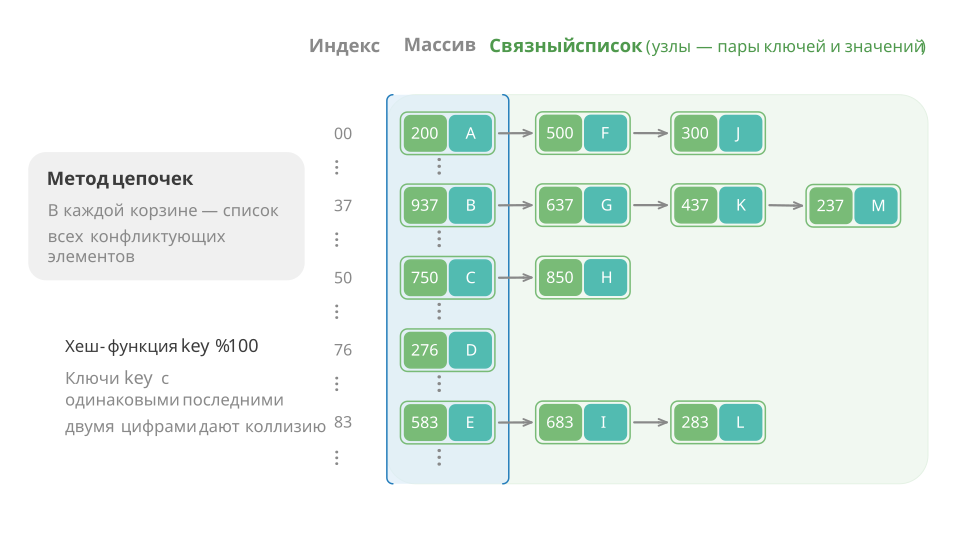
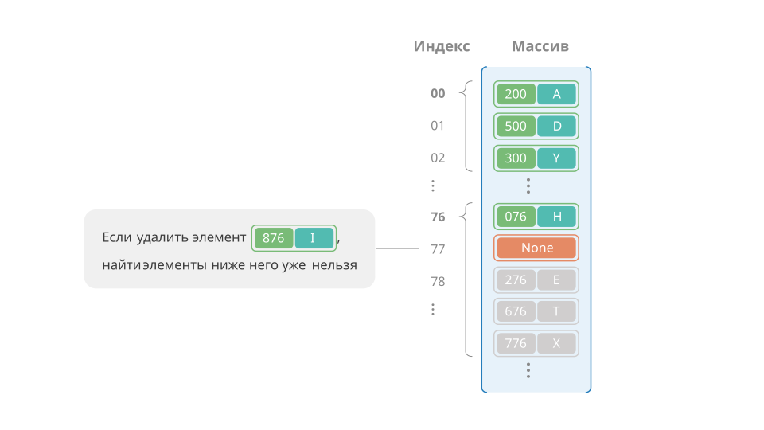

# Коллизии

Как отмечалось в предыдущем разделе, **множество возможных входов хеш-функции обычно гораздо больше множества её выходов**, поэтому в принципе избежать коллизий нельзя. Если на входе допустимы любые целые числа, а результат ограничен индексами массива, одному индексу корзины обязательно будут соответствовать несколько чисел.

Коллизии могут привести к ошибочному результату поиска и сделать хеш-таблицу непригодной для работы. Можно при каждой коллизии расширять таблицу, пока коллизия не исчезнет. Это простой и действенный, но слишком затратный подход: расширение требует переноса большого объёма данных и повторного вычисления хешей. Для повышения эффективности воспользуемся двумя приёмами.

1. Изменим структуру таблицы так, **чтобы она корректно работала и при коллизиях**.
2. Будем расширять таблицу лишь при необходимости, когда коллизии становятся серьёзной проблемой.

Два основных способа изменить структуру хеш-таблицы — метод цепочек и открытая адресация.

## Метод цепочек

В исходной хеш-таблице в каждой корзине хранилась только одна пара. При <u>методе цепочек (separate chaining)</u> вместо одиночного элемента используется связный список: каждая пара образует узел, и все пары, между которыми возникла коллизия, хранятся в одном списке. Ниже показан пример такой таблицы.



При использовании метода цепочек операции с хеш-таблицей меняются следующим образом.

- **Поиск**. По ключу `key` хеш-функция вычисляет индекс корзины. Переходим к первому узлу списка и обходим его, сравнивая ключи `key`, пока не найдём нужную пару.
- **Вставка**. Сначала с помощью хеш-функции находим начало списка, затем добавляем в него узел с парой «ключ — значение».
- **Удаление**. По результату хеш-функции находим начало списка, обходим список, находим нужный узел и удаляем его.

У метода цепочек есть следующие недостатки.

- **Дополнительный расход памяти**. Связному списку нужны указатели на узлы, поэтому он занимает больше памяти, чем массив.
- **Снижение скорости поиска**. Чтобы найти нужный элемент, приходится последовательно обходить список.

Ниже приведена простая реализация хеш-таблицы с цепочками. Обратите внимание на две детали.

- Для простоты вместо связных списков используем списки на основе динамических массивов. Таким образом, хеш-таблица представляет собой массив корзин, а каждая корзина — список.
- В реализации предусмотрено расширение таблицы. Когда коэффициент заполнения превышает $\frac{2}{3}$, увеличиваем ёмкость в $2$ раза.

```src
[file]{hash_map_chaining}-[class]{hash_map_chaining}-[func]{}
```

Если связный список длинный, поиск за $O(n)$ становится неэффективным. **Список можно преобразовать в АВЛ-дерево или красно-чёрное дерево** и тем самым сократить время поиска до $O(\log n)$.

## Открытая адресация

При <u>открытой адресации (open addressing)</u> коллизии разрешаются без дополнительных структур данных: при необходимости проверяется несколько позиций. Основные способы проверки — линейное пробирование, квадратичное пробирование и многократное хеширование.

Рассмотрим, как работает таблица с открытой адресацией, на примере линейного пробирования.

### Линейное пробирование

При линейном пробировании позиции проверяются последовательно с фиксированным шагом. Операции с такой таблицей несколько отличаются от операций с простой хеш-таблицей.

- **Вставка**. Вычисляем индекс корзины с помощью хеш-функции. Если корзина занята, от места коллизии переходим к следующим корзинам с постоянным шагом (обычно $1$). Найдя пустую корзину, вставляем в неё элемент.
- **Поиск**. При коллизии движемся дальше с тем же шагом. Когда находим нужный элемент, возвращаем `value`. Если встретилась пустая корзина, искомого элемента в таблице нет: возвращаем `None`.

На рисунке ниже показаны пары в таблице с открытой адресацией и линейным пробированием. Данная хеш-функция направляет ключи `key` с одинаковыми последними двумя цифрами в одну корзину. Благодаря линейному пробированию пары размещаются последовательно в этой корзине и в корзинах под ней.


Однако **линейное пробирование способствует образованию скоплений**. Чем длиннее ряд занятых ячеек, тем вероятнее коллизия в одной из них. Это, в свою очередь, удлиняет ряд. Возникает замкнутый круг, и со временем вставка, удаление, поиск и обновление замедляются.

Важно помнить: **в таблице с открытой адресацией нельзя просто удалить элемент**. На его месте останется пустая корзина `None`, а линейный поиск остановится, как только дойдёт до неё. Элементы, лежащие дальше по пути пробирования, окажутся недоступны: программа может ошибочно решить, что их нет. Это показано на рисунке ниже.



Проблему решает <u>ленивое удаление (lazy deletion)</u>. Вместо непосредственного удаления элемента из таблицы **корзину помечают константой `TOMBSTONE`**. И `None`, и `TOMBSTONE` обозначают свободную корзину, в которую можно вставить пару. Но при линейном поиске за меткой `TOMBSTONE` нужно продолжать обход: дальше ещё могут быть пары.

Однако **ленивое удаление может ускорить падение производительности таблицы**. Каждое удаление оставляет метку. Чем больше меток `TOMBSTONE`, тем дольше может идти поиск: прежде чем найти нужный элемент, иногда приходится пропустить несколько `TOMBSTONE`.

Поэтому при линейном пробировании запомним индекс первой метки `TOMBSTONE`. Когда искомый элемент найден, поменяем его местами с этой меткой `TOMBSTONE`. Тогда при поиске или вставке найденный элемент перемещается ближе к своей идеальной позиции — началу пробирования. Это ускоряет последующие поиски.

Следующий код реализует хеш-таблицу с открытой адресацией, линейным пробированием и ленивым удалением. Чтобы полнее использовать её ёмкость, рассматриваем массив как кольцевой: дойдя до конца, продолжаем обход с начала.

```src
[file]{hash_map_open_addressing}-[class]{hash_map_open_addressing}-[func]{}
```

### Квадратичное пробирование

Наряду с линейным пробированием при открытой адресации часто используют квадратичное. При коллизии здесь проверяют позиции со смещением, равным квадрату номера попытки: $1, 4, 9, \dots$ шагов от исходной позиции вместо продвижения с постоянным шагом.

У квадратичного пробирования есть следующие преимущества.

- Смещение на квадрат номера попытки помогает ослабить эффект скопления, характерный для линейного пробирования.
- Пропуская более длинные участки при поиске свободной ячейки, квадратичное пробирование способствует более равномерному распределению данных.

Однако у квадратичного пробирования есть и недостатки.

- Скопления по-прежнему возможны: одни ячейки занимаются чаще других.
- Поскольку квадраты быстро растут, последовательность проверок может охватывать не всю таблицу. Даже если пустая корзина есть, пробирование может до неё не дойти.

### Многократное хеширование

Как следует из названия, при многократном хешировании для пробирования используют несколько хеш-функций: $f_1(x)$, $f_2(x)$, $f_3(x)$, $\dots$.

- **Вставка**. Если функция $f_1(x)$ привела к коллизии, пробуем $f_2(x)$ и так далее. Найдя свободное место, вставляем элемент.
- **Поиск**. Проверяем позиции, применяя хеш-функции в том же порядке. Когда находим элемент, возвращаем его. Если встретилась пустая ячейка или все функции уже испробованы, элемента в таблице нет: возвращаем `None`.

По сравнению с линейным пробированием этот способ меньше подвержен образованию скоплений, но вычисление нескольких хеш-функций требует дополнительных затрат.

!!! tip

    Во всех таблицах с открытой адресацией, будь то линейное или квадратичное пробирование или многократное хеширование, нельзя просто очистить ячейку при удалении.

## Какой подход используют разные языки

Языки программирования реализуют хеш-таблицы по-разному. Рассмотрим несколько примеров.

- Python использует открытую адресацию. При пробировании словарь `dict` использует псевдослучайные числа.
- Java использует метод цепочек. Начиная с JDK 1.8, когда длина массива в `HashMap` достигает 64, а длина списка — 8, список преобразуется в красно-чёрное дерево для ускорения поиска.
- Начиная с Go 1.24 встроенный тип `map` по умолчанию использует открытую адресацию на основе Swiss Table. В Go 1.23 и более ранних версиях использовался метод цепочек: в корзине хранилось до 8 пар, а при переполнении к ней присоединялась дополнительная корзина.
