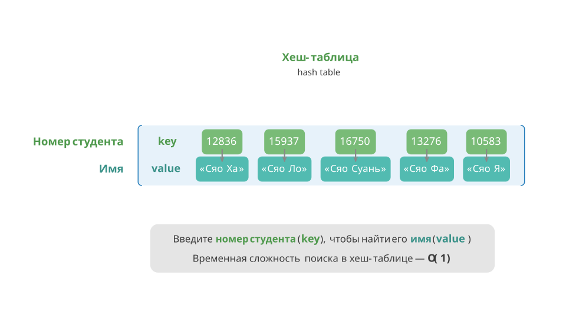
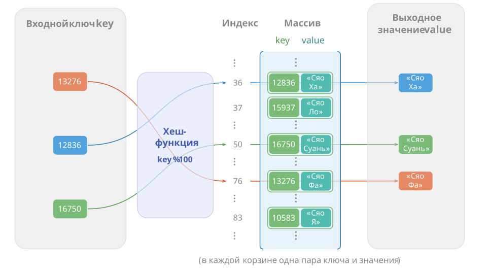

# Хеш-таблица

<u>Хеш-таблица (hash table)</u>, также называемая <u>таблицей рассеяния</u>, реализует эффективный поиск элементов за счет установления соответствия между ключом `key` и значением `value` . Иначе говоря, если передать в хеш-таблицу ключ `key` , то можно за $O(1)$ времени получить соответствующее значение `value` .

Как показано на рисунке ниже, пусть есть $n$ студентов, и у каждого из них есть два поля данных: имя и номер студенческого билета. Если мы хотим реализовать запрос вида «ввести номер студенческого билета и вернуть соответствующее имя», то для этого можно воспользоваться хеш-таблицей, изображенной на рисунке ниже.



Помимо хеш-таблицы, функцией поиска также обладают массив и связный список. Сравнение их эффективности приведено в таблице ниже.

- **Добавление элемента**: нужно лишь добавить элемент в конец массива (или списка), что занимает $O(1)$ времени.
- **Поиск элемента**: так как массив (или список) неупорядочен, приходится обходить все элементы, что занимает $O(n)$ времени.
- **Удаление элемента**: сначала нужно найти элемент, затем удалить его из массива (или списка), что занимает $O(n)$ времени.

<p align="center"> Таблица <id> &nbsp; Сравнение эффективности поиска элементов </p>

|          | Массив | Связный список | Хеш-таблица |
| -------- | ------ | -------------- | ----------- |
| Поиск элемента | $O(n)$ | $O(n)$ | $O(1)$ |
| Добавление элемента | $O(1)$ | $O(1)$ | $O(1)$ |
| Удаление элемента | $O(n)$ | $O(n)$ | $O(1)$ |

Нетрудно заметить, что **операции поиска, добавления и удаления в хеш-таблице имеют временную сложность $O(1)$** , то есть выполняются очень эффективно.

## Основные операции с хеш-таблицей

К базовым операциям хеш-таблицы относятся инициализация, поиск, добавление пар ключ-значение и удаление пар ключ-значение. Пример кода приведен ниже:

```snippet
hash_map_operations
```

??? pythontutor "Визуализация выполнения"

    @tutor hash_map_operations_tutor

Существует три распространенных способа обхода хеш-таблицы: обход пар ключ-значение, обход ключей и обход значений. Примеры кода приведены ниже:

```snippet
hash_map_traversal
```

??? pythontutor "Визуализация выполнения"

    @tutor hash_map_traversal_tutor

## Простая реализация хеш-таблицы

Сначала рассмотрим самый простой случай: **реализуем хеш-таблицу только с помощью одного массива**. В хеш-таблице каждую пустую ячейку массива мы называем <u>бакетом (bucket)</u>, и каждый бакет может хранить одну пару ключ-значение. Следовательно, операция поиска сводится к тому, чтобы найти бакет, соответствующий `key` , и получить из него `value` .

Но как определить бакет, соответствующий заданному `key` ? Это делается с помощью <u>хеш-функции (hash function)</u>. Назначение хеш-функции - отображать большое входное пространство в меньшее выходное пространство. В хеш-таблице входным пространством являются все `key` , а выходным - все бакеты, то есть индексы массива. Иначе говоря, передав `key` на вход, **мы можем с помощью хеш-функции получить позицию хранения соответствующей пары ключ-значение в массиве**.

Процесс вычисления хеш-функции для одного `key` включает два шага.

1. Сначала с помощью некоторого хеш-алгоритма `hash()` вычисляется хеш-значение.
2. Затем хеш-значение берется по модулю числа бакетов (длины массива) `capacity` , чтобы получить бакет (индекс массива) `index` , соответствующий этому `key` .

```shell
index = hash(key) % capacity
```

После этого можно использовать `index` для доступа к соответствующему бакету в хеш-таблице и получения `value` .

Пусть длина массива `capacity = 100` , а хеш-алгоритм `hash(key) = key` . Тогда легко получить хеш-функцию `key % 100` . На рисунке ниже на примере `key` «номер студенческого билета» и `value` «имя» показан принцип работы хеш-функции.



Ниже приведен код простой реализации хеш-таблицы. В нем мы инкапсулируем `key` и `value` в класс `Pair` , чтобы представить пару ключ-значение.

```src
[file]{array_hash_map}-[class]{array_hash_map}-[func]{}
```

## Хеш-коллизии и расширение

По сути, хеш-функция отображает входное пространство, состоящее из всех `key` , в выходное пространство, состоящее из всех индексов массива, а входное пространство обычно значительно больше выходного. Поэтому **теоретически неизбежно существование ситуации «несколько входов соответствуют одному выходу»**.

Для хеш-функции из приведенного выше примера, если последние две цифры `key` совпадают, то совпадает и результат хеш-функции. Например, если искать студентов с номерами 12836 и 20336, то получим:

```shell
12836 % 100 = 36
20336 % 100 = 36
```

Как показано на рисунке ниже, два номера указывают на одно и то же имя, что, очевидно, неверно. Такую ситуацию, когда нескольким входам соответствует один и тот же выход, называют <u>хеш-коллизией (hash collision)</u>.


Легко понять, что чем больше емкость хеш-таблицы $n$ , тем ниже вероятность того, что несколько `key` попадут в один и тот же бакет, а значит, тем меньше коллизий. Поэтому **мы можем уменьшать число хеш-коллизий путем расширения хеш-таблицы**.

Как показано на рисунке ниже, до расширения пары ключ-значение `(136, A)` и `(236, D)` конфликтовали, а после расширения коллизия исчезла.


Подобно расширению массива, расширение хеш-таблицы требует перенести все пары ключ-значение из старой таблицы в новую, а это очень затратно по времени. Кроме того, поскольку емкость хеш-таблицы `capacity` изменилась, нам приходится с помощью хеш-функции заново вычислять позиции хранения всех пар ключ-значение, что дополнительно увеличивает вычислительные расходы процесса расширения. Поэтому языки программирования обычно заранее резервируют достаточно большую емкость хеш-таблицы, чтобы избежать частых расширений.

<u>Коэффициент загрузки (load factor)</u> - важное понятие хеш-таблицы. Он определяется как отношение числа элементов в хеш-таблице к числу бакетов и используется для оценки степени серьезности хеш-коллизий, **а также часто служит условием срабатывания расширения хеш-таблицы**. Например, в Java, когда коэффициент загрузки превышает $0.75$ , система расширяет хеш-таблицу до $2$ раз от исходной емкости.
