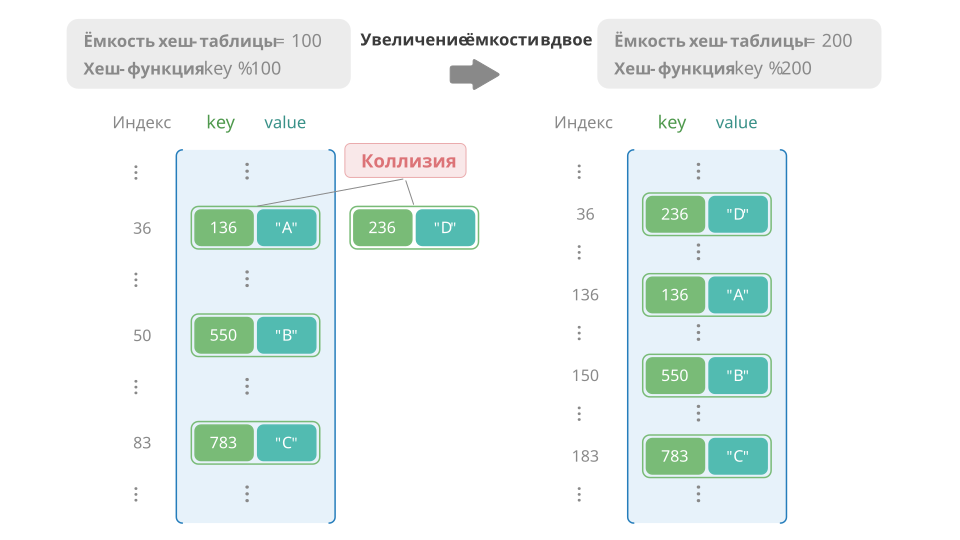

# Хеш-таблица

<u>Хеш-таблица (hash table)</u>, или <u>таблица рассеивания</u>, связывает ключ `key` со значением `value` и тем самым обеспечивает быстрый поиск. Введя ключ `key`, можно за время $O(1)$ получить соответствующее значение `value`.

Пусть, как на рисунке ниже, есть $n$ студентов и для каждого известны имя и номер. Если по номеру нужно возвращать имя, можно использовать показанную на рисунке хеш-таблицу.


Искать элементы можно также в массиве и связном списке. В таблице ниже сравнивается эффективность этих структур.

- **Вставка**. Достаточно добавить элемент в конец массива или связного списка. Это занимает $O(1)$ времени.
- **Поиск**. Элементы массива или списка не упорядочены, поэтому может потребоваться обход всех элементов. Время поиска — $O(n)$.
- **Удаление**. Сначала нужно найти элемент, затем удалить его из массива или списка. На это уходит $O(n)$ времени.

<p align="center"> Таблица <id> &nbsp; Сравнение эффективности поиска элементов </p>

|          | Массив   | Связный список   | Хеш-таблица |
| -------- | ------ | ------ | ------ |
| Поиск элемента | $O(n)$ | $O(n)$ | $O(1)$ |
| Вставка элемента | $O(1)$ | $O(1)$ | $O(1)$ |
| Удаление элемента | $O(n)$ | $O(n)$ | $O(1)$ |

Как видно, **вставка, удаление, поиск и обновление в хеш-таблице занимают $O(1)$ времени**. Это очень эффективные операции.

## Основные операции с хеш-таблицей

К основным операциям относятся создание таблицы, поиск, добавление и удаление пар. Вот пример:

```snippet
hash_map_operations
```

??? pythontutor "Визуализация выполнения"

    @tutor hash_map_operations_tutor

Распространены три способа обхода хеш-таблицы: по парам, только по ключам и только по значениям. Вот пример:

```snippet
hash_map_traversal
```

??? pythontutor "Визуализация выполнения"

    @tutor hash_map_traversal_tutor

## Простая реализация хеш-таблицы

Начнём с простейшего случая: **реализуем хеш-таблицу с помощью одного массива**. Каждую ячейку массива назовём <u>корзиной (bucket)</u>. В корзине можно хранить одну пару «ключ — значение». Чтобы выполнить поиск, нужно найти корзину для `key` и прочитать из неё `value`.

Как определить нужную корзину по `key`? Для этого служит <u>хеш-функция (hash function)</u>. Она отображает большое множество входных данных в меньшее множество результатов. У хеш-таблицы входное множество составляют всевозможные ключи `key`, а выходное — все корзины (индексы массива). Иными словами, подав на вход `key`, **мы получим с помощью хеш-функции позицию в массиве, где хранится пара с этим ключом `key`**.

Получив на вход `key`, хеш-функция выполняет два шага.

1. Вычисляет хеш по некоторому алгоритму `hash()`.
2. Берёт остаток от деления хеша на число корзин (длину массива) `capacity`. Для ключа `key` это даёт индекс корзины `index` в массиве.

```shell
index = hash(key) % capacity
```

По индексу `index` можно обратиться к соответствующей корзине хеш-таблицы и получить `value`.

Пусть длина массива задана как `capacity = 100`, а хеш вычисляется по правилу `hash(key) = key`. Тогда хеш-функция принимает вид `key % 100`. На рисунке ниже ключ `key` — номер студента, а значение `value` — его имя. На этом примере показано, как работает хеш-функция.


Ниже приведена простая реализация хеш-таблицы. Класс `Pair` объединяет `key` и `value` и представляет пару «ключ — значение».

```src
[file]{array_hash_map}-[class]{array_hash_map}-[func]{}
```

## Коллизии и расширение таблицы

Хеш-функция отображает множество всех ключей `key` во множество индексов массива. Входное множество обычно гораздо больше выходного. Поэтому **неизбежно найдутся разные входные значения, дающие один результат**.

У хеш-функции из нашего примера результаты совпадают, когда у входных ключей `key` одинаковы две последние цифры. Например, при поиске студентов с номерами 12836 и 20336 получим:

```shell
12836 % 100 = 36
20336 % 100 = 36
```

Как видно на рисунке ниже, оба номера указывают на одно имя, и результат поиска явно неверен. Когда разным входным значениям соответствует один и тот же результат, возникает <u>коллизия (hash collision)</u>.


Чем больше ёмкость $n$ хеш-таблицы, тем меньше вероятность, что несколько ключей `key` попадут в одну корзину, и тем реже коллизии. Значит, **расширение хеш-таблицы помогает уменьшить число коллизий**.

На рисунке ниже до расширения возникает коллизия между парами `(136, A)` и `(236, D)`, а после расширения коллизия исчезает.



Как и при расширении массива, все пары приходится переносить из старой хеш-таблицы в новую, что занимает много времени. Кроме того, меняется ёмкость `capacity`, поэтому хеш-функцией нужно заново вычислить положение каждой пары. Это ещё больше увеличивает вычислительные затраты. Чтобы реже расширять таблицу, реализации в языках программирования обычно заранее выделяют достаточную ёмкость.

<u>Коэффициент заполнения (load factor)</u> — важная характеристика хеш-таблицы. Он равен отношению числа элементов к числу корзин и позволяет оценить, насколько серьёзны коллизии. **Его также часто используют как критерий расширения таблицы**. Например, в Java при превышении порога $0.75$ ёмкость увеличивается в $2$ раза.
