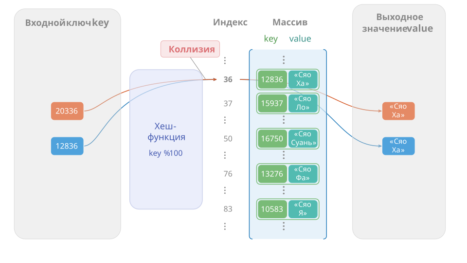

# 6.1 &nbsp; Хеш-таблица

<u>Хеш-таблица (hash table)</u>, или <u>таблица рассеивания</u>, связывает ключ `key` со значением `value` и тем самым обеспечивает быстрый поиск. Введя ключ `key`, можно за время $O(1)$ получить соответствующее значение `value`.

Пусть, как на рисунке 6-1, есть $n$ студентов и для каждого известны имя и номер. Если по номеру нужно возвращать имя, можно использовать показанную на рисунке хеш-таблицу.

{ class="animation-figure" }

<p align="center"> Рисунок 6-1 &nbsp; Абстрактное представление хеш-таблицы </p>

Искать элементы можно также в массиве и связном списке. В таблице 6-1 сравнивается эффективность этих структур.

- **Вставка**. Достаточно добавить элемент в конец массива или связного списка. Это занимает $O(1)$ времени.
- **Поиск**. Элементы массива или списка не упорядочены, поэтому может потребоваться обход всех элементов. Время поиска — $O(n)$.
- **Удаление**. Сначала нужно найти элемент, затем удалить его из массива или списка. На это уходит $O(n)$ времени.

<p align="center"> Таблица 6-1 &nbsp; Сравнение эффективности поиска элементов </p>

<div class="center-table" markdown>

|          | Массив   | Связный список   | Хеш-таблица |
| -------- | ------ | ------ | ------ |
| Поиск элемента | $O(n)$ | $O(n)$ | $O(1)$ |
| Вставка элемента | $O(1)$ | $O(1)$ | $O(1)$ |
| Удаление элемента | $O(n)$ | $O(n)$ | $O(1)$ |

</div>

Как видно, **вставка, удаление, поиск и обновление в хеш-таблице занимают $O(1)$ времени**. Это очень эффективные операции.

## 6.1.1 &nbsp; Основные операции с хеш-таблицей

К основным операциям относятся создание таблицы, поиск, добавление и удаление пар. Вот пример:

=== "Python"

    ```python title="hash_map.py"
    # Создать хеш-таблицу
    hmap = dict[int, str]()

    # Вставка
    # Добавить в таблицу пару (key, value)
    hmap[12836] = "Сяо Ха"
    hmap[15937] = "Сяо Ло"
    hmap[16750] = "Сяо Суань"
    hmap[13276] = "Сяо Фа"
    hmap[10583] = "Сяо Я"

    # Поиск
    # Получить из таблицы значение value по ключу key
    name: str = hmap[15937]

    # Удаление
    # Удалить из таблицы пару (key, value)
    hmap.pop(10583)
    ```

=== "C++"

    ```cpp title="hash_map.cpp"
    /* Создать хеш-таблицу */
    unordered_map<int, string> map;

    /* Вставка */
    // Добавить в таблицу пару (key, value)
    map[12836] = "Сяо Ха";
    map[15937] = "Сяо Ло";
    map[16750] = "Сяо Суань";
    map[13276] = "Сяо Фа";
    map[10583] = "Сяо Я";

    /* Поиск */
    // Получить из таблицы значение value по ключу key
    string name = map[15937];

    /* Удаление */
    // Удалить из таблицы пару (key, value)
    map.erase(10583);
    ```

=== "Java"

    ```java title="hash_map.java"
    /* Создать хеш-таблицу */
    Map<Integer, String> map = new HashMap<>();

    /* Вставка */
    // Добавить в таблицу пару (key, value)
    map.put(12836, "Сяо Ха");
    map.put(15937, "Сяо Ло");
    map.put(16750, "Сяо Суань");
    map.put(13276, "Сяо Фа");
    map.put(10583, "Сяо Я");

    /* Поиск */
    // Получить из таблицы значение value по ключу key
    String name = map.get(15937);

    /* Удаление */
    // Удалить из таблицы пару (key, value)
    map.remove(10583);
    ```

=== "C#"

    ```csharp title="hash_map.cs"
    /* Создать хеш-таблицу */
    Dictionary<int, string> map = new() {
        /* Вставка */
        // Добавить в таблицу пару (key, value)
        { 12836, "Сяо Ха" },
        { 15937, "Сяо Ло" },
        { 16750, "Сяо Суань" },
        { 13276, "Сяо Фа" },
        { 10583, "Сяо Я" }
    };

    /* Поиск */
    // Получить из таблицы значение value по ключу key
    string name = map[15937];

    /* Удаление */
    // Удалить из таблицы пару (key, value)
    map.Remove(10583);
    ```

=== "Go"

    ```go title="hash_map_test.go"
    /* Создать хеш-таблицу */
    hmap := make(map[int]string)

    /* Вставка */
    // Добавить в таблицу пару (key, value)
    hmap[12836] = "Сяо Ха"
    hmap[15937] = "Сяо Ло"
    hmap[16750] = "Сяо Суань"
    hmap[13276] = "Сяо Фа"
    hmap[10583] = "Сяо Я"

    /* Поиск */
    // Получить из таблицы значение value по ключу key
    name := hmap[15937]

    /* Удаление */
    // Удалить из таблицы пару (key, value)
    delete(hmap, 10583)
    ```

=== "Swift"

    ```swift title="hash_map.swift"
    /* Создать хеш-таблицу */
    var map: [Int: String] = [:]

    /* Вставка */
    // Добавить в таблицу пару (key, value)
    map[12836] = "Сяо Ха"
    map[15937] = "Сяо Ло"
    map[16750] = "Сяо Суань"
    map[13276] = "Сяо Фа"
    map[10583] = "Сяо Я"

    /* Поиск */
    // Получить из таблицы значение value по ключу key
    let name = map[15937]!

    /* Удаление */
    // Удалить из таблицы пару (key, value)
    map.removeValue(forKey: 10583)
    ```

=== "JS"

    ```javascript title="hash_map.js"
    /* Создать хеш-таблицу */
    const map = new Map();

    /* Вставка */
    // Добавить в таблицу пару (key, value)
    map.set(12836, 'Сяо Ха');
    map.set(15937, 'Сяо Ло');
    map.set(16750, 'Сяо Суань');
    map.set(13276, 'Сяо Фа');
    map.set(10583, 'Сяо Я');

    /* Поиск */
    // Получить из таблицы значение value по ключу key
    let name = map.get(15937);

    /* Удаление */
    // Удалить из таблицы пару (key, value)
    map.delete(10583);
    ```

=== "TS"

    ```typescript title="hash_map.ts"
    /* Создать хеш-таблицу */
    const map = new Map<number, string>();

    /* Вставка */
    // Добавить в таблицу пару (key, value)
    map.set(12836, 'Сяо Ха');
    map.set(15937, 'Сяо Ло');
    map.set(16750, 'Сяо Суань');
    map.set(13276, 'Сяо Фа');
    map.set(10583, 'Сяо Я');

    /* Поиск */
    // Получить из таблицы значение value по ключу key
    let name = map.get(15937);

    /* Удаление */
    // Удалить из таблицы пару (key, value)
    map.delete(10583);
    ```

=== "Dart"

    ```dart title="hash_map.dart"
    /* Создать хеш-таблицу */
    final Map<int, String> map = {};

    /* Вставка */
    // Добавить в таблицу пару (key, value)
    map[12836] = "Сяо Ха";
    map[15937] = "Сяо Ло";
    map[16750] = "Сяо Суань";
    map[13276] = "Сяо Фа";
    map[10583] = "Сяо Я";

    /* Поиск */
    // Получить из таблицы значение value по ключу key
    final String? name = map[15937];

    /* Удаление */
    // Удалить из таблицы пару (key, value)
    map.remove(10583);
    ```

=== "Rust"

    ```rust title="hash_map.rs"
    use std::collections::HashMap;

    // Создать хеш-таблицу
    let mut map = HashMap::new();

    // Вставка
    // Добавить в таблицу пару (key, value)
    map.insert(12836, "Сяо Ха");
    map.insert(15937, "Сяо Ло");
    map.insert(16750, "Сяо Суань");
    map.insert(13276, "Сяо Фа");
    map.insert(10583, "Сяо Я");

    // Поиск
    // Получить из таблицы значение value по ключу key
    let name = map.get(&15937).copied().unwrap();

    // Удаление
    // Удалить из таблицы пару (key, value)
    _ = map.remove(&10583);
    ```

=== "C"

    ```c title="hash_map.c"
    // В C нет встроенной хеш-таблицы
    ```

=== "Kotlin"

    ```kotlin title="hash_map.kt"
    /* Создать хеш-таблицу */
    val map = HashMap<Int, String>()

    /* Вставка */
    // Добавить в таблицу пару (key, value)
    map[12836] = "Сяо Ха"
    map[15937] = "Сяо Ло"
    map[16750] = "Сяо Суань"
    map[13276] = "Сяо Фа"
    map[10583] = "Сяо Я"

    /* Поиск */
    // Получить из таблицы значение value по ключу key
    val name = map[15937]

    /* Удаление */
    // Удалить из таблицы пару (key, value)
    map.remove(10583)
    ```

=== "Ruby"

    ```ruby title="hash_map.rb"
    # Создать хеш-таблицу
    hmap = {}

    # Вставка
    # Добавить в таблицу пару (key, value)
    hmap[12836] = "Сяо Ха"
    hmap[15937] = "Сяо Ло"
    hmap[16750] = "Сяо Суань"
    hmap[13276] = "Сяо Фа"
    hmap[10583] = "Сяо Я"

    # Поиск
    # Получить из таблицы значение value по ключу key
    name = hmap[15937]

    # Удаление
    # Удалить из таблицы пару (key, value)
    hmap.delete(10583)
    ```

??? pythontutor "Визуализация выполнения"

    <div style="height: 549px; width: 100%;"><iframe class="pythontutor-iframe" title="Визуализация выполнения" src="https://pythontutor.com/iframe-embed.html#code=%22%22%22Driver%20Code%22%22%22%0Aif%20__name__%20%3D%3D%20%22__main__%22%3A%0A%20%20%20%20%23%20%D0%98%D0%BD%D0%B8%D1%86%D0%B8%D0%B0%D0%BB%D0%B8%D0%B7%D0%B8%D1%80%D1%83%D0%B5%D0%BC%20%D1%85%D0%B5%D1%88-%D1%82%D0%B0%D0%B1%D0%BB%D0%B8%D1%86%D1%83%0A%20%20%20%20hmap%20%3D%20%7B%7D%0A%20%20%20%20%0A%20%20%20%20%23%20%D0%94%D0%BE%D0%B1%D0%B0%D0%B2%D0%BB%D0%B5%D0%BD%D0%B8%D0%B5%0A%20%20%20%20%23%20%D0%94%D0%BE%D0%B1%D0%B0%D0%B2%D0%BB%D1%8F%D0%B5%D0%BC%20%D0%B2%20%D1%85%D0%B5%D1%88-%D1%82%D0%B0%D0%B1%D0%BB%D0%B8%D1%86%D1%83%20%D0%BF%D0%B0%D1%80%D1%8B%20%C2%AB%D0%BA%D0%BB%D1%8E%D1%87%20%E2%80%94%20%D0%B7%D0%BD%D0%B0%D1%87%D0%B5%D0%BD%D0%B8%D0%B5%C2%BB%20%28key,%20value%29%0A%20%20%20%20hmap%5B12836%5D%20%3D%20%22%D0%A1%D1%8F%D0%BE%20%D0%A5%D0%B0%22%0A%20%20%20%20hmap%5B15937%5D%20%3D%20%22%D0%A1%D1%8F%D0%BE%20%D0%9B%D0%BE%22%0A%20%20%20%20hmap%5B16750%5D%20%3D%20%22%D0%A1%D1%8F%D0%BE%20%D0%A1%D1%83%D0%B0%D0%BD%D1%8C%22%0A%20%20%20%20hmap%5B13276%5D%20%3D%20%22%D0%A1%D1%8F%D0%BE%20%D0%A4%D0%B0%22%0A%20%20%20%20hmap%5B10583%5D%20%3D%20%22%D0%A1%D1%8F%D0%BE%20%D0%AF%22%0A%20%20%20%20%0A%20%20%20%20%23%20%D0%9F%D0%BE%D0%B8%D1%81%D0%BA%0A%20%20%20%20%23%20%D0%9F%D0%BE%20%D0%BA%D0%BB%D1%8E%D1%87%D1%83%20key%20%D0%BD%D0%B0%D1%85%D0%BE%D0%B4%D0%B8%D0%BC%20%D0%B2%20%D1%85%D0%B5%D1%88-%D1%82%D0%B0%D0%B1%D0%BB%D0%B8%D1%86%D0%B5%20%D0%B7%D0%BD%D0%B0%D1%87%D0%B5%D0%BD%D0%B8%D0%B5%20value%0A%20%20%20%20name%20%3D%20hmap%5B15937%5D%0A%20%20%20%20%0A%20%20%20%20%23%20%D0%A3%D0%B4%D0%B0%D0%BB%D0%B5%D0%BD%D0%B8%D0%B5%0A%20%20%20%20%23%20%D0%A3%D0%B4%D0%B0%D0%BB%D1%8F%D0%B5%D0%BC%20%D0%B8%D0%B7%20%D1%85%D0%B5%D1%88-%D1%82%D0%B0%D0%B1%D0%BB%D0%B8%D1%86%D1%8B%20%D0%BF%D0%B0%D1%80%D1%83%20%C2%AB%D0%BA%D0%BB%D1%8E%D1%87%20%E2%80%94%20%D0%B7%D0%BD%D0%B0%D1%87%D0%B5%D0%BD%D0%B8%D0%B5%C2%BB%20%28key,%20value%29%0A%20%20%20%20hmap.pop%2810583%29&codeDivHeight=472&codeDivWidth=350&cumulative=false&curInstr=2&heapPrimitives=nevernest&origin=opt-frontend.js&py=311&rawInputLstJSON=%5B%5D&textReferences=false"> </iframe></div>
    <div style="margin-top: 5px;"><a href="https://pythontutor.com/iframe-embed.html#code=%22%22%22Driver%20Code%22%22%22%0Aif%20__name__%20%3D%3D%20%22__main__%22%3A%0A%20%20%20%20%23%20%D0%98%D0%BD%D0%B8%D1%86%D0%B8%D0%B0%D0%BB%D0%B8%D0%B7%D0%B8%D1%80%D1%83%D0%B5%D0%BC%20%D1%85%D0%B5%D1%88-%D1%82%D0%B0%D0%B1%D0%BB%D0%B8%D1%86%D1%83%0A%20%20%20%20hmap%20%3D%20%7B%7D%0A%20%20%20%20%0A%20%20%20%20%23%20%D0%94%D0%BE%D0%B1%D0%B0%D0%B2%D0%BB%D0%B5%D0%BD%D0%B8%D0%B5%0A%20%20%20%20%23%20%D0%94%D0%BE%D0%B1%D0%B0%D0%B2%D0%BB%D1%8F%D0%B5%D0%BC%20%D0%B2%20%D1%85%D0%B5%D1%88-%D1%82%D0%B0%D0%B1%D0%BB%D0%B8%D1%86%D1%83%20%D0%BF%D0%B0%D1%80%D1%8B%20%C2%AB%D0%BA%D0%BB%D1%8E%D1%87%20%E2%80%94%20%D0%B7%D0%BD%D0%B0%D1%87%D0%B5%D0%BD%D0%B8%D0%B5%C2%BB%20%28key,%20value%29%0A%20%20%20%20hmap%5B12836%5D%20%3D%20%22%D0%A1%D1%8F%D0%BE%20%D0%A5%D0%B0%22%0A%20%20%20%20hmap%5B15937%5D%20%3D%20%22%D0%A1%D1%8F%D0%BE%20%D0%9B%D0%BE%22%0A%20%20%20%20hmap%5B16750%5D%20%3D%20%22%D0%A1%D1%8F%D0%BE%20%D0%A1%D1%83%D0%B0%D0%BD%D1%8C%22%0A%20%20%20%20hmap%5B13276%5D%20%3D%20%22%D0%A1%D1%8F%D0%BE%20%D0%A4%D0%B0%22%0A%20%20%20%20hmap%5B10583%5D%20%3D%20%22%D0%A1%D1%8F%D0%BE%20%D0%AF%22%0A%20%20%20%20%0A%20%20%20%20%23%20%D0%9F%D0%BE%D0%B8%D1%81%D0%BA%0A%20%20%20%20%23%20%D0%9F%D0%BE%20%D0%BA%D0%BB%D1%8E%D1%87%D1%83%20key%20%D0%BD%D0%B0%D1%85%D0%BE%D0%B4%D0%B8%D0%BC%20%D0%B2%20%D1%85%D0%B5%D1%88-%D1%82%D0%B0%D0%B1%D0%BB%D0%B8%D1%86%D0%B5%20%D0%B7%D0%BD%D0%B0%D1%87%D0%B5%D0%BD%D0%B8%D0%B5%20value%0A%20%20%20%20name%20%3D%20hmap%5B15937%5D%0A%20%20%20%20%0A%20%20%20%20%23%20%D0%A3%D0%B4%D0%B0%D0%BB%D0%B5%D0%BD%D0%B8%D0%B5%0A%20%20%20%20%23%20%D0%A3%D0%B4%D0%B0%D0%BB%D1%8F%D0%B5%D0%BC%20%D0%B8%D0%B7%20%D1%85%D0%B5%D1%88-%D1%82%D0%B0%D0%B1%D0%BB%D0%B8%D1%86%D1%8B%20%D0%BF%D0%B0%D1%80%D1%83%20%C2%AB%D0%BA%D0%BB%D1%8E%D1%87%20%E2%80%94%20%D0%B7%D0%BD%D0%B0%D1%87%D0%B5%D0%BD%D0%B8%D0%B5%C2%BB%20%28key,%20value%29%0A%20%20%20%20hmap.pop%2810583%29&codeDivHeight=800&codeDivWidth=600&cumulative=false&curInstr=2&heapPrimitives=nevernest&origin=opt-frontend.js&py=311&rawInputLstJSON=%5B%5D&textReferences=false" target="_blank" rel="noopener noreferrer">Во весь экран ></a></div>

Распространены три способа обхода хеш-таблицы: по парам, только по ключам и только по значениям. Вот пример:

=== "Python"

    ```python title="hash_map.py"
    # Обход хеш-таблицы
    # Обход пар «ключ -> значение»
    for key, value in hmap.items():
        print(key, "->", value)

    # Обход только ключей
    for key in hmap.keys():
        print(key)

    # Обход только значений
    for val in hmap.values():
        print(val)
    ```

=== "C++"

    ```cpp title="hash_map.cpp"
    /* Обход хеш-таблицы */
    // Обход пар «ключ -> значение»
    for (auto kv : map) {
        cout << kv.first << " -> " << kv.second << endl;
    }

    // Обход пар «ключ -> значение» с помощью итератора
    for (auto iter = map.begin(); iter != map.end(); iter++) {
        cout << iter->first << " -> " << iter->second << endl;
    }
    ```

=== "Java"

    ```java title="hash_map.java"
    /* Обход хеш-таблицы */
    // Обход пар «ключ -> значение»
    for (Map.Entry<Integer, String> kv : map.entrySet()) {
        System.out.println(kv.getKey() + " -> " + kv.getValue());
    }

    // Обход только ключей
    for (int key : map.keySet()) {
        System.out.println(key);
    }

    // Обход только значений
    for (String val : map.values()) {
        System.out.println(val);
    }
    ```

=== "C#"

    ```csharp title="hash_map.cs"
    /* Обход хеш-таблицы */
    // Обход пар «ключ -> значение»
    foreach (var kv in map) {
        Console.WriteLine(kv.Key + " -> " + kv.Value);
    }

    // Обход только ключей
    foreach (int key in map.Keys) {
        Console.WriteLine(key);
    }

    // Обход только значений
    foreach (string val in map.Values) {
        Console.WriteLine(val);
    }
    ```

=== "Go"

    ```go title="hash_map_test.go"
    /* Обход хеш-таблицы */
    // Обход пар «ключ -> значение»
    for key, value := range hmap {
        fmt.Println(key, "->", value)
    }

    // Обход только ключей
    for key := range hmap {
        fmt.Println(key)
    }

    // Обход только значений
    for _, value := range hmap {
        fmt.Println(value)
    }
    ```

=== "Swift"

    ```swift title="hash_map.swift"
    /* Обход хеш-таблицы */
    // Обход пар «ключ -> значение»
    for (key, value) in map {
        print("\(key) -> \(value)")
    }

    // Обход только ключей
    for key in map.keys {
        print(key)
    }

    // Обход только значений
    for value in map.values {
        print(value)
    }
    ```

=== "JS"

    ```javascript title="hash_map.js"
    /* Обход хеш-таблицы */
    // Обход пар «ключ -> значение»
    for (const [k, v] of map.entries()) {
        console.info(k + ' -> ' + v);
    }

    // Обход только ключей
    for (const k of map.keys()) {
        console.info(k);
    }

    // Обход только значений
    for (const v of map.values()) {
        console.info(v);
    }
    ```

=== "TS"

    ```typescript title="hash_map.ts"
    /* Обход хеш-таблицы */
    // Обход пар «ключ -> значение»
    for (const [k, v] of map.entries()) {
        console.info(k + ' -> ' + v);
    }

    // Обход только ключей
    for (const k of map.keys()) {
        console.info(k);
    }

    // Обход только значений
    for (const v of map.values()) {
        console.info(v);
    }
    ```

=== "Dart"

    ```dart title="hash_map.dart"
    /* Обход хеш-таблицы */
    // Обход пар «ключ -> значение»
    map.forEach((key, value) => print("$key -> $value"));

    // Обход только ключей
    map.keys.forEach((key) => print(key));

    // Обход только значений
    map.values.forEach((value) => print(value));
    ```

=== "Rust"

    ```rust title="hash_map.rs"
    // Обход хеш-таблицы
    // Обход пар «ключ -> значение»
    for (key, value) in &map {
        println!("{key} -> {value}");
    }

    // Обход только ключей
    for key in map.keys() {
        println!("{key}");
    }

    // Обход только значений
    for value in map.values() {
        println!("{value}");
    }
    ```

=== "C"

    ```c title="hash_map.c"
    // В C нет встроенной хеш-таблицы
    ```

=== "Kotlin"

    ```kotlin title="hash_map.kt"
    /* Обход хеш-таблицы */
    // Обход пар «ключ -> значение»
    for ((key, value) in map) {
        println("$key -> $value")
    }

    // Обход только ключей
    for (key in map.keys) {
        println(key)
    }

    // Обход только значений
    for (_val in map.values) {
        println(_val)
    }
    ```

=== "Ruby"

    ```ruby title="hash_map.rb"
    # Обход хеш-таблицы
    # Обход пар «ключ -> значение»
    hmap.entries.each { |key, value| puts "#{key} -> #{value}" }

    # Обход только ключей
    hmap.keys.each { |key| puts key }

    # Обход только значений
    hmap.values.each { |val| puts val }
    ```

??? pythontutor "Визуализация выполнения"

    <div style="height: 549px; width: 100%;"><iframe class="pythontutor-iframe" title="Визуализация выполнения" src="https://pythontutor.com/iframe-embed.html#code=%22%22%22Driver%20Code%22%22%22%0Aif%20__name__%20%3D%3D%20%22__main__%22%3A%0A%20%20%20%20%23%20%D0%98%D0%BD%D0%B8%D1%86%D0%B8%D0%B0%D0%BB%D0%B8%D0%B7%D0%B8%D1%80%D1%83%D0%B5%D0%BC%20%D1%85%D0%B5%D1%88-%D1%82%D0%B0%D0%B1%D0%BB%D0%B8%D1%86%D1%83%0A%20%20%20%20hmap%20%3D%20%7B%7D%0A%20%20%20%20%0A%20%20%20%20%23%20%D0%94%D0%BE%D0%B1%D0%B0%D0%B2%D0%BB%D0%B5%D0%BD%D0%B8%D0%B5%0A%20%20%20%20%23%20%D0%94%D0%BE%D0%B1%D0%B0%D0%B2%D0%BB%D1%8F%D0%B5%D0%BC%20%D0%B2%20%D1%85%D0%B5%D1%88-%D1%82%D0%B0%D0%B1%D0%BB%D0%B8%D1%86%D1%83%20%D0%BF%D0%B0%D1%80%D1%8B%20%C2%AB%D0%BA%D0%BB%D1%8E%D1%87%20%E2%80%94%20%D0%B7%D0%BD%D0%B0%D1%87%D0%B5%D0%BD%D0%B8%D0%B5%C2%BB%20%28key,%20value%29%0A%20%20%20%20hmap%5B12836%5D%20%3D%20%22%D0%A1%D1%8F%D0%BE%20%D0%A5%D0%B0%22%0A%20%20%20%20hmap%5B15937%5D%20%3D%20%22%D0%A1%D1%8F%D0%BE%20%D0%9B%D0%BE%22%0A%20%20%20%20hmap%5B16750%5D%20%3D%20%22%D0%A1%D1%8F%D0%BE%20%D0%A1%D1%83%D0%B0%D0%BD%D1%8C%22%0A%20%20%20%20hmap%5B13276%5D%20%3D%20%22%D0%A1%D1%8F%D0%BE%20%D0%A4%D0%B0%22%0A%20%20%20%20hmap%5B10583%5D%20%3D%20%22%D0%A1%D1%8F%D0%BE%20%D0%AF%22%0A%20%20%20%20%0A%20%20%20%20%23%20%D0%9E%D0%B1%D1%85%D0%BE%D0%B4%D0%B8%D0%BC%20%D1%85%D0%B5%D1%88-%D1%82%D0%B0%D0%B1%D0%BB%D0%B8%D1%86%D1%83%0A%20%20%20%20%23%20%D0%9F%D0%B5%D1%80%D0%B5%D0%B1%D0%B8%D1%80%D0%B0%D0%B5%D0%BC%20%D0%BF%D0%B0%D1%80%D1%8B%20key-%3Evalue%0A%20%20%20%20for%20key,%20value%20in%20hmap.items%28%29%3A%0A%20%20%20%20%20%20%20%20print%28key,%20%22-%3E%22,%20value%29%0A%20%20%20%20%23%20%D0%9F%D0%B5%D1%80%D0%B5%D0%B1%D0%B8%D1%80%D0%B0%D0%B5%D0%BC%20%D1%82%D0%BE%D0%BB%D1%8C%D0%BA%D0%BE%20%D0%BA%D0%BB%D1%8E%D1%87%D0%B8%20key%0A%20%20%20%20for%20key%20in%20hmap.keys%28%29%3A%0A%20%20%20%20%20%20%20%20print%28key%29%0A%20%20%20%20%23%20%D0%9F%D0%B5%D1%80%D0%B5%D0%B1%D0%B8%D1%80%D0%B0%D0%B5%D0%BC%20%D1%82%D0%BE%D0%BB%D1%8C%D0%BA%D0%BE%20%D0%B7%D0%BD%D0%B0%D1%87%D0%B5%D0%BD%D0%B8%D1%8F%20value%0A%20%20%20%20for%20val%20in%20hmap.values%28%29%3A%0A%20%20%20%20%20%20%20%20print%28val%29&codeDivHeight=472&codeDivWidth=350&cumulative=false&curInstr=8&heapPrimitives=nevernest&origin=opt-frontend.js&py=311&rawInputLstJSON=%5B%5D&textReferences=false"> </iframe></div>
    <div style="margin-top: 5px;"><a href="https://pythontutor.com/iframe-embed.html#code=%22%22%22Driver%20Code%22%22%22%0Aif%20__name__%20%3D%3D%20%22__main__%22%3A%0A%20%20%20%20%23%20%D0%98%D0%BD%D0%B8%D1%86%D0%B8%D0%B0%D0%BB%D0%B8%D0%B7%D0%B8%D1%80%D1%83%D0%B5%D0%BC%20%D1%85%D0%B5%D1%88-%D1%82%D0%B0%D0%B1%D0%BB%D0%B8%D1%86%D1%83%0A%20%20%20%20hmap%20%3D%20%7B%7D%0A%20%20%20%20%0A%20%20%20%20%23%20%D0%94%D0%BE%D0%B1%D0%B0%D0%B2%D0%BB%D0%B5%D0%BD%D0%B8%D0%B5%0A%20%20%20%20%23%20%D0%94%D0%BE%D0%B1%D0%B0%D0%B2%D0%BB%D1%8F%D0%B5%D0%BC%20%D0%B2%20%D1%85%D0%B5%D1%88-%D1%82%D0%B0%D0%B1%D0%BB%D0%B8%D1%86%D1%83%20%D0%BF%D0%B0%D1%80%D1%8B%20%C2%AB%D0%BA%D0%BB%D1%8E%D1%87%20%E2%80%94%20%D0%B7%D0%BD%D0%B0%D1%87%D0%B5%D0%BD%D0%B8%D0%B5%C2%BB%20%28key,%20value%29%0A%20%20%20%20hmap%5B12836%5D%20%3D%20%22%D0%A1%D1%8F%D0%BE%20%D0%A5%D0%B0%22%0A%20%20%20%20hmap%5B15937%5D%20%3D%20%22%D0%A1%D1%8F%D0%BE%20%D0%9B%D0%BE%22%0A%20%20%20%20hmap%5B16750%5D%20%3D%20%22%D0%A1%D1%8F%D0%BE%20%D0%A1%D1%83%D0%B0%D0%BD%D1%8C%22%0A%20%20%20%20hmap%5B13276%5D%20%3D%20%22%D0%A1%D1%8F%D0%BE%20%D0%A4%D0%B0%22%0A%20%20%20%20hmap%5B10583%5D%20%3D%20%22%D0%A1%D1%8F%D0%BE%20%D0%AF%22%0A%20%20%20%20%0A%20%20%20%20%23%20%D0%9E%D0%B1%D1%85%D0%BE%D0%B4%D0%B8%D0%BC%20%D1%85%D0%B5%D1%88-%D1%82%D0%B0%D0%B1%D0%BB%D0%B8%D1%86%D1%83%0A%20%20%20%20%23%20%D0%9F%D0%B5%D1%80%D0%B5%D0%B1%D0%B8%D1%80%D0%B0%D0%B5%D0%BC%20%D0%BF%D0%B0%D1%80%D1%8B%20key-%3Evalue%0A%20%20%20%20for%20key,%20value%20in%20hmap.items%28%29%3A%0A%20%20%20%20%20%20%20%20print%28key,%20%22-%3E%22,%20value%29%0A%20%20%20%20%23%20%D0%9F%D0%B5%D1%80%D0%B5%D0%B1%D0%B8%D1%80%D0%B0%D0%B5%D0%BC%20%D1%82%D0%BE%D0%BB%D1%8C%D0%BA%D0%BE%20%D0%BA%D0%BB%D1%8E%D1%87%D0%B8%20key%0A%20%20%20%20for%20key%20in%20hmap.keys%28%29%3A%0A%20%20%20%20%20%20%20%20print%28key%29%0A%20%20%20%20%23%20%D0%9F%D0%B5%D1%80%D0%B5%D0%B1%D0%B8%D1%80%D0%B0%D0%B5%D0%BC%20%D1%82%D0%BE%D0%BB%D1%8C%D0%BA%D0%BE%20%D0%B7%D0%BD%D0%B0%D1%87%D0%B5%D0%BD%D0%B8%D1%8F%20value%0A%20%20%20%20for%20val%20in%20hmap.values%28%29%3A%0A%20%20%20%20%20%20%20%20print%28val%29&codeDivHeight=800&codeDivWidth=600&cumulative=false&curInstr=8&heapPrimitives=nevernest&origin=opt-frontend.js&py=311&rawInputLstJSON=%5B%5D&textReferences=false" target="_blank" rel="noopener noreferrer">Во весь экран ></a></div>

## 6.1.2 &nbsp; Простая реализация хеш-таблицы

Начнём с простейшего случая: **реализуем хеш-таблицу с помощью одного массива**. Каждую ячейку массива назовём <u>корзиной (bucket)</u>. В корзине можно хранить одну пару «ключ — значение». Чтобы выполнить поиск, нужно найти корзину для `key` и прочитать из неё `value`.

Как определить нужную корзину по `key`? Для этого служит <u>хеш-функция (hash function)</u>. Она отображает большое множество входных данных в меньшее множество результатов. У хеш-таблицы входное множество составляют всевозможные ключи `key`, а выходное — все корзины (индексы массива). Иными словами, подав на вход `key`, **мы получим с помощью хеш-функции позицию в массиве, где хранится пара с этим ключом `key`**.

Получив на вход `key`, хеш-функция выполняет два шага.

1. Вычисляет хеш по некоторому алгоритму `hash()`.
2. Берёт остаток от деления хеша на число корзин (длину массива) `capacity`. Для ключа `key` это даёт индекс корзины `index` в массиве.

```shell
index = hash(key) % capacity
```

По индексу `index` можно обратиться к соответствующей корзине хеш-таблицы и получить `value`.

Пусть длина массива задана как `capacity = 100`, а хеш вычисляется по правилу `hash(key) = key`. Тогда хеш-функция принимает вид `key % 100`. На рисунке 6-2 ключ `key` — номер студента, а значение `value` — его имя. На этом примере показано, как работает хеш-функция.

{ class="animation-figure" }

<p align="center"> Рисунок 6-2 &nbsp; Принцип работы хеш-функции </p>

Ниже приведена простая реализация хеш-таблицы. Класс `Pair` объединяет `key` и `value` и представляет пару «ключ — значение».

=== "Python"

    ```python title="array_hash_map.py"
    class Pair:
        """Пара «ключ — значение»"""

        def __init__(self, key: int, val: str):
            self.key = key
            self.val = val

    class ArrayHashMap:
        """Хеш-таблица на основе массива"""

        def __init__(self):
            """Конструктор"""
            # Создать массив из 100 корзин
            self.buckets: list[Pair | None] = [None] * 100

        def hash_func(self, key: int) -> int:
            """Хеш-функция"""
            index = key % 100
            return index

        def get(self, key: int) -> str | None:
            """Поиск"""
            index: int = self.hash_func(key)
            pair: Pair = self.buckets[index]
            if pair is None:
                return None
            return pair.val

        def put(self, key: int, val: str):
            """Вставка и обновление"""
            pair = Pair(key, val)
            index: int = self.hash_func(key)
            self.buckets[index] = pair

        def remove(self, key: int):
            """Удаление"""
            index: int = self.hash_func(key)
            # Записать None в знак удаления
            self.buckets[index] = None

        def entry_set(self) -> list[Pair]:
            """Получить все пары «ключ — значение»"""
            result: list[Pair] = []
            for pair in self.buckets:
                if pair is not None:
                    result.append(pair)
            return result

        def key_set(self) -> list[int]:
            """Получить все ключи"""
            result = []
            for pair in self.buckets:
                if pair is not None:
                    result.append(pair.key)
            return result

        def value_set(self) -> list[str]:
            """Получить все значения"""
            result = []
            for pair in self.buckets:
                if pair is not None:
                    result.append(pair.val)
            return result

        def print(self):
            """Вывести хеш-таблицу"""
            for pair in self.buckets:
                if pair is not None:
                    print(pair.key, "->", pair.val)
    ```

=== "C++"

    ```cpp title="array_hash_map.cpp"
    /* Пара «ключ — значение» */
    struct Pair {
      public:
        int key;
        string val;
        Pair(int key, string val) {
            this->key = key;
            this->val = val;
        }
    };

    /* Хеш-таблица на основе массива */
    class ArrayHashMap {
      private:
        vector<Pair *> buckets;

      public:
        ArrayHashMap() {
            // Создать массив из 100 корзин
            buckets = vector<Pair *>(100);
        }

        ~ArrayHashMap() {
            // Освободить память
            for (const auto &bucket : buckets) {
                delete bucket;
            }
            buckets.clear();
        }

        /* Хеш-функция */
        int hashFunc(int key) {
            int index = key % 100;
            return index;
        }

        /* Поиск */
        string get(int key) {
            int index = hashFunc(key);
            Pair *pair = buckets[index];
            if (pair == nullptr)
                return "";
            return pair->val;
        }

        /* Вставка */
        void put(int key, string val) {
            Pair *pair = new Pair(key, val);
            int index = hashFunc(key);
            buckets[index] = pair;
        }

        /* Удаление */
        void remove(int key) {
            int index = hashFunc(key);
            // Освободить память и присвоить указателю nullptr
            delete buckets[index];
            buckets[index] = nullptr;
        }

        /* Получить все пары «ключ — значение» */
        vector<Pair *> pairSet() {
            vector<Pair *> pairSet;
            for (Pair *pair : buckets) {
                if (pair != nullptr) {
                    pairSet.push_back(pair);
                }
            }
            return pairSet;
        }

        /* Получить все ключи */
        vector<int> keySet() {
            vector<int> keySet;
            for (Pair *pair : buckets) {
                if (pair != nullptr) {
                    keySet.push_back(pair->key);
                }
            }
            return keySet;
        }

        /* Получить все значения */
        vector<string> valueSet() {
            vector<string> valueSet;
            for (Pair *pair : buckets) {
                if (pair != nullptr) {
                    valueSet.push_back(pair->val);
                }
            }
            return valueSet;
        }

        /* Вывести хеш-таблицу */
        void print() {
            for (Pair *kv : pairSet()) {
                cout << kv->key << " -> " << kv->val << endl;
            }
        }
    };
    ```

=== "Java"

    ```java title="array_hash_map.java"
    /* Пара «ключ — значение» */
    class Pair {
        public int key;
        public String val;

        public Pair(int key, String val) {
            this.key = key;
            this.val = val;
        }
    }

    /* Хеш-таблица на основе массива */
    class ArrayHashMap {
        private List<Pair> buckets;

        public ArrayHashMap() {
            // Создать массив из 100 корзин
            buckets = new ArrayList<>();
            for (int i = 0; i < 100; i++) {
                buckets.add(null);
            }
        }

        /* Хеш-функция */
        private int hashFunc(int key) {
            int index = key % 100;
            return index;
        }

        /* Поиск */
        public String get(int key) {
            int index = hashFunc(key);
            Pair pair = buckets.get(index);
            if (pair == null)
                return null;
            return pair.val;
        }

        /* Вставка */
        public void put(int key, String val) {
            Pair pair = new Pair(key, val);
            int index = hashFunc(key);
            buckets.set(index, pair);
        }

        /* Удаление */
        public void remove(int key) {
            int index = hashFunc(key);
            // Записать null в знак удаления
            buckets.set(index, null);
        }

        /* Получить все пары «ключ — значение» */
        public List<Pair> pairSet() {
            List<Pair> pairSet = new ArrayList<>();
            for (Pair pair : buckets) {
                if (pair != null)
                    pairSet.add(pair);
            }
            return pairSet;
        }

        /* Получить все ключи */
        public List<Integer> keySet() {
            List<Integer> keySet = new ArrayList<>();
            for (Pair pair : buckets) {
                if (pair != null)
                    keySet.add(pair.key);
            }
            return keySet;
        }

        /* Получить все значения */
        public List<String> valueSet() {
            List<String> valueSet = new ArrayList<>();
            for (Pair pair : buckets) {
                if (pair != null)
                    valueSet.add(pair.val);
            }
            return valueSet;
        }

        /* Вывести хеш-таблицу */
        public void print() {
            for (Pair kv : pairSet()) {
                System.out.println(kv.key + " -> " + kv.val);
            }
        }
    }
    ```

=== "C#"

    ```csharp title="array_hash_map.cs"
    /* Пара «ключ — значение» типа int->string */
    class Pair(int key, string val) {
        public int key = key;
        public string val = val;
    }

    /* Хеш-таблица на основе массива */
    class ArrayHashMap {
        List<Pair?> buckets;
        public ArrayHashMap() {
            // Создать массив из 100 корзин
            buckets = [];
            for (int i = 0; i < 100; i++) {
                buckets.Add(null);
            }
        }

        /* Хеш-функция */
        int HashFunc(int key) {
            int index = key % 100;
            return index;
        }

        /* Поиск */
        public string? Get(int key) {
            int index = HashFunc(key);
            Pair? pair = buckets[index];
            if (pair == null) return null;
            return pair.val;
        }

        /* Вставка */
        public void Put(int key, string val) {
            Pair pair = new(key, val);
            int index = HashFunc(key);
            buckets[index] = pair;
        }

        /* Удаление */
        public void Remove(int key) {
            int index = HashFunc(key);
            // Записать null в знак удаления
            buckets[index] = null;
        }

        /* Получить все пары «ключ — значение» */
        public List<Pair> PairSet() {
            List<Pair> pairSet = [];
            foreach (Pair? pair in buckets) {
                if (pair != null)
                    pairSet.Add(pair);
            }
            return pairSet;
        }

        /* Получить все ключи */
        public List<int> KeySet() {
            List<int> keySet = [];
            foreach (Pair? pair in buckets) {
                if (pair != null)
                    keySet.Add(pair.key);
            }
            return keySet;
        }

        /* Получить все значения */
        public List<string> ValueSet() {
            List<string> valueSet = [];
            foreach (Pair? pair in buckets) {
                if (pair != null)
                    valueSet.Add(pair.val);
            }
            return valueSet;
        }

        /* Вывести хеш-таблицу */
        public void Print() {
            foreach (Pair kv in PairSet()) {
                Console.WriteLine(kv.key + " -> " + kv.val);
            }
        }
    }
    ```

=== "Go"

    ```go title="array_hash_map.go"
    /* Пара «ключ — значение» */
    type pair struct {
        key int
        val string
    }

    /* Хеш-таблица на основе массива */
    type arrayHashMap struct {
        buckets []*pair
    }

    /* Создать хеш-таблицу */
    func newArrayHashMap() *arrayHashMap {
        // Создать массив из 100 корзин
        buckets := make([]*pair, 100)
        return &arrayHashMap{buckets: buckets}
    }

    /* Хеш-функция */
    func (a *arrayHashMap) hashFunc(key int) int {
        index := key % 100
        return index
    }

    /* Поиск */
    func (a *arrayHashMap) get(key int) string {
        index := a.hashFunc(key)
        pair := a.buckets[index]
        if pair == nil {
            return "Not Found"
        }
        return pair.val
    }

    /* Вставка */
    func (a *arrayHashMap) put(key int, val string) {
        pair := &pair{key: key, val: val}
        index := a.hashFunc(key)
        a.buckets[index] = pair
    }

    /* Удаление */
    func (a *arrayHashMap) remove(key int) {
        index := a.hashFunc(key)
        // Записать nil в знак удаления
        a.buckets[index] = nil
    }

    /* Получить все пары «ключ — значение» */
    func (a *arrayHashMap) pairSet() []*pair {
        var pairs []*pair
        for _, pair := range a.buckets {
            if pair != nil {
                pairs = append(pairs, pair)
            }
        }
        return pairs
    }

    /* Получить все ключи */
    func (a *arrayHashMap) keySet() []int {
        var keys []int
        for _, pair := range a.buckets {
            if pair != nil {
                keys = append(keys, pair.key)
            }
        }
        return keys
    }

    /* Получить все значения */
    func (a *arrayHashMap) valueSet() []string {
        var values []string
        for _, pair := range a.buckets {
            if pair != nil {
                values = append(values, pair.val)
            }
        }
        return values
    }

    /* Вывести хеш-таблицу */
    func (a *arrayHashMap) print() {
        for _, pair := range a.buckets {
            if pair != nil {
                fmt.Println(pair.key, "->", pair.val)
            }
        }
    }
    ```

=== "Swift"

    ```swift title="array_hash_map.swift"
    /* Пара «ключ — значение» */
    class Pair: Equatable {
        public var key: Int
        public var val: String

        public init(key: Int, val: String) {
            self.key = key
            self.val = val
        }

        public static func == (lhs: Pair, rhs: Pair) -> Bool {
            lhs.key == rhs.key && lhs.val == rhs.val
        }
    }

    /* Хеш-таблица на основе массива */
    class ArrayHashMap {
        private var buckets: [Pair?]

        init() {
            // Создать массив из 100 корзин
            buckets = Array(repeating: nil, count: 100)
        }

        /* Хеш-функция */
        private func hashFunc(key: Int) -> Int {
            let index = key % 100
            return index
        }

        /* Поиск */
        func get(key: Int) -> String? {
            let index = hashFunc(key: key)
            let pair = buckets[index]
            return pair?.val
        }

        /* Вставка */
        func put(key: Int, val: String) {
            let pair = Pair(key: key, val: val)
            let index = hashFunc(key: key)
            buckets[index] = pair
        }

        /* Удаление */
        func remove(key: Int) {
            let index = hashFunc(key: key)
            // Записать nil в знак удаления
            buckets[index] = nil
        }

        /* Получить все пары «ключ — значение» */
        func pairSet() -> [Pair] {
            buckets.compactMap { $0 }
        }

        /* Получить все ключи */
        func keySet() -> [Int] {
            buckets.compactMap { $0?.key }
        }

        /* Получить все значения */
        func valueSet() -> [String] {
            buckets.compactMap { $0?.val }
        }

        /* Вывести хеш-таблицу */
        func print() {
            for pair in pairSet() {
                Swift.print("\(pair.key) -> \(pair.val)")
            }
        }
    }
    ```

=== "JS"

    ```javascript title="array_hash_map.js"
    /* Пара «ключ — значение» типа Number -> String */
    class Pair {
        constructor(key, val) {
            this.key = key;
            this.val = val;
        }
    }

    /* Хеш-таблица на основе массива */
    class ArrayHashMap {
        #buckets;
        constructor() {
            // Создать массив из 100 корзин
            this.#buckets = new Array(100).fill(null);
        }

        /* Хеш-функция */
        #hashFunc(key) {
            return key % 100;
        }

        /* Поиск */
        get(key) {
            let index = this.#hashFunc(key);
            let pair = this.#buckets[index];
            if (pair === null) return null;
            return pair.val;
        }

        /* Вставка */
        set(key, val) {
            let index = this.#hashFunc(key);
            this.#buckets[index] = new Pair(key, val);
        }

        /* Удаление */
        delete(key) {
            let index = this.#hashFunc(key);
            // Записать null в знак удаления
            this.#buckets[index] = null;
        }

        /* Получить все пары «ключ — значение» */
        entries() {
            let arr = [];
            for (let i = 0; i < this.#buckets.length; i++) {
                if (this.#buckets[i]) {
                    arr.push(this.#buckets[i]);
                }
            }
            return arr;
        }

        /* Получить все ключи */
        keys() {
            let arr = [];
            for (let i = 0; i < this.#buckets.length; i++) {
                if (this.#buckets[i]) {
                    arr.push(this.#buckets[i].key);
                }
            }
            return arr;
        }

        /* Получить все значения */
        values() {
            let arr = [];
            for (let i = 0; i < this.#buckets.length; i++) {
                if (this.#buckets[i]) {
                    arr.push(this.#buckets[i].val);
                }
            }
            return arr;
        }

        /* Вывести хеш-таблицу */
        print() {
            let pairSet = this.entries();
            for (const pair of pairSet) {
                console.info(`${pair.key} -> ${pair.val}`);
            }
        }
    }
    ```

=== "TS"

    ```typescript title="array_hash_map.ts"
    /* Пара «ключ — значение» типа Number -> String */
    class Pair {
        public key: number;
        public val: string;

        constructor(key: number, val: string) {
            this.key = key;
            this.val = val;
        }
    }

    /* Хеш-таблица на основе массива */
    class ArrayHashMap {
        private readonly buckets: (Pair | null)[];

        constructor() {
            // Создать массив из 100 корзин
            this.buckets = new Array(100).fill(null);
        }

        /* Хеш-функция */
        private hashFunc(key: number): number {
            return key % 100;
        }

        /* Поиск */
        public get(key: number): string | null {
            let index = this.hashFunc(key);
            let pair = this.buckets[index];
            if (pair === null) return null;
            return pair.val;
        }

        /* Вставка */
        public set(key: number, val: string) {
            let index = this.hashFunc(key);
            this.buckets[index] = new Pair(key, val);
        }

        /* Удаление */
        public delete(key: number) {
            let index = this.hashFunc(key);
            // Записать null в знак удаления
            this.buckets[index] = null;
        }

        /* Получить все пары «ключ — значение» */
        public entries(): (Pair | null)[] {
            let arr: (Pair | null)[] = [];
            for (let i = 0; i < this.buckets.length; i++) {
                if (this.buckets[i]) {
                    arr.push(this.buckets[i]);
                }
            }
            return arr;
        }

        /* Получить все ключи */
        public keys(): (number | undefined)[] {
            let arr: (number | undefined)[] = [];
            for (let i = 0; i < this.buckets.length; i++) {
                if (this.buckets[i]) {
                    arr.push(this.buckets[i].key);
                }
            }
            return arr;
        }

        /* Получить все значения */
        public values(): (string | undefined)[] {
            let arr: (string | undefined)[] = [];
            for (let i = 0; i < this.buckets.length; i++) {
                if (this.buckets[i]) {
                    arr.push(this.buckets[i].val);
                }
            }
            return arr;
        }

        /* Вывести хеш-таблицу */
        public print() {
            let pairSet = this.entries();
            for (const pair of pairSet) {
                console.info(`${pair.key} -> ${pair.val}`);
            }
        }
    }
    ```

=== "Dart"

    ```dart title="array_hash_map.dart"
    /* Пара «ключ — значение» */
    class Pair {
      int key;
      String val;
      Pair(this.key, this.val);
    }

    /* Хеш-таблица на основе массива */
    class ArrayHashMap {
      late List<Pair?> _buckets;

      ArrayHashMap() {
        // Создать массив из 100 корзин
        _buckets = List.filled(100, null);
      }

      /* Хеш-функция */
      int _hashFunc(int key) {
        final int index = key % 100;
        return index;
      }

      /* Поиск */
      String? get(int key) {
        final int index = _hashFunc(key);
        final Pair? pair = _buckets[index];
        if (pair == null) {
          return null;
        }
        return pair.val;
      }

      /* Вставка */
      void put(int key, String val) {
        final Pair pair = Pair(key, val);
        final int index = _hashFunc(key);
        _buckets[index] = pair;
      }

      /* Удаление */
      void remove(int key) {
        final int index = _hashFunc(key);
        _buckets[index] = null;
      }

      /* Получить все пары «ключ — значение» */
      List<Pair> pairSet() {
        List<Pair> pairSet = [];
        for (final Pair? pair in _buckets) {
          if (pair != null) {
            pairSet.add(pair);
          }
        }
        return pairSet;
      }

      /* Получить все ключи */
      List<int> keySet() {
        List<int> keySet = [];
        for (final Pair? pair in _buckets) {
          if (pair != null) {
            keySet.add(pair.key);
          }
        }
        return keySet;
      }

      /* Получить все значения */
      List<String> values() {
        List<String> valueSet = [];
        for (final Pair? pair in _buckets) {
          if (pair != null) {
            valueSet.add(pair.val);
          }
        }
        return valueSet;
      }

      /* Вывести хеш-таблицу */
      void printHashMap() {
        for (final Pair kv in pairSet()) {
          print("${kv.key} -> ${kv.val}");
        }
      }
    }
    ```

=== "Rust"

    ```rust title="array_hash_map.rs"
    /* Пара «ключ — значение» */
    #[derive(Debug, Clone, PartialEq)]
    pub struct Pair {
        pub key: i32,
        pub val: String,
    }

    /* Хеш-таблица на основе массива */
    pub struct ArrayHashMap {
        buckets: Vec<Option<Pair>>,
    }

    impl ArrayHashMap {
        pub fn new() -> ArrayHashMap {
            // Создать массив из 100 корзин
            Self {
                buckets: vec![None; 100],
            }
        }

        /* Хеш-функция */
        fn hash_func(&self, key: i32) -> usize {
            key as usize % 100
        }

        /* Поиск */
        pub fn get(&self, key: i32) -> Option<&String> {
            let index = self.hash_func(key);
            self.buckets[index].as_ref().map(|pair| &pair.val)
        }

        /* Вставка */
        pub fn put(&mut self, key: i32, val: &str) {
            let index = self.hash_func(key);
            self.buckets[index] = Some(Pair {
                key,
                val: val.to_string(),
            });
        }

        /* Удаление */
        pub fn remove(&mut self, key: i32) {
            let index = self.hash_func(key);
            // Записать None в знак удаления
            self.buckets[index] = None;
        }

        /* Получить все пары «ключ — значение» */
        pub fn entry_set(&self) -> Vec<&Pair> {
            self.buckets
                .iter()
                .filter_map(|pair| pair.as_ref())
                .collect()
        }

        /* Получить все ключи */
        pub fn key_set(&self) -> Vec<&i32> {
            self.buckets
                .iter()
                .filter_map(|pair| pair.as_ref().map(|pair| &pair.key))
                .collect()
        }

        /* Получить все значения */
        pub fn value_set(&self) -> Vec<&String> {
            self.buckets
                .iter()
                .filter_map(|pair| pair.as_ref().map(|pair| &pair.val))
                .collect()
        }

        /* Вывести хеш-таблицу */
        pub fn print(&self) {
            for pair in self.entry_set() {
                println!("{} -> {}", pair.key, pair.val);
            }
        }
    }
    ```

=== "C"

    ```c title="array_hash_map.c"
    /* Пара «ключ — значение» типа int->string */
    typedef struct {
        int key;
        char *val;
    } Pair;

    /* Хеш-таблица на основе массива */
    typedef struct {
        Pair *buckets[MAX_SIZE];
    } ArrayHashMap;

    /* Конструктор */
    ArrayHashMap *newArrayHashMap() {
        ArrayHashMap *hmap = malloc(sizeof(ArrayHashMap));
        for (int i=0; i < MAX_SIZE; i++) {
            hmap->buckets[i] = NULL;
        }
        return hmap;
    }

    /* Деструктор */
    void delArrayHashMap(ArrayHashMap *hmap) {
        for (int i = 0; i < MAX_SIZE; i++) {
            if (hmap->buckets[i] != NULL) {
                free(hmap->buckets[i]->val);
                free(hmap->buckets[i]);
            }
        }
        free(hmap);
    }

    /* Вставка */
    void put(ArrayHashMap *hmap, const int key, const char *val) {
        Pair *pair = malloc(sizeof(Pair));
        pair->key = key;
        pair->val = malloc(strlen(val) + 1);
        strcpy(pair->val, val);

        int index = hashFunc(key);
        hmap->buckets[index] = pair;
    }

    /* Удаление */
    void removeItem(ArrayHashMap *hmap, const int key) {
        int index = hashFunc(key);
        free(hmap->buckets[index]->val);
        free(hmap->buckets[index]);
        hmap->buckets[index] = NULL;
    }

    /* Получить все пары «ключ — значение» */
    void pairSet(ArrayHashMap *hmap, MapSet *set) {
        Pair *entries;
        int i = 0, index = 0;
        int total = 0;
        /* Подсчитать число действующих пар */
        for (i = 0; i < MAX_SIZE; i++) {
            if (hmap->buckets[i] != NULL) {
                total++;
            }
        }
        entries = malloc(sizeof(Pair) * total);
        for (i = 0; i < MAX_SIZE; i++) {
            if (hmap->buckets[i] != NULL) {
                entries[index].key = hmap->buckets[i]->key;
                entries[index].val = malloc(strlen(hmap->buckets[i]->val) + 1);
                strcpy(entries[index].val, hmap->buckets[i]->val);
                index++;
            }
        }
        set->set = entries;
        set->len = total;
    }

    /* Получить все ключи */
    void keySet(ArrayHashMap *hmap, MapSet *set) {
        int *keys;
        int i = 0, index = 0;
        int total = 0;
        /* Подсчитать число действующих пар */
        for (i = 0; i < MAX_SIZE; i++) {
            if (hmap->buckets[i] != NULL) {
                total++;
            }
        }
        keys = malloc(total * sizeof(int));
        for (i = 0; i < MAX_SIZE; i++) {
            if (hmap->buckets[i] != NULL) {
                keys[index] = hmap->buckets[i]->key;
                index++;
            }
        }
        set->set = keys;
        set->len = total;
    }

    /* Получить все значения */
    void valueSet(ArrayHashMap *hmap, MapSet *set) {
        char **vals;
        int i = 0, index = 0;
        int total = 0;
        /* Подсчитать число действующих пар */
        for (i = 0; i < MAX_SIZE; i++) {
            if (hmap->buckets[i] != NULL) {
                total++;
            }
        }
        vals = malloc(total * sizeof(char *));
        for (i = 0; i < MAX_SIZE; i++) {
            if (hmap->buckets[i] != NULL) {
                vals[index] = hmap->buckets[i]->val;
                index++;
            }
        }
        set->set = vals;
        set->len = total;
    }

    /* Вывести хеш-таблицу */
    void print(ArrayHashMap *hmap) {
        int i;
        MapSet set;
        pairSet(hmap, &set);
        Pair *entries = (Pair *)set.set;
        for (i = 0; i < set.len; i++) {
            printf("%d -> %s\n", entries[i].key, entries[i].val);
        }
        free(set.set);
    }
    ```

=== "Kotlin"

    ```kotlin title="array_hash_map.kt"
    /* Пара «ключ — значение» */
    class Pair(
        var key: Int,
        var _val: String
    )

    /* Хеш-таблица на основе массива */
    class ArrayHashMap {
        // Создать массив из 100 корзин
        private val buckets = arrayOfNulls<Pair>(100)

        /* Хеш-функция */
        fun hashFunc(key: Int): Int {
            val index = key % 100
            return index
        }

        /* Поиск */
        fun get(key: Int): String? {
            val index = hashFunc(key)
            val pair = buckets[index] ?: return null
            return pair._val
        }

        /* Вставка */
        fun put(key: Int, _val: String) {
            val pair = Pair(key, _val)
            val index = hashFunc(key)
            buckets[index] = pair
        }

        /* Удаление */
        fun remove(key: Int) {
            val index = hashFunc(key)
            // Записать null в знак удаления
            buckets[index] = null
        }

        /* Получить все пары «ключ — значение» */
        fun pairSet(): MutableList<Pair> {
            val pairSet = mutableListOf<Pair>()
            for (pair in buckets) {
                if (pair != null)
                    pairSet.add(pair)
            }
            return pairSet
        }

        /* Получить все ключи */
        fun keySet(): MutableList<Int> {
            val keySet = mutableListOf<Int>()
            for (pair in buckets) {
                if (pair != null)
                    keySet.add(pair.key)
            }
            return keySet
        }

        /* Получить все значения */
        fun valueSet(): MutableList<String> {
            val valueSet = mutableListOf<String>()
            for (pair in buckets) {
                if (pair != null)
                    valueSet.add(pair._val)
            }
            return valueSet
        }

        /* Вывести хеш-таблицу */
        fun print() {
            for (kv in pairSet()) {
                val key = kv.key
                val _val = kv._val
                println("$key -> $_val")
            }
        }
    }
    ```

=== "Ruby"

    ```ruby title="array_hash_map.rb"
    ### Пара «ключ — значение» ###
    class Pair
      attr_accessor :key, :val

      def initialize(key, val)
        @key = key
        @val = val
      end
    end

    ### Хеш-таблица на основе массива ###
    class ArrayHashMap
      ### Конструктор ###
      def initialize
        # Создать массив из 100 корзин
        @buckets = Array.new(100)
      end

      ### Хеш-функция ###
      def hash_func(key)
        index = key % 100
      end

      ### Поиск ###
      def get(key)
        index = hash_func(key)
        pair = @buckets[index]

        return if pair.nil?
        pair.val
      end

      ### Вставка ###
      def put(key, val)
        pair = Pair.new(key, val)
        index = hash_func(key)
        @buckets[index] = pair
      end

      ### Удаление ###
      def remove(key)
        index = hash_func(key)
        # Записать nil в знак удаления
        @buckets[index] = nil
      end

      ### Получить все пары «ключ — значение» ###
      def entry_set
        result = []
        @buckets.each { |pair| result << pair unless pair.nil? }
        result
      end

      ### Получить все ключи ###
      def key_set
        result = []
        @buckets.each { |pair| result << pair.key unless pair.nil? }
        result
      end

      ### Получить все значения ###
      def value_set
        result = []
        @buckets.each { |pair| result << pair.val unless pair.nil? }
        result
      end

      ### Вывести хеш-таблицу ###
      def print
        @buckets.each { |pair| puts "#{pair.key} -> #{pair.val}" unless pair.nil? }
      end
    end
    ```

??? pythontutor "Визуализация выполнения"

    <div style="height: 549px; width: 100%;"><iframe class="pythontutor-iframe" title="Визуализация выполнения" src="https://pythontutor.com/iframe-embed.html#code=class%20Pair%3A%0A%20%20%22%22%22%D0%9F%D0%B0%D1%80%D0%B0%20%C2%AB%D0%BA%D0%BB%D1%8E%D1%87%20%E2%80%94%20%D0%B7%D0%BD%D0%B0%D1%87%D0%B5%D0%BD%D0%B8%D0%B5%C2%BB%22%22%22%0A%20%20def%20__init__%28self,%20key%3A%20int,%20val%3A%20str%29%3A%0A%20%20%20%20self.key%20%3D%20key%0A%20%20%20%20self.val%20%3D%20val%0A%0A%0Aclass%20ArrayHashMap%3A%0A%20%20%22%22%22%D0%A5%D0%B5%D1%88-%D1%82%D0%B0%D0%B1%D0%BB%D0%B8%D1%86%D0%B0%20%D0%BD%D0%B0%20%D0%BE%D1%81%D0%BD%D0%BE%D0%B2%D0%B5%20%D0%BC%D0%B0%D1%81%D1%81%D0%B8%D0%B2%D0%B0%22%22%22%0A%0A%20%20def%20__init__%28self%29%3A%0A%20%20%20%20%22%22%22%D0%9A%D0%BE%D0%BD%D1%81%D1%82%D1%80%D1%83%D0%BA%D1%82%D0%BE%D1%80%22%22%22%0A%20%20%20%20%23%20%D0%A1%D0%BE%D0%B7%D0%B4%D0%B0%D1%82%D1%8C%20%D0%BC%D0%B0%D1%81%D1%81%D0%B8%D0%B2%20%D0%B8%D0%B7%2020%20%D0%BA%D0%BE%D1%80%D0%B7%D0%B8%D0%BD%0A%20%20%20%20self.buckets%3A%20list%5BPair%20%7C%20None%5D%20%3D%20%5BNone%5D%20%2A%2020%0A%0A%20%20def%20hash_func%28self,%20key%3A%20int%29%20-%3E%20int%3A%0A%20%20%20%20%22%22%22%D0%A5%D0%B5%D1%88-%D1%84%D1%83%D0%BD%D0%BA%D1%86%D0%B8%D1%8F%22%22%22%0A%20%20%20%20index%20%3D%20key%20%25%2020%0A%20%20%20%20return%20index%0A%0A%20%20def%20get%28self,%20key%3A%20int%29%20-%3E%20str%3A%0A%20%20%20%20%22%22%22%D0%9F%D0%BE%D0%B8%D1%81%D0%BA%22%22%22%0A%20%20%20%20index%3A%20int%20%3D%20self.hash_func%28key%29%0A%20%20%20%20pair%3A%20Pair%20%3D%20self.buckets%5Bindex%5D%0A%20%20%20%20if%20pair%20is%20None%3A%0A%20%20%20%20%20%20return%20None%0A%20%20%20%20return%20pair.val%0A%0A%20%20def%20put%28self,%20key%3A%20int,%20val%3A%20str%29%3A%0A%20%20%20%20%22%22%22%D0%92%D1%81%D1%82%D0%B0%D0%B2%D0%BA%D0%B0%22%22%22%0A%20%20%20%20pair%20%3D%20Pair%28key,%20val%29%0A%20%20%20%20index%3A%20int%20%3D%20self.hash_func%28key%29%0A%20%20%20%20self.buckets%5Bindex%5D%20%3D%20pair%0A%0A%20%20def%20remove%28self,%20key%3A%20int%29%3A%0A%20%20%20%20%22%22%22%D0%A3%D0%B4%D0%B0%D0%BB%D0%B5%D0%BD%D0%B8%D0%B5%22%22%22%0A%20%20%20%20index%3A%20int%20%3D%20self.hash_func%28key%29%0A%20%20%20%20%23%20%D0%97%D0%B0%D0%BF%D0%B8%D1%81%D0%B0%D1%82%D1%8C%20None%20%D0%B2%20%D0%B7%D0%BD%D0%B0%D0%BA%20%D1%83%D0%B4%D0%B0%D0%BB%D0%B5%D0%BD%D0%B8%D1%8F%0A%20%20%20%20self.buckets%5Bindex%5D%20%3D%20None%0A%0A%20%20def%20entry_set%28self%29%20-%3E%20list%5BPair%5D%3A%0A%20%20%20%20%22%22%22%D0%9F%D0%BE%D0%BB%D1%83%D1%87%D0%B8%D1%82%D1%8C%20%D0%B2%D1%81%D0%B5%20%D0%BF%D0%B0%D1%80%D1%8B%20%C2%AB%D0%BA%D0%BB%D1%8E%D1%87%20%E2%80%94%20%D0%B7%D0%BD%D0%B0%D1%87%D0%B5%D0%BD%D0%B8%D0%B5%C2%BB%22%22%22%0A%20%20%20%20result%3A%20list%5BPair%5D%20%3D%20%5B%5D%0A%20%20%20%20for%20pair%20in%20self.buckets%3A%0A%20%20%20%20%20%20if%20pair%20is%20not%20None%3A%0A%20%20%20%20%20%20%20%20result.append%28pair%29%0A%20%20%20%20return%20result%0A%0A%20%20def%20key_set%28self%29%20-%3E%20list%5Bint%5D%3A%0A%20%20%20%20%22%22%22%D0%9F%D0%BE%D0%BB%D1%83%D1%87%D0%B8%D1%82%D1%8C%20%D0%B2%D1%81%D0%B5%20%D0%BA%D0%BB%D1%8E%D1%87%D0%B8%22%22%22%0A%20%20%20%20result%20%3D%20%5B%5D%0A%20%20%20%20for%20pair%20in%20self.buckets%3A%0A%20%20%20%20%20%20if%20pair%20is%20not%20None%3A%0A%20%20%20%20%20%20%20%20result.append%28pair.key%29%0A%20%20%20%20return%20result%0A%0A%20%20def%20value_set%28self%29%20-%3E%20list%5Bstr%5D%3A%0A%20%20%20%20%22%22%22%D0%9F%D0%BE%D0%BB%D1%83%D1%87%D0%B8%D1%82%D1%8C%20%D0%B2%D1%81%D0%B5%20%D0%B7%D0%BD%D0%B0%D1%87%D0%B5%D0%BD%D0%B8%D1%8F%22%22%22%0A%20%20%20%20result%20%3D%20%5B%5D%0A%20%20%20%20for%20pair%20in%20self.buckets%3A%0A%20%20%20%20%20%20if%20pair%20is%20not%20None%3A%0A%20%20%20%20%20%20%20%20result.append%28pair.val%29%0A%20%20%20%20return%20result%0A%0A%20%20def%20print%28self%29%3A%0A%20%20%20%20%22%22%22%D0%92%D1%8B%D0%B2%D0%B5%D1%81%D1%82%D0%B8%20%D1%85%D0%B5%D1%88-%D1%82%D0%B0%D0%B1%D0%BB%D0%B8%D1%86%D1%83%22%22%22%0A%20%20%20%20for%20pair%20in%20self.buckets%3A%0A%20%20%20%20%20%20if%20pair%20is%20not%20None%3A%0A%20%20%20%20%20%20%20%20print%28pair.key,%20%22-%3E%22,%20pair.val%29%0A%0A%0A%22%22%22Driver%20Code%22%22%22%0Aif%20__name__%20%3D%3D%20%22__main__%22%3A%0A%20%20%23%20%D0%A1%D0%BE%D0%B7%D0%B4%D0%B0%D1%82%D1%8C%20%D1%85%D0%B5%D1%88-%D1%82%D0%B0%D0%B1%D0%BB%D0%B8%D1%86%D1%83%0A%20%20hmap%20%3D%20ArrayHashMap%28%29%0A%0A%20%20%23%20%D0%92%D1%81%D1%82%D0%B0%D0%B2%D0%BA%D0%B0%0A%20%20hmap.put%2812836,%20%22%D0%A1%D1%8F%D0%BE%20%D0%A5%D0%B0%22%29%0A%20%20hmap.put%2815937,%20%22%D0%A1%D1%8F%D0%BE%20%D0%9B%D0%BE%22%29%0A%20%20hmap.put%2816750,%20%22%D0%A1%D1%8F%D0%BE%20%D0%A1%D1%83%D0%B0%D0%BD%D1%8C%22%29%0A%20%20hmap.put%2813276,%20%22%D0%A1%D1%8F%D0%BE%20%D0%A4%D0%B0%22%29%0A%20%20hmap.put%2810583,%20%22%D0%A1%D1%8F%D0%BE%20%D0%AF%22%29%0A%0A%20%20%23%20%D0%9F%D0%BE%D0%B8%D1%81%D0%BA%0A%20%20name%20%3D%20hmap.get%2815937%29%0A%0A%20%20%23%20%D0%A3%D0%B4%D0%B0%D0%BB%D0%B5%D0%BD%D0%B8%D0%B5%0A%20%20hmap.remove%2810583%29%0A%0A%20%20%23%20%D0%9E%D0%B1%D1%85%D0%BE%D0%B4%20%D1%85%D0%B5%D1%88-%D1%82%D0%B0%D0%B1%D0%BB%D0%B8%D1%86%D1%8B%0A%20%20print%28%22%5Cn%D0%9E%D0%B1%D1%85%D0%BE%D0%B4%20%D0%BF%D0%B0%D1%80%20%C2%AB%D0%BA%D0%BB%D1%8E%D1%87%20-%3E%20%D0%B7%D0%BD%D0%B0%D1%87%D0%B5%D0%BD%D0%B8%D0%B5%C2%BB%22%29%0A%20%20for%20pair%20in%20hmap.entry_set%28%29%3A%0A%20%20%20%20print%28pair.key,%20%22-%3E%22,%20pair.val%29&codeDivHeight=472&codeDivWidth=350&cumulative=false&curInstr=4&heapPrimitives=nevernest&origin=opt-frontend.js&py=311&rawInputLstJSON=%5B%5D&textReferences=false"> </iframe></div>
    <div style="margin-top: 5px;"><a href="https://pythontutor.com/iframe-embed.html#code=class%20Pair%3A%0A%20%20%22%22%22%D0%9F%D0%B0%D1%80%D0%B0%20%C2%AB%D0%BA%D0%BB%D1%8E%D1%87%20%E2%80%94%20%D0%B7%D0%BD%D0%B0%D1%87%D0%B5%D0%BD%D0%B8%D0%B5%C2%BB%22%22%22%0A%20%20def%20__init__%28self,%20key%3A%20int,%20val%3A%20str%29%3A%0A%20%20%20%20self.key%20%3D%20key%0A%20%20%20%20self.val%20%3D%20val%0A%0A%0Aclass%20ArrayHashMap%3A%0A%20%20%22%22%22%D0%A5%D0%B5%D1%88-%D1%82%D0%B0%D0%B1%D0%BB%D0%B8%D1%86%D0%B0%20%D0%BD%D0%B0%20%D0%BE%D1%81%D0%BD%D0%BE%D0%B2%D0%B5%20%D0%BC%D0%B0%D1%81%D1%81%D0%B8%D0%B2%D0%B0%22%22%22%0A%0A%20%20def%20__init__%28self%29%3A%0A%20%20%20%20%22%22%22%D0%9A%D0%BE%D0%BD%D1%81%D1%82%D1%80%D1%83%D0%BA%D1%82%D0%BE%D1%80%22%22%22%0A%20%20%20%20%23%20%D0%A1%D0%BE%D0%B7%D0%B4%D0%B0%D1%82%D1%8C%20%D0%BC%D0%B0%D1%81%D1%81%D0%B8%D0%B2%20%D0%B8%D0%B7%2020%20%D0%BA%D0%BE%D1%80%D0%B7%D0%B8%D0%BD%0A%20%20%20%20self.buckets%3A%20list%5BPair%20%7C%20None%5D%20%3D%20%5BNone%5D%20%2A%2020%0A%0A%20%20def%20hash_func%28self,%20key%3A%20int%29%20-%3E%20int%3A%0A%20%20%20%20%22%22%22%D0%A5%D0%B5%D1%88-%D1%84%D1%83%D0%BD%D0%BA%D1%86%D0%B8%D1%8F%22%22%22%0A%20%20%20%20index%20%3D%20key%20%25%2020%0A%20%20%20%20return%20index%0A%0A%20%20def%20get%28self,%20key%3A%20int%29%20-%3E%20str%3A%0A%20%20%20%20%22%22%22%D0%9F%D0%BE%D0%B8%D1%81%D0%BA%22%22%22%0A%20%20%20%20index%3A%20int%20%3D%20self.hash_func%28key%29%0A%20%20%20%20pair%3A%20Pair%20%3D%20self.buckets%5Bindex%5D%0A%20%20%20%20if%20pair%20is%20None%3A%0A%20%20%20%20%20%20return%20None%0A%20%20%20%20return%20pair.val%0A%0A%20%20def%20put%28self,%20key%3A%20int,%20val%3A%20str%29%3A%0A%20%20%20%20%22%22%22%D0%92%D1%81%D1%82%D0%B0%D0%B2%D0%BA%D0%B0%22%22%22%0A%20%20%20%20pair%20%3D%20Pair%28key,%20val%29%0A%20%20%20%20index%3A%20int%20%3D%20self.hash_func%28key%29%0A%20%20%20%20self.buckets%5Bindex%5D%20%3D%20pair%0A%0A%20%20def%20remove%28self,%20key%3A%20int%29%3A%0A%20%20%20%20%22%22%22%D0%A3%D0%B4%D0%B0%D0%BB%D0%B5%D0%BD%D0%B8%D0%B5%22%22%22%0A%20%20%20%20index%3A%20int%20%3D%20self.hash_func%28key%29%0A%20%20%20%20%23%20%D0%97%D0%B0%D0%BF%D0%B8%D1%81%D0%B0%D1%82%D1%8C%20None%20%D0%B2%20%D0%B7%D0%BD%D0%B0%D0%BA%20%D1%83%D0%B4%D0%B0%D0%BB%D0%B5%D0%BD%D0%B8%D1%8F%0A%20%20%20%20self.buckets%5Bindex%5D%20%3D%20None%0A%0A%20%20def%20entry_set%28self%29%20-%3E%20list%5BPair%5D%3A%0A%20%20%20%20%22%22%22%D0%9F%D0%BE%D0%BB%D1%83%D1%87%D0%B8%D1%82%D1%8C%20%D0%B2%D1%81%D0%B5%20%D0%BF%D0%B0%D1%80%D1%8B%20%C2%AB%D0%BA%D0%BB%D1%8E%D1%87%20%E2%80%94%20%D0%B7%D0%BD%D0%B0%D1%87%D0%B5%D0%BD%D0%B8%D0%B5%C2%BB%22%22%22%0A%20%20%20%20result%3A%20list%5BPair%5D%20%3D%20%5B%5D%0A%20%20%20%20for%20pair%20in%20self.buckets%3A%0A%20%20%20%20%20%20if%20pair%20is%20not%20None%3A%0A%20%20%20%20%20%20%20%20result.append%28pair%29%0A%20%20%20%20return%20result%0A%0A%20%20def%20key_set%28self%29%20-%3E%20list%5Bint%5D%3A%0A%20%20%20%20%22%22%22%D0%9F%D0%BE%D0%BB%D1%83%D1%87%D0%B8%D1%82%D1%8C%20%D0%B2%D1%81%D0%B5%20%D0%BA%D0%BB%D1%8E%D1%87%D0%B8%22%22%22%0A%20%20%20%20result%20%3D%20%5B%5D%0A%20%20%20%20for%20pair%20in%20self.buckets%3A%0A%20%20%20%20%20%20if%20pair%20is%20not%20None%3A%0A%20%20%20%20%20%20%20%20result.append%28pair.key%29%0A%20%20%20%20return%20result%0A%0A%20%20def%20value_set%28self%29%20-%3E%20list%5Bstr%5D%3A%0A%20%20%20%20%22%22%22%D0%9F%D0%BE%D0%BB%D1%83%D1%87%D0%B8%D1%82%D1%8C%20%D0%B2%D1%81%D0%B5%20%D0%B7%D0%BD%D0%B0%D1%87%D0%B5%D0%BD%D0%B8%D1%8F%22%22%22%0A%20%20%20%20result%20%3D%20%5B%5D%0A%20%20%20%20for%20pair%20in%20self.buckets%3A%0A%20%20%20%20%20%20if%20pair%20is%20not%20None%3A%0A%20%20%20%20%20%20%20%20result.append%28pair.val%29%0A%20%20%20%20return%20result%0A%0A%20%20def%20print%28self%29%3A%0A%20%20%20%20%22%22%22%D0%92%D1%8B%D0%B2%D0%B5%D1%81%D1%82%D0%B8%20%D1%85%D0%B5%D1%88-%D1%82%D0%B0%D0%B1%D0%BB%D0%B8%D1%86%D1%83%22%22%22%0A%20%20%20%20for%20pair%20in%20self.buckets%3A%0A%20%20%20%20%20%20if%20pair%20is%20not%20None%3A%0A%20%20%20%20%20%20%20%20print%28pair.key,%20%22-%3E%22,%20pair.val%29%0A%0A%0A%22%22%22Driver%20Code%22%22%22%0Aif%20__name__%20%3D%3D%20%22__main__%22%3A%0A%20%20%23%20%D0%A1%D0%BE%D0%B7%D0%B4%D0%B0%D1%82%D1%8C%20%D1%85%D0%B5%D1%88-%D1%82%D0%B0%D0%B1%D0%BB%D0%B8%D1%86%D1%83%0A%20%20hmap%20%3D%20ArrayHashMap%28%29%0A%0A%20%20%23%20%D0%92%D1%81%D1%82%D0%B0%D0%B2%D0%BA%D0%B0%0A%20%20hmap.put%2812836,%20%22%D0%A1%D1%8F%D0%BE%20%D0%A5%D0%B0%22%29%0A%20%20hmap.put%2815937,%20%22%D0%A1%D1%8F%D0%BE%20%D0%9B%D0%BE%22%29%0A%20%20hmap.put%2816750,%20%22%D0%A1%D1%8F%D0%BE%20%D0%A1%D1%83%D0%B0%D0%BD%D1%8C%22%29%0A%20%20hmap.put%2813276,%20%22%D0%A1%D1%8F%D0%BE%20%D0%A4%D0%B0%22%29%0A%20%20hmap.put%2810583,%20%22%D0%A1%D1%8F%D0%BE%20%D0%AF%22%29%0A%0A%20%20%23%20%D0%9F%D0%BE%D0%B8%D1%81%D0%BA%0A%20%20name%20%3D%20hmap.get%2815937%29%0A%0A%20%20%23%20%D0%A3%D0%B4%D0%B0%D0%BB%D0%B5%D0%BD%D0%B8%D0%B5%0A%20%20hmap.remove%2810583%29%0A%0A%20%20%23%20%D0%9E%D0%B1%D1%85%D0%BE%D0%B4%20%D1%85%D0%B5%D1%88-%D1%82%D0%B0%D0%B1%D0%BB%D0%B8%D1%86%D1%8B%0A%20%20print%28%22%5Cn%D0%9E%D0%B1%D1%85%D0%BE%D0%B4%20%D0%BF%D0%B0%D1%80%20%C2%AB%D0%BA%D0%BB%D1%8E%D1%87%20-%3E%20%D0%B7%D0%BD%D0%B0%D1%87%D0%B5%D0%BD%D0%B8%D0%B5%C2%BB%22%29%0A%20%20for%20pair%20in%20hmap.entry_set%28%29%3A%0A%20%20%20%20print%28pair.key,%20%22-%3E%22,%20pair.val%29&codeDivHeight=800&codeDivWidth=600&cumulative=false&curInstr=4&heapPrimitives=nevernest&origin=opt-frontend.js&py=311&rawInputLstJSON=%5B%5D&textReferences=false" target="_blank" rel="noopener noreferrer">Во весь экран ></a></div>

## 6.1.3 &nbsp; Коллизии и расширение таблицы

Хеш-функция отображает множество всех ключей `key` во множество индексов массива. Входное множество обычно гораздо больше выходного. Поэтому **неизбежно найдутся разные входные значения, дающие один результат**.

У хеш-функции из нашего примера результаты совпадают, когда у входных ключей `key` одинаковы две последние цифры. Например, при поиске студентов с номерами 12836 и 20336 получим:

```shell
12836 % 100 = 36
20336 % 100 = 36
```

Как видно на рисунке 6-3, оба номера указывают на одно имя, и результат поиска явно неверен. Когда разным входным значениям соответствует один и тот же результат, возникает <u>коллизия (hash collision)</u>.

{ class="animation-figure" }

<p align="center"> Рисунок 6-3 &nbsp; Пример коллизии </p>

Чем больше ёмкость $n$ хеш-таблицы, тем меньше вероятность, что несколько ключей `key` попадут в одну корзину, и тем реже коллизии. Значит, **расширение хеш-таблицы помогает уменьшить число коллизий**.

На рисунке 6-4 до расширения возникает коллизия между парами `(136, A)` и `(236, D)`, а после расширения коллизия исчезает.

{ class="animation-figure" }

<p align="center"> Рисунок 6-4 &nbsp; Расширение хеш-таблицы </p>

Как и при расширении массива, все пары приходится переносить из старой хеш-таблицы в новую, что занимает много времени. Кроме того, меняется ёмкость `capacity`, поэтому хеш-функцией нужно заново вычислить положение каждой пары. Это ещё больше увеличивает вычислительные затраты. Чтобы реже расширять таблицу, реализации в языках программирования обычно заранее выделяют достаточную ёмкость.

<u>Коэффициент заполнения (load factor)</u> — важная характеристика хеш-таблицы. Он равен отношению числа элементов к числу корзин и позволяет оценить, насколько серьёзны коллизии. **Его также часто используют как критерий расширения таблицы**. Например, в Java при превышении порога $0.75$ ёмкость увеличивается в $2$ раза.
