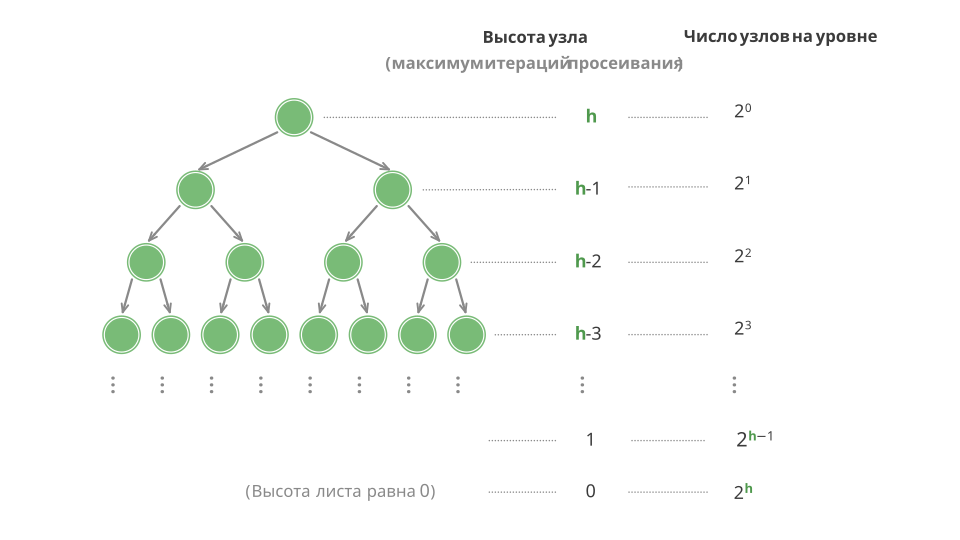

# 8.2 &nbsp; Построение кучи

Иногда нужно построить кучу из всех элементов списка. Эту операцию называют построением кучи.

## 8.2.1 &nbsp; Построение последовательными вставками

Сначала создаём пустую кучу, затем перебираем список и по очереди вставляем каждый элемент: добавляем его в конец кучи и просеиваем снизу вверх.

С каждой вставкой длина кучи увеличивается на единицу. Узлы добавляются в бинарное дерево в порядке от верхних уровней к нижним, поэтому сама куча строится сверху вниз.

Пусть элементов $n$. Вставка одного элемента занимает время $O(\log{n})$, поэтому временная сложность такого построения равна $O(n \log n)$.

## 8.2.2 &nbsp; Построение просеиванием при обходе массива

Кучу можно построить эффективнее, всего за два шага.

1. Поместите все элементы списка в массив кучи в исходном порядке. Свойство кучи пока не обеспечено.
2. Обойдите массив в обратном порядке (обратном обходу дерева по уровням). Для каждого узла, кроме листьев, выполните просеивание сверху вниз.

**После просеивания узла поддерево с корнем в этом узле удовлетворяет свойству кучи**. Поскольку узлы перебираются в обратном порядке, куча строится снизу вверх.

Обратный порядок гарантирует, что поддеревья детей текущего узла уже являются кучами. Именно при этом условии просеивание корректно восстанавливает кучу с корнем в текущем узле.

**У листьев нет детей, поэтому каждый лист сам по себе уже образует кучу и не нуждается в просеивании**. Последний внутренний узел — родитель последнего узла дерева. Как видно в коде ниже, с него и начинают обратный обход с просеиванием:

=== "Python"

    ```python title="my_heap.py"
    def __init__(self, nums: list[int]):
        """Конструктор кучи по входному списку"""
        # Поместить элементы списка в кучу в прежнем порядке
        self.max_heap = nums
        # Выполнить просеивание для всех узлов, кроме листьев
        for i in range(self.parent(self.size() - 1), -1, -1):
            self.sift_down(i)
    ```

=== "C++"

    ```cpp title="my_heap.cpp"
    /* Конструктор кучи по входному списку */
    MaxHeap(vector<int> nums) {
        // Поместить элементы списка в кучу в прежнем порядке
        maxHeap = nums;
        // Выполнить просеивание для всех узлов, кроме листьев
        for (int i = parent(size() - 1); i >= 0; i--) {
            siftDown(i);
        }
    }
    ```

=== "Java"

    ```java title="my_heap.java"
    /* Конструктор кучи по входному списку */
    MaxHeap(List<Integer> nums) {
        // Поместить элементы списка в кучу в прежнем порядке
        maxHeap = new ArrayList<>(nums);
        // Выполнить просеивание для всех узлов, кроме листьев
        for (int i = parent(size() - 1); i >= 0; i--) {
            siftDown(i);
        }
    }
    ```

=== "C#"

    ```csharp title="my_heap.cs"
    /* Конструктор кучи по входному списку */
    MaxHeap(IEnumerable<int> nums) {
        // Поместить элементы списка в кучу в прежнем порядке
        maxHeap = new List<int>(nums);
        // Выполнить просеивание для всех узлов, кроме листьев
        var size = Parent(this.Size() - 1);
        for (int i = size; i >= 0; i--) {
            SiftDown(i);
        }
    }
    ```

=== "Go"

    ```go title="my_heap.go"
    /* Конструктор кучи по срезу */
    func newMaxHeap(nums []any) *maxHeap {
        // Поместить элементы списка в кучу в прежнем порядке
        h := &maxHeap{data: nums}
        for i := h.parent(len(h.data) - 1); i >= 0; i-- {
            // Выполнить просеивание для всех узлов, кроме листьев
            h.siftDown(i)
        }
        return h
    }
    ```

=== "Swift"

    ```swift title="my_heap.swift"
    /* Конструктор кучи по входному списку */
    init(nums: [Int]) {
        // Поместить элементы списка в кучу в прежнем порядке
        maxHeap = nums
        // Выполнить просеивание для всех узлов, кроме листьев
        for i in (0 ... parent(i: size() - 1)).reversed() {
            siftDown(i: i)
        }
    }
    ```

=== "JS"

    ```javascript title="my_heap.js"
    /* Конструктор пустой кучи или кучи по входному списку */
    constructor(nums) {
        // Поместить элементы списка в кучу в прежнем порядке
        this.#maxHeap = nums === undefined ? [] : [...nums];
        // Выполнить просеивание для всех узлов, кроме листьев
        for (let i = this.#parent(this.size() - 1); i >= 0; i--) {
            this.#siftDown(i);
        }
    }
    ```

=== "TS"

    ```typescript title="my_heap.ts"
    /* Конструктор пустой кучи или кучи по входному списку */
    constructor(nums?: number[]) {
        // Поместить элементы списка в кучу в прежнем порядке
        this.maxHeap = nums === undefined ? [] : [...nums];
        // Выполнить просеивание для всех узлов, кроме листьев
        for (let i = this.parent(this.size() - 1); i >= 0; i--) {
            this.siftDown(i);
        }
    }
    ```

=== "Dart"

    ```dart title="my_heap.dart"
    /* Конструктор кучи по входному списку */
    MaxHeap(List<int> nums) {
      // Поместить элементы списка в кучу в прежнем порядке
      _maxHeap = nums;
      // Выполнить просеивание для всех узлов, кроме листьев
      for (int i = _parent(size() - 1); i >= 0; i--) {
        siftDown(i);
      }
    }
    ```

=== "Rust"

    ```rust title="my_heap.rs"
    /* Конструктор кучи по входному списку */
    fn new(nums: Vec<i32>) -> Self {
        // Поместить элементы списка в кучу в прежнем порядке
        let mut heap = MaxHeap { max_heap: nums };
        // Выполнить просеивание для всех узлов, кроме листьев
        for i in (0..=Self::parent(heap.size() - 1)).rev() {
            heap.sift_down(i);
        }
        heap
    }
    ```

=== "C"

    ```c title="my_heap.c"
    /* Конструктор кучи по срезу */
    MaxHeap *newMaxHeap(int nums[], int size) {
        // Добавить все элементы в кучу
        MaxHeap *maxHeap = (MaxHeap *)malloc(sizeof(MaxHeap));
        maxHeap->size = size;
        memcpy(maxHeap->data, nums, size * sizeof(int));
        for (int i = parent(maxHeap, size - 1); i >= 0; i--) {
            // Выполнить просеивание для всех узлов, кроме листьев
            siftDown(maxHeap, i);
        }
        return maxHeap;
    }
    ```

=== "Kotlin"

    ```kotlin title="my_heap.kt"
    /* Макс-куча */
    class MaxHeap(nums: MutableList<Int>?) {
        // Список, в отличие от массива, расширяется автоматически
        private val maxHeap = mutableListOf<Int>()

        /* Конструктор кучи по входному списку */
        init {
            // Поместить элементы списка в кучу в прежнем порядке
            maxHeap.addAll(nums!!)
            // Выполнить просеивание для всех узлов, кроме листьев
            for (i in parent(size() - 1) downTo 0) {
                siftDown(i)
            }
        }

        /* Индекс левого ребёнка */
        private fun left(i: Int): Int {
            return 2 * i + 1
        }

        /* Индекс правого ребёнка */
        private fun right(i: Int): Int {
            return 2 * i + 2
        }

        /* Индекс родителя */
        private fun parent(i: Int): Int {
            return (i - 1) / 2 // Целочисленное деление с округлением вниз
        }

        /* Поменять элементы местами */
        private fun swap(i: Int, j: Int) {
            val temp = maxHeap[i]
            maxHeap[i] = maxHeap[j]
            maxHeap[j] = temp
        }

        /* Размер кучи */
        fun size(): Int {
            return maxHeap.size
        }

        /* Проверить, пуста ли куча */
        fun isEmpty(): Boolean {
            /* Проверить, пуста ли куча */
            return size() == 0
        }

        /* Посмотреть элемент в корне */
        fun peek(): Int {
            return maxHeap[0]
        }

        /* Вставить элемент в кучу */
        fun push(_val: Int) {
            // Добавить узел
            maxHeap.add(_val)
            // Просеивание вверх
            siftUp(size() - 1)
        }

        /* Просеивать вверх от узла i */
        private fun siftUp(it: Int) {
            // Параметры функции в Kotlin неизменяемы, поэтому создаём временную переменную
            var i = it
            while (true) {
                // Найти родителя узла i
                val p = parent(i)
                // Если вышли за корень или узел уже на своём месте, завершить просеивание
                if (p < 0 || maxHeap[i] <= maxHeap[p]) break
                // Поменять два узла местами
                swap(i, p)
                // Продолжить просеивание вверх
                i = p
            }
        }

        /* Извлечь элемент из кучи */
        fun pop(): Int {
            // Проверить, пуста ли куча
            if (isEmpty()) throw IndexOutOfBoundsException()
            // Поменять местами корень и крайний правый лист (первый и последний элементы)
            swap(0, size() - 1)
            // Удалить узел
            val _val = maxHeap.removeAt(size() - 1)
            // Просеивание вниз
            siftDown(0)
            // Вернуть элемент из корня
            return _val
        }

        /* Просеивать вниз от узла i */
        private fun siftDown(it: Int) {
            // Параметры функции в Kotlin неизменяемы, поэтому создаём временную переменную
            var i = it
            while (true) {
                // Сохранить в ma индекс наибольшего из узлов i, l и r
                val l = left(i)
                val r = right(i)
                var ma = i
                if (l < size() && maxHeap[l] > maxHeap[ma]) ma = l
                if (r < size() && maxHeap[r] > maxHeap[ma]) ma = r
                // Если ни у одного потомка значение не больше, чем у родителя, завершить просеивание
                if (ma == i) break
                // Поменять два узла местами
                swap(i, ma)
                // Продолжить просеивание вниз
                i = ma
            }
        }

        /* Вывести кучу в виде бинарного дерева */
        fun print() {
            val queue = PriorityQueue { a: Int, b: Int -> b - a }
            queue.addAll(maxHeap)
            printHeap(queue)
        }
    }
    ```

=== "Ruby"

    ```ruby title="my_heap.rb"
    ### Конструктор кучи по входному списку ###
    def initialize(nums)
      # Поместить элементы списка в кучу в прежнем порядке
      @max_heap = nums
      # Выполнить просеивание для всех узлов, кроме листьев
      parent(size - 1).downto(0) do |i|
        sift_down(i)
      end
    end
    ```

??? pythontutor "Визуализация выполнения"

    <div style="height: 549px; width: 100%;"><iframe class="pythontutor-iframe" title="Визуализация выполнения" src="https://pythontutor.com/iframe-embed.html#code=class%20MaxHeap%3A%0A%20%20%20%20%22%22%22%D0%9C%D0%B0%D0%BA%D1%81-%D0%BA%D1%83%D1%87%D0%B0%22%22%22%0A%0A%20%20%20%20def%20__init__%28self,%20nums%3A%20list%5Bint%5D%29%3A%0A%20%20%20%20%20%20%20%20%22%22%22%D0%9A%D0%BE%D0%BD%D1%81%D1%82%D1%80%D1%83%D0%BA%D1%82%D0%BE%D1%80%20%D0%BA%D1%83%D1%87%D0%B8%20%D0%BF%D0%BE%20%D0%B2%D1%85%D0%BE%D0%B4%D0%BD%D0%BE%D0%BC%D1%83%20%D1%81%D0%BF%D0%B8%D1%81%D0%BA%D1%83%22%22%22%0A%20%20%20%20%20%20%20%20%23%20%D0%A1%D0%BF%D0%B8%D1%81%D0%BE%D0%BA%20%D0%B2%20%D0%BA%D1%83%D1%87%D1%83%20%D0%B1%D0%B5%D0%B7%20%D0%BF%D0%B5%D1%80%D0%B5%D1%81%D1%82%D0%B0%D0%BD%D0%BE%D0%B2%D0%BE%D0%BA%0A%20%20%20%20%20%20%20%20self.max_heap%20%3D%20nums%0A%20%20%20%20%20%20%20%20%23%20%D0%92%D1%8B%D0%BF%D0%BE%D0%BB%D0%BD%D0%B8%D1%82%D1%8C%20%D0%BF%D1%80%D0%BE%D1%81%D0%B5%D0%B8%D0%B2%D0%B0%D0%BD%D0%B8%D0%B5%20%D0%B4%D0%BB%D1%8F%20%D0%B2%D1%81%D0%B5%D1%85%20%D1%83%D0%B7%D0%BB%D0%BE%D0%B2,%20%D0%BA%D1%80%D0%BE%D0%BC%D0%B5%20%D0%BB%D0%B8%D1%81%D1%82%D1%8C%D0%B5%D0%B2%0A%20%20%20%20%20%20%20%20for%20i%20in%20range%28self.parent%28self.size%28%29%20-%201%29,%20-1,%20-1%29%3A%0A%20%20%20%20%20%20%20%20%20%20%20%20self.sift_down%28i%29%0A%0A%20%20%20%20def%20left%28self,%20i%3A%20int%29%20-%3E%20int%3A%0A%20%20%20%20%20%20%20%20%22%22%22%D0%98%D0%BD%D0%B4%D0%B5%D0%BA%D1%81%20%D0%BB%D0%B5%D0%B2%D0%BE%D0%B3%D0%BE%20%D1%80%D0%B5%D0%B1%D1%91%D0%BD%D0%BA%D0%B0%22%22%22%0A%20%20%20%20%20%20%20%20return%202%20%2A%20i%20%2B%201%0A%0A%20%20%20%20def%20right%28self,%20i%3A%20int%29%20-%3E%20int%3A%0A%20%20%20%20%20%20%20%20%22%22%22%D0%98%D0%BD%D0%B4%D0%B5%D0%BA%D1%81%20%D0%BF%D1%80%D0%B0%D0%B2%D0%BE%D0%B3%D0%BE%20%D1%80%D0%B5%D0%B1%D1%91%D0%BD%D0%BA%D0%B0%22%22%22%0A%20%20%20%20%20%20%20%20return%202%20%2A%20i%20%2B%202%0A%0A%20%20%20%20def%20parent%28self,%20i%3A%20int%29%20-%3E%20int%3A%0A%20%20%20%20%20%20%20%20%22%22%22%D0%98%D0%BD%D0%B4%D0%B5%D0%BA%D1%81%20%D1%80%D0%BE%D0%B4%D0%B8%D1%82%D0%B5%D0%BB%D1%8F%22%22%22%0A%20%20%20%20%20%20%20%20return%20%28i%20-%201%29%20//%202%20%20%23%20%D0%94%D0%B5%D0%BB%D0%B5%D0%BD%D0%B8%D0%B5%20%D1%81%20%D0%BE%D0%BA%D1%80%D1%83%D0%B3%D0%BB%D0%B5%D0%BD%D0%B8%D0%B5%D0%BC%20%D0%B2%D0%BD%D0%B8%D0%B7%0A%0A%20%20%20%20def%20swap%28self,%20i%3A%20int,%20j%3A%20int%29%3A%0A%20%20%20%20%20%20%20%20%22%22%22%D0%9E%D0%B1%D0%BC%D0%B5%D0%BD%20%D1%8D%D0%BB%D0%B5%D0%BC%D0%B5%D0%BD%D1%82%D0%BE%D0%B2%22%22%22%0A%20%20%20%20%20%20%20%20self.max_heap%5Bi%5D,%20self.max_heap%5Bj%5D%20%3D%20self.max_heap%5Bj%5D,%20self.max_heap%5Bi%5D%0A%0A%20%20%20%20def%20size%28self%29%20-%3E%20int%3A%0A%20%20%20%20%20%20%20%20%22%22%22%D0%A0%D0%B0%D0%B7%D0%BC%D0%B5%D1%80%20%D0%BA%D1%83%D1%87%D0%B8%22%22%22%0A%20%20%20%20%20%20%20%20return%20len%28self.max_heap%29%0A%0A%20%20%20%20def%20sift_down%28self,%20i%3A%20int%29%3A%0A%20%20%20%20%20%20%20%20%22%22%22%D0%9F%D1%80%D0%BE%D1%81%D0%B5%D1%8F%D1%82%D1%8C%20%D0%B2%D0%BD%D0%B8%D0%B7%20%D0%BE%D1%82%20i%22%22%22%0A%20%20%20%20%20%20%20%20while%20True%3A%0A%20%20%20%20%20%20%20%20%20%20%20%20%23%20ma%20%E2%80%94%20%D0%B8%D0%BD%D0%B4%D0%B5%D0%BA%D1%81%20%D1%83%D0%B7%D0%BB%D0%B0%20%D1%81%20%D0%BD%D0%B0%D0%B8%D0%B1%D0%BE%D0%BB%D1%8C%D1%88%D0%B8%D0%BC%20%D0%B7%D0%BD%D0%B0%D1%87%D0%B5%D0%BD%D0%B8%D0%B5%D0%BC%0A%20%20%20%20%20%20%20%20%20%20%20%20l,%20r,%20ma%20%3D%20self.left%28i%29,%20self.right%28i%29,%20i%0A%20%20%20%20%20%20%20%20%20%20%20%20if%20l%20%3C%20self.size%28%29%20and%20self.max_heap%5Bl%5D%20%3E%20self.max_heap%5Bma%5D%3A%0A%20%20%20%20%20%20%20%20%20%20%20%20%20%20%20%20ma%20%3D%20l%0A%20%20%20%20%20%20%20%20%20%20%20%20if%20r%20%3C%20self.size%28%29%20and%20self.max_heap%5Br%5D%20%3E%20self.max_heap%5Bma%5D%3A%0A%20%20%20%20%20%20%20%20%20%20%20%20%20%20%20%20ma%20%3D%20r%0A%20%20%20%20%20%20%20%20%20%20%20%20%23%20%D0%A1%D1%82%D0%BE%D0%BF%3A%20%D0%B2%20%D1%83%D0%B7%D0%BB%D0%B5%20i%20%D0%BC%D0%B0%D0%BA%D1%81%D0%B8%D0%BC%D1%83%D0%BC%0A%20%20%20%20%20%20%20%20%20%20%20%20if%20ma%20%3D%3D%20i%3A%0A%20%20%20%20%20%20%20%20%20%20%20%20%20%20%20%20break%0A%20%20%20%20%20%20%20%20%20%20%20%20%23%20%D0%9E%D0%B1%D0%BC%D0%B5%D0%BD%20%D1%83%D0%B7%D0%BB%D0%BE%D0%B2%0A%20%20%20%20%20%20%20%20%20%20%20%20self.swap%28i,%20ma%29%0A%20%20%20%20%20%20%20%20%20%20%20%20%23%20%D0%94%D0%B0%D0%BB%D0%B5%D0%B5%20%D0%B2%D0%BD%D0%B8%D0%B7%0A%20%20%20%20%20%20%20%20%20%20%20%20i%20%3D%20ma%0A%0A%0A%22%22%22Driver%20Code%22%22%22%0Aif%20__name__%20%3D%3D%20%22__main__%22%3A%0A%20%20%20%20%23%20%D0%A1%D0%BE%D0%B7%D0%B4%D0%B0%D1%82%D1%8C%20%D0%BC%D0%B0%D0%BA%D1%81-%D0%BA%D1%83%D1%87%D1%83%0A%20%20%20%20max_heap%20%3D%20MaxHeap%28%5B1,%202,%203,%204,%205%5D%29&codeDivHeight=472&codeDivWidth=350&cumulative=false&curInstr=4&heapPrimitives=nevernest&origin=opt-frontend.js&py=311&rawInputLstJSON=%5B%5D&textReferences=false"> </iframe></div>
    <div style="margin-top: 5px;"><a href="https://pythontutor.com/iframe-embed.html#code=class%20MaxHeap%3A%0A%20%20%20%20%22%22%22%D0%9C%D0%B0%D0%BA%D1%81-%D0%BA%D1%83%D1%87%D0%B0%22%22%22%0A%0A%20%20%20%20def%20__init__%28self,%20nums%3A%20list%5Bint%5D%29%3A%0A%20%20%20%20%20%20%20%20%22%22%22%D0%9A%D0%BE%D0%BD%D1%81%D1%82%D1%80%D1%83%D0%BA%D1%82%D0%BE%D1%80%20%D0%BA%D1%83%D1%87%D0%B8%20%D0%BF%D0%BE%20%D0%B2%D1%85%D0%BE%D0%B4%D0%BD%D0%BE%D0%BC%D1%83%20%D1%81%D0%BF%D0%B8%D1%81%D0%BA%D1%83%22%22%22%0A%20%20%20%20%20%20%20%20%23%20%D0%A1%D0%BF%D0%B8%D1%81%D0%BE%D0%BA%20%D0%B2%20%D0%BA%D1%83%D1%87%D1%83%20%D0%B1%D0%B5%D0%B7%20%D0%BF%D0%B5%D1%80%D0%B5%D1%81%D1%82%D0%B0%D0%BD%D0%BE%D0%B2%D0%BE%D0%BA%0A%20%20%20%20%20%20%20%20self.max_heap%20%3D%20nums%0A%20%20%20%20%20%20%20%20%23%20%D0%92%D1%8B%D0%BF%D0%BE%D0%BB%D0%BD%D0%B8%D1%82%D1%8C%20%D0%BF%D1%80%D0%BE%D1%81%D0%B5%D0%B8%D0%B2%D0%B0%D0%BD%D0%B8%D0%B5%20%D0%B4%D0%BB%D1%8F%20%D0%B2%D1%81%D0%B5%D1%85%20%D1%83%D0%B7%D0%BB%D0%BE%D0%B2,%20%D0%BA%D1%80%D0%BE%D0%BC%D0%B5%20%D0%BB%D0%B8%D1%81%D1%82%D1%8C%D0%B5%D0%B2%0A%20%20%20%20%20%20%20%20for%20i%20in%20range%28self.parent%28self.size%28%29%20-%201%29,%20-1,%20-1%29%3A%0A%20%20%20%20%20%20%20%20%20%20%20%20self.sift_down%28i%29%0A%0A%20%20%20%20def%20left%28self,%20i%3A%20int%29%20-%3E%20int%3A%0A%20%20%20%20%20%20%20%20%22%22%22%D0%98%D0%BD%D0%B4%D0%B5%D0%BA%D1%81%20%D0%BB%D0%B5%D0%B2%D0%BE%D0%B3%D0%BE%20%D1%80%D0%B5%D0%B1%D1%91%D0%BD%D0%BA%D0%B0%22%22%22%0A%20%20%20%20%20%20%20%20return%202%20%2A%20i%20%2B%201%0A%0A%20%20%20%20def%20right%28self,%20i%3A%20int%29%20-%3E%20int%3A%0A%20%20%20%20%20%20%20%20%22%22%22%D0%98%D0%BD%D0%B4%D0%B5%D0%BA%D1%81%20%D0%BF%D1%80%D0%B0%D0%B2%D0%BE%D0%B3%D0%BE%20%D1%80%D0%B5%D0%B1%D1%91%D0%BD%D0%BA%D0%B0%22%22%22%0A%20%20%20%20%20%20%20%20return%202%20%2A%20i%20%2B%202%0A%0A%20%20%20%20def%20parent%28self,%20i%3A%20int%29%20-%3E%20int%3A%0A%20%20%20%20%20%20%20%20%22%22%22%D0%98%D0%BD%D0%B4%D0%B5%D0%BA%D1%81%20%D1%80%D0%BE%D0%B4%D0%B8%D1%82%D0%B5%D0%BB%D1%8F%22%22%22%0A%20%20%20%20%20%20%20%20return%20%28i%20-%201%29%20//%202%20%20%23%20%D0%94%D0%B5%D0%BB%D0%B5%D0%BD%D0%B8%D0%B5%20%D1%81%20%D0%BE%D0%BA%D1%80%D1%83%D0%B3%D0%BB%D0%B5%D0%BD%D0%B8%D0%B5%D0%BC%20%D0%B2%D0%BD%D0%B8%D0%B7%0A%0A%20%20%20%20def%20swap%28self,%20i%3A%20int,%20j%3A%20int%29%3A%0A%20%20%20%20%20%20%20%20%22%22%22%D0%9E%D0%B1%D0%BC%D0%B5%D0%BD%20%D1%8D%D0%BB%D0%B5%D0%BC%D0%B5%D0%BD%D1%82%D0%BE%D0%B2%22%22%22%0A%20%20%20%20%20%20%20%20self.max_heap%5Bi%5D,%20self.max_heap%5Bj%5D%20%3D%20self.max_heap%5Bj%5D,%20self.max_heap%5Bi%5D%0A%0A%20%20%20%20def%20size%28self%29%20-%3E%20int%3A%0A%20%20%20%20%20%20%20%20%22%22%22%D0%A0%D0%B0%D0%B7%D0%BC%D0%B5%D1%80%20%D0%BA%D1%83%D1%87%D0%B8%22%22%22%0A%20%20%20%20%20%20%20%20return%20len%28self.max_heap%29%0A%0A%20%20%20%20def%20sift_down%28self,%20i%3A%20int%29%3A%0A%20%20%20%20%20%20%20%20%22%22%22%D0%9F%D1%80%D0%BE%D1%81%D0%B5%D1%8F%D1%82%D1%8C%20%D0%B2%D0%BD%D0%B8%D0%B7%20%D0%BE%D1%82%20i%22%22%22%0A%20%20%20%20%20%20%20%20while%20True%3A%0A%20%20%20%20%20%20%20%20%20%20%20%20%23%20ma%20%E2%80%94%20%D0%B8%D0%BD%D0%B4%D0%B5%D0%BA%D1%81%20%D1%83%D0%B7%D0%BB%D0%B0%20%D1%81%20%D0%BD%D0%B0%D0%B8%D0%B1%D0%BE%D0%BB%D1%8C%D1%88%D0%B8%D0%BC%20%D0%B7%D0%BD%D0%B0%D1%87%D0%B5%D0%BD%D0%B8%D0%B5%D0%BC%0A%20%20%20%20%20%20%20%20%20%20%20%20l,%20r,%20ma%20%3D%20self.left%28i%29,%20self.right%28i%29,%20i%0A%20%20%20%20%20%20%20%20%20%20%20%20if%20l%20%3C%20self.size%28%29%20and%20self.max_heap%5Bl%5D%20%3E%20self.max_heap%5Bma%5D%3A%0A%20%20%20%20%20%20%20%20%20%20%20%20%20%20%20%20ma%20%3D%20l%0A%20%20%20%20%20%20%20%20%20%20%20%20if%20r%20%3C%20self.size%28%29%20and%20self.max_heap%5Br%5D%20%3E%20self.max_heap%5Bma%5D%3A%0A%20%20%20%20%20%20%20%20%20%20%20%20%20%20%20%20ma%20%3D%20r%0A%20%20%20%20%20%20%20%20%20%20%20%20%23%20%D0%A1%D1%82%D0%BE%D0%BF%3A%20%D0%B2%20%D1%83%D0%B7%D0%BB%D0%B5%20i%20%D0%BC%D0%B0%D0%BA%D1%81%D0%B8%D0%BC%D1%83%D0%BC%0A%20%20%20%20%20%20%20%20%20%20%20%20if%20ma%20%3D%3D%20i%3A%0A%20%20%20%20%20%20%20%20%20%20%20%20%20%20%20%20break%0A%20%20%20%20%20%20%20%20%20%20%20%20%23%20%D0%9E%D0%B1%D0%BC%D0%B5%D0%BD%20%D1%83%D0%B7%D0%BB%D0%BE%D0%B2%0A%20%20%20%20%20%20%20%20%20%20%20%20self.swap%28i,%20ma%29%0A%20%20%20%20%20%20%20%20%20%20%20%20%23%20%D0%94%D0%B0%D0%BB%D0%B5%D0%B5%20%D0%B2%D0%BD%D0%B8%D0%B7%0A%20%20%20%20%20%20%20%20%20%20%20%20i%20%3D%20ma%0A%0A%0A%22%22%22Driver%20Code%22%22%22%0Aif%20__name__%20%3D%3D%20%22__main__%22%3A%0A%20%20%20%20%23%20%D0%A1%D0%BE%D0%B7%D0%B4%D0%B0%D1%82%D1%8C%20%D0%BC%D0%B0%D0%BA%D1%81-%D0%BA%D1%83%D1%87%D1%83%0A%20%20%20%20max_heap%20%3D%20MaxHeap%28%5B1,%202,%203,%204,%205%5D%29&codeDivHeight=800&codeDivWidth=600&cumulative=false&curInstr=4&heapPrimitives=nevernest&origin=opt-frontend.js&py=311&rawInputLstJSON=%5B%5D&textReferences=false" target="_blank" rel="noopener noreferrer">Во весь экран ></a></div>

## 8.2.3 &nbsp; Анализ сложности

Определим временную сложность второго способа построения кучи.

- Пусть в полном бинарном дереве $n$ узлов. Тогда листьев $(n + 1) / 2$, где $/$ означает целочисленное деление с округлением вниз. Следовательно, просеять нужно $n / 2$ узлов.
- При просеивании вниз узел может опуститься самое большее до листа, поэтому число итераций ограничено высотой бинарного дерева $\log n$.

Перемножив эти величины, получим оценку времени построения $O(n \log n)$. **Однако она завышена: мы не учли, что на нижних уровнях бинарного дерева гораздо больше узлов, чем на верхних**.

Проведём более точный расчёт. Для простоты возьмём совершенное бинарное дерево с $n$ узлами и высотой $h$. Это допущение не изменит итоговую оценку сложности.

{ class="animation-figure" }

<p align="center"> Рисунок 8-5 &nbsp; Число узлов на каждом уровне совершенного бинарного дерева </p>

Как видно на рисунке, максимальное число итераций просеивания вниз равно расстоянию от узла до листа, то есть высоте узла. Поэтому, сложив по всем уровням произведения «число узлов $\times$ высота узла», **получим суммарное число итераций просеивания всех узлов в худшем случае**.

$$
T(h) = 2^0h + 2^1(h-1) + 2^2(h-2) + \dots + 2^{(h-1)}\times1
$$

Упростим выражение с помощью знакомых из школы свойств последовательностей. Для начала умножим $T(h)$ на $2$:

$$
\begin{aligned}
T(h) & = 2^0h + 2^1(h-1) + 2^2(h-2) + \dots + 2^{h-1}\times1 \newline
2 T(h) & = 2^1h + 2^2(h-1) + 2^3(h-2) + \dots + 2^{h}\times1 \newline
\end{aligned}
$$

Вычтем со сдвигом предыдущее выражение $T(h)$ из полученного выражения $2 T(h)$:

$$
2T(h) - T(h) = T(h) = -2^0h + 2^1 + 2^2 + \dots + 2^{h-1} + 2^h
$$

Видим, что $T(h)$ представляет собой геометрическую прогрессию. Применив формулу её суммы, получаем оценку времени:

$$
\begin{aligned}
T(h) & = 2 \frac{1 - 2^h}{1 - 2} - h \newline
& = 2^{h+1} - h - 2 \newline
& = O(2^h)
\end{aligned}
$$

В совершенном бинарном дереве высоты $h$ число узлов равно $n = 2^{h+1} - 1$. Следовательно, сложность составляет $O(2^h) = O(n)$. Итак, **по готовому списку кучу можно построить очень эффективно, за время $O(n)$**.
