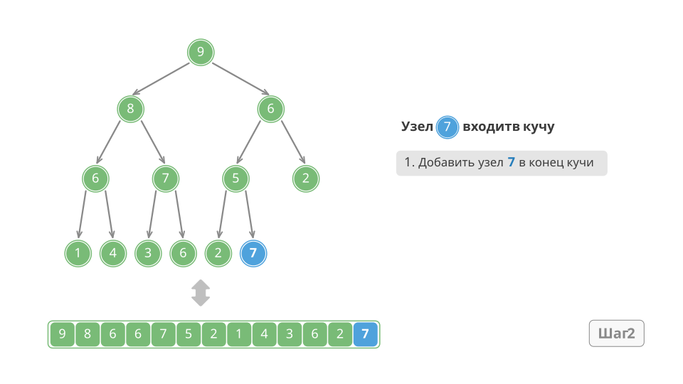
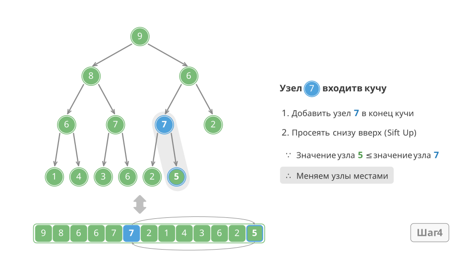
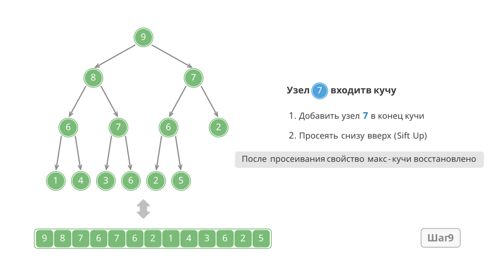
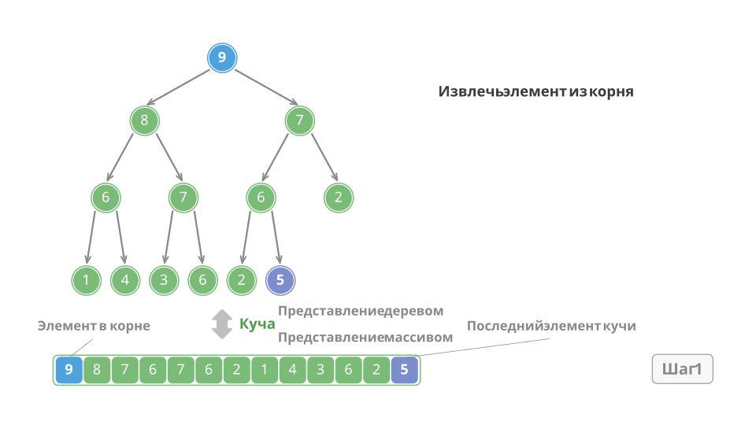
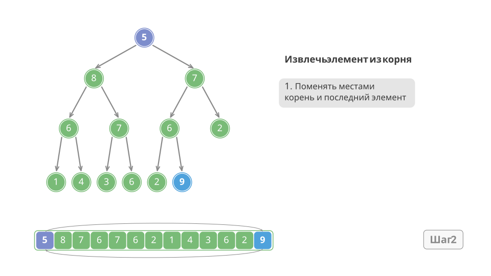
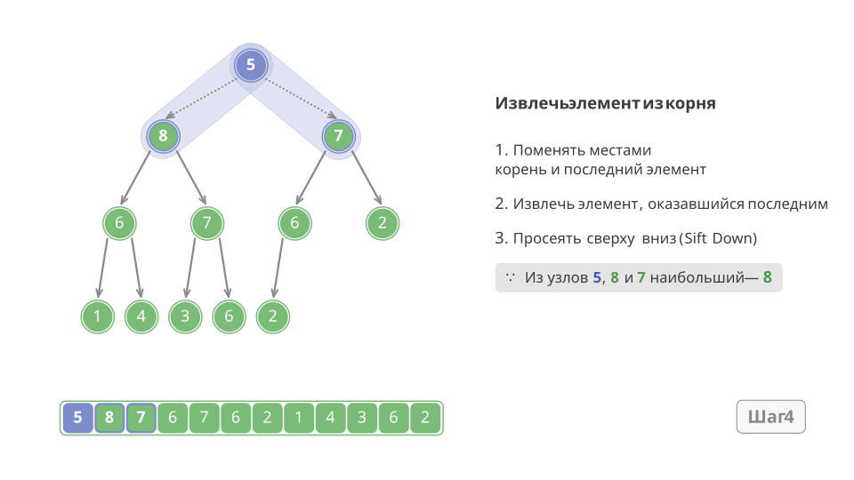
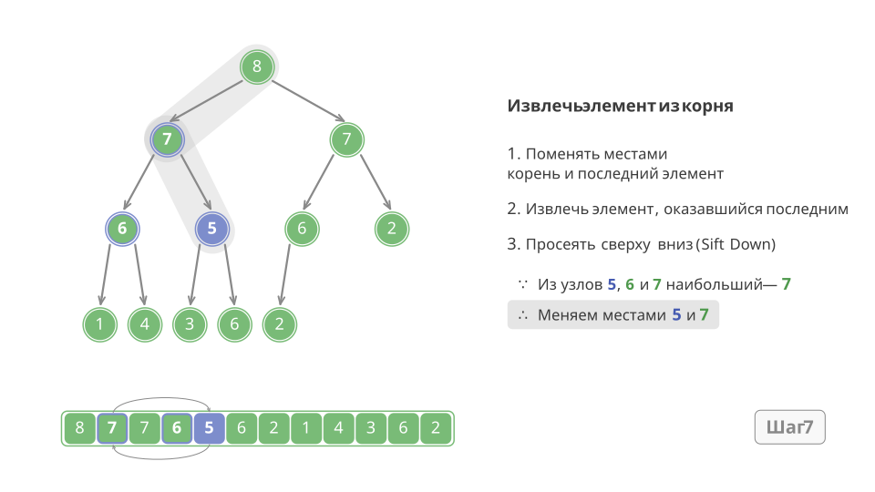
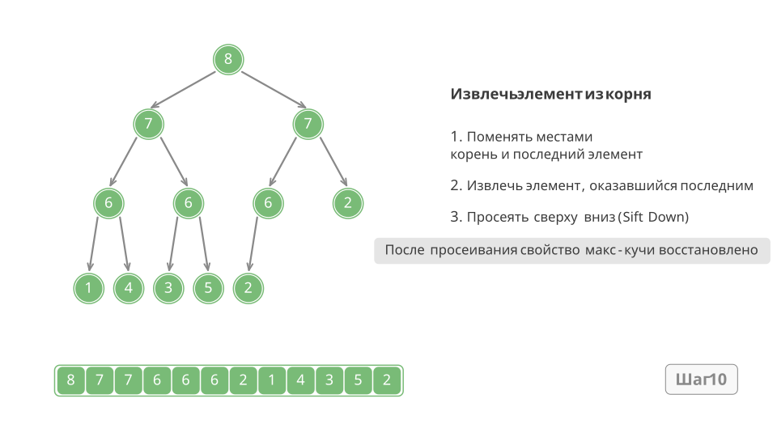

# Куча

<u>Куча (heap)</u> - это полное двоичное дерево, удовлетворяющее определенным условиям. Основных типов кучи два, как показано на рисунке ниже.

- <u>Минимальная куча (min heap)</u>: значение любого узла $\leq$ значения его дочерних узлов.
- <u>Максимальная куча (max heap)</u>: значение любого узла $\geq$ значения его дочерних узлов.


Куча, являясь частным случаем полного двоичного дерева, обладает следующими свойствами.

- Узлы самого нижнего уровня заполняются слева, а все остальные уровни заполнены полностью.
- Корневой узел двоичного дерева мы называем вершиной кучи, а самый правый узел нижнего уровня - основанием кучи.
- Для максимальной (минимальной) кучи значение элемента на вершине, то есть у корневого узла, является максимальным (минимальным).

## Распространенные операции с кучей

Нужно отметить, что многие языки программирования предоставляют не саму кучу, а <u>очередь с приоритетом (priority queue)</u> - абстрактную структуру данных, определяемую как очередь, в которой элементы извлекаются в соответствии с приоритетом.

На практике **куча обычно используется для реализации очереди с приоритетом, а максимальная куча эквивалентна очереди с приоритетом, в которой элементы извлекаются по убыванию**. С точки зрения использования очередь с приоритетом и куча могут считаться эквивалентными структурами данных. Поэтому в этой книге мы не будем специально различать их и в дальнейшем будем единообразно называть кучей.

Распространенные операции с кучей приведены в таблице ниже. Конкретные имена методов зависят от языка программирования.

<p align="center"> Таблица <id> &nbsp; Эффективность операций с кучей </p>

| Имя метода  | Описание                                         | Временная сложность |
| ----------- | ------------------------------------------------ | ------------------- |
| `push()`    | Поместить элемент в кучу                         | $O(\log n)$         |
| `pop()`     | Извлечь элемент с вершины кучи                   | $O(\log n)$         |
| `peek()`    | Получить доступ к вершине кучи (для max / min кучи это соответственно максимум / минимум) | $O(1)$ |
| `size()`    | Получить число элементов в куче                  | $O(1)$              |
| `isEmpty()` | Проверить, пуста ли куча                         | $O(1)$              |

В реальных приложениях мы можем напрямую использовать классы кучи, предоставляемые языком программирования, или классы очереди с приоритетом.

Подобно сортировкам «по возрастанию» и «по убыванию», мы можем переключаться между «минимальной кучей» и «максимальной кучей», изменяя `flag` или модифицируя `Comparator` . Код приведен ниже:

```snippet
heap_operations
```

??? pythontutor "Визуализация выполнения"

    @tutor heap_operations_tutor

## Реализация кучи

Ниже реализуется максимальная куча. Чтобы преобразовать ее в минимальную кучу, достаточно инвертировать всю логику сравнений по величине, например заменить $\geq$ на $\leq$ . Заинтересованные читатели могут попробовать реализовать это самостоятельно.

### Хранение и представление кучи

В разделе «Двоичные деревья» мы уже говорили, что полное двоичное дерево очень удобно представлять массивом. Поскольку куча как раз и является полным двоичным деревом, **для хранения кучи мы также будем использовать массив**.

Когда двоичное дерево представляется массивом, элементы массива соответствуют значениям узлов, а индексы - положениям этих узлов в двоичном дереве. **Указатели на узлы реализуются через формулы отображения индексов**.

Как показано на рисунке ниже, для заданного индекса $i$ индекс левого дочернего узла равен $2i + 1$ , правого дочернего узла - $2i + 2$ , а родительского узла - $(i - 1) / 2$ с округлением вниз. Если индекс выходит за допустимые границы, это означает пустой узел или отсутствие узла.


Мы можем инкапсулировать формулы отображения индексов в функции, чтобы потом было удобнее ими пользоваться:

```src
[file]{my_heap}-[class]{max_heap}-[func]{parent}
```

### Доступ к элементу на вершине кучи

Элемент на вершине кучи - это корневой узел двоичного дерева, то есть первый элемент списка:

```src
[file]{my_heap}-[class]{max_heap}-[func]{peek}
```

### Добавление элемента в кучу

Пусть дан элемент `val` . Сначала мы помещаем его в основание кучи. После добавления свойства кучи могут нарушиться, потому что `val` может оказаться больше, чем другие элементы в куче. **Поэтому необходимо восстановить порядок на пути от вставленного узла к корню**. Эта операция называется упорядочиванием кучи.

Рассмотрим ситуацию, когда упорядочивание выполняется **снизу вверх**, начиная от только что вставленного узла. Как показано на рисунке ниже, мы сравниваем значение вставленного узла со значением его родителя. Если вставленный узел больше, то меняем их местами. Затем продолжаем выполнять ту же операцию и последовательно восстанавливать корректность всех узлов по пути снизу вверх, пока не выйдем за корень или не встретим узел, для которого обмен не требуется.

=== "<1>"
    

=== "<2>"
    

=== "<3>"
    

=== "<4>"
    

=== "<5>"
    

=== "<6>"
    

=== "<7>"
    

=== "<8>"
    

=== "<9>"
    

Пусть общее число узлов равно $n$ , тогда высота дерева равна $O(\log n)$ . Следовательно, максимальное число итераций операции упорядочивания кучи тоже не превышает $O(\log n)$ . Отсюда **временная сложность добавления элемента в кучу равна $O(\log n)$** . Код приведен ниже:

```src
[file]{my_heap}-[class]{max_heap}-[func]{sift_up}
```

### Извлечение элемента с вершины кучи

Элемент на вершине кучи - это корневой узел двоичного дерева, то есть первый элемент списка. Если просто удалить первый элемент списка, то индексы всех узлов двоичного дерева изменятся, и это сильно затруднит последующее восстановление структуры при помощи упорядочивания кучи. Чтобы по возможности минимизировать изменение индексов элементов, мы используем следующий порядок действий.

1. Поменять местами элемент на вершине кучи и элемент у основания кучи, то есть поменять корневой узел с самым правым листовым узлом.
2. После обмена удалить основание кучи из списка. Стоит отметить, что, поскольку обмен уже выполнен, фактически удаляется исходный элемент вершины кучи.
3. Начиная от корневого узла, **выполнить упорядочивание кучи сверху вниз**.

Как показано на рисунке ниже, **направление операции упорядочивания кучи сверху вниз противоположно операции упорядочивания кучи снизу вверх**. Мы сравниваем значение корневого узла со значениями двух дочерних узлов, выбираем больший дочерний узел и меняем его местами с корневым узлом. Затем циклически повторяем ту же операцию, пока не выйдем за листовой узел или не встретим узел, который уже не требует обмена.

=== "<1>"
    

=== "<2>"
    

=== "<3>"
    

=== "<4>"
    

=== "<5>"
    

=== "<6>"
    

=== "<7>"
    

=== "<8>"
    

=== "<9>"
    

=== "<10>"
    

Как и операция добавления в кучу, операция извлечения элемента с вершины кучи также имеет временную сложность $O(\log n)$ . Код приведен ниже:

```src
[file]{my_heap}-[class]{max_heap}-[func]{sift_down}
```

## Типичные применения кучи

- **Очередь с приоритетом**: куча обычно является предпочтительной структурой данных для реализации очереди с приоритетом. Добавление и извлечение элементов имеют временную сложность $O(\log n)$ , а построение кучи - $O(n)$ , и все эти операции выполняются очень эффективно.
- **Пирамидальная сортировка**: для заданного набора данных можно построить кучу, а затем непрерывно извлекать из нее элементы, получая отсортированные данные. Однако на практике мы обычно используем более изящную реализацию пирамидальной сортировки. Подробности см. в разделе «Пирамидальная сортировка».
- **Получение наибольших $k$ элементов**: это классическая алгоритмическая задача и одновременно типичное применение кучи. Например, выбор 10 самых горячих новостей для списка популярных тем или выбор 10 самых продаваемых товаров.
