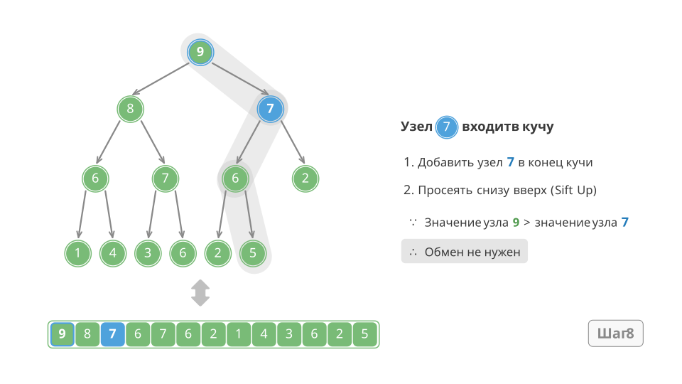
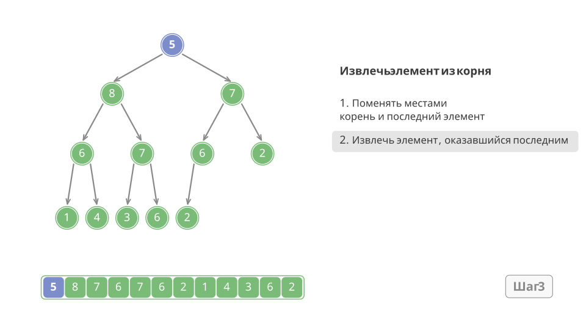
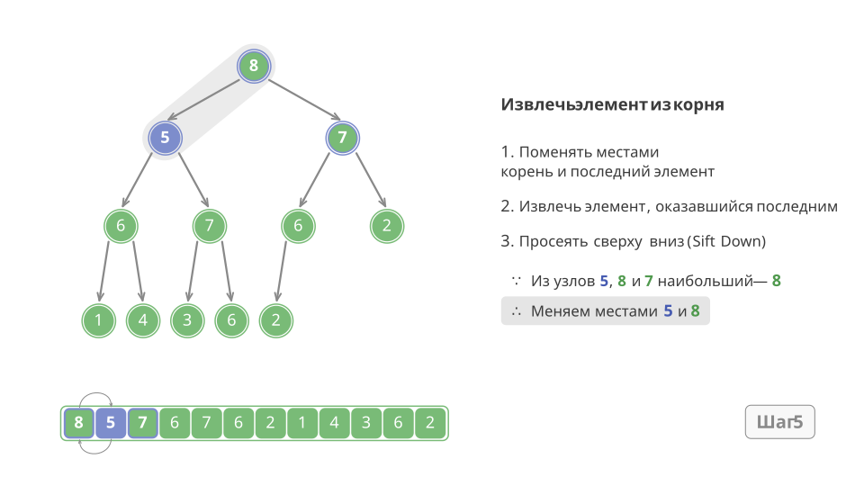
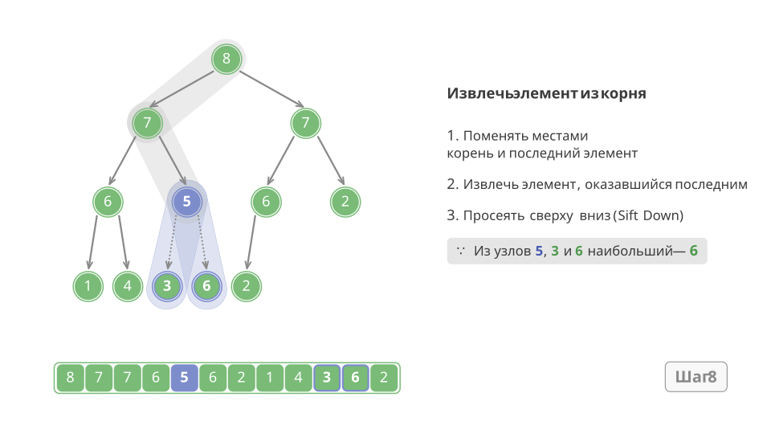

# Куча

<u>Куча (heap)</u> — полное бинарное дерево, удовлетворяющее определённому условию. В зависимости от этого условия различают два основных типа куч, показанных ниже.

- <u>Мин-куча (min heap)</u>: значение любого узла $\leq$ значение каждого из его детей.
- <u>Макс-куча (max heap)</u>: значение любого узла $\geq$ значение каждого из его детей.


Как частный случай полного бинарного дерева, куча обладает следующими свойствами.

- Нижний уровень заполняется слева направо, все остальные уровни заполнены целиком.
- Корень дерева называют вершиной кучи, а крайний правый узел нижнего уровня — последним узлом кучи.
- В макс-куче корень содержит максимальный элемент, а в мин-куче — минимальный.

## Основные операции с кучей

Многие языки программирования предоставляют <u>очередь с приоритетом (priority queue)</u>. Это абстрактная структура данных, в которой порядок извлечения определяется приоритетом элементов.

**Кучу часто используют для реализации очереди с приоритетом. Макс-куча соответствует очереди, из которой элементы извлекаются в порядке убывания**. С точки зрения использования очередь с приоритетом и кучу можно считать равнозначными структурами данных. Поэтому в этой книге будем называть обе «кучей».

В таблице перечислены основные операции с кучей. Имена методов зависят от языка программирования.

<p align="center"> Таблица <id> &nbsp; Эффективность операций с кучей </p>

| Метод      | Описание                                             | Временная сложность  |
| ----------- | ------------------------------------------------ | ----------- |
| `push()`    | Вставить элемент в кучу                                         | $O(\log n)$ |
| `pop()`     | Извлечь элемент из корня                                     | $O(\log n)$ |
| `peek()`    | Посмотреть элемент в корне (максимум в макс-куче, минимум в мин-куче) | $O(1)$      |
| `size()`    | Получить число элементов кучи                                 | $O(1)$      |
| `isEmpty()` | Проверить, пуста ли куча                                   | $O(1)$      |

На практике можно воспользоваться готовым классом кучи или очереди с приоритетом в выбранном языке.

Как и при выборе сортировки по возрастанию или убыванию, мин-кучу можно заменить макс-кучей и наоборот, задав `flag` или изменив `Comparator`. Ниже приведён код:

```snippet
heap_operations
```

??? pythontutor "Визуализация выполнения"

    @tutor heap_operations_tutor

## Реализация кучи

Ниже реализована макс-куча. Чтобы получить мин-кучу, достаточно обратить все сравнения значений (например, заменить $\geq$ на $\leq$). Попробуйте сделать это самостоятельно.

### Хранение и представление кучи

В главе «Бинарное дерево» мы видели, насколько удобно представлять полное бинарное дерево массивом. Куча — именно такое дерево, **поэтому будем хранить её в массиве**.

При представлении дерева массивом элемент хранит значение узла, а индекс задаёт его позицию в дереве. **Вместо указателей на узлы используются формулы для вычисления индексов**.

Как показано ниже, у узла с индексом $i$ левый ребёнок имеет индекс $2i + 1$, правый — $2i + 2$, а родитель — $(i - 1) / 2$ (деление с округлением вниз). Если индекс выходит за границы массива, соответствующий узел пуст или отсутствует.


Для удобства оформим вычисление индексов в виде функций:

```src
[file]{my_heap}-[class]{max_heap}-[func]{parent}
```

### Посмотреть элемент в корне

Корень кучи — это корень бинарного дерева, то есть первый элемент списка:

```src
[file]{my_heap}-[class]{max_heap}-[func]{peek}
```

### Вставить элемент в кучу

Сначала добавим элемент `val` в конец кучи. Поскольку `val` может быть больше других элементов, свойство кучи после вставки может нарушиться. **Нужно восстановить порядок на пути от вставленного узла к корню**. Эту операцию называют <u>восстановлением свойства кучи (heapify)</u>.

Начнём с нового узла и выполним **просеивание снизу вверх**. Как показано ниже, сравниваем новый узел с его родителем и меняем их местами, если новый узел больше. Повторяем это, восстанавливая порядок снизу вверх, пока не дойдём до границы за корнем или до узла, для которого обмен не нужен.

=== "<1>"
    

=== "<2>"
    

=== "<3>"
    

=== "<4>"
    

=== "<5>"
    

=== "<6>"
    

=== "<7>"
    

=== "<8>"
    

=== "<9>"
    

Если всего узлов $n$, высота дерева составляет $O(\log n)$. Значит, число итераций просеивания не превышает $O(\log n)$, а **временная сложность вставки равна $O(\log n)$**. Реализация приведена ниже:

```src
[file]{my_heap}-[class]{max_heap}-[func]{sift_up}
```

### Извлечь элемент из корня

Корень кучи — корень дерева и первый элемент списка. Если удалить первый элемент непосредственно из списка, индексы всех остальных узлов изменятся. После этого восстановить порядок просеиванием будет трудно. Чтобы изменить как можно меньше индексов, поступим так.

1. Поменяем местами корень и последний элемент кучи (корень дерева и крайний правый лист).
2. Удалим последний элемент из списка. После обмена там находится прежний корень, так что удаляем именно его.
3. Начиная с корня, выполним **просеивание сверху вниз**.

Как показано ниже, **просеивание сверху вниз идёт в направлении, обратном просеиванию снизу вверх**. Сравниваем корень с обоими детьми и, если нужен обмен, меняем его с бо́льшим ребёнком. Повторяем действие, пока не выйдем за уровень листьев или не дойдём до узла, для которого обмен не нужен.

=== "<1>"
    

=== "<2>"
    

=== "<3>"
    

=== "<4>"
    

=== "<5>"
    

=== "<6>"
    

=== "<7>"
    

=== "<8>"
    

=== "<9>"
    

=== "<10>"
    

Как и вставка, извлечение корня имеет временную сложность $O(\log n)$. Реализация приведена ниже:

```src
[file]{my_heap}-[class]{max_heap}-[func]{sift_down}
```

## Где применяют кучу

- **Очередь с приоритетом**. Куча часто оказывается первым выбором для такой очереди: вставка и извлечение имеют временную сложность $O(\log n)$, а построение кучи — $O(n)$. Все эти операции эффективны.
- **Пирамидальная сортировка**. Из заданного набора данных можно построить кучу, а затем извлекать элементы один за другим и получить упорядоченную последовательность. Обычно используют более изящную реализацию, описанную в разделе «Пирамидальная сортировка».
- **Поиск $k$ наибольших элементов**. Эта классическая алгоритмическая задача часто встречается на практике. Примеры — выбор десяти самых популярных новостей для списка трендов Weibo или десяти самых продаваемых товаров.
