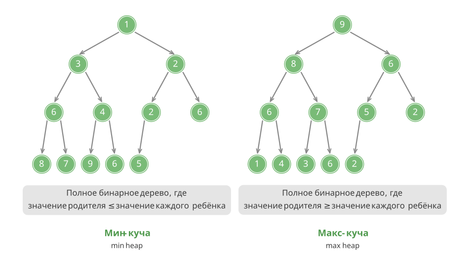
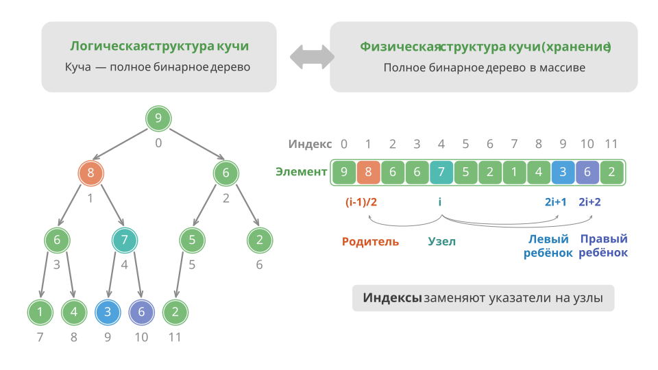
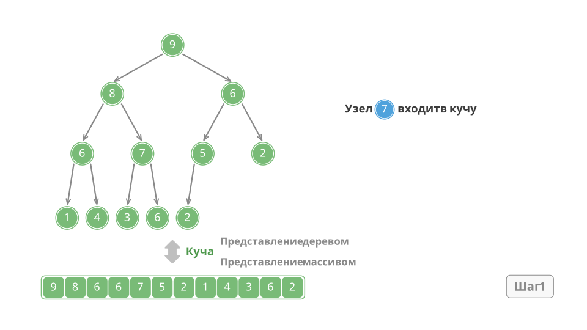
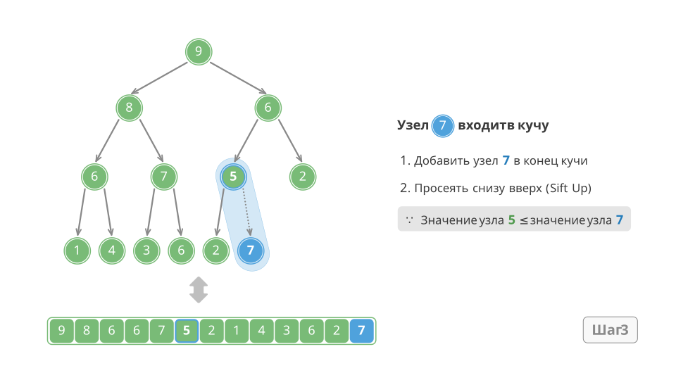
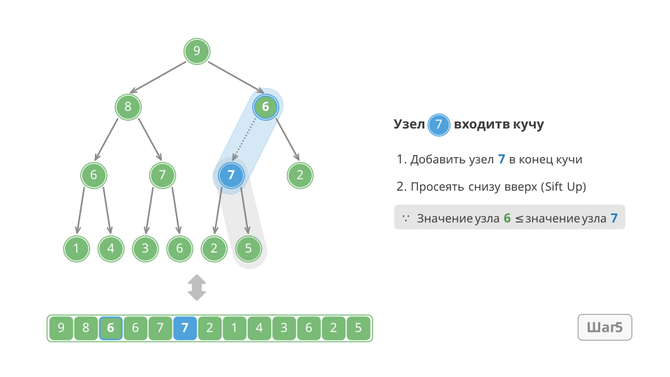
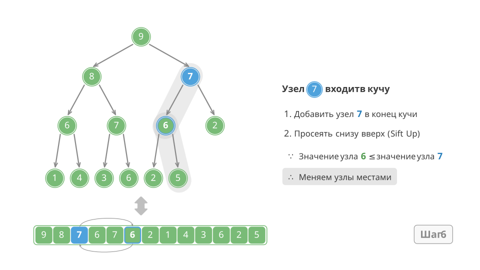
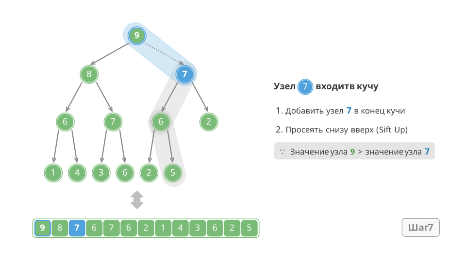
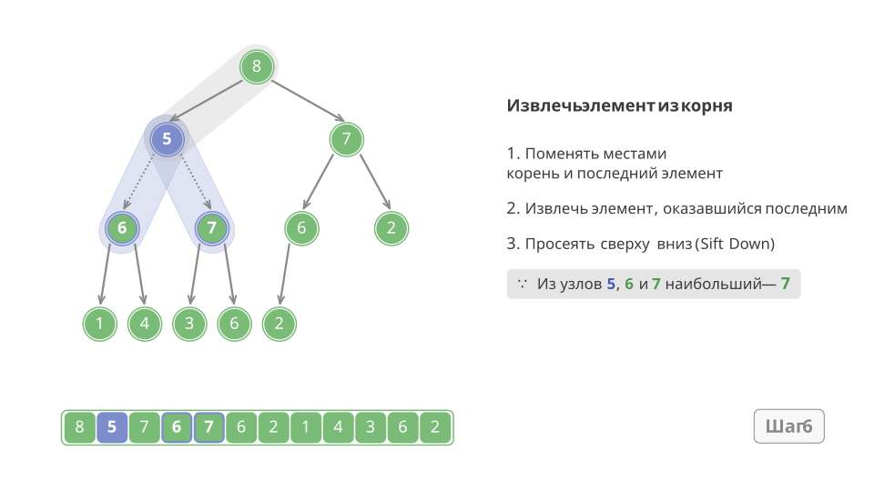
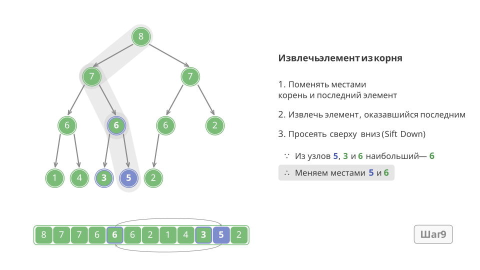

# 8.1 &nbsp; Куча

<u>Куча (heap)</u> — полное бинарное дерево, удовлетворяющее определённому условию. В зависимости от этого условия различают два основных типа куч, показанных ниже.

- <u>Мин-куча (min heap)</u>: значение любого узла $\leq$ значение каждого из его детей.
- <u>Макс-куча (max heap)</u>: значение любого узла $\geq$ значение каждого из его детей.

{ class="animation-figure" }

<p align="center"> Рисунок 8-1 &nbsp; Мин-куча и макс-куча </p>

Как частный случай полного бинарного дерева, куча обладает следующими свойствами.

- Нижний уровень заполняется слева направо, все остальные уровни заполнены целиком.
- Корень дерева называют вершиной кучи, а крайний правый узел нижнего уровня — последним узлом кучи.
- В макс-куче корень содержит максимальный элемент, а в мин-куче — минимальный.

## 8.1.1 &nbsp; Основные операции с кучей

Многие языки программирования предоставляют <u>очередь с приоритетом (priority queue)</u>. Это абстрактная структура данных, в которой порядок извлечения определяется приоритетом элементов.

**Кучу часто используют для реализации очереди с приоритетом. Макс-куча соответствует очереди, из которой элементы извлекаются в порядке убывания**. С точки зрения использования очередь с приоритетом и кучу можно считать равнозначными структурами данных. Поэтому в этой книге будем называть обе «кучей».

В таблице перечислены основные операции с кучей. Имена методов зависят от языка программирования.

<p align="center"> Таблица 8-1 &nbsp; Эффективность операций с кучей </p>

<div class="center-table" markdown>

| Метод      | Описание                                             | Временная сложность  |
| ----------- | ------------------------------------------------ | ----------- |
| `push()`    | Вставить элемент в кучу                                         | $O(\log n)$ |
| `pop()`     | Извлечь элемент из корня                                     | $O(\log n)$ |
| `peek()`    | Посмотреть элемент в корне (максимум в макс-куче, минимум в мин-куче) | $O(1)$      |
| `size()`    | Получить число элементов кучи                                 | $O(1)$      |
| `isEmpty()` | Проверить, пуста ли куча                                   | $O(1)$      |

</div>

На практике можно воспользоваться готовым классом кучи или очереди с приоритетом в выбранном языке.

Как и при выборе сортировки по возрастанию или убыванию, мин-кучу можно заменить макс-кучей и наоборот, задав `flag` или изменив `Comparator`. Ниже приведён код:

=== "Python"

    ```python title="heap.py"
    # Инициализировать мин-кучу
    min_heap, flag = [], 1
    # Инициализировать макс-кучу
    max_heap, flag = [], -1

    # Модуль heapq в Python по умолчанию реализует мин-кучу
    # Смена знака элементов перед вставкой обращает порядок сравнения и позволяет реализовать макс-кучу
    # В этом примере flag = 1 задаёт мин-кучу, а flag = -1 — макс-кучу

    # Вставить элемент в кучу
    heapq.heappush(max_heap, flag * 1)
    heapq.heappush(max_heap, flag * 3)
    heapq.heappush(max_heap, flag * 2)
    heapq.heappush(max_heap, flag * 5)
    heapq.heappush(max_heap, flag * 4)

    # Получить элемент в корне
    peek: int = flag * max_heap[0]  # 5

    # Извлечь элемент из корня
    # При извлечении элементы образуют последовательность в порядке убывания
    val = flag * heapq.heappop(max_heap)  # 5
    val = flag * heapq.heappop(max_heap)  # 4
    val = flag * heapq.heappop(max_heap)  # 3
    val = flag * heapq.heappop(max_heap)  # 2
    val = flag * heapq.heappop(max_heap)  # 1

    # Размер кучи
    size: int = len(max_heap)

    # Проверить, пуста ли куча
    is_empty: bool = not max_heap

    # Построить кучу по входному списку
    # Временная сложность — O(n), а не O(nlogn)
    min_heap: list[int] = [1, 3, 2, 5, 4]
    heapq.heapify(min_heap)
    ```

=== "C++"

    ```cpp title="heap.cpp"
    /* Инициализировать кучу */
    // Инициализировать мин-кучу
    priority_queue<int, vector<int>, greater<int>> minHeap;
    // Инициализировать макс-кучу
    priority_queue<int, vector<int>, less<int>> maxHeap;

    /* Вставить элемент в кучу */
    maxHeap.push(1);
    maxHeap.push(3);
    maxHeap.push(2);
    maxHeap.push(5);
    maxHeap.push(4);

    /* Получить элемент в корне */
    int peek = maxHeap.top(); // 5

    /* Извлечь элемент из корня */
    // При извлечении элементы образуют последовательность в порядке убывания
    maxHeap.pop(); // 5
    maxHeap.pop(); // 4
    maxHeap.pop(); // 3
    maxHeap.pop(); // 2
    maxHeap.pop(); // 1

    /* Размер кучи */
    int size = maxHeap.size();

    /* Проверить, пуста ли куча */
    bool isEmpty = maxHeap.empty();

    /* Построить кучу по входному списку */
    // Временная сложность — O(n), а не O(nlogn)
    vector<int> input{1, 3, 2, 5, 4};
    minHeap = priority_queue<int, vector<int>, greater<int>>(input.begin(), input.end());
    ```

=== "Java"

    ```java title="heap.java"
    /* Инициализировать кучу */
    // Инициализировать мин-кучу
    Queue<Integer> minHeap = new PriorityQueue<>();
    // Инициализировать макс-кучу, задав Comparator лямбда-выражением
    Queue<Integer> maxHeap = new PriorityQueue<>((a, b) -> b - a);

    /* Вставить элемент в кучу */
    maxHeap.offer(1);
    maxHeap.offer(3);
    maxHeap.offer(2);
    maxHeap.offer(5);
    maxHeap.offer(4);

    /* Получить элемент в корне */
    int peek = maxHeap.peek(); // 5

    /* Извлечь элемент из корня */
    // При извлечении элементы образуют последовательность в порядке убывания
    peek = maxHeap.poll(); // 5
    peek = maxHeap.poll(); // 4
    peek = maxHeap.poll(); // 3
    peek = maxHeap.poll(); // 2
    peek = maxHeap.poll(); // 1

    /* Размер кучи */
    int size = maxHeap.size();

    /* Проверить, пуста ли куча */
    boolean isEmpty = maxHeap.isEmpty();

    /* Построить кучу по входному списку */
    // Временная сложность — O(n), а не O(nlogn)
    minHeap = new PriorityQueue<>(Arrays.asList(1, 3, 2, 5, 4));
    ```

=== "C#"

    ```csharp title="heap.cs"
    /* Инициализировать кучу */
    // Инициализировать мин-кучу
    PriorityQueue<int, int> minHeap = new();
    // Инициализировать макс-кучу, задав Comparer лямбда-выражением
    PriorityQueue<int, int> maxHeap = new(Comparer<int>.Create((x, y) => y.CompareTo(x)));

    /* Вставить элемент в кучу */
    maxHeap.Enqueue(1, 1);
    maxHeap.Enqueue(3, 3);
    maxHeap.Enqueue(2, 2);
    maxHeap.Enqueue(5, 5);
    maxHeap.Enqueue(4, 4);

    /* Получить элемент в корне */
    int peek = maxHeap.Peek(); // 5

    /* Извлечь элемент из корня */
    // При извлечении элементы образуют последовательность в порядке убывания
    peek = maxHeap.Dequeue(); // 5
    peek = maxHeap.Dequeue(); // 4
    peek = maxHeap.Dequeue(); // 3
    peek = maxHeap.Dequeue(); // 2
    peek = maxHeap.Dequeue(); // 1

    /* Размер кучи */
    int size = maxHeap.Count;

    /* Проверить, пуста ли куча */
    bool isEmpty = maxHeap.Count == 0;

    /* Построить кучу по входному списку */
    // Временная сложность — O(n), а не O(nlogn)
    minHeap = new PriorityQueue<int, int>([(1, 1), (3, 3), (2, 2), (5, 5), (4, 4)]);
    ```

=== "Go"

    ```go title="heap.go"
    // В Go макс-кучу целых чисел можно построить, реализовав heap.Interface
    // Для реализации heap.Interface требуется также реализовать sort.Interface
    type intHeap []any

    // Метод Push интерфейса heap.Interface добавляет элемент в кучу
    func (h *intHeap) Push(x any) {
        // Методы Push и Pop используют указатель в качестве получателя,
        // поскольку изменяют как содержимое среза, так и его длину.
        *h = append(*h, x.(int))
    }

    // Метод Pop интерфейса heap.Interface извлекает последний элемент среза (heap.Pop уже переместил туда корень)
    func (h *intHeap) Pop() any {
        // Извлекаемый элемент находится в конце
        last := (*h)[len(*h)-1]
        *h = (*h)[:len(*h)-1]
        return last
    }

    // Метод Len интерфейса sort.Interface
    func (h *intHeap) Len() int {
        return len(*h)
    }

    // Метод Less интерфейса sort.Interface
    func (h *intHeap) Less(i, j int) bool {
        // Для мин-кучи нужно использовать знак «меньше»
        return (*h)[i].(int) > (*h)[j].(int)
    }

    // Метод Swap интерфейса sort.Interface
    func (h *intHeap) Swap(i, j int) {
        (*h)[i], (*h)[j] = (*h)[j], (*h)[i]
    }

    // Метод Top возвращает элемент в корне
    func (h *intHeap) Top() any {
        return (*h)[0]
    }

    func TestHeap(t *testing.T) {
        /* Инициализировать кучу */
        // Инициализировать макс-кучу
        maxHeap := &intHeap{}
        heap.Init(maxHeap)
        /* Вставить элемент в кучу */
        // Вызвать метод heap.Interface для добавления элемента
        heap.Push(maxHeap, 1)
        heap.Push(maxHeap, 3)
        heap.Push(maxHeap, 2)
        heap.Push(maxHeap, 5)
        heap.Push(maxHeap, 4)

        /* Получить элемент в корне */
        top := maxHeap.Top()
        fmt.Printf("Элемент в корне: %d\n", top)

        /* Извлечь элемент из корня */
        // Вызвать метод heap.Interface для удаления элемента
        fmt.Printf("Извлечённый элемент: %d\n", heap.Pop(maxHeap)) // 5
        fmt.Printf("Извлечённый элемент: %d\n", heap.Pop(maxHeap)) // 4
        fmt.Printf("Извлечённый элемент: %d\n", heap.Pop(maxHeap)) // 3
        fmt.Printf("Извлечённый элемент: %d\n", heap.Pop(maxHeap)) // 2
        fmt.Printf("Извлечённый элемент: %d\n", heap.Pop(maxHeap)) // 1

        /* Размер кучи */
        size := len(*maxHeap)
        fmt.Printf("Число элементов в куче: %d\n", size)

        /* Проверить, пуста ли куча */
        isEmpty := len(*maxHeap) == 0
        fmt.Printf("Пуста ли куча: %t\n", isEmpty)
    }
    ```

=== "Swift"

    ```swift title="heap.swift"
    import HeapModule

    /* Инициализировать кучу */
    // Тип Heap в Swift поддерживает макс-кучу и мин-кучу. Требуется пакет swift-collections
    var heap = Heap<Int>()

    /* Вставить элемент в кучу */
    heap.insert(1)
    heap.insert(3)
    heap.insert(2)
    heap.insert(5)
    heap.insert(4)

    /* Получить элемент в корне */
    var peek = heap.max()

    /* Извлечь элемент из корня */
    peek = heap.removeMax() // 5
    peek = heap.removeMax() // 4
    peek = heap.removeMax() // 3
    peek = heap.removeMax() // 2
    peek = heap.removeMax() // 1

    /* Размер кучи */
    let size = heap.count

    /* Проверить, пуста ли куча */
    let isEmpty = heap.isEmpty

    /* Построить кучу по входному списку */
    // Временная сложность — O(n), а не O(nlogn)
    let heap2 = Heap([1, 3, 2, 5, 4])
    ```

=== "JS"

    ```javascript title="heap.js"
    // В JavaScript нет встроенного класса Heap
    ```

=== "TS"

    ```typescript title="heap.ts"
    // В TypeScript нет встроенного класса Heap
    ```

=== "Dart"

    ```dart title="heap.dart"
    // В Dart нет встроенного класса Heap
    ```

=== "Rust"

    ```rust title="heap.rs"
    use std::{cmp::Reverse, collections::BinaryHeap};

    /* Инициализировать кучу */
    // Инициализировать мин-кучу
    // BinaryHeap в Rust — макс-куча. Для мин-кучи элементы нужно обернуть в Reverse
    #[allow(unused_assignments)]
    let mut min_heap = BinaryHeap::new();
    // Инициализировать макс-кучу
    let mut max_heap = BinaryHeap::new();

    /* Вставить элемент в кучу */
    max_heap.push(1);
    max_heap.push(3);
    max_heap.push(2);
    max_heap.push(5);
    max_heap.push(4);

    /* Получить элемент в корне */
    let peek = max_heap.peek().unwrap(); // 5

    /* Извлечь элемент из корня */
    // При извлечении элементы образуют последовательность в порядке убывания
    let peek = max_heap.pop().unwrap(); // 5
    let peek = max_heap.pop().unwrap(); // 4
    let peek = max_heap.pop().unwrap(); // 3
    let peek = max_heap.pop().unwrap(); // 2
    let peek = max_heap.pop().unwrap(); // 1

    /* Размер кучи */
    let size = max_heap.len();

    /* Проверить, пуста ли куча */
    let is_empty = max_heap.is_empty();

    /* Построить кучу по входному списку */
    // Временная сложность — O(n), а не O(nlogn)
    min_heap = BinaryHeap::from(vec![Reverse(1), Reverse(3), Reverse(2), Reverse(5), Reverse(4)]);
    ```

=== "C"

    ```c title="heap.c"
    // В C нет встроенного класса Heap
    ```

=== "Kotlin"

    ```kotlin title="heap.kt"
    /* Инициализировать кучу */
    // Инициализировать мин-кучу
    var minHeap = PriorityQueue<Int>()
    // Инициализировать макс-кучу, задав Comparator лямбда-выражением
    val maxHeap = PriorityQueue { a: Int, b: Int -> b - a }

    /* Вставить элемент в кучу */
    maxHeap.offer(1)
    maxHeap.offer(3)
    maxHeap.offer(2)
    maxHeap.offer(5)
    maxHeap.offer(4)

    /* Получить элемент в корне */
    var peek = maxHeap.peek() // 5

    /* Извлечь элемент из корня */
    // При извлечении элементы образуют последовательность в порядке убывания
    peek = maxHeap.poll() // 5
    peek = maxHeap.poll() // 4
    peek = maxHeap.poll() // 3
    peek = maxHeap.poll() // 2
    peek = maxHeap.poll() // 1

    /* Размер кучи */
    val size = maxHeap.size

    /* Проверить, пуста ли куча */
    val isEmpty = maxHeap.isEmpty()

    /* Построить кучу по входному списку */
    // Временная сложность — O(n), а не O(nlogn)
    minHeap = PriorityQueue(mutableListOf<Int?>(1, 3, 2, 5, 4))
    ```

=== "Ruby"

    ```ruby title="heap.rb"
    # В Ruby нет встроенного класса Heap
    ```

??? pythontutor "Визуализация выполнения"

    <div style="height: 549px; width: 100%;"><iframe class="pythontutor-iframe" title="Визуализация выполнения" src="https://pythontutor.com/iframe-embed.html#code=import%20heapq%0A%0A%22%22%22Driver%20Code%22%22%22%0Aif%20__name__%20%3D%3D%20%22__main__%22%3A%0A%20%20%20%20%23%20%D0%A1%D0%BE%D0%B7%D0%B4%D0%B0%D1%91%D0%BC%20%D0%BC%D0%B8%D0%BD-%D0%BA%D1%83%D1%87%D1%83%0A%20%20%20%20min_heap,%20flag%20%3D%20%5B%5D,%201%0A%20%20%20%20%23%20%D0%A1%D0%BE%D0%B7%D0%B4%D0%B0%D1%91%D0%BC%20%D0%BC%D0%B0%D0%BA%D1%81-%D0%BA%D1%83%D1%87%D1%83%0A%20%20%20%20max_heap,%20flag%20%3D%20%5B%5D,%20-1%0A%20%20%20%20%0A%20%20%20%20%23%20%D0%9F%D0%BE%20%D1%83%D0%BC%D0%BE%D0%BB%D1%87%D0%B0%D0%BD%D0%B8%D1%8E%20%D0%BC%D0%BE%D0%B4%D1%83%D0%BB%D1%8C%20heapq%20%D0%B2%20Python%20%D1%80%D0%B5%D0%B0%D0%BB%D0%B8%D0%B7%D1%83%D0%B5%D1%82%20%D0%BC%D0%B8%D0%BD-%D0%BA%D1%83%D1%87%D1%83%0A%20%20%20%20%23%20%D0%95%D1%81%D0%BB%D0%B8%20%D0%BF%D0%B5%D1%80%D0%B5%D0%B4%20%D0%B2%D1%81%D1%82%D0%B0%D0%B2%D0%BA%D0%BE%D0%B9%20%D0%BC%D0%B5%D0%BD%D1%8F%D1%82%D1%8C%20%D0%B7%D0%BD%D0%B0%D0%BA%20%D0%BA%D0%B0%D0%B6%D0%B4%D0%BE%D0%B3%D0%BE%20%D1%87%D0%B8%D1%81%D0%BB%D0%B0,%20%D0%B8%D1%85%20%D0%BF%D0%BE%D1%80%D1%8F%D0%B4%D0%BE%D0%BA%20%D0%BC%D0%B5%D0%BD%D1%8F%D0%B5%D1%82%D1%81%D1%8F%20%D0%BD%D0%B0%20%D0%BE%D0%B1%D1%80%D0%B0%D1%82%D0%BD%D1%8B%D0%B9%20%D0%B8%20%D0%BF%D0%BE%D0%BB%D1%83%D1%87%D0%B0%D0%B5%D1%82%D1%81%D1%8F%20%D0%BC%D0%B0%D0%BA%D1%81-%D0%BA%D1%83%D1%87%D0%B0%0A%20%20%20%20%23%20%D0%97%D0%B4%D0%B5%D1%81%D1%8C%20flag%20%3D%201%20%D0%B7%D0%B0%D0%B4%D0%B0%D1%91%D1%82%20%D0%BC%D0%B8%D0%BD-%D0%BA%D1%83%D1%87%D1%83,%20%D0%B0%20flag%20%3D%20-1%20%E2%80%94%20%D0%BC%D0%B0%D0%BA%D1%81-%D0%BA%D1%83%D1%87%D1%83%0A%20%20%20%20%0A%20%20%20%20%23%20%D0%94%D0%BE%D0%B1%D0%B0%D0%B2%D0%BB%D1%8F%D0%B5%D0%BC%20%D1%8D%D0%BB%D0%B5%D0%BC%D0%B5%D0%BD%D1%82%D1%8B%20%D0%B2%20%D0%BA%D1%83%D1%87%D1%83%0A%20%20%20%20heapq.heappush%28max_heap,%20flag%20%2A%201%29%0A%20%20%20%20heapq.heappush%28max_heap,%20flag%20%2A%203%29%0A%20%20%20%20heapq.heappush%28max_heap,%20flag%20%2A%202%29%0A%20%20%20%20heapq.heappush%28max_heap,%20flag%20%2A%205%29%0A%20%20%20%20heapq.heappush%28max_heap,%20flag%20%2A%204%29%0A%20%20%20%20%0A%20%20%20%20%23%20%D0%A7%D0%B8%D1%82%D0%B0%D0%B5%D0%BC%20%D1%8D%D0%BB%D0%B5%D0%BC%D0%B5%D0%BD%D1%82%20%D0%B2%20%D0%BA%D0%BE%D1%80%D0%BD%D0%B5%0A%20%20%20%20peek%20%3D%20flag%20%2A%20max_heap%5B0%5D%20%23%205%0A%20%20%20%20%0A%20%20%20%20%23%20%D0%98%D0%B7%D0%B2%D0%BB%D0%B5%D0%BA%D0%B0%D0%B5%D0%BC%20%D0%BA%D0%BE%D1%80%D0%BD%D0%B5%D0%B2%D0%BE%D0%B9%20%D1%8D%D0%BB%D0%B5%D0%BC%D0%B5%D0%BD%D1%82%0A%20%20%20%20%23%20%D0%AD%D0%BB%D0%B5%D0%BC%D0%B5%D0%BD%D1%82%D1%8B%20%D0%B8%D0%B7%D0%B2%D0%BB%D0%B5%D0%BA%D0%B0%D1%8E%D1%82%D1%81%D1%8F%20%D0%B2%20%D0%BF%D0%BE%D1%80%D1%8F%D0%B4%D0%BA%D0%B5%20%D1%83%D0%B1%D1%8B%D0%B2%D0%B0%D0%BD%D0%B8%D1%8F%0A%20%20%20%20val%20%3D%20flag%20%2A%20heapq.heappop%28max_heap%29%20%23%205%0A%20%20%20%20val%20%3D%20flag%20%2A%20heapq.heappop%28max_heap%29%20%23%204%0A%20%20%20%20val%20%3D%20flag%20%2A%20heapq.heappop%28max_heap%29%20%23%203%0A%20%20%20%20val%20%3D%20flag%20%2A%20heapq.heappop%28max_heap%29%20%23%202%0A%20%20%20%20val%20%3D%20flag%20%2A%20heapq.heappop%28max_heap%29%20%23%201%0A%20%20%20%20%0A%20%20%20%20%23%20%D0%A3%D0%B7%D0%BD%D0%B0%D1%91%D0%BC%20%D1%80%D0%B0%D0%B7%D0%BC%D0%B5%D1%80%20%D0%BA%D1%83%D1%87%D0%B8%0A%20%20%20%20size%20%3D%20len%28max_heap%29%0A%20%20%20%20%0A%20%20%20%20%23%20%D0%9F%D1%80%D0%BE%D0%B2%D0%B5%D1%80%D1%8F%D0%B5%D0%BC,%20%D0%BF%D1%83%D1%81%D1%82%D0%B0%20%D0%BB%D0%B8%20%D0%BA%D1%83%D1%87%D0%B0%0A%20%20%20%20is_empty%20%3D%20not%20max_heap%0A%20%20%20%20%0A%20%20%20%20%23%20%D0%A1%D1%82%D1%80%D0%BE%D0%B8%D0%BC%20%D0%BA%D1%83%D1%87%D1%83%20%D0%B8%D0%B7%20%D1%81%D0%BF%D0%B8%D1%81%D0%BA%D0%B0%0A%20%20%20%20%23%20%D0%9F%D0%BE%D1%81%D1%82%D1%80%D0%BE%D0%B5%D0%BD%D0%B8%D0%B5%20%D0%B7%D0%B0%D0%BD%D0%B8%D0%BC%D0%B0%D0%B5%D1%82%20O%28n%29%20%D0%B2%D1%80%D0%B5%D0%BC%D0%B5%D0%BD%D0%B8,%20%D0%B0%20%D0%BD%D0%B5%20O%28nlogn%29%0A%20%20%20%20min_heap%20%3D%20%5B1,%203,%202,%205,%204%5D%0A%20%20%20%20heapq.heapify%28min_heap%29&codeDivHeight=472&codeDivWidth=350&cumulative=false&curInstr=3&heapPrimitives=nevernest&origin=opt-frontend.js&py=311&rawInputLstJSON=%5B%5D&textReferences=false"> </iframe></div>
    <div style="margin-top: 5px;"><a href="https://pythontutor.com/iframe-embed.html#code=import%20heapq%0A%0A%22%22%22Driver%20Code%22%22%22%0Aif%20__name__%20%3D%3D%20%22__main__%22%3A%0A%20%20%20%20%23%20%D0%A1%D0%BE%D0%B7%D0%B4%D0%B0%D1%91%D0%BC%20%D0%BC%D0%B8%D0%BD-%D0%BA%D1%83%D1%87%D1%83%0A%20%20%20%20min_heap,%20flag%20%3D%20%5B%5D,%201%0A%20%20%20%20%23%20%D0%A1%D0%BE%D0%B7%D0%B4%D0%B0%D1%91%D0%BC%20%D0%BC%D0%B0%D0%BA%D1%81-%D0%BA%D1%83%D1%87%D1%83%0A%20%20%20%20max_heap,%20flag%20%3D%20%5B%5D,%20-1%0A%20%20%20%20%0A%20%20%20%20%23%20%D0%9F%D0%BE%20%D1%83%D0%BC%D0%BE%D0%BB%D1%87%D0%B0%D0%BD%D0%B8%D1%8E%20%D0%BC%D0%BE%D0%B4%D1%83%D0%BB%D1%8C%20heapq%20%D0%B2%20Python%20%D1%80%D0%B5%D0%B0%D0%BB%D0%B8%D0%B7%D1%83%D0%B5%D1%82%20%D0%BC%D0%B8%D0%BD-%D0%BA%D1%83%D1%87%D1%83%0A%20%20%20%20%23%20%D0%95%D1%81%D0%BB%D0%B8%20%D0%BF%D0%B5%D1%80%D0%B5%D0%B4%20%D0%B2%D1%81%D1%82%D0%B0%D0%B2%D0%BA%D0%BE%D0%B9%20%D0%BC%D0%B5%D0%BD%D1%8F%D1%82%D1%8C%20%D0%B7%D0%BD%D0%B0%D0%BA%20%D0%BA%D0%B0%D0%B6%D0%B4%D0%BE%D0%B3%D0%BE%20%D1%87%D0%B8%D1%81%D0%BB%D0%B0,%20%D0%B8%D1%85%20%D0%BF%D0%BE%D1%80%D1%8F%D0%B4%D0%BE%D0%BA%20%D0%BC%D0%B5%D0%BD%D1%8F%D0%B5%D1%82%D1%81%D1%8F%20%D0%BD%D0%B0%20%D0%BE%D0%B1%D1%80%D0%B0%D1%82%D0%BD%D1%8B%D0%B9%20%D0%B8%20%D0%BF%D0%BE%D0%BB%D1%83%D1%87%D0%B0%D0%B5%D1%82%D1%81%D1%8F%20%D0%BC%D0%B0%D0%BA%D1%81-%D0%BA%D1%83%D1%87%D0%B0%0A%20%20%20%20%23%20%D0%97%D0%B4%D0%B5%D1%81%D1%8C%20flag%20%3D%201%20%D0%B7%D0%B0%D0%B4%D0%B0%D1%91%D1%82%20%D0%BC%D0%B8%D0%BD-%D0%BA%D1%83%D1%87%D1%83,%20%D0%B0%20flag%20%3D%20-1%20%E2%80%94%20%D0%BC%D0%B0%D0%BA%D1%81-%D0%BA%D1%83%D1%87%D1%83%0A%20%20%20%20%0A%20%20%20%20%23%20%D0%94%D0%BE%D0%B1%D0%B0%D0%B2%D0%BB%D1%8F%D0%B5%D0%BC%20%D1%8D%D0%BB%D0%B5%D0%BC%D0%B5%D0%BD%D1%82%D1%8B%20%D0%B2%20%D0%BA%D1%83%D1%87%D1%83%0A%20%20%20%20heapq.heappush%28max_heap,%20flag%20%2A%201%29%0A%20%20%20%20heapq.heappush%28max_heap,%20flag%20%2A%203%29%0A%20%20%20%20heapq.heappush%28max_heap,%20flag%20%2A%202%29%0A%20%20%20%20heapq.heappush%28max_heap,%20flag%20%2A%205%29%0A%20%20%20%20heapq.heappush%28max_heap,%20flag%20%2A%204%29%0A%20%20%20%20%0A%20%20%20%20%23%20%D0%A7%D0%B8%D1%82%D0%B0%D0%B5%D0%BC%20%D1%8D%D0%BB%D0%B5%D0%BC%D0%B5%D0%BD%D1%82%20%D0%B2%20%D0%BA%D0%BE%D1%80%D0%BD%D0%B5%0A%20%20%20%20peek%20%3D%20flag%20%2A%20max_heap%5B0%5D%20%23%205%0A%20%20%20%20%0A%20%20%20%20%23%20%D0%98%D0%B7%D0%B2%D0%BB%D0%B5%D0%BA%D0%B0%D0%B5%D0%BC%20%D0%BA%D0%BE%D1%80%D0%BD%D0%B5%D0%B2%D0%BE%D0%B9%20%D1%8D%D0%BB%D0%B5%D0%BC%D0%B5%D0%BD%D1%82%0A%20%20%20%20%23%20%D0%AD%D0%BB%D0%B5%D0%BC%D0%B5%D0%BD%D1%82%D1%8B%20%D0%B8%D0%B7%D0%B2%D0%BB%D0%B5%D0%BA%D0%B0%D1%8E%D1%82%D1%81%D1%8F%20%D0%B2%20%D0%BF%D0%BE%D1%80%D1%8F%D0%B4%D0%BA%D0%B5%20%D1%83%D0%B1%D1%8B%D0%B2%D0%B0%D0%BD%D0%B8%D1%8F%0A%20%20%20%20val%20%3D%20flag%20%2A%20heapq.heappop%28max_heap%29%20%23%205%0A%20%20%20%20val%20%3D%20flag%20%2A%20heapq.heappop%28max_heap%29%20%23%204%0A%20%20%20%20val%20%3D%20flag%20%2A%20heapq.heappop%28max_heap%29%20%23%203%0A%20%20%20%20val%20%3D%20flag%20%2A%20heapq.heappop%28max_heap%29%20%23%202%0A%20%20%20%20val%20%3D%20flag%20%2A%20heapq.heappop%28max_heap%29%20%23%201%0A%20%20%20%20%0A%20%20%20%20%23%20%D0%A3%D0%B7%D0%BD%D0%B0%D1%91%D0%BC%20%D1%80%D0%B0%D0%B7%D0%BC%D0%B5%D1%80%20%D0%BA%D1%83%D1%87%D0%B8%0A%20%20%20%20size%20%3D%20len%28max_heap%29%0A%20%20%20%20%0A%20%20%20%20%23%20%D0%9F%D1%80%D0%BE%D0%B2%D0%B5%D1%80%D1%8F%D0%B5%D0%BC,%20%D0%BF%D1%83%D1%81%D1%82%D0%B0%20%D0%BB%D0%B8%20%D0%BA%D1%83%D1%87%D0%B0%0A%20%20%20%20is_empty%20%3D%20not%20max_heap%0A%20%20%20%20%0A%20%20%20%20%23%20%D0%A1%D1%82%D1%80%D0%BE%D0%B8%D0%BC%20%D0%BA%D1%83%D1%87%D1%83%20%D0%B8%D0%B7%20%D1%81%D0%BF%D0%B8%D1%81%D0%BA%D0%B0%0A%20%20%20%20%23%20%D0%9F%D0%BE%D1%81%D1%82%D1%80%D0%BE%D0%B5%D0%BD%D0%B8%D0%B5%20%D0%B7%D0%B0%D0%BD%D0%B8%D0%BC%D0%B0%D0%B5%D1%82%20O%28n%29%20%D0%B2%D1%80%D0%B5%D0%BC%D0%B5%D0%BD%D0%B8,%20%D0%B0%20%D0%BD%D0%B5%20O%28nlogn%29%0A%20%20%20%20min_heap%20%3D%20%5B1,%203,%202,%205,%204%5D%0A%20%20%20%20heapq.heapify%28min_heap%29&codeDivHeight=800&codeDivWidth=600&cumulative=false&curInstr=3&heapPrimitives=nevernest&origin=opt-frontend.js&py=311&rawInputLstJSON=%5B%5D&textReferences=false" target="_blank" rel="noopener noreferrer">Во весь экран ></a></div>

## 8.1.2 &nbsp; Реализация кучи

Ниже реализована макс-куча. Чтобы получить мин-кучу, достаточно обратить все сравнения значений (например, заменить $\geq$ на $\leq$). Попробуйте сделать это самостоятельно.

### 1. &nbsp; Хранение и представление кучи

В главе «Бинарное дерево» мы видели, насколько удобно представлять полное бинарное дерево массивом. Куча — именно такое дерево, **поэтому будем хранить её в массиве**.

При представлении дерева массивом элемент хранит значение узла, а индекс задаёт его позицию в дереве. **Вместо указателей на узлы используются формулы для вычисления индексов**.

Как показано ниже, у узла с индексом $i$ левый ребёнок имеет индекс $2i + 1$, правый — $2i + 2$, а родитель — $(i - 1) / 2$ (деление с округлением вниз). Если индекс выходит за границы массива, соответствующий узел пуст или отсутствует.

{ class="animation-figure" }

<p align="center"> Рисунок 8-2 &nbsp; Представление и хранение кучи </p>

Для удобства оформим вычисление индексов в виде функций:

=== "Python"

    ```python title="my_heap.py"
    def left(self, i: int) -> int:
        """Индекс левого ребёнка"""
        return 2 * i + 1

    def right(self, i: int) -> int:
        """Индекс правого ребёнка"""
        return 2 * i + 2

    def parent(self, i: int) -> int:
        """Индекс родителя"""
        return (i - 1) // 2  # Целочисленное деление с округлением вниз
    ```

=== "C++"

    ```cpp title="my_heap.cpp"
    /* Индекс левого ребёнка */
    int left(int i) {
        return 2 * i + 1;
    }

    /* Индекс правого ребёнка */
    int right(int i) {
        return 2 * i + 2;
    }

    /* Индекс родителя */
    int parent(int i) {
        return (i - 1) / 2; // Целочисленное деление с округлением вниз
    }
    ```

=== "Java"

    ```java title="my_heap.java"
    /* Индекс левого ребёнка */
    int left(int i) {
        return 2 * i + 1;
    }

    /* Индекс правого ребёнка */
    int right(int i) {
        return 2 * i + 2;
    }

    /* Индекс родителя */
    int parent(int i) {
        return (i - 1) / 2; // Целочисленное деление с округлением вниз
    }
    ```

=== "C#"

    ```csharp title="my_heap.cs"
    /* Индекс левого ребёнка */
    int Left(int i) {
        return 2 * i + 1;
    }

    /* Индекс правого ребёнка */
    int Right(int i) {
        return 2 * i + 2;
    }

    /* Индекс родителя */
    int Parent(int i) {
        return (i - 1) / 2; // Целочисленное деление с округлением вниз
    }
    ```

=== "Go"

    ```go title="my_heap.go"
    /* Индекс левого ребёнка */
    func (h *maxHeap) left(i int) int {
        return 2*i + 1
    }

    /* Индекс правого ребёнка */
    func (h *maxHeap) right(i int) int {
        return 2*i + 2
    }

    /* Индекс родителя */
    func (h *maxHeap) parent(i int) int {
        // Целочисленное деление с округлением вниз
        return (i - 1) / 2
    }
    ```

=== "Swift"

    ```swift title="my_heap.swift"
    /* Индекс левого ребёнка */
    func left(i: Int) -> Int {
        2 * i + 1
    }

    /* Индекс правого ребёнка */
    func right(i: Int) -> Int {
        2 * i + 2
    }

    /* Индекс родителя */
    func parent(i: Int) -> Int {
        (i - 1) / 2 // Целочисленное деление с округлением вниз
    }
    ```

=== "JS"

    ```javascript title="my_heap.js"
    /* Индекс левого ребёнка */
    #left(i) {
        return 2 * i + 1;
    }

    /* Индекс правого ребёнка */
    #right(i) {
        return 2 * i + 2;
    }

    /* Индекс родителя */
    #parent(i) {
        return Math.floor((i - 1) / 2); // Целочисленное деление с округлением вниз
    }
    ```

=== "TS"

    ```typescript title="my_heap.ts"
    /* Индекс левого ребёнка */
    left(i: number): number {
        return 2 * i + 1;
    }

    /* Индекс правого ребёнка */
    right(i: number): number {
        return 2 * i + 2;
    }

    /* Индекс родителя */
    parent(i: number): number {
        return Math.floor((i - 1) / 2); // Целочисленное деление с округлением вниз
    }
    ```

=== "Dart"

    ```dart title="my_heap.dart"
    /* Индекс левого ребёнка */
    int _left(int i) {
      return 2 * i + 1;
    }

    /* Индекс правого ребёнка */
    int _right(int i) {
      return 2 * i + 2;
    }

    /* Индекс родителя */
    int _parent(int i) {
      return (i - 1) ~/ 2; // Целочисленное деление с округлением вниз
    }
    ```

=== "Rust"

    ```rust title="my_heap.rs"
    /* Индекс левого ребёнка */
    fn left(i: usize) -> usize {
        2 * i + 1
    }

    /* Индекс правого ребёнка */
    fn right(i: usize) -> usize {
        2 * i + 2
    }

    /* Индекс родителя */
    fn parent(i: usize) -> usize {
        (i - 1) / 2 // Целочисленное деление с округлением вниз
    }
    ```

=== "C"

    ```c title="my_heap.c"
    /* Индекс левого ребёнка */
    int left(MaxHeap *maxHeap, int i) {
        return 2 * i + 1;
    }

    /* Индекс правого ребёнка */
    int right(MaxHeap *maxHeap, int i) {
        return 2 * i + 2;
    }

    /* Индекс родителя */
    int parent(MaxHeap *maxHeap, int i) {
        return (i - 1) / 2; // Округление вниз
    }
    ```

=== "Kotlin"

    ```kotlin title="my_heap.kt"
    /* Индекс левого ребёнка */
    fun left(i: Int): Int {
        return 2 * i + 1
    }

    /* Индекс правого ребёнка */
    fun right(i: Int): Int {
        return 2 * i + 2
    }

    /* Индекс родителя */
    fun parent(i: Int): Int {
        return (i - 1) / 2 // Целочисленное деление с округлением вниз
    }
    ```

=== "Ruby"

    ```ruby title="my_heap.rb"
    ### Индекс левого ребёнка ###
    def left(i)
      2 * i + 1
    end

    ### Индекс правого ребёнка ###
    def right(i)
      2 * i + 2
    end

    ### Индекс родителя ###
    def parent(i)
      (i - 1) / 2     # Целочисленное деление с округлением вниз
    end
    ```

### 2. &nbsp; Посмотреть элемент в корне

Корень кучи — это корень бинарного дерева, то есть первый элемент списка:

=== "Python"

    ```python title="my_heap.py"
    def peek(self) -> int:
        """Посмотреть элемент в корне"""
        return self.max_heap[0]
    ```

=== "C++"

    ```cpp title="my_heap.cpp"
    /* Посмотреть элемент в корне */
    int peek() {
        return maxHeap[0];
    }
    ```

=== "Java"

    ```java title="my_heap.java"
    /* Посмотреть элемент в корне */
    int peek() {
        return maxHeap.get(0);
    }
    ```

=== "C#"

    ```csharp title="my_heap.cs"
    /* Посмотреть элемент в корне */
    int Peek() {
        return maxHeap[0];
    }
    ```

=== "Go"

    ```go title="my_heap.go"
    /* Посмотреть элемент в корне */
    func (h *maxHeap) peek() any {
        return h.data[0]
    }
    ```

=== "Swift"

    ```swift title="my_heap.swift"
    /* Посмотреть элемент в корне */
    func peek() -> Int {
        maxHeap[0]
    }
    ```

=== "JS"

    ```javascript title="my_heap.js"
    /* Посмотреть элемент в корне */
    peek() {
        return this.#maxHeap[0];
    }
    ```

=== "TS"

    ```typescript title="my_heap.ts"
    /* Посмотреть элемент в корне */
    peek(): number {
        return this.maxHeap[0];
    }
    ```

=== "Dart"

    ```dart title="my_heap.dart"
    /* Посмотреть элемент в корне */
    int peek() {
      return _maxHeap[0];
    }
    ```

=== "Rust"

    ```rust title="my_heap.rs"
    /* Посмотреть элемент в корне */
    fn peek(&self) -> Option<i32> {
        self.max_heap.first().copied()
    }
    ```

=== "C"

    ```c title="my_heap.c"
    /* Посмотреть элемент в корне */
    int peek(MaxHeap *maxHeap) {
        return maxHeap->data[0];
    }
    ```

=== "Kotlin"

    ```kotlin title="my_heap.kt"
    /* Посмотреть элемент в корне */
    fun peek(): Int {
        return maxHeap[0]
    }
    ```

=== "Ruby"

    ```ruby title="my_heap.rb"
    ### Посмотреть элемент в корне ###
    def peek
      @max_heap[0]
    end
    ```

??? pythontutor "Визуализация выполнения"

    <div style="height: 549px; width: 100%;"><iframe class="pythontutor-iframe" title="Визуализация выполнения" src="https://pythontutor.com/iframe-embed.html#code=class%20MaxHeap%3A%0A%20%20%20%20%22%22%22%D0%9C%D0%B0%D0%BA%D1%81-%D0%BA%D1%83%D1%87%D0%B0%22%22%22%0A%0A%20%20%20%20def%20__init__%28self,%20nums%3A%20list%5Bint%5D%29%3A%0A%20%20%20%20%20%20%20%20%22%22%22%D0%9A%D0%BE%D0%BD%D1%81%D1%82%D1%80%D1%83%D0%BA%D1%82%D0%BE%D1%80%22%22%22%0A%20%20%20%20%20%20%20%20%23%20%D0%A1%D0%BF%D0%B8%D1%81%D0%BE%D0%BA%20%D0%B2%20%D0%BA%D1%83%D1%87%D1%83%20%D0%B1%D0%B5%D0%B7%20%D0%BF%D0%B5%D1%80%D0%B5%D1%81%D1%82%D0%B0%D0%BD%D0%BE%D0%B2%D0%BE%D0%BA%0A%20%20%20%20%20%20%20%20self.max_heap%20%3D%20nums%0A%0A%20%20%20%20def%20left%28self,%20i%3A%20int%29%20-%3E%20int%3A%0A%20%20%20%20%20%20%20%20%22%22%22%D0%98%D0%BD%D0%B4%D0%B5%D0%BA%D1%81%20%D0%BB%D0%B5%D0%B2%D0%BE%D0%B3%D0%BE%20%D1%80%D0%B5%D0%B1%D1%91%D0%BD%D0%BA%D0%B0%22%22%22%0A%20%20%20%20%20%20%20%20return%202%20%2A%20i%20%2B%201%0A%0A%20%20%20%20def%20right%28self,%20i%3A%20int%29%20-%3E%20int%3A%0A%20%20%20%20%20%20%20%20%22%22%22%D0%98%D0%BD%D0%B4%D0%B5%D0%BA%D1%81%20%D0%BF%D1%80%D0%B0%D0%B2%D0%BE%D0%B3%D0%BE%20%D1%80%D0%B5%D0%B1%D1%91%D0%BD%D0%BA%D0%B0%22%22%22%0A%20%20%20%20%20%20%20%20return%202%20%2A%20i%20%2B%202%0A%0A%20%20%20%20def%20parent%28self,%20i%3A%20int%29%20-%3E%20int%3A%0A%20%20%20%20%20%20%20%20%22%22%22%D0%98%D0%BD%D0%B4%D0%B5%D0%BA%D1%81%20%D1%80%D0%BE%D0%B4%D0%B8%D1%82%D0%B5%D0%BB%D1%8F%22%22%22%0A%20%20%20%20%20%20%20%20return%20%28i%20-%201%29%20//%202%20%20%23%20%D0%94%D0%B5%D0%BB%D0%B5%D0%BD%D0%B8%D0%B5%20%D1%81%20%D0%BE%D0%BA%D1%80%D1%83%D0%B3%D0%BB%D0%B5%D0%BD%D0%B8%D0%B5%D0%BC%20%D0%B2%D0%BD%D0%B8%D0%B7%0A%0A%20%20%20%20def%20size%28self%29%20-%3E%20int%3A%0A%20%20%20%20%20%20%20%20%22%22%22%D0%A0%D0%B0%D0%B7%D0%BC%D0%B5%D1%80%20%D0%BA%D1%83%D1%87%D0%B8%22%22%22%0A%20%20%20%20%20%20%20%20return%20len%28self.max_heap%29%0A%0A%20%20%20%20def%20is_empty%28self%29%20-%3E%20bool%3A%0A%20%20%20%20%20%20%20%20%22%22%22%D0%9F%D1%83%D1%81%D1%82%D0%B0%20%D0%BB%D0%B8%20%D0%BA%D1%83%D1%87%D0%B0%3F%22%22%22%0A%20%20%20%20%20%20%20%20return%20self.size%28%29%20%3D%3D%200%0A%0A%20%20%20%20def%20peek%28self%29%20-%3E%20int%3A%0A%20%20%20%20%20%20%20%20%22%22%22%D0%9F%D0%BE%D1%81%D0%BC%D0%BE%D1%82%D1%80%D0%B5%D1%82%D1%8C%20%D1%8D%D0%BB%D0%B5%D0%BC%D0%B5%D0%BD%D1%82%20%D0%B2%20%D0%BA%D0%BE%D1%80%D0%BD%D0%B5%22%22%22%0A%20%20%20%20%20%20%20%20return%20self.max_heap%5B0%5D%0A%0A%0A%22%22%22Driver%20Code%22%22%22%0Aif%20__name__%20%3D%3D%20%22__main__%22%3A%0A%20%20%20%20%23%20%D0%A1%D0%BE%D0%B7%D0%B4%D0%B0%D1%82%D1%8C%20%D0%BC%D0%B0%D0%BA%D1%81-%D0%BA%D1%83%D1%87%D1%83%0A%20%20%20%20%23%20%D0%9C%D0%B0%D1%81%D1%81%D0%B8%D0%B2%20%D1%83%D0%B6%D0%B5%20%D0%BE%D0%B1%D1%80%D0%B0%D0%B7%D1%83%D0%B5%D1%82%20%D0%BA%D1%83%D1%87%D1%83%20%0A%20%20%20%20max_heap%20%3D%20MaxHeap%28%5B9,%208,%206,%206,%207,%205,%202,%201,%204,%203,%206,%202%5D%29%0A%0A%20%20%20%20%23%20%D0%9F%D0%BE%D0%BB%D1%83%D1%87%D0%B8%D1%82%D1%8C%20%D1%8D%D0%BB%D0%B5%D0%BC%D0%B5%D0%BD%D1%82%20%D0%B2%20%D0%BA%D0%BE%D1%80%D0%BD%D0%B5%0A%20%20%20%20peek%20%3D%20max_heap.peek%28%29%0A%20%20%20%20print%28f%22%5Cn%D0%AD%D0%BB%D0%B5%D0%BC%D0%B5%D0%BD%D1%82%20%D0%B2%20%D0%BA%D0%BE%D1%80%D0%BD%D0%B5%3A%20%7Bpeek%7D%22%29&codeDivHeight=472&codeDivWidth=350&cumulative=false&curInstr=7&heapPrimitives=nevernest&origin=opt-frontend.js&py=311&rawInputLstJSON=%5B%5D&textReferences=false"> </iframe></div>
    <div style="margin-top: 5px;"><a href="https://pythontutor.com/iframe-embed.html#code=class%20MaxHeap%3A%0A%20%20%20%20%22%22%22%D0%9C%D0%B0%D0%BA%D1%81-%D0%BA%D1%83%D1%87%D0%B0%22%22%22%0A%0A%20%20%20%20def%20__init__%28self,%20nums%3A%20list%5Bint%5D%29%3A%0A%20%20%20%20%20%20%20%20%22%22%22%D0%9A%D0%BE%D0%BD%D1%81%D1%82%D1%80%D1%83%D0%BA%D1%82%D0%BE%D1%80%22%22%22%0A%20%20%20%20%20%20%20%20%23%20%D0%A1%D0%BF%D0%B8%D1%81%D0%BE%D0%BA%20%D0%B2%20%D0%BA%D1%83%D1%87%D1%83%20%D0%B1%D0%B5%D0%B7%20%D0%BF%D0%B5%D1%80%D0%B5%D1%81%D1%82%D0%B0%D0%BD%D0%BE%D0%B2%D0%BE%D0%BA%0A%20%20%20%20%20%20%20%20self.max_heap%20%3D%20nums%0A%0A%20%20%20%20def%20left%28self,%20i%3A%20int%29%20-%3E%20int%3A%0A%20%20%20%20%20%20%20%20%22%22%22%D0%98%D0%BD%D0%B4%D0%B5%D0%BA%D1%81%20%D0%BB%D0%B5%D0%B2%D0%BE%D0%B3%D0%BE%20%D1%80%D0%B5%D0%B1%D1%91%D0%BD%D0%BA%D0%B0%22%22%22%0A%20%20%20%20%20%20%20%20return%202%20%2A%20i%20%2B%201%0A%0A%20%20%20%20def%20right%28self,%20i%3A%20int%29%20-%3E%20int%3A%0A%20%20%20%20%20%20%20%20%22%22%22%D0%98%D0%BD%D0%B4%D0%B5%D0%BA%D1%81%20%D0%BF%D1%80%D0%B0%D0%B2%D0%BE%D0%B3%D0%BE%20%D1%80%D0%B5%D0%B1%D1%91%D0%BD%D0%BA%D0%B0%22%22%22%0A%20%20%20%20%20%20%20%20return%202%20%2A%20i%20%2B%202%0A%0A%20%20%20%20def%20parent%28self,%20i%3A%20int%29%20-%3E%20int%3A%0A%20%20%20%20%20%20%20%20%22%22%22%D0%98%D0%BD%D0%B4%D0%B5%D0%BA%D1%81%20%D1%80%D0%BE%D0%B4%D0%B8%D1%82%D0%B5%D0%BB%D1%8F%22%22%22%0A%20%20%20%20%20%20%20%20return%20%28i%20-%201%29%20//%202%20%20%23%20%D0%94%D0%B5%D0%BB%D0%B5%D0%BD%D0%B8%D0%B5%20%D1%81%20%D0%BE%D0%BA%D1%80%D1%83%D0%B3%D0%BB%D0%B5%D0%BD%D0%B8%D0%B5%D0%BC%20%D0%B2%D0%BD%D0%B8%D0%B7%0A%0A%20%20%20%20def%20size%28self%29%20-%3E%20int%3A%0A%20%20%20%20%20%20%20%20%22%22%22%D0%A0%D0%B0%D0%B7%D0%BC%D0%B5%D1%80%20%D0%BA%D1%83%D1%87%D0%B8%22%22%22%0A%20%20%20%20%20%20%20%20return%20len%28self.max_heap%29%0A%0A%20%20%20%20def%20is_empty%28self%29%20-%3E%20bool%3A%0A%20%20%20%20%20%20%20%20%22%22%22%D0%9F%D1%83%D1%81%D1%82%D0%B0%20%D0%BB%D0%B8%20%D0%BA%D1%83%D1%87%D0%B0%3F%22%22%22%0A%20%20%20%20%20%20%20%20return%20self.size%28%29%20%3D%3D%200%0A%0A%20%20%20%20def%20peek%28self%29%20-%3E%20int%3A%0A%20%20%20%20%20%20%20%20%22%22%22%D0%9F%D0%BE%D1%81%D0%BC%D0%BE%D1%82%D1%80%D0%B5%D1%82%D1%8C%20%D1%8D%D0%BB%D0%B5%D0%BC%D0%B5%D0%BD%D1%82%20%D0%B2%20%D0%BA%D0%BE%D1%80%D0%BD%D0%B5%22%22%22%0A%20%20%20%20%20%20%20%20return%20self.max_heap%5B0%5D%0A%0A%0A%22%22%22Driver%20Code%22%22%22%0Aif%20__name__%20%3D%3D%20%22__main__%22%3A%0A%20%20%20%20%23%20%D0%A1%D0%BE%D0%B7%D0%B4%D0%B0%D1%82%D1%8C%20%D0%BC%D0%B0%D0%BA%D1%81-%D0%BA%D1%83%D1%87%D1%83%0A%20%20%20%20%23%20%D0%9C%D0%B0%D1%81%D1%81%D0%B8%D0%B2%20%D1%83%D0%B6%D0%B5%20%D0%BE%D0%B1%D1%80%D0%B0%D0%B7%D1%83%D0%B5%D1%82%20%D0%BA%D1%83%D1%87%D1%83%20%0A%20%20%20%20max_heap%20%3D%20MaxHeap%28%5B9,%208,%206,%206,%207,%205,%202,%201,%204,%203,%206,%202%5D%29%0A%0A%20%20%20%20%23%20%D0%9F%D0%BE%D0%BB%D1%83%D1%87%D0%B8%D1%82%D1%8C%20%D1%8D%D0%BB%D0%B5%D0%BC%D0%B5%D0%BD%D1%82%20%D0%B2%20%D0%BA%D0%BE%D1%80%D0%BD%D0%B5%0A%20%20%20%20peek%20%3D%20max_heap.peek%28%29%0A%20%20%20%20print%28f%22%5Cn%D0%AD%D0%BB%D0%B5%D0%BC%D0%B5%D0%BD%D1%82%20%D0%B2%20%D0%BA%D0%BE%D1%80%D0%BD%D0%B5%3A%20%7Bpeek%7D%22%29&codeDivHeight=800&codeDivWidth=600&cumulative=false&curInstr=7&heapPrimitives=nevernest&origin=opt-frontend.js&py=311&rawInputLstJSON=%5B%5D&textReferences=false" target="_blank" rel="noopener noreferrer">Во весь экран ></a></div>

### 3. &nbsp; Вставить элемент в кучу

Сначала добавим элемент `val` в конец кучи. Поскольку `val` может быть больше других элементов, свойство кучи после вставки может нарушиться. **Нужно восстановить порядок на пути от вставленного узла к корню**. Эту операцию называют <u>восстановлением свойства кучи (heapify)</u>.

Начнём с нового узла и выполним **просеивание снизу вверх**. Как показано ниже, сравниваем новый узел с его родителем и меняем их местами, если новый узел больше. Повторяем это, восстанавливая порядок снизу вверх, пока не дойдём до границы за корнем или до узла, для которого обмен не нужен.

=== "<1>"
    { class="animation-figure" }

=== "<2>"
    { class="animation-figure" }

=== "<3>"
    { class="animation-figure" }

=== "<4>"
    { class="animation-figure" }

=== "<5>"
    { class="animation-figure" }

=== "<6>"
    { class="animation-figure" }

=== "<7>"
    { class="animation-figure" }

=== "<8>"
    { class="animation-figure" }

=== "<9>"
    { class="animation-figure" }

<p align="center"> Рисунок 8-3 &nbsp; Шаги вставки элемента в кучу </p>

Если всего узлов $n$, высота дерева составляет $O(\log n)$. Значит, число итераций просеивания не превышает $O(\log n)$, а **временная сложность вставки равна $O(\log n)$**. Реализация приведена ниже:

=== "Python"

    ```python title="my_heap.py"
    def push(self, val: int):
        """Вставить элемент в кучу"""
        # Добавить узел
        self.max_heap.append(val)
        # Просеивание вверх
        self.sift_up(self.size() - 1)

    def sift_up(self, i: int):
        """Просеивать вверх от узла i"""
        while True:
            # Найти родителя узла i
            p = self.parent(i)
            # Если вышли за корень или узел уже на своём месте, завершить просеивание
            if p < 0 or self.max_heap[i] <= self.max_heap[p]:
                break
            # Поменять два узла местами
            self.swap(i, p)
            # Продолжить просеивание вверх
            i = p
    ```

=== "C++"

    ```cpp title="my_heap.cpp"
    /* Вставить элемент в кучу */
    void push(int val) {
        // Добавить узел
        maxHeap.push_back(val);
        // Просеивание вверх
        siftUp(size() - 1);
    }

    /* Просеивать вверх от узла i */
    void siftUp(int i) {
        while (true) {
            // Найти родителя узла i
            int p = parent(i);
            // Если вышли за корень или узел уже на своём месте, завершить просеивание
            if (p < 0 || maxHeap[i] <= maxHeap[p])
                break;
            // Поменять два узла местами
            swap(maxHeap[i], maxHeap[p]);
            // Продолжить просеивание вверх
            i = p;
        }
    }
    ```

=== "Java"

    ```java title="my_heap.java"
    /* Вставить элемент в кучу */
    void push(int val) {
        // Добавить узел
        maxHeap.add(val);
        // Просеивание вверх
        siftUp(size() - 1);
    }

    /* Просеивать вверх от узла i */
    void siftUp(int i) {
        while (true) {
            // Найти родителя узла i
            int p = parent(i);
            // Если вышли за корень или узел уже на своём месте, завершить просеивание
            if (p < 0 || maxHeap.get(i) <= maxHeap.get(p))
                break;
            // Поменять два узла местами
            swap(i, p);
            // Продолжить просеивание вверх
            i = p;
        }
    }
    ```

=== "C#"

    ```csharp title="my_heap.cs"
    /* Вставить элемент в кучу */
    void Push(int val) {
        // Добавить узел
        maxHeap.Add(val);
        // Просеивание вверх
        SiftUp(Size() - 1);
    }

    /* Просеивать вверх от узла i */
    void SiftUp(int i) {
        while (true) {
            // Найти родителя узла i
            int p = Parent(i);
            // Если вышли за корень или узел уже на своём месте, завершить просеивание
            if (p < 0 || maxHeap[i] <= maxHeap[p])
                break;
            // Поменять два узла местами
            Swap(i, p);
            // Продолжить просеивание вверх
            i = p;
        }
    }
    ```

=== "Go"

    ```go title="my_heap.go"
    /* Вставить элемент в кучу */
    func (h *maxHeap) push(val any) {
        // Добавить узел
        h.data = append(h.data, val)
        // Просеивание вверх
        h.siftUp(len(h.data) - 1)
    }

    /* Просеивать вверх от узла i */
    func (h *maxHeap) siftUp(i int) {
        for true {
            // Найти родителя узла i
            p := h.parent(i)
            // Если вышли за корень или узел уже на своём месте, завершить просеивание
            if p < 0 || h.data[i].(int) <= h.data[p].(int) {
                break
            }
            // Поменять два узла местами
            h.swap(i, p)
            // Продолжить просеивание вверх
            i = p
        }
    }
    ```

=== "Swift"

    ```swift title="my_heap.swift"
    /* Вставить элемент в кучу */
    func push(val: Int) {
        // Добавить узел
        maxHeap.append(val)
        // Просеивание вверх
        siftUp(i: size() - 1)
    }

    /* Просеивать вверх от узла i */
    func siftUp(i: Int) {
        var i = i
        while true {
            // Найти родителя узла i
            let p = parent(i: i)
            // Если вышли за корень или узел уже на своём месте, завершить просеивание
            if p < 0 || maxHeap[i] <= maxHeap[p] {
                break
            }
            // Поменять два узла местами
            swap(i: i, j: p)
            // Продолжить просеивание вверх
            i = p
        }
    }
    ```

=== "JS"

    ```javascript title="my_heap.js"
    /* Вставить элемент в кучу */
    push(val) {
        // Добавить узел
        this.#maxHeap.push(val);
        // Просеивание вверх
        this.#siftUp(this.size() - 1);
    }

    /* Просеивать вверх от узла i */
    #siftUp(i) {
        while (true) {
            // Найти родителя узла i
            const p = this.#parent(i);
            // Если вышли за корень или узел уже на своём месте, завершить просеивание
            if (p < 0 || this.#maxHeap[i] <= this.#maxHeap[p]) break;
            // Поменять два узла местами
            this.#swap(i, p);
            // Продолжить просеивание вверх
            i = p;
        }
    }
    ```

=== "TS"

    ```typescript title="my_heap.ts"
    /* Вставить элемент в кучу */
    push(val: number): void {
        // Добавить узел
        this.maxHeap.push(val);
        // Просеивание вверх
        this.siftUp(this.size() - 1);
    }

    /* Просеивать вверх от узла i */
    siftUp(i: number): void {
        while (true) {
            // Найти родителя узла i
            const p = this.parent(i);
            // Если вышли за корень или узел уже на своём месте, завершить просеивание
            if (p < 0 || this.maxHeap[i] <= this.maxHeap[p]) break;
            // Поменять два узла местами
            this.swap(i, p);
            // Продолжить просеивание вверх
            i = p;
        }
    }
    ```

=== "Dart"

    ```dart title="my_heap.dart"
    /* Вставить элемент в кучу */
    void push(int val) {
      // Добавить узел
      _maxHeap.add(val);
      // Просеивание вверх
      siftUp(size() - 1);
    }

    /* Просеивать вверх от узла i */
    void siftUp(int i) {
      while (true) {
        // Найти родителя узла i
        int p = _parent(i);
        // Если вышли за корень или узел уже на своём месте, завершить просеивание
        if (p < 0 || _maxHeap[i] <= _maxHeap[p]) {
          break;
        }
        // Поменять два узла местами
        _swap(i, p);
        // Продолжить просеивание вверх
        i = p;
      }
    }
    ```

=== "Rust"

    ```rust title="my_heap.rs"
    /* Вставить элемент в кучу */
    fn push(&mut self, val: i32) {
        // Добавить узел
        self.max_heap.push(val);
        // Просеивание вверх
        self.sift_up(self.size() - 1);
    }

    /* Просеивать вверх от узла i */
    fn sift_up(&mut self, mut i: usize) {
        loop {
            // Узел i уже достиг корня. Завершить просеивание
            if i == 0 {
                break;
            }
            // Найти родителя узла i
            let p = Self::parent(i);
            // Если узел уже на своём месте, завершить просеивание
            if self.max_heap[i] <= self.max_heap[p] {
                break;
            }
            // Поменять два узла местами
            self.swap(i, p);
            // Продолжить просеивание вверх
            i = p;
        }
    }
    ```

=== "C"

    ```c title="my_heap.c"
    /* Вставить элемент в кучу */
    void push(MaxHeap *maxHeap, int val) {
        // При стандартных настройках столько узлов добавлять не следует
        if (maxHeap->size == MAX_SIZE) {
            printf("heap is full!");
            return;
        }
        // Добавить узел
        maxHeap->data[maxHeap->size] = val;
        maxHeap->size++;

        // Просеивание вверх
        siftUp(maxHeap, maxHeap->size - 1);
    }

    /* Просеивать вверх от узла i */
    void siftUp(MaxHeap *maxHeap, int i) {
        while (true) {
            // Найти родителя узла i
            int p = parent(maxHeap, i);
            // Если вышли за корень или узел уже на своём месте, завершить просеивание
            if (p < 0 || maxHeap->data[i] <= maxHeap->data[p]) {
                break;
            }
            // Поменять два узла местами
            swap(maxHeap, i, p);
            // Продолжить просеивание вверх
            i = p;
        }
    }
    ```

=== "Kotlin"

    ```kotlin title="my_heap.kt"
    /* Вставить элемент в кучу */
    fun push(_val: Int) {
        // Добавить узел
        maxHeap.add(_val)
        // Просеивание вверх
        siftUp(size() - 1)
    }

    /* Просеивать вверх от узла i */
    fun siftUp(it: Int) {
        // Параметры функции в Kotlin неизменяемы, поэтому создаём временную переменную
        var i = it
        while (true) {
            // Найти родителя узла i
            val p = parent(i)
            // Если вышли за корень или узел уже на своём месте, завершить просеивание
            if (p < 0 || maxHeap[i] <= maxHeap[p]) break
            // Поменять два узла местами
            swap(i, p)
            // Продолжить просеивание вверх
            i = p
        }
    }
    ```

=== "Ruby"

    ```ruby title="my_heap.rb"
    ### Вставить элемент в кучу ###
    def push(val)
      # Добавить узел
      @max_heap << val
      # Просеивание вверх
      sift_up(size - 1)
    end

    ### Просеивать вверх от узла i ###
    def sift_up(i)
      loop do
        # Найти родителя узла i
        p = parent(i)
        # Если вышли за корень или узел уже на своём месте, завершить просеивание
        break if p < 0 || @max_heap[i] <= @max_heap[p]
        # Поменять два узла местами
        swap(i, p)
        # Продолжить просеивание вверх
        i = p
      end
    end
    ```

??? pythontutor "Визуализация выполнения"

    <div style="height: 549px; width: 100%;"><iframe class="pythontutor-iframe" title="Визуализация выполнения" src="https://pythontutor.com/iframe-embed.html#code=class%20MaxHeap%3A%0A%20%20%20%20%22%22%22%D0%9C%D0%B0%D0%BA%D1%81-%D0%BA%D1%83%D1%87%D0%B0%22%22%22%0A%0A%20%20%20%20def%20__init__%28self,%20nums%3A%20list%5Bint%5D%29%3A%0A%20%20%20%20%20%20%20%20%22%22%22%D0%9A%D0%BE%D0%BD%D1%81%D1%82%D1%80%D1%83%D0%BA%D1%82%D0%BE%D1%80%22%22%22%0A%20%20%20%20%20%20%20%20%23%20%D0%A1%D0%BF%D0%B8%D1%81%D0%BE%D0%BA%20%D0%B2%20%D0%BA%D1%83%D1%87%D1%83%20%D0%B1%D0%B5%D0%B7%20%D0%BF%D0%B5%D1%80%D0%B5%D1%81%D1%82%D0%B0%D0%BD%D0%BE%D0%B2%D0%BE%D0%BA%0A%20%20%20%20%20%20%20%20self.max_heap%20%3D%20nums%0A%0A%20%20%20%20def%20left%28self,%20i%3A%20int%29%20-%3E%20int%3A%0A%20%20%20%20%20%20%20%20%22%22%22%D0%98%D0%BD%D0%B4%D0%B5%D0%BA%D1%81%20%D0%BB%D0%B5%D0%B2%D0%BE%D0%B3%D0%BE%20%D1%80%D0%B5%D0%B1%D1%91%D0%BD%D0%BA%D0%B0%22%22%22%0A%20%20%20%20%20%20%20%20return%202%20%2A%20i%20%2B%201%0A%0A%20%20%20%20def%20right%28self,%20i%3A%20int%29%20-%3E%20int%3A%0A%20%20%20%20%20%20%20%20%22%22%22%D0%98%D0%BD%D0%B4%D0%B5%D0%BA%D1%81%20%D0%BF%D1%80%D0%B0%D0%B2%D0%BE%D0%B3%D0%BE%20%D1%80%D0%B5%D0%B1%D1%91%D0%BD%D0%BA%D0%B0%22%22%22%0A%20%20%20%20%20%20%20%20return%202%20%2A%20i%20%2B%202%0A%0A%20%20%20%20def%20parent%28self,%20i%3A%20int%29%20-%3E%20int%3A%0A%20%20%20%20%20%20%20%20%22%22%22%D0%98%D0%BD%D0%B4%D0%B5%D0%BA%D1%81%20%D1%80%D0%BE%D0%B4%D0%B8%D1%82%D0%B5%D0%BB%D1%8F%22%22%22%0A%20%20%20%20%20%20%20%20return%20%28i%20-%201%29%20//%202%20%20%23%20%D0%94%D0%B5%D0%BB%D0%B5%D0%BD%D0%B8%D0%B5%20%D1%81%20%D0%BE%D0%BA%D1%80%D1%83%D0%B3%D0%BB%D0%B5%D0%BD%D0%B8%D0%B5%D0%BC%20%D0%B2%D0%BD%D0%B8%D0%B7%0A%0A%20%20%20%20def%20swap%28self,%20i%3A%20int,%20j%3A%20int%29%3A%0A%20%20%20%20%20%20%20%20%22%22%22%D0%9E%D0%B1%D0%BC%D0%B5%D0%BD%20%D1%8D%D0%BB%D0%B5%D0%BC%D0%B5%D0%BD%D1%82%D0%BE%D0%B2%22%22%22%0A%20%20%20%20%20%20%20%20self.max_heap%5Bi%5D,%20self.max_heap%5Bj%5D%20%3D%20self.max_heap%5Bj%5D,%20self.max_heap%5Bi%5D%0A%0A%20%20%20%20def%20size%28self%29%20-%3E%20int%3A%0A%20%20%20%20%20%20%20%20%22%22%22%D0%A0%D0%B0%D0%B7%D0%BC%D0%B5%D1%80%20%D0%BA%D1%83%D1%87%D0%B8%22%22%22%0A%20%20%20%20%20%20%20%20return%20len%28self.max_heap%29%0A%0A%20%20%20%20def%20is_empty%28self%29%20-%3E%20bool%3A%0A%20%20%20%20%20%20%20%20%22%22%22%D0%9F%D1%83%D1%81%D1%82%D0%B0%20%D0%BB%D0%B8%20%D0%BA%D1%83%D1%87%D0%B0%3F%22%22%22%0A%20%20%20%20%20%20%20%20return%20self.size%28%29%20%3D%3D%200%0A%0A%20%20%20%20def%20push%28self,%20val%3A%20int%29%3A%0A%20%20%20%20%20%20%20%20%22%22%22%D0%92%D1%81%D1%82%D0%B0%D0%B2%D0%B8%D1%82%D1%8C%20%D1%8D%D0%BB%D0%B5%D0%BC%D0%B5%D0%BD%D1%82%20%D0%B2%20%D0%BA%D1%83%D1%87%D1%83%22%22%22%0A%20%20%20%20%20%20%20%20%23%20%D0%94%D0%BE%D0%B1%D0%B0%D0%B2%D0%B8%D1%82%D1%8C%20%D1%83%D0%B7%D0%B5%D0%BB%0A%20%20%20%20%20%20%20%20self.max_heap.append%28val%29%0A%20%20%20%20%20%20%20%20%23%20%D0%9F%D1%80%D0%BE%D1%81%D0%B5%D0%B8%D0%B2%D0%B0%D0%BD%D0%B8%D0%B5%20%D0%B2%D0%B2%D0%B5%D1%80%D1%85%0A%20%20%20%20%20%20%20%20self.sift_up%28self.size%28%29%20-%201%29%0A%0A%20%20%20%20def%20sift_up%28self,%20i%3A%20int%29%3A%0A%20%20%20%20%20%20%20%20%22%22%22%D0%9F%D1%80%D0%BE%D1%81%D0%B5%D0%B8%D0%B2%D0%B0%D1%82%D1%8C%20%D0%B2%D0%B2%D0%B5%D1%80%D1%85%20%D0%BE%D1%82%20%D1%83%D0%B7%D0%BB%D0%B0%20i%22%22%22%0A%20%20%20%20%20%20%20%20while%20True%3A%0A%20%20%20%20%20%20%20%20%20%20%20%20%23%20%D0%9D%D0%B0%D0%B9%D1%82%D0%B8%20%D1%80%D0%BE%D0%B4%D0%B8%D1%82%D0%B5%D0%BB%D1%8F%20%D1%83%D0%B7%D0%BB%D0%B0%20i%0A%20%20%20%20%20%20%20%20%20%20%20%20p%20%3D%20self.parent%28i%29%0A%20%20%20%20%20%20%20%20%20%20%20%20%23%20%D0%95%D1%81%D0%BB%D0%B8%20%D0%B2%D1%8B%D1%88%D0%BB%D0%B8%20%D0%B7%D0%B0%20%D0%BA%D0%BE%D1%80%D0%B5%D0%BD%D1%8C%20%D0%B8%D0%BB%D0%B8%20%D1%83%D0%B7%D0%B5%D0%BB%20%D1%83%D0%B6%D0%B5%20%D0%BD%D0%B0%20%D1%81%D0%B2%D0%BE%D1%91%D0%BC%20%D0%BC%D0%B5%D1%81%D1%82%D0%B5,%20%D0%B7%D0%B0%D0%B2%D0%B5%D1%80%D1%88%D0%B8%D1%82%D1%8C%20%D0%BF%D1%80%D0%BE%D1%81%D0%B5%D0%B8%D0%B2%D0%B0%D0%BD%D0%B8%D0%B5%0A%20%20%20%20%20%20%20%20%20%20%20%20if%20p%20%3C%200%20or%20self.max_heap%5Bi%5D%20%3C%3D%20self.max_heap%5Bp%5D%3A%0A%20%20%20%20%20%20%20%20%20%20%20%20%20%20%20%20break%0A%20%20%20%20%20%20%20%20%20%20%20%20%23%20%D0%9E%D0%B1%D0%BC%D0%B5%D0%BD%20%D1%83%D0%B7%D0%BB%D0%BE%D0%B2%0A%20%20%20%20%20%20%20%20%20%20%20%20self.swap%28i,%20p%29%0A%20%20%20%20%20%20%20%20%20%20%20%20%23%20%D0%9F%D1%80%D0%BE%D0%B4%D0%BE%D0%BB%D0%B6%D0%B8%D1%82%D1%8C%20%D0%BF%D1%80%D0%BE%D1%81%D0%B5%D0%B8%D0%B2%D0%B0%D0%BD%D0%B8%D0%B5%20%D0%B2%D0%B2%D0%B5%D1%80%D1%85%0A%20%20%20%20%20%20%20%20%20%20%20%20i%20%3D%20p%0A%0A%0A%22%22%22Driver%20Code%22%22%22%0Aif%20__name__%20%3D%3D%20%22__main__%22%3A%0A%20%20%20%20%23%20%D0%A1%D0%BE%D0%B7%D0%B4%D0%B0%D1%82%D1%8C%20%D0%BC%D0%B0%D0%BA%D1%81-%D0%BA%D1%83%D1%87%D1%83%0A%20%20%20%20%23%20%D0%9C%D0%B0%D1%81%D1%81%D0%B8%D0%B2%20%D1%83%D0%B6%D0%B5%20%D0%BE%D0%B1%D1%80%D0%B0%D0%B7%D1%83%D0%B5%D1%82%20%D0%BA%D1%83%D1%87%D1%83%0A%20%20%20%20max_heap%20%3D%20MaxHeap%28%5B9,%208,%206,%206,%207,%205,%202,%201,%204,%203,%206,%202%5D%29%0A%0A%20%20%20%20%23%20%D0%92%D1%81%D1%82%D0%B0%D0%B2%D0%B8%D1%82%D1%8C%20%D1%8D%D0%BB%D0%B5%D0%BC%D0%B5%D0%BD%D1%82%20%D0%B2%20%D0%BA%D1%83%D1%87%D1%83%0A%20%20%20%20val%20%3D%207%0A%20%20%20%20max_heap.push%28val%29&codeDivHeight=472&codeDivWidth=350&cumulative=false&curInstr=8&heapPrimitives=nevernest&origin=opt-frontend.js&py=311&rawInputLstJSON=%5B%5D&textReferences=false"> </iframe></div>
    <div style="margin-top: 5px;"><a href="https://pythontutor.com/iframe-embed.html#code=class%20MaxHeap%3A%0A%20%20%20%20%22%22%22%D0%9C%D0%B0%D0%BA%D1%81-%D0%BA%D1%83%D1%87%D0%B0%22%22%22%0A%0A%20%20%20%20def%20__init__%28self,%20nums%3A%20list%5Bint%5D%29%3A%0A%20%20%20%20%20%20%20%20%22%22%22%D0%9A%D0%BE%D0%BD%D1%81%D1%82%D1%80%D1%83%D0%BA%D1%82%D0%BE%D1%80%22%22%22%0A%20%20%20%20%20%20%20%20%23%20%D0%A1%D0%BF%D0%B8%D1%81%D0%BE%D0%BA%20%D0%B2%20%D0%BA%D1%83%D1%87%D1%83%20%D0%B1%D0%B5%D0%B7%20%D0%BF%D0%B5%D1%80%D0%B5%D1%81%D1%82%D0%B0%D0%BD%D0%BE%D0%B2%D0%BE%D0%BA%0A%20%20%20%20%20%20%20%20self.max_heap%20%3D%20nums%0A%0A%20%20%20%20def%20left%28self,%20i%3A%20int%29%20-%3E%20int%3A%0A%20%20%20%20%20%20%20%20%22%22%22%D0%98%D0%BD%D0%B4%D0%B5%D0%BA%D1%81%20%D0%BB%D0%B5%D0%B2%D0%BE%D0%B3%D0%BE%20%D1%80%D0%B5%D0%B1%D1%91%D0%BD%D0%BA%D0%B0%22%22%22%0A%20%20%20%20%20%20%20%20return%202%20%2A%20i%20%2B%201%0A%0A%20%20%20%20def%20right%28self,%20i%3A%20int%29%20-%3E%20int%3A%0A%20%20%20%20%20%20%20%20%22%22%22%D0%98%D0%BD%D0%B4%D0%B5%D0%BA%D1%81%20%D0%BF%D1%80%D0%B0%D0%B2%D0%BE%D0%B3%D0%BE%20%D1%80%D0%B5%D0%B1%D1%91%D0%BD%D0%BA%D0%B0%22%22%22%0A%20%20%20%20%20%20%20%20return%202%20%2A%20i%20%2B%202%0A%0A%20%20%20%20def%20parent%28self,%20i%3A%20int%29%20-%3E%20int%3A%0A%20%20%20%20%20%20%20%20%22%22%22%D0%98%D0%BD%D0%B4%D0%B5%D0%BA%D1%81%20%D1%80%D0%BE%D0%B4%D0%B8%D1%82%D0%B5%D0%BB%D1%8F%22%22%22%0A%20%20%20%20%20%20%20%20return%20%28i%20-%201%29%20//%202%20%20%23%20%D0%94%D0%B5%D0%BB%D0%B5%D0%BD%D0%B8%D0%B5%20%D1%81%20%D0%BE%D0%BA%D1%80%D1%83%D0%B3%D0%BB%D0%B5%D0%BD%D0%B8%D0%B5%D0%BC%20%D0%B2%D0%BD%D0%B8%D0%B7%0A%0A%20%20%20%20def%20swap%28self,%20i%3A%20int,%20j%3A%20int%29%3A%0A%20%20%20%20%20%20%20%20%22%22%22%D0%9E%D0%B1%D0%BC%D0%B5%D0%BD%20%D1%8D%D0%BB%D0%B5%D0%BC%D0%B5%D0%BD%D1%82%D0%BE%D0%B2%22%22%22%0A%20%20%20%20%20%20%20%20self.max_heap%5Bi%5D,%20self.max_heap%5Bj%5D%20%3D%20self.max_heap%5Bj%5D,%20self.max_heap%5Bi%5D%0A%0A%20%20%20%20def%20size%28self%29%20-%3E%20int%3A%0A%20%20%20%20%20%20%20%20%22%22%22%D0%A0%D0%B0%D0%B7%D0%BC%D0%B5%D1%80%20%D0%BA%D1%83%D1%87%D0%B8%22%22%22%0A%20%20%20%20%20%20%20%20return%20len%28self.max_heap%29%0A%0A%20%20%20%20def%20is_empty%28self%29%20-%3E%20bool%3A%0A%20%20%20%20%20%20%20%20%22%22%22%D0%9F%D1%83%D1%81%D1%82%D0%B0%20%D0%BB%D0%B8%20%D0%BA%D1%83%D1%87%D0%B0%3F%22%22%22%0A%20%20%20%20%20%20%20%20return%20self.size%28%29%20%3D%3D%200%0A%0A%20%20%20%20def%20push%28self,%20val%3A%20int%29%3A%0A%20%20%20%20%20%20%20%20%22%22%22%D0%92%D1%81%D1%82%D0%B0%D0%B2%D0%B8%D1%82%D1%8C%20%D1%8D%D0%BB%D0%B5%D0%BC%D0%B5%D0%BD%D1%82%20%D0%B2%20%D0%BA%D1%83%D1%87%D1%83%22%22%22%0A%20%20%20%20%20%20%20%20%23%20%D0%94%D0%BE%D0%B1%D0%B0%D0%B2%D0%B8%D1%82%D1%8C%20%D1%83%D0%B7%D0%B5%D0%BB%0A%20%20%20%20%20%20%20%20self.max_heap.append%28val%29%0A%20%20%20%20%20%20%20%20%23%20%D0%9F%D1%80%D0%BE%D1%81%D0%B5%D0%B8%D0%B2%D0%B0%D0%BD%D0%B8%D0%B5%20%D0%B2%D0%B2%D0%B5%D1%80%D1%85%0A%20%20%20%20%20%20%20%20self.sift_up%28self.size%28%29%20-%201%29%0A%0A%20%20%20%20def%20sift_up%28self,%20i%3A%20int%29%3A%0A%20%20%20%20%20%20%20%20%22%22%22%D0%9F%D1%80%D0%BE%D1%81%D0%B5%D0%B8%D0%B2%D0%B0%D1%82%D1%8C%20%D0%B2%D0%B2%D0%B5%D1%80%D1%85%20%D0%BE%D1%82%20%D1%83%D0%B7%D0%BB%D0%B0%20i%22%22%22%0A%20%20%20%20%20%20%20%20while%20True%3A%0A%20%20%20%20%20%20%20%20%20%20%20%20%23%20%D0%9D%D0%B0%D0%B9%D1%82%D0%B8%20%D1%80%D0%BE%D0%B4%D0%B8%D1%82%D0%B5%D0%BB%D1%8F%20%D1%83%D0%B7%D0%BB%D0%B0%20i%0A%20%20%20%20%20%20%20%20%20%20%20%20p%20%3D%20self.parent%28i%29%0A%20%20%20%20%20%20%20%20%20%20%20%20%23%20%D0%95%D1%81%D0%BB%D0%B8%20%D0%B2%D1%8B%D1%88%D0%BB%D0%B8%20%D0%B7%D0%B0%20%D0%BA%D0%BE%D1%80%D0%B5%D0%BD%D1%8C%20%D0%B8%D0%BB%D0%B8%20%D1%83%D0%B7%D0%B5%D0%BB%20%D1%83%D0%B6%D0%B5%20%D0%BD%D0%B0%20%D1%81%D0%B2%D0%BE%D1%91%D0%BC%20%D0%BC%D0%B5%D1%81%D1%82%D0%B5,%20%D0%B7%D0%B0%D0%B2%D0%B5%D1%80%D1%88%D0%B8%D1%82%D1%8C%20%D0%BF%D1%80%D0%BE%D1%81%D0%B5%D0%B8%D0%B2%D0%B0%D0%BD%D0%B8%D0%B5%0A%20%20%20%20%20%20%20%20%20%20%20%20if%20p%20%3C%200%20or%20self.max_heap%5Bi%5D%20%3C%3D%20self.max_heap%5Bp%5D%3A%0A%20%20%20%20%20%20%20%20%20%20%20%20%20%20%20%20break%0A%20%20%20%20%20%20%20%20%20%20%20%20%23%20%D0%9E%D0%B1%D0%BC%D0%B5%D0%BD%20%D1%83%D0%B7%D0%BB%D0%BE%D0%B2%0A%20%20%20%20%20%20%20%20%20%20%20%20self.swap%28i,%20p%29%0A%20%20%20%20%20%20%20%20%20%20%20%20%23%20%D0%9F%D1%80%D0%BE%D0%B4%D0%BE%D0%BB%D0%B6%D0%B8%D1%82%D1%8C%20%D0%BF%D1%80%D0%BE%D1%81%D0%B5%D0%B8%D0%B2%D0%B0%D0%BD%D0%B8%D0%B5%20%D0%B2%D0%B2%D0%B5%D1%80%D1%85%0A%20%20%20%20%20%20%20%20%20%20%20%20i%20%3D%20p%0A%0A%0A%22%22%22Driver%20Code%22%22%22%0Aif%20__name__%20%3D%3D%20%22__main__%22%3A%0A%20%20%20%20%23%20%D0%A1%D0%BE%D0%B7%D0%B4%D0%B0%D1%82%D1%8C%20%D0%BC%D0%B0%D0%BA%D1%81-%D0%BA%D1%83%D1%87%D1%83%0A%20%20%20%20%23%20%D0%9C%D0%B0%D1%81%D1%81%D0%B8%D0%B2%20%D1%83%D0%B6%D0%B5%20%D0%BE%D0%B1%D1%80%D0%B0%D0%B7%D1%83%D0%B5%D1%82%20%D0%BA%D1%83%D1%87%D1%83%0A%20%20%20%20max_heap%20%3D%20MaxHeap%28%5B9,%208,%206,%206,%207,%205,%202,%201,%204,%203,%206,%202%5D%29%0A%0A%20%20%20%20%23%20%D0%92%D1%81%D1%82%D0%B0%D0%B2%D0%B8%D1%82%D1%8C%20%D1%8D%D0%BB%D0%B5%D0%BC%D0%B5%D0%BD%D1%82%20%D0%B2%20%D0%BA%D1%83%D1%87%D1%83%0A%20%20%20%20val%20%3D%207%0A%20%20%20%20max_heap.push%28val%29&codeDivHeight=800&codeDivWidth=600&cumulative=false&curInstr=8&heapPrimitives=nevernest&origin=opt-frontend.js&py=311&rawInputLstJSON=%5B%5D&textReferences=false" target="_blank" rel="noopener noreferrer">Во весь экран ></a></div>

### 4. &nbsp; Извлечь элемент из корня

Корень кучи — корень дерева и первый элемент списка. Если удалить первый элемент непосредственно из списка, индексы всех остальных узлов изменятся. После этого восстановить порядок просеиванием будет трудно. Чтобы изменить как можно меньше индексов, поступим так.

1. Поменяем местами корень и последний элемент кучи (корень дерева и крайний правый лист).
2. Удалим последний элемент из списка. После обмена там находится прежний корень, так что удаляем именно его.
3. Начиная с корня, выполним **просеивание сверху вниз**.

Как показано ниже, **просеивание сверху вниз идёт в направлении, обратном просеиванию снизу вверх**. Сравниваем корень с обоими детьми и, если нужен обмен, меняем его с бо́льшим ребёнком. Повторяем действие, пока не выйдем за уровень листьев или не дойдём до узла, для которого обмен не нужен.

=== "<1>"
    { class="animation-figure" }

=== "<2>"
    { class="animation-figure" }

=== "<3>"
    { class="animation-figure" }

=== "<4>"
    { class="animation-figure" }

=== "<5>"
    { class="animation-figure" }

=== "<6>"
    { class="animation-figure" }

=== "<7>"
    { class="animation-figure" }

=== "<8>"
    { class="animation-figure" }

=== "<9>"
    { class="animation-figure" }

=== "<10>"
    { class="animation-figure" }

<p align="center"> Рисунок 8-4 &nbsp; Шаги извлечения корня кучи </p>

Как и вставка, извлечение корня имеет временную сложность $O(\log n)$. Реализация приведена ниже:

=== "Python"

    ```python title="my_heap.py"
    def pop(self) -> int:
        """Извлечь элемент из кучи"""
        # Проверить, пуста ли куча
        if self.is_empty():
            raise IndexError("Куча пуста")
        # Поменять местами корень и крайний правый лист (первый и последний элементы)
        self.swap(0, self.size() - 1)
        # Удалить узел
        val = self.max_heap.pop()
        # Просеивание вниз
        self.sift_down(0)
        # Вернуть элемент из корня
        return val

    def sift_down(self, i: int):
        """Просеивать вниз от узла i"""
        while True:
            # Сохранить в ma индекс наибольшего из узлов i, l и r
            l, r, ma = self.left(i), self.right(i), i
            if l < self.size() and self.max_heap[l] > self.max_heap[ma]:
                ma = l
            if r < self.size() and self.max_heap[r] > self.max_heap[ma]:
                ma = r
            # Если ни у одного потомка значение не больше, чем у родителя, завершить просеивание
            if ma == i:
                break
            # Поменять два узла местами
            self.swap(i, ma)
            # Продолжить просеивание вниз
            i = ma
    ```

=== "C++"

    ```cpp title="my_heap.cpp"
    /* Извлечь элемент из кучи */
    void pop() {
        // Проверить, пуста ли куча
        if (isEmpty()) {
            throw out_of_range("Куча пуста");
        }
        // Поменять местами корень и крайний правый лист (первый и последний элементы)
        swap(maxHeap[0], maxHeap[size() - 1]);
        // Удалить узел
        maxHeap.pop_back();
        // Просеивание вниз
        siftDown(0);
    }

    /* Просеивать вниз от узла i */
    void siftDown(int i) {
        while (true) {
            // Сохранить в ma индекс наибольшего из узлов i, l и r
            int l = left(i), r = right(i), ma = i;
            if (l < size() && maxHeap[l] > maxHeap[ma])
                ma = l;
            if (r < size() && maxHeap[r] > maxHeap[ma])
                ma = r;
            // Если ни у одного потомка значение не больше, чем у родителя, завершить просеивание
            if (ma == i)
                break;
            swap(maxHeap[i], maxHeap[ma]);
            // Продолжить просеивание вниз
            i = ma;
        }
    }
    ```

=== "Java"

    ```java title="my_heap.java"
    /* Извлечь элемент из кучи */
    int pop() {
        // Проверить, пуста ли куча
        if (isEmpty())
            throw new IndexOutOfBoundsException();
        // Поменять местами корень и крайний правый лист (первый и последний элементы)
        swap(0, size() - 1);
        // Удалить узел
        int val = maxHeap.remove(size() - 1);
        // Просеивание вниз
        siftDown(0);
        // Вернуть элемент из корня
        return val;
    }

    /* Просеивать вниз от узла i */
    void siftDown(int i) {
        while (true) {
            // Сохранить в ma индекс наибольшего из узлов i, l и r
            int l = left(i), r = right(i), ma = i;
            if (l < size() && maxHeap.get(l) > maxHeap.get(ma))
                ma = l;
            if (r < size() && maxHeap.get(r) > maxHeap.get(ma))
                ma = r;
            // Если ни у одного потомка значение не больше, чем у родителя, завершить просеивание
            if (ma == i)
                break;
            // Поменять два узла местами
            swap(i, ma);
            // Продолжить просеивание вниз
            i = ma;
        }
    }
    ```

=== "C#"

    ```csharp title="my_heap.cs"
    /* Извлечь элемент из кучи */
    int Pop() {
        // Проверить, пуста ли куча
        if (IsEmpty())
            throw new IndexOutOfRangeException();
        // Поменять местами корень и крайний правый лист (первый и последний элементы)
        Swap(0, Size() - 1);
        // Удалить узел
        int val = maxHeap.Last();
        maxHeap.RemoveAt(Size() - 1);
        // Просеивание вниз
        SiftDown(0);
        // Вернуть элемент из корня
        return val;
    }

    /* Просеивать вниз от узла i */
    void SiftDown(int i) {
        while (true) {
            // Сохранить в ma индекс наибольшего из узлов i, l и r
            int l = Left(i), r = Right(i), ma = i;
            if (l < Size() && maxHeap[l] > maxHeap[ma])
                ma = l;
            if (r < Size() && maxHeap[r] > maxHeap[ma])
                ma = r;
            // Если узел i наибольший или ниже нет детей, завершить просеивание
            if (ma == i) break;
            // Поменять два узла местами
            Swap(i, ma);
            // Продолжить просеивание вниз
            i = ma;
        }
    }
    ```

=== "Go"

    ```go title="my_heap.go"
    /* Извлечь элемент из кучи */
    func (h *maxHeap) pop() any {
        // Проверить, пуста ли куча
        if h.isEmpty() {
            fmt.Println("error")
            return nil
        }
        // Поменять местами корень и крайний правый лист (первый и последний элементы)
        h.swap(0, h.size()-1)
        // Удалить узел
        val := h.data[len(h.data)-1]
        h.data = h.data[:len(h.data)-1]
        // Просеивание вниз
        h.siftDown(0)

        // Вернуть элемент из корня
        return val
    }

    /* Просеивать вниз от узла i */
    func (h *maxHeap) siftDown(i int) {
        for true {
            // Сохранить в max индекс наибольшего из узлов i, l и r
            l, r, max := h.left(i), h.right(i), i
            if l < h.size() && h.data[l].(int) > h.data[max].(int) {
                max = l
            }
            if r < h.size() && h.data[r].(int) > h.data[max].(int) {
                max = r
            }
            // Если ни у одного потомка значение не больше, чем у родителя, завершить просеивание
            if max == i {
                break
            }
            // Поменять два узла местами
            h.swap(i, max)
            // Продолжить просеивание вниз
            i = max
        }
    }
    ```

=== "Swift"

    ```swift title="my_heap.swift"
    /* Извлечь элемент из кучи */
    func pop() -> Int {
        // Проверить, пуста ли куча
        if isEmpty() {
            fatalError("Куча пуста")
        }
        // Поменять местами корень и крайний правый лист (первый и последний элементы)
        swap(i: 0, j: size() - 1)
        // Удалить узел
        let val = maxHeap.remove(at: size() - 1)
        // Просеивание вниз
        siftDown(i: 0)
        // Вернуть элемент из корня
        return val
    }

    /* Просеивать вниз от узла i */
    func siftDown(i: Int) {
        var i = i
        while true {
            // Сохранить в ma индекс наибольшего из узлов i, l и r
            let l = left(i: i)
            let r = right(i: i)
            var ma = i
            if l < size(), maxHeap[l] > maxHeap[ma] {
                ma = l
            }
            if r < size(), maxHeap[r] > maxHeap[ma] {
                ma = r
            }
            // Если ни у одного потомка значение не больше, чем у родителя, завершить просеивание
            if ma == i {
                break
            }
            // Поменять два узла местами
            swap(i: i, j: ma)
            // Продолжить просеивание вниз
            i = ma
        }
    }
    ```

=== "JS"

    ```javascript title="my_heap.js"
    /* Извлечь элемент из кучи */
    pop() {
        // Проверить, пуста ли куча
        if (this.isEmpty()) throw new Error('Куча пуста');
        // Поменять местами корень и крайний правый лист (первый и последний элементы)
        this.#swap(0, this.size() - 1);
        // Удалить узел
        const val = this.#maxHeap.pop();
        // Просеивание вниз
        this.#siftDown(0);
        // Вернуть элемент из корня
        return val;
    }

    /* Просеивать вниз от узла i */
    #siftDown(i) {
        while (true) {
            // Сохранить в ma индекс наибольшего из узлов i, l и r
            const l = this.#left(i),
                r = this.#right(i);
            let ma = i;
            if (l < this.size() && this.#maxHeap[l] > this.#maxHeap[ma]) ma = l;
            if (r < this.size() && this.#maxHeap[r] > this.#maxHeap[ma]) ma = r;
            // Если ни у одного потомка значение не больше, чем у родителя, завершить просеивание
            if (ma === i) break;
            // Поменять два узла местами
            this.#swap(i, ma);
            // Продолжить просеивание вниз
            i = ma;
        }
    }
    ```

=== "TS"

    ```typescript title="my_heap.ts"
    /* Извлечь элемент из кучи */
    pop(): number {
        // Проверить, пуста ли куча
        if (this.isEmpty()) throw new RangeError('Heap is empty.');
        // Поменять местами корень и крайний правый лист (первый и последний элементы)
        this.swap(0, this.size() - 1);
        // Удалить узел
        const val = this.maxHeap.pop();
        // Просеивание вниз
        this.siftDown(0);
        // Вернуть элемент из корня
        return val;
    }

    /* Просеивать вниз от узла i */
    siftDown(i: number): void {
        while (true) {
            // Сохранить в ma индекс наибольшего из узлов i, l и r
            const l = this.left(i),
                r = this.right(i);
            let ma = i;
            if (l < this.size() && this.maxHeap[l] > this.maxHeap[ma]) ma = l;
            if (r < this.size() && this.maxHeap[r] > this.maxHeap[ma]) ma = r;
            // Если ни у одного потомка значение не больше, чем у родителя, завершить просеивание
            if (ma === i) break;
            // Поменять два узла местами
            this.swap(i, ma);
            // Продолжить просеивание вниз
            i = ma;
        }
    }
    ```

=== "Dart"

    ```dart title="my_heap.dart"
    /* Извлечь элемент из кучи */
    int pop() {
      // Проверить, пуста ли куча
      if (isEmpty()) throw Exception('Куча пуста');
      // Поменять местами корень и крайний правый лист (первый и последний элементы)
      _swap(0, size() - 1);
      // Удалить узел
      int val = _maxHeap.removeLast();
      // Просеивание вниз
      siftDown(0);
      // Вернуть элемент из корня
      return val;
    }

    /* Просеивать вниз от узла i */
    void siftDown(int i) {
      while (true) {
        // Сохранить в ma индекс наибольшего из узлов i, l и r
        int l = _left(i);
        int r = _right(i);
        int ma = i;
        if (l < size() && _maxHeap[l] > _maxHeap[ma]) ma = l;
        if (r < size() && _maxHeap[r] > _maxHeap[ma]) ma = r;
        // Если ни у одного потомка значение не больше, чем у родителя, завершить просеивание
        if (ma == i) break;
        // Поменять два узла местами
        _swap(i, ma);
        // Продолжить просеивание вниз
        i = ma;
      }
    }
    ```

=== "Rust"

    ```rust title="my_heap.rs"
    /* Извлечь элемент из кучи */
    fn pop(&mut self) -> i32 {
        // Проверить, пуста ли куча
        if self.is_empty() {
            panic!("index out of bounds");
        }
        // Поменять местами корень и крайний правый лист (первый и последний элементы)
        self.swap(0, self.size() - 1);
        // Удалить узел
        let val = self.max_heap.pop().unwrap();
        // Просеивание вниз
        self.sift_down(0);
        // Вернуть элемент из корня
        val
    }

    /* Просеивать вниз от узла i */
    fn sift_down(&mut self, mut i: usize) {
        loop {
            // Сохранить в ma индекс наибольшего из узлов i, l и r
            let (l, r, mut ma) = (Self::left(i), Self::right(i), i);
            if l < self.size() && self.max_heap[l] > self.max_heap[ma] {
                ma = l;
            }
            if r < self.size() && self.max_heap[r] > self.max_heap[ma] {
                ma = r;
            }
            // Если ни у одного потомка значение не больше, чем у родителя, завершить просеивание
            if ma == i {
                break;
            }
            // Поменять два узла местами
            self.swap(i, ma);
            // Продолжить просеивание вниз
            i = ma;
        }
    }
    ```

=== "C"

    ```c title="my_heap.c"
    /* Извлечь элемент из кучи */
    int pop(MaxHeap *maxHeap) {
        // Проверить, пуста ли куча
        if (isEmpty(maxHeap)) {
            printf("heap is empty!");
            return INT_MAX;
        }
        // Поменять местами корень и крайний правый лист (первый и последний элементы)
        swap(maxHeap, 0, size(maxHeap) - 1);
        // Удалить узел
        int val = maxHeap->data[maxHeap->size - 1];
        maxHeap->size--;
        // Просеивание вниз
        siftDown(maxHeap, 0);

        // Вернуть элемент из корня
        return val;
    }

    /* Просеивать вниз от узла i */
    void siftDown(MaxHeap *maxHeap, int i) {
        while (true) {
            // Сохранить в max индекс наибольшего из узлов i, l и r
            int l = left(maxHeap, i);
            int r = right(maxHeap, i);
            int max = i;
            if (l < size(maxHeap) && maxHeap->data[l] > maxHeap->data[max]) {
                max = l;
            }
            if (r < size(maxHeap) && maxHeap->data[r] > maxHeap->data[max]) {
                max = r;
            }
            // Если ни у одного потомка значение не больше, чем у родителя, завершить просеивание
            if (max == i) {
                break;
            }
            // Поменять два узла местами
            swap(maxHeap, i, max);
            // Продолжить просеивание вниз
            i = max;
        }
    }
    ```

=== "Kotlin"

    ```kotlin title="my_heap.kt"
    /* Извлечь элемент из кучи */
    fun pop(): Int {
        // Проверить, пуста ли куча
        if (isEmpty()) throw IndexOutOfBoundsException()
        // Поменять местами корень и крайний правый лист (первый и последний элементы)
        swap(0, size() - 1)
        // Удалить узел
        val _val = maxHeap.removeAt(size() - 1)
        // Просеивание вниз
        siftDown(0)
        // Вернуть элемент из корня
        return _val
    }

    /* Просеивать вниз от узла i */
    fun siftDown(it: Int) {
        // Параметры функции в Kotlin неизменяемы, поэтому создаём временную переменную
        var i = it
        while (true) {
            // Сохранить в ma индекс наибольшего из узлов i, l и r
            val l = left(i)
            val r = right(i)
            var ma = i
            if (l < size() && maxHeap[l] > maxHeap[ma]) ma = l
            if (r < size() && maxHeap[r] > maxHeap[ma]) ma = r
            // Если ни у одного потомка значение не больше, чем у родителя, завершить просеивание
            if (ma == i) break
            // Поменять два узла местами
            swap(i, ma)
            // Продолжить просеивание вниз
            i = ma
        }
    }
    ```

=== "Ruby"

    ```ruby title="my_heap.rb"
    ### Извлечь элемент из кучи ###
    def pop
      # Проверить, пуста ли куча
      raise IndexError, "Куча пуста" if is_empty?
      # Поменять местами корень и крайний правый лист (первый и последний элементы)
      swap(0, size - 1)
      # Удалить узел
      val = @max_heap.pop
      # Просеивание вниз
      sift_down(0)
      # Вернуть элемент из корня
      val
    end

    ### Просеивать вниз от узла i ###
    def sift_down(i)
      loop do
        # Сохранить в ma индекс наибольшего из узлов i, l и r
        l, r, ma = left(i), right(i), i
        ma = l if l < size && @max_heap[l] > @max_heap[ma]
        ma = r if r < size && @max_heap[r] > @max_heap[ma]

        # Если ни у одного потомка значение не больше, чем у родителя, завершить просеивание
        break if ma == i

        # Поменять два узла местами
        swap(i, ma)
        # Продолжить просеивание вниз
        i = ma
      end
    end
    ```

??? pythontutor "Визуализация выполнения"

    <div style="height: 549px; width: 100%;"><iframe class="pythontutor-iframe" title="Визуализация выполнения" src="https://pythontutor.com/iframe-embed.html#code=class%20MaxHeap%3A%0A%20%20%22%22%22%D0%9C%D0%B0%D0%BA%D1%81-%D0%BA%D1%83%D1%87%D0%B0%22%22%22%0A%0A%20%20def%20__init__%28self,%20nums%3A%20list%5Bint%5D%29%3A%0A%20%20%20%20%22%22%22%D0%9A%D0%BE%D0%BD%D1%81%D1%82%D1%80%D1%83%D0%BA%D1%82%D0%BE%D1%80%22%22%22%0A%20%20%20%20%23%20%D0%A1%D0%BF%D0%B8%D1%81%D0%BE%D0%BA%20%D0%B2%20%D0%BA%D1%83%D1%87%D1%83%20%D0%B1%D0%B5%D0%B7%20%D0%BF%D0%B5%D1%80%D0%B5%D1%81%D1%82%D0%B0%D0%BD%D0%BE%D0%B2%D0%BE%D0%BA%0A%20%20%20%20self.max_heap%20%3D%20nums%0A%0A%20%20def%20left%28self,%20i%3A%20int%29%20-%3E%20int%3A%0A%20%20%20%20%22%22%22%D0%98%D0%BD%D0%B4%D0%B5%D0%BA%D1%81%20%D0%BB%D0%B5%D0%B2%D0%BE%D0%B3%D0%BE%20%D1%80%D0%B5%D0%B1%D1%91%D0%BD%D0%BA%D0%B0%22%22%22%0A%20%20%20%20return%202%20%2A%20i%20%2B%201%0A%0A%20%20def%20right%28self,%20i%3A%20int%29%20-%3E%20int%3A%0A%20%20%20%20%22%22%22%D0%98%D0%BD%D0%B4%D0%B5%D0%BA%D1%81%20%D0%BF%D1%80%D0%B0%D0%B2%D0%BE%D0%B3%D0%BE%20%D1%80%D0%B5%D0%B1%D1%91%D0%BD%D0%BA%D0%B0%22%22%22%0A%20%20%20%20return%202%20%2A%20i%20%2B%202%0A%0A%20%20def%20parent%28self,%20i%3A%20int%29%20-%3E%20int%3A%0A%20%20%20%20%22%22%22%D0%98%D0%BD%D0%B4%D0%B5%D0%BA%D1%81%20%D1%80%D0%BE%D0%B4%D0%B8%D1%82%D0%B5%D0%BB%D1%8F%22%22%22%0A%20%20%20%20return%20%28i%20-%201%29%20//%202%20%20%23%20%D0%94%D0%B5%D0%BB%D0%B5%D0%BD%D0%B8%D0%B5%20%D1%81%20%D0%BE%D0%BA%D1%80%D1%83%D0%B3%D0%BB%D0%B5%D0%BD%D0%B8%D0%B5%D0%BC%20%D0%B2%D0%BD%D0%B8%D0%B7%0A%0A%20%20def%20swap%28self,%20i%3A%20int,%20j%3A%20int%29%3A%0A%20%20%20%20%22%22%22%D0%9E%D0%B1%D0%BC%D0%B5%D0%BD%20%D1%8D%D0%BB%D0%B5%D0%BC%D0%B5%D0%BD%D1%82%D0%BE%D0%B2%22%22%22%0A%20%20%20%20self.max_heap%5Bi%5D,%20self.max_heap%5Bj%5D%20%3D%20self.max_heap%5Bj%5D,%20self.max_heap%5Bi%5D%0A%0A%20%20def%20size%28self%29%20-%3E%20int%3A%0A%20%20%20%20%22%22%22%D0%A0%D0%B0%D0%B7%D0%BC%D0%B5%D1%80%20%D0%BA%D1%83%D1%87%D0%B8%22%22%22%0A%20%20%20%20return%20len%28self.max_heap%29%0A%0A%20%20def%20is_empty%28self%29%20-%3E%20bool%3A%0A%20%20%20%20%22%22%22%D0%9F%D1%83%D1%81%D1%82%D0%B0%20%D0%BB%D0%B8%20%D0%BA%D1%83%D1%87%D0%B0%3F%22%22%22%0A%20%20%20%20return%20self.size%28%29%20%3D%3D%200%0A%0A%20%20def%20pop%28self%29%20-%3E%20int%3A%0A%20%20%20%20%22%22%22%D0%98%D0%B7%D0%B2%D0%BB%D0%B5%D1%87%D1%8C%20%D0%B8%D0%B7%20%D0%BA%D1%83%D1%87%D0%B8%22%22%22%0A%20%20%20%20%23%20%D0%9F%D1%80%D0%BE%D0%B2%D0%B5%D1%80%D0%BA%D0%B0%20%D0%BD%D0%B0%20%D0%BF%D1%83%D1%81%D1%82%D0%BE%D1%82%D1%83%0A%20%20%20%20if%20self.is_empty%28%29%3A%0A%20%20%20%20%20%20raise%20IndexError%28%22%D0%9A%D1%83%D1%87%D0%B0%20%D0%BF%D1%83%D1%81%D1%82%D0%B0%22%29%0A%20%20%20%20%23%20%D0%9E%D0%B1%D0%BC%D0%B5%D0%BD%20%D0%BA%D0%BE%D1%80%D0%BD%D1%8F%20%D0%B8%20%D0%BF%D1%80%D0%B0%D0%B2%D0%BE%D0%B3%D0%BE%20%D0%BB%D0%B8%D1%81%D1%82%D0%B0%20%28%D0%BF%D0%B5%D1%80%D0%B2%D0%BE%D0%B3%D0%BE%20%D0%B8%20%D0%BF%D0%BE%D1%81%D0%BB%D0%B5%D0%B4%D0%BD%D0%B5%D0%B3%D0%BE%29%0A%20%20%20%20self.swap%280,%20self.size%28%29%20-%201%29%0A%20%20%20%20%23%20%D0%A3%D0%B4%D0%B0%D0%BB%D0%B8%D1%82%D1%8C%20%D1%83%D0%B7%D0%B5%D0%BB%0A%20%20%20%20val%20%3D%20self.max_heap.pop%28%29%0A%20%20%20%20%23%20%D0%9F%D1%80%D0%BE%D1%81%D0%B5%D1%8F%D1%82%D1%8C%20%D0%B2%D0%BD%D0%B8%D0%B7%0A%20%20%20%20self.sift_down%280%29%0A%20%20%20%20%23%20%D0%92%D0%B5%D1%80%D0%BD%D1%83%D1%82%D1%8C%20%D0%BA%D0%BE%D1%80%D0%B5%D0%BD%D1%8C%0A%20%20%20%20return%20val%0A%0A%20%20def%20sift_down%28self,%20i%3A%20int%29%3A%0A%20%20%20%20%22%22%22%D0%9F%D1%80%D0%BE%D1%81%D0%B5%D1%8F%D1%82%D1%8C%20%D0%B2%D0%BD%D0%B8%D0%B7%20%D0%BE%D1%82%20i%22%22%22%0A%20%20%20%20while%20True%3A%0A%20%20%20%20%20%20%23%20ma%20%E2%80%94%20%D0%B8%D0%BD%D0%B4%D0%B5%D0%BA%D1%81%20%D1%83%D0%B7%D0%BB%D0%B0%20%D1%81%20%D0%BD%D0%B0%D0%B8%D0%B1%D0%BE%D0%BB%D1%8C%D1%88%D0%B8%D0%BC%20%D0%B7%D0%BD%D0%B0%D1%87%D0%B5%D0%BD%D0%B8%D0%B5%D0%BC%0A%20%20%20%20%20%20l,%20r,%20ma%20%3D%20self.left%28i%29,%20self.right%28i%29,%20i%0A%20%20%20%20%20%20if%20l%20%3C%20self.size%28%29%20and%20self.max_heap%5Bl%5D%20%3E%20self.max_heap%5Bma%5D%3A%0A%20%20%20%20%20%20%20%20ma%20%3D%20l%0A%20%20%20%20%20%20if%20r%20%3C%20self.size%28%29%20and%20self.max_heap%5Br%5D%20%3E%20self.max_heap%5Bma%5D%3A%0A%20%20%20%20%20%20%20%20ma%20%3D%20r%0A%20%20%20%20%20%20%23%20%D0%A1%D1%82%D0%BE%D0%BF%3A%20%D0%B2%20%D1%83%D0%B7%D0%BB%D0%B5%20i%20%D0%BC%D0%B0%D0%BA%D1%81%D0%B8%D0%BC%D1%83%D0%BC%0A%20%20%20%20%20%20if%20ma%20%3D%3D%20i%3A%0A%20%20%20%20%20%20%20%20break%0A%20%20%20%20%20%20%23%20%D0%9E%D0%B1%D0%BC%D0%B5%D0%BD%20%D1%83%D0%B7%D0%BB%D0%BE%D0%B2%0A%20%20%20%20%20%20self.swap%28i,%20ma%29%0A%20%20%20%20%20%20%23%20%D0%94%D0%B0%D0%BB%D0%B5%D0%B5%20%D0%B2%D0%BD%D0%B8%D0%B7%0A%20%20%20%20%20%20i%20%3D%20ma%0A%0A%0A%22%22%22Driver%20Code%22%22%22%0Aif%20__name__%20%3D%3D%20%22__main__%22%3A%0A%20%20%23%20%D0%A1%D0%BE%D0%B7%D0%B4%D0%B0%D1%82%D1%8C%20%D0%BC%D0%B0%D0%BA%D1%81-%D0%BA%D1%83%D1%87%D1%83%0A%20%20%23%20%D0%9C%D0%B0%D1%81%D1%81%D0%B8%D0%B2%20%D1%83%D0%B6%D0%B5%20%D0%BE%D0%B1%D1%80%D0%B0%D0%B7%D1%83%D0%B5%D1%82%20%D0%BA%D1%83%D1%87%D1%83%0A%20%20max_heap%20%3D%20MaxHeap%28%5B9,%208,%207,%206,%207,%206,%202,%201,%204,%203,%206,%202,%205%5D%29%0A%0A%20%20%23%20%D0%98%D0%B7%D0%B2%D0%BB%D0%B5%D1%87%D1%8C%20%D0%BA%D0%BE%D1%80%D0%B5%D0%BD%D1%8C%0A%20%20peek%20%3D%20max_heap.pop%28%29&codeDivHeight=472&codeDivWidth=350&cumulative=false&curInstr=8&heapPrimitives=nevernest&origin=opt-frontend.js&py=311&rawInputLstJSON=%5B%5D&textReferences=false"> </iframe></div>
    <div style="margin-top: 5px;"><a href="https://pythontutor.com/iframe-embed.html#code=class%20MaxHeap%3A%0A%20%20%22%22%22%D0%9C%D0%B0%D0%BA%D1%81-%D0%BA%D1%83%D1%87%D0%B0%22%22%22%0A%0A%20%20def%20__init__%28self,%20nums%3A%20list%5Bint%5D%29%3A%0A%20%20%20%20%22%22%22%D0%9A%D0%BE%D0%BD%D1%81%D1%82%D1%80%D1%83%D0%BA%D1%82%D0%BE%D1%80%22%22%22%0A%20%20%20%20%23%20%D0%A1%D0%BF%D0%B8%D1%81%D0%BE%D0%BA%20%D0%B2%20%D0%BA%D1%83%D1%87%D1%83%20%D0%B1%D0%B5%D0%B7%20%D0%BF%D0%B5%D1%80%D0%B5%D1%81%D1%82%D0%B0%D0%BD%D0%BE%D0%B2%D0%BE%D0%BA%0A%20%20%20%20self.max_heap%20%3D%20nums%0A%0A%20%20def%20left%28self,%20i%3A%20int%29%20-%3E%20int%3A%0A%20%20%20%20%22%22%22%D0%98%D0%BD%D0%B4%D0%B5%D0%BA%D1%81%20%D0%BB%D0%B5%D0%B2%D0%BE%D0%B3%D0%BE%20%D1%80%D0%B5%D0%B1%D1%91%D0%BD%D0%BA%D0%B0%22%22%22%0A%20%20%20%20return%202%20%2A%20i%20%2B%201%0A%0A%20%20def%20right%28self,%20i%3A%20int%29%20-%3E%20int%3A%0A%20%20%20%20%22%22%22%D0%98%D0%BD%D0%B4%D0%B5%D0%BA%D1%81%20%D0%BF%D1%80%D0%B0%D0%B2%D0%BE%D0%B3%D0%BE%20%D1%80%D0%B5%D0%B1%D1%91%D0%BD%D0%BA%D0%B0%22%22%22%0A%20%20%20%20return%202%20%2A%20i%20%2B%202%0A%0A%20%20def%20parent%28self,%20i%3A%20int%29%20-%3E%20int%3A%0A%20%20%20%20%22%22%22%D0%98%D0%BD%D0%B4%D0%B5%D0%BA%D1%81%20%D1%80%D0%BE%D0%B4%D0%B8%D1%82%D0%B5%D0%BB%D1%8F%22%22%22%0A%20%20%20%20return%20%28i%20-%201%29%20//%202%20%20%23%20%D0%94%D0%B5%D0%BB%D0%B5%D0%BD%D0%B8%D0%B5%20%D1%81%20%D0%BE%D0%BA%D1%80%D1%83%D0%B3%D0%BB%D0%B5%D0%BD%D0%B8%D0%B5%D0%BC%20%D0%B2%D0%BD%D0%B8%D0%B7%0A%0A%20%20def%20swap%28self,%20i%3A%20int,%20j%3A%20int%29%3A%0A%20%20%20%20%22%22%22%D0%9E%D0%B1%D0%BC%D0%B5%D0%BD%20%D1%8D%D0%BB%D0%B5%D0%BC%D0%B5%D0%BD%D1%82%D0%BE%D0%B2%22%22%22%0A%20%20%20%20self.max_heap%5Bi%5D,%20self.max_heap%5Bj%5D%20%3D%20self.max_heap%5Bj%5D,%20self.max_heap%5Bi%5D%0A%0A%20%20def%20size%28self%29%20-%3E%20int%3A%0A%20%20%20%20%22%22%22%D0%A0%D0%B0%D0%B7%D0%BC%D0%B5%D1%80%20%D0%BA%D1%83%D1%87%D0%B8%22%22%22%0A%20%20%20%20return%20len%28self.max_heap%29%0A%0A%20%20def%20is_empty%28self%29%20-%3E%20bool%3A%0A%20%20%20%20%22%22%22%D0%9F%D1%83%D1%81%D1%82%D0%B0%20%D0%BB%D0%B8%20%D0%BA%D1%83%D1%87%D0%B0%3F%22%22%22%0A%20%20%20%20return%20self.size%28%29%20%3D%3D%200%0A%0A%20%20def%20pop%28self%29%20-%3E%20int%3A%0A%20%20%20%20%22%22%22%D0%98%D0%B7%D0%B2%D0%BB%D0%B5%D1%87%D1%8C%20%D0%B8%D0%B7%20%D0%BA%D1%83%D1%87%D0%B8%22%22%22%0A%20%20%20%20%23%20%D0%9F%D1%80%D0%BE%D0%B2%D0%B5%D1%80%D0%BA%D0%B0%20%D0%BD%D0%B0%20%D0%BF%D1%83%D1%81%D1%82%D0%BE%D1%82%D1%83%0A%20%20%20%20if%20self.is_empty%28%29%3A%0A%20%20%20%20%20%20raise%20IndexError%28%22%D0%9A%D1%83%D1%87%D0%B0%20%D0%BF%D1%83%D1%81%D1%82%D0%B0%22%29%0A%20%20%20%20%23%20%D0%9E%D0%B1%D0%BC%D0%B5%D0%BD%20%D0%BA%D0%BE%D1%80%D0%BD%D1%8F%20%D0%B8%20%D0%BF%D1%80%D0%B0%D0%B2%D0%BE%D0%B3%D0%BE%20%D0%BB%D0%B8%D1%81%D1%82%D0%B0%20%28%D0%BF%D0%B5%D1%80%D0%B2%D0%BE%D0%B3%D0%BE%20%D0%B8%20%D0%BF%D0%BE%D1%81%D0%BB%D0%B5%D0%B4%D0%BD%D0%B5%D0%B3%D0%BE%29%0A%20%20%20%20self.swap%280,%20self.size%28%29%20-%201%29%0A%20%20%20%20%23%20%D0%A3%D0%B4%D0%B0%D0%BB%D0%B8%D1%82%D1%8C%20%D1%83%D0%B7%D0%B5%D0%BB%0A%20%20%20%20val%20%3D%20self.max_heap.pop%28%29%0A%20%20%20%20%23%20%D0%9F%D1%80%D0%BE%D1%81%D0%B5%D1%8F%D1%82%D1%8C%20%D0%B2%D0%BD%D0%B8%D0%B7%0A%20%20%20%20self.sift_down%280%29%0A%20%20%20%20%23%20%D0%92%D0%B5%D1%80%D0%BD%D1%83%D1%82%D1%8C%20%D0%BA%D0%BE%D1%80%D0%B5%D0%BD%D1%8C%0A%20%20%20%20return%20val%0A%0A%20%20def%20sift_down%28self,%20i%3A%20int%29%3A%0A%20%20%20%20%22%22%22%D0%9F%D1%80%D0%BE%D1%81%D0%B5%D1%8F%D1%82%D1%8C%20%D0%B2%D0%BD%D0%B8%D0%B7%20%D0%BE%D1%82%20i%22%22%22%0A%20%20%20%20while%20True%3A%0A%20%20%20%20%20%20%23%20ma%20%E2%80%94%20%D0%B8%D0%BD%D0%B4%D0%B5%D0%BA%D1%81%20%D1%83%D0%B7%D0%BB%D0%B0%20%D1%81%20%D0%BD%D0%B0%D0%B8%D0%B1%D0%BE%D0%BB%D1%8C%D1%88%D0%B8%D0%BC%20%D0%B7%D0%BD%D0%B0%D1%87%D0%B5%D0%BD%D0%B8%D0%B5%D0%BC%0A%20%20%20%20%20%20l,%20r,%20ma%20%3D%20self.left%28i%29,%20self.right%28i%29,%20i%0A%20%20%20%20%20%20if%20l%20%3C%20self.size%28%29%20and%20self.max_heap%5Bl%5D%20%3E%20self.max_heap%5Bma%5D%3A%0A%20%20%20%20%20%20%20%20ma%20%3D%20l%0A%20%20%20%20%20%20if%20r%20%3C%20self.size%28%29%20and%20self.max_heap%5Br%5D%20%3E%20self.max_heap%5Bma%5D%3A%0A%20%20%20%20%20%20%20%20ma%20%3D%20r%0A%20%20%20%20%20%20%23%20%D0%A1%D1%82%D0%BE%D0%BF%3A%20%D0%B2%20%D1%83%D0%B7%D0%BB%D0%B5%20i%20%D0%BC%D0%B0%D0%BA%D1%81%D0%B8%D0%BC%D1%83%D0%BC%0A%20%20%20%20%20%20if%20ma%20%3D%3D%20i%3A%0A%20%20%20%20%20%20%20%20break%0A%20%20%20%20%20%20%23%20%D0%9E%D0%B1%D0%BC%D0%B5%D0%BD%20%D1%83%D0%B7%D0%BB%D0%BE%D0%B2%0A%20%20%20%20%20%20self.swap%28i,%20ma%29%0A%20%20%20%20%20%20%23%20%D0%94%D0%B0%D0%BB%D0%B5%D0%B5%20%D0%B2%D0%BD%D0%B8%D0%B7%0A%20%20%20%20%20%20i%20%3D%20ma%0A%0A%0A%22%22%22Driver%20Code%22%22%22%0Aif%20__name__%20%3D%3D%20%22__main__%22%3A%0A%20%20%23%20%D0%A1%D0%BE%D0%B7%D0%B4%D0%B0%D1%82%D1%8C%20%D0%BC%D0%B0%D0%BA%D1%81-%D0%BA%D1%83%D1%87%D1%83%0A%20%20%23%20%D0%9C%D0%B0%D1%81%D1%81%D0%B8%D0%B2%20%D1%83%D0%B6%D0%B5%20%D0%BE%D0%B1%D1%80%D0%B0%D0%B7%D1%83%D0%B5%D1%82%20%D0%BA%D1%83%D1%87%D1%83%0A%20%20max_heap%20%3D%20MaxHeap%28%5B9,%208,%207,%206,%207,%206,%202,%201,%204,%203,%206,%202,%205%5D%29%0A%0A%20%20%23%20%D0%98%D0%B7%D0%B2%D0%BB%D0%B5%D1%87%D1%8C%20%D0%BA%D0%BE%D1%80%D0%B5%D0%BD%D1%8C%0A%20%20peek%20%3D%20max_heap.pop%28%29&codeDivHeight=800&codeDivWidth=600&cumulative=false&curInstr=8&heapPrimitives=nevernest&origin=opt-frontend.js&py=311&rawInputLstJSON=%5B%5D&textReferences=false" target="_blank" rel="noopener noreferrer">Во весь экран ></a></div>

## 8.1.3 &nbsp; Где применяют кучу

- **Очередь с приоритетом**. Куча часто оказывается первым выбором для такой очереди: вставка и извлечение имеют временную сложность $O(\log n)$, а построение кучи — $O(n)$. Все эти операции эффективны.
- **Пирамидальная сортировка**. Из заданного набора данных можно построить кучу, а затем извлекать элементы один за другим и получить упорядоченную последовательность. Обычно используют более изящную реализацию, описанную в разделе «Пирамидальная сортировка».
- **Поиск $k$ наибольших элементов**. Эта классическая алгоритмическая задача часто встречается на практике. Примеры — выбор десяти самых популярных новостей для списка трендов Weibo или десяти самых продаваемых товаров.
