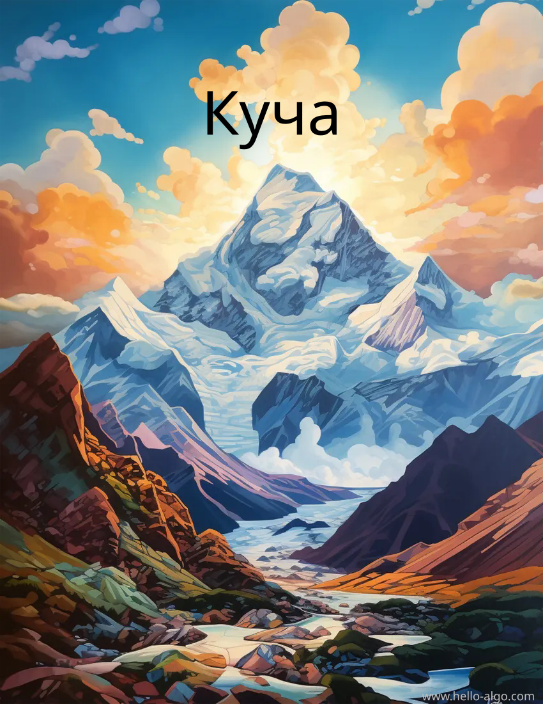

# Глава 8. &nbsp; Кучи

{ class="cover-image" }

!!! abstract

    Кучи похожи на горные хребты, где склоны поднимаются уступами и каждая вершина имеет свои очертания.
    
    Пики высятся на разной высоте, но прежде всего взгляд находит самую высокую вершину.

## Содержание главы

- [8.1 &nbsp; Куча](heap.md)
- [8.2 &nbsp; Построение кучи](build_heap.md)
- [8.3 &nbsp; Задача о k наибольших элементах](top_k.md)
- [8.4 &nbsp; Итоги](summary.md)
- [8.5 &nbsp; Упражнения](exercises.md)
